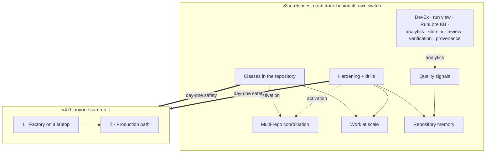

# v4: anyone can run it, and the v3.x releases before it

**Date:** 2026-10-31 · **Status:** roadmap approved by the owner 2026-10-31 (decisions
[V1 to V6](#owner-decisions-2026-10-31)); amended 2026-11-05 ([V7](#owner-decisions-2026-11-05));
**restructured 2026-11-06** ([V8 to V20](#owner-decisions-2026-11-06)): v4.0 is the laptop loop and
the production path, and everything that ships before it is a [v3.x track](#v3x) on the released
platform. Designs written earlier use the old numbers; [the mapping](#renumbering) names each one's
track. Each track gets its own design before it is built · **Follows:** the
[v3 roadmap](2026-10-19-v3-roadmap-design.md), released as v3.0.0 on 2026-10-31 · **Candidates:** issue
[#280](https://github.com/Smana/ai-native-ref/issues/280) and the
[v4 landscape research](2026-10-31-v4-landscape-research.md)

## Outcome

v3 made the factory land more accepted pull requests per dollar, on the reference host. v4 makes it
**run for anyone, outside the reference host**:

1. **On a laptop:** a platform engineer runs the whole factory loop on kind in about 30 minutes,
   from the docs alone. The loop is: label an issue, watch the room, get a reviewed pull request,
   see the merge gate decide.
2. **In production:** a platform team installs it on its own cluster and plugs in its own identity
   provider, secrets store, GitOps tool and gateway.

Today neither holds:
- Maku's [kind quickstart](https://github.com/Smana/maku/blob/main/docs/quickstart.md) runs one
  attended run in a room. It has no factory loop, gateway, budgets or short-lived credentials.
- The full platform needs cloud-native-ref's [host contract](../../../HOST-CONTRACT.md).
- v3 deferred "install on any Kubernetes" ([Later](2026-10-19-v3-roadmap-design.md#later)). v4 takes
  it up with the shape v3 sketched: a core profile any cluster can run, with cloud-native-ref as the
  reference profile, the one proven live.

The other capabilities the owner selected ship before it, as [v3.x tracks](#v3x), each behind its own
switch ([V8](#owner-decisions-2026-11-06)).

## Owner decisions, 2026-10-31 {#owner-decisions-2026-10-31}

| # | Decision |
|---|---|
| V1 | **v4's outcome is "anyone can run it"**, chosen over "less human time per merge", "from one issue to fleets" and "trust you can prove". It decides priority when items compete |
| V2 | **Both stages, in order.** First the laptop: the full loop on kind in about 30 minutes. Then the production path: an adopter's own cluster, with bring-your-own identity provider, secrets, GitOps and gateway |
| V3 | **v4.0 is a core, the rest v4.x increments.** v4.0 holds the reach items plus what an outside adopter needs on day one: classes declared in their repositories, untrusted-input hardening (their issues come from strangers) and outcome analytics (to see value). Every other pick ships as an increment, each behind its own switch, in dependency order |
| V4 | **The selection.** From #280: customizable merge classes, the animated run view, Gemini, the Kubernetes-from-scratch setup, developer experience. From the research: the items in [the increments](#increments). Not selected: [below](#not-in-v4) |
| V5 | **Repository memory reopens, as reviewed code.** v3 kept memory out and named its reopening: "entries agents propose and humans merge". v4.6 builds exactly that, after the repeat-defect signal of v4.3 exists |
| V6 | **Approving from Slack is in.** v3 kept approval in the rooms web UI ([status](../../../website/content/docs/status.md#later)). #280 item 5, which the owner wrote and selected, reverses it. The Slack push-approval design sets its limits |

## Owner decisions, 2026-11-05 {#owner-decisions-2026-11-05}

| # | Decision |
|---|---|
| V7 | **Developer Experience ships as a [v3.x line](2026-11-05-v3x-devex-roadmap-design.md) on the released v3 platform, and multi-repository coordination becomes a v4.0 target.** The conversational intake, the unified attention and resume, the Slack proposals and the Slack `forge.push` approval are increments on v3.0.0, each behind its own switch, with a bounded fast-follow pack. Multi-repository coordination leaves v4.4 and joins the core as item 9: its [design](2026-11-05-v4-multi-repo-coordination-design.md) and its switched-off implementation may proceed, but **activation and live proof wait for items 3 and 4**. Fleet campaigns stay in v4.4. V4 and V6 are unchanged in substance; what changes is where the work lands and when it may be turned on. The [architecture review](../reviews/2026-11-05-v4-devex-architecture-review.md) records why |

## Owner decisions, 2026-11-06 {#owner-decisions-2026-11-06}

| # | Decision |
|---|---|
| V8 | **Everything that ships before v4.0 is a v3.x release; v4.0 is the answer to "anyone can run it".** v4.0 holds the laptop loop and the production path. Two v3.x tracks must have shipped before it is cut, because an outside adopter's issues come from strangers: **merge classes declared in the repository** and **untrusted-input hardening**. Outcome analytics no longer gates v4.0. Every other item, including the old v4.1 to v4.6 increments, becomes a v3.x track ([below](#v3x)). Supersedes V3 and the placement in V7; the selection in V4 is unchanged |
| V9 | **"Anyone" is a platform engineer:** fluent in Kubernetes, Helm, GitOps and GitHub Apps, new to Maku and to agents. The docs assume that fluency |
| V10 | **Both stages are required for v4.0**, the laptop and the production path, as in V2 |
| V11 | **The production proof runs on a generic cluster (k3s or kubeadm)**, which has no cloud identity to lean on, so every bring-your-own seam has to be real |
| V12 | **The laptop's merge gate is a built-in check:** Maku's gate reports its own commit status, in shadow by default. policy-bot stays the production path's reference implementation |
| V13 | **The laptop authenticates with a GitHub App, created by a setup helper** from a manifest. It keeps the bot identity and short-lived tokens of production |
| V14 | **The laptop runs on any OpenAI-compatible endpoint**, one base URL and one key, with one worked example. agentgateway is optional on the laptop. Public work stays off Claude |
| V15 | **Bring-your-own seams in v4.0:** the identity provider (OIDC), the secrets store and the GitOps tool. agentgateway is a required, shipped piece, because budgets, tiers and metering depend on it |
| V16 | **Public repositories are in the go test; private repositories are documented**, with the adopter's own model choice, and are not part of v4.0's proof |
| V17 | **From v4.0, chart values and the install contract follow semver.** A breaking change waits for a major release or ships with a migration note. A nightly job upgrades the previous release on kind. No support SLA |
| V18 | **The production path installs from one umbrella Helm chart**, so Flux and Argo CD both consume it natively. cloud-native-ref becomes one set of values |
| V19 | **gVisor is required in production.** On the laptop it is used when present; otherwise the run uses runc behind a visible "not isolated" banner |
| V20 | **v4.0's go test adds one person other than the owner,** who completes the laptop quickstart from the docs and files a friction log |

## Why these features

**What the field says** ([research](2026-10-31-v4-landscape-research.md)):

| Question | Finding |
|---|---|
| Is self-hosting still a differentiator? | It is narrowing. Cursor, Claude, Amp, Devin (Outposts) and Factory now run on customer machines. What is still ours: class-based autonomous merging with shadow mode, caps and a regression breaker; a test-first tester; model routing by data class at a gateway; an open-source GitOps control plane. Adoption needs these to be reachable outside the reference host |
| Where is the bottleneck for adopters? | Review and verification, not code generation. Agent PRs wait 17.6 h for a first review against 3.4 h, and merge 32.7% of the time against 84.4% (LinearB 2026, 8.1M PRs). Spotify: "PR review is" the bottleneck. These drive v4.1 and v4.2 |
| What do adopters build first? | Sandboxed per-run environments, verification before review, triggers from where work starts, fleet migrations, governed tool access (Spotify, Stripe, Ramp, Uber, Monzo, 2025–2026) |
| What do competitors ship that we lack? | Scheduled and event-triggered tasks (7 products), per-repo environment snapshots, multi-repo tasks, memory (6 products; GitHub reports 90% vs 83% merge rate with Copilot Memory), PR continuation including merge conflicts |
| Where is security heading? | Adaptive injection attacks beat 12 published defences more than 90% of the time ("The Attacker Moves Second", Nov 2025). OWASP's GenAI red-teaming manual (2026-10-20) and the CISA/Five Eyes guidance (2026-05-01) call for regular assessment. gh-aw's safe outputs, threat detection and author-trust filtering are the reference |

## v4.0: anyone can run it {#v4-0}

v4.0 is cut when both stages pass their go test ([below](#how-v4-is-judged)) and the two day-one safety
tracks have shipped as v3.x releases ([V8](#owner-decisions-2026-11-06)). Whatever else has shipped by
then is in v4.0 too; whatever has not continues as v4.x.

| Stage | Outcome | Decided ([V8 to V20](#owner-decisions-2026-11-06)) | Built on | Design lives in |
|---|---|---|---|---|
| **1 · The factory on a laptop** | The kind quickstart grows from one attended run to the full loop: a sample repository, the factory and reviewer on one model key, the merge gate in shadow by default. A nightly kind job proves it end to end | Built-in gate check, not policy-bot (V12). A GitHub App created by a setup helper, not a PAT (V13). Any OpenAI-compatible endpoint (V14). gVisor when present, otherwise runc behind a visible "not isolated" banner (V19) | Maku quickstart and portable runtime (Maku designs 3a/3b) | Maku |
| **2 · The production path** | The host contract split into *required* and *bring-your-own* pieces, each with a reference implementation and a stated seam. One install on a generic cluster from the docs alone, with a smoke test | Proven on k3s or kubeadm (V11). Bring your own identity provider (OIDC), secrets store and GitOps tool; agentgateway ships as a required piece (V15). One umbrella Helm chart (V18). gVisor required (V19). Semver on chart values and the install contract, with an upgrade test (V17). Public repositories in the go test; private ones documented (V16) | [`HOST-CONTRACT.md`](../../../HOST-CONTRACT.md), v3's [install sketch](2026-10-19-v3-roadmap-design.md#later) | ai-native-ref, with Maku |

1 comes before 2: the laptop loop is the core profile that the production path extends.

## v3.x: what ships before v4.0 {#v3x}

Every other item is a **track** that ships as v3.x releases on the released v3 platform, each behind
its own switch ([V8](#owner-decisions-2026-11-06)). A track ships increment by increment: offline
proofs, a Maku release, the pin here with the switch off, a live proof, then the switch-on change. A
v3.x minor release carries whichever increments have passed their live proof.

| Track | Outcome | Needs first | Design | Gates v4.0 |
|---|---|---|---|---|
| **Merge classes declared in the repository** (#280 item 1) | A class is declared once, in the adopter's repository, against a schema. Maku's gate and the policy-bot rule are generated from it. Presets. Promotion from shadow by replay. The platform sets the ceiling a repository may relax | — | [merge policy self-service](https://github.com/Smana/ai-native-ref/blob/81384f71807411282615089330d3d7b38bc67e4a/docs/superpowers/specs/2026-11-04-merge-policy-self-service-design.md), [merge gate classes](2026-10-22-merge-gate-classes-design.md), the [human path](2026-10-29-merge-gate-human-path-design.md) | **Yes** |
| **Untrusted-input hardening** | The agent writes only through validated outputs. Input is filtered by author trust, outputs pass a threat check before they apply, and protected files (CI config, `AGENTS.md`, manifests) stay out of reach. **Injection red-team drills** against every role prove it, run like the merge-gate drills | — | to write; gh-aw's safe outputs and the [Model Armor research](2026-11-04-model-armor-oss-equivalents-research.md) as inputs | **Yes** |
| **Developer experience** (#280 item 5) | Say what you want and confirm a plan; one list of what needs you, and a brief on return; one Slack proposal message; approving a push from Slack; a fast-follow pack | — | [v3.x DevEx roadmap](2026-11-05-v3x-devex-roadmap-design.md) | No |
| **The animated run view** (#280 item 2) | A run's page builds its diagram as each role starts, and replays when finished. A **run timeline** (every tool call, check, decision and cost, from the room log) and a **diff between two runs** of the same task | — | [Maku's animated run view](https://github.com/Smana/maku/blob/main/docs/superpowers/specs/2026-11-03-animated-run-view-design.md) | No |
| **RunLore's knowledge base** | RunLore's knowledge base is filled by the factory, and its entries merge through a curated queue | Its phases 3 and 4 need hardening | [RunLore's knowledge base](2026-11-03-runlore-kb-from-the-factory-design.md) | No |
| **Outcome analytics** | Merge rate, revert rate, time to merge, rework and cost per merged PR, by class, model, role and repository, on a dashboard and in a weekly report | — | to write; built on v3's outcome metrics and spend per identity | No |
| **Gemini** (#280 item 3) | Gemini as a selectable provider, public data only, added the way Kimi and Mistral were | — | [providers design](2026-10-28-moonshot-mistral-providers-design.md) | No |
| **Multi-repository coordination** | One confirmed change across two public repositories: a parent issue that records and explains the change and never writes code, one ordinary task per repository, a landed artifact as the dependency, a read-only integration check. **Design and switched-off build may proceed; activation waits for classes and hardening** | Classes, hardening (activation only) | [multi-repository design](2026-11-05-v4-multi-repo-coordination-design.md) | No |
| **Review capacity** | A **review inbox and routing**: one queue of agent PRs waiting on a human, ranked by risk, class and age, routed to owners, stale ones closed. A **plan approval gate** per class | — | to write | No |
| **Verification** | **Pre-PR verification on real services** (ephemeral services, scoped test credentials, a preview, screenshots). The **PR continuation loop**: the factory drives its own PR to the merge | — | to write | No |
| **Quality signals** | **Judge and reviewer calibration** against recorded outcomes. **Reviewer severity and resolution**, with rarely-acted-on rules muted | Analytics | to write | No |
| **Work at scale** | **Event triggers and schedules** (main's CI red, security alerts, cron). **Fleet campaigns**: one change across N repositories, with a progress view | Classes, hardening | to write | No |
| **Signed provenance** | An attestation per commit naming its run, model, prompt hash, policy and checks | — | v3's [run provenance](2026-10-22-run-provenance-design.md) | No |
| **Repository memory as reviewed code** | Agents propose what they learned as small PRs to `AGENTS.md` or skills files, reviewed like code. No hidden state ([V5](#owner-decisions-2026-10-31)) | Hardening (the write path), quality signals (the repeat-defect signal) | to write | No |

Design input carried from the [dsh-superagent evaluation](2026-11-04-dsh-superagent-evaluation-research.md):
for review capacity, task stages named by who the task waits for. For verification, thread
subscriptions where humans resume and bots only inform, and a mandate revalidated before a resume.
For work at scale, an observe mode that records what a proactive rule would have accepted before it
may act.

### Earlier numbering {#renumbering}

Designs written before [V8](#owner-decisions-2026-11-06) use the old numbers. They map as follows:

| Old name | Now |
|---|---|
| v4.0 item 1, item 2 | v4.0 stages 1 and 2 |
| v4.0 item 3 | [Merge classes declared in the repository](#t-classes) |
| v4.0 item 4 | [Untrusted-input hardening](#t-hardening) |
| v4.0 item 5 | [Outcome analytics](#t-analytics) |
| v4.0 item 6 | [Gemini](#t-gemini) |
| v4.0 item 7 | [Developer experience](#t-devex) |
| v4.0 item 8 | [The animated run view](#t-run-view) |
| v4.0 item 9 | [Multi-repository coordination](#t-multi-repo) |
| v4.1 | [Review capacity](#t-review) |
| v4.2 | [Verification](#t-verification) |
| v4.3 | [Quality signals](#t-quality) |
| v4.4 | [Work at scale](#t-scale) |
| v4.5 | [Signed provenance](#t-provenance) |
| v4.6 | [Repository memory](#t-memory) |

## Order of work {#order-of-work}

- **v4.0's critical path** is the laptop, the production path, classes and hardening. They may run
  side by side: the laptop loop shows the gate and the hardening, and needs neither to start.
- **Other tracks** run beside it in the order the owner picks. A track moves earlier only when what it
  needs has shipped (the table's "Needs first" column).
- **As in v3:** offline proofs first, then live sessions in batches, then a go/no-go per increment on
  live evidence.

## How v4 is judged {#how-v4-is-judged}

| Item | Go when |
|---|---|
| v4.0 laptop (1) | A nightly kind job takes a labelled issue to a reviewed PR and a gate decision. A fresh agent with no context, given only the quickstart page, reaches the same end. The quickstart takes 30 minutes or less on the reference laptop. **One person other than the owner** completes it from the docs and files a friction log (V20) |
| v4.0 production (2) | One install on a k3s or kubeadm cluster passes the smoke test from the docs alone. Each bring-your-own seam is named, with what is lost when it is not filled. A nightly job upgrades the previous release's install on kind (V17) |
| v4.0 safety | The classes and hardening tracks have shipped, each on its own go/no-go (V8) |
| Every v3.x track | Its own design's go/no-go, on offline proofs and then live evidence |

The outcome metrics of v3 ([How v3 is judged](2026-10-19-v3-roadmap-design.md#how-v3-is-judged))
stay. The outcome analytics track reports them.

## Not on the road to v4 {#not-in-v4}

**Considered in the research and not selected (2026-10-31):**
- audit export and compliance evidence;
- pre-call budget reservation;
- SLO-driven auto-revert;
- best-of-N attempts;
- playbooks;
- repository-declared environments;
- multi-team tenancy;
- a release-gating regression eval;
- a rule for new dependencies and sources;
- an egress denial view;
- Jira and Linear intake;
- the warm pool.

**Still out, for v3's reasons** ([Not in v3](2026-10-19-v3-roadmap-design.md#not-in-v3)):
- public work on Claude;
- a doc-writer agent;
- a standalone architect agent;
- parallel writers on one branch;
- per-step model switching.

## Maintenance the research found

These are not features. Each one is a small change of its own:

| Finding | Action |
|---|---|
| The [alternatives page](../../../website/content/docs/how-it-works/alternatives.md) is stale on Substrate (per-agent JWT closed 2026-10-22; v1.0.0-rc.1 adds micro-VMs, moves to DCO), kagent (v1.0.0-rc1: owned-resource RBAC) and ax (a Claude Code example; #376 and #363 still open) | Re-check and update the rows |
| agent-sandbox is pinned at v1.0.5; v1.0.9 is current, and v1.0.7 adds warm members behind Kueue gates | Bump, with its release notes read |
| SWE-bench Verified is retired (OpenAI, 2026-02-23) | The [eval bench design](2026-10-22-eval-bench-design.md) names SWE-bench Pro, SWE-rebench or Terminal-Bench 2.0 as its public anchor |
| Daytona went private (June 2026); Google's Jules closes on 2026-12-31 | Remove them where the docs cite them as options |

## Open questions

These are for the stage and track designs, not this roadmap:

1. **Closed 2026-11-06:** the laptop gate (V12), laptop credentials (V13) and the production proof's
   cluster (V11).
2. **Environments (verification):** does pre-PR verification on real services need the
   repository-declared environments that were not selected? Decided in the verification track's design.
3. **Slack approval (DevEx): closed 2026-11-05.** The [Slack push-approval
   design](2026-11-05-v3x-slack-push-approval-design.md) answers it: Slack decides `forge.push` and
   nothing else; the binding is the run's branch, deliberately not a commit, because no reliable pushed
   commit exists before the push and the owner accepted that; and merging stays a review of the current
   head on GitHub. What that design leaves out — other classes, reason text, merging from Slack — is out
   of scope, not undecided. The question the DevEx track still owns is which capabilities each coding
   agent declares.
4. **Tool results (hardening):** the hardening track filters strangers' text. MCP tool results (logs,
   metrics, docs the agent reads back) are a second injection vector, and agentgateway can screen them
   on `tools/call` responses. In scope, and at the gateway? The
   [Model Armor research](2026-11-04-model-armor-oss-equivalents-research.md) lays out the hooks and the
   order.
5. **The laptop without gVisor (stage 1):** what exactly the "not isolated" banner restricts beyond
   warning: for example, refusing repositories that are not public, or refusing a model key with
   wide scope. Decided in stage 1's design.
