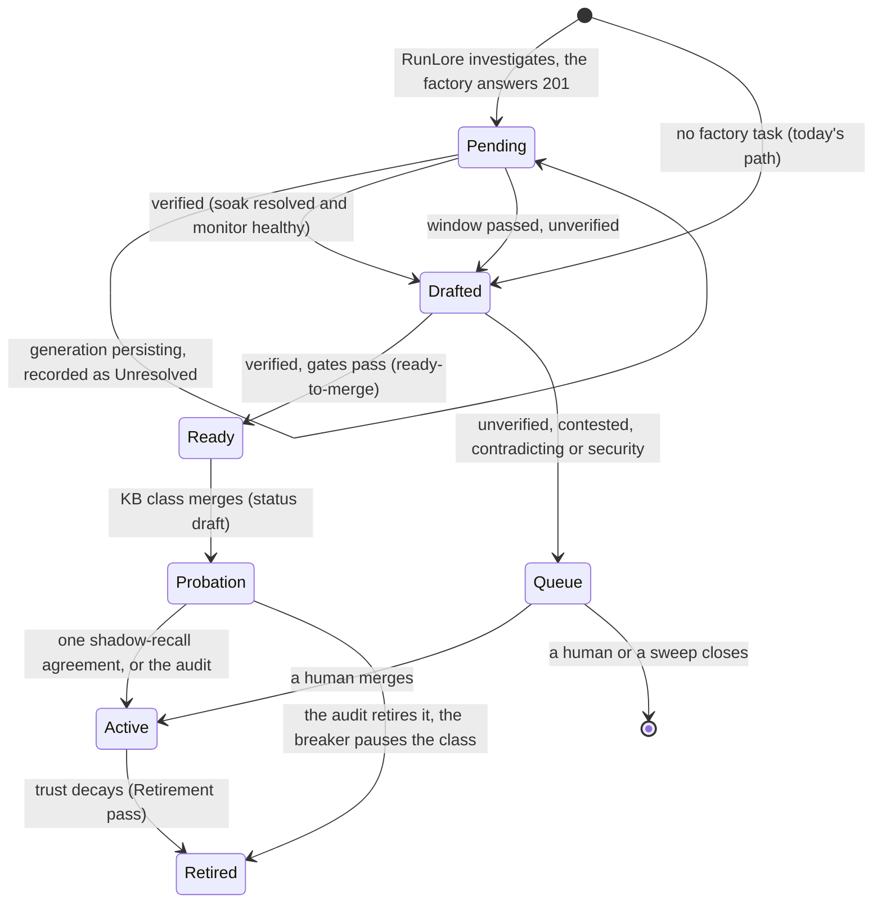
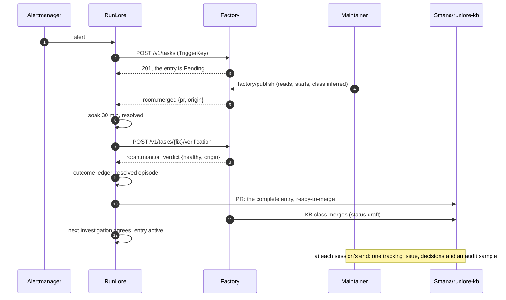

# RunLore's knowledge base, filled by the agent factory

**Date:** 2026-11-03 · **Status:** design agreed with the owner 2026-11-03, decision by decision
([below](#owner-decisions-2026-11-03)); phase 1 is being built, its live session is [runbook 25](../../runbooks/agent-factory/25-runlore-kb-phase-1.md); not yet on the
[v4 roadmap](2026-10-31-v4-roadmap-design.md) · **Builds on:** feature 14,
[RunLore agent to agent](2026-10-27-runlore-agent-to-agent-design.md) (RA1 to RA14). **Touches:**
v4.0 item 4 (untrusted-input hardening), v4.0 item 5 (outcome analytics), v4.6 (repository memory)

Read against RunLore `origin/main` at `b730f1c` (`RL/`), Maku `origin/main` at `2816bce`
(`MK/`), cloud-native-ref `origin/main` at `3f5a133c` (`CNR/`), this repository at `028bf6a`, and
`Smana/runlore-kb` on GitHub on 2026-11-03.

## Outcome

RunLore's knowledge base fills itself from the factory's work, and a human reviews it once per demo session
instead of once per entry. An incident the factory fixes becomes one complete entry, written after
the fix is proven: symptom, cause, the fix PR and the verdict. The factory's merge gate merges it
when the evidence holds. Everything else waits in one queue, reviewed at each session's end. Later, any factory agent
proposes the operational lessons it learned, and every agent reads the entries for what its task
touches before it starts. The measure is three numbers together: fewer human touches per incident,
more merged entries, and entries that recall and resolve.

## What exists

| Piece | Today | Where |
|---|---|---|
| The knowledge base has stalled | 54 PRs open (the oldest from 2026-08-02), 19 merged ever (the last 2026-08-20), 51 closed unmerged. The showcase's seven entries, #157 to #163, are open; their fixes merged (CNR #2638, #2659) | `gh pr list -R Smana/runlore-kb` |
| The human merge is by design | D1: "Human stays the merge approver". D6: the curator "never auto-merges". Auto-merge of any kind is out of scope. RunLore has no merge call | `RL/dev/superpowers/specs/2026-06-21-runlore-learning-curation-workflow-design.md` §2 and §8; `RL/website/content/docs/concepts/learning-loop.md:17-18` |
| Noise | A 6-day pilot drafted 29 PRs; about 72% were closed as not worth keeping: churn, canaries, near-duplicates | `RL/website/content/docs/concepts/reviewing-knowledge.md:141-165` |
| The curator | Gate: verified, confidence ≥ 0.75, evidence, a change or a suggested action. Dedup: catalog fingerprint, an optional decider, BM25 `dup_score`, coalescing onto an open PR. It drafts **at investigation time**; `## Resolution` is the model's suggestion | `RL/internal/curator/curator.go:81-247`, `RL/internal/curator/draft.go:60-79` |
| The decision-ready queue | Only a `ready-to-merge` label, set by the Queue pass on PRs a human labelled `solved` once a ledger episode resolved. No review surface | `RL/internal/curate/resolution.go:21-55` |
| Trust | `factor = (resolved+up+0.5·confirms+k/2)/(recalls+up+down+0.5·confirms+k)`; recall's gate 3 refuses below 0.5. Only recall opens credit an entry; a new entry has no history | `RL/internal/outcome/ledger.go:1345-1395`, `RL/internal/investigate/recall.go:753-757` |
| Draft status | Recall skips `status: draft` and `retired`; `kb_search` still returns them | `RL/internal/investigate/recall.go:491-495` |
| The factory loop is one way | RunLore's soak verdict lives in its factory ledger (`factory.jsonl`) and never reaches the outcome ledger, the entry or its labels. The post-merge re-investigation drafts nothing. The factory's monitor verdict never reaches RunLore: webhook payloads are ids only | `RL/internal/factory/ledger.go:35-55`, `RL/internal/app/curator.go:156-197`, `MK/internal/webhook/webhook.go:32-45` |
| No write path for agents | RunLore's MCP server is read-only; Slack thread capture drops bot messages; an agent's only way in is a PR on the KB repository by hand, which skips the fingerprint and the sweeps | `RL/internal/kbmcp/kbmcp.go:3-7`, `RL/internal/server/server.go:768-770` |
| No read path for factory agents | `kb_search` and `kb_get` are served by `lore mcp` over stdio only. A factory role reaches MCP servers through the agent router, as StreamableHTTP targets its capability profile lists | `RL/internal/kbmcp/kbmcp.go:3-7`, `RL/internal/app/mcp.go:110`; `infrastructure/base/agent-gateway/mcp.yaml:48-53`, `infrastructure/base/agent-gateway/profiles/triager.internal.yaml` |
| Entry types | A closed list: `Incident`, `Playbook`, `Concept`. Unknown frontmatter keys are ignored, so new fields need no validator change | `RL/internal/kbvalidate/kbvalidate.go:60`, `RL/internal/catalog/load.go:77` |
| The merge gate | Per class `live` or `shadow` and `maxPerDay`, under the repository's `merge.autoMergesPerDay`; the breaker. Adopted classes need `modifyOnly` and a semver diff shape | `MK/docs/factory.md:724-761, 927` |
| The showcase's human steps | Per incident: label the stub `factory/publish`, label the fix `class:alert-rules`, label it `factory/ready`, merge the fix, and (never done) merge the KB PR. A forgotten class label makes the class `review`, and RunLore's verdict is refused `not_own_task` | [Runbook 20](../../runbooks/agent-factory/20-runlore-agent-to-agent.md); `tooling/base/agent-factory/helm-values-configmap.yaml:281` |
| Where RunLore runs | Neither cluster: aws-0 keeps it commented out, gcp-0 is torn down. The `runlore` internal principal is declared on gcp-0 only | `CNR/observability/aws-0/kustomization.yaml:17-20`, `tooling/gcp-0/agent-factory/helm-values-sponsored.yaml:43-53` |
| The factory's own memory plan | v4.6: agents propose what they learned as PRs to `AGENTS.md` or skills (V5, "no hidden state"), after v4.0 item 4's write path | [v4 roadmap](2026-10-31-v4-roadmap-design.md) V5 and v4.6 |
| R38 | An internal-origin task never feeds an implementer run on a public repository. RunLore's findings are internal (R33) | [dark-factory plan](../plans/2026-09-27-agent-dark-factory-plan.md) R33, R38 |

## Decisions

| # | Decision | Rejected | Why |
|---|---|---|---|
| RK1 | **The measure is three numbers together**: human touches per incident, merged entries per session, and entries that compound (instant recalls, their resolve rate, tokens per incident) | One of them alone; the showcase's polish | Entries alone is a vanity count, the dedup exists for it. Touches alone is met by merging nothing. Compounding is the point: a recall costs about 7% of an investigation |
| RK2 | **RunLore's features are generic.** Each is a RunLore contract any producer can use; the factory is the reference client, through its config here and its events in Maku | Features shaped around the factory's labels and classes | RunLore is open source with adopters. Its factory client (`RL/internal/factory`) already calls the factory's public API, not a private hook |
| RK3 | **RunLore still only drafts (D6 holds). Machine evidence sets `ready-to-merge`; the factory's merge gate merges through a new class on `Smana/runlore-kb`.** D1 becomes: a human owns the policy and audits, and decides every entry the evidence does not cover | (a) An auto-merge rung in RunLore; (c) a human merges everything, batched | (a) reverses D6, and the curator is a fallible model. The merge gate already has shadow mode, caps and a breaker, and any adopter's merge automation can act on the same label. (c) alone does not end the stall |
| RK4 | **The human's queue is one tracking issue** on `Smana/runlore-kb`, rewritten by `lore curate` at each session's end: the entries that need a decision, riskiest first, each with its evidence and PR link; an audit sample of the KB-class merges since the last rewrite, max(3, 20%); the session's measures (RK1). One Slack line links it. Each entry keeps its own PR | One bundled digest PR; the factory's room page; a Slack digest; a weekly schedule | One PR per entry keeps merge and close one click each and keeps the sweeps working. The issue is the one place to look. RunLore runs only in sessions (RK15), so a schedule would mostly fire with nothing new |
| RK5 | **For an incident the factory takes, the entry is drafted once, after verification**: RunLore's soak `resolved` **and** the factory's monitor `healthy`. A `persisting` generation becomes `## Unresolved` (the fix that did not hold); a later verified generation of the same `TriggerKey` completes the entry. That generation comes from RunLore's next detection of the still-firing alert (RA12 as built); the factory's follow-up issue stays a notice. No verified outcome within the window: today's path, into the queue. A factory answer other than `201` or `200`: today's path at once | Draft at investigation time and append later | One complete PR per incident instead of an incomplete one and an edit. The evidence must be captured before it goes: Task CRs are not in Git, rooms are purged 90 days after they close |
| RK6 | **The verdict is an outcome-ledger observation.** `resolved` plus `healthy` is a resolved episode on the entry's fingerprint, weighted as an Alertmanager resolve; `persisting`, a monitor `regression` or `room.reverted` is a failure | Leaving the factory ledger apart (`RL` plan R4) | It is the same signal a resolve webhook gives, observed more carefully. Without it, the entries the factory fixes earn no trust |
| RK7 | **An auto-merged entry lands `status: draft`** and becomes `active` after one shadow-recall agreement: an investigation ran, the draft would have passed recall's gates, and its cause agrees with the fresh root cause. The queue can promote or retire any draft | Two agreements; the human audit only; 30 days without a contradiction | A draft cannot serve an instant recall, so a wrong one costs nothing until it agrees with an independent investigation, which runs anyway. Most patterns do not recur within a month: age proves nothing. Two agreements would keep most entries out of recall for months |
| RK8 | **The knowledge base takes any operational lesson**, incident or not, in three new types the validator learns, `Decision`, `Procedure`, `Gotcha`. A lesson is proposed only when the code and Git history do not record it; at most 3 per run. It auto-merges only when its task's outcome confirmed it (merged, and verified where the class verifies). **Instant recall fires only on `Incident`** | Incidents only; anything an agent found notable | The owner's choice: the factory's agents learn more than incidents teach. The bar keeps diff summaries out and the queue small. A lesson never matches an incident, so it must never answer one |
| RK9 | **The agent that learned a lesson proposes it; RunLore's curator decides** (fingerprint, dedup, format, trust) | RunLore mining the factory's diffs and logs; a librarian role | The agent knows what surprised it, a diff does not. One curator holds one bar for every writer, `kb-steward` included |
| RK10 | **A lesson is a validated run output** (v4.0 item 4's write path). When the task reaches its terminal outcome, the factory sends the lessons, the outcome and the entries the run cited to an authenticated RunLore endpoint, through the curator's gates | An MCP write tool called mid-task; agents opening KB PRs | The outcome RK8 needs exists only at the end. A mid-task write into shared memory is what v4.0's hardening forbids. Direct PRs skip dedup and the sweeps |
| RK11 | **A lesson auto-merges only if every input of its task passed v4.0's author-trust filter.** Any other lesson goes to the queue. Every entry records its origin (task, role, model); every reader receives entries as quoted data | Auto-merge on a verified outcome alone; never auto-merge a lesson | A lesson written under injected text becomes an instruction every later agent reads (RK12). The v4 research names agentjacking on RunLore's alert path |
| RK12 | **Factory agents read the knowledge base before they work**, scoped to the repository, paths and resources the task touches, and report the entries they cited. A cited entry's task outcome is its trust signal: a lesson's recall | RunLore the only reader | A lesson nobody reads compounds nothing. Citations are the only signal an entry that never matches an incident can earn |
| RK13 | **The knowledge base is public text.** `Smana/runlore-kb` is a public repository: every entry is published, and secret redaction at each tool output is the boundary (`RL/internal/investigate/loop.go:1248`). Every factory role may read every entry. R33 and R38 keep covering the raw finding inside the factory | A data class per entry, `internal` by default; a private KB repository | A data class protects nothing the repository already shows. A private repository would hide the reference's own learning loop |
| RK14 | **Split by subject.** How to work in a repository (conventions, build and test traps) goes to `AGENTS.md` or skills through v4.6, loaded every run; how the running platform behaves (component gotchas, procedures, incidents and fixes) goes to RunLore, retrieved by resource. One proposal format; the factory routes | RunLore holds everything; two independent memories | `AGENTS.md` loads every run and must stay short; RunLore retrieves by workload and resource. Both are reviewed in Git, so V5's "no hidden state" holds |
| RK15 | **The showcase loses two steps.** `factory/publish` stays (the only reader between internal text and a public repository). The fix's class is inferred at publish. For an internal principal's task, `factory/publish` also starts the fix (RA9 amended). The fix's merge stays a maintainer's while `alert-rules` runs in shadow. **RunLore is switched on deliberately**, for a demo session on aws-0, and off after, as runbook 20 had it: the host's line with its Alertmanager route and rules, and aws-0's copy of its broker subscriber, turn on and off together (its internal principal stays declared, inert without RunLore's calls), a session-scoped exception to D4 ("every switch off" outside gcp-0) as runbook 19's `human.mcp.sessionStart` is. One replica on a volume (G8); the volume and its ledgers outlive the switch | Keeping four labels; automating the publish read now; RunLore on all the time; the factory's side declared permanently | A forgotten class label silently breaks the loop and protects nothing. The spend `factory/ready` approves is already capped ($2 a task, $10 a day). Publish carries R38 until v4.0's drills pass. The owner wants RunLore on only on purpose. A subscriber left on while RunLore is off is disabled after three failed deliveries (factory interfaces F6, `RoomWebhookDisabled`) and stays disabled when RunLore returns, so both sides switch together. Uninstalling keeps RunLore's PVCs (`CNR/observability/aws-0/kustomization.yaml:20`). aws-0 is the factory the fence names |
| RK16 | **Incident entries auto-merge only after a threat check on the entry's text** exists, not only lessons | Auto-merging incident entries at once | They quote logs and alert labels, and RK12 makes every agent read them: a crafted log line would become a stored injection |
| RK17 | **The backlog is replayed.** The seven showcase entries are rebuilt complete from what GitHub still holds (the fix PRs, `factory/merged:<class>`, the verdict comments); gcp-0's ledger is gone. The other 47 go through the first queue once, and only then does the stale sweep, in `apply`, close those that never recurred: `stale_after: 0s` until that queue | One `kb-steward` triage by hand; closing all | The seven are the first real test of the outcome join, with known answers. With the chart's `720h`, the first sweep, 6h after start, would close most of the 47 unseen; dry-run is no hold, it also blocks `ready-to-merge` (`RL/internal/app/curate.go:118-130`). `apply` lets the sweeps comment, label and close, nothing more |
| RK18 | **Four phases, each behind a gate** ([Phases and gates](#phases-and-gates)) | One release | Phase 1 alone should restart merging without trusting new machinery; each later phase spends trust the earlier one earned |
| RK19 | **A breaker**: an audit that retires an auto-merged entry as wrong pauses the KB class, as `maxFollowUps` pauses a factory class | Counting wrong entries only in the measures | One wrong recall-grade entry repeats its error on every recall |
| RK20 | **RunLore's model spend is capped in dollars**: `model.pricing` set, so `runlore_investigation_cost_usd` reports it. Measured over its first session on aws-0; then a daily alert at 80% of 1.5 × that session's daily spend, and the provider's monthly limit at 1.5 × the sessions expected in a month as the backstop | Tokens; a dollar figure now; the alert alone; a per-investigation ceiling only | Token prices differ about tenfold between RunLore's models. An investigation is about 79k tokens, a recall about 6k: a session's mix decides the number. RunLore runs only in sessions (RK15), so a month of always-on spend is never measured. An alert warns; only the provider's limit stops spending; a per-investigation ceiling bounds a run, not a busy session |
| RK21 | **These plans live in this repository for now**; RunLore's D1 amendment ([below](#rl-d1-amended)) is ported to RunLore when its first PR is cut | Writing in RunLore now | The owner, 2026-11-03: "write the specs in the same dir as superpowers for now" |

## The life of an entry

Phase 1 stops at `Ready`: a human merges it from the queue. Phase 3 opens the `Probation`
path. A lesson (phase 4) follows the same states without `Pending`, and never recalls.

## The loop, in phase 3

## Interfaces

**`room.monitor_verdict`**, a new broker event on a room whose task has an `origin`: `{type, room,
repo, pr, origin, verdict}`, `verdict` one of `healthy`, `regression`, `inconclusive`. Sent once,
when the post-merge monitor's verdict is final. Ids and a closed code only, like every event. The
fix's room stays open until then: a human merge's room otherwise closes once its facts settle, and
the broker emits only from an open room's log (`MK/internal/factory/reconciler/roomclose.go:26-68`,
`MK/internal/webhook/emitter.go:48-52`).

**RunLore's `factory.curation`**: `{defer: true, window: 7d}`. With `defer`, an investigation the
factory accepted is held per `TriggerKey` in the factory ledger instead of drafted. A verified
generation drafts the complete entry; `window` past the first generation's acceptance (the `201`)
without one drafts today's entry, so an incident nobody publishes still reaches the queue. `window`
must cover a maintainer's publish and merge plus the longest `followUpWindow` of the classes
RunLore's fixes take (`alert-rules`: 2h).

**RunLore's knowledge over HTTP**: the read-only `kb_search` and `kb_get` of `lore mcp`, served as
StreamableHTTP at `/mcp` on RunLore's server, the same handlers. The agent router gains the target
`runlore-kb`; the internal triager's capability profile lists both tools. No token: any caller allowed on RunLore's serve port reaches `/mcp` (the agent router, and the Alertmanager and broker that port already admits), and it is read-only and serves public text (RK13).

**The entry**, in the frontmatter: `origin` (`runlore`, or `agent-factory:<task>`), `resolution:
{fix_pr, merge_sha, verdict, verified_at}` when verified; in the body, `## Resolution` becomes the
applied fix (its PR, its diff summary, the soak's evidence) and the suggestion moves under it.
Phase 3 adds `status: draft` on the KB class's merges.

**`lore kb resolve --pr <n> --fix <url> --merge-sha <sha> --verdict resolved|persisting
[--evidence <file>]`**: records an applied resolution on an entry, on its open PR or through an
entry-edit PR once merged. The deferred path calls the same function; the replay (RK17) calls the
command.

**The tracking issue**, one per KB repository, titled `Knowledge queue`, rewritten by a new
`lore curate` pass (`curate.queue_issue: {schedule, slack: true}`). The schedule is optional, for an
adopter whose RunLore runs all the time; here it is empty and the session's switch-off step runs the
pass once (`lore curate queue-issue`) before RunLore goes off:

| Section | Holds |
|---|---|
| Decide | Every open entry PR not `ready-to-merge`, riskiest first: contested, contradicting an entry, security-tagged, unverified. Each: title, verdict, confidence, the evidence line, the PR link |
| Audit | A random max(3, 20%) of the KB-class merges since the last rewrite. A tick keeps it; a comment `retire` retires it, and RK19's breaker reads it |
| Measures | Merged entries, queue age (median, oldest), instant recalls and their resolve rate, tokens per incident; human touches per incident come from this repository's ops script |

**Publish** (Maku): `api.internalPrincipals[].publishStarts: true` makes `factory/publish`
on the principal's stub both create the fix issue and start its task, charged to the publisher. The
fix's class is inferred from the paths a new `## Files` section of the triager's proposal names,
matched against the `allowedFiles` of each class that is neither adopted nor an oracle class (`deps-patch` and `deps-minor` also allow `observability/`); none or several match: `review`. It is recorded in
`status.published.class` and copied into the fix task's `spec.predictedClass`, not applied as a
label: triage counts a `class:` label only when a maintainer applied it
(`MK/internal/factory/triage/classify.go:148-160`).

**The KB class** (phase 2): `classes.kb-entries` on `Smana/runlore-kb`, a new adopted diff shape:
the shape of a RunLore entry PR, one added file under `incidents/` plus additions-only changes to
`index.md` and `log.md`, from `runlore[bot]` on a `runlore/kb-` branch, labelled `ready-to-merge` by
RunLore. The merge gate runs no command, so the validator is the repository's required `validate`
check (`lore validate-kb`) through `holdoutChecks`. An entry-edit PR (`runlore/<verb>-…`) is not
that shape and stays a human merge. Shadow first; `maxPerDay: 5` (under the repository's `merge.autoMergesPerDay`); the breaker per RK19.

**The lesson endpoint** (phase 4, planned at its gate): `POST /v1/knowledge/proposals` on RunLore,
authenticated as an internal principal. Body: `{task, repository, role, model, outcome, inputs_trusted,
cited: [entry], lessons: [{type, subject, title, body, resources}]}`, `lessons` at most 3,
`subject` `platform` (RunLore files it) or `repository` (refused: the factory routes those to v4.6).

## Phases and gates

| Phase | Ships | The human | Gate to the next |
|---|---|---|---|
| 1. Close the loop | `room.monitor_verdict`; RK5 and RK6; `lore kb resolve`; `ready-to-merge` from verified evidence; the queue issue; RK15; the replay (RK17); the internal triager reads the knowledge base (`/mcp`, the `runlore-kb` target); live 5 of runbook 20 finally run | Merges every entry, from a decision-ready queue | Three sessions in a row whose queue was cleared before the next one; the seven showcase entries merged; live 5 (`persisting`) passed |
| 2. The KB class in shadow | `classes.kb-entries` in shadow; the KB repository adopted (fence file, policy) | The same, read against the shadow record | At least 20 shadow decisions; never a "would merge" on an entry a human closed; the threat check on entry text exists |
| 3. Incident entries live | The class live; `status: draft` and RK7's promotion; the audit section; RK19's breaker | The queue and the audit | v4.0's injection drills pass for every role; the next 20 auto-merged entries with none retired as wrong |
| 4. Lessons | Reads for every role; the lesson endpoint; v4.6's routing; RK11 | Every lesson through the queue until its drills pass | — |

Phases 3 and 4 consume v4.0 item 4's interfaces, which do not exist yet: their plans are written
at their gate. Phases 1 and 2 are planned now.

## Pull requests, in order

| # | Repository | Content | Proof | Depends on |
|---|---|---|---|---|
| 1 | Maku | `room.monitor_verdict`, the origin task's fix room held open for it; `publishStarts`; the proposal's `## Files` and the class inferred from it; a release | Offline 1, 2 | nothing |
| 2 | RunLore (three PRs, 2a to 2c, one release) | `factory.curation` (RK5); the outcome observation (RK6); `lore kb resolve`; the Queue pass on verified evidence; `curate.queue_issue`; `kb_search` and `kb_get` at `/mcp`; the D1 amendment; a release | Offline 3 to 6, 9 | nothing |
| 3 | cloud-native-ref | Pin RunLore; RunLore's session switch on aws-0, off by default: one replica on a volume, its Alertmanager route and rules with it; its ingress from the agent router; `curate.queue_issue`, `curate.sweeps.mode: apply` with `stale_after: 0s`. The `runlore` machine user exists (aws-0 hosts ZITADEL, so the name takes no suffix); the session mirrors its keys to OpenBao | the host's CI | 2 |
| 3b | cloud-native-ref | `stale_after: 720h`, once the first queue issue has listed the backlog | the host's CI | live 4 |
| 3c | cloud-native-ref | RunLore's daily spend alert at 80% of 1.5 × the first session's daily spend (RK20) | the host's CI | the first session |
| 4 | ai-native-ref | Pin Maku and `HOST_REF`; the `runlore` internal principal on aws-0 (`publishStarts`, `verification`) and the broker's subscriber, a session switch off by default; `alert-rules` in shadow with `monitor.verification`; `factory.curation` in RunLore's factory values; the `runlore-kb` target and the internal triager's tools; the measures script; runbook 25 | `task check` | 1, 2, 3 |
| 4a | ai-native-ref, cloud-native-ref | An ai-native-ref release or pre-release, and the host pinning its tag and digest: a merged PR 4 changes nothing on the cluster until then. The release is the owner's decision | the host's CI | 4 |
| — | aws-0 | Phase 1 live session, and the replay (it exercises the entry path and writes no outcome event) | Live 1 to 4 | 4a |
| 5 | Maku | The adopted shape of a RunLore entry PR, with a required label; a release | Offline 7 | 1 |
| 6 | runlore-kb | Adoption: the fence file, the policy, `validate` a required check | the merge gate reads it | phase 1 gate |
| 7 | ai-native-ref | Pin; `classes.kb-entries` in shadow; then an artifact and host pin as in 4a | `task check` | 5, 6 |

## Gate

**Offline proofs**

1. The factory sends `room.monitor_verdict` once per final verdict, only on a room with an origin,
   with a closed code; no text field; an `inconclusive` is sent as such.
2. `publishStarts`: a maintainer's `factory/publish` on an internal principal's stub creates the fix
   issue and starts its task once; a second label starts nothing; a sponsored principal's stub
   still needs `factory/ready`; the class is the one class whose `allowedFiles` admit every path of
   the proposal's `## Files`, `review` with none or several, carried in `status.published.class`.
3. Deferral: a `201` holds the draft; resolved plus healthy drafts one complete entry with the fix
   PR, the merge SHA and the verdict; `persisting` then a verified generation drafts one entry with
   both; the window passed drafts today's entry; a `202`, a `429` or an error drafts at once.
4. The outcome ledger: a verified episode raises the entry's factor as a resolve does; `persisting`,
   `regression` and `room.reverted` lower it; a replayed event counts once.
5. `lore kb resolve` on an open PR appends; on a merged entry opens one edit PR; a second identical
   call changes nothing.
6. The queue issue: one issue, rewritten not duplicated, by `lore curate queue-issue` or its
   schedule; the sections ordered as above; nothing new since the last rewrite says so; the Slack
   line links it.
7. The KB shape admits a RunLore entry PR (one added `incidents/` file, `index.md` and `log.md`
   with additions only) from `runlore[bot]` with `ready-to-merge` and a green `validate`; it refuses
   a modified entry, two added entries, a deletion in a companion file, a path outside those, a red
   `validate`, another author, and a label that `runlore[bot]` did not apply.
8. `task check` is green.
9. `/mcp` lists exactly `kb_search` and `kb_get`, answers them from the catalog as `lore mcp`
   does, and refuses any other method that would write.

**Live proofs** (aws-0)

1. RunLore runs on aws-0 through a restart of its pod without losing a soak; switched off and on
   again, its ledgers and held drafts carry over, and the broker's subscriber is enabled.
2. A seeded incident: one owner label (`factory/publish`) starts a fix whose class is inferred;
   the owner merges it; the soak, `room.monitor_verdict`, and one complete KB PR labelled
   `ready-to-merge`.
3. Runbook 20's live 5: a fix that does not hold, `persisting`, the entry still pending; the
   alert's next notification makes RunLore file the next generation, whose verified fix completes it.
4. The replay: #157 to #163 rebuilt with their fixes; the first queue issue lists the backlog.

## Not in this design

Auto-merge inside RunLore. Cross-incident synthesis into playbooks (D5). A doc-writer role. Lessons
through an MCP write tool. Verifying fixes RunLore did not originate (feature 14's exclusion
stands). A revert on `persisting`. Forges other than GitHub.

## Corrections from the plan reviews, 2026-11-04

The four plans were reviewed against the code before any build. What changes the design above:

| Correction | Why |
|---|---|
| `ready-to-merge` is set by the verification itself, not only by a sweep, and withdrawn when the evidence flips | The first sweep runs 6h after start and a session is shorter. A revert after labelling would otherwise keep the label and hide the entry from Decide |
| A held incident keeps the fingerprint and entry path of its first hold | Both come from model-written text, so they drift between generations: a failed fix's trust would land on an entry that never exists, and a second PR could open |
| `lore curate refresh-entries` rebuilds a conflicting entry PR on the current base, on RunLore's own branches only: commits that GitHub reports as authored by `runlore[bot]`, committed by `web-flow` and verified | Every entry inserts at the same place in `log.md`, so merging one makes the next conflict. A session's queue is therefore cleared while RunLore is on |
| The `security` category is a human-applied label in phase 1 | Nothing writes it by machine, and no signal is specified |

Added from the 2026-11-04 build (the plans now say these in place):

| Correction | Why |
|---|---|
| A re-detection files nothing while the hold's current generation is undecided: a bound fix with no verdict, no outcome, not reverted and no regression. An undrafted hold with no fix room yet files nothing either, until the window. Both release when the fix room ends without a merge and, for an unmerged fix, at the window. A `201` on a hold with no live artifact starts it again | Alertmanager's 1h repeat would otherwise reset the record under a running fix and buy a new triager and stub each hour. RK5's "next generation from RunLore's re-detection" therefore means the first repeat after a generation is decided |
| Refresh's scope is narrow. A pass rebuilds only a PR labelled `ready-to-merge` or with a held latest observation, at most 10 a run, and stops on a 403 or 429. Any other conflicting PR is listed in Decide as `conflict`. `lore curate refresh-entries --pr <n>` rebuilds one a human is about to review. `lore curate queue-issue` reconciles labels, then refreshes, then rewrites | The first merge conflicts about 52 backlog PRs: about 312 writes and 52 CI runs a refresh, past GitHub's rate limit, and each rebuild bumps `updated_at`, which RK17's stale sweep reads. A session of about 5h is shorter than the first sweep's 6h, so a mid-session contest must still withdraw the label |
| `Smana/runlore-kb` gets a real `leak-scan` job in phase 2, and the `kb-entries` class sets `leakScanCheck: leak-scan`, in both merge check lists beside `validate` | The gate reads the leak check by name, and a red one escalates as `secret_scan_red` saying a live credential was found. With `validate` standing in, an invalid entry would say that |
| Maku's inference of a change's class never picks a live class | The file list is the triager's, written from alert text, and must not choose a class that merges by itself |

### Open for phase 3's gate

Phase 2 leaves these as built, failing closed. Phase 3's gate decides each with the owner before a class goes live:

- `label_missing`, `policy_pending` and `not_mergeable` are terminal at the same head. After RunLore's refresh removes the label and pushes, an adopted entry is handed off and re-labelling does not revive it; `policy_pending` when the poller beats policy-bot's re-evaluation, and `not_mergeable` on a `log.md` conflict, end the same way.
- Shadow records a conflicted entry as would-merge, so phase 2's gate reads the would-merge counts knowing they are inflated.
- Inference excludes `alert-rules` once it is live: its fixes then infer `review` until the class has another source.
- The trust factor is 0.4 after two failed fixes and then a verified one (prior `k=2`: `(1+1)/(3+2)`), below recall's 0.5 gate, so a fix verified on the third try still does not earn recall.

## RL D1, amended

To be ported into `RL/dev/superpowers/specs/2026-06-21-runlore-learning-curation-workflow-design.md`
§2 with RunLore's first PR (RK21):

> D1 (amended 2026-11-03): **A human owns the merge policy and decides every entry the evidence
> does not cover.** An entry whose fix merged and whose outcome a machine verified (the alert
> resolved after a soak, the post-merge monitor healthy) may be merged by the adopter's merge
> automation, as `status: draft`, and is audited in the queue. D6 is unchanged: the curator
> never merges.

## Owner decisions 2026-11-03

Agreed in one session, question by question, recommendations taken unless noted: RK1 (all three
measures), RK2, RK3 and RK4 (the owner on the trust bar: "human still needs to be in the loop, but
also there can be many incident to review we need to find the sweet spot"), RK5, RK7, RK8 (the
owner chose any lesson over incidents only), RK9 to RK14, RK15 ("I let you choose the best"),
RK16 to RK18 (this order), RK19 and RK20 (the gates as written), RK21. Later the same day, on the
plans' questions: the spend cap in dollars, with a daily alert and the provider's limit (RK20); the
next generation from RunLore's re-detection (RK5); the knowledge base as public text over a private
repository (RK13); `/mcp` behind network policy only; the plans' own rulings kept. Then: "runlore
should only be enabled on purposes for our demo platform" (RK15), so the queue is rewritten at each
session's end (RK4), the gates count sessions and entries, and the spend cap comes from the first
session (RK20).

## Left to the builder

The Go names. `factory.curation.window` against the classes' `followUpWindow`.
How the risk order breaks ties. The threat check's mechanism (phase 2's gate). The model's rates in `model.pricing`, from the provider's published prices.
