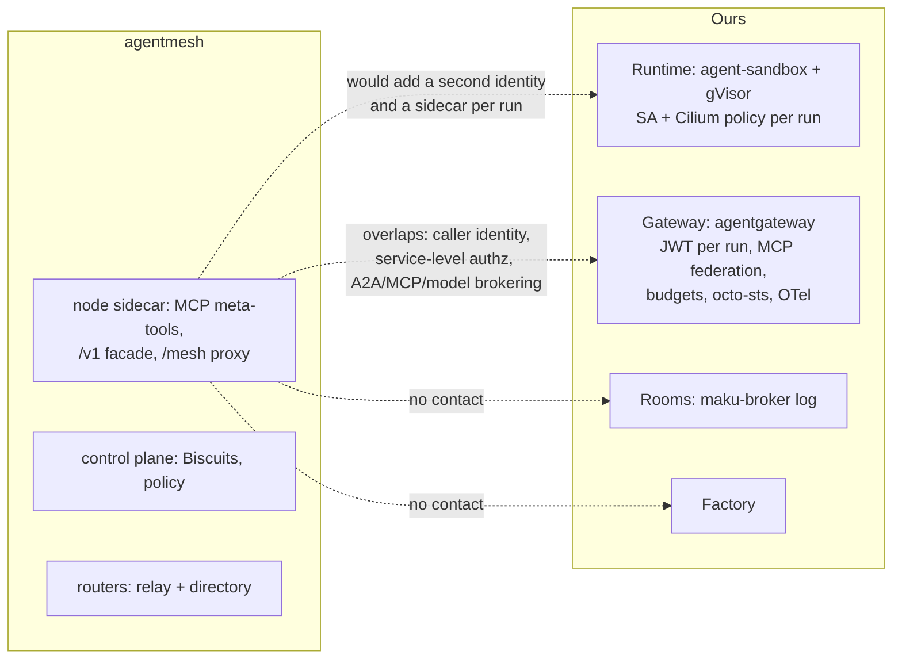

# agentmesh (google): evaluation against the platform's gateway, rooms and runtime

**Date:** 2026-11-04 · **Status:** research · **Verdict:** watch · **Read at:**
[`e4787a0`](https://github.com/google/agentmesh/tree/e4787a050bccf066d481dca40d219888fabb5b84)
(main, 2026-11-03, the day after v0.2.0). Every claim is checked in code or in the docs source at
this commit unless marked **[U]**. Line anchors are given where counted; otherwise the link names
the file and the function or field.

Method note: the repository was read file by file over GitHub at the pinned commit rather than
from a local clone. The Logseq graphs hold no prior note on agentmesh. Context7 has no entry for
google/agentmesh; its matches ("AgentsMesh", "Solace Agent Mesh") are unrelated products.

## Verdict

**Watch, do not adopt.** agentmesh is an open-source (Apache-2.0) private network for agents: a
libp2p overlay with its own control plane, routers and a per-pod node that brokers MCP, model and
A2A calls under a caller identity carried in Biscuit tokens. It solves a problem we do not have,
reaching agents and tools across NATs, laptops, clusters and clouds by service name, and for that it
adds a second identity system, a control plane, a router StatefulSet and a sidecar per workload. On
the controls we care about it is behind agentgateway: policy is one JSON document on an API, not
Kubernetes objects; per-tool allow-lists exist only in caller-appended task blocks, not in standing
roles; there are no token budgets, no OpenTelemetry, no GitHub token exchange; and its own
agent-sandbox blueprint passes the task token *into* the sandbox. The project is pre-1.0 with one
code owner writing three quarters of the commits, "not an officially supported Google product", and
it shipped three critical or high advisories in its alphas. Two ideas are worth borrowing: offline,
sealable narrowing of a run's credential per task, and a data-class floor the caller cannot relax.
Reconsider when runs on one cluster must call agents on another, or when its policy becomes
declarative and its delegation chain revocable.

## 1. What it is

| Aspect | Finding |
|---|---|
| Purpose | "A private network for AI agents." A node beside each agent publishes tools and models, discovers and calls services other nodes publish, and presents a verifiable identity. Closed by default; policy names services (`mcp://x`, `inference://y`, `a2a://z`, `egress://host`), not addresses ([README](https://github.com/google/agentmesh/blob/e4787a050bccf066d481dca40d219888fabb5b84/README.md), [architecture](https://github.com/google/agentmesh/blob/e4787a050bccf066d481dca40d219888fabb5b84/site/content/docs/concepts/architecture.md)) |
| Components | `agentmesh-control-plane` (enrolment, Biscuit issuance, policy; HTTP over SQLite or PostgreSQL; never on the data path), `agentmesh-router` (libp2p relay plus Kademlia directory, state is one key file), `agentmesh-node` (one per host or pod, local API on `127.0.0.1:8080`: an MCP server, an OpenAI-compatible `/v1`, a `/mesh/<peer>/<type>/<name>/` proxy, `/oauth/token`), `agentmesh-one` (all in one binary), an optional console ([cmd/](https://github.com/google/agentmesh/tree/e4787a050bccf066d481dca40d219888fabb5b84/cmd), [main.go](https://github.com/google/agentmesh/blob/e4787a050bccf066d481dca40d219888fabb5b84/cmd/agentmesh-node/main.go)) |
| Transport | Nodes are libp2p peers: QUIC `udp/5001` and TCP `tcp/5002`, every hop TLS 1.3 or Noise, hole punching, relay circuits through routers that see ciphertext only ([networking](https://github.com/google/agentmesh/blob/e4787a050bccf066d481dca40d219888fabb5b84/site/content/docs/concepts/networking.md), [go.mod](https://github.com/google/agentmesh/blob/e4787a050bccf066d481dca40d219888fabb5b84/go.mod): `go-libp2p` v0.51, `go-libp2p-kad-dht`, `go-libp2p-pubsub`) |
| Identity | Ed25519 key per node, peer ID derived from it; enrolment with an OIDC token (a Kubernetes projected SA token, a SPIFFE JWT-SVID, a cloud metadata token, or a human login) or a bootstrap token; the control plane mints a **Biscuit** (Datalog facts, Ed25519-signed, verified offline). Member Biscuit 24 h; Delegated Session Biscuit 1 h, bound to the origin node's channel; holders may append up to 8 narrowing "task" blocks and seal ([identity](https://github.com/google/agentmesh/blob/e4787a050bccf066d481dca40d219888fabb5b84/site/content/docs/concepts/identity.md), [biscuit.go](https://github.com/google/agentmesh/blob/e4787a050bccf066d481dca40d219888fabb5b84/internal/identity/biscuit.go) `MintBiscuitToken`, `MintDelegatedBiscuitToken`, `RequireAuthorityBinding`; [tar.go](https://github.com/google/agentmesh/blob/e4787a050bccf066d481dca40d219888fabb5b84/api/tar.go) `MaxAttenuationBlocks = 8`) |
| Authorization | Enforced at the **callee node**: caller's Biscuit facts plus the mesh policy as Datalog plus task blocks plus the node's local `attenuation`. Roles grant `allowed_services`, `allowed_publish`, `allowed_targets`, `allowed_labels`, `allowed_ingress`, HTTP method and path grants, `custom_datalog`; bindings map roles to `user:`, `email:`, `group:`, `idp_role:`, `node:`, `mesh:system:authenticated` ([agentmesh.proto](https://github.com/google/agentmesh/blob/e4787a050bccf066d481dca40d219888fabb5b84/api/agentmesh.proto) `PolicyRole`, [authorization](https://github.com/google/agentmesh/blob/e4787a050bccf066d481dca40d219888fabb5b84/site/content/docs/concepts/authorization.md)) |
| Open source vs Google | Everything evaluated is in the Apache-2.0 repository; no Google control plane, no telemetry, air-gapped operation documented ([boundaries](https://github.com/google/agentmesh/blob/e4787a050bccf066d481dca40d219888fabb5b84/site/content/docs/concepts/boundaries.md)). Google appears as `ghcr.io/google/*` images, a Cloud Run guide, a Google STS egress guide and Google Managed Prometheus as an optional monitor. **Not a wrapper around a Google Cloud service.** The README says it "is not an officially supported Google product" and is outside Google's OSS vulnerability rewards |
| Maintainers | `CODEOWNERS` is one line, `* @aojea` ([CODEOWNERS](https://github.com/google/agentmesh/blob/e4787a050bccf066d481dca40d219888fabb5b84/CODEOWNERS)); aojea has 1,792 of 2,391 contributions (75 %), the top two 87 % (GitHub contributors API, 2026-11-04) |
| Repository | Created 2026-04-21 as `google/sam` ("Sovereign Agent Mesh"), renamed to `google/agentmesh` between 2026-10-07 and 2026-10-12 (the old URL redirects). 1,185 stars, 198 forks, 27 open issues and PRs, last push 2026-11-03 (GitHub API, 2026-11-04) |
| Releases | v0.1.0-alpha.1 2026-06-26 → alpha.9 ≈ 2026-09-06 → rc.1–rc.10 through 2026-10-14 → v0.1.0 2026-10-16 → v0.1.1 2026-10-18 → **v0.2.0 2026-11-02**: about 22 releases in four months. v0.2.0 is additive on the wire but migrates the database to schema 21 with "do not downgrade" ([v0.2.0](https://github.com/google/agentmesh/releases/tag/v0.2.0)). The roadmap allows breaking changes between 0.x minors; 1.0 (frozen contracts, audits, HA control plane, CVE policy) is "planned" ([ROADMAP.md](https://github.com/google/agentmesh/blob/e4787a050bccf066d481dca40d219888fabb5b84/ROADMAP.md)) |
| Kubernetes packaging | Two Helm charts, **no CRDs, no operator**: `charts/agentmesh` (control plane Deployment ×2 stateless, PostgreSQL StatefulSet or external DSN, router StatefulSet with a PVC for its key, optional console, optional Gateway API `Gateway` + `HTTPRoute`, a bootstrap Job that seeds policy once) and `charts/agentmesh-node` (one Deployment: your backend container plus the node, loopback-bound, projected SA token with audience and 3600 s expiry, `automountServiceAccountToken: false`) ([charts/](https://github.com/google/agentmesh/tree/e4787a050bccf066d481dca40d219888fabb5b84/charts), [deployment.yaml](https://github.com/google/agentmesh/blob/e4787a050bccf066d481dca40d219888fabb5b84/charts/agentmesh-node/templates/deployment.yaml)) |
| Pod hygiene | Chart defaults: `runAsNonRoot`, uid 65532, `seccompProfile: RuntimeDefault`, `allowPrivilegeEscalation: false`, drop `ALL`; startup, readiness and liveness probes on the metrics port; CPU and memory **requests only**, and the docs say routers must run without a CPU limit ([agentmesh values](https://github.com/google/agentmesh/blob/e4787a050bccf066d481dca40d219888fabb5b84/charts/agentmesh/values.yaml), [node values](https://github.com/google/agentmesh/blob/e4787a050bccf066d481dca40d219888fabb5b84/charts/agentmesh-node/values.yaml), [kubernetes.md L226-227](https://github.com/google/agentmesh/blob/e4787a050bccf066d481dca40d219888fabb5b84/site/content/docs/guides/kubernetes.md#L226-L227)). Metrics endpoints are unauthenticated ([L222-223](https://github.com/google/agentmesh/blob/e4787a050bccf066d481dca40d219888fabb5b84/site/content/docs/guides/kubernetes.md#L222-L223)) |
| EKS, GKE, spot | Documented on kind and GKE only ("The public testnets run this setup on GKE", [L13-14](https://github.com/google/agentmesh/blob/e4787a050bccf066d481dca40d219888fabb5b84/site/content/docs/guides/kubernetes.md#L13-L14)); the example Gateway class is `gke-l7-global-external-managed` but the chart requires you to name any class. Nothing GKE-only is required: identity is the cluster's own OIDC issuer, so **EKS should work but is undocumented and untested upstream [U]**; AWS appears only as an egress STS audience ([sts.go](https://github.com/google/agentmesh/blob/e4787a050bccf066d481dca40d219888fabb5b84/internal/controlplane/sts.go) `resolveEgressAudience`) and as a "wanted" track in [#734](https://github.com/google/agentmesh/issues/734). Spot: control plane and nodes are stateless and reconnect; a router drained gracefully hands its members over in about a second, but a router killed without releasing its lease stays listed for 15 min and its identity lives in a `ReadWriteOnce` PVC ([scalability](https://github.com/google/agentmesh/blob/e4787a050bccf066d481dca40d219888fabb5b84/site/content/docs/guides/scalability.md), [router-statefulset.yaml](https://github.com/google/agentmesh/blob/e4787a050bccf066d481dca40d219888fabb5b84/charts/agentmesh/templates/router-statefulset.yaml)). Spot nodes are not mentioned anywhere |

## 2. Which of our layers it touches

| Layer | Contact | Detail |
|---|---|---|
| Gateway | **Overlaps** | Both verify a caller on every call and authorize MCP, model and A2A traffic. agentgateway does it at a central proxy with Kubernetes CRDs; agentmesh at a sidecar per workload with a control-plane policy document. agentmesh's own guide puts **agentgateway in front of a node** and has agentgateway exchange the caller's JWT at the node's `/oauth/token` ([agentgateway.md](https://github.com/google/agentmesh/blob/e4787a050bccf066d481dca40d219888fabb5b84/site/content/docs/guides/agentgateway.md)); a node also exposes Envoy `ext_authz` and `ext_proc` for gateways ([ext_authz.go](https://github.com/google/agentmesh/blob/e4787a050bccf066d481dca40d219888fabb5b84/internal/node/ext_authz.go)). So the project itself positions the mesh as a layer *behind* a gateway, not a replacement |
| Runtime | **Would change it** | A node per run pod, with its own Ed25519 key in a data directory and a Biscuit, beside our identity-proxy and bridge sidecars; the run pod would need egress to routers on UDP 5001 or TCP 5002 (relayed, so no inbound), a new hole in each run's default-deny policy. Sandboxed-agent blueprint 2 (Docker Sandbox and Kubernetes `agent-sandbox`) hands the task token to the sandbox as `OPENAI_API_KEY` or a bearer header ([sandboxed-agents.md L89-94](https://github.com/google/agentmesh/blob/e4787a050bccf066d481dca40d219888fabb5b84/site/content/docs/preview/sandboxed-agents.md#L89-L94)); only blueprint 1 (NVIDIA OpenShell, an external header-injecting proxy) keeps the sandbox credential-free ([L26, L63-64](https://github.com/google/agentmesh/blob/e4787a050bccf066d481dca40d219888fabb5b84/site/content/docs/preview/sandboxed-agents.md#L63-L64)). Our identity-proxy sidecar already is that external proxy |
| Cilium policy | **No overlap, no replacement** | agentmesh names services, not addresses, and says process and network confinement belong to the sandbox platform ([agent-architecture.md](https://github.com/google/agentmesh/blob/e4787a050bccf066d481dca40d219888fabb5b84/site/content/docs/preview/agent-architecture.md), [security-architecture.md](https://github.com/google/agentmesh/blob/e4787a050bccf066d481dca40d219888fabb5b84/site/content/docs/contributing/security-architecture.md) "No OS, kernel, or container sandboxing"). Its blueprint uses a plain `NetworkPolicy` to the node's Service ([L133-142](https://github.com/google/agentmesh/blob/e4787a050bccf066d481dca40d219888fabb5b84/site/content/docs/preview/sandboxed-agents.md#L133-L142)) |
| Rooms | **None** | No session, log, participant, approval or verdict concept anywhere in `api/` or `internal/node/`. Agents call each other directly, which our rooms design forbids ("agents collaborate through the log, never by prompting each other") |
| Factory | **None** | No intake, queue, budget, merge or stop concept |

## 3. What it would bring

Features we lack, each with evidence. None is on our roadmap as a need.

| Feature | What agentmesh does | Evidence |
|---|---|---|
| **Agent reachability across networks** | Any enrolled node, in another cluster, cloud, laptop or phone, is callable by `type://name` through relays with NAT traversal | [networking.md](https://github.com/google/agentmesh/blob/e4787a050bccf066d481dca40d219888fabb5b84/site/content/docs/concepts/networking.md) |
| **A2A discovery and agent cards** | `a2a://` services are advertised in a gossip directory; the caller's node serves a regenerated `/.well-known/agent-card.json` whose URLs point at the mesh path, gRPC bindings dropped, signatures removed. v0.2.0 adds router ingress that exposes `a2a`, `mcp` and `inference` services to HTTP clients outside the mesh under the same policy | [a2a_service.go](https://github.com/google/agentmesh/blob/e4787a050bccf066d481dca40d219888fabb5b84/internal/node/a2a_service.go) `regenerateAgentCardForMesh`, [chat-a2a.md](https://github.com/google/agentmesh/blob/e4787a050bccf066d481dca40d219888fabb5b84/site/content/docs/use-cases/chat-a2a.md), [v0.2.0](https://github.com/google/agentmesh/releases/tag/v0.2.0). Our agentgateway 1.6 already routes A2A to an `AgentgatewayBackend` with `spec.a2a` (agentgateway docs via Context7) |
| **Mutually authenticated, encrypted agent-to-agent transport** | libp2p TLS 1.3 or Noise, authenticated by each peer's Ed25519 key; relays see ciphertext | [networking.md](https://github.com/google/agentmesh/blob/e4787a050bccf066d481dca40d219888fabb5b84/site/content/docs/concepts/networking.md). Inside one cluster Cilium or a mesh gives us the same |
| **Offline, task-scoped narrowing of a credential** | A holder appends up to 8 `tar_block`s (`allowed_services`, `allowed_tools`, `allowed_methods`, `allowed_paths`, `allowed_resources`, expiry), each can only intersect, then seals so a leaf cannot append more; the callee enforces every block | [tar.go](https://github.com/google/agentmesh/blob/e4787a050bccf066d481dca40d219888fabb5b84/api/tar.go) `EvaluateTaskRules`, `EffectiveTARExpiration`; [agent-architecture.md](https://github.com/google/agentmesh/blob/e4787a050bccf066d481dca40d219888fabb5b84/site/content/docs/preview/agent-architecture.md) |
| **Caller-side data-class floor** | A node's `egress.require_labels` is a floor every remote provider must attest; a caller may tighten it with `X-Mesh-Required-Labels` but never relax it; a label nobody attests is a kill switch | [policy.go](https://github.com/google/agentmesh/blob/e4787a050bccf066d481dca40d219888fabb5b84/api/policy.go) `Egress.RequireLabels`, [openai_scorer.go](https://github.com/google/agentmesh/blob/e4787a050bccf066d481dca40d219888fabb5b84/internal/node/openai_scorer.go) `outsideLabels` |
| **Egress with credential stripping** | The node discards the agent's `Authorization`, `Cookie` and `X-*`, injects a static secret from its secrets dir or a 5–15 min ES256 "border JWT" (`sub` = caller, `act.sub` = egress node) for OIDC federation or AWS `sts.amazonaws.com`; TLS tunnels check SNI and refuse ECH | [egress-destinations.md](https://github.com/google/agentmesh/blob/e4787a050bccf066d481dca40d219888fabb5b84/site/content/docs/guides/egress-destinations.md), [sts.go](https://github.com/google/agentmesh/blob/e4787a050bccf066d481dca40d219888fabb5b84/internal/controlplane/sts.go) `HandleSTSToken`. We already strip at the gateway and exchange with octo-sts |
| **Substrate and OpenShell integrations** | A credential provider turns a Substrate actor's SPIFFE ID into a Biscuit at the egress gateway, so the actor holds nothing | [credprovider.go](https://github.com/google/agentmesh/blob/e4787a050bccf066d481dca40d219888fabb5b84/internal/credprovider/credprovider.go), [substrate.md](https://github.com/google/agentmesh/blob/e4787a050bccf066d481dca40d219888fabb5b84/site/content/docs/guides/substrate.md). Relevant only if we move to Substrate |

## 4. Gaps against our needs

| Our need | agentmesh | Evidence |
|---|---|---|
| A per-run identity checked on every call | Partly. Identity is per **node** (the pod) and derived from a projected SA token, so one node per run would work. Callers through a node get a Delegated Session Biscuit (1 h) bound to that node's channel. A standing node Biscuit lasts 24 h; a workload session 48 h | [identity.md](https://github.com/google/agentmesh/blob/e4787a050bccf066d481dca40d219888fabb5b84/site/content/docs/concepts/identity.md), [kubernetes.md L29, L142](https://github.com/google/agentmesh/blob/e4787a050bccf066d481dca40d219888fabb5b84/site/content/docs/guides/kubernetes.md#L142) |
| No long-lived credential in the sandbox | **Fails in its Kubernetes blueprint**: the task token enters the sandbox as `OPENAI_API_KEY`. The node itself keeps a persistent Ed25519 key (and, with `--offline-access`, an OIDC refresh token) in its data directory | [sandboxed-agents.md L93-94](https://github.com/google/agentmesh/blob/e4787a050bccf066d481dca40d219888fabb5b84/site/content/docs/preview/sandboxed-agents.md#L93-L94), [identity.md](https://github.com/google/agentmesh/blob/e4787a050bccf066d481dca40d219888fabb5b84/site/content/docs/concepts/identity.md) |
| Revocation that reaches every hop | Open: a ban on a compromised node does not reach delegations re-exchanged downstream; removed grants persist in issued tokens until refresh; nodes sync policy every 15 min by default | [#767](https://github.com/google/agentmesh/issues/767), [#742](https://github.com/google/agentmesh/issues/742), [authorization.md](https://github.com/google/agentmesh/blob/e4787a050bccf066d481dca40d219888fabb5b84/site/content/docs/concepts/authorization.md) |
| MCP federation with per-role tool allow-lists, tools listed natively | **No federation.** The local MCP server exposes six meta-tools (`discover_remote_services`, `find_remote_tools`, `describe_remote_tool`, `call_remote_tool`, …); remote tools never appear in `tools/list`. Standing roles grant whole services; `allowed_tools` exists only in task blocks the *caller* appends. A caller cannot detect that a provider's tools changed | [mcp_handlers.go](https://github.com/google/agentmesh/blob/e4787a050bccf066d481dca40d219888fabb5b84/internal/node/mcp_handlers.go), [tar.go](https://github.com/google/agentmesh/blob/e4787a050bccf066d481dca40d219888fabb5b84/api/tar.go), [#561](https://github.com/google/agentmesh/issues/561) |
| Model routing by data class on separate listeners; one alias, one backend | **Opposite design.** `/v1` looks the model name up mesh-wide, ranks providers by load, rotates equal ones round-robin and retries up to three; the caller cannot name a peer; the forwarded `Authorization` is the caller's own. Labels approximate a data class | [openai_facade.go](https://github.com/google/agentmesh/blob/e4787a050bccf066d481dca40d219888fabb5b84/internal/node/openai_facade.go) `providersFor`, [openai_scorer.go](https://github.com/google/agentmesh/blob/e4787a050bccf066d481dca40d219888fabb5b84/internal/node/openai_scorer.go) `rotateEqualHead` |
| Token budgets | None. Rate limiting is per-Biscuit request limiting added in v0.2.0; nothing counts tokens against a cap | [agentmesh.proto](https://github.com/google/agentmesh/blob/e4787a050bccf066d481dca40d219888fabb5b84/api/agentmesh.proto) (no limit fields), [v0.2.0](https://github.com/google/agentmesh/releases/tag/v0.2.0), [ROADMAP.md](https://github.com/google/agentmesh/blob/e4787a050bccf066d481dca40d219888fabb5b84/ROADMAP.md) (not listed) |
| Token exchange with octo-sts for GitHub | None. Egress brokers are static secrets, OIDC federation and AWS assume-role; GitHub only as an example hostname | [egress-destinations.md](https://github.com/google/agentmesh/blob/e4787a050bccf066d481dca40d219888fabb5b84/site/content/docs/guides/egress-destinations.md), [sts.go](https://github.com/google/agentmesh/blob/e4787a050bccf066d481dca40d219888fabb5b84/internal/controlplane/sts.go) |
| OpenTelemetry gen_ai metrics, traces, JSON logs | Prometheus only (`agentmesh_node_*`, `agentmesh_node_inference_tokens_total{peer_id,model,token_type}`); OTel appears only as indirect deps; JSON logs are an open request; "following one task across the mesh" is an open design issue; OTel is "planned" | [node_metrics.go](https://github.com/google/agentmesh/blob/e4787a050bccf066d481dca40d219888fabb5b84/internal/node/node_metrics.go), [inference_metrics.go](https://github.com/google/agentmesh/blob/e4787a050bccf066d481dca40d219888fabb5b84/internal/node/inference_metrics.go), [go.mod](https://github.com/google/agentmesh/blob/e4787a050bccf066d481dca40d219888fabb5b84/go.mod), [#332](https://github.com/google/agentmesh/issues/332), [#844](https://github.com/google/agentmesh/issues/844) |
| Declarative, reviewable configuration | Policy is one protojson document on `POST /policies` (each post replaces all of it), the console, or `--policy-file` at first boot; Helm seeds it once and then the database is the source of truth. No CRDs | [policy.md](https://github.com/google/agentmesh/blob/e4787a050bccf066d481dca40d219888fabb5b84/site/content/docs/reference/policy.md), [bootstrap-job.yaml](https://github.com/google/agentmesh/blob/e4787a050bccf066d481dca40d219888fabb5b84/charts/agentmesh/templates/bootstrap-job.yaml) |
| Rooms: attributed, append-only collaboration | Nothing. Direct agent-to-agent calls, which the rooms design rules out | `api/`, `internal/node/` |
| EKS and GKE, spot | GKE documented; EKS undocumented **[U]**; routers want no CPU limit and keep identity in a PVC; a crashed router stays listed 15 min | §1 |
| Constitution: limits, probes, restricted PSS, default-deny | Probes and restricted PSS yes; requests only, no limits; the project requires routers to run without a CPU limit; metrics unauthenticated | §1 |
| Maturity and security record | Pre-1.0, breaking changes allowed between minors; three advisories in alphas: unauthenticated `/libp2p-http` bypass (critical, < alpha.3), insecure default policy and open OIDC enrolment (critical, < alpha.9, CVE-2026-103091 per OpenCVE), unauthenticated `/enroll/status` leaking a Biscuit (high, < alpha.9); all patched before v0.1.0 | [GHSA-r6hp-67wp-c7jx](https://github.com/google/agentmesh/security/advisories/GHSA-r6hp-67wp-c7jx), [GHSA-cgmg-9xf6-rrgw](https://github.com/google/agentmesh/security/advisories/GHSA-cgmg-9xf6-rrgw), [GHSA-hp3x-79wr-rx66](https://github.com/google/agentmesh/security/advisories/GHSA-hp3x-79wr-rx66), [CVE-2026-103091](https://app.opencve.io/cve/CVE-2026-103091) |

**What adopting it would still leave us to build:** everything in the gaps table that is ours
today: budgets, octo-sts exchange, MCP federation with native tool lists, data-class listeners,
OpenTelemetry, CRD-based policy, the rooms and the factory. **What it would replace:** nothing we
run. It could sit *behind* agentgateway for agent-to-agent calls, which is where its own guide puts
it, at the price of a control plane, a router StatefulSet, PostgreSQL and a sidecar per run.

## 5. Worth borrowing

1. **Task-scoped, offline narrowing of a run's credential, sealed before it enters the sandbox.**
   A run that spawns a sub-agent or hands off could carry a narrower audience or claim set rather
   than its full role token. Our JWTs cannot be attenuated offline; a narrower token would come from
   the gateway or the factory instead. Design idea only.
2. **A data-class floor the caller cannot relax** (`require_labels` plus a header that can only
   tighten). Our listener-per-class already fixes the floor at the gateway; the header form would
   let a run ask for a *stricter* class on one call.
3. **Policy posts are whole-document and reject unknown fields**, so a typo fails instead of
   silently dropping a grant. Our generated `mcp.yaml` and `policy-capabilities.yaml` gates do
   the same; keep it that way.
4. The revocation gap in [#767](https://github.com/google/agentmesh/issues/767) is a good test
   for our own design: a run token revoked by the factory must also stop anything that run
   delegated. Our runs delegate nothing, which is the simpler answer; write that down.

## 6. Reconsider if

1. Runs on one cluster must call agents or tools on another cluster, cloud or an operator's
   machine, and a central gateway with VPN or Tailscale no longer suffices. That is the problem
   agentmesh solves.
2. Policy becomes declarative: a CRD or a GitOps-applied document that wins over the database.
3. Standing roles gain per-tool grants, and remote tools can be listed natively (federation).
4. The delegation chain becomes revocable end to end ([#767](https://github.com/google/agentmesh/issues/767) closed).
5. OpenTelemetry export with gen_ai conventions ships (roadmap item).
6. The Kubernetes `agent-sandbox` blueprint keeps the task token outside the sandbox, as blueprint 1 does.
7. EKS is documented and tested upstream, and a 1.0 with a deprecation policy, or a quarter
   without breaking releases.

## Sources

- Repository at [`e4787a0`](https://github.com/google/agentmesh/tree/e4787a050bccf066d481dca40d219888fabb5b84): `README.md`, `ROADMAP.md`, `CODEOWNERS`, `go.mod`, `charts/`, `api/`, `cmd/agentmesh-node/main.go`, `internal/{identity,node,controlplane,credprovider}/`, `site/content/docs/`
- Docs site: [concepts](https://google.github.io/agentmesh/docs/concepts/), [Kubernetes guide](https://google.github.io/agentmesh/docs/guides/kubernetes/), [agentgateway guide](https://google.github.io/agentmesh/docs/guides/agentgateway/), [egress destinations](https://google.github.io/agentmesh/docs/guides/egress-destinations/), [scalability](https://google.github.io/agentmesh/docs/guides/scalability/), [policy reference](https://google.github.io/agentmesh/docs/reference/policy/), [node config](https://google.github.io/agentmesh/docs/reference/node-config/), [preview: sandboxed agents](https://google.github.io/agentmesh/docs/preview/sandboxed-agents/), [agent architecture](https://google.github.io/agentmesh/docs/preview/agent-architecture/), [security architecture](https://google.github.io/agentmesh/docs/contributing/security-architecture/), [A2A chat](https://google.github.io/agentmesh/docs/use-cases/chat-a2a/)
- GitHub API, 2026-11-04: repository metadata, releases, contributors, open issues ([#767](https://github.com/google/agentmesh/issues/767), [#742](https://github.com/google/agentmesh/issues/742), [#734](https://github.com/google/agentmesh/issues/734), [#844](https://github.com/google/agentmesh/issues/844), [#561](https://github.com/google/agentmesh/issues/561), [#332](https://github.com/google/agentmesh/issues/332))
- [v0.2.0 release notes](https://github.com/google/agentmesh/releases/tag/v0.2.0)
- Advisories: [GHSA-r6hp-67wp-c7jx](https://github.com/google/agentmesh/security/advisories/GHSA-r6hp-67wp-c7jx), [GHSA-cgmg-9xf6-rrgw](https://github.com/google/agentmesh/security/advisories/GHSA-cgmg-9xf6-rrgw), [GHSA-hp3x-79wr-rx66](https://github.com/google/agentmesh/security/advisories/GHSA-hp3x-79wr-rx66); [CVE-2026-103091](https://app.opencve.io/cve/CVE-2026-103091) (OpenCVE; the GHSA pages themselves say "no known CVE", so the mapping is **[U]**)
- Rename SAM → Agent Mesh: [wavect.io](https://wavect.io/blog/google-sam-agent-mesh-mcp-tools/) (third party)
- agentgateway A2A backend: agentgateway.dev docs through Context7 (`/websites/agentgateway_dev`)
- The Logseq graphs: searched, no prior note on agentmesh; Context7 has no google/agentmesh entry
