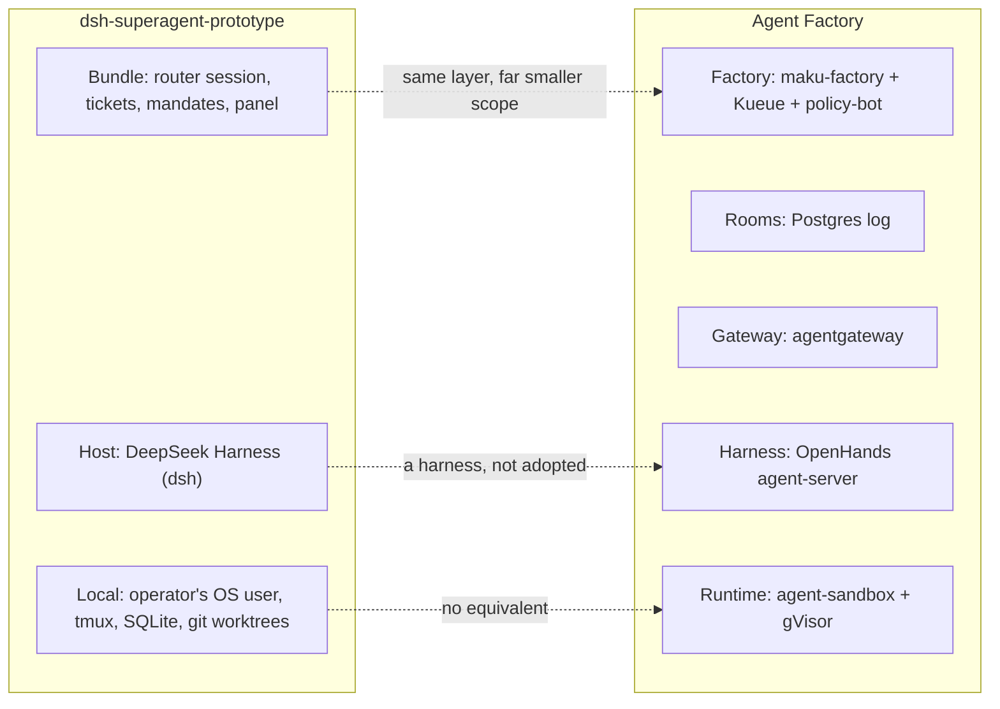

# dsh-superagent-prototype (DeepSeek): evaluation against the Agent Factory

**Date:** 2026-11-04 · **Status:** research · **Verdict:** borrow · **Read at:** dsh-superagent-prototype
[`8c32a9d`](https://github.com/deepseek-ai/dsh-superagent-prototype/tree/8c32a9dc5d72c033816c6a8110b37f40cf94fba4)
(the repository's only commit, 2026-10-31) and DeepSeek Harness
[`8bd0733`](https://github.com/deepseek-ai/deepseek-harness/tree/8bd073392eef6f54e921a093b95076248eb08cbb)
(`master` on 2026-11-03). Every claim is checked in code at these commits unless marked **[U]**
(unverified) or attributed to a secondary source **[S]**. The primary DeepSeek article was published
on a WeChat account and could not be fetched; its content is cited through press coverage **[S]**.

## Verdict

dsh-superagent-prototype is **not a harness and not a model**: it is a one-commit, MIT-licensed
research drop of a *factory-layer* orchestrator, written as a plugin bundle for DeepSeek's own
TypeScript harness (dsh). A long-lived LLM "router" session takes GitHub and Feishu events, decides
under a deterministic gate plus a model assessment whether they are authorised work, opens a
"Ticket" with an immutable "Mandate", and runs one persistent worker session per Ticket in a local
git worktree, with no sandbox (`danger-full-access` as the operator's OS user), no budgets, no merge
gate of its own and no Kubernetes packaging. It cannot replace OpenHands, our controller or any
other layer, and DeepSeek says in the README that it is "not an official DeepSeek product" and "not
identical to our internal version". **Borrow** four ideas we lack: thread *subscriptions* that route
later comments and CI straight to the task's worker without a new mention; an *observe* accept mode
that records what a proactive rule would have done before letting it act; an immutable *Mandate*
revalidated against the current policy before an ended task resumes; and a *stage model* that
labels every task by what it waits for, so a queue shows only what needs a person. Do not adopt
the code or dsh. Reconsider dsh as a harness only if it reaches a stable release with an HTTP
server API and session-log upload off by default.

## 1. What it is

| Aspect | Finding |
|---|---|
| Repository | [deepseek-ai/dsh-superagent-prototype](https://github.com/deepseek-ai/dsh-superagent-prototype): one commit, `8c32a9d`, 2026-10-31 20:06 +0800, author "DeepSeek Harness Team" with no linked GitHub login (GitHub lists no contributors). MIT ([LICENSE](https://github.com/deepseek-ai/dsh-superagent-prototype/blob/8c32a9dc5d72c033816c6a8110b37f40cf94fba4/LICENSE)). On 2026-11-04: 18,083 stars, 1,961 forks, issues, discussions and wiki **disabled**, no releases |
| Status, in its own words | "Research prototype for reference only, not an official DeepSeek product … much of the engineering done by coding agents … may still contain bugs … not identical to our internal version or the implementation described in *Exploring Super-agent Design*" ([README L3-L5](https://github.com/deepseek-ai/dsh-superagent-prototype/blob/8c32a9dc5d72c033816c6a8110b37f40cf94fba4/README.md#L3-L5)) |
| What it does | "A proactive coding agent for one GitHub repository, packaged as a bundle for DeepSeek Harness. It listens to GitHub and, optionally, Feishu … opens a work item, works on it in its own agent session and directory, and answers in the original conversation, for example with a pull request" ([README L7](https://github.com/deepseek-ai/dsh-superagent-prototype/blob/8c32a9dc5d72c033816c6a8110b37f40cf94fba4/README.md#L7)) |
| Shape | TypeScript, about 110 source files and 59 vitest specs ([007 modules](https://github.com/deepseek-ai/dsh-superagent-prototype/blob/8c32a9dc5d72c033816c6a8110b37f40cf94fba4/docs/007-architecture.md#L289-L398), [tests](https://github.com/deepseek-ai/dsh-superagent-prototype/blob/8c32a9dc5d72c033816c6a8110b37f40cf94fba4/docs/007-architecture.md#L402-L446)); runtime dependencies are `zod` and `proper-lockfile`, everything else is a `@deepseek-ai/dsh-*` peer at `^0.2.1-alpha.2` ([package.json L53-L85](https://github.com/deepseek-ai/dsh-superagent-prototype/blob/8c32a9dc5d72c033816c6a8110b37f40cf94fba4/package.json#L53-L85)) |
| Host | [DeepSeek Harness (dsh)](https://github.com/deepseek-ai/deepseek-harness): MIT, "everything is a plugin" on Cordis, 271,930 stars, created 2026-08-13; README: developer preview, "THERE WILL BE COMPATIBILITY-BREAKING CHANGES"; every tag is alpha or rc (`dsh-v0.2.2-alpha.3` newest), npm `latest` is `0.2.1-rc.5`. The prototype's install pins `0.2.1-rc.3` ([006 L76](https://github.com/deepseek-ai/dsh-superagent-prototype/blob/8c32a9dc5d72c033816c6a8110b37f40cf94fba4/docs/006-deployment.md#L76)) |
| Paper | *Exploring Super-agent Design: Towards a More Autonomous Agent System* (Chinese: Super-agent 设计探索), DeepSeek Harness team, 2026-10-31, on WeChat **[U: not fetched]**. Coverage: [IT之家](https://www.ithome.com/1/020/615.htm), [ifanr](https://www.ifanr.com/1687026) **[S]**. Four traits: continuous, efficient, proactive, persistent; a Router layer and concurrent Worker sessions; "speculative execution" (silent bug reproduction before anyone asks); "Inline & Spill" and "Chain of Recall" memory; an async ReAct loop "implemented in DeepSeek Harness but not enabled by default". Long-term memory, security against injection, and oversight are listed as **unsolved**. Internal instances run daily at DeepSeek for bug reproduction, review replies and dsh's own iteration **[S]** |
| Benchmarks | None in the repository. The article's experiment is synthetic: about 300 simulated messages, about 20 of them work requests, five runs per configuration, simulated tools. Super-agent p50 12.4 min, p95 15.7 min, against a single session with subagents at p95 29.5 min; cache reads +37% (23.23M to 31.77M tokens); the baseline never invoked a subagent **[S]**. The team states it measures scheduling, not coding quality **[S]**. No SWE-bench or Terminal-Bench figure exists for either the prototype or dsh |
| Community | No Hacker News or Reddit thread found on 2026-11-04; coverage is Chinese tech press and aggregators. explainx.ai counted "a single commit and about 130 stars" at launch and "about 5,400" a day later ([explainx](https://explainx.ai/blog/deepseek-dsh-superagent-prototype-proactive-github-coding-agent-tickets-mandates-mit-2026)) **[S]** |

### Which layer

The bundle is a **factory-layer orchestration pattern**: an LLM router that never codes, one worker
session per unit of work, and a domain model (Source, Trigger, Thread, Eval, Mandate, Ticket,
Assignment, Subscription) with a durable effect queue
([001 L25-L37](https://github.com/deepseek-ai/dsh-superagent-prototype/blob/8c32a9dc5d72c033816c6a8110b37f40cf94fba4/docs/001-domain.md#L25-L37),
[007 L164-L181](https://github.com/deepseek-ai/dsh-superagent-prototype/blob/8c32a9dc5d72c033816c6a8110b37f40cf94fba4/docs/007-architecture.md#L164-L181)).
The harness is dsh, which the bundle only configures. Nothing in it is model-side: the plugin has no
provider code; `provider` is a free string resolved through the host's `ctx.llm`
([role-models.ts L7-L12](https://github.com/deepseek-ai/dsh-superagent-prototype/blob/8c32a9dc5d72c033816c6a8110b37f40cf94fba4/src/app/role-models.ts#L7-L12),
[policy.ts L70](https://github.com/deepseek-ai/dsh-superagent-prototype/blob/8c32a9dc5d72c033816c6a8110b37f40cf94fba4/src/policy.ts#L70)).

### How it runs, against our requirements

| Question | Answer | Evidence |
|---|---|---|
| Headless on Kubernetes? | No. It needs dsh's **Web profile** (the panel is a sidebar plugin), a loopback web server, a `tmux` session started by a Python script, an hourly "check" prompt scheduled from the operator's other dsh profile, and a SQLite file | [006 L7](https://github.com/deepseek-ai/dsh-superagent-prototype/blob/8c32a9dc5d72c033816c6a8110b37f40cf94fba4/docs/006-deployment.md#L7), [L102-L141](https://github.com/deepseek-ai/dsh-superagent-prototype/blob/8c32a9dc5d72c033816c6a8110b37f40cf94fba4/docs/006-deployment.md#L102-L141), [package.json L34-L44](https://github.com/deepseek-ai/dsh-superagent-prototype/blob/8c32a9dc5d72c033816c6a8110b37f40cf94fba4/package.json#L34-L44), [scripts/dsh-superagent L177-L181](https://github.com/deepseek-ai/dsh-superagent-prototype/blob/8c32a9dc5d72c033816c6a8110b37f40cf94fba4/scripts/dsh-superagent#L177-L181). No Docker, Kubernetes or container word in any doc |
| Any OpenAI-compatible model? | Yes, through dsh: built-in `anthropic`, `openai`, `moonshotai`, `zai` providers and a "Custom model API" with a base URL speaking `openai-completions`, `openai-responses` or `anthropic-messages`. A separate model per role (eval, executor) | [dsh providers.md](https://github.com/deepseek-ai/deepseek-harness/blob/8bd073392eef6f54e921a093b95076248eb08cbb/docs/user/guide/providers.md), [dsh provider.ts](https://github.com/deepseek-ai/deepseek-harness/blob/8bd073392eef6f54e921a093b95076248eb08cbb/packages/llm/llm-pi-ai/src/provider.ts); [006 L204-L205](https://github.com/deepseek-ai/dsh-superagent-prototype/blob/8c32a9dc5d72c033816c6a8110b37f40cf94fba4/docs/006-deployment.md#L204-L205) |
| MCP? | Not in the bundle: neither preset loads `@deepseek-ai/dsh-mcp-client`, and `WORK_TOOLS` lists only dsh-native tools. dsh ships an MCP client plugin (stdio and streamable-http) that a profile could add | [cordis.patch.yml L20-L194](https://github.com/deepseek-ai/dsh-superagent-prototype/blob/8c32a9dc5d72c033816c6a8110b37f40cf94fba4/cordis.patch.yml#L20-L194), [sessions.ts L61-L62](https://github.com/deepseek-ai/dsh-superagent-prototype/blob/8c32a9dc5d72c033816c6a8110b37f40cf94fba4/src/app/sessions.ts#L61-L62); [dsh mcp-client README](https://github.com/deepseek-ai/deepseek-harness/blob/8bd073392eef6f54e921a093b95076248eb08cbb/packages/mcp/mcp-client/README.md) |
| Sandbox? | None. Both roles get `danger-full-access` in code and run "as the operator's OS user"; "A worker can execute programs by path and read the operator's home directory"; the shims and worktrees "establish defaults, not a security boundary" | [sessions.ts L152](https://github.com/deepseek-ai/dsh-superagent-prototype/blob/8c32a9dc5d72c033816c6a8110b37f40cf94fba4/src/app/sessions.ts#L152), [006 L19](https://github.com/deepseek-ai/dsh-superagent-prototype/blob/8c32a9dc5d72c033816c6a8110b37f40cf94fba4/docs/006-deployment.md#L19), [003 L78-L80](https://github.com/deepseek-ai/dsh-superagent-prototype/blob/8c32a9dc5d72c033816c6a8110b37f40cf94fba4/docs/003-execution.md#L78-L80), [environment.ts L2-L4](https://github.com/deepseek-ai/dsh-superagent-prototype/blob/8c32a9dc5d72c033816c6a8110b37f40cf94fba4/src/infra/environment.ts#L2-L4) |
| Long-lived credentials in reach of the agent? | Yes. The agent is a GitHub **user account** signed into a `gh` wrapper on the host (a GitHub App "cannot be the agent, because dsh-superagent reads the account's notifications"); git gets its token from `gh auth git-credential`. Ambient `GH_TOKEN`/`GITHUB_TOKEN` and `KEY|PASSWORD|SECRET|TOKEN` variables are stripped from worker processes, which is hygiene, not a boundary | [006 L33-L47](https://github.com/deepseek-ai/dsh-superagent-prototype/blob/8c32a9dc5d72c033816c6a8110b37f40cf94fba4/docs/006-deployment.md#L33-L47), [environment.ts L23, L45-L58, L106-L115](https://github.com/deepseek-ai/dsh-superagent-prototype/blob/8c32a9dc5d72c033816c6a8110b37f40cf94fba4/src/infra/environment.ts#L45-L58), [006 L218](https://github.com/deepseek-ai/dsh-superagent-prototype/blob/8c32a9dc5d72c033816c6a8110b37f40cf94fba4/docs/006-deployment.md#L218) |
| Hardcoded keys in the repo? | None found. Model keys live in dsh's credential store; GitHub and Feishu go through operator-configured CLIs; the only fixed host is `github.com` (GitHub Enterprise Server unsupported) | [environment.ts L111-L112](https://github.com/deepseek-ai/dsh-superagent-prototype/blob/8c32a9dc5d72c033816c6a8110b37f40cf94fba4/src/infra/environment.ts#L111-L112), [006 L25](https://github.com/deepseek-ai/dsh-superagent-prototype/blob/8c32a9dc5d72c033816c6a8110b37f40cf94fba4/docs/006-deployment.md#L25). A literal grep of every source file was not possible in this session; the files read in full contain no `fetch(`, analytics or Sentry call **[U]** |
| Telemetry or phone-home? | None in the bundle. The **host** does: dsh's base bundle enables `dsh-session-telemetry-otel` in `FEEDBACK_ONLY` mode to `https://dsh-otel-collector.deepseeksvc.com/v1/logs` and `dsh-session-log-deepseek`, which "sends complete unaccepted log suffixes with subsequent DeepSeek requests by default, including requests sent through configured gateways"; both are opt-out. The superagent profile is "a copy of DSH's Web profile", so it inherits them | [dsh base cordis.patch.yml](https://github.com/deepseek-ai/deepseek-harness/blob/8bd073392eef6f54e921a093b95076248eb08cbb/packages/bundle/base/cordis.patch.yml), [dsh CLI reference](https://github.com/deepseek-ai/deepseek-harness/blob/8bd073392eef6f54e921a093b95076248eb08cbb/apps/cli/reference/README.md); [SETUP.md L55](https://github.com/deepseek-ai/dsh-superagent-prototype/blob/8c32a9dc5d72c033816c6a8110b37f40cf94fba4/SETUP.md#L55) |
| Spot nodes, per-run identity, network policy | Not applicable: one process on one machine, one identity (the agent account) for every Ticket | [006 L7-L19](https://github.com/deepseek-ai/dsh-superagent-prototype/blob/8c32a9dc5d72c033816c6a8110b37f40cf94fba4/docs/006-deployment.md#L7-L19) |

### Maturity

A one-off prototype drop, as the name says. Signals: a single commit by a team alias, issues and
discussions disabled, no releases, a README that disclaims productisation, docs that still carry
migration code from the project's "earlier names (`dsh-tag`, `dsh-go`, `dsh-freelancer`)"
([environment.ts L15-L16](https://github.com/deepseek-ai/dsh-superagent-prototype/blob/8c32a9dc5d72c033816c6a8110b37f40cf94fba4/src/infra/environment.ts#L15-L16)),
"Nothing deletes old records yet, so these grow without bound"
([007 L484](https://github.com/deepseek-ai/dsh-superagent-prototype/blob/8c32a9dc5d72c033816c6a8110b37f40cf94fba4/docs/007-architecture.md#L484)),
and two open questions on trust and deployment isolation
([007 L614-L617](https://github.com/deepseek-ai/dsh-superagent-prototype/blob/8c32a9dc5d72c033816c6a8110b37f40cf94fba4/docs/007-architecture.md#L614-L617)).
No source states a maintenance commitment; the article calls it "an exploratory engineering
architecture" **[S]**. The host it depends on has only alpha and rc tags and the bundle's peer range
(`^0.2.1-alpha.2`) already trails npm's `next` (`0.2.2-rc.1`).

The engineering quality of what is there is high for a prototype: a hexagonal core with one writer
per state, 59 specs including a simulated-host runtime test and a "model-surface" test that budgets
every prompt and tool description per role
([007 L437](https://github.com/deepseek-ai/dsh-superagent-prototype/blob/8c32a9dc5d72c033816c6a8110b37f40cf94fba4/docs/007-architecture.md#L437)),
and documentation written in the reader-first style we ask of our own site.

## 2. What it would bring

Each item names the gap in the [v4 landscape](2026-10-31-v4-landscape-research.md) ranking where
one applies, where the idea would land, and a cost class (XS under a day, S days, M weeks).

### 2.1 Thread subscriptions: later comments and CI reach the worker without a new mention (gap 4, PR continuation loop)

**What they do.** Accepting a Ticket subscribes it to every Thread of its triggers, and binding a
PR subscribes the PR thread. "Every later message on a subscribed thread, from any participant or
bot, reaches the subscribed tickets as context; it carries no authority and needs no mention or
allowed-sender check." An ended Ticket keeps its subscriptions: a person's comment on a merged or
closed PR resumes it under the same Mandate; "bots and CI do not wake it"
([prompts/subscriptions.md L2-L5](https://github.com/deepseek-ai/dsh-superagent-prototype/blob/8c32a9dc5d72c033816c6a8110b37f40cf94fba4/prompts/subscriptions.md#L2-L5),
[001 L37](https://github.com/deepseek-ai/dsh-superagent-prototype/blob/8c32a9dc5d72c033816c6a8110b37f40cf94fba4/docs/001-domain.md#L37)).
A worker that finds an attached thread unrelated hands its messages back once, with a reason, and
the message becomes a fresh candidate
([002 L28-L34](https://github.com/deepseek-ai/dsh-superagent-prototype/blob/8c32a9dc5d72c033816c6a8110b37f40cf94fba4/docs/002-authorization.md#L28-L34)).
Sources poll subscribed threads for two weeks after the last trigger
([003 L116](https://github.com/deepseek-ai/dsh-superagent-prototype/blob/8c32a9dc5d72c033816c6a8110b37f40cf94fba4/docs/003-execution.md#L116)).

**What we have.** A GitHub "Request changes" review becomes a new run on the same branch, and a red
CI on the task's own PR starts a fix run ([factory](../../../website/content/docs/how-it-works/factory.md)).
A plain PR comment, a comment on the originating issue after the PR opened, or a human comment on a
merged PR does nothing. The landscape ranks the continuation loop fourth and marks our loop
"conditional".

**Where it lands.** The factory controller: a `Task` would record the threads it follows (issue, PR,
review threads), the intake would route a comment on a followed thread to the task as a *follow-up
input* rather than refusing or ignoring it, and a human comment on a Done task would reopen it under
the original class and budget. The conservative half, *who may wake a task*, maps onto our existing
rules: humans resume, bots and CI only inform. **Cost: M**, mostly in Maku; the room log is the
natural place to record the follow-up and the worker's hand-back.

### 2.2 Observe mode for proactive rules (gap 5, event triggers; gap 7, injection drills)

**What they do.** Work nobody asked for needs a written rule, and the accept mode starts in
`observe`: "Inferred candidates are assessed; a positive assessment is recorded as ignore marked
'would accept', and nothing is accepted." `auto` is switched on "after reviewing the recorded
Decisions". A proactive accept needs at least one matching rule, every rule is judged exactly once,
and a bot on the Source's bot list "can produce an inferred candidate, never an explicit request"
([002 L91-L105](https://github.com/deepseek-ai/dsh-superagent-prototype/blob/8c32a9dc5d72c033816c6a8110b37f40cf94fba4/docs/002-authorization.md#L91-L105),
[L11-L16](https://github.com/deepseek-ai/dsh-superagent-prototype/blob/8c32a9dc5d72c033816c6a8110b37f40cf94fba4/docs/002-authorization.md#L11-L16)).
The assessment prompt demands three facts with quotes in `intent_evidence`, and the code refuses an
accept without it ([admission.md L17, L24, L37](https://github.com/deepseek-ai/dsh-superagent-prototype/blob/8c32a9dc5d72c033816c6a8110b37f40cf94fba4/prompts/admission.md#L17),
[policy.ts L53](https://github.com/deepseek-ai/dsh-superagent-prototype/blob/8c32a9dc5d72c033816c6a8110b37f40cf94fba4/src/policy.ts#L53)).

**What we have.** Shadow mode exists for the *merge* side (classes decide in shadow before going
live) but not for *intake*: a task starts only from an explicit act (label, check mark, API call).
When we add event triggers (gap 5) or a RunLore-style proactive path, we will need exactly this
dial.

**Where it lands.** The controller's intake: a per-class `accept: off | observe | auto` with the
same deterministic-gate-then-model order we already use for the scoper's acceptance rewrite, and a
counter of "would accept" decisions per class. **Cost: S** once a proactive intake exists; nothing
to build before then.

### 2.3 An immutable Mandate, revalidated before resume (gap 19, run-bound provenance; our constitution)

**What they do.** An accept creates a Mandate: policy version, scope, strength (`explicit` or
`inferred`), matched rules, the sender's identity on that Source and how the Source received the
trigger. It is immutable; "wider scope means a new Ticket". A policy change never cancels running
work; it delivers a notice to the affected Tickets. Before an ended Ticket resumes, the Mandate is
revalidated: the sender must still be allowed, the rules still enabled, the mode still `auto`
([001 L32-L34](https://github.com/deepseek-ai/dsh-superagent-prototype/blob/8c32a9dc5d72c033816c6a8110b37f40cf94fba4/docs/001-domain.md#L32-L34),
[002 L107-L141](https://github.com/deepseek-ai/dsh-superagent-prototype/blob/8c32a9dc5d72c033816c6a8110b37f40cf94fba4/docs/002-authorization.md#L107-L141)).
Only three operations change it: accept, a person's stop, failed revalidation.

**What we have.** A Task snapshots the issue so later edits do not change it, and records the
sponsor and cap for API intake. We do not record *under which class policy version* a task was
accepted, and a resumed or retried task reads the current config. If 2.1 lands (tasks that reopen
weeks later), revalidation becomes necessary: a class may have been paused or a principal removed.

**Where it lands.** A `mandate` block on the Task (policy ConfigMap hash, class, intake kind,
principal, sponsor) and a revalidation step in `/factory retry` and any reopen. **Cost: S**.

### 2.4 Ticket stages by what they wait for, and a panel that shows only what needs a person (gap 2, review inbox)

**What they do.** A table of seven stages, first match wins: `person/delivery`, `person/answer`,
`person/review`, `person/blocked|failed`, `working/queued`, `idle`, `working`. "A `person` stage
means the Ticket cannot continue without human input"; the overview lists those first, "a healthy
state takes no space"
([003 L9-L21](https://github.com/deepseek-ai/dsh-superagent-prototype/blob/8c32a9dc5d72c033816c6a8110b37f40cf94fba4/docs/003-execution.md#L9-L21),
[005 L7-L24](https://github.com/deepseek-ai/dsh-superagent-prototype/blob/8c32a9dc5d72c033816c6a8110b37f40cf94fba4/docs/005-panel.md#L7-L24)).
A worker's question is a structured `human_action` field, forwarded unchanged to the conversation
where the person wrote, "never in another Source"
([handoff-worker.md L1](https://github.com/deepseek-ai/dsh-superagent-prototype/blob/8c32a9dc5d72c033816c6a8110b37f40cf94fba4/prompts/handoff-worker.md#L1)).

**What we have.** Task phases (`Escalated`, `AwaitingHuman`, …) and `maku --needs-me`, which the
status page says misses split proposals. Our phases describe the *controller's* state; theirs
describe the *person's* obligation, derived from stored reports, so a restart recomputes it.

**Where it lands.** A derived `waitingOn: person | ci | run | none` field on Task status, computed
from reports, feeding `--needs-me`, the rooms list and a future inbox. **Cost: XS-S**.

### 2.5 Ideas that are smaller, or that we already have

| Idea | What they do | Us | Verdict |
|---|---|---|---|
| Router that never waits | A guard refuses `sleep`, shell timeouts over 30 s and job waits over 5 s in the router session; a worker's foreground command moves to a background job after 5 s and its end wakes the session ([sessions.ts L70-L86](https://github.com/deepseek-ai/dsh-superagent-prototype/blob/8c32a9dc5d72c033816c6a8110b37f40cf94fba4/src/app/sessions.ts#L70-L86), [cordis.patch.yml L38-L74](https://github.com/deepseek-ai/dsh-superagent-prototype/blob/8c32a9dc5d72c033816c6a8110b37f40cf94fba4/cordis.patch.yml#L38-L74)) | Our controller is Go, not a model, so it never waits; our implementer did spend 36 minutes retrying an unreachable CI log (harness-roles research §3.3). OpenHands' terminal tool has a per-command timeout but no "move to background and wake me" **[U]** | Worth a look for the implementer's CI wait: have the harness fetch and quote the failing log, as the roles research already recommends |
| Human messages get a reserved slot | Concurrency counts worker slots, "with one extra slot for a person's message or a status request", and wakes take priority over launches ([003 L55-L61](https://github.com/deepseek-ai/dsh-superagent-prototype/blob/8c32a9dc5d72c033816c6a8110b37f40cf94fba4/docs/003-execution.md#L55-L61)) | `caps.concurrentRuns` and Kueue treat a revision run and a new task alike | A Kueue priority class for revision and retry runs. **XS** |
| Durable effects, stored first | Every side effect is a row, enqueued inside the transaction, executed after commit, retried with backoff; `Later` defers without counting a failure ([007 L164-L181](https://github.com/deepseek-ai/dsh-superagent-prototype/blob/8c32a9dc5d72c033816c6a8110b37f40cf94fba4/docs/007-architecture.md#L164-L181)) | Kubernetes objects and reconcile loops give us the same restart safety | Nothing to add; it confirms our "state in objects, re-check on restart" choice over Temporal |
| Prompt parts with "Default updated" | Team overrides record which built-in text they replaced; an upgrade that changes the default shows the diff and asks keep or adopt ([004 L38-L42](https://github.com/deepseek-ai/dsh-superagent-prototype/blob/8c32a9dc5d72c033816c6a8110b37f40cf94fba4/docs/004-prompts.md#L38-L42)) | Steering notes per class in each repository | A good pattern if class steering notes ever gain a factory-owned default. Not now |
| Tool-result pruner | Results over 8,192 chars keep the first 4,096 and the last 1,024 ([cordis.patch.yml L90-L94](https://github.com/deepseek-ai/dsh-superagent-prototype/blob/8c32a9dc5d72c033816c6a8110b37f40cf94fba4/cordis.patch.yml#L90-L94)) | OpenHands truncates an event at 30,000 chars and condenses history | Head-and-tail keeps the error line of a long test log. Check whether the SDK's truncation keeps the tail **[U]**; XS if not |
| Report vocabulary | `progress / waiting / ready / blocked / failed / dropped`; "ready means reviewed implementation with relevant checks passed"; `dropped` ends silently when "nothing for a human to do" ([work.md L45-L49](https://github.com/deepseek-ai/dsh-superagent-prototype/blob/8c32a9dc5d72c033816c6a8110b37f40cf94fba4/prompts/work.md#L45-L49)) | Role endings and the judge's `met / not_yet / impossible` | We have the equivalent; `dropped` resembles the scoper's `needs_author` on already-done work |

### 2.6 What it does not have, against the list we were asked about

| Capability | dsh-superagent-prototype | Evidence |
|---|---|---|
| Sub-agent delegation, context isolation | Workers may spawn dsh subagents under the `standard` preset, restricted to the worker's tools, stopped at hand-off; the router has none and must "not delegate [assessment] to another Session". No role split inside a Ticket: one worker does scope, code, checks, self-review and PR | [cordis.patch.yml L96-L111](https://github.com/deepseek-ai/dsh-superagent-prototype/blob/8c32a9dc5d72c033816c6a8110b37f40cf94fba4/cordis.patch.yml#L96-L111), [sessions.ts L298-L312](https://github.com/deepseek-ai/dsh-superagent-prototype/blob/8c32a9dc5d72c033816c6a8110b37f40cf94fba4/src/app/sessions.ts#L298-L312), [admission.md L3](https://github.com/deepseek-ai/dsh-superagent-prototype/blob/8c32a9dc5d72c033816c6a8110b37f40cf94fba4/prompts/admission.md#L3), [work.md L29](https://github.com/deepseek-ai/dsh-superagent-prototype/blob/8c32a9dc5d72c033816c6a8110b37f40cf94fba4/prompts/work.md#L29) |
| Planning and self-verification loops | Prompt text only: "self-reviewed, validated", "Review changes and run relevant checks", "do not report ready while a job whose result you need runs". No judge, no tester, no reviewer agent, no plan approval; "Executors decide their follow-ups". Human and bot reviewers are handled "by outcome", three rounds per automated reviewer | [work.md L14, L39-L40](https://github.com/deepseek-ai/dsh-superagent-prototype/blob/8c32a9dc5d72c033816c6a8110b37f40cf94fba4/prompts/work.md#L14), [004 L88](https://github.com/deepseek-ai/dsh-superagent-prototype/blob/8c32a9dc5d72c033816c6a8110b37f40cf94fba4/docs/004-prompts.md#L88) |
| Memory across runs | None beyond the SQLite ticket store and dsh session persistence; cross-Ticket facts travel as a 100-word router note. The article's "Inline & Spill" and "Chain of Recall" are not in the prototype, and it names long-term memory unsolved **[S]** | [007 L450-L486](https://github.com/deepseek-ai/dsh-superagent-prototype/blob/8c32a9dc5d72c033816c6a8110b37f40cf94fba4/docs/007-architecture.md#L450-L486), [dispatch.md L47-L48](https://github.com/deepseek-ai/dsh-superagent-prototype/blob/8c32a9dc5d72c033816c6a8110b37f40cf94fba4/prompts/dispatch.md#L47-L48) |
| Context compaction | dsh plugins `compaction-basic`, `command-compact`, `tool-result-pruner`; the router is told to "Check ticket summaries after compaction to avoid duplicate work", which shows a long-lived LLM router forgetting its own tickets | [cordis.patch.yml L79-L94](https://github.com/deepseek-ai/dsh-superagent-prototype/blob/8c32a9dc5d72c033816c6a8110b37f40cf94fba4/cordis.patch.yml#L79-L94), [dispatch.md L44](https://github.com/deepseek-ai/dsh-superagent-prototype/blob/8c32a9dc5d72c033816c6a8110b37f40cf94fba4/prompts/dispatch.md#L44) |
| Parallel exploration, best-of-N | None. Tickets run concurrently up to `maxWorkers`; "One source message produces at most one ticket" | [admission.md L32](https://github.com/deepseek-ai/dsh-superagent-prototype/blob/8c32a9dc5d72c033816c6a8110b37f40cf94fba4/prompts/admission.md#L32) |
| Evaluation harness | None in the repository; the article's synthetic scheduling experiment is not reproducible from it **[S]** | repository tree |
| Budgets, daily caps, stop switch | No USD or token budget; a `models` health entry reports sessions "waiting on a model-budget retry" (dsh's retry). Stop: per Ticket from the panel, and a process-wide "Pause processing" | [006 L183-L191](https://github.com/deepseek-ai/dsh-superagent-prototype/blob/8c32a9dc5d72c033816c6a8110b37f40cf94fba4/docs/006-deployment.md#L183-L191), [003 L192-L200](https://github.com/deepseek-ai/dsh-superagent-prototype/blob/8c32a9dc5d72c033816c6a8110b37f40cf94fba4/docs/003-execution.md#L192-L200) |
| Merge gate | Prompt-governed: "The host has no merge-specific decision logic"; auto-merge allowed under 200 changed lines with approvals, through *another account's* CLI | [003 L84-L90](https://github.com/deepseek-ai/dsh-superagent-prototype/blob/8c32a9dc5d72c033816c6a8110b37f40cf94fba4/docs/003-execution.md#L84-L90) |
| Rooms | GitHub and Feishu threads are the conversation; an IM gets one acknowledgement, one result or question, one end notice. No multi-party log of its own | [004 L77-L89](https://github.com/deepseek-ai/dsh-superagent-prototype/blob/8c32a9dc5d72c033816c6a8110b37f40cf94fba4/docs/004-prompts.md#L77-L89) |

## 3. Gaps against our needs

| Our need | dsh-superagent-prototype | Evidence link |
|---|---|---|
| Runs on EKS and GKE, spot nodes | One Node process on one machine, in tmux, with a loopback panel and a SQLite file | [006 L7](https://github.com/deepseek-ai/dsh-superagent-prototype/blob/8c32a9dc5d72c033816c6a8110b37f40cf94fba4/docs/006-deployment.md#L7), [script L177-L181](https://github.com/deepseek-ai/dsh-superagent-prototype/blob/8c32a9dc5d72c033816c6a8110b37f40cf94fba4/scripts/dsh-superagent#L177-L181) |
| Own identity and network policy per run | One GitHub user account for every Ticket; no network control | [006 L31-L47](https://github.com/deepseek-ai/dsh-superagent-prototype/blob/8c32a9dc5d72c033816c6a8110b37f40cf94fba4/docs/006-deployment.md#L31-L47) |
| No long-lived credential reaches a sandbox | No sandbox; the agent account's `gh` login is on the host and `git` calls it as a credential helper | [environment.ts L23, L111](https://github.com/deepseek-ai/dsh-superagent-prototype/blob/8c32a9dc5d72c033816c6a8110b37f40cf94fba4/src/infra/environment.ts#L111) |
| Headless HTTP harness API | dsh has a one-shot `--profile headless`, ACP and JSON-RPC over stdio; the bundle needs the Web profile | [dsh cli README](https://github.com/deepseek-ai/deepseek-harness/blob/8bd073392eef6f54e921a093b95076248eb08cbb/apps/cli/README.md), [package.json L34-L44](https://github.com/deepseek-ai/dsh-superagent-prototype/blob/8c32a9dc5d72c033816c6a8110b37f40cf94fba4/package.json#L34-L44) |
| MCP federation with per-role allow-lists | No MCP in the bundle; dsh's client plugin has per-server tool names only | [cordis.patch.yml](https://github.com/deepseek-ai/dsh-superagent-prototype/blob/8c32a9dc5d72c033816c6a8110b37f40cf94fba4/cordis.patch.yml), [dsh mcp-client](https://github.com/deepseek-ai/deepseek-harness/blob/8bd073392eef6f54e921a093b95076248eb08cbb/packages/mcp/mcp-client/README.md) |
| Roles: scoper, tester, reviewer on another model, judge | One worker role per Ticket; the router routes and assesses, "never add implementation plans" | [orchestrator.md L4](https://github.com/deepseek-ai/dsh-superagent-prototype/blob/8c32a9dc5d72c033816c6a8110b37f40cf94fba4/prompts/orchestrator.md#L4) |
| Per-run USD and token budgets, daily caps | None | [006 L204-L205](https://github.com/deepseek-ai/dsh-superagent-prototype/blob/8c32a9dc5d72c033816c6a8110b37f40cf94fba4/docs/006-deployment.md#L204-L205) |
| Merge gate under a class policy | Prompt text and a second account's CLI | [003 L84-L90](https://github.com/deepseek-ai/dsh-superagent-prototype/blob/8c32a9dc5d72c033816c6a8110b37f40cf94fba4/docs/003-execution.md#L84-L90) |
| Outcomes and cost per tier and role | Counts of Triggers, Decisions and Tickets for the last day; no cost | [005 L19](https://github.com/deepseek-ai/dsh-superagent-prototype/blob/8c32a9dc5d72c033816c6a8110b37f40cf94fba4/docs/005-panel.md#L19) |
| Multi-repository | "one GitHub repository", github.com only | [README L7](https://github.com/deepseek-ai/dsh-superagent-prototype/blob/8c32a9dc5d72c033816c6a8110b37f40cf94fba4/README.md#L7), [006 L25](https://github.com/deepseek-ai/dsh-superagent-prototype/blob/8c32a9dc5d72c033816c6a8110b37f40cf94fba4/docs/006-deployment.md#L25) |
| No SaaS in the data path | Host defaults upload session logs to DeepSeek (feedback-gated OTel, and with DeepSeek API requests); opt-out by env or setting | [dsh base patch](https://github.com/deepseek-ai/deepseek-harness/blob/8bd073392eef6f54e921a093b95076248eb08cbb/packages/bundle/base/cordis.patch.yml) |
| Open source, maintained | MIT; one commit, issues disabled, "research prototype for reference only" | [README L3](https://github.com/deepseek-ai/dsh-superagent-prototype/blob/8c32a9dc5d72c033816c6a8110b37f40cf94fba4/README.md#L3) |

**What adopting it would leave us to build:** everything below the factory layer (runtime, identity,
network policy, gateway, budgets), the roles, the merge gate, the rooms, Kubernetes packaging,
multi-repository support, and a port of our MCP tools to dsh's plugin model, on a harness in
developer preview. It would **replace OpenHands with dsh**, not add to it. The trade is a
TypeScript harness with a stdio-only machine interface and default log upload against a Python
harness with an HTTP server API that we already run in every sandbox. Only patterns lend
themselves.

## 4. Worth borrowing

1. **Thread subscriptions** (2.1): comments on the issue or PR, and human comments on a merged PR,
   reach the task's next run; bots and CI inform but never wake. The largest item and the one the
   landscape ranks highest (gap 4).
2. **Observe mode** (2.2) for any proactive intake we add: record "would accept" per class before
   `auto`.
3. **A Mandate on the Task** (2.3): the policy version and principal a task was accepted under,
   revalidated on retry and reopen.
4. **`waitingOn` stages** (2.4) derived from reports, so `--needs-me` and the room list show the
   person's obligation, not the controller's phase.
5. Small: a Kueue priority for revision and retry runs; a check that the SDK's event truncation
   keeps the tail of a long test log.

**Not worth borrowing:** the long-lived LLM router (our deterministic controller does its job
without compaction amnesia), prompt-governed auto-merge, the single-account identity model, and
the tmux-and-hourly-prompt supervision loop.

## 5. Reconsider if

- **dsh-superagent-prototype** gains a second commit, open issues, a release, or a statement of
  maintenance; or DeepSeek publishes the internal version's reviewer, memory ("Chain of Recall") or
  speculative-execution components as code.
- **DeepSeek Harness** ships a stable release (a tag without `alpha` or `rc`) with a deprecation
  policy, an HTTP server API comparable to OpenHands agent-server, container images or a Helm
  chart, and session-log upload off by default. Then it is a harness candidate for the
  *alternatives* table, judged on the roles research's criteria, not a factory candidate.
- The article's "Inline & Spill" or "Chain of Recall" memory appears as open code with an
  evaluation: it would speak to gap 10 (repository memory), where we have nothing planned.

## 6. Sources

- Repository at [`8c32a9d`](https://github.com/deepseek-ai/dsh-superagent-prototype/tree/8c32a9dc5d72c033816c6a8110b37f40cf94fba4): README, SETUP.md, `docs/000` to `008`, `prompts/*.md`, `cordis.patch.yml`, `src/app/sessions.ts`, `src/app/role-models.ts`, `src/executor/dsh.ts`, `src/executor/background.ts`, `src/infra/environment.ts`, `src/policy.ts`, `scripts/dsh-superagent`
- GitHub API, 2026-11-04: repository metadata, commits, contributors, issues for both repositories
- DeepSeek Harness at [`8bd0733`](https://github.com/deepseek-ai/deepseek-harness/tree/8bd073392eef6f54e921a093b95076248eb08cbb): README, SAFETY.md, `apps/cli/README.md`, `apps/cli/reference/README.md`, `packages/bundle/base/cordis.patch.yml`, `packages/bundle/headless/README.md`, `packages/mcp/mcp-client/README.md`, `packages/llm/llm-pi-ai/src/provider.ts`, `docs/user/guide/providers.md`; docs site [quickstart](https://deepseek-harness.github.io/deepseek-harness/en/guide/quickstart), [providers](https://deepseek-harness.github.io/deepseek-harness/en/guide/providers), [Python SDK](https://deepseek-harness.github.io/deepseek-harness/en/guide/python-sdk), [public deployments](https://deepseek-harness.github.io/deepseek-harness/en/guide/public-deployments); [deepseek.com/harness](https://www.deepseek.com/en/harness/); npm `@deepseek-ai/dsh` dist-tags
- OpenHands SDK delegate tool and agent-server routes, for comparison: [impl.py](https://github.com/openhands/software-agent-sdk/blob/main/openhands-tools/openhands/tools/delegate/impl.py), [conversation_router.py](https://github.com/openhands/software-agent-sdk/blob/main/openhands-agent-server/openhands/agent_server/conversation_router.py) (Context7, unpinned)
- Press coverage of the article **[S]**: [IT之家](https://www.ithome.com/1/020/615.htm), [ifanr](https://www.ifanr.com/1687026), [yicai](https://www.yicai.com/news/103419784.html), [cls.cn](https://www.cls.cn/detail/2521643), [ToolNavs](https://toolnavs.com/zh/article/3036-deepseek-super-agent-liang-xiang-yi-ge-ai-tong-chou-duo-ge-ai-bu-yong-dian-ming), [explainx.ai](https://explainx.ai/blog/deepseek-dsh-superagent-prototype-proactive-github-coding-agent-tickets-mandates-mit-2026), [hermes-ai.net](https://hermes-ai.net/news/deepseek-releases-a-silent-coding-agent-that-works-without-bothering-you/)
- Local: [v4 landscape research §2](2026-10-31-v4-landscape-research.md), [harness roles research](2026-10-30-harness-roles-research.md), the site's [alternatives](../../../website/content/docs/how-it-works/alternatives.md), [roles](../../../website/content/docs/how-it-works/roles.md), [factory](../../../website/content/docs/how-it-works/factory.md), [runtime](../../../website/content/docs/how-it-works/runtime.md) and [harness reference](../../../website/content/docs/reference/harness.md) pages
- The Logseq graphs: searched, no prior note on "superagent" or DeepSeek Harness
