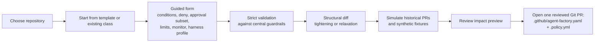
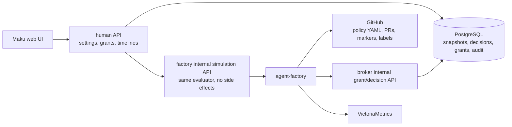

# Merge policy self-service: repository classes, Maku settings, and approval memory

**Date:** 2026-11-04 · **Status:** proposed — the design was approved section by section with the
owner on 2026-11-04; review of this written spec is pending · **Part of:** the merge-gate line
after [the merge gate classes design](2026-10-22-merge-gate-classes-design.md) and [the human path
design](2026-10-29-merge-gate-human-path-design.md) · **Research:** [the auto-merge criteria
study](2026-10-29-automerge-criteria-research.md), a 2026-11-04 Dust/alternatives survey (summarised
below), and a local cloud-native fit review · **Runtime:** Maku (the factory, human API, web UI,
store), this repository (central config, guardrails, dashboards, alerts, runbooks), and
cloud-native-ref (the canary repository's policy files)

Read against Maku `origin/main` `844d2a0a`, cited `Maku/<path>`; this repository at `origin/main`
`bfabb257`, cited `ANR/<path>`; cloud-native-ref at `HOST_REF` `0af4249f`, cited `CNR/<path>`.

## Outcome

Maku gains a self-service, GitOps-backed merge-policy workspace. Repository maintainers define
merge classes in `.github/agent-factory.yaml`; platform operators keep enrollment, base merge
settings, harness profiles, budgets, schedules, and guardrails in the Flux-managed factory config;
and the existing Maku web application provides templates, validation, simulation, promotion,
approval memory, and a readable decision timeline.

Nothing new runs. The factory, human API, web UI, broker store, policy-bot, CNPG database, Flux,
and VictoriaMetrics are the components already deployed. The design extends the merge-gate line
rather than replacing it: existing shadow decisions, adopted Renovate pull requests, semver
shapes, release-age checks, monitors, breakers, and decision records carry forward.

Success is measured, not assumed: a maintainer creates and simulates a class in under ten minutes
without hand-writing YAML, auto-merge coverage rises against the recorded baseline, every decision
is explainable in Maku, and there are zero unauthorized merges without an increase in the
post-merge revert rate.

## What exists

| Piece | Where | Today |
|---|---|---|
| Class vocabulary | `Maku/internal/factory/config/classes.go` | Typed conditions: live/shadow, allowed and protected files, modify-only, patch caps, diff shapes (`links-only`, `semver-patch`, `semver-minor`, `added-entry`), holdouts, release age, oracle, monitor, adoption, companion files, required label |
| Author modes | `Maku/internal/factory/config/classes.go`, `Maku/internal/factory/intake/adopt.go` | Factory-authored task PRs and adopted trusted-bot PRs, including `deps-patch` and `deps-minor` for Renovate |
| Gate | `Maku/internal/factory/reconciler/{arm.go,gate.go,merge.go}` | Fixed base rows plus class conditions, head pinning, breaker, caps, shadow decisions, approve-to-merge, decision records |
| Repository fence | `Maku/internal/factory/fence/fence.go` | `.github/agent-factory.yaml` on the default branch, read and cached fail-closed; currently exactly `factory: <name>` |
| policy-bot | `ANR/tooling/base/policy-bot`, `CNR/.policy.yml`, `ANR/.policy.yml` | Independent second evaluator, read from `main`; live/shadow classes have `low-risk:` rules and parity tests |
| Central config | `ANR/tooling/base/agent-factory/helm-values-configmap.yaml` | Repository enrollment, maintainers, classes, merge settings, schedules, budgets, loops, meter, tracing; rendered by Flux and rolled by config checksum |
| Store | `Maku/internal/store`, CNPG through `ANR/infrastructure/base/room-broker/sqlinstance.yaml` | Append-only room events, approvals with constrained state transitions, RLS, Atlas migrations, testcontainers tests |
| Human API and UI | `Maku/internal/humanapi`, `Maku/web` | Room list and room pages, per-handler principal checks, ZITADEL identity, repository access through `repoaccess.CanWrite`; no settings pages yet |
| Observability | `Maku/internal/factory/fmetrics`, `ANR/observability/base/agent-platform` | Factory metrics, dashboards, alerts, `VMServiceScrape`; decision metrics and paused-class gauge |
| Evidence | `ANR/scripts/ci/tests/test-agent-merge-gate-parity.py`, `Maku/scripts/shadow-merge-tally.sh` | Shadow decisions with exact heads, outcome labels, parity suite, Clopper-Pearson widening bounds |

### Cloud-native fit

| Need | Existing tool used | Deliberately not introduced |
|---|---|---|
| Policy source of truth and review | Git, Flux-managed central config, policy-bot base-branch policy | A policy CRD or operator |
| Runtime and reconciliation | Existing agent-factory and Maku human API | A new webservice or controller |
| Grant and audit state | CNPG PostgreSQL, Atlas migrations, RLS | Room events as repository-wide audit |
| Identity and authorization | ZITADEL, human API principals, `repoaccess.CanWrite` | A new policy RBAC system |
| Observability | VictoriaMetrics, `VMServiceScrape`, existing dashboards and alerts | A new monitoring stack |
| Cluster admission policy | Kyverno, where it already runs | Kyverno/OPA/CEL for GitHub merge policy |

## Field survey, 2026-11-04

The owner's Dust example needed a correction: Dust (dust.tt) has **four per-tool approval
stakes**—High asks every time, Medium saves an approval for a specific input, Low lets users
disable confirmations, and Never ask runs automatically. Those stakes govern tool calls, not pull
requests; Dust's GitHub integration lists PR review actions, not merge actions. Its useful idea is
the Medium semantic: a human turns one approval into a narrow, visible, input-specific permission.

| Product | What it contributes | What it lacks for this design |
|---|---|---|
| Dust | Per-tool High/Medium/Low/Never-ask stakes; Medium saves an input-specific approval; admin UI under Spaces → Tools | No native PR-merge gate, no public saved-approval lifecycle API, no policy shadow mode found |
| GitHub Copilot agent / Agent Merge | Branch-scoped agent PRs; workflow approvals by write users; enterprise audit events | No configurable per-class merge risk ladder; no remembered merge approvals |
| OpenAI Codex | Sandboxes and approval policies; Auto-review risk levels; enterprise policy API/Terraform; denial breakers | PR merge authority remains external; no full task/PR shadow mode |
| Devin | Five local modes; per-action allow/ask/deny; org rules outrank local; persisted approval choices; Autoapprover rules | Autoapprover does not merge; no shadow mode; approval persistence is config, not calibrated evidence |
| Factory Droid | Off/Low/Medium/High autonomy ceiling; per-command rules; org maximum clamps; `droid rules check` previews matching | Policy preview is command matching, not full PR shadow evaluation |
| OpenHands SDK | LOW/MEDIUM/HIGH/UNKNOWN risk and confirmation modes; custom analyzers | Default `NeverConfirm` in the documented conversation API; no remembered approvals or shadow policy mode |
| Claude Code | Permission modes and per-tool rules; remembered grants; managed org denies; fail-closed classifier | Merge authority remains in the provider; no merge-policy shadow replay |
| Cursor | Local run modes; PR approval automation with risk threshold and policy file; a PR cannot relax its own review policy | No general action audit log found; no shadow mode for PR approval |
| Mergify | Deterministic YAML conditions; separate queue and merge conditions; simulator API | No approval memory; not an agent execution policy |
| Renovate | Package rules, automerge modes, minimum release age, dry-run, protected files | Dependency-only; no agent policy or evidence promotion |
| GitHub rulesets / merge queue | Layered rules, required checks, evaluate mode, history, API/UI | No AI risk classes or remembered approvals |
| policy-bot | Base-branch YAML, path/size conditions, simulation API, detailed rule state | No merge actor, monitor, breaker, or approval memory |

The existing auto-merge criteria study reached the same conclusion from a different direction:
the field uses a closed predicate vocabulary plus a pinned external check, and “remembered
approval” means a persisted rule, not learning. The factory already matches that shape; what it
lacks is self-service authoring, simulation, promotion workflow, and narrow approval memory.

## Decisions

| # | Decision | Rejected | Why |
|---|---|---|---|
| MP1 | **Repository YAML plus the existing Maku UI.** Class definitions and live/shadow/off state live in `.github/agent-factory.yaml`; Maku's existing web application is the primary UX; Git is the automation interface | A new webservice; a UI/database as source of truth; a public policy API in the first release | Reuses the fence loader, Git review, policy-bot base-branch pattern, and existing UI deployment |
| MP2 | **Central guardrails and harness profiles.** Enrollment, maintainers, base merge settings, schedules, budgets, models, tiers, loops, and guardrails stay central | Moving all factory configuration into each repository | Cost and platform safety stay with operators; repository policy stays about merge authority |
| MP3 | **A fixed base no class can remove.** Required CI, leak scan, ownership fence, policy-bot, provenance, author checks, head pinning, breaker, and caps remain | Letting a repository disable base controls | Configurability expands provably safe changes; it cannot remove the controls that make automation trustworthy |
| MP4 | **A closed typed condition vocabulary** with `all`/`any` composition and explicit deny rules | CEL, Rego, Kyverno, scripts, or a Mergify-like DSL | MC1 and the field survey agree: a gate path must not become a program; a reason per condition keeps decisions explainable |
| MP5 | **The intended class is fixed before implementation** by a schedule, maintainer label, or confirmed Maku suggestion | Searching a finished PR for any permissive class | Prevents post-hoc reclassification; ambiguity goes to a human |
| MP6 | **Most restrictive rule wins:** deny → require approval → allow; operator guardrails outrank repository policy; grants never broaden their class | First-match or most-permissive evaluation | The final decision must name the rule that produced it |
| MP7 | **Shadow before live, 20 decisions by default.** Promotion needs 20 shadow decisions merged unchanged at their exact heads, zero bad mature outcomes, and a passed drill; widening keeps 29/46/61 | The initially proposed 10 decisions; automatic widening | Ten clean decisions bounds the bad rate only at 25.9%; twenty gives 13.9% and is the accepted live-switch trade-off; 29 reaches the 10% class budget |
| MP8 | **Structural relaxation detection.** Any broadening, denial narrowing, approval-subset narrowing, cap increase, evidence removal, authorship broadening, or evidence-affecting harness change returns the class to shadow | Trusting a “minor change” label or historical simulation alone | Simulation illustrates impact; only structural proof can establish pure tightening, and uncertainty fails toward shadow |
| MP9 | **Approval memory is an exception inside an armed class.** A live class may declare a `requiresApproval` subset; saved grants match only that subset | Grants that create new classes, bypass deny/caps/breaker, or promote unarmed classes | Keeps Dust-like memory useful without making it a side door around evidence |
| MP10 | **Deterministic grant matching.** Repository, class, paths, diff shape, dependency ecosystem/update type, and evidence—no embeddings or model similarity | Semantic “close enough” matching | A grant must be displayable, testable, and revocable as an exact predicate |
| MP11 | **policy-bot stays the independent second check**, with generated `low-risk:` rules and parity tests | Generating only one evaluator or letting Maku replace policy-bot | ADR-0045 and MC2: two evaluators of one fence, with drift caught in CI |
| MP12 | **Every decision is snapshot-bound** to head, base, repository policy, guardrails, harness profile, and grant version | Reusing a previous allow after any input moves | A stale authorization is an unproven authorization |
| MP13 | **Fail closed on policy and grants.** Invalid policy pauses auto-merge; transient reads use the existing staleness window then fail closed; failed grant lookup never authorizes | Last-known-good policy as indefinite authority | Human merges can continue; automation must not act on partial state |
| MP14 | **Policy self-modification is human-only.** A PR changing policy, `.policy.yml`, workflows, or guardrails is evaluated under base-branch policy and merged by a human | A class authorizing the change that enables it | The same rule Cursor and policy-bot already enforce |
| MP15 | **Migration is explicit per repository.** Repository YAML is comparison-only until a central cutover removes that repository's central classes; rollback restores the exported central policy | Automatic migration or two authoritative sources | Preserves behavior, prevents drift, and gives every repository a rollback path |
| MP16 | **One evaluator for simulation and runtime**, with versioned conformance fixtures including the final push-provenance check | A separate UI policy engine | A simulator that can disagree with the gate is a liability, not a tool |
| MP17 | **Server-side authorization.** Maintainers need repository write; operators manage guardrails; readers see decisions; any maintainer may revoke a grant | Client-side hiding as security | The human API already has the principal, ZITADEL, and `repoaccess` primitives |
| MP18 | **Existing observability, bounded labels.** Revisions and grant IDs live in decision records, not metric labels | High-cardinality metrics | VictoriaMetrics cardinality and the factory's metric contract stay bounded |
| MP19 | **Canary on cloud-native-ref.** It already exercises live/shadow classes, policy-bot, Renovate adoption, and Flux monitoring; ai-native-ref follows only after the canary passes | Starting on the factory's own configuration repository | The canary must exercise every existing author mode and monitor before the platform's own config moves |

## Repository policy

`.github/agent-factory.yaml` remains the ownership fence and becomes the repository class policy
file. The `factory:` field is read-only in Maku. As today, every repository policy declares
`docs-links` and `revert`; `review` remains implicit and is never declared.

```yaml
factory: aws-0

classes:
  docs-broad:
    mode: shadow                  # live | shadow | off
    author: agents                # agents | adopt
    harness: docs-standard        # a centrally approved profile

    conditions:
      all:
        - allowedFiles: ['^docs/.+\.md$', '^README\.md$']
        - maxPatchFiles: 10
        - maxModifiedLines: 200
        - holdoutChecks: ['Check the documentation links 🔗']
      deny:
        - protectedFiles: ['^docs/superpowers/', '^docs/specs/']

    requiresApproval:
      - changedFiles: ['^docs/security/']

    limits:
      maxPerDay: 2

    monitor:
      followUpWindow: 168h
```

### Schema layers

| Layer | Owner | Holds |
|---|---|---|
| `factory` | Ownership fence | The factory allowed to act on the repository; Maku never edits it |
| `classes.<name>.mode` | Repository | `live`, `shadow`, or `off`; promotion changes it through Git |
| `author` | Repository | Existing `agents` or `adopt` modes |
| `conditions` | Repository | Typed predicates, composed with `all`/`any` |
| `deny` | Repository | Typed deny predicates; any match refuses |
| `requiresApproval` | Repository | Typed subsets that ask a human even when the class is live |
| `limits` | Repository | Class-local caps, always below central guardrails |
| `monitor` | Repository | Existing post-merge monitor settings |
| `harness` | Central config | A named, centrally approved execution profile |

### Condition vocabulary

The first release reuses existing names wherever Maku has one:

- `allowedFiles`
- `protectedFiles` — valid only under `deny`
- `changedFiles` — valid only under `requiresApproval`
- `modifyOnly`
- `maxPatchFiles`
- `maxModifiedLines`
- `diffShape`
- `holdoutChecks`
- `releaseAgeCheck`
- `oracle`
- `companionFiles`
- `requiredLabel`

Unknown names fail strict decoding. Regexes are length-bounded and guarded against catastrophic
backtracking.

### Harness profiles

Execution concerns move out of the class:

```yaml
# Central factory config, Flux-managed
harnessProfiles:
  docs-standard:
    template: solo
    tier: light
    checks: false
    testFirst: false
    loop: off
  adopted-none:
    template: none
```

A repository class may reference only a centrally defined profile. It cannot invent a profile,
choose a model directly, raise a budget, or alter loop limits. Existing class-coupled `checks`,
`testFirst`, and `loops` settings migrate into named profiles. A harness change that affects the
reviewer model or the evidence a decision relied on resets that class's promotion evidence; if
Maku cannot prove the change evidence-neutral, it treats it as a reset.

### Central guardrails

| Guardrail | Repository policy may |
|---|---|
| Global protected paths | Only add more protected paths |
| Mandatory checks | Only add required checks |
| Maximum patch files and modified lines | Only choose lower caps |
| Maximum auto-merges per day and per class | Only choose lower caps |
| Breaker floor (`window`, `maxReverts`, `maxFollowUps`) | Only choose stricter breaker settings |
| Maximum saved-grant lifetime | Only choose a shorter lifetime; the default is 90 days |
| Minimum promotion evidence | Only meet or exceed 20 clean decisions; weaker needs an operator exception |
| Approved harness profiles | Only reference a profile from the central list |

Guardrails use the same typed vocabulary where practical, so evaluation and explanations stay
consistent across operator and repository policy.

### Resolution order

```mermaid
flowchart TD
  pr["Pull request + intended class<br/>+ exact head"] --> base["Fixed base gate<br/>CI, leak scan, ownership,<br/>policy-bot, provenance"]
  base -->|fail| human["Human review"]
  base -->|pass| author{"Author mode"}
  author -->|fail| human
  author -->|pass| class{"Class conditions"}
  class -->|fail| human["class_mismatch"]
  class -->|pass| deny{"Deny rules"}
  deny -->|match| human
  deny -->|no match| approval{"requiresApproval subset?"}
  approval -->|no| caps{"Breaker and caps"}
  approval -->|yes| grant{"Matching saved grant?"}
  grant -->|no| human["Approval required"]
  grant -->|yes| caps
  caps -->|fail| human["Paused or capped"]
  caps -->|pass| mode{"Class mode"}
  mode -->|shadow| record["Record would-arm<br/>and would-require-approval"]
  mode -->|live| merge["Merge exact head"]
```

A shadow decision records both what a live class would merge and what it would send to approval.
Only cases that would auto-merge without a grant count toward the live-switch evidence;
approval-required cases are tracked separately as grant candidates.

### Saved grants

Saved grants live in Maku's existing backend, not in repository YAML:

- Repository-local and bound to one class.
- Matching only deterministic normalized attributes.
- Applying only to a `requiresApproval` subset of a live class.
- Never bypassing the fixed base, class conditions, deny rules, breaker, caps, or guardrails.
- Inactive while the class is `shadow` or `off`.
- Limited to an operator-configurable lifetime, 90 days by default, with expiry warnings in Maku.
- Suspended by material policy or harness changes until reconfirmed.
- Disabled immediately when an auto-merge they authorize is reverted.
- Exportable as YAML for review.

If a PR falls outside every armed class, Maku offers “propose a shadow class” rather than “create
a rule.”

### Relaxation and snapshots

Maku compares policy structurally before saving. A change is a relaxation when it broadens the
accepted input set, narrows deny or approval subsets, raises a cap, removes evidence, broadens
authorship, or changes evidence-producing harness settings. If structural analysis cannot prove
pure tightening, the class returns to shadow.

Every decision records the PR head, base branch, repository policy hash, central guardrail and
harness-profile hash, class name, grant version, and final verdict. Any bound input changing
invalidates an earlier authorization.

A transient GitHub read failure may use the last valid snapshot only until the existing fence
staleness window expires, then fails closed. Invalid policy on the default branch pauses
auto-merge for that repository immediately; human merges continue.

## Maku settings UI

Routes added to the existing application:

- `/settings`
- `/settings/merge-policies`
- `/settings/merge-policies/<repository>`
- `/settings/approval-memory`
- `/settings/evidence`

The server returns the SPA for direct loads. Authorization is enforced in every handler:
read-only members view policies, decisions, evidence, grants, and audit; repository maintainers
create policy PRs, simulate, manage grants, and request promotion; platform operators manage
guardrails through Git, approve evidence exceptions, and control rollout stages.

### Policy editor



The editor never directly mutates repository policy, never edits `factory:`, and opens one PR
containing both the class policy and the policy-bot rule when both change. An expert YAML view
remains available with the same validation.

### Simulation

Before saving or promoting, Maku shows newly auto-merged, newly blocked, newly
approval-required, and unchanged decisions, plus the strictness counterfactual: decisions the
gate refused that a human then merged unchanged. Each row links to the PR, exact head, matched or
failed rule, every condition result, policy-bot simulation result, and policy revision.

### Promotion

The evidence page shows clean shadow decisions merged unchanged, bad mature outcomes, the current
Clopper-Pearson bound, reviewer-model attribution, drill status, and eligibility. “Promote to
live” verifies the default gate, opens a Git PR changing `mode: shadow` to `mode: live`, and
records the request, evidence snapshot, and approver. A human merges that PR.

Operators may require stronger evidence. An exception below twenty decisions requires operator
approval, a written justification, and an audit record.

### Approval memory

For a PR in a live class's approval subset:

- **Merge once** uses the existing human-approved merge path for that head only.
- **Merge and create rule** first shows the exact predicate, the future PRs it would match, the
  conditions that remain outside it, and its expiry and revocation path.

The approval-memory page supports search, immediate revocation, renewal, YAML export, usage
history, and outcome history.

### Decision timeline

Every decision renders as a timeline: fixed-base results, author mode, intended class, each
condition, deny and approval outcomes, grant use, breaker and cap state, final verdict, and every
policy, guardrail, harness, and grant revision. It links to the Git commit that defined the
policy and the PR comment or database audit event that recorded the decision.

## Storage, APIs, audit, and observability

Git owns policy and class state. PostgreSQL owns grants and queryable audit. GitHub PR markers
remain the durable decision record; the database is an index.

| Table | Purpose | Mutability |
|---|---|---|
| `merge_policy_snapshots` | Repository YAML commit, content hash, canonical form, validity, fetch time | Refresh cache |
| `merge_decisions` | Append-only decision index: head, class, verdict, conditions, snapshots, grant version | Insert only |
| `merge_outcomes` | Append-only merged/reverted/follow-up/monitor/approved outcomes | Insert only |
| `approval_grants` | Current grant state, predicate, origin, creator, expiry, status, last use | Constrained transitions |
| `approval_grant_events` | Created, used, suspended, reconfirmed, revoked, expired, disabled | Insert only |
| `policy_promotions` | Request, evidence snapshot, threshold, approver, PR, outcome | Insert plus terminal state |
| `operator_exceptions` | Exception request, approver, justification, scope, expiry | Insert plus terminal state |

Migrations follow the existing Atlas and RLS patterns. No new table widens access to room events
or weakens RLS. The database decision index retains 180 days by default; GitHub markers, labels,
and Git history remain the long-term record.

### Internal data flow



No stable public policy API is introduced. The human API serves the UI; the factory exposes an
internal simulation API used by the human API; and the broker exposes internal grant and decision
endpoints used by the factory.

The factory reads active grants immediately before authorization and again before the merge call.
Grant lookup is not cached across merge decisions and fails closed. Decision and outcome writes
are idempotent by repository, PR, head, and decision key.

### Metrics and alerts

| Metric | Meaning |
|---|---|
| `maku_factory_merge_decisions_total{repository,class,verdict,reason,grant}` | Gate decisions; grant is a boolean |
| `maku_factory_policy_changes_total{repository,class,change}` | Tightening, relaxation, promotion, demotion |
| `maku_factory_shadow_evidence{repository,class}` | Clean, bad, immature, pending evidence |
| `maku_factory_approval_grants_active{repository,class}` | Active grants |
| `maku_factory_approval_grant_events_total{repository,class,event}` | Grant lifecycle |
| `maku_factory_policy_load_errors_total{repository,reason}` | Unreadable, invalid, stale, guardrail mismatch |
| `maku_factory_simulation_runs_total{repository,result}` | Simulation requests |

Alerts: invalid policy, unreadable policy, grant disabled after revert, promotion exception used,
long-paused class, and grants expiring soon.

## Class templates

### Documentation-only

`docs-broad` starts in shadow, allows additions, edits, and deletions within declared documentation
paths, permits Markdown and explicitly enabled static assets (SVG excluded initially), and excludes
symlinks, executable or mode changes, site/build configuration, policy files, workflows, and code
paths. Defaults: ten files, 200 modified lines, two merges per day, documentation link holdout,
documentation build holdout when present, protected spec/decision/security paths, an approval
subset for security-sensitive or architectural documentation, and a seven-day follow-up window.

### Dependency updates

`deps-patch` and `deps-minor` reuse the existing adopted-class machinery. Patch updates may
promote to live after the standard evidence gate; minor updates remain shadow-only in this
release. Both compute semver from the diff, adopt Renovate PRs from `^renovate/`, read
`renovate/stability-days`, cap at three files and ten lines, protect the existing
never-automerge paths, and monitor Flux within one hour plus a seven-day follow-up window. The
live patch lane uses a minimum release age of three days. Major, digest-only, install/lifecycle
script, and protected-path changes remain human-reviewed.

### Generated files

`generated-files` starts in shadow and declares explicit input and output paths. A gate-path
GitHub Actions workflow regenerates outputs from the PR head and compares byte-for-byte; Maku
reads the check and diff and never executes repository code. A PR changing the regeneration
workflow, tooling, or generator configuration is outside the class and human-merged. A merge is
valid only when every changed path is declared, the regeneration check succeeds, output matches
byte-for-byte, no manual generated-output edit remains, and no verification tooling changed.

### Custom and existing classes

Custom classes use the same typed vocabulary, start in shadow, reference only central harness
profiles, require policy-bot parity, and follow the same simulation and promotion path. Existing
`docs-links`, `dead-links`, `revert`, `review`, and `added-entry` semantics are unchanged.

## Migration and rollout

| Stage | State | Merge authority | Exit criterion |
|---|---|---|---|
| 0 | Flags off | Existing central config | Current behavior unchanged |
| 1 | Read/import | Existing central config | Generated policy valid and structurally equivalent |
| 2 | Simulation | Existing central config | Simulator matches runtime on fixtures and recent PRs |
| 3 | Dual evaluation | Existing central config | One week, zero unexplained divergence |
| 4 | Repository cutover | Repository YAML | Invalid or unreadable policy pauses auto-merge fail-closed |
| 5 | Approval memory | Repository YAML plus grants | Grant lifecycle and rollback proofs pass |
| 6 | Promotion workflow | Repository YAML | One promotion request produces a correct reviewed PR |

cloud-native-ref completes every stage first; ai-native-ref follows only after the canary passes.

Migration preserves current live/shadow behavior exactly—migration is not a new class or a
relaxation. The repository PR lands while repository YAML is comparison-only; the central
cutover then switches authority and removes that repository's central classes after validating
the repository snapshot. A repository never has two authoritative policy sources. Legacy
central-only configuration remains supported for one deprecation cycle, and a configuration
mixing legacy and repository-authoritative shapes for the same repository fails validation.

Feature flags, all default off: `policyManagement.read`, `policyManagement.simulation`,
`policyManagement.repositoryAuthority`, `policyManagement.approvalMemory`, and
`policyManagement.promotion`.

Rollback restores the exported central classes through a central config PR. Invalid repository
policy pauses auto-merge fail-closed; simulator divergence disables simulation and promotion;
grant defects disable approval memory; and a canary regression stops ai-native-ref migration.

## Testing

| Layer | Proof |
|---|---|
| Config/schema | Strict decode; unknown fields, invalid regexes, invalid modes, unsafe authorship, and guardrail violations fail with precise errors |
| Evaluator | Every leaf condition passes and fails alone; `all`/`any`; deny precedence; approval subsets; grant matching |
| Structural diff | Pure tightening recognized; broadening and evidence removal return to shadow; uncertainty fails as relaxation |
| Snapshots | Head, base, policy, guardrail, harness, and grant-version changes invalidate authorization |
| Fail-closed | Unreadable, stale, invalid, or partial policy pauses auto-merge; failed grant lookup never authorizes |
| Grants | Create, use, suspend, reconfirm, revoke, expire, disable-after-revert; concurrent transitions; audit events |
| Promotion | Twenty clean unchanged decisions, zero bad mature outcomes, drill passed; 29/46/61 widening; reviewer-model attribution; exception audit |
| Author modes | Existing agents-authored and adopted Renovate semantics unchanged |
| Simulator/runtime parity | Versioned fixtures produce identical decisions, including final push provenance |
| policy-bot parity | Every live/shadow class has a matching rule; deliberate drift fails CI |
| Store | testcontainers PostgreSQL proves tables, RLS, constrained transitions, and retention |
| Human API | Server-side roles, bounded bodies, CSRF/origin checks, no route bypassing principal validation |
| Web UI | Vitest settings routes, editor validation, simulation diff, grants, timeline, direct-load routing |
| Scripts | Shadow tally, parity suite, migration export, and policy validation fixtures |
| Full gate | `task check` on the composite |

Acceptance requires: a maintainer creates and simulates a class in under ten minutes without
hand-writing YAML; the canary completes with zero unexplained divergence; every decision is
explainable; coverage rises against baseline; zero unauthorized merges occur; the revert rate is
no worse than baseline; existing behavior is preserved at cutover; conformance fixtures pass;
grant lifecycle and rollback proofs pass; and `task check` passes.

## Not in this design

| Not built | Why |
|---|---|
| A new webservice, operator, CRD, or namespace | The existing Maku, factory, broker, policy-bot, CNPG, Flux, and VictoriaMetrics components cover the runtime |
| CEL, Rego, Kyverno, or a general DSL | MC1 and the field survey: gate paths must not become programs |
| A public policy-management API | Git YAML is the automation interface until the model is proven |
| Repository-owned schedules, budgets, or enrollment | Cost and intake stay with operators |
| Saved grants that promote unarmed classes | Approval memory is not a side door around evidence |
| Semantic or learned grant matching | Grants must be exact, inspectable predicates |
| Live minor dependency updates | Existing rule: minors stay shadow until separate evidence justifies a change |
| Direct Dependabot adoption | The deployed adoption path is Renovate; another bot is a separate decision |
| Merging policy-changing PRs automatically | MP14: self-modification is human-only |

## Left to the builder

Exact Go structs and YAML keys for the repository policy parser; the canonical-policy format used
by structural comparison; the migration DDL and RLS grants; internal endpoint paths and request
shapes; the Maku UI component breakdown; the historical-PR window and fixture format used by
simulation; the operator guardrail schema's exact fields; and the dashboard panel layout.
