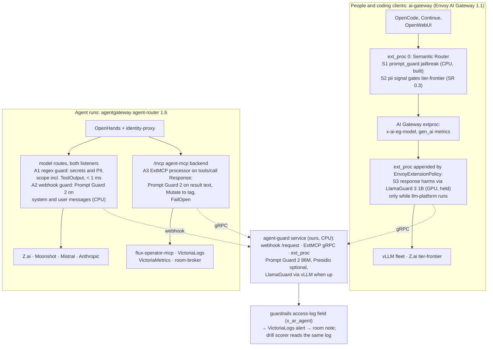

# Google Cloud Model Armor: what it offers, its open-source equivalents, and the shape that fits the Agent Factory

**Date:** 2026-11-04 · **Status:** research · **Read against:** agentgateway `v1.6.0` (the pin; `v1.7.0` where it changes the answer), Envoy AI Gateway / Agent Router `1.1`, vLLM Semantic Router `v0.2.0` (the pin; `v0.4.0` latest), ai-native-ref `main` at `028bf6a`. Every claim cites a URL; **[U]** marks what could not be verified against a primary source. Code is cited at tagged GitHub and docs URLs rather than a local checkout. The Logseq graphs hold no prior note on Model Armor, Prompt Guard or prompt injection.

## Verdict

Model Armor is a hosted detector: four classifier families (prompt injection and jailbreak, responsible-AI harms, sensitive data, malicious URLs) behind a regional REST API, plus Google-only inline hooks (Agent Gateway, Service Extensions on Google load balancers, Google-managed MCP servers, Apigee, Gemini Enterprise) and org-wide "floor settings". Every classifier behind it is proprietary; everything around it is integration. The platform already has the integration half for free: **agentgateway 1.6 ships the guard pipeline Model Armor plugs into** (`promptGuard` with regex, webhook and `googleModelArmor` guards, `Audit`/`Reject` actions, a `guardrails` access-log variable) and **MCP guardrails** (an external `ExtMCP` processor on `tools/call` responses), while the Semantic Router already runs a CPU jailbreak classifier for people. What is missing is open-weight classifiers behind those hooks: Meta's **Prompt Guard 2** (86M, CPU) for injection, the already-served **LlamaGuard 3 1B** for harm categories, built-in regex plus **Presidio** for sensitive data, and the existing Cilium egress policy, which already makes "malicious URL" moot for agents. Model Armor itself is not worth adopting: it puts a SaaS in the data path, sends `internal` data to a third party, is GCP-region-bound, and from EKS it is REST-only. The open-source shape is worth building **later, in a fixed order and as part of v4's untrusted-input hardening**, starting with the two-hour regex layer in `Audit` mode now. It stays a filter: adaptive attacks beat every published detector, so the boundaries remain per-run identity, capability profiles, egress, validated outputs and the merge gate, and the injection drills (v4 landscape gap #7) are what measure whether the filter earned its latency.

## What Model Armor is

Google's own framing: a detector you call, or that Google calls for you inline on Google-controlled paths. It inspects each prompt or response as a **single turn**, text up to 65,536 tokens, does not decode Base64/hex/URL-encoded or ciphertext content, and keeps nothing unless Cloud Logging is on ([overview](https://docs.cloud.google.com/security-command-center/docs/model-armor-overview), [release notes](https://docs.cloud.google.com/model-armor/release-notes)).

| Feature | What it does | Proprietary or integration | Evidence |
|---|---|---|---|
| Prompt injection and jailbreak | Classifier on prompt or response; confidence Low/Medium/High; inputs under three words return `NO_MATCH_FOUND`; filter versions v3 "Stable", v4 "Latest", v1/v2 retire 2026-12-17 | Proprietary model | [overview](https://docs.cloud.google.com/security-command-center/docs/model-armor-overview), [release notes](https://docs.cloud.google.com/model-armor/release-notes) |
| Responsible AI filters | Hate speech, harassment, sexually explicit, dangerous content, each with a confidence level; CSAM always on | Proprietary model | [overview](https://docs.cloud.google.com/security-command-center/docs/model-armor-overview) |
| Sensitive Data Protection, basic | Credit cards, US SSN/ITIN, financial accounts, Google Cloud credentials and API keys; inspect only | Proprietary detectors | same |
| Sensitive Data Protection, advanced | Full DLP templates (infoTypes, custom dictionaries and regex); inspect **and de-identify**; 0.5 MB payload limit | Google DLP service | same, [DeepInspect](https://www.deepinspect.ai/blog/google-model-armor-pricing) |
| Malicious URL detection | Scans URLs in prompts and responses, first 256 only; unavailable in eight "limited-support" regions | Google threat intel | [overview](https://docs.cloud.google.com/security-command-center/docs/model-armor-overview), [regions](https://docs.cloud.google.com/model-armor/feature-availability-by-region) |
| Documents and images | PDF, CSV, TXT, Office formats; files over 4 MB skipped; images JPEG/PNG/BMP, `us`/`eu` only (Preview) | Integration (parsing) + the same classifiers | [overview](https://docs.cloud.google.com/security-command-center/docs/model-armor-overview) |
| Floor settings | Minimum thresholds at organization, folder or project; a template less strict than the floor is rejected; the lower level wins; inline enforcement for Gemini and Google MCP servers is project-level | Integration (policy plane) | [floor settings](https://docs.cloud.google.com/model-armor/configure-floor-settings) |
| REST API | `sanitizeUserPrompt`, `sanitizeModelResponse`, streaming variant; plain text or base64 file; Google advises sending only the latest user message | Integration | [sanitize](https://docs.cloud.google.com/model-armor/sanitize-prompts-responses) |
| Agent Gateway (Gemini Enterprise Agent Platform) | Inline on egress to MCP servers, A2A and OpenAI-format LLMs (vLLM included); sanitizes `tools/call` and `prompts/get` **requests and responses**, not `tools/list`; ingress only for ADK agents; same region required. GA 2026-06-24 | Google-hosted integration | [agent gateway](https://docs.cloud.google.com/model-armor/model-armor-agent-gateway-integration), [release notes](https://docs.cloud.google.com/model-armor/release-notes) |
| Service Extensions | A `GCPTrafficExtension` callout on Google Application Load Balancers and GKE Inference Gateway; `timeout: 1s`, `failOpen: false`; per-model template IDs in `model_armor_settings` JSON. "OpenAI format models, agents and MCP servers on all clouds" | Envoy-callout integration, Google LB only | [GKE inference gateway](https://docs.cloud.google.com/kubernetes-engine/docs/how-to/customize-gke-inference-gateway-configurations), [integrations](https://docs.cloud.google.com/model-armor/integrations) |
| Google and Google Cloud MCP servers | Inline, floor settings only, GA 2026-04-22 | Google-managed only | [integrations](https://docs.cloud.google.com/model-armor/integrations) |
| Apigee, Gemini Enterprise, Agent Platform | Inline policies; Gemini Enterprise adds documents and intermediate steps such as grounding results | Google-hosted integration | same |
| Third-party gateways | agentgateway `googleModelArmor` guard (`Reject`/`Audit`, `failureMode`, template location defaults to `us-central1`) | Integration written by Solo.io | [agentgateway](https://agentgateway.dev/docs/kubernetes/latest/documentation/llm/guardrails/google-model-armor/) |
| Languages | Injection and RAI filters tested in nine languages; English-only in limited-support regions [U] | | [overview](https://docs.cloud.google.com/security-command-center/docs/model-armor-overview), [regions](https://docs.cloud.google.com/model-armor/feature-availability-by-region) |
| Regions | 17 regions plus `us` and `eu` multi-regions; Paris and Frankfurt full; London limited; data residency enforced by default since 2026-10-26 | | [locations](https://docs.cloud.google.com/model-armor/locations), [release notes](https://docs.cloud.google.com/model-armor/release-notes) |
| Latency | No published figure. Google's own callout uses a 1 s timeout; best practice says "enable only the detectors you need" [U] | | [GKE page](https://docs.cloud.google.com/kubernetes-engine/docs/how-to/customize-gke-inference-gateway-configurations), [best practices](https://docs.cloud.google.com/model-armor/best-practices) |
| Pricing | 2M tokens/month free, then $0.10 per 1M tokens (about 4 characters a token); 3B tokens/month included in Security Command Center Premium/Enterprise | | [product page](https://cloud.google.com/security/products/model-armor), [DeepInspect](https://www.deepinspect.ai/blog/google-model-armor-pricing) |

Two constraints matter most for this platform. **Inline integration is Google-infrastructure-only**: Agent Gateway, Service Extensions and the MCP hook all live on GCP; from EKS, or from agentgateway on either cloud, Model Armor is a REST call per request, a SaaS in the data path. **It sees the text**: the `internal` data class exists so that only Anthropic sees internal data ([ADR-0054](https://github.com/Smana/ai-native-ref/blob/main/website/content/docs/decisions/0054-agent-model-providers-anthropic-direct.md)); a Google detector on the `internal` listener would be a second recipient, which the data-class split forbids.

## Open-source equivalents

Checked against the project's own docs or model card; versions and dates are what the page shows. Years shown as "[U year]" come from pages that print day and month only.

| Model Armor feature | Open-source option(s) | Fit for this platform | Evidence |
|---|---|---|---|
| The guard pipeline itself (where filters attach, actions, audit, fail mode) | **agentgateway 1.6 `promptGuard`**: `regex` (Mask/Reject/Audit, < 1 ms), `webhook` (`POST /request`, `/response`; Pass/Mask/Reject), `openAIModeration`, `bedrockGuardrails`, `googleModelArmor`; `failureMode` FailClosed/FailOpen; `scope` SystemPrompt/Messages/ToolInput/ToolOutput, honoured in 1.6 only by regex and Bedrock, by every guard except webhook in 1.7, where the request default adds `ToolOutput`; applies to Completions, Messages, Responses, GenerateContent routes; a `guardrails` CEL variable (`phase`, `guard`, `action`, `actionReason`, `assessments`, no content) for access logs | **Already deployed.** This is the integration half of Model Armor, in the gateway agents already use. The webhook contract carries `messages[].role/content` only, no `tool_calls`, and never takes `scope`: an open-source classifier behind a webhook does not see tool outputs **[U: undocumented; test on the wire]** | [guardrails 1.6.x](https://agentgateway.dev/docs/kubernetes/1.6.x/documentation/llm/guardrails/overview/), [webhook](https://agentgateway.dev/docs/kubernetes/1.6.x/documentation/llm/guardrails/webhook/guardrails/), [OpenAPI](https://raw.githubusercontent.com/solo-io/gloo-gateway-use-cases/refs/heads/main/ai-guardrail-webhook-server/docs/gloo-ai-gateway-guardrail-webhook-openapi.yaml), [v1.6.0](https://github.com/agentgateway/agentgateway/releases/tag/v1.6.0), [v1.7.0](https://github.com/agentgateway/agentgateway/releases), [access log](https://agentgateway.dev/docs/standalone/main/documentation/observability/access-logs/view/) |
| MCP tool-call and tool-result screening (Agent Gateway's `tools/call` sanitising) | **agentgateway MCP guardrails (ExtMCP)**: an ordered list of `processors`, each a remote gRPC server (`remote.backendRef`) with `methods` such as `tools/call: Response`; outcomes Pass, Mutate (`result` replaced), Deny (JSON-RPC `-32001`); `failureMode` FailClosed default; documented for 1.6.x; `v1.6.0` notes expose `mcpGuardrails` metadata to access-log CEL; 1.7 adds an in-proxy CEL processor | **Direct equivalent for the federated MCP servers** (flux docs search, VictoriaLogs and VictoriaMetrics reads, room tools). Logs and metrics are attacker-writable text, so this is the right hook. Which release first shipped the remote processor is **[U]**: confirm on the pinned chart | [about](https://agentgateway.dev/docs/kubernetes/1.6.x/documentation/mcp/guardrails/about/), [processors](https://agentgateway.dev/docs/kubernetes/latest/documentation/mcp/guardrails/processors/), [v1.6.0](https://github.com/agentgateway/agentgateway/releases/tag/v1.6.0) |
| Prompt injection and jailbreak | **Llama Prompt Guard 2** 86M (mDeBERTa, 8 languages, 512-token window, 92 ms on A100; 81.2% attack prevention on AgentDojo) and 22M (English, 19 ms); Llama 4 Community License, not OSI. **vLLM Semantic Router jailbreak LoRA** on BERT, Apache-2.0, Rust/candle, CPU, the one already running as `prompt_guard`. **Granite Guardian 3.3 8B** (Apache-2.0, jailbreak among its harms, English only, vLLM-served, GPU). LlamaFirewall wraps Prompt Guard 2 plus an `AlignmentCheck` that needs a Together API key | Prompt Guard 2 is the best fit per CPU-millisecond and is built for "untrusted data in the context window"; its licence is a Meta community licence, so prefer the Apache-2.0 SR classifier where licence purity matters, at unknown quality **[U: no published eval]**. Both are English-first, 512-token windows: results must be chunked | [Prompt Guard 2](https://huggingface.co/meta-llama/Llama-Prompt-Guard-2-86M), [SR classifier](https://huggingface.co/llm-semantic-router/lora_jailbreak_classifier_modernbert-base_model), [Granite Guardian 3.3](https://huggingface.co/ibm-granite/granite-guardian-3.3-8b), [LlamaFirewall](https://github.com/meta-llama/PurpleLlama/tree/main/LlamaFirewall), [LlamaCon](https://ai.meta.com/blog/llamacon-llama-news) |
| Responsible AI filters | **LlamaGuard 3 1B**, already served as `xplane-llamaguard3-1b` (13 MLCommons categories, prompt and response, 8 languages, F1 0.899 English; Llama 3.2 licence). **Llama Guard 4 12B** (text and image, S14 code-interpreter abuse; Llama 4 licence; one GPU). **ShieldGemma** text 2B/9B/27B (Gemma 2, four harms, English, Gemma terms; no injection category). **ShieldGemma 2** 4B is **image-only**. Granite Guardian 3.3 8B covers harms plus RAG groundedness and function-call hallucination | LlamaGuard 3 1B costs nothing extra and nothing dispatches to it: the gap the serving page lists. Harm filters matter for the human chat path, little for coding agents. ShieldGemma brings nothing the served model lacks and adds a Gemma licence | [Llama Guard 3 1B](https://huggingface.co/meta-llama/Llama-Guard-3-1B), [Llama Guard 4](https://huggingface.co/meta-llama/Llama-Guard-4-12B), [ShieldGemma](https://huggingface.co/google/shieldgemma-2b), [ShieldGemma 2](https://huggingface.co/google/shieldgemma-2-4b-it), [serving gaps](https://github.com/Smana/ai-native-ref/blob/main/website/content/docs/how-it-works/serving/_index.md#known-gaps) |
| Sensitive data, basic | agentgateway built-in regex patterns (credit card with Luhn check since 1.6, SSN, phone, email) plus custom regex for secrets (`AKIA…`, `ghp_`/`ghs_`, `eyJ…`), `Mask` or `Reject`, scope `ToolOutput` included | **Direct equivalent, zero cost, works in 1.6.** Cloud-credential patterns are ours to write; secret scanning already exists in CI (TruffleHog) and this moves a cheap copy to the gateway | [guardrails 1.6.x](https://agentgateway.dev/docs/kubernetes/1.6.x/documentation/llm/guardrails/overview/), [v1.6.0](https://github.com/agentgateway/agentgateway/releases/tag/v1.6.0) |
| Sensitive data, advanced (DLP templates, de-identify) | **Microsoft Presidio** (MIT, analyzer + anonymizer, spaCy or transformers, Docker, Kubernetes; 2.2.366, 27 Oct [U year]). The Semantic Router's PII ModernBERT classifier (loaded, read by no decision). NeMo Guardrails' GLiNER PII example. `agentic-layer/guardrail-adapter` (Apache-2.0) bridges Envoy `ext_proc` to Presidio | Presidio behind the webhook or `ext_proc` gives inspect-and-redact with your own recognizers, CPU-only. For agents it is low value: the identity proxy already keeps credentials out of the sandbox, and PII is rare in infra repositories. For `MoM` chat the designed `NOT pii_any` gate (SR 0.3) is the first step | [Presidio](https://github.com/microsoft/presidio), [releases](https://github.com/microsoft/presidio/releases), [guardrail-adapter](https://awesome.ecosyste.ms/projects/github.com%2Fagentic-layer%2Fguardrail-adapter), [routing gaps](https://github.com/Smana/ai-native-ref/blob/main/website/content/docs/how-it-works/routing-and-cost.md#known-gaps) |
| Malicious URL detection | No maintained open-source classifier: llm-guard's `MaliciousURLs` scanner is archived; feeds (URLhaus, PhishTank) are lists; Google Safe Browsing is an API | **Already covered differently for agents**: the sandbox's Cilium default-deny FQDN egress means a planted URL cannot be fetched. The residual is a URL an agent writes into a PR for a human to click: a regex guard on `ToolInput`/response in Audit, or a merge-gate check, is enough | [llm-guard](https://github.com/protectai/llm-guard), [egress runbook](https://github.com/Smana/ai-native-ref/blob/main/docs/runbooks/agent-factory/03-egress.md) |
| Documents and images | Apache Tika or `unstructured` for extraction, then the same classifiers | Not applicable at the gateway: agents read files inside the sandbox, people's chat clients send text. Skip | — |
| Floor settings (org-wide minimums, non-overridable) | **The CI gateway check** (`scripts/ci/flux-schema/assert-agent-gateway.py`) already holds budgets and capability rules to the factory's values; extend it to require a guard policy on every model route and the MCP backend. Kyverno for a cluster-wide "every HTTPRoute of class X has a guard" rule | The GitOps equivalent is stronger than a console floor: the policy is reviewed in a PR and `task check` refuses a route without it | [gateways page](https://github.com/Smana/ai-native-ref/blob/main/website/content/docs/how-it-works/gateways.md) |
| Frameworks (orchestrate many rails) | **NeMo Guardrails** v0.24.1, 16 Sep [U year], Apache-2.0: input, dialog, retrieval, execution (tool) and output rails, tool-call validation since 0.23; Python library or server; no Helm. **Guardrails AI** v0.11.0, 14 Aug [U year], Apache-2.0, validators as PyPI packages; hosted inference discontinued 2026-08-25. **LlamaFirewall**: Python library, policy engine over scanners | All are in-process Python, designed to wrap an application, not a gateway: they would run inside the sandbox (untrusted) or as a second proxy. A thin webhook/ExtMCP service that calls classifiers directly is less code than hosting any of them | [NeMo](https://github.com/NVIDIA-NeMo/Guardrails), [releases](https://github.com/NVIDIA-NeMo/Guardrails/releases), [Guardrails AI](https://github.com/guardrails-ai/guardrails), [releases](https://github.com/guardrails-ai/guardrails/releases) |
| Dead or research-only | **llm-guard** (MIT, archived 2026-07-08/09, models unmaintained). **Rebuff** (archived 2025-05-16, needs OpenAI and Pinecone). **OpenShield** (archived 2026-02-03, needs an OpenAI key). **Vigil** (alpha, "for research purposes"; YARA, vectors, canary tokens) | Do not build on them. Vigil's canary-token idea (plant a secret in the system prompt, alert if it leaks) is worth copying into the drills | [llm-guard](https://github.com/protectai/llm-guard), [StationX](https://app.stationx.net/articles/llm-guard), [Rebuff](https://github.com/protectai/rebuff), [OpenShield](https://github.com/openshieldai/openshield), [Vigil](https://github.com/deadbits/vigil-llm) |
| Evaluation (does the filter work?) | **CyberSecEval 4** (MIT; textual and visual prompt-injection suites, code-interpreter abuse; needs model API keys). **AgentDojo** is what Prompt Guard 2 reports against. The platform's own injection drills (v4 landscape gap #7) | A filter without a drill is a guess. Run the drills first in `Audit`, read the `guardrails` log, then decide `Reject` per guard | [CyberSecEval](https://github.com/meta-llama/PurpleLlama/tree/main/CybersecurityBenchmarks), [v4 research §5](https://github.com/Smana/ai-native-ref/blob/main/docs/superpowers/specs/2026-10-31-v4-landscape-research.md) |
| Human gateway hooks | **Envoy AI Gateway (Agent Router) 1.1** has no guardrail feature; the request ([#1409](https://github.com/theagentrouter/agent-router/issues/1409), open since 2025-10-22, relabelled 2026-07-13) points to `ext_proc`/`ext_authz`. **vLLM Semantic Router** `prompt_guard` (jailbreak, threshold 0.7, CPU, fail-closed) and `pii` signals are in the chain at filter index 0; no output-side hook in v0.2.0 | For people, the Semantic Router *is* the guard pipeline; a response-side screen needs a second `ext_proc` appended with an `EnvoyExtensionPolicy` | [Agent Router capabilities](https://theagentrouter.ai/docs/capabilities/), [#1409](https://github.com/theagentrouter/agent-router/issues/1409), [SR helmrelease](https://github.com/Smana/ai-native-ref/blob/main/infrastructure/base/vllm-semantic-router/helmrelease.yaml), [SR releases](https://github.com/vllm-project/semantic-router/releases) |

Per-candidate operational facts, for the record:

| Project | Licence · maintainer · last release | Runs as | Needs | Screens |
|---|---|---|---|---|
| Prompt Guard 2 86M / 22M | Llama 4 Community · Meta · 2025-04-29 | Behind our webhook or ExtMCP service; ONNX exists for 22M | CPU; 86M is 92 ms on A100, CPU figure unpublished [U] | Prompt, tool result, any text chunk ≤ 512 tokens; 8 languages (86M) |
| LlamaGuard 3 1B | Llama 3.2 Community · Meta · 2024-09 | Already on vLLM, OpenAI API | One L4 (held) | Prompt and response, 13 harm categories, 8 languages; **not** injection |
| Llama Guard 4 12B | Llama 4 Community · Meta · 2025-04-29 | vLLM | One GPU, 24 GB class | Prompt, response, images; S14 code-interpreter abuse |
| ShieldGemma 2B/9B/27B; ShieldGemma 2 4B | Gemma terms · Google · 2024-07 / 2025-04 | vLLM | GPU | Four harms, English; ShieldGemma 2 images only |
| Granite Guardian 3.3 8B | Apache-2.0 · IBM · 2025-08-01 | vLLM, SGLang | GPU | Harms incl. jailbreak, groundedness, function-call hallucination; English |
| Semantic Router jailbreak + PII | Apache-2.0 · vLLM project · v0.2.0 pinned (2026-03-10), v0.4.0 (2026-09-27) | In the router pod, CPU | 2–4 GiB RAM | User prompt only (v0.2.0) |
| Presidio | MIT · Microsoft · 2.2.366 (27 Oct [U year]) | HTTP service, Docker, Kubernetes | CPU, spaCy model | PII entities; many languages per recognizer; redacts |
| NeMo Guardrails | Apache-2.0 · NVIDIA · v0.24.1 (16 Sep [U year]) | Python library or server | CPU plus the LLM it calls for self-checks | Input, output, retrieval, tool calls and results |
| Guardrails AI | Apache-2.0 · Guardrails AI · v0.11.0 (14 Aug [U year]) | Python library or Flask server | CPU; validators download models | Input, output; hosted inference gone since 2026-08-25 |
| LlamaFirewall | Meta · 2025-04-29 | Python library | Prompt Guard 2 locally; AlignmentCheck needs Together API (SaaS) | Inputs, reasoning, code |
| CyberSecEval 4 | MIT · Meta | Benchmark harness | Model API keys | Evaluation only |
| agentgateway guards and ExtMCP | Apache-2.0 · Linux Foundation (Solo.io) · v1.6.0 2026-10-02, v1.7.0 2026-10-27 | In the gateway | Nothing extra | LLM request/response by scope; MCP methods |

All of the above run on EKS and GKE: they are containers, a vLLM model or a gateway policy; none depends on a cloud service except LlamaFirewall's AlignmentCheck, Rebuff and OpenShield (excluded).

## Recommended shape for this platform

The platform already owns the hooks; the work is a small **`agent-guard`** service (CPU, two replicas, ours) that speaks three protocols to the same classifiers, plus policies and a CI rule. Everything starts in `Audit` and moves to `Reject` per guard only on drill evidence.

**Where each screen sits, and why there.**

| Screen | Where | Runs on | Covers | Order |
|---|---|---|---|---|
| A1 secrets and PII regex | `AgentgatewayPolicy` `promptGuard.request[].regex` on `agentgateway-models` and `-internal` routes, `scope: [SystemPrompt, Messages, ToolOutput]` | In the proxy, < 1 ms | A credential or card number in anything an agent sends a provider, tool results included. `Audit` on `internal`, `Reject` on `public` once the drills show no false positive on YAML and logs | **Now**: two hours, no new component |
| A2 injection on prompts | `promptGuard.request[].webhook` → `agent-guard` `/request`, `failureMode: FailOpen`, `action: Audit` | CPU, Prompt Guard 2 86M, chunked at 512 tokens; scan only messages not seen before (hash per run) so a 100k-token context costs one chunk per turn | Direct jailbreaks in issue text that the scoper copies into the task; system-prompt tampering | With v4 untrusted-input hardening |
| A3 injection in MCP results | `spec.backend.mcp.guardrails.processors[]` on `agent-mcp`, `tools/call: Response`, `failureMode: FailOpen` | The same service, ExtMCP gRPC | Log lines, metric labels, flux docs and room messages that come back from federated servers: the attacker-writable text an investigate run reads. `Mutate` wraps a flagged result in a marker the harness prompt tells the model to distrust; `Deny` only for secrets | Same milestone; the vector that matters for RunLore |
| A4 injection in non-MCP tool results | Tool-role messages from the harness's own tools (`gh`, `curl`, file reads) appear only inside the LLM request. In 1.6 only regex reads `ToolOutput`; in 1.7 every guard but the webhook does | **Open-source gap at the gateway.** Options: upstream `scope` for webhooks (file the issue); or screen in Maku's identity-proxy, which already sees every body; or accept regex-only here | Decide after A3's drill results |
| S1 jailbreak on `MoM` | Semantic Router `prompt_guard` | Built | People's prompts to local models | Done |
| S2 PII gate | SR 0.3 `NOT pii_any` on the frontier decision | Designed | Keeps PII off Z.ai from chat | Already in the routing design |
| S3 response harms | A second `ext_proc` appended with an `EnvoyExtensionPolicy` (after routing, so order no longer matters), `failure_mode_allow: true`, short timeout | LlamaGuard 3 1B on vLLM, through `agent-guard` so the classifier can change | Chat responses to people; gives the held GPU a job | Only if self-hosted chat gets real users; else pack the GPU as the roadmap says |

**Reporting.** One path, three readers. agentgateway writes every guard result into the `guardrails` variable: add `guardrails`, `guardrails[0].action` and `guardrails[0].actionReason` as access-log fields, filtered on `guardrails.size() > 0`, beside `x_ar_agent`, which already names the run; `assessments` carries no content, so the log stays content-free like the traces. ExtMCP decisions arrive the same way (`mcpGuardrails` dynamic metadata, exposed to access-log CEL in `v1.6.0`). From there: a VictoriaLogs rule counts hits per run and guard (`AgentGuardrailHit`), the room gets a note from the harness when a `Reject` returns 403 (the body names the guard, as `agent_budget_exhausted` does for budgets), and the drill scorer reads the log to compute detection and false-positive rates per guard. OpenTelemetry: the OTLP access log already carries the `agentgateway.access` scope; no new exporter.

**What it would cost.**

| Item | Estimate |
|---|---|
| A1 regex policies, CI rule in `assert-agent-gateway.py`, access-log fields | 1 to 2 days |
| `agent-guard` service: webhook HTTP, ExtMCP gRPC, `ext_proc` gRPC; Prompt Guard 2 via ONNX or candle; chunking; per-run seen-hash; Helm, network policy, restricted PSS, probes | 1.5 to 2 weeks |
| Drill integration: planted injections in issues, PR comments, log lines, MCP results; scoring from the access log | Shared with v4 "untrusted-input hardening" |
| Run cost | Two CPU pods, 1 vCPU / 2 GiB each: about $15 to 30 a month on spot. LlamaGuard's L4 is already paid (about $216 a month at the design's $0.30/h) and the roadmap wants it packed; S3 is the only use that justifies keeping it |
| Latency added per agent model call | Regex nil; webhook tens to a few hundred ms per new 512-token chunk on CPU [U]; against an 11 s median model reply, under 3% |
| Model Armor for comparison | At the fleet's day cap of 25M reference tokens (B2 is 41M), about 750M tokens a month if every request were screened: about $75 a month, plus GCP egress, a region-bound template, and a third party reading `internal` data |

**What it would still not protect against.** The platform's own stance holds: *a filter, not a boundary*. Adaptive attacks defeated 12 published prompt-injection defences at over 90% where the papers had reported near zero, and human red-teamers reached 100% ([Willison](https://simonwillison.net/2025/Nov/2/new-prompt-injection-papers/)). Prompt Guard 2's own number is 81.2% attack prevention on AgentDojo, non-adaptive ([model card](https://huggingface.co/meta-llama/Llama-Prompt-Guard-2-86M)). Model Armor shares the structural limits: single-turn, no decoding of encoded payloads, text-only, 512-token windows in the open models. Specific residuals here: an injection split across several tool results; one phrased as a plausible maintainer instruction in a PR comment; YAML, PromQL and stack traces that look adversarial to a classifier trained on chat (false positives are the likelier drill finding); a reviewer run persuaded to approve inside the room, which no text filter sees. The controls that bound the damage stay the ones in place: a `sub` per run, the capability profile's model and tool rules, Cilium default-deny egress, short-lived tokens, the merge gate's class policy, and the planned validated outputs with protected files. The guard's value is **evidence**: it turns silent injection attempts into a counted, attributed log line the drills can score.

**Is it worth doing, and in what order?**

1. **Now, cheaply (A1 and the log field):** regex secrets and PII in `Audit` on both listeners, the `guardrails` access-log fields, and the CI rule that every model route carries the policy. It costs a day and produces data.
2. **With v4's untrusted-input hardening (A2, A3, drills):** build `agent-guard` with Prompt Guard 2, wire the webhook and the ExtMCP processor in `Audit`, run the injection drills, then promote guards to `Reject` one at a time on their measured false-positive rate. Decide A4 (tool results inside the LLM request) on what A3 shows; file the upstream webhook `scope` request first.
3. **Later or never (S3, Presidio, ShieldGemma, Model Armor):** a response-harm screen for people only when the self-hosted chat has users; Presidio only if PII appears in the drills; ShieldGemma never (English-only, no injection category, Gemma terms, and LlamaGuard already runs); Model Armor never on this platform's stance, unless a GKE-only adopter wants its compliance paper trail and accepts the third party.

## Reconsider if

- agentgateway lets webhook guards take `scope`, or exposes tool-role messages to the webhook: A4 becomes a configuration change, not Maku code.
- Envoy AI Gateway / Agent Router ships native guardrails ([#1409](https://github.com/theagentrouter/agent-router/issues/1409)): S3 moves from a hand-written `ext_proc` to a CRD.
- The Semantic Router adds an output-side or tool-result hook: S3 folds into the router.
- The injection drills show detection below what the regex layer alone gives, or false positives that block legitimate runs: drop the classifier layer and keep the boundaries.
- An open-weight classifier with an OSI licence matches Prompt Guard 2 on AgentDojo-style agent benchmarks: swap it in behind `agent-guard`.
- An adopter on GKE needs Model Armor's compliance record (FedRAMP High, SCC findings) for `public` data: the `googleModelArmor` guard is one policy, in `Audit`, on the `public` listener only.

## Sources

- Model Armor: [overview](https://docs.cloud.google.com/security-command-center/docs/model-armor-overview), [integrations](https://docs.cloud.google.com/model-armor/integrations), [Agent Gateway integration](https://docs.cloud.google.com/model-armor/model-armor-agent-gateway-integration), [floor settings](https://docs.cloud.google.com/model-armor/configure-floor-settings), [sanitize API](https://docs.cloud.google.com/model-armor/sanitize-prompts-responses), [locations](https://docs.cloud.google.com/model-armor/locations), [feature availability by region](https://docs.cloud.google.com/model-armor/feature-availability-by-region), [release notes](https://docs.cloud.google.com/model-armor/release-notes), [GKE Inference Gateway configuration](https://docs.cloud.google.com/kubernetes-engine/docs/how-to/customize-gke-inference-gateway-configurations), [product and pricing page](https://cloud.google.com/security/products/model-armor), [DeepInspect pricing note, 2026-10-18](https://www.deepinspect.ai/blog/google-model-armor-pricing)
- agentgateway: [LLM guardrails 1.6.x](https://agentgateway.dev/docs/kubernetes/1.6.x/documentation/llm/guardrails/overview/), [latest, with scope definitions](https://agentgateway.dev/docs/kubernetes/latest/documentation/llm/guardrails/overview/), [webhook guide](https://agentgateway.dev/docs/kubernetes/1.6.x/documentation/llm/guardrails/webhook/guardrails/), [webhook OpenAPI](https://raw.githubusercontent.com/solo-io/gloo-gateway-use-cases/refs/heads/main/ai-guardrail-webhook-server/docs/gloo-ai-gateway-guardrail-webhook-openapi.yaml), [Google Model Armor guard](https://agentgateway.dev/docs/kubernetes/latest/documentation/llm/guardrails/google-model-armor/), [MCP guardrails about](https://agentgateway.dev/docs/kubernetes/1.6.x/documentation/mcp/guardrails/about/), [MCP processors](https://agentgateway.dev/docs/kubernetes/latest/documentation/mcp/guardrails/processors/), [access-log `guardrails` variable](https://agentgateway.dev/docs/standalone/main/documentation/observability/access-logs/view/), [v1.6.0 release](https://github.com/agentgateway/agentgateway/releases/tag/v1.6.0), [releases](https://github.com/agentgateway/agentgateway/releases)
- Envoy AI Gateway / Agent Router: [capabilities](https://theagentrouter.ai/docs/capabilities/), [issue #1409](https://github.com/theagentrouter/agent-router/issues/1409)
- vLLM Semantic Router: [releases](https://github.com/vllm-project/semantic-router/releases), [jailbreak classifier card](https://huggingface.co/llm-semantic-router/lora_jailbreak_classifier_modernbert-base_model), this repository's [helmrelease](https://github.com/Smana/ai-native-ref/blob/main/infrastructure/base/vllm-semantic-router/helmrelease.yaml) and [EnvoyPatchPolicy](https://github.com/Smana/ai-native-ref/blob/main/infrastructure/base/envoy-ai-gateway/envoypatchpolicy-semantic-router.yaml)
- Models: [Llama Prompt Guard 2 86M](https://huggingface.co/meta-llama/Llama-Prompt-Guard-2-86M), [Llama Guard 3 1B](https://huggingface.co/meta-llama/Llama-Guard-3-1B), [Llama Guard 4](https://huggingface.co/meta-llama/Llama-Guard-4-12B), [LlamaCon announcement](https://ai.meta.com/blog/llamacon-llama-news), [ShieldGemma 2B](https://huggingface.co/google/shieldgemma-2b), [ShieldGemma 2](https://huggingface.co/google/shieldgemma-2-4b-it), [Granite Guardian 3.3 8B](https://huggingface.co/ibm-granite/granite-guardian-3.3-8b), [Granite Guardian 3.2 5B](https://huggingface.co/ibm-granite/granite-guardian-3.2-5b)
- Frameworks and tools: [PurpleLlama](https://github.com/meta-llama/PurpleLlama), [LlamaFirewall](https://github.com/meta-llama/PurpleLlama/tree/main/LlamaFirewall), [CyberSecEval](https://github.com/meta-llama/PurpleLlama/tree/main/CybersecurityBenchmarks), [NeMo Guardrails](https://github.com/NVIDIA-NeMo/Guardrails) and [releases](https://github.com/NVIDIA-NeMo/Guardrails/releases), [llm-guard](https://github.com/protectai/llm-guard) and [StationX on its archiving](https://app.stationx.net/articles/llm-guard), [Presidio](https://github.com/microsoft/presidio) and [releases](https://github.com/microsoft/presidio/releases), [Guardrails AI](https://github.com/guardrails-ai/guardrails) and [releases](https://github.com/guardrails-ai/guardrails/releases), [Rebuff](https://github.com/protectai/rebuff), [Vigil](https://github.com/deadbits/vigil-llm), [OpenShield](https://github.com/openshieldai/openshield), [guardrail-adapter](https://awesome.ecosyste.ms/projects/github.com%2Fagentic-layer%2Fguardrail-adapter)
- Platform: [gateways](https://github.com/Smana/ai-native-ref/blob/main/website/content/docs/how-it-works/gateways.md), [serving known gaps](https://github.com/Smana/ai-native-ref/blob/main/website/content/docs/how-it-works/serving/_index.md#known-gaps), [routing and cost](https://github.com/Smana/ai-native-ref/blob/main/website/content/docs/how-it-works/routing-and-cost.md), [v4 landscape research §5](https://github.com/Smana/ai-native-ref/blob/main/docs/superpowers/specs/2026-10-31-v4-landscape-research.md), [status](https://github.com/Smana/ai-native-ref/blob/main/website/content/docs/status.md), [Willison on adaptive attacks](https://simonwillison.net/2025/Nov/2/new-prompt-injection-papers/)
