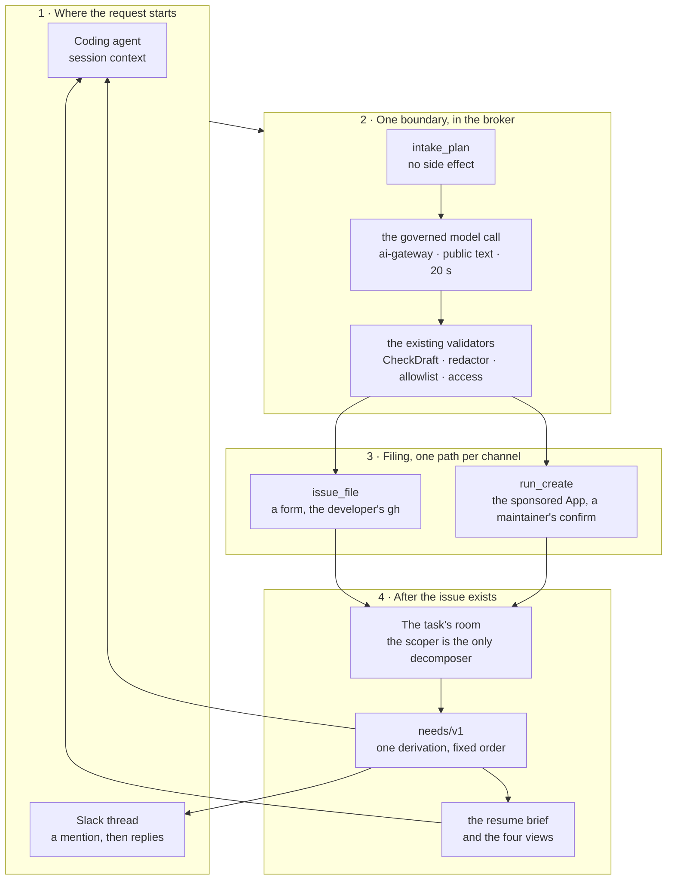
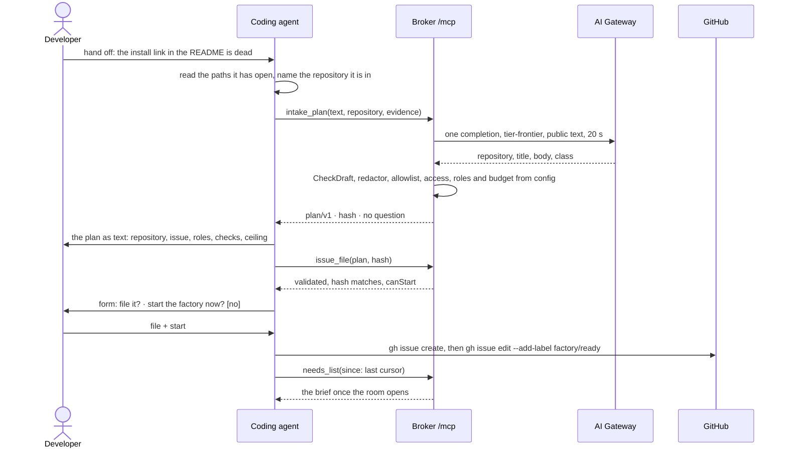

# v3.x: conversational developer experience

**Date:** 2026-11-05 · **Status:** design for owner review. The scope and the sixteen owner
decisions in [Owner decisions](#owner-decisions) were validated on 2026-11-05. Nothing here is built ·
**Part of:** v4.0 item 7, "Developer experience"
([v4 roadmap](2026-10-31-v4-roadmap-design.md#core)), delivered as increments in the v3.x line on the
v3.0.0 platform · **Follows:** the [factory from your coding agent](2026-10-25-factory-from-your-agent-design.md),
[factory interfaces](2026-10-21-factory-interfaces-design.md) F3, F9 and F8, the
[scoper](2026-10-22-scoper-design.md) SC1 to SC9, the [splitter](2026-10-23-splitter-design.md), and
[S6](2026-09-23-agent-collaboration-rooms-design.md) (a task is sequential runs in one room) ·
**Amends:** [factory from your coding agent](2026-10-25-factory-from-your-agent-design.md) FA12 and
FA13 (prompts and skill), and the Slack intake flow of
[F9](2026-10-21-factory-interfaces-design.md#decisions) · **Depends on:** the
[Slack push-approval design](2026-11-05-v3x-slack-push-approval-design.md), same date, for three
things it owns: `chat.update` on the App's Slack interface, interactivity dispatched inside the one
`POST /slack/events` handler, and the webhook vocabulary at thirteen types with `room.approval_closed`
([the seam](#seam-approval)) · **Sibling:** the multi-repository design being written separately;
[the seam](#seams) is all this design says about it · **Read from:** Maku at
`4685672f0f40973286a121f83ea92dd3428b8120`. Every `internal/…:N` citation below is that commit.

## Outcome

You say what you want in the words you already use, in Slack or in your coding agent, and one
question at a time gets you to a plan you can read: the repository with the evidence for it, the issue
it will file, the roles that will run, the checks that will say it is done, and what it may cost. You
confirm it, and only then does an issue exist and a room open.

Both channels reach **one planner**, a broker tool that turns the request into that plan through one
governed model call. A coding agent adds the context it has (the repository it is in, the paths it
read); it does not write the plan, and its own model is not a second planner. Slack adds the thread and
the channel's repositories. The plan is validated by the same code either way, so the two channels
cannot produce different readings of the same request.

After that, the factory talks back in the same place. Four surfaces — your coding agent, the `maku`
CLI, a Slack thread, the room page — show one list of what needs you, in one order, each item with one
action and a link. A Slack thread keeps one proposal message that updates in place, then tells you how
the work goes and answers "how is it going?" without ever steering the run. Coming back after a day
away gives you a short, deterministic brief: what was asked, which plan version ran, what changed,
what blocks it, and the one thing to do.

The increment removes a grammar without removing a control. Issues stay mandatory, the scoper stays
the only thing that decomposes a task after filing, the human stays the filer on both channels, and no
new tool can approve, steer or stop a run.

## Scope

| In this design | Out, and where it goes |
|---|---|
| One natural-language planner in the broker, used by both channels through one governed model call | A general dialogue engine, a workflow engine, chat memory ([Not in this design](#not-in)) |
| One `needs/v1` derivation behind four surfaces | Ranking, routing to owners, stale auto-close ([v4.1](2026-10-31-v4-roadmap-design.md#increments)) |
| A deterministic resume brief | Scheduled digests, email, desktop notifications |
| Review and CI feedback continuing the same room | The pre-PR verification loop, the continuation loop ([v4.2](2026-10-31-v4-roadmap-design.md#increments)) |
| One proposal message in Slack, with controls | Approving a run from Slack (its own design, [the seam](#seam-approval)) |
| Small, PR-sized fixes in the [fast-follow pack](#fast-follow) | A new platform, a new service, a new store |
| One public repository, end to end, in the live proof | Multi-repository tasks, fleet campaigns, cross-factory orchestration |
| The planner's public model route | The planner's internal route, and any cross-repository code search |

## What exists today {#exists}

Everything in this table is shipped and cited at the commit named in the header. "Gap" rows are what
the rest of this design closes.

| Piece | State | Today, precisely | Where |
|---|---|---|---|
| Slack mention grammar | Shipped | Line 1 is `[<owner/repo>] <title>`; a channel serving one repository may omit it. A malformed line is refused with a `Try:` line. Nothing is inferred from the thread, and no model runs | `internal/slackapp/draft.go:31` (`ParseMention`), `:79` (`areaTitle`) |
| Slack body grammar | Shipped | The App composes the three template sections from `Should:`/`Acceptance:` keywords and free text. Deterministic, and the only reader of a mention | `internal/slackapp/draft.go:159` (`composeBody`) |
| Slack draft editing | Shipped | A reply re-composes the draft and posts a **new** message; at most 20 revisions per thread; the earlier draft stays and a ✅ on it is refused | `internal/slackapp/app.go:564` (`reply`), `:30` (`maxRevisions`), `:472` (`postDraft`) |
| The draft's recovery invariant | Shipped | The full structured draft (`repo`, `title`, `body`, `sha256`, `author`, `rev`) is the message's **metadata**; nothing is stored. The App re-reads the thread, recomputes the hash from the metadata and drops a message whose hash does not hold. Metadata over 8 KiB is refused, never truncated | `internal/slackapp/slack.go:27` (`Metadata`); `internal/slackapp/app.go:32` (`maxMetadata`), `:168` (`draftHash`), `:472` (`postDraft`), `:513` (`threadDraft`) |
| Slack filing | Shipped | A `white_check_mark` files the latest draft: linked user, maintainer of the repository, the message is the bot's own, hash matches, channel configured, one issue per thread. The App calls `run_create` with the sponsor and the channel's `maxCostUSD` | `internal/slackapp/app.go:624` (`reaction`), `:630` (`file`); `docs/slack.md` "File" |
| Slack after filing | Shipped, one-way | Broker webhooks post one line per event. A reply once the draft is filed is dropped without a word. There is no status question | `internal/slackapp/app.go:564`, `docs/slack.md` "Flows" |
| Slack controls | Shipped, none | The manifest declares `interactivity: {is_enabled: false}` and there is no `block_actions` handler. The App has no `chat.update` | `docs/slack.md` "Manifest"; `internal/slackapp/slack.go:52-66` |
| Webhook vocabulary | Shipped, closed | Twelve types, closed; the App maps nine of them to a thread line and silently drops `task_received`, `run_ended` and `monitor_verdict` | `internal/webhook/events.go:15-17`; `internal/slackapp/app.go:849` (`line`) |
| Coding-agent drafting | Shipped | The `handoff` prompt tells the model to write the three sections and call `issue_draft`, then `issue_file`. The model chooses the repository and writes the text; the broker validates text, not place | `internal/humanapi/mcpprompts.go:50`; `internal/humanapi/issuedraft.go:44` |
| Issue validation | Shipped | `sanitize.CheckDraft` holds the title to `<area>: <what>` and the body to the three headings in order, strips hidden characters, then the broker's redactor refuses a secret. This is the only validator | `internal/factory/sanitize/draft.go:31`; `internal/humanapi/issuedraft.go:82` |
| Filing, coding agent | Shipped | `issue_file` is a `maku` relay tool: an elicitation form shows the draft, offers "start the factory now" only when `canStart`, then runs `gh issue create` and optionally `gh issue edit --add-label`. Never a tool argument | `internal/maku/issuefile.go:58`, `:80`; `internal/humanapi/issuedraft.go:57` (`canStart`) |
| Model callers | Shipped, two | Every model call crosses a gateway chosen by caller: a run through the agent gateway on the run's own JWT, humans and coding clients through `ai-gateway` on a per-client API key. **The broker calls no model at all** | `internal/runctl/pod.go:94`; `website/content/docs/how-it-works/gateways.md` |
| A bounded HTTP classifier call | Shipped | The factory's tier classifier is the existing pattern for a non-run caller: an audited egress client, a 3 s deadline, a 64 KiB reply cap, a strict decode, and a fallback that never blocks the task | `internal/factory/triage/c7.go:44`, `:56` |
| Room creation | Shipped | `POST /api/rooms` lets an agents member create a room owned and driven by them. No MCP tool, no Slack path reaches it; `maku run` uses it for the local quickstart only | `internal/humanapi/rooms.go:59`; `internal/maku/run.go:80` |
| Needs, per room | Shipped | `summary.View` lists an approval, a hold, a merge and a `needs_author` answer; the room-row path lists the same four again, separately | `internal/summary/summary.go:401`, `:420`; `internal/humanapi/rooms.go:374` (`needs`) |
| Needs, across rooms | Shipped, by hand | The inbox prompt says "call `rooms_list` with `needsMe`, then with `mine`": the merge is the model's. The CLI exposes two filters, not one list | `internal/humanapi/mcpprompts.go:74`; `internal/maku/client.go:67` |
| Needs, the split hole | Gap | A proposed split is `Escalated` with reason `split_proposed` and **no PR**. `Merge` needs a PR and `Answer` needs `needs_author`, and neither `needs` nor `View` has a fifth clause, so the row has no need and no step: it is invisible to `--needs-me`, to `room_wait`'s `needs_you` and to the room page's step. No page records it | `internal/factory/reconciler/split.go:95`; `internal/summary/waiting.go:81`, `:95`; `internal/summary/step.go:49`; `internal/humanapi/rooms.go:374`; `internal/maku/roomwait.go:80` |
| Needs, the merge hole | Gap, and a contradiction | `Merge` and `Answer` require `policy.Close`, and `Close` is `Role == Owner`. A maintainer who is not the room's owner therefore gets no merge need, though GitHub would let them merge — the comment above `Merge` assumes owner and maintainer are the same person. The command reference states the symptom ("a task waiting for your merge is not listed under `--needs-me`") while `prNeed` lists it for the owner, so the doc and the code disagree | `internal/summary/waiting.go:78`, `:81`; `internal/policy/policy.go:139`; `internal/humanapi/rooms.go:335` (`prNeed`); `website/content/docs/reference/commands.md:43` |
| What changed | Shipped | `room_changes` returns milestones since a cursor; `maku` keeps the cursor locally. There is no brief that joins it to the outcome, the plan and the blocker | `internal/humanapi/mcpchanges.go`; `internal/maku/cursors.go` |
| Plan and progress | Shipped | `TaskFacts.Plan` holds the personas the task expects to run; the web rail draws them with the steps still to come | `internal/envelope/payloads.go:153`; `internal/factory/reconciler/facts.go:289` (`planOf`); `web/src/flow.ts` |
| Next step wording | Shipped, wrong in one path | `MergeHow` renders "tick bypass rules … `gh pr merge --admin`"; `Merge` prefers `ApproveHow` only when the facts say `MergeByApproval`. Under approve-to-merge a card can still tell you to admin-merge | `internal/summary/waiting.go:56`, `:81`; status page known limitations |
| Final cost | Shipped, frozen early | A run's cost waits `endSettle` (2 min) after it ends; a terminal task stops reconciling, and the facts key buckets dollars to 10 % steps, so the card's dollars precede the settle | `internal/factory/meter/meter.go:227`; `internal/factory/reconciler/facts.go:155`, `reconciler.go:909` |
| Run admission | Shipped | One rule for every run: `live >= caps.ConcurrentRuns` refuses with `waiting_run_slot`, and the review WIP cap is checked before it. A revision queues behind a first run | `internal/factory/reconciler/implement.go:57`, `:79` |
| Sponsored tool list | Shipped, closed | A sponsored principal gets `run_create` plus `issue_draft`, `room_summary`, `room_tail`, `room_changes`. The list is pinned by a test | `internal/humanapi/mcp.go:155`; `internal/humanapi/sponsored_test.go:80` |
| Client capabilities | Shipped, unproven | The relay reads forms, URL mode and roots from `initialize`. The commands reference still marks Claude Code's forms and slash commands "unconfirmed", and four clients unconfirmed in most columns | `internal/maku/mcp.go:158`, `internal/maku/localtools.go:81`; `website/content/docs/reference/commands.md` |
| Channel configuration | Shipped, three places | The same channel-to-repository mapping lives in the App's `channels`, the factory's `api.sponsored.repositories`, and the broker's `webhooks[].repositories`, plus a whole-file overlay copy of the first | `internal/slackapp/config.go:43`; `tooling/base/agent-factory/slack-app/config.yaml`; `tooling/gcp-0/agent-factory/helm-values-sponsored.yaml`; `infrastructure/gcp-0/room-broker/config.yaml` |

### The gaps this design closes {#gaps}

**G1 — there is no shared brain, so the two channels read the same request differently.** Slack has a
keyword composer and no model (`draft.go:159`). A coding agent's own model writes the plan, and the
broker only checks the text (`issuedraft.go:44`). The same sentence therefore produces a template
draft in one place and a model's guess in the other, with no shared notion of which repository, which
roles or which budget. That is the gap the owner closed, and it is not closed by making Slack
deterministic.

**G2 — the repository is the person's job.** In Slack it must be on line 1 or be the channel's only
repository. In a coding agent the model guesses from the conversation, and nothing checks that the
factory serves the repository, or that the person may file there.

**G3 — the plan is not visible before it is expensive.** The roles, the cost ceiling and the checks
that will judge the work are decided after the issue exists: the scoper's scope, the class's template,
the task's budget. A wrong reading costs a run. The vocabulary to show them already exists
(`TaskFacts.Plan`, `web/src/flow.ts`) and is not used before filing.

**G4 — there is no inbox, only four lists.** `needs` and `summary.View` are two implementations of the
same rule; the cross-room merge is a prompt telling the model to call `rooms_list` twice; the split
proposal falls through all of them; and the merge need is gated on the room's owner rather than on who
may merge the pull request (the two rows above).

**G5 — the thread stops talking when the work starts.** Today the App posts events and ignores replies
after filing (`app.go:564`). "How is it going?" has no answer in the place the work was asked for.

**G6 — a resumed session restarts from zero.** The card gives state and the next step; `room_changes`
gives milestones. Nothing joins them, so a developer coming back cannot see which plan version ran,
what changed while they were away, and what the blocker is, in one read.

**G7 — five small truths are wrong or missing.** A card can still say admin-merge under approve-to-merge.
A task's dollars freeze before they settle. Four client capabilities are documented but unproven. The
same channel is configured in three files, two of which can drift silently. A CI or permission failure
arrives as a reason code, not as something you can act on.

## Decisions {#decisions}

### Owner decisions, 2026-11-05 {#owner-decisions}

| # | Decision | Rejected | Why |
|---|---|---|---|
| CD1 | **Natural language replaces the command and field grammars; the issue does not go away.** A confirmed issue creates the room. There is no room without an issue and no `room_create` on any surface | A chat that opens rooms; keeping the field grammar as the only path | The issue is the task's snapshot and the factory's audit text ([interfaces F1](2026-10-21-factory-interfaces-design.md#decisions)); a room with no issue has no task, no gate and no `--mine`. `POST /api/rooms` keeps its one caller, the local quickstart (`internal/maku/run.go:80`) |
| CD2 | **One pre-filing boundary, shared by Slack and coding agents, with one implementation. The in-task scoper stays the only post-filing decomposition engine** | A second planner that also splits work after filing; two boundaries that drift; a boundary per channel | Two decomposers would disagree about the same issue, and the scoper's scope is what the implementer, judge and reviewer all read ([SC9](2026-10-22-scoper-design.md)). Before filing there is no task to scope. "Shared" is only true if the reading of the request is shared |
| CD3 | **The boundary's issue output is the existing one.** Every proposed issue goes through `sanitize.CheckDraft` and the broker's redactor; no new template, no relaxed title rule | A plan-specific template; a free-form body the factory parses later | One validator keeps the factory's intake, the API and Slack in agreement; `internal/factory/sanitize/draft.go:31` is already shared by both |
| CD4 | **Filing stays per channel.** A coding agent files with the developer's own `gh` behind a form; Slack files with its sponsored App after a maintainer's confirmation | One filing path for both; letting the plan tool file | The developer's `gh` keeps the issue theirs, which `--mine` and the maintainer check depend on (FA4); the App's path is the only one a channel can carry |
| CD5 | **Repository inference is contextual and shows its evidence.** The channel's or the session's context, the allowlist, and an explicit `owner/repo` or a path the person named. Several candidates means the alternatives are listed with their evidence and **one** question is asked, with a recommended answer | Asking the person to type `owner/repo` every time; guessing silently; a cross-repository code search | The mapping is one line, and people already describe work in the words that identify the file ("the install guide"). Evidence is what makes a wrong inference cheap to reject. A search service is a new component and a cross-repository oracle for one question |
| CD6 | **No new steering, approval or stop surface.** The boundary proposes; it never decides. `factory/stop` and the room page keep their standing | A "confirm plan and start" tool argument; an approve tool; a stop tool | ADR-0049 stands: a client an agent can drive never decides for a human. The stop stays the developer's own label, applied only when they ask for it (`internal/summary/summary.go:465`) |
| CD7 | **One continuously updated proposal message in Slack, with structured controls.** A confirmation binds the exact version it showed | One message per revision, as the draft works today | Forty revisions should be one message, not forty. A version-less confirm is a confirm of something the person may no longer be reading |
| CD8 | **After filing, the thread projects progress and answers status questions.** Ordinary replies never reach the run | Leaving the thread one-way; letting a reply steer | The question is asked in chat, so the answer belongs there. Steering stays on the room page (ADR-0049) |
| CD9 | **Approving a run from Slack is a separate design.** This one defines only the seam: `needs/v1` carries a stable approval id and a decide URL, and the Slack renderer shows the link | Building approval here | [v4 V6](2026-10-31-v4-roadmap-design.md#owner-decisions-2026-10-31) turns approval on; its limits, its commit binding and its audit are that design's |
| CD10 | **One needs-me inbox across the four surfaces**, ordered by a fixed rule, each item with one action and one link. No ranking, no routing, no stale-closing | A per-surface list; priority scoring | Four lists are four chances to miss the one thing that blocks work. Ranking is [v4.1](2026-10-31-v4-roadmap-design.md#increments) and needs outcomes this does not have |
| CD11 | **Notifications are meaningful transitions only, and the resume brief is deterministic** | Posting every run event; a model-written summary | A run start is not news; a review request, a red check and a hand-off are. The brief's text is built by the same package that escapes untrusted text, so it cannot become a channel for an agent's prose |
| CD12 | **Review and CI feedback continue the same room and its context; revisions are preferred over new intake; the real diff and the failing logs are supplied when available** | A new room per review round; a fair queue for everything | The room holds the task's scope, the notes and the branch. A revision that waits behind a stranger's first run is a stuck pull request. The reviewer's comments and the failing job are the cheapest context there is |
| CD13 | **Plan confirmation and live progress reuse the roles vocabulary and the stage strip.** The multi-repository diagram belongs to the sibling design | A plan-specific role vocabulary; a diagram per surface | `TaskFacts.Plan` already names the personas in order and the rail already draws them (facts.go:289, web/src/flow.ts). One picture, one set of words |
| CD14 | **A plan edit is a repost with the changed sections marked. Materiality is a fixed table**, and it is exactly the set of fields the hash covers | A model judging materiality; a diff engine over proposals; "prose does not matter" | A model judging its own change is the wrong direction of trust. The body of the issue *is* the work order, so a body change is material; only the evidence and the question's wording are not |
| CD15 | **One clarification at a time, with a recommended answer** | A list of questions; a form with five fields | [SC7](2026-10-22-scoper-design.md) measured the same rule for the scoper: asking must be a deliberate step, and a list of questions is a form. The recommendation is what makes one answer enough |
| CD16 | **The fast-follow pack is bounded, PR-sized work** ([below](#fast-follow)) | Folding them into the increment; a cleanup milestone | Each one is a defect with a test, not a design. They ship on their own so the increment's proof stays about intake and the inbox |

### Settled while designing

These were decided here and are marked for the owner's reading; they are the parts where a different
answer changes the shape of the code.

| # | Decision | Why |
|---|---|---|
| CD17 | **The planner's model proposes the reading; configuration fixes what costs money or changes the run.** The model returns the repository, the title, the body and the class. **Roles** come from the class's template (`Cfg.Templates[class].Roles` plus the scoper and tester switches), **budget** from the class's `taskUSD` and the channel's `maxCostUSD`, and both are echoed back by the broker, not by the model. A model-named value for any of the three is dropped and logged | A model that names its own budget or roles is a model that can widen them. Both numbers already exist and are already enforced ([truthful costs](2026-10-22-truthful-costs-design.md)); the class is the only lever the model needs, and the class is shown |
| CD18 | **One planner, one governed model route, both channels.** `intake_plan` runs in the broker. A coding agent passes context (its repository, the paths it read); its model does not compose the plan and is never the alternate planner. Slack passes the thread and the channel. The call is public-data only, through `ai-gateway` with the broker's own client identity, a pinned alias, a hard deadline and a bounded reply. A small deterministic composer exists as a **degraded mode only**: off by default, labelled as not the natural-language experience, and outside the live proof | Two planners is the drift G1 describes. A private or self-hosted model in the broker would be a second, ungoverned data path. The degraded composer is kept because a channel with no planner is worse than a plain template, but it must never be mistaken for the feature |
| CD19 | **At most three issues, one defect each. Several issues only when the requester named several outcomes; the plan never turns one outcome into parts.** `dependsOn` is displayed and recorded on the issue body, not enforced by the factory. Slack can file exactly one, and only when the whole plan fits a message's metadata | One defect per issue is the skill's rule and the scoper's input. Splitting one outcome is the splitter's job, after filing, with a maintainer's `/factory split`. Enforcement between issues is multi-repository work |
| CD20 | **The proposal is transient, and its metadata is the whole of it.** The plan, its hash, its author and its revision live in the Slack message's metadata — the mechanism the draft already uses — and the App re-reads it after a restart or an edit. Nothing is stored. The App never parses the rendered message to recover a plan, and never re-composes one from raw text | Today's recovery invariant (`slack.go:27`, `app.go:32`, `:513`). Parsing rendered mrkdwn would be a second, lossy source of truth, and a recomposed plan is a plan nobody confirmed |
| CD21 | **`needs/v1` is one function.** The room-row list, the room summary, the CLI, the MCP tool, the web panel and the Slack lines all read it | Two implementations of the same rule is how the split proposal fell through (G4). One function, one test fixture per kind |
| CD22 | **A revision is preferred over new intake by one explicit wait, not by a scheduler.** `caps.preferRevisions`: while any task in the factory is waiting for a slot to run a **revision** (a run that continues a task which already has one), a task whose next run is its **first** waits with the reason `waiting_revision_first`. Caps still bind: the review WIP cap and the run slot are checked first, so priority never overrides a limit | The owner's outcome is "revision runs prioritized over new intake". A first run that waits one slot-time is the whole behavioural change; it needs no queue, no reservation and no new component, and its test is two fake tasks. **It is a priority for finite work, not a starvation-free scheduler:** while revisions keep arriving, first runs can be deferred until the revisions stop, and the only thing that bounds that is the reviewer and run caps plus the fact that revisions drain. If first runs must not starve under sustained review load, that is a scheduling design with a reservation or an ageing rule, and the fast-follow pack's reserved slot is the smallest step towards it. A reserved slot changes how many runs fit — a throughput decision that does not belong in a UX increment |
| CD23 | **The final spend is written once, after the settle window.** A terminal task requeues once at its last run's end plus `endSettle` plus a margin, prices its runs again, and posts one `spend_final` fact; the facts key stops bucketing dollars for a terminal task | The card's dollars are a claim about money. `endSettle` already exists for exactly this reason (`meter.go:227`) |
| CD24 | **One source of truth for a Slack channel's binding**, with generated consumers: one file declares `<channel id>: {repositories, maxCostUSD, notify}`; a generator writes the App's `channels`, the factory's sponsored `repositories` and the broker's webhook `repositories`, and the gate fails on drift | The precedent is already in the tree: `scripts/ci/gen-webhook-egress.py` renders the webhook egress and fails on drift. Three hand-kept copies is the drift (`tooling/base/agent-factory/slack-app/config.yaml`, `helm-values-sponsored.yaml`, `infrastructure/gcp-0/room-broker/config.yaml`) |
| CD25 | **Slack recognises a fixed question vocabulary and nothing else.** `status`, `needs me`, `what changed`, `the pull request`, and a stop request that answers with the room link and how to stop it. Anything else gets one line saying where it acts | An open-ended chat is a dialogue engine (out of scope), and a stop must not look like a command the App can carry out |
| CD26 | **Who may act on a need is read from GitHub, not from the room's role.** `needs/v1` asks two different questions: may this login merge, review or answer on GitHub (the existing access check), and may they close the room (the policy's `Close`). A merge, review or answer item uses the first; closing still uses the second | The room's `Owner` is who opened the task, and the platform has several maintainers per repository. GitHub is the authority on who may merge, as `MergeHow` already says (`waiting.go:56`), and reading it from the room role is how a second maintainer misses a pull request ("`--needs-me` merge gap") |
| CD27 | **The plan's hash binds every material field, and the material set is the displayed set.** `apiVersion`, the repository, the budget ceiling and its source, and each issue's index, title, body, class, roles and `dependsOn`, in their array order. Evidence, alternatives, the question's wording and the `rev` are displayed and **not** hashed, because changing them changes nothing that is filed | A confirmation is a promise about what will be filed. A field the person can read and the hash ignores is a field they cannot actually confirm. The acceptance checklist is not a separate field: it is the body's `## Acceptance check` section, so it is hashed once, through the body |
| CD28 | **Slack reads needs through a sponsored `needs_list` on the existing `/mcp`**, beside `room_summary` and `room_changes`, with a closed read-only schema; with `intake_plan` it is the second of the two read-only tools the sponsored list gains, and neither decides anything. `/api/needs` stays the human-token route for the browser and the CLI | The App already holds a sponsored principal and the broker already admits its token; a second bearer path to the human API would widen what the App's token reaches for no new capability. Adding a tool to the sponsored list is a deliberate, tested amendment (`sponsored_test.go:80`) |
| CD29 | **Slack's controls ride the one public path.** Interactivity is dispatched inside `POST /slack/events` by content type, after the same signature verification, as the approval design decides (its D11). This design adds no route, no HTTPRoute match and no host-contract change | One door with one lock. A second public path is an `Exact` route match, a `HOST-CONTRACT` version and a `HOST_REF` bump for a `Content-Type` branch |

## Architecture {#architecture}



### Components and contracts {#components}

| # | Component | Repository | Contract | Ships behind |
|---|---|---|---|---|
| 1 | `intake_plan`, broker tool | Maku | Free text plus context in, one `plan/v1` out, its hash, and at most one question. Reads; writes nothing; admits the human token and a sponsored principal with `on_behalf_of`. One of the two read-only tools the sponsored list gains ([count](#needs)) | `human.intake.plan.enabled` |
| 2 | The planner's model call | Maku | One `chat/completions` to `ai-gateway` on the broker's own key, pinned alias, `temperature: 0`, `max_tokens` bounded, 20 s deadline, reply ≤ 64 KiB, strict decode then `CheckDraft`. No provider key in the broker, no direct provider call | with 1 |
| 3 | The planner's guards | Maku | The candidate set is *allowlist ∩ the effective requester may write*, resolved from the same `Identity.Login` + `Access.CanWrite` pair `canStart` uses; roles and budget are overwritten from config; a private repository is refused before any call | with 1 |
| 4 | `issue_file`, extended | Maku | Takes the plan and its hash. Re-validates through the broker before `gh issue create`. The form shows repository, issue preview and ceiling; the start field is unchanged (FA4) | follows 1 |
| 5 | `run_create`, extended | Maku | Takes the plan and its hash **from the message's metadata**, never from rendered text. Re-validates the plan and recomputes the hash; a mismatch is `plan_changed` and files nothing | follows 1 |
| 6 | Proposal message + controls | Maku | One message per thread, updated in place with `chat.update` (from the approval design), the whole plan in its metadata; a Confirm binds the hash in that metadata; ✅ stays as the fallback | `proposals.enabled` |
| 7 | Thread status answers | Maku | A fixed vocabulary reaching the sponsored `room_summary`, `room_changes` and `needs_list`, rendered by the same view package as the card | `proposals.enabled` |
| 8 | `needs/v1` | Maku | One function over a room's facts and the caller's standing; the row list, the summary, the CLI, the MCP tool and the web panel call it | always on once published |
| 9 | `needs_list`, broker tool | Maku | The caller's needs across rooms, with a `since` cursor; one item shape; no ranking. A closed schema on both the human and the sponsored tool lists | `human.needs.enabled`, and `human.mcp.enabled` for the tool |
| 10 | Resume brief | Maku | Deterministic text over the need, the plan version, the milestones since a cursor, the blocker and the links | with 9 |
| 11 | Slack binding generator | ai-native-ref | One declaration in, three consumers out, drift is a gate failure | the repo's own gate |
| 12 | Revision preference | Maku | One condition and one wait reason in the admission check (`waiting_revision_first`) | `caps.preferRevisions` |
| 13 | Final spend fact | Maku | One requeue on a terminal task, one re-price, one fact | `facts.finalSpend` |
| 14 | CI and review evidence in a revision brief | Maku | Review comment bodies and the failing check's annotations, or the job's log excerpt when egress allows, quoted as untrusted | `brief.ciEvidence` |

### The planner's model call {#model-call}

The whole of it, because it is the one new data path:

| Aspect | Decision |
|---|---|
| Identity | A per-client API key, `planner`, in `ai-gateway-api-keys` (ns `envoy-ai-gateway-system`), the same mechanism as `openwebui` and `promptfoo`. The broker mounts its own copy through its own `ExternalSecret` from the same origin (AWS `platform-llm-api-keys`, or the GCP `Password` generator) — never a literal, never a cross-namespace read. The gateway records `x-ai-gateway-client-id: planner`, so the existing spend-per-identity dashboard attributes these tokens with no new pricing table |
| Route | In-cluster, straight to the AI Gateway data-plane Service, as OpenWebUI and the nightly eval already do. Pinned alias `tier-frontier` (GLM-5.3 through Z.ai): CPU-only, so it answers with `llm-platform` suspended, and no `MoM` classifier in the path. **Two CNP halves, both required:** the broker's own policy gains one `toEndpoints` egress rule to that Service on `8080` (`infrastructure/base/room-broker/network-policy.yaml`), and the data plane's `envoy-data-plane` policy gains one `fromEndpoints` entry selecting only `{io.kubernetes.pod.namespace: agent-system, app.kubernetes.io/name: room-broker}` on `8080` (`infrastructure/base/envoy-gateway/network-policy.yaml`). That file pairs every in-cluster ingress source with `security-policy.yaml`'s API-key `SecurityPolicy`, which is why the broker must also hold the `planner` key: whitelisted and authenticated, or refused |
| Data | **Public text only.** The planner runs only for a repository GitHub reports as public, read once per repository and cached like `repoaccess`. A private repository is refused (`private_repository_unsupported`) before any call. This is not a compromise: a Slack proposal becomes a public issue by construction, since `run_create`'s `dataClass` enum is `public` alone (`runcreate.go:32`) |
| Request | The effective requester's text, the channel or session context, and the candidate list. Bounded: text ≤ 16 KiB, context ≤ 4 KiB, candidates ≤ 20. `temperature: 0`, `max_tokens` ≤ 4 000, a JSON response the broker decodes strictly |
| Budget and cost | Two caps, both enforced by the broker rather than by the gateway's shadow counters: `human.intake.plan.dailyPlans` per requester (a counter beside the existing per-human limiter) and one call per plan attempt — no retry loop. Tokens come from the response's `usage` and are exported as a metric; dollars are the gateway's own accounting by client id |
| Timeout | 20 s, under the 25 s `/mcp` bound (`mcp.go:64`) and well under Slack's expectations, since the App acknowledges an event immediately and posts from a worker (`app.go:188`, `:210`). A timeout is `planner_timeout`: nothing is filed and nothing is posted but one line |
| Refusal | Any of: decode failure, a draft `CheckDraft` refuses, a repository outside the candidate set, a secret, the daily cap, the timeout. Each has a named reason and one sentence; a plan is refused whole, never partially filed |
| Audit | One log line and one span per call: the effective requester, the surface and thread or session, the repository, the plan hash, the model, the token counts, the outcome and the duration. **Never the request or the plan text** — it is already in Slack or in the person's session, and it is about to be public on GitHub |
| Failure of the route | `planner_unavailable`. If `human.intake.plan.fallback: composer` is on, the App's existing keyword composer produces a template draft and every surface says "template draft: the plan service is unavailable". Off by default, never in the live proof, and never described as the natural-language experience |

### `plan/v1` {#plan}

Bounded by construction; every string is data.

```json
{
  "apiVersion": "plan/v1",
  "rev": 3,
  "planner": {"model": "tier-frontier", "surface": "slack", "at": "2026-11-05T09:41:07Z"},
  "repository": "owner/repo",
  "repositoryEvidence": [
    {"kind": "path", "text": "README.md named in the thread", "url": "https://github.com/owner/repo/blob/main/README.md"},
    {"kind": "thread", "text": "asked in #platform, which serves owner/repo"}
  ],
  "alternatives": [
    {"repository": "owner/docs", "why": "also serves this channel; it holds no README.md"}
  ],
  "issues": [
    {
      "index": 1,
      "title": "docs: the install link points at a moved page",
      "body": "## What is wrong\n…\n\n## What it should be\n…\n\n## Acceptance check\n…",
      "class": "docs-links",
      "roles": ["scoper", "implementer", "reviewer"],
      "dependsOn": []
    }
  ],
  "budget": {"ceilingUSD": 2.0, "source": "class:docs-links.taskUSD"},
  "question": null,
  "hash": "sha256:9f2c…"
}
```

| Rule | Value |
|---|---|
| Issues | 1 to 3 in the contract; each body ≤ 16 KiB and each title ≤ 256 runes, as `CheckDraft` already bounds them. Slack's subset: exactly one issue, canonical JSON ≤ 7 KiB so the metadata stays under the 8 KiB cap |
| Class, roles, budget | `class` is the model's one sourced choice, shown. `roles` and `budget` are written by the broker from config (CD17); a model-supplied value is dropped and logged |
| Evidence | At most 5 items, each ≤ 280 runes, untrusted, and never a link the broker did not build |
| Question | At most one, `{text, recommended: {answer, why}}` |
| Hash | SHA-256 over the canonical JSON of `{apiVersion, repository, budget: {ceilingUSD, source}, issues: [{index, title, body, class, roles, dependsOn}]}`, fields in that fixed order and issues in array order. The broker computes it; a caller may not supply it |
| Materiality | The hashed set, and only it (CD27). Everything else is display |
| Slack's bound | The whole plan is the message metadata, so the cap is Slack's, not the model's: an oversized plan is refused with a pointer to the coding agent or the web, never truncated and never filed from a re-read of the rendered message |

### `needs/v1` {#needs}

One derivation, computed from a room's facts and the caller's standing. The kinds, in the fixed order
that is the only ordering:

| Kind | When | The one action |
|---|---|---|
| `plan_confirmation` | A Slack proposal awaits a maintainer; a task sits at `Escalated` with `split_proposed` | Confirm the proposal; comment `/factory split`, or `/factory retry` |
| `approval` | A live approval the caller may decide in the web UI | Decide on the room page (the link carries the anchor) |
| `question` | `Escalated` with `needs_author` | Answer on the issue, or `/factory retry` on the assumption |
| `merge` | `AwaitingHuman` with a PR | Approve the current head under approve-to-merge, else merge or close |
| `review` | A PR whose review the caller owes | Review on GitHub |
| `failed_check` | `ci_wait_expired`, `contract_*`, `release_age_red`, `verdict_stale` | Read the named check, then `/factory retry` |
| `recovery` | `budget_reached`, `Reverted`, resumes exhausted | Decide: retry, a new issue, or close |
| `hold` | A `Queued` room the caller could release | Release, or let it run |

Each item carries `{kind, id, room, issue, pr, what, why, deadline, action: {kind, label, url}, source}`.
`source` is where the item was derived from, for the tests, not for the reader. The order is: a deadline
ascending (none last), then the kind order above, then the room id — deterministic and documented, so
two surfaces cannot disagree. No scoring, no routing, no expiry.

Two rules keep the list honest, and both are why the current four clauses miss items:

- **The kind table is closed, not the phase table.** An item is derived from the wait reason and the
  facts, not from a list of phases, so a wait the factory adds later appears (or fails a fixture) instead
  of disappearing. `plan_confirmation` has no PR precondition, which is what the split proposal needs.
- **Standing comes from where the action happens** (CD26). A merge, review or answer item asks GitHub
  whether this login may act there; closing the room keeps asking the policy. The room's `Owner` is not
  a proxy for the repository's maintainers.

The two existing implementations become one: `summary.View` and `humanapi.needs` both call `needs/v1`.

**Two front doors, one shape.** `/api/needs` serves the human token, for the browser and the CLI. The
sponsored list on `/mcp` serves the App (CD28), with a schema closed to `{since?, room?, repo?}` and
returns the same items; it has no field that could carry a decision. Adding it to the tool table
(`internal/humanapi/mcp.go:96`) and to `sponsoredTools` (`mcp.go:155`) amends `sponsored_test.go:80` in
the same pull request, which is the point of that test.

**The sponsored list gains exactly two tools, and both only read.** `intake_plan` (proposes, files
nothing) and `needs_list` (reports what waits), taking the list from five to seven: `run_create` for the
one write it already had, `issue_draft`, `room_summary`, `room_tail`, `room_changes`, and these two.
**No sponsored tool decides, approves, steers, stops, queues, forks or labels** — the sponsored
instructions' sentence stays true as written — and neither addition widens what the App's token can
reach on a room.

### The resume brief {#brief}

Built by the view package (`internal/roomview`), so the escaping rule has one home (FA10/FA11).

```markdown
**Resume: 26zfnuxm · #2238 docs: the install link points at a moved page**

Asked: `point the README's install link at the page it moved to` (acceptance: `README.md's install link returns 200`)
Plan: proposal v3 `sha256:9f2c…` · class `docs-links` · budget $2.00 ceiling (class:docs-links.taskUSD)
Changed since 2026-11-04 18:20 UTC (16 h):
- 18:31 the reviewer requested changes on #2239 → implementer started (your review)
- 18:52 CI `links` failed: 1 dead link, `docs/install.md:14`
- 19:04 the implementer pushed a fix; CI is running
Blocked on: `failed_check` — CI `links` has not reported within 24 h
Next: read the failing check, then `/factory retry` → https://github.com/owner/repo/actions/runs/…
Links: room · issue · pull request · CI run
```

Every line is fixed prose plus quoted data. The plan version is the proposal's hash for a task filed
through the boundary, and the scoper's `status.scope` state otherwise. When the last run ended for a
permission, configuration or egress reason, that line says so with the fix — the three the platform
meets most are a GitHub App missing a permission, a check the App cannot read, and a CI log host
outside the egress policy.

### The four surfaces

| Surface | New | Reads |
|---|---|---|
| Coding agent | a `resume` prompt, a rewritten skill, `needs_list` and the brief | `needs/v1` through `/mcp`, human token |
| `maku` CLI | `maku needs [--since]`, `maku status` gains the brief's head | `/api/needs`, human token |
| Room page | the needs panel reads the same list; the rail already draws the plan | `/api/needs` |
| Slack | the proposal message, status answers, one line per meaningful transition | `needs/v1` through the sponsored `needs_list` on `/mcp` |

### The seams {#seams}

**To the Slack push-approval design** {#seam-approval}. Three things are its, and this design uses them
without changing them: `chat.update` on the App's Slack interface, which the proposal message needs and
the card also uses; interactivity dispatched inside `POST /slack/events` by content type after the same
signature verification (its D11, this design's CD29), so there is no second public path; and the webhook
vocabulary at thirteen types with `room.approval_closed`. **The event contract is coordinated, not
implemented here.** This design adds no event type: its notification table is a subset of the thirteen.
The App's `line()` switch gains `room.approval_closed` in that design's change, and
`webhooks[slack-app].events` is the one list both designs edit — this one drops `room.run_started`, that
one adds the new type — so whichever lands second rebases it and runs the count test. A `needs/v1`
approval item carries the approval id and the room's decide URL; the card that design builds is where a
decision happens, and no approval can be decided through `intake_plan`, `plan/v1`, or a thread reply.

**To the multi-repository design**
([its design](2026-11-05-v4-multi-repo-coordination-design.md), MR4). That design does **not** read
`plan/v1` unchanged: a multi-repository task has artifacts, a family budget and an integration order
that this object has no field for, so reusing it would mean either lying in the schema or widening a
single-repository contract after the fact. The boundary is instead:

- **A separate `coordination_plan` broker tool beside `intake_plan`.** Same governed natural-language
  interpretation, and that is the only thing the two share on the model side: the same broker-side
  route, the same `planner` client identity, the same pinned alias, the same bounded reply, the same
  effective requester resolution for a human token or a sponsored principal with `on_behalf_of`, the
  same initial public-only guard, one bounded call per attempt.
- **Its cost has a named home.** A `planningMicroUSD` allocation on the coordination family pays for
  planning and replanning, and the existing per-requester `human.intake.plan.dailyPlans` counter
  increments on every attempt; the multi-repository design adds no second counter and bypasses
  neither bound.
- **Deterministic coordination validation owns what is multi-repository:** artifacts, the family
  budget, the integration order, per-child roles and hashes. It returns a typed `CoordinationPlan`,
  its canonical hash and diagnostics — not a `plan/v1`.
- **Filing stays separate.** `coordination_plan` has no side effect, and the in-task scoper remains the
  only post-filing decomposition engine in both designs.

What this design keeps: one issue per task, a dependency recorded in the issue body only, no
cross-repository ordering, and a live proof inside one public repository.

## Journeys {#journeys}

### A coding agent: from a sentence to a filed issue



| You say | Tool | What is fixed about it |
|---|---|---|
| "hand this off", "file this" | `intake_plan` → `issue_file` | The plan, its hash and the form; the repository check, roles and ceiling |
| "where is it", "how is it going" | `needs_list` / `room_summary` | The card |
| "what changed" | `needs_list(since)` / `room_changes` | The milestone list and the brief |
| "wait for it" | `room_wait` | The condition set and the timeout |
| "tell it to look at line 42" | `room_queue` (wrapped, machine-sent) | It reaches the next run's brief, never the live one |
| "let me see the branch" | `room_checkout` | The worktree path and the on-open-file confirmation |
| "try a different approach" | `room_fork` | The fork's own room |
| "stop it" | none — the skill prints the label command | The label is the developer's, applied with their own `gh` |

The skill's rewrite is one page: it routes a sentence to a tool, passes context to `intake_plan` instead
of writing the plan itself, shows every view as it comes, and keeps four prohibitions (never file
without the form's answer, never label on its own, never treat a note as an instruction, never claim a
room exists before `needs_list` shows it).

### Slack: from a mention to a following thread

| Step | What you see | What happened |
|---|---|---|
| Mention | One proposal message: the repository with its evidence, then the issue as it will be filed, the roles, the acceptance check, the budget ceiling | `intake_plan` on the App's sponsored token, the model reading the text |
| Uncertain | The same message with one question and a recommended answer, the alternatives under it | Several allowlisted repositories matched |
| Reply | The same message updated in place, the sections that changed marked `‹changed›` — the words name the new repository too | A reply re-plans; the message is edited with `chat.update`, its metadata replaced |
| Confirm | `Filed #N for @you; the factory starts it. Room: …` under the proposal | A maintainer's Confirm (or ✅) binds the hash in the message's metadata, then `run_create` |
| Progress | One line per meaningful transition, appended in the thread | The broker's webhooks, unchanged in shape |
| "how is it going?" | The room card, as `maku status` would print it | The App's sponsored `room_summary` |
| "needs me?" | The needs list for the room, each with its one action and link | The sponsored `needs_list` |
| Anything else | One line: progress is here; approvals and steering are on the room page, and the link | CD25 |

Controls, on the proposal message: **Confirm** (primary), **Edit issues** (a hint to reply, never a
modal), **Cancel**. **Changing the repository is a reply**, not a menu: the person writes "it belongs in
`owner/docs`", the planner is called again with that text as evidence, and the message re-renders. One
input path for a change is one path to test, and it keeps the repository decision in the requester's own
words. Anything that changes a hashed field re-renders with `requires a new confirmation` in the header
(CD14, CD27).

**One transition leaves the thread's list, and one arrives.** `room.run_started` leaves the App's
subscription (CD11: a run starting is not news) and `room.approval_closed` joins it from the approval
design, so the list stays at nine of thirteen. The App's rendering table keeps its entry for
`room.run_started` — another subscriber may still ask for it — but a thread no longer posts "A run
started." A person who wants to know asks, and gets the card.

## Security and privacy {#security}

| Risk | Control |
|---|---|
| A prompt-injected agent files work, or confirms a plan | Filing needs the form's answer (a human's), which the model cannot give (FA4), and the start field is unchanged. Confirming in Slack needs a linked maintainer's own interaction; an agent holds neither. `intake_plan` has no side effect at all |
| A hostile request steers the planner's model | The model's output is a proposal, never an action. Every field it returns is re-checked: the repository against the candidate set, the draft against `CheckDraft` and the redactor, roles and budget replaced from config. Text from the issue or the thread enters as data, and the plan shows what it derived and from where |
| A model call becomes an ungoverned data path | One route, one client identity, one pinned alias, public text only, a private repository refused before the call, no provider key in the broker, no direct provider call, and the gateway's own telemetry for every call: the `gen_ai.*` series scraped by `infrastructure/base/envoy-ai-gateway/vmscrape.yaml` (VMPodScrape on the extproc sidecar's `aigw-admin` port), the `x-ai-gateway-client-id` the `SecurityPolicy` `ai-gateway-api-key` forwards (`security-policy.yaml`), and its access log |
| Untrusted text becomes a link, heading or terminal escape | One escaper, in the view package, for the plan, the proposal, the needs list and the brief; agents' text always in code spans; every link is one the broker built. The existing golden link parse extends to the new renderers |
| A repository leaks because it was "inferred" | Inference runs after the allowlist and after the requester's access check: the candidate set is *channel or factory allowlist ∩ the requester may write*. A repository outside both is never named, not even as an alternative, and the refusal names only what the channel serves. No cross-repository search exists to leak one |
| A secret reaches the issue | Unchanged: the redactor runs on every draft before it is filed (`issuedraft.go:82`), and the plan is validated by the same path |
| A stale confirm files something else | Two independent checks: the App re-reads its own message's metadata and compares the hash it stored, and the broker recomposes the plan from the submitted fields and recomputes the hash over the material set; a mismatch is `plan_changed` and files nothing |
| A rendered message becomes a second source of truth | CD20: the plan is only ever read from the metadata, never parsed out of the mrkdwn the model caused to be rendered. A message whose metadata is missing or whose hash does not hold is not a proposal |
| The plan widens cost or roles | CD17: roles and budget are written by the broker from config. The ceiling is `min(class.taskUSD, channel.maxCostUSD)`, the factory enforces its own cap, and a private repository never reaches the model |
| The planner's key is over-used | Per-requester `human.intake.plan.dailyPlans`, one call per attempt, a bounded reply, a 20 s deadline; the gateway's per-key token budget is the second backstop and its client id is what attributes the spend |
| CI logs, review comments and carried instructions | They enter a run's brief as untrusted, fenced, truncated, and the run's rules already treat the snapshot as the only task text (F8) |
| A status question becomes a steering channel | CD25's fixed vocabulary; the App's sponsored token has no steering or approval tool (mcp.go's sponsored list), and the renderer answers only from `room_summary`, `room_changes` and `needs_list` |
| Slack interactivity widens the attack surface | The one `POST /slack/events` path verifies `X-Slack-Signature` over the raw body before parsing either shape (the approval design's dispatch, `verify.go:36`), checks that the acting `user.id` is the linked maintainer, and drops any `action_id` it does not know |
| Data class follows the requester | `run_create` takes `dataClass`, and its schema's enum is `public` alone (`internal/humanapi/runcreate.go:32`), so a channel can never file internal work; the planner refuses a private repository instead of sending its text to a public provider. The coding-agent path files through the developer's `gh`, and the factory's own triage sets the task's class |

## Failure and refusal cases {#failures}

| Case | Behaviour |
|---|---|
| No allowlisted repository matches | The plan is refused with `repository_not_allowed`, and the message lists the repositories the channel or factory serves and the requester may write in |
| Several match | One question, the most likely recommended, the alternatives with their evidence; nothing is filed until answered |
| The requester cannot write to the inferred repository | The plan says so (`no_write`) and offers the repositories they can; a coding agent may still show the draft for a person to file |
| The repository is private | `private_repository_unsupported` before any model call, with the reason (the planner's route is public-only) and the two ways forward: `issue_draft` + `issue_file` with the developer's own model, or wait for the internal route |
| The factory does not serve the repository | Not a refusal: `factory_served: false` and one line saying an issue filed here will not be labelled and will not start work |
| The plan is longer than a bound | Refused with the field and the bound; nothing is truncated silently. For Slack, the pointer is the coding agent or the web |
| The plan's draft fails `CheckDraft` | The validator's own message, as today (`invalid_draft: …`), on the field it names |
| The plan contains a secret | `invalid_draft` naming the rule, as today; the plan is not filed |
| The model's reply does not decode | `planner_invalid`: one line, nothing filed, the attempt counted. No retry loop; the person can ask again |
| The model route is down or over budget | `planner_unavailable`. With `human.intake.plan.fallback: composer` on, a template draft appears labelled "template draft: the plan service is unavailable"; otherwise one line and no draft |
| The call exceeds 20 s | `planner_timeout`, as above. The App has already acknowledged the event, so nothing in Slack shows a failure it has to retry |
| The plan was superseded in the thread | `plan_changed`, with the newer proposal's version; the App re-renders and asks again |
| A second Confirm | Idempotent on the thread key, as today's ✅ is: `Already filed` with the room link |
| The App restarts with a proposal open | The proposal is recovered from the message metadata on the next event or status answer; nothing was ever stored, so nothing is lost or stale |
| Slack interactivity is off (an App built from an older manifest) | The proposal still posts; Confirm falls back to ✅, and the message says which one to use |
| A coding client cannot show forms | `issue_file` refuses as today, with the draft to file with `gh`; the plan's text is still shown |
| A status question the vocabulary does not know | One line naming where progress, approvals and steering live, and the link |
| The room is unreadable or sealed | The card's existing words ("room unavailable", the seal), with the issue and PR links |
| A revision waits behind a full slot too | It keeps `waiting_run_slot`; priority only decides who waits *longer*, never who may exceed a cap |
| The meter has not settled when the task ends | The card says "spend settling" for at most `endSettle` plus a margin, then the final fact lands; it never shows a number it will then change silently |
| A CI log is outside the egress policy | The brief quotes the failing check's name and its annotations instead, and says the log was not readable |
| `needs_list` meets a room whose facts cannot be read | The room contributes no item and one line says its state could not be read; the other rooms are unaffected |

## Configuration and files {#config}

### Switches

| Surface | Key | Default | What it turns on |
|---|---|---|---|
| Broker | `human.intake.plan.enabled` | `false` | `intake_plan` on `/mcp`, for the human token and the sponsored App |
| Broker | `human.intake.plan.model` | `tier-frontier` | The one alias the planner may name; the gateway refuses any other |
| Broker | `human.intake.plan.apiKeyFile` | none | The broker's `planner` key, a mounted Secret |
| Broker | `human.intake.plan.deadline` | `20s` | The call's deadline, capped at 20 s |
| Broker | `human.intake.plan.dailyPlans` | `50` | Per-requester daily plans |
| Broker | `human.intake.plan.fallback` | `off` | The degraded composer; `composer` is labelled on every surface and excluded from the proof |
| Broker | `human.needs.enabled` | `true` with the release | `/api/needs` and `needs_list`; read-only, so it ships on |
| Slack App | `proposals.enabled` | `false` | The single proposal message, its controls and the thread answers |
| Slack App | `notify` | today's nine minus `room.run_started`, plus the approval design's `room.approval_closed` | Which of the thirteen transitions post a line; the declaration (CD24) is the one place it is written |
| Factory | `caps.preferRevisions` | `false` | `waiting_revision_first` in the admission check |
| Factory | `facts.finalSpend` | `false` | The requeue and the final spend fact |
| Factory | `brief.ciEvidence` | `false` | Review comments and check annotations in a revision brief |

Each key lands in the release that reads it: both config decoders refuse unknown keys
(`internal/config`, `internal/slackapp/config.go:56`), so a switch cannot be deployed ahead of its code.

### Files, at design level

| Repository | File | Change |
|---|---|---|
| Maku | `internal/intake/` (new package: `plan.go`, `hash.go`, `guards.go`, `model.go`) | `plan/v1`, the canonical hash, the candidate and access guards, the governed HTTP client and its strict decode |
| Maku | `internal/humanapi/intake.go` (new), `mcp.go`, `mcpwire/` | the `intake_plan` tool and its schema, on both tool lists; `issue_file`'s plan arguments on the relay side |
| Maku | `internal/humanapi/runcreate.go` | the plan and hash on `run_create` |
| Maku | `internal/summary/needs.go` (new), `summary.go`, `internal/humanapi/rooms.go`, `internal/humanapi/mcpneeds.go` (new) | one `needs/v1`; `/api/needs`; the `needs_list` tool and its sponsored entry (`mcp.go:155`) |
| Maku | `internal/roomview/brief.go` (new) | the resume brief |
| Maku | `internal/slackapp/proposal*.go` (new), `app.go`, `slack.go`, `config.go`, `verify.go` | the proposal message in metadata, `chat.update`, the interactivity branch, the question vocabulary |
| Maku | `internal/factory/reconciler/implement.go`, `facts.go` | `waiting_revision_first`; the final spend |
| Maku | `internal/maku/` (`needs.go` new; `status.go`, `client.go`, `localtools.go`), `internal/humanapi/mcpprompts.go`, `internal/maku/skill/` | the `needs` command, the resume brief in `status`, the `resume` and `needs` prompts, and the skill's rewrite |
| Maku | `docs/slack.md`, `docs/cli.md`, `docs/api.md` | the flows and the tools |
| ai-native-ref | `infrastructure/base/envoy-ai-gateway/api-keys-externalsecret.yaml` and its GCP counterpart; a new broker `ExternalSecret` for the `planner` key | the planner's identity, as a credential of `security-policy.yaml`'s API-key policy |
| ai-native-ref | `infrastructure/base/room-broker/network-policy.yaml`: one `toEndpoints` egress rule. `infrastructure/base/envoy-gateway/network-policy.yaml`: one `fromEndpoints` ingress entry on `envoy-data-plane`, selecting only `agent-system`/`room-broker` on `8080` | the two halves of one connection; either alone refuses the call |
| ai-native-ref | `tooling/base/agent-factory/slack-bindings.yaml` (new, one declaration) and the three generated files | CD24; `scripts/ci/gen-slack-bindings.py` and its test |
| ai-native-ref | `infrastructure/base/room-broker/config.yaml` (`human.intake`, `human.needs`) and `tooling/base/agent-factory/helm-values-configmap.yaml` | the switches |
| ai-native-ref | `website/content/docs/use/slack.md`, `use/guide/terminal-and-coding-agent.md`, `use/guide/when-the-factory-needs-you.md`, `reference/commands.md`, `how-it-works/roles.md` (one sentence linking the plan) | the reader's side |
| ai-native-ref | `website/content/docs/status.md`, `decisions/0060-conversational-intake.md` | state, and the record of CD1 to CD8 plus the planner's data path. Both land with the release, not in this PR |

## Observability {#observability}

| Signal | Kind | Labels | Why |
|---|---|---|---|
| `maku_intake_plan_total` | counter | `surface` (`slack`, `session`), `outcome` (`planned`, `asked`, `refused`, `degraded`), `reason` | Whether the planner is working: a rising `asked` means the allowlist or the evidence is weak; a `degraded` line means the route is down |
| `maku_intake_plan_seconds` | histogram | `surface`, `outcome` | The planner is on the intake path; the 20 s bound is a product decision |
| `maku_intake_plan_tokens` | counter | `surface`, `kind` (`prompt`, `completion`) | The call's cost, from the response's `usage`; the gateway attributes the dollars by client id |
| `maku_plan_confirm_total` | counter | `surface` (`slack`, `session`), `outcome` (`filed`, `plan_changed`, `not_linked`, `not_a_maintainer`, `refused`) | The version binding's real behaviour |
| `maku_needs_items` | gauge | `kind` | What the inbox is actually made of; the split hole shows here first |
| `maku_needs_list_total` | counter | `surface`, `principal` (`human`, `sponsored`), `outcome` | Adoption, and whether the sponsored schema is being read as intended |
| `maku_resume_brief_total` | counter | `outcome` | How often a session comes back |
| `maku_revision_deferred_total` | counter | — | How often a first run yields to a revision |
| `maku_task_spend_final_seconds` | histogram | — | The gap between a task's end and its final dollars |
| `maku_slack_proposal_updates` | counter | `action` (`mention`, `reply`, `confirm`, `cancel`) | CD7 working |
| `maku_slack_thread_answer_total` | counter | `question` | CD25's vocabulary, and the questions it does not know |

Traces: one span per `intake_plan`, one per model call and one per confirm, carrying the plan hash, the
issue count and the outcome — never the text. Logs carry the hash, the repository, the reason and the
token counts. The plan's text is the requester's, and it is not logged: it is already in Slack or in
their session, and it is about to be public on GitHub.

## Rollout {#rollout}

1. **The structures first, off.** `plan/v1`, the hash, `needs/v1`, the brief, the revision preference and
   the final spend land behind their switches, with their fixtures. Nothing changes for anyone.
2. **Reads on.** `human.needs.enabled` ships on: one inbox, the split and merge holes closed. This is the
   visible improvement with the smallest risk, because it is read-only.
3. **The planner's route, secret first.** On both clouds, the `planner` value exists in the remote
   source — the AWS Secrets Manager JSON and the GCP generator — **before** the entry is added to
   `ai-gateway-api-keys`'s `ExternalSecret`, or the sync fails on a missing remote ref and takes the
   gateway's own key material with it. Then the broker's `ExternalSecret`, its egress rule, the data
   plane's ingress entry and the gateway route land with `human.intake.plan.enabled: false`, and one
   offline proof calls a fake gateway. Nothing reaches a model until the switch is on.
4. **The coding agent.** The switch on for one public repository whose `sessionStart` is empty, with
   `maku setup` writing the new skill. The form still decides, and the planner never files.
5. **Slack, one channel.** `proposals.enabled` in one channel, after the approval design's `chat.update`
   and interactivity dispatch are released. The fallback ✅ stays.
6. **The fast-follow pack**, one PR each, in the order in [that section](#fast-follow).
7. **Any switch off** returns the surface to today's behaviour with no data migration: the plan stores
   nothing, `needs/v1` is derived, and a proposal is a message.

## Acceptance: offline {#offline}

Every one is a CI test in the repository that owns the code.

**Maku**

1. `plan/v1` goldens against a fake model endpoint: one repository and no question; three candidates and
   one question with a recommendation; a repository outside the candidate set (refused, and the outsider
   never named); a draft `CheckDraft` refuses; a plan with a secret; a plan at every bound. Each golden
   asserts the hash is stable across a re-render, and that roles and budget come from config **even when
   the fake model returns different ones**.
2. The model call's guards, all against the fake endpoint: the pinned alias is the only one sent; a
   private repository refuses **before** any request (the fake counts zero calls); a reply over 64 KiB or
   not decodable is `planner_invalid`; a call over the deadline is `planner_timeout`; the daily cap
   refuses without a request; the only `Authorization` header sent is the configured planner key.
3. The hash covers the material set and nothing else: changing the repository, the budget ceiling, any
   issue's title, body (including only its `## Acceptance check` section), class, roles, `dependsOn` or
   their order yields a different hash; changing the evidence, an alternative, the question's wording or
   the `rev` yields the same hash.
4. The hash binding: a plan changed after the render is refused `plan_changed` by both `run_create` and
   `issue_file`; an unchanged plan is accepted; a truncated body is refused.
5. The Slack metadata invariant: a proposal round-trips through the metadata unchanged; the App read from
   a fresh process (no memory) recovers the same plan and hash; a message whose metadata is absent, or
   whose hash does not hold, is not a proposal; a plan whose metadata would exceed 8 KiB is refused as
   too large with the pointer to the coding agent, and **nothing** is filed from the rendered text; an
   in-place `chat.update` keeps the metadata and the hash.
6. `needs/v1` fixtures, one per kind, including the three the current clauses drop: `Escalated` with
   `split_proposed` and no PR yields `plan_confirmation` with the `/factory split` action;
   `ci_wait_expired` yields `failed_check`; and an `AwaitingHuman` PR whose room is owned by someone
   else yields `merge` for a login GitHub says may merge it, and none for one that may not. The row
   list, the summary, the MCP tool, the CLI and the web panel are asserted against the same fixture.
7. The two front doors: `/api/needs` refuses a sponsored token, the sponsored `needs_list` refuses a
   human-only field and returns the same items in the same order, and the sponsored tool list test
   (`sponsored_test.go:80`) is amended deliberately to the new closed set.
8. The resume brief goldens: a normal resume, one with a permission failure, one with a config failure,
   one with an unreadable CI log, hostile notes and titles (links, Markdown, ANSI, bidi), and no cursor.
   Every rendering is parsed: no link outside the allowlist, no heading or table from untrusted text.
9. `room_wait` and the CLI `needs` command over a fake broker: the item order, the `since` cursor, an
   empty inbox, and a room whose facts cannot be read.
10. The Slack proposal: one message across five revisions (one `ts`, five `chat.update` calls); the
    material-field table driving `requires a new confirmation`; a reply that names another allowlisted
    repository reroutes the plan; a Confirm whose metadata hash does not match (refused); a Confirm from a
    user who is not a linked maintainer (refused, one line); the ✅ fallback reaching the same code path;
    an unknown `action_id` dropped; an interaction body with a bad signature reaching nothing.
11. The question vocabulary: five known questions answered from a fake room summary, five unknown ones
    answered with the one direction line, and a stop request that only prints the link and the label.
12. The revision preference: with `preferRevisions` on and one task waiting for a slot to run a
    revision, a first run waits `waiting_revision_first` and the revision does not; with the switch off nothing changes; a first run
    whose revision neighbour reached the review WIP cap still waits on the slot, and neither run
    exceeds a cap; a revision is never preferred into an over-cap state.
13. The final spend: a terminal task requeues exactly once, prices again, posts one fact, and its key does
    not bucket dollars.
14. The CI and review evidence: a review comment and a check annotation appear in the revision brief,
    fenced and truncated; a log outside the egress policy yields the annotation path and one sentence.
15. Config: each new key is refused by an older decoder, and each new decoder refuses an unknown key;
    the degraded composer is unreachable unless `human.intake.plan.fallback: composer`.

**ai-native-ref**

16. The binding generator: one declaration produces the App's `channels`, the factory's sponsored
    `repositories` and the broker's webhook `repositories` byte for byte; changing one generated file by
    hand fails the gate; a channel naming an unserved repository fails at the declaration.
17. The gateway wiring is asserted in both directions, because a Cilium allow is only half of it: the
    `planner` key exists in `ai-gateway-api-keys` on both clouds; the broker's egress rule names only the
    AI Gateway Service and `8080`; `envoy-data-plane` in
    `infrastructure/base/envoy-gateway/network-policy.yaml` carries exactly one `fromEndpoints` entry
    selecting only `agent-system`/`room-broker` on `8080`, and a fixture fails if that entry reaches any
    other pod or port; the same file's pairing rule holds, meaning the `planner` key is a credential of
    `security-policy.yaml`'s `ai-gateway-api-key` policy, so a call without it is refused `401` and a call
    with a key the policy does not know is refused too; the gateway's profile check passes for the
    planner's alias; `task check` with the doc paths resolving against `.host/`.

## Acceptance: live, one repository {#live}

One session per channel, one public repository end to end (`Smana/ai-native-ref` for the coding agent,
the channel that serves it for Slack). Multi-repository and private-repository paths are exercised
offline only; the live proof stays inside one public repository, on purpose.

**Coding agent (Claude Code and OpenCode)**

1. `maku setup <client>` writes the new skill; `maku doctor` prints a capability line that says, from
   the client's own `initialize`, whether forms, URL mode and roots are declared — and it no longer
   says "unconfirmed" about the client it just saw.
2. "hand off: the install link in the README is dead" produces a plan whose repository is right, whose
   issue passes `issue_draft`, and whose roles and ceiling match the class's config. The gateway's
   access log shows one call under the `planner` client id. The form files it; GitHub shows the
   developer as the author and the labeller.
3. "wait for it" in the background returns on the first need; the brief names the plan version and the
   blocker.
4. After the reviewer requests changes: `needs_list` shows `review`/`failed_check` as it moves, a
   revision run starts, and the revision brief carries the reviewer's comment. With another task's
   first run queued at the same moment, that first run shows `waiting_revision_first`.
5. A resumed session with a 10-minute-old cursor gets the brief, and its "changed since" list matches
   `room_changes`.

**Slack**

6. A mention that names no repository and whose channel serves one is planned with the evidence shown;
   a mention in a two-repository channel that says "the install guide" asks one question with a
   recommendation.
7. Five replies update one message, not five; the changed sections are marked; the header says when a
   new confirmation is required; one reply that names the other allowlisted repository moves the plan
   there.
8. A non-maintainer's Confirm is refused in one line; a maintainer's files the issue, starts the task,
   and the thread shows `Filed #N`.
9. The App pod is restarted between the proposal and the Confirm; the Confirm still files the same plan,
   from the metadata, with no re-plan.
10. "how is it going?" answers with the card; "needs me?" answers with the needs list; "stop it"
    answers with the room link and the label, and the run does not stop.
11. A transition that is not meaningful (a run start alone) posts nothing; `room.approval_closed`
    arriving from the approval design's path is accepted and does not break the thread.
12. With `proposals.enabled: false`, the same thread shows today's behaviour, ✅ included.

**Cross-surface**

13. The same room's needs, read in the agent, the CLI, the browser and the thread, list the same items
    in the same order, with the same ids.
14. A `split_proposed` task appears as a `plan_confirmation` in all four, and its action is the
    `/factory split` comment.

**Go/no-go:** 1 to 14 hold on the live session, with the session's evidence in
`docs/runbooks/agent-factory/results-*.md`, then the switches stay on for that repository and that
channel. A run that only shows the degraded composer's template draft is not evidence for this design.

## Fast-follow pack {#fast-follow}

Six bounded changes, each a PR with its own tests, none of them a platform change. They ship after the
increment's live proof; 1 and 2 are the ones people feel.

| # | Change | Acceptance |
|---|---|---|
| 1 | **The next step never says admin-merge when an approval would merge** | `MergeHow` is chosen from the gate's decision, not from a snapshot: for a task whose class is approve-to-merge, every renderer (card, brief, needs list, Slack line) says "approve the head", and a golden fails if `--admin` appears in a step for such a task. Where admin merge is genuinely the only path (`human_commit_in_pr`), the step says why in one sentence |
| 2 | **A task's dollars are final, and say when they are not** | The final spend fact lands within `endSettle` plus a margin of the task's end, and one golden asserts the card equals the ledger's settled total for that run. Before it lands the card reads "spend settling" and never shows a number it will change without saying so. The ledger's own gap (`maku#280`) is named in the PR, not fixed here |
| 3 | **A reserved slot for revisions** | `caps.reservedForRevisions: 1` keeps one slot unusable by a first run, so a revision starts without waiting for a first run to finish at all, not merely sooner. Its proof covers the interaction the reservation introduces: the review WIP cap still binds a revision, a first run is admitted as soon as no revision is waiting because the reservation adds no wait of its own, the reservation never exceeds `ConcurrentRuns`, and with the switch at 0 nothing changes. It shortens the deferral CD22 admits to; it does not make first runs starvation-free under sustained review load. It builds on CD22 and replaces nothing |
| 4 | **Every coding client's capabilities are measured, not guessed** | `maku doctor --client <name>` prints forms, URL mode, roots, prompts and the protocol revision it read from `initialize`, and stores the last one per client and version. `reference/commands.md`'s client table gains a "measured on" column, and no cell reads "unconfirmed" for a client the platform has run against |
| 5 | **One declaration for a Slack channel's binding** | CD24 and offline proof 16: three generated files, one declaration, a gate that fails on drift, and the overlay copy of the App's config deleted |
| 6 | **A failure you can act on** | A permission, configuration or egress failure reaches the run's brief and the resume brief with the specific fix (the App's permission, the missing egress host, the check the App cannot read), and the run's note says what it could not read. One fixture per cause, taken from the three the platform has met |

## Not in this design {#not-in}

- A free-form dialogue engine: the boundary answers in a fixed shape, and the thread understands five
  questions.
- A general workflow engine, a plan DSL, or plans that survive as objects: a plan is one proposal.
- A standalone room: no `room_create` on any new surface, and `POST /api/rooms` keeps its one caller.
- **A cross-repository code search for repository inference.** v1 uses the channel or session context,
  the allowlist and the words the person used; when that is not enough it asks one question with a
  recommendation. A search service can be added behind the same contract if the questions prove too
  frequent.
- **A planner route for internal data.** It needs a workload identity the broker does not have towards
  the agent gateway's `internal` listener, and a `planner.internal` profile; until then a private
  repository is refused and the coding-agent path is the fallback.
- Fleet campaigns, cross-factory orchestration, multi-repository ordering (the sibling design).
- Approving a run, or merging, from Slack (its own design).
- Inbox ranking, routing to owners, stale-closing, digests, email ([v4.1](2026-10-31-v4-roadmap-design.md#increments)).
- The v4.1 plan-approval gate where the **scoper's** plan waits before code. The hash binding built here
  is what such a gate would use, and that is the whole of the relation.
- A second decomposition engine: the scoper and its splitter stay the only one.
- Pre-PR verification and the continuation loop ([v4.2](2026-10-31-v4-roadmap-design.md#increments)).
- Repository memory, or any stored preference that would make the planner better over time.

## Left to the builder

The planner's prompt and its JSON response shape, and the wording of every refusal. The evidence
ranking's tie-breaks between two equally supported repositories. Whether `intake_plan` is one tool or
two (`plan` and `refine`). The brief's exact line order when a room has both a failed check and a
recovery decision. The `needs/v1` item's `source` field's shape. How the interactivity branch
deduplicates a double click (the existing event dedup is in memory, per replica). The exact Slack
metadata budget the one-issue bound leaves (4 KiB of body was assumed). The ExternalSecret wiring that
gives the broker and `ai-gateway-api-keys` the same `planner` value on both clouds. The `toEndpoints`
port for the AI Gateway data plane. The Go names, and the generator's file layout.

## Roadmap and status

This design changes no page by itself. The increment's own release is where the switches turn on, and
that is where ADR-0060 records CD1 to CD8 and the planner's one governed data path, and where the
status page's rows for Slack intake and the coding agent gain their new evidence. The v4 roadmap names
this work only through its own item 7, which points back at v4.0; the
[v3.x roadmap](2026-11-05-v3x-devex-roadmap-design.md) is where this design is named. Until then the
state lives only on the status page, as [the docs style](../../../docs/docs-style.md) requires.
