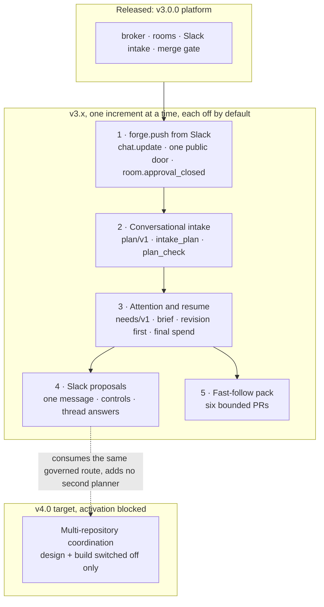

# v3.x: developer experience on the released v3 platform

**Date:** 2026-11-05 · **Status:** roadmap approved by the owner 2026-11-05
([decisions XD1 to XD9](#owner-decisions-2026-11-05)). This is a roadmap: each increment has its design
named in [the increments](#increments) and its own implementation plan, and none of them is built ·
**Part of:** v4.0 item 7, "Developer experience" ([v4 roadmap](2026-10-31-v4-roadmap-design.md#core)),
delivered instead as increments on the released v3.0.0 platform · **Follows:** the
[v3 roadmap](2026-10-19-v3-roadmap-design.md), released as v3.0.0 on 2026-10-31 · **Companion:** the
[architecture review](../reviews/2026-11-05-v4-devex-architecture-review.md) that moved this work onto a
line of its own

## Outcome

The factory keeps every control it has and loses one grammar. Where you already are — a Slack thread,
a coding agent — you describe the work in your own words, read one plan, and confirm it. Afterwards
the same place tells you what needs you, what changed while you were away, and what the one next step
is. A maintainer who has to say yes at 19:45 can say it on a phone, for the one approval whose
question has a single honest answer.

Four increments, each behind its own switch. They are listed here in the order a person meets them;
they land in a different order, because each one consumes what the previous landed
([dependencies](#order)):

1. **Conversational intake.** One governed planner in the broker turns a request into a plan — the
   repository with its evidence, the issue as it will be filed, the roles, the checks, the ceiling —
   and asks at most one question. Slack and a coding agent share it, so the same sentence cannot read
   two ways.
2. **One list of what needs you, and a brief on return.** One derivation behind the room page, the
   CLI, the coding agent and a Slack thread; a deterministic resume brief; revisions preferred over
   new intake; a task's dollars final once they settle; a step that never says admin-merge when an
   approval is the merge.
3. **Slack proposals.** One proposal message per thread, edited in place with its plan in the
   message's metadata, Confirm and Cancel, and a thread that afterwards answers five fixed questions
   without ever steering the run.
4. **Deciding `forge.push` from Slack.** The most frequent attended approval — "may this run push to
   `agent/<room>`?" — becomes one card with Approve and Deny, resolved to the linked human's room
   standing and repository write, under the store's existing single-decision fence and four-eyes.

A bounded **fast-follow pack** of six PR-sized defects ships alongside them.

## Scope

| In this line | Out, and where |
|---|---|
| Four increments on the v3.0.0 platform, each behind its own switch, off by default | A v4 pre-release, a new platform, a new service, a new store |
| One governed natural-language planner, public repositories only | A private-repository planner route, a cross-repository code search, a dialogue engine |
| One `needs/v1` derivation and one resume brief | Ranking, routing to owners, stale auto-closing ([v4.1](2026-10-31-v4-roadmap-design.md#increments)) |
| Slack deciding `forge.push`, bound to the run's branch | Merging from Slack, other approval classes, free-text reasons |
| Six bounded fast-follow changes ([pack](#fast-follow)) | Any of them growing into a design |
| Design and switched-off build of multi-repository coordination, beside this line | Activating it, or proving it live, before v4.0 items 3 and 4 ship ([XD4](#owner-decisions-2026-11-05)) |

## Owner decisions, 2026-11-05 {#owner-decisions-2026-11-05}

| # | Decision |
|---|---|
| XD1 | **A v3.x increment line, on the released v3.0.0 platform.** This work is not a v4 pre-release: v4.0's outcome stays "anyone can run it", and these increments land on the platform the owner runs today |
| XD2 | **Four increments, in dependency order,** each with its design named in [the increments](#increments) and its own implementation plan: Slack `forge.push` approval, conversational intake, attention and resume, Slack proposals. Every one behind its own switch, off by default |
| XD3 | **A bounded fast-follow pack.** Six defect-sized changes, each a PR with its own test. They ship after the increment's live proof and are never folded into a design |
| XD4 | **Multi-repository coordination is a v4.0 target, moved out of v4.4.** Fleet campaigns remain v4.4. Its [design](2026-11-05-v4-multi-repo-coordination-design.md) and its switched-off implementation may proceed beside this line, but **activation and live proof stay blocked** until v4.0 item 3 (repository-declared classes) and item 4 (untrusted-input hardening) ship |
| XD5 | **The natural-language planner is public-repository only in v1.** A private repository is refused before any model call; the coding agent's own path is the fallback for internal work |
| XD6 | **Slack approval binds the branch and deliberately not a commit.** The owner accepted the absence of a commit SHA on 2026-11-05: no reliable pushed commit exists before the push, so the binding is the run's branch. Merging is unchanged — a review of the current head on GitHub |
| XD7 | **Offline first, then a live proof the owner turns on.** Each increment's suites and gates pass before a time-bounded live session; the switches are flipped only by an explicit owner go naming the cluster, the repository and the window |
| XD8 | **The initial multi-repository proof is deliberately small:** two public repositories, two children, one dependency. Parallel independent children are designed and tested offline; the first live proof does **not** claim parallel execution |
| XD9 | **A switch off returns today's behaviour, with no data migration.** The plan stores nothing, the inbox is derived, and a proposal is a message |

## The increments {#increments}

The order is the merge order: an increment consumes what the one before it landed.

| # | Increment | What you get | Design | Plans | Switch, off by default |
|---|---|---|---|---|---|
| 1 | **`forge.push` from Slack** | An approval card with Approve and Deny in the thread the work was filed from, inert once decided, one line for the clicker | [design](2026-11-05-v3x-slack-push-approval-design.md) | [plan](../plans/2026-11-05-v3x-slack-push-approval-maku-plan.md) | broker `human.slackDecide`; App `channels.<id>.approvals` |
| 2 | **Conversational intake** | One plan, one question at most, the repository with its evidence, filed through the form that already exists | [design](2026-11-05-v3x-conversational-devex-design.md#architecture) | [plan](../plans/2026-11-05-v3x-conversational-intake-maku-plan.md) | broker `human.intake.plan.enabled`, `human.intake.plan.fallback: off` |
| 3 | **Attention and resume** | One list across four surfaces, the split and merge holes closed, a brief that names the plan version and the blocker, revision-first scheduling, settled dollars | [design](2026-11-05-v3x-conversational-devex-design.md#needs) | [plan](../plans/2026-11-05-v3x-attention-resume-maku-plan.md) | broker `human.needs.enabled` (on with its release, read-only); factory `caps.preferRevisions`, `facts.finalSpend`, `brief.ciEvidence` |
| 4 | **Slack proposals** | One message per thread edited in place, Confirm and Cancel riding the same public door, then five answered questions and one line per meaningful transition | [design](2026-11-05-v3x-conversational-devex-design.md#owner-decisions) | [plan](../plans/2026-11-05-v3x-slack-proposals-maku-plan.md) | App `proposals.enabled` |
| 5 | **Fast-follow pack** | The six defects people feel first ([below](#fast-follow)) | the same design, [fast-follow pack](2026-11-05-v3x-conversational-devex-design.md#fast-follow) | one PR each | none: fixes |

Increment 1 supplies three primitives the fourth consumes and does not change: `chat.update` on the
App's Slack interface, a tagged message-metadata payload, and interactivity dispatched inside the one
`POST /slack/events` handler after the same signature verification. Increment 4 therefore adds no
route, no `HTTPRoute` match and no host-contract version.

Increments 2 and 3 share one contract: the plan's hash from 2 is what a resume brief reports as "plan
version" in 3. Increment 4 reads `intake_plan` and `needs_list` exactly as their plans state them.

## Dependencies and order {#order}

- **Why 1 comes first:** the proposal message needs the card's primitives. Without them, increment 4
  would open a second public path and a second metadata format for the same Slack app.
- **Why 2 before 3:** the brief reports the plan a task was filed from. There is no plan to report
  until the planner exists.
- **Why 3 before 4:** the thread answers from `needs_list`, and the App's tool list is amended once,
  in 3.
- **Within an increment:** Maku pull requests merge one at a time on their own offline evidence, then
  a release, then this repository pins it with the switches off, then the switch-on change.
- **Multi-repository coordination** may be built and tested beside any of these, switched off. Its
  activation is a capability gate, not a version check ([XD4](#owner-decisions-2026-11-05)).

## Switches and offline-first evidence {#switches}

Nothing in this line changes behaviour until an operator sets one value. Both sides refuse an unknown
config key, so a switch can never be deployed ahead of the code that reads it.

| Increment | Offline evidence, before any switch | Where it runs |
|---|---|---|
| 1 | The decide route's closed refusal table, the frozen store, the store's single-decision fence, the card's renderer, the interaction branch's dedup and 3-second rule | Maku `task check` and `task lint` |
| 2 | `plan/v1` goldens against a fake model endpoint, the guards (pinned alias, private refusal before any call, deadline, daily cap, key), the hash's material set and its immutability, both re-validation paths (`run_create`, `issue_file`) | Maku, then this repository's gateway-configuration gates |
| 3 | One `needs/v1` fixture per kind, the split and merge holes, the brief's inertness, admission and settlement cases, the frozen four-surface parity set | Maku, plus this repository's render gates |
| 4 | The tagged metadata payload with the draft's wire bytes unchanged, recovery from metadata alone, the control values, the thread vocabulary, the one-declaration generator with its drift gate | Maku, plus this repository's generator gate |
| 5 | One test per defect, named in the pack | whichever repository owns the code |

Two rules hold across the line:

- **No live claim from an offline test.** A green suite is not evidence that a person can do the
  thing; it is evidence that nothing else broke.
- **The degraded path is never the feature.** The deterministic composer behind
  `human.intake.plan.fallback: composer` exists so a channel without a planner falls back to a
  labelled template draft rather than to nothing. Every surface marks it, and it is excluded from
  every live proof.

## Live proofs: one session per channel, on the owner's go {#live}

Each increment gets one time-bounded session on a named cluster, in public repositories only, from
each channel it serves — a coding agent, then a Slack channel. The go criterion is the increment's own
design, and the evidence lands in `docs/runbooks/agent-factory/results-*.md`.

What the owner is turning on, and off again:

| Increment | The proof ends when |
|---|---|
| 1 | A maintainer approves and denies a real `forge.push` from a phone; a non-approver, a non-writer, a four-eyes prompter and a second press each get their own refusal line; the room page and the thread agree on who decided |
| 2 | A sentence whose repository is inferred from context files an issue whose author is the developer, with the gateway's access log showing one call under the planner's client id, and one uncertain sentence asks exactly one question |
| 3 | The same room's needs read identically in the agent, the CLI, the browser and the thread; a split proposal and a non-owner maintainer's merge both appear; a 10-minute-old cursor produces a brief that matches "what changed" |
| 4 | Five replies update one message; a restart between the proposal and the Confirm still files the same plan from metadata, with no re-plan; a run start posts nothing |
| 5 | Each defect's own reproduction, run against the live platform |

Teardown is part of the proof: every switch returns to its shipped value, and ordinary issue intake
still works.

## The public-only limit {#public-only}

The planner reads `chat/completions` through the AI Gateway on the broker's own client identity, and
the text it reads is public by construction: a Slack proposal becomes a public issue, and a coding
agent's request names a public repository. So:

- A private repository is refused (`private_repository_unsupported`) **before** any request leaves the
  broker. There is no internal-data route, and no second ungoverned data path.
- The multi-repository first switch is `publicOnly: true`; private and mixed families are outside the
  first live claim ([XD8](#owner-decisions-2026-11-05)).
- Metrics and spans carry the requester, the surface, the repository, the plan hash, the model, the
  token counts and the outcome — never the request or the plan text, which is already public
  elsewhere.

## Fast-follow pack {#fast-follow}

Six bounded changes, each a PR with its own tests, none of them a platform change
([the pack](2026-11-05-v3x-conversational-devex-design.md#fast-follow)):

1. The next step never says admin-merge when an approval would merge.
2. A task's dollars are final, and say when they are not.
3. A reserved run slot for revisions.
4. Every coding client's capabilities are measured, not guessed.
5. One declaration for a Slack channel's binding, generated into its three consumers.
6. A permission, configuration or egress failure says what to change.

## Non-goals {#non-goals}

- **Approving anything else from Slack, or merging from Slack.** `forge.push` is the one class with a
  bounded, verifiable destination and no free text in its answer. Merging stays a review of the current
  head on GitHub.
- **Steering or stopping a run from Slack or MCP.** Those stay on the room page.
- **A dialogue engine, a workflow engine, a plan DSL.** One plan per request, five questions in a
  thread, and nothing that survives as an object.
- **A standalone room.** No new `room_create`; `POST /api/rooms` keeps its one caller.
- **A second decomposition engine.** The scoper and its splitter stay the only post-filing
  decomposition; the pre-filing planner proposes and never decides.
- **Ranking, routing, digests, e-mail** — v4.1 — and **pre-PR verification, the continuation loop** —
  v4.2.
- **Fleet campaigns, cross-factory orchestration and any parallel-children live claim.** Fleet stays
  v4.4; parallel multi-repository children are designed and unproven.
- **Repository memory**, or any stored preference that would make the planner improve over time
  ([v4.6](2026-10-31-v4-roadmap-design.md#increments)).

## Roadmap and status bookkeeping

This roadmap changes no page by itself, and the [status page](../../../website/content/docs/status.md#v3x)
describes the line as planned until each increment ships.

- **With each release:** that increment's status row gains its evidence, and the site pages it touches
  gain their reader-facing text.
- **With increment 2's release:** ADR-0060 records the conversational intake decisions and the
  planner's one governed data path.
- **With increment 1's release:** the Slack pages, ADR-0049 and ADR-0059 FA7, `docs/security.md`
  invariant 8 and runbooks 18 and 22 are amended in the same change that drops the prohibition.
- **At v4.0:** the [v4 roadmap](2026-10-31-v4-roadmap-design.md#core) item 7 points here for what
  shipped early, and item 9 carries multi-repository coordination with its activation prerequisite.
