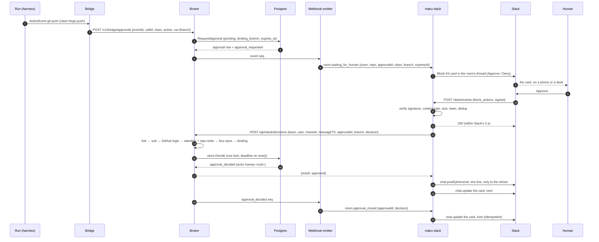
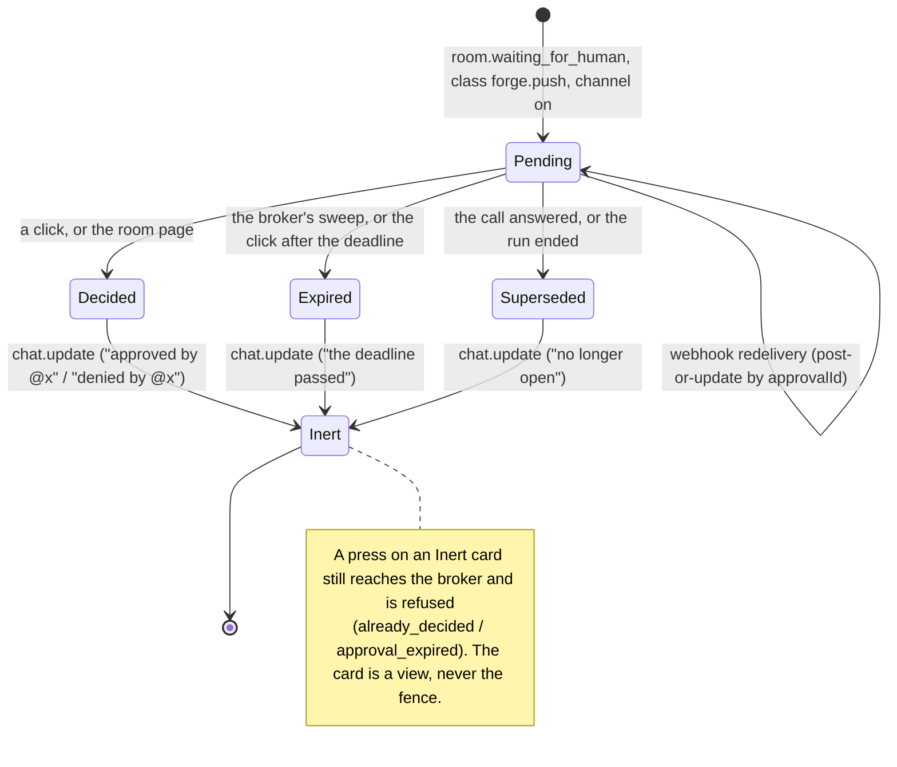

# Deciding `forge.push` from Slack

**This is an amendment, not an addition.** Until today the Slack App is defined by a prohibition:
"No tool or Slack path approves or steers; the App reads no reply in a thread"
(`maku/docs/security.md:265`, invariant 8, held by `TestSponsoredToolList` and
`TestSlackNeverDecides`). This design removes one case from that prohibition and narrows the
invariant to what remains true. Every document, test and runbook that states the prohibition is
amended in the same change; none is deleted, and the refusals that carried the prohibition (no
free-text reasons, no other approval class, no merge, no steering, no answers) become the
specification of a closed surface instead of a side effect of the App being unable to act.

*Paths: `maku/…` is the Maku repository at `4685672f`; everything else is this one.*

## Outcome {#outcome}

A room's `forge.push` approval appears in the thread it was filed from as one Block Kit card:
the approval id, the class, the destination branch, the deadline on the database's clock, and the
room's URL. **Approve** and **Deny** are single-use buttons bound to that approval. The first
valid decision wins, on the store's existing fence, whether it came from the button or from the
room page. A refusal is one line only the clicker sees, in a closed vocabulary that names no
repository, branch, GitHub login or other person.

What it buys: the most frequent approval class in attended rooms — "may this run push to
`agent/<room>`?" — stops requiring a laptop; the person who has to say yes at 19:45 can say it on
their phone, with the same four-eyes rule, the same room standing, the same repository permission
and the same audit entry as on the room page.

What it does not buy, and this design spends most of its words on keeping: no merging, no other
approval class, no reason text, no answers to `needs_author`, no steering, no widening of any
run's egress or capability, no change to the merge gate.

## Current state, verified at `maku@4685672f` {#current-state}

| Fact | Evidence |
|---|---|
| The App is one public endpoint, `POST /slack/events` matched exactly, on the `factory-slack` listener of `platform-public` | `tooling/base/agent-factory/slack-app/httproute.yaml:19`, `HOST-CONTRACT.md:14` (H4 version 4), `maku/internal/app/slackapp.go:152` |
| The manifest declares `"interactivity": { "is_enabled": false }` and there is no `block_actions` handler anywhere in the package | `maku/docs/slack.md:40`, `maku/docs/slack.md:47`, `maku/internal/slackapp/app.go:288-352` |
| The App has no `chat.update`: its Slack interface is `Thread`, `Post`, `Message`, `PostEphemeral`, `UserName` | `maku/internal/slackapp/slack.go:52-66` |
| The App's broker principal has five MCP tools and no more, and no tool decides | `maku/internal/humanapi/mcp.go:156` (`run_create,issue_draft,room_summary,room_tail,room_changes`), pinned by `maku/internal/humanapi/sponsored_test.go:82` |
| A thread reply is read for one purpose (amending an unfiled draft) and the ✅ files a draft; nothing else in a thread is a command | `maku/internal/slackapp/app.go:564-618`, `maku/docs/slack.md:154-161` |
| Slack's signature is verified before the body is parsed: `v0=` HMAC-SHA256 over `v0:<ts>:<body>`, 5-minute skew, 1 MiB cap, constant-time compare, closed when the secret is unset | `maku/internal/slackapp/verify.go:36-63` |
| Deciding is web-only by policy: `Decide` is in `uiOnly`, so a non-web surface is refused before the room matrix is consulted | `maku/internal/policy/policy.go:85-91`, `:123`, `:135`; `maku/web/src/needs.ts:5` ("the page's one decide path") |
| The web decide path reads the approval, checks it is this room's, checks four-eyes against the row's prompters, then calls `store.Decide` | `maku/internal/humanapi/acts.go:475-503` |
| `store.Decide` is the whole race: `UPDATE … WHERE state = 'pending'` under the room's row lock, the deadline read in the same transaction on `now()`, one close per approval, replayed idempotency keys answered from storage | `maku/internal/store/approvals.go:157-167`, `:181-248`, `:252-271` |
| The `approvals` table is its own `approval_requested` event: an insert must match its event's id, run, call, class and action, and the broker's grant cannot update anything but `state, decided_by, decided_at, reason` | `maku/internal/store/migrations/20261005120000_approvals.sql:38-46`, `:81-82` |
| `store.Approval` carries no branch and no commit, and the `approval_requested` payload carries no branch | `maku/internal/store/approvals.go:50-59`, `maku/internal/envelope/payloads.go:82-91` |
| The room's `forge.push` approvals arrive from the bridge with the run's own record available, which carries `Branch` and `Repository` | `maku/internal/bridgeapi/approvals.go:43` (the five classes), `maku/internal/bridgeapi/server.go:279-299` (`bridgeAuth` returns `runwatch.Run`), `maku/internal/runwatch/run.go:41-42` |
| A room's runs share the branch `agent/<roomRef>`; a run without a room gets `agent/<runId>` | `maku/internal/factory/api/server.go:316-324`, `maku/internal/runctl/objects.go:39-45` |
| Run GitHub tokens are confined to the run's own `agent/**` branch by the repository ruleset, proven live (a push to another branch is `GH013`) | `ai-native-ref/docs/runbooks/agent-factory/05-github-octo-sts.md:4-6`, `:77-83`, `:143` |
| A room's approval wait is one webhook line with no approval id, class, branch or deadline, and the thread is told to go to the room page | `maku/internal/webhook/events.go:97-99`, `maku/internal/slackapp/app.go:849-873` |
| The webhook vocabulary is closed at twelve types and its payload is ids, states and closed codes only | `maku/internal/webhook/events.go:15-17`, `maku/internal/webhook/webhook.go:36-53` |
| A Slack user is linked to a ZITADEL `sub` (no GitHub login stored), and the broker resolves the account's *current* GitHub login per repository | `maku/internal/store/migrations/20261028120000_slack_links.sql:15-24`, `maku/internal/store/slacklinks.go:141`, `maku/internal/humanapi/access.go:43-70`, `maku/internal/ghidentity` (`Login`, `CheckActive`) |
| Write on a repository is `write`, `maintain` or `admin`, cached and failing closed | `maku/internal/repoaccess/repoaccess.go:57-74` |
| The Slack App's pod may already reach the broker's human listener on :8080 (all paths) | `infrastructure/base/room-broker/network-policy.yaml:44-52` |
| `forge.push` already has fixed prose on the room page (what it wants, why, what each answer does) | `maku/web/src/approval-help.ts:13-18` |

Three consequences worth stating before the decisions:

1. **The ban is structural, not incidental.** `Decide` being `uiOnly` (`policy.go:85-91`) means a
   new surface cannot decide "by accident"; this design has to argue, not assume, that its
   surface is a human's.
2. **The store needs no new fence.** Everything dangerous about a click — two clicks, a click
   after the deadline, a click on an answered call, a click after a run ended, a retry — is
   already decided inside `store.Decide` on the database's clock. The amendment must not add a
   second one.
3. **There is no commit to bind.** The approval is requested from the harness's `ActionEvent`
   before the push runs; nothing in the approval row, the run record (`AgentRunSpec` has
   `baseRef` and `branch`, no SHA) or the room's log carries the commit that the approved push
   will carry. D5 handles this head-on.

## Decisions {#decisions}

| # | Decision | Rejected alternative | Why |
|---|---|---|---|
| D1 | **Slack decides `forge.push` and nothing else.** Every other class renders exactly today's text line: "answer it on the room page" | All human classes; a per-channel class list | `forge.push` is the class with a bounded, verifiable destination (the run's branch) and no free text in its answer. `forge.pr`/`forge.other`/`mcp.write`/`shell.high` are decided on the room page, where the raw redacted action, the class prose and the call's row are all in front of the person. A config list of classes is a widening knob nobody needs |
| D2 | **A separate authenticated broker decide path for the App**, `POST /api/slack/decisions` on the human listener, bearer-authenticated as the App's sponsored principal | A sixth MCP tool (`room_decide`) on the sponsored list; a new flag on `Actor.HandleVia`; letting the App call the web socket | A tool is model-facing and would sit in the App's instruction list as "you may decide"; `HandleVia` would have to carry a "trust me, this is really a human" bit, which is exactly the confusion the design must avoid. A dedicated route has one meaning and one body shape |
| D3 | **Identity is resolved, never asserted:** signed click → `slack_links` row → `sub` → the account's *current* GitHub login → repository permission | Trusting a login or a role in the button value; a second link table; caching a login in the button | `slack_links` already stores the `sub` and nothing else, deliberately (`20261028120000_slack_links.sql:1-3`). The button value is a hint (D6) |
| D4 | **Two standings, both required:** the resolved human must be an approver (or owner) *in the room* **and** hold `write` (or `maintain`/`admin`) on the room's repository | Room standing only; repository write only; "maintainer" alone | Room standing says who the room trusts; repository permission says who may change the code (T16 already holds runs to it, admins included). A repository maintainer who is not an approver in this room does not get to decide this room's actions |
| D5 | **The durable binding for `forge.push` is the branch, and there is deliberately no commit.** `approvals` gains `binding_branch` (not null, defaulting to `''`, CRD-shaped), set by the bridge from `run.Branch` and copied into the `approval_requested` payload; the trigger that makes a row its event is extended to compare it | Binding a head SHA captured at request time; binding a SHA read from GitHub at click time; binding both | A SHA available at request time is *not the pushed commit*: the push carries commits the agent makes afterwards, so displaying it would invite a person to approve something they were not shown — worse than showing nothing. A click-time GitHub read makes the broker a forge reader (new credential use, new egress, new failure mode) for a value that still is not the pushed commit. What a person can honestly bind is *the branch this run may push to*, and the ruleset already makes that a real boundary (`05-github-octo-sts.md:77-83`). The pushed commit's identity arrives after the fact from the forge, on the room page and in the PR |
| D6 | **The button value is a hint; the broker recomputes everything.** Value is `v1\|forge.push\|<approvalId>\|<branch>`, and the broker re-reads the approval (which gives it the room), re-reads the run's branch, re-checks the class, and refuses any mismatch | Trusting the value's class, room or branch | Slack signs the *click*, not the card's contents; a card can outlive the state it was drawn from. Recomputing is one store read and one runwatch lookup, both already on the path |
| D7 | **`store.Decide` is called unchanged**, with a per-(approval, decision) idempotency scope, so a Slack retry replays instead of duplicating | A new "Slack decision" store method; a pre-check of `state` before deciding | The row lock, the deadline on `now()`, the answered/ended supersede and the replay semantics are the fence (`approvals.go:181-248`). A pre-check would be a second, weaker fence |
| D8 | **The room log records the linked human as the actor** (`actor_kind=human`, `actor_id=human:<sub>`), and the surface lives in the idempotency scope (`origin_client=human:<sub>:slack:<approvalId>`), never in the actor | Recording `system:slack-app` with the human in the payload; a new actor kind | The audit question is "who decided", and that is a person. The App is a channel, and a channel is not a decider |
| D9 | **The card is the existing wait line, made a card.** One Block Kit message per approval, replacing today's `room.waiting_for_human` text when the class qualifies, posted or updated by approval id | A second, richer message beside the wait line; a modal; a DM | One message per approval is what the thread already promises; a modal cannot be re-read tomorrow and a DM is a second place to look |
| D10 | **The card's teardown is best effort, the fence is not.** On decide, expiry and supersede the App calls `chat.update` to make the card inert; a failed update is logged and counted, never retried into a loop | Treating the card as the fence; skipping the update | A person must not be able to press a dead button tomorrow, but no Slack state may ever be load-bearing: the store refuses a stale click regardless (`already_decided`, `approval_expired`) |
| D11 | **`POST /slack/events` stays the only public path.** Interactivity is dispatched from the same handler after the same signature check, by content type — the one branch the conversational design rides too (its CD29) | A new `/slack/interactions` route; a separate listener | A second path is a second `Exact` HTTPRoute match, an H4/HOST-CONTRACT bump and a `HOST_REF` bump for a `Content-Type` branch. Slack signs both bodies identically, so one door with one lock is genuinely smaller. The cost — two request shapes in one handler — is paid in ~20 lines and one test, and it is paid once: the proposal cards' controls and this card's buttons share it |
| D12 | **No reason, no text, ever.** A Slack decision carries an empty reason; the card carries no agent text; the refusal line is a fixed sentence per code | An "optional reason" field on the card; showing the trimmed command | Reasons are what the bridge shows the agent (`maxDecisionReason`, `acts.go:146`), and a button on a phone is not where a person writes a sentence that steers a model (`redact` alone would not make agent-visible prose safe). The room page keeps that affordance |
| D13 | **The class is a constant, not config.** `slackDecidableClass = "forge.push"` in the broker, and the card is only drawn for that class | `human.slackDecide.classes[]`; a per-channel class list | A widening that needs only a config edit is how a narrow amendment becomes a general one; D1's boundary should cost a code change and a design |
| D14 | **Two switches, both off by default:** the broker's `human.slackDecide` (route and checks) and the App's per-channel `approvals: true` (cards with buttons) | One switch | They fail differently: the broker switch is the authority (a card without it answers "unavailable"), the channel switch is who gets the affordance. Turning the channel off is the fast, safe rollback |
| D15 | **Room standing on the Slack path comes from the Room CR only** — `spec.owner`, a `spec.members` role, or the `approver` flag — resolved with the zero `policy.Groups`, never from ZITADEL group membership | Reading the user's ZITADEL grants through the org reader (a new identity read for one route); passing the App's own groups (which would grant the machine's standing to a person); trusting a role in the button | The broker holds no token for the linked human, so it cannot know their groups; a plausible-looking substitute would be a privilege bug. The consequence is deliberate and fails closed: a platform admin who is neither the room's owner nor a named approver is refused here and decides on the room page, where their token is theirs. The people who must answer at 19:45 are the room's owner and its approvers, and D15 says exactly that |

### Owner decisions, 2026-11-05 {#owner-signoff}

| Item | The owner's answer |
|---|---|
| **D5** | **Signed off as written, 2026-11-05: branch-only binding, no commit SHA.** The reason is recorded with the decision and stands on its own: **no reliable pushed commit exists before the push** — the approval is requested from the harness's `ActionEvent`, and the commit the push will carry is made afterwards, so any SHA shown at request time is one the person did not approve. A SHA read at click time would not fix that, and would make the broker a forge reader for a value that is still not the pushed commit. The binding is the run's branch; the pushed commit's identity arrives after the fact, from the forge |
| **Merge** | **Unchanged and out of scope.** Merging remains a review of the **current head on GitHub**; a `forge.push` approval releases one push and never a merge, and no control added here can reach the merge gate |

### Accepted residual, stated plainly

The App's pod holds the ZITADEL client credentials that make it `system:slack-app`. D2 gives that
principal a route that casts a decision **as a linked human**. A compromised App pod can therefore
decide any pending `forge.push` approval, as any *linked* user, without a click. It cannot invent a
human (the `sub` comes from `slack_links`), cannot decide anything but `forge.push`, cannot decide
outside the room's approver/owner set and repository write, cannot escape four-eyes, cannot decide
twice, cannot decide past the deadline, and every such decision is recorded as that person's.
That is the same class of residual `docs/security.md:26` (T12) already accepts for the broker —
"can decide pending approvals" — and it is strictly narrower. It is not made better by silence:
the compensating controls are the single class, the two standings, the log line per decision, and
the `SlackDecisionsSpike` alert (§Observability). A future design that wants this residual gone
must give the broker a way to verify a click it did not originate (Slack's signing secret in the
broker, or a Slack-issued JWT), and both are worse than the residual.

## The flow {#flow}



### The card's lifecycle {#lifecycle}



## Contracts {#contracts}

### 1. The broker's decide route

`POST /api/slack/decisions` on the broker's human listener (`:8080`), registered only when
`human.slackDecide` is set — unset, the path is the mux's 404, as `/mcp` is when `MCP` is false
(`server.go:208-215`).

Authentication: `Authorization: Bearer <the App's client-credentials access token>`, through the
existing sponsored authenticator (`sponsoredPrincipal`, `mcp.go:160-173`), which also checks
`p.Sponsored` and `p.Expiry`. A human's or a machine's token is refused. No cookie is read and no
`Origin` is required: the route has no cookie surface, so it has no CSRF surface.

Request (strictly decoded; an unknown key is a 400):

```json
{
  "team": "T07J97G2K2P",
  "user": "U07JY4EQNDN",
  "channel": "C0CC4M8SNVD",
  "messageTS": "1730822400.123456",
  "approvalId": "01M4A1B2C3D4E5F6G7H8J9K0MN",
  "branch": "agent/26zfnuxm",
  "decision": "approved"
}
```

| Field | Shape enforced before any read | Source |
|---|---|---|
| `team` | `^T[A-Z0-9]{2,20}$`, and equal to the configured team | the signed payload's `team.id` |
| `user` | `^[UW][A-Z0-9]{2,20}$` | `user.id` |
| `channel` | `^[CG][A-Z0-9]{2,20}$` | `channel.id` |
| `messageTS` | `^[0-9]{1,12}\.[0-9]{1,8}$` | `container.message_ts` (or `message.ts`; they agree) |
| `approvalId` | `^[0-9A-HJKMNP-TV-Z]{26}$`, a ULID: `bridgeapi` is its only producer (`bridgeapi/approvals.go:112`, `ulid.Make()`) | the button value |
| `branch` | the CRD's pattern, `^agent/[a-z0-9][a-z0-9._/-]{0,100}$` (`api/v1alpha1/agentrun_types.go:59`) | the button value |
| `decision` | `approved` \| `denied` | the `action_id` |

Body cap 4 KiB, `Content-Type: application/json` required, one request per HTTP request, read
with `http.MaxBytesReader`. Rate limit: the same per-replica limiter *mechanism* `Actor` uses
(`acts.go:151-174`), sized for a decision surface rather than for chat — **10/min per `(team,user)`
with a burst of 5, not the human limiter's 10/s burst 20**, because a person presses a button a few
times and never in a stream. Per replica, as the human limiter is (`P22`); over it, `429
rate_limited`.

Response, always a closed code, never a sentence:

```json
{"result":"approved"}
```

| HTTP | `result` | Meaning |
|---|---|---|
| 200 | `approved`, `denied` | The decision was recorded on this request |
| 200 | `already_decided` | Someone (or this same click, replayed) closed it first; nothing was appended |
| 200 | `approval_expired` | The deadline had passed; the click closed it `expired` if it was still pending |
| 200 | `not_linked` | The Slack user has no `slack_links` row, or the account has no GitHub identity |
| 200 | `link_unverified` | ZITADEL or GitHub could not be asked; fails closed, no detail |
| 200 | `not_permitted` | Not an approver or owner in this room, or the room is admins-only |
| 200 | `repository_permission` | The resolved login cannot write the room's repository |
| 200 | `four_eyes` | OD-16: this human prompted the run (or the room) |
| 200 | `binding_mismatch` | The hint's branch is not the run's branch, or the approval has none |
| 200 | `not_supported` | The class is not `forge.push` |
| 200 | `not_found` | No such approval in the room log |
| 200 | `sealed` | The room is sealed |
| 400 | `bad_request` | Shape, body size or content type |
| 401/403 | — | Not the App's principal |
| 429 | `rate_limited` | |
| 503 | `unavailable` | The store, the room reader or the log could not be read: retryable |

Every refusal is a 200 with a code (except the four transport ones), so the App never retries a
refusal and Slack never redelivers one into a loop.

### 2. The resolution, in order {#resolution}

Each step names the code it refuses with. Everything is read from the broker's own stores; nothing
is taken from the request beyond the ids above.

1. **The App.** `sponsoredPrincipal` → `authn.Principal{Kind: system, ID: system:slack-app}`.
   Not it: 403.
2. **The workspace.** `team == human.slackDecide.teamID`. Different: `not_permitted` (a peer
   workspace's click is not this workspace's, and the answer says nothing).
3. **The link.** `store.SlackLink(team, user)` → `sub`, found=false → `not_linked`
   (`slacklinks.go:141-147`).
4. **The room.** `store.Approval(approvalId)` → the row; its `RoomID` *is* the room. The request
   cannot name a room, so a card cannot be pointed at another room's approval. Missing: `not_found`.
   Then the `Room` CR and `store.Room` (`RoomState`) are read; a sealed room: `sealed`.
5. **The class.** `ap.Class == "forge.push"`: else `not_supported`. Free, and first, so an
   unsupported class never costs a GitHub call.
6. **Room standing.** `policy.Groups{}.Resolve(room, Principal{Kind: human, ID: "human:"+sub}, "",
   true)` then `policy.Allowed(subj, policy.Decide)`. False: `not_permitted` (`policy.go:135`,
   `:163-193`). Three details matter:
   - **The zero `Groups`.** `Resolve` reads `p.Groups` for the ZITADEL Admin/Member grants, and the
     broker has no token for the linked human — only a `sub`. Empty group names never match
     (`in()`, `policy.go:146-148`), so standing is exactly the Room CR's: `spec.owner`, a
     `spec.members` role, or the `approver` flag. D15 states the consequence.
   - **`WebUI: true` is a fact about the surface, not a grant.** `Decide` is `uiOnly`
     (`policy.go:85-91, 123`), so it must be true for any human to decide. It is safe here because
     nothing on this route is reachable by a token a local agent can drive: the caller must be the
     App's client-credentials principal, and the human is resolved from a Slack-signed click
     through `slack_links`, not from a bearer the caller chose.
   - **No driver.** `""` is passed for `driver`: the Slack path holds no driver token, and
     `Decide` does not consult it (`policy.go:135`).
7. **The account.** `ghidentity.Resolver.Login(ctx, sub, room.Spec.Repository)` → the account's
   current GitHub login. `ErrInactive` or no GitHub link: `not_linked`; any other error:
   `link_unverified` (`access.go:43-70`). A room without a repository is admins-only on the page
   (`access.go`: the gate's `room.Spec.Repository == ""` branch) and `not_permitted` here.
8. **Repository permission.** `Access.CanWrite(ctx, room.Spec.Repository, login)`: an error is
   `link_unverified`, false is `repository_permission` (`repoaccess.go:57-74`).
9. **The binding.** `expected` is the run's branch, read from `Runs.InRoom(room)` by `ap.RunID`
   (`runwatch.Run.Branch`, `run.go:41-42`). `expected == ""` → `binding_mismatch`; the request's
   `branch != expected` → `binding_mismatch`.
10. **Four eyes.** `room.Spec.Approvals.FourEyes && slices.Contains(ap.Prompters, "human:"+sub)`
    → `four_eyes`. `ap.Prompters` is the row's copy of `store.Prompters` (`approvals.go:375-392`),
    written when the approval was requested; the web path compares the same field
    (`acts.go:490-492`), so the two surfaces can never disagree about who is excluded.
11. **The decision.** `store.Decide(ctx, ap.ID, decision, "human:"+sub, "", draft)` with the draft:

    | Draft field | Value | Why |
    |---|---|---|
    | `Actor` | `{Kind: human, ID: "human:"+sub}` | D8: the log names the person |
    | `Origin` | `client` | a person's act, as the web path's is (`acts.go:250-251`) |
    | `OriginClient` | `"human:"+sub+":slack:"+approvalId` | the idempotency scope, one per approval |
    | `OriginSeq` | `1` for `approved`, `2` for `denied` | one key per (approval, decision): a replayed click replays, the opposite decision is not a replay |
    | `Role` on the actor | empty, as the web path leaves it | parity; the row already has `prompters` and standing is derivable |

    `store.ErrAlreadyDecided` → `already_decided`; `store.ErrApprovalExpired` → `approval_expired`;
    `store.ErrSealed` → `sealed`; `store.ErrNoApproval` → `not_found`; `ErrBadDecision` →
    `bad_request`; anything else → `unavailable`. Exactly one actor is stamped and it is never
    `system:slack-app`.

`Actor.OnDecided` is called for a first decision, so `rooms_approval_decision_seconds` counts
Slack decisions exactly as it counts web ones (`acts.go:98-103`, `:499-501`).

### 3. What the store gains

One migration, `approvals` only, additive:

```sql
ALTER TABLE approvals ADD COLUMN binding_branch text NOT NULL DEFAULT ''
  CHECK (binding_branch = '' OR binding_branch ~ '^agent/[a-z0-9][a-z0-9._/-]{0,100}$');
```

- The `approval_requested` payload gains `branch` (`omitempty`), set from `run.Branch` in
  `bridgeapi`'s approval handler, which already has the run (`server.go:279-299`) and only for the
  classes the broker forwards.
- `approvals_are_their_events()` is **replaced** (a new migration, `CREATE OR REPLACE FUNCTION`)
  so the insert check also requires `coalesce(payload->>'branch','') = NEW.binding_branch`. The row
  stays its event, down to the new field.
- The broker's grant is unchanged: `INSERT` and `UPDATE (state, decided_by, decided_at, reason)`.
  A binding cannot be rewritten after the fact, by the broker least of all
  (`20261005120000_approvals.sql:81-82`).
- Rollback of the code leaves a defaulted column and a stricter trigger that the old code still
  satisfies (`branch` empty for every class it sent).

`store.Approval` gains one field (`BindingBranch`), `approvalCols` one column, `requestApproval`
one INSERT argument. Nothing else in the store moves.

### 4. The webhook's addition {#webhook}

Minimal, closed, backwards compatible; `webhook.Event` is shared with RunLore's subscriber, so
every field is optional and every new value is clipped to a list.

| Change | Shape | Rule |
|---|---|---|
| `room.waiting_for_human` gains `repo` | `owner/name` | Already emitted on task events; the App needs it to know whether the channel serves the room's repository |
| `room.waiting_for_human` gains `approvalId`, `class`, `branch`, `expiresAt` | ULID; one of the five classes (`webhook.Classes()`); the branch pattern; RFC3339 UTC | Emitted only on the `approval_requested` path (`events.go:97-99`). A value outside the closed set is dropped, not clipped to `other`: an approval card with a made-up class is not a card |
| New type `room.approval_closed` | `{type, room, approvalId, decision}` | `decision` ∈ `approved \| denied \| expired \| superseded` (`store.Approval*`); emitted per `approval_decided` event by the tracker |
| `webhook.Types()` | 12 → 13 | A subscriber that does not list the new type never receives it: the App's `webhooks[slack-app].events` is extended in the same ai-native-ref change (runbook 22) |

The tracker stays free of Kubernetes imports and of the run's spec: everything a card shows comes
from the event it already reads (`events.go:92-124`).

### 5. The card {#card}

Blocks, in this order, from the webhook's fields only — no agent text, no room text, no reason, no
GitHub login, no other person's name:

| Element | Content | Note |
|---|---|---|
| Header | `Approval needed: push to the forge` | Fixed prose, from `approval-help.ts`'s `forge.push` rule, which the room page shows too (`approval-help.ts:13-18`) |
| Section, `fields` | `Class` = `forge.push`; `Branch` = the event's `branch` (the run's, e.g. `agent/26zfnuxm`); `Approval` = `<approvalId>`; `Deadline` = `<!date^<unix>^{date_short_pretty} at {time}\|by <unix>>` | `<!date>` is rendered client-side by Slack: no clock in the App, no timezone in the message |
| Section | `If you approve: the push goes out and the run continues.` / `If you deny: nothing is pushed; the agent is told no and none of it runs.` | The room page's own sentences, so a person reads the same thing on both surfaces |
| Actions | `Approve` (primary, `factory_approval_approve`), `Deny` (danger, `factory_approval_deny`), `Open the room` (URL button, `<roomsURL>/r/<room>`) | Two deciding buttons, one inert link. Value: `v1\|forge.push\|<approvalId>\|<branch>` (≤ 2 000 chars by construction) |
| Context | `<room url>` | so a forwarded screenshot still says where |

**No commit.** D5's slot is omitted rather than filled with a blank: the card prints no `commit:`
label, and the thread gains the commit's identity the way it gains everything else — after the
fact, from the forge (`room.pr_opened`, the PR link on the room page).

Message metadata: `{event_type: "factory_approval", event_payload: {approvalId, class, branch}}`,
well under `maxMetadata` (`app.go:32-33`), so the App can find the card again without a search API
scope.

**The metadata payload becomes tagged, and the draft path must not notice.** Today
`Metadata.EventPayload` is a concrete `DraftPayload` (`slack.go:29-44`) and `threadDraft`
(`app.go:513-530`) reads it directly. It becomes `json.RawMessage`, decoded on demand by
`event_type` — `draftPayload()` and `approvalPayload()`, each a strict decode that fails closed.
Three invariants of the draft path are preserved exactly:

- **Posting is byte-identical**: a draft's metadata marshals to the same JSON it does today, so a
  thread's existing messages keep working and an older draft still validates.
- **The hash check is untouched**: `threadDraft` still accepts only a message whose `user` is the
  bot's, whose `event_type` is `factory_draft`, and whose `SHA256 == draftHash(repo, title, body)`;
  an unreadable or unexpected payload decodes to "not a draft", which is the branch it already
  takes for a foreign message.
- **A card can never be read as a draft**: its `event_type` differs, and even a forged
  `factory_draft` would fail the hash. `filed` detection and "the newest valid draft wins" are
  unchanged, as is the 20-revision bound.

Posted only when **all** hold: the channel has `approvals: true`; the channel's `repositories`
contains the event's `repo`; the room has a thread in `factory-slack-threads`; and the event carries
`approvalId`, `class == "forge.push"` and a non-empty `branch`. Anything else keeps today's line
(`app.go:857-858`), so a `forge.pr` approval in the same thread reads exactly as it does now.

Post-or-update, keyed by `approvalId`: before posting, the App reads the thread it already knows
how to read (`Slack.Thread`, `app.go:576`) and updates an existing card with the same approval id.
A webhook redelivery, or a restart that lost the in-memory delivery set, therefore cannot double the
card. A thread too long to read (`ErrThreadTooLong`) falls back to posting and says so in the metric.

### 6. The Slack interaction handler

`App.Events()` (`app.go:288-333`) gains one branch, after the verification it already does:

1. `a.Verifier.Body(r)` first, unchanged: 401 `bad_signature` on anything unsigned, stale (±5 min)
   or over 1 MiB. Nothing is parsed before it.
2. `Content-Type: application/x-www-form-urlencoded` with exactly one `payload` field → the
   interactivity branch. Anything else → today's JSON path, byte-for-byte.
3. Form parse with a size cap; `payload` decoded into a closed struct; `type == "block_actions"`;
   `is_enterprise_install == false`; `team.id == TeamID`; `user.id`, `channel.id`, the message ts
   (`container.message_ts`, or `message.ts`) shapes; exactly one action; `action_id` in the two known
   ids; and the channel is a served one whose `approvals` is true — a click in a channel with the
   flag off is answered locally (`not_enabled`), with no broker call. Anything else: 200 `ignored`,
   no broker call, no message — the same silence today's unknown events get.
4. Dedup on `(approvalId, user.id, action_id, action.action_ts)`, which is stable across Slack's
   retries of one interaction: a duplicate answers 200 and does nothing else, so a retry never
   produces a second response message. The App's existing bounded `seen` set is reused
   (`app.go:98-121`). **This dedup is UX only, never correctness.** It is in memory, per replica,
   and lost on a restart; correctness is the store's, which records one `approval_decided` per
   approval ever (D7), and the per-(approval, decision) idempotency scope. A redelivered click after
   a restart is therefore still one decision; the worst case of the lost set is a second *answer
   line* to the presser, never a second event.
5. Enqueue, then **answer 200 immediately**: Slack requires a response within three seconds, and
   the broker call, the ephemeral answer and the `chat.update` may not fit. The worker does the
   three of them under the existing `handleTimeout` (30 s), so nothing here is unbounded either
   (`app.go:315-319`).
6. The answer to the person is `chat.postEphemeral` in the card's channel and thread, addressed to
   the clicking user id from the payload: the clicker and nobody else sees it, and **no URL from a
   request body is ever dialled** — `response_url` is deliberately unused, because the App's egress
   is `matchName: slack.com` and `hooks.slack.com` would be a widening
   (`tooling/base/agent-factory/slack-app/network-policy.yaml:53`). A failed explain is logged and
   counted, never retried.
7. The card is updated with `chat.update` to the inert form: no buttons, one line naming the
   outcome. `chat:write` already covers it (the App owns the message); no new scope.

Refusal text, one fixed line per code, no names beyond `<@user>`:

| Code | Line (inert mrkdwn) |
|---|---|
| `not_linked` | `Not decided: <@u> is not linked to a GitHub account here. Mention me with \`link\`, then press the button again.` |
| `link_unverified` | `Not decided: the factory could not check your GitHub account just now. Press the button again in a minute.` |
| `not_permitted` | `Not decided: only this room's approvers decide here. Ask an owner to add you as an approver.` |
| `repository_permission` | `Not decided: your GitHub account cannot write to this room's repository.` |
| `four_eyes` | `Not decided: you prompted this run, and four-eyes asks another approver to decide it.` |
| `already_decided` | `Already decided; nothing changed.` |
| `approval_expired` | `Not decided: the deadline had passed.` |
| `binding_mismatch` | `Not decided: this card no longer matches the request. Open the room page: <url>` |
| `not_supported` | `Not decided from Slack: this approval is on the room page only: <url>` |
| `not_found` | `Not decided: this request is no longer in the room's log.` |
| `sealed` | `Not decided: this room is sealed.` |
| `rate_limited` | `Too many presses just now; wait a minute.` |
| `unavailable` | `Not decided: the factory could not be reached just now. Press the button again.` |

No line names the repository, the branch, a GitHub login, an approver, or how many approvers a room
has; `repository_permission` says "this room's repository", which is the room the card is about and
nothing more. This is the anti-oracle rule of the existing refusals (`app.go:745-772`) applied to a
new code path.

### 7. The seam to the conversational DevEx design {#seam}

The two designs were written the same day and agree in four places. Each is stated here so a
reviewer can check one against the other; none of them changes D2, D5, D11 or D15.

| Seam | This design | The conversational design (CD7, CD9, CD20, CD28, CD29) |
|---|---|---|
| **One public door** | D11: interactivity dispatched inside `POST /slack/events` by `Content-Type`, after the same signature check, with no new route, HTTPRoute match or host-contract version | CD29 says the same and names this design's D11 as its source; its proposal controls ride the same branch, so the parsing, size cap, dedup and 3-second rule are written once |
| **`chat.update` and the metadata payload** | Supplies `Slack.Update` and the tagged `Metadata` decoder (§5) so a message the App posted can be edited in place and re-found later | Consumes both: one proposal message per thread updated in place (CD7), its plan in the message metadata (CD20) |
| **The webhook vocabulary** | Twelve types become thirteen, adding `room.approval_closed`, and `room.waiting_for_human` carries the approval's ids (§4). The App's `line()` switch gains the new type in this design's change | Its notification table is a subset of the same thirteen. `webhooks[slack-app].events` is the one list both designs edit — it drops `room.run_started` there, this one adds the new type — so whichever lands second rebases it and runs the count test |
| **Reads versus decisions** | The decide route (§1) authenticates the App's principal and authorises **one** class, resolved from the store. It never consults the MCP tool list | Adds two read-only sponsored tools to `/mcp` (CD28): `intake_plan` and `needs_list`, each with a **closed** schema. They widen what the App's token may *read*, not what it may decide — the decide route's checks are independent of the tool list, and `TestSponsoredToolList`'s load-bearing assertion (no sponsored tool decides) still holds |

What this design does **not** inherit from the seam: no needs item is decidable, no proposal reply is
read as anything, and `needs/v1`'s approval `url` stays a link for every class until a click on
*this* card's button, for `forge.push`, reaches the route of §1.

## Security analysis {#security}

| Risk | Control | Residual |
|---|---|---|
| A forged or altered interaction | `X-Slack-Signature` over the raw body, secret read at use, ±5 min, 1 MiB, constant time, before any parse (`verify.go:36-63`); the App is closed when the secret is unset | Whoever holds the signing secret can forge clicks — and could already forge mentions and ✅s |
| A stomped card: the request changed after the card was drawn | D6: the broker recomputes class, room, branch, deadline and standing from its own stores and refuses a mismatch; the button's value is a hint | A card whose branch is right and whose *content* is stale still decides the live row — which is the correct semantics: the row is the request |
| Two decisions (double click, Slack retry, phone and laptop) | `store.Decide`'s `UPDATE … WHERE pending` under the room's row lock; the App's dedup; the per-(approval, decision) idempotency scope | None for the room log: one `approval_decided` per approval, ever |
| A click after the deadline, before or after the sweep | The deadline is read under the same row lock, on `now()`: past it, the click closes the approval `expired` and answers `approval_expired`, sweep or no sweep (`approvals.go:210-241`) | None |
| A click on an approval whose call was answered, or whose run ended | The same transaction's `answeredSQL`/`endedSQL` closes it `superseded` and refuses (`approvals.go:74-83`, `:226-241`) | None |
| A decision that is really the App's, or a deputy minting one | D8: the actor is `human:<sub>` from `slack_links`, never `system:slack-app`; four-eyes against the row's prompters; the class constant; the App-token deputy residual above, accepted and alerted | A compromised App pod can decide `forge.push` as a linked human; the log names the human, the class is one, and the burst is visible |
| Privilege laundering through Slack (a repository maintainer deciding a room they are not trusted in, or a machine's standing leaking to a person) | D4's two standings, both required; D15's CR-only standing with the zero `policy.Groups`, so the App's own groups are never consulted | A person with both is exactly the person the room page would let decide; a ZITADEL admin outside the room's CR cannot decide here (D15) |
| An approval decided from a phone without the room's context | The card carries the class prose, the branch, the deadline and the room link; the decision is the same decision the page offers | A person may decide with less on screen. That is the price of the feature, and it is bounded to the class whose question has one honest answer |
| Slack text becomes an instruction | D12: no reason, no agent text, no room text; the card is fixed prose plus ids, and `slackText`'s escapes still apply (`app.go:249-252`) | None new: invariant 7's test is extended to the card in both directions (no text in, no text out) |
| The public door widens for a second request shape | D11: one path, one signature check, one size cap, one team check, one dedup; the interactivity branch parses only a closed struct and drops unknown `action_id`s | A malformed interactivity body is a new 400/ignored case on a path that was already public `POST` for Slack |
| An SSRF through a URL in the body | No URL from a request body is dialled: the answer is `chat.postEphemeral`, and the only outbound hosts are the API host the App already uses | — |
| Information leak through a refusal | The closed code list, the fixed lines, no repository/branch/login/approver names, no count of approvers | The channel membership already sees the card, which names the branch and the class |
| A webhook subscriber learns more | `room.approval_closed` carries an id and a closed decision, as every event carries ids and codes; the branch is already implied by the room's page | — |
| Merge, or anything else, gets decided | The merge gate is untouched: merging remains a GitHub review of the current head (`merge-gate` classes design, unchanged); `forge.push` releases one push and nothing else — `ApprovalDecidedPayload`'s decision is consumed by the bridge's step, whose scope is that one call | None: a decision cannot be replayed onto another call (single-use `approvalId`, T5) |

**Invariant 8, amended.** Today: "No tool or Slack path approves or steers; the App reads no reply
in a thread." After this change:

> **8.** No tool and no Slack *reply* approves or steers: the App reads no reply in a thread as a
> command, and no sponsored tool decides. The one Slack path that decides is a signed **button** on
> a broker-posted card, for `forge.push` only, resolved to the linked human's room standing and
> repository write, four-eyes included, and recorded as that human's decision. `TestSlackNeverDecides`
> (replies), `TestSponsoredToolList` (tools) and the new `TestSlackDecidesForgePushOnly` hold it.

`TestSlackNeverDecides` is **kept and renamed** to say what it now pins: a thread reply that says
"approve", "stop", "/factory retry" or "approve `<room>`" still reaches no broker and decides
nothing (`app_test.go:174-183`). `TestSponsoredToolList` is **kept unchanged** — the tool list does
not grow — and `TestSponsoredTokenElsewhere` gains the new path as the *only* second route the
App's token reaches, with a human bearer there being refused.

## Component impact, at design level {#impact}

| Repository | File / package | Change |
|---|---|---|
| Maku | `internal/store/migrations/*_approval_binding.sql` (new) | the column, its check, the replaced `approvals_are_their_events()` |
| Maku | `internal/store/approvals.go` | `Approval.BindingBranch`, `approvalCols`, the INSERT |
| Maku | `internal/envelope/payloads.go` | `ApprovalRequestedPayload.Branch` |
| Maku | `internal/bridgeapi/approvals.go` | set `Branch: run.Branch` for the forwarded classes |
| Maku | `internal/humanapi/slackdecide.go` (new) | the route, the resolution of §2, the closed codes |
| Maku | `internal/humanapi/server.go` | one `mux.HandleFunc("POST /api/slack/decisions", …)` behind `SlackDecide != nil`; the `Server` field |
| Maku | `internal/config/config.go` | `human.slackDecide {principal, teamID}`, validated like `human.slackLink` (sponsored principal, team shape, `human.access` required) |
| Maku | `internal/metrics/metrics.go` | `rooms_slack_decisions_total{result, decision}` |
| Maku | `internal/webhook/events.go`, `webhook.go` | `Event` fields, `Classes()`, `approval_closed`, the tracker's two emissions |
| Maku | `internal/slackapp/app.go` | the interactivity branch, the card renderer, the post-or-update card path, the ephemeral answer and the `chat.update` call; `postDraft` and `threadDraft` read the tagged payload with the hash check and the `filed`/latest-draft rules untouched (`:471-530`) |
| Maku | `internal/slackapp/slack.go` | `Update(ctx, channel, ts, text, blocks)` on the interface and the client (`chat.update`); `Metadata.EventPayload` becomes a tagged `json.RawMessage` with strict `draftPayload()`/`approvalPayload()` decoders, replacing the concrete `DraftPayload` field (`slack.go:29-44`). A draft's JSON on the wire is unchanged |
| Maku | `internal/slackapp/broker.go` | `Decide(ctx, Decision) (DecisionResult, error)` posting to `/api/slack/decisions`, same token cache, same 401-retry |
| Maku | `internal/slackapp/config.go` | `Channel.Approvals bool` |
| Maku | `internal/app/slackapp.go`, `internal/app/broker*.go` | wire `SlackDecide`, the recorder, the config |
| Maku | tests | amended: `app_test.go:174`; added: `slackapp/interactions_test.go`, `humanapi/slackdecide_test.go`, store and webhook tests (§Test matrix) |
| Maku | docs | `docs/security.md` (invariant 8, the App section), `docs/slack.md` (manifest, config, flows, state, "what it never does"), `docs/api.md` (the route), `docs/integration.md` (the broker's switch), `web/src/needs.ts:5` (a comment, no behaviour) |
| ai-native-ref | `tooling/base/agent-factory/slack-app/config.yaml` | **nothing structural** — the channel map gains `approvals: true` in the gcp-0 overlay only |
| ai-native-ref | `infrastructure/gcp-0/room-broker/config.yaml` | `human.slackDecide: {principal: slack-app, teamID: …}`; the `webhooks[slack-app].events` list gains `room.approval_closed` |
| ai-native-ref | `tooling/base/agent-factory/slack-app/httproute.yaml` | **unchanged**: one `Exact POST /slack/events` already covers both shapes |
| ai-native-ref | `HOST-CONTRACT.md`, `HOST_REF` | **unchanged**: H4's `factory-slack` listener already admits the path, so no host PR is needed |
| ai-native-ref | `infrastructure/base/room-broker/network-policy.yaml` | **unchanged**: the App's pods already reach :8080 on every path (`:44-52`) |
| ai-native-ref | `tooling/base/agent-factory/slack-app/network-policy.yaml` | **unchanged**: the answer is `chat.postEphemeral` on `slack.com`, so no `hooks.slack.com` egress is added (`:53`) |
| ai-native-ref | `website/content/docs/use/slack.md`, `decisions/0049-…`, `decisions/0059-…` (FA7), `runbooks/agent-factory/18-…`, `22-…` | amended, §Documentation |

## Observability {#observability}

| Signal | Where | Values | What it answers |
|---|---|---|---|
| `factory_slack_requests_total{route, outcome}` | the App, `:9090` | route gains `interactions`; outcomes gain `decided`, `duplicate`, `not_enabled`, `not_supported`, `error` | Did clicks arrive, and what did the App do with them |
| `rooms_slack_decisions_total{result, decision}` | the broker | `result` = the closed table of §1; `decision` = `approved`/`denied`/`""` | Which refusal fires in production, and how many decisions came from Slack |
| `rooms_approval_decision_seconds` | the broker, unchanged | — | Slack decisions land in the same histogram as the web's, so the class's real latency is one series |
| `rooms_rejected_actions_total{reason}` | the broker, unchanged | — | The web path's refusals are untouched by this change |
| Log, App | `interaction refused`, one line | `approval`, `team`, `channel`, `user`, `action`, `outcome` | Who pressed what, and the code |
| Log, broker | `slack decision`, one line | `room`, `approval`, `user` (Slack id), `principal`, `decision`, `result`, `seq` | The same act from the authority's side |
| Log, App | `card update failed` | `approval`, `channel`, `err` | D10's best-effort teardown, and its failures |

None of these carries a reason, a command, a repository or a branch: the ids are enough to find
everything else in the room log, which is where a transcript belongs.

**Alerts.** `SlackDecisionsSpike`: more than five `result="approved"` in ten minutes from one
`(team,user)`, or any `result="approved"` in a room whose policy is `unattended` (an attended-only
class decided where a person should not have been asked). `SlackCardUpdatesFailing`: any
`card update failed` for an hour — the cards are then lying about being live, which is worse than
not having them.

## Rollout {#rollout}

Ordered, each step reversible on its own:

1. **Maku release.** Migration, broker route (switch off), webhook fields and type, App code
   (`approvals` absent → false). Nothing visible changes: no card has a button, no path answers but
   the mux's 404, the tracker's new type is not in any subscriber's list.
2. **ai-native-ref, one channel.** `human.slackDecide` on the broker; `approvals: true` for a single
   channel in the gcp-0 App config; `room.approval_closed` added to that subscriber's events; bump
   `generation` and restart the broker (`webhooks` applies at restart, `docs/slack.md` State). Slack
   console: **Interactivity & Shortcuts** → Request URL = the existing events URL; nothing else in
   the manifest changes. No host change, so the pin is not bumped.
3. **Live proofs** (§Live proofs), on that channel.
4. **Widen**, channel by channel, if the metrics say the refusals are the ones expected.

The two switches are ordered for a reason: the broker's route must exist before any card offers a
button (a click on a card whose broker switch is off answers `unavailable`, which is honest but
useless), and Slack's interactivity URL must be set before the first card with buttons is posted.

**Rollback**, in this order:

1. App: `approvals: false` for the channel (a restart). New wait lines are text again; a click on an
   existing card is answered `not_enabled` with the room link, without reaching the broker.
2. Slack console: interactivity off. Existing cards' buttons then fail inside Slack, and the thread
   lines still work.
3. Broker: `human.slackDecide` removed (a restart). The route is a 404; the web path is untouched.

The migration is additive and defaulted, so a code rollback needs no database change; the replaced
trigger accepts every row the old code writes. The review obligation and the merge gate are
untouched at every step.

## Test matrix, offline {#tests}

Every row is a named test in the same change. "Amended" means the existing test is kept and its
assertion narrowed, never deleted.

| # | Test | Pins |
|---|---|---|
| 1 | `slackapp.TestSlackInteractivitySignature` | Unsigned, stale and oversized interactivity bodies are 401 `bad_signature`, counted, and reach no broker call; the JSON events path still works from the same handler |
| 2 | `slackapp.TestInteractivityShape` | Wrong content type, two `payload` fields, `block_actions` with two actions, an unknown `action_id`, a bad `value` prefix, a foreign `team.id`, `is_enterprise_install` → 200 `ignored`, no broker call |
| 3 | `slackapp.TestSlackDecidesForgePushOnly` | A card's Approve reaches the broker exactly once with the payload of §1; a Deny likewise; a thread reply saying "approve" reaches nothing |
| 4 | `slackapp.TestSlackInteractivityDedup` | The same interaction retried (Slack's redelivery) → one broker call, one `chat.update`, one ephemeral; a distinct second click → the broker's answer, shown once |
| 5 | `slackapp.TestCardOnlyForForgePush` | `forge.pr`/`mcp.write`/`egress.new`, a wait with no `approvalId`, a wait with no `branch`, a channel with `approvals: false`, a channel not serving the repo, a room with no thread → today's text line and no button; a click in such a channel answers `not_enabled` and reaches no broker |
| 6 | `slackapp.TestCardCloseIsInert` | `room.approval_closed` → `chat.update` with no buttons and one fixed line, idempotent on redelivery; an unreadable thread is counted, not fatal |
| 7 | `slackapp.TestThreadMessagesCarryNoText` (amended) | The card, too, carries ids, the branch, the deadline and the room URL — never agent text; `slackText` escapes still hold |
| 8 | `slackapp.TestMetadataShapes` | A draft's metadata marshals byte-identically and its hash still validates; a card's decodes as an approval payload; an unknown `event_type`, a card payload where a draft is expected, and an unreadable payload are all ignored by `threadDraft` (no draft, no panic); `filed` is still detected and the newest valid draft still wins |
| 9 | `slackapp.TestSlackNeverDecides` (amended, kept) | A reply is never a decision; ✅ still files a draft; nothing else in a thread acts |
| 10 | `humanapi.TestSlackDecideRefusals` | One case per row of §1's table, each with its exact code, and no body detail ever |
| 11 | `humanapi.TestSlackDecideNeedsBothStandings` | Approver without repo write → `repository_permission`; repo writer without approver → `not_permitted`; owner + writer → `approved`; an admin-group member with no CR standing → `not_permitted` (D15), and the same person on the room page may still decide |
| 12 | `humanapi.TestSlackDecideFourEyes` | A prompter (`human:<sub>` in `ap.Prompters`) → `four_eyes`; another approver → decided; four-eyes off → the prompter decides |
| 13 | `humanapi.TestSlackDecideBinding` | The request's branch ≠ the run's → `binding_mismatch`; an approval with no branch → `binding_mismatch`; the right branch → decided |
| 14 | `humanapi.TestSlackDecideActorIsHuman` | The appended `approval_decided` has `actor_kind=human`, `actor_id=human:<sub>`, `origin=client`, `origin_client=human:<sub>:slack:<approvalId>`; `system:slack-app` appears nowhere in the row or the event |
| 15 | `humanapi.TestSlackDecideIdempotent` | The same request twice → one event, the same result; approve then deny → `already_decided` and still one `approval_decided` |
| 16 | `humanapi.TestSlackDecideExpired` | Past `expires_at` with the sweep never run → `approval_expired`, row `expired`, one `approval_decided`; the sweep afterwards appends nothing |
| 17 | `humanapi.TestSlackDecideSuperseded` | A tool result after the request, and a run that ended, each → `already_decided` with the row `superseded` |
| 18 | `humanapi.TestSlackDecideClasses` | `forge.pr`, `forge.other`, `mcp.write`, `shell.high`, `egress.new` → `not_supported`, whatever the clicker's standing |
| 19 | `humanapi.TestSlackDecideUnavailable` | Store, room-reader and log failures → 503 `unavailable`; a malformed body → 400; over the limiter → 429 |
| 20 | `humanapi.TestSponsoredToolList` (kept; **not changed by this design**) | The list this design leaves behind is `run_create,issue_draft,room_summary,room_tail,room_changes`. The conversational design adds two read-only names to it, `intake_plan` and `needs_list` (its CD28); that change is that design's, it adds *reads*, and the assertion it must keep is the one that matters here: no name in the sponsored list decides, steers or queues |
| 21 | `humanapi.TestSponsoredTokenElsewhere` (amended) | The App's token reaches `/mcp` and `/api/slack/decisions` and nowhere else; a human bearer on the new route is refused |
| 22 | `store.TestApprovalBinding` | `binding_branch` round-trips; the trigger refuses a row whose `branch` differs from its event's; the broker's grant cannot update the column |
| 23 | `webhook.TestWaitingCarriesApproval` | `room.waiting_for_human` on the `approval_requested` path carries room, repo, approval id, class, branch and deadline; a branch or class outside the closed shapes is dropped, not clipped |
| 24 | `webhook.TestApprovalClosed` | `approval_decided` → `room.approval_closed` with the four decisions, once per approval per subscriber |
| 25 | `config.TestLoadSlackDecide` | Off by default; a principal that is not sponsored, a bad team id, or no `human.access` is refused, as `human.slackLink`'s are |
| 26 | `slackapp.TestLoadConfigApprovals` | `approvals` decodes per channel, defaults false, and an unknown key is still refused |
| 27 | `app.TestSlackAppWiring` | The route and the card path are wired; with `human.slackDecide` unset the broker path is a 404 |

The room page, the CLI card and the merge gate need no test change: nothing in their behaviour moves.

## Live proofs {#live-proofs}

One channel, one room, one attended policy. Each proof names the log line, the metric and the room
event that close it; `maku watch <room>` and `psql` against the broker's database read the room log.

| # | Do | Expect | Evidence |
|---|---|---|---|
| L1 | Press **Approve** twice quickly, then replay the same interaction (Slack's own retry happens on a slow 200; a replay can be forced by re-POSTing the signed body) | One decision; the card inert once; the clicker sees one answer | broker log one `slack decision … result=approved seq=N`; `rooms_slack_decisions_total{result="approved"}` +1 and `{result="already_decided"}` +1 for the second; one `approval_decided` in `maku watch`; `factory_slack_requests_total{route="interactions"}` = 1 decided + 1 duplicate |
| L2 | Let a card's deadline pass in a room whose sweep interval is longer than the wait; press **Approve** before the sweep, then again after it | `approval_expired` both times, no decision, one `approval_decided decision=expired` | broker log `result=approval_expired` twice; `rooms_slack_decisions_total{result="approval_expired"}` +2; row `expired`; `maku watch` shows the expired close and no approval |
| L3 | Three presses from: a Slack user with no link; a linked user who is not an approver in the room; a linked approver whose GitHub login cannot write the repository | `not_linked`, `not_permitted`, `repository_permission`; no decision | one App log line per press with its code; three broker lines with the same codes; `rooms_slack_decisions_total` one series each; no `approval_decided` but the one from the eventual legitimate decision |
| L4 | A person who prompted the run presses **Approve**; a second approver presses afterwards | `four_eyes`, then decided | broker `result=four_eyes` then `result=approved`; the room log names only the second human |
| L5 | Press a card whose signed body is tampered with (change the `value`'s branch), then an unsigned POST to the same URL, then a card whose approval belongs to another room posted into this thread's channel | 401 for the unsigned; `ignored` for the tampered `action_id`/value that fails the shape; `binding_mismatch` for the cross-room value | `factory_slack_requests_total{outcome="bad_signature"}` +1; `…{outcome="ignored"}` +1; broker `result=binding_mismatch`; no event in either room |
| L6 | Provoke a `forge.pr` or `shell.high` approval in the same thread | A text line with the room link and **no** button; a card of the `forge.push` beside it keeps its buttons | the thread as rendered; `factory_slack_requests_total{route="interactions"}` unchanged; `rooms_slack_decisions_total{result="not_supported"}` stays 0 from real clicks |
| L7 | Approve on the card while the run's call is answered in the room page's same second, twice over (once the page wins, once the card wins) | Exactly one decision each time; the loser is `already_decided` or `superseded`; the card goes inert either way | two `approval_decided` in total across the two races, one per approval; the App's card update counted twice and failing zero times |
| L8 | Kill the App's ability to update (a Slack 5xx stub, or a channel where the bot lost `chat:write`), then decide a card | The decision still lands; the card update failure is logged and counted; the card's button afterwards answers `already_decided` | broker log shows the decision; App `card update failed` line; `factory_slack_requests_total{outcome="error"}` +1; pressing the stale card yields `already_decided`, not a second event |

## Documentation amendments {#documentation}

| Document | Amendment |
|---|---|
| Maku `docs/security.md:258-266` (the App section) | Invariant 8 as quoted above; a bullet "**One class, one surface.**" naming the route, the two standings, the four-eyes rule, the empty reason and the actor; the refusal table's `not_*` rows extended with the new codes; T12's residual noted as covering a compromised App as well |
| Maku `docs/slack.md:1-3, 24-47` | The intro line changes from "Approvals and steering stay in the web UI" to "Steering, every other approval class, and merges stay in the web UI; a `forge.push` approval has a card you can decide". The manifest gains `"interactivity": { "is_enabled": true, "request_url": "https://factory-slack.<domain>/slack/events" }` — the same URL, stated explicitly with why; the scopes stay identical (`chat:write` already covers `chat.update`) |
| Maku `docs/slack.md` Config, Flows, State | `channels.<id>.approvals`; the card flow and its teardown; the `interactions` route's outcomes in the closed metric list; the two switches |
| Maku `docs/slack.md:154-161` ("What it never does") | Rewritten as a list of what it still never does, with the one exception first and its four limits (one class, no reason, no answers, no steering), so a reader who skims the prohibitions cannot conclude the App decides everything |
| Maku `docs/slack.md:163` (Live proof 5) | Points at the eight proofs here, and keeps the two Slack-fact checks it already asks for |
| Maku `docs/api.md` | The route, its body, its closed result table, its 200-on-refusal rule |
| Maku `docs/integration.md` | `human.slackDecide` beside `human.slackLink`, and that the App's `webhooks` entry must list `room.approval_closed` |
| ADR-0049 (`website/content/docs/decisions/0049-…`) | One consequence row changes: "no phone approvals" becomes "no phone approvals except `forge.push`, which a Slack card may decide, under the same fence and the same four-eyes; every other class and every reason stays browser-only". The decision itself — a broker-served UI, a session the broker re-validates, nothing approving from a place a local agent drives — is untouched, and the amendment says why Slack is not such a place: the click is Slack-signed, and the human is resolved from a link that only that human could have confirmed |
| ADR-0059 FA7 (`website/content/docs/decisions/0059-…:69`) | "Approvals stay on the room page" gains "(except a `forge.push` approval, which the thread's card may decide; the card still links to the room page)" |
| `website/content/docs/use/slack.md` | The step table's **Act** row and a short "Approve a push from the thread" section: what the card shows, who may press it, what a refusal means, and that merging is still your review on GitHub. `lastVerified` bumped |
| `docs/runbooks/agent-factory/22-slack.md` | §1's "Not enabled: interactivity" becomes the interactivity URL (the same as events) as an owner action; §5 adds `approvals: true` and `room.approval_closed`; §7 gains the eight checks; the symptom table gains `not_permitted`, `repository_permission`, `four_eyes`, `result=unavailable` |
| `docs/runbooks/agent-factory/18-factory-interfaces.md` | Its flow diagram's caption and the subscription list gain the new event type; a note that the App now calls one route besides `/mcp`, on the same listener and CNP, so H4 and the pin do not move |
| Not amended | OD-16, ADR-0044/0045, the merge gate and its classes, the room page's decide path, the CLI's "an approval is a link, never a command" line, `status.md`, the roadmap |

## Non-goals {#non-goals}

- **Merging.** A push approval releases one push. The merge stays a GitHub review of the current
  head, and no Slack control ever says "merge".
- **Any other approval class.** `forge.pr`, `forge.other`, `mcp.write`, `shell.high` and `egress.new`
  keep the room page only; egress is not approvable at all, as it never was.
- **Answers.** `needs_author` questions, free-text replies, and anything the agent reads as a
  sentence. This design adds no field an agent could be steered by.
- **Reasons.** A Slack decision has an empty reason by construction (D12).
- **Steering, stopping, driving, forking, queueing, filing** — unchanged, and still not possible
  from a thread reply.
- **Proposal cards and `chat.update` for proposals.** Those belong to
  `2026-11-05-v3x-conversational-devex-design.md` (CD7, CD9, CD20, CD29). This design supplies the
  machinery they ride — the interactivity branch, `Slack.Update`, and the tagged metadata payload —
  and turns the approval `id` their renderer shows into a control for one class; it builds no
  proposal, and neither design's contract changes for the other (§Seam).
- **A second public path, a modal, a slash command, a DM flow, a workspace beyond the one.**
- **A commit-bound approval.** Rejected in D5 with its reasons; a future design that wants it needs
  a forge-side source for the pushed commit, not a stale one.
- **Reviving decisions in the other direction.** No Slack message can be edited by a human to change
  a decision; a second press after a decision is `already_decided`.

## What this design does not claim {#not-claimed}

- It does not make Slack a trustworthy decider. It makes one class of question answerable from a
  phone by the person the room already trusts, with the same fence the page uses, and it records
  that person's name on the answer.
- It does not close the residual that a compromised App pod can cast one decision as a linked
  human. That is stated, bounded, alerted, and cheaper than the alternatives that would close it.
- It does not touch what a run may do. A `forge.push` approval releases the push the run already
  had the credentials to make; the ruleset confines it to the run's own branch whatever a person
  presses.
