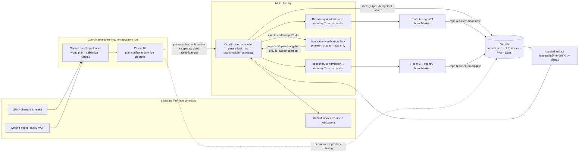
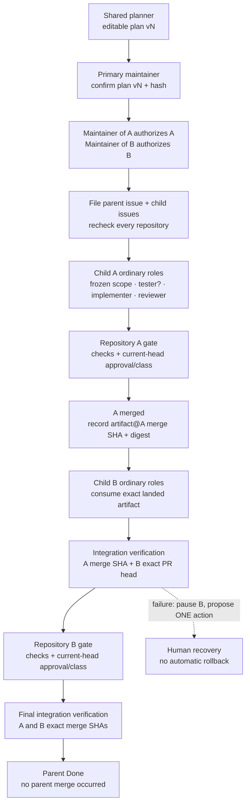

# v4.0: multi-repository coordination, one confirmed change with repository-local authority

**Date:** 2026-11-05 · **Status:** proposed; the owner validated the target and the decisions in
this design on 2026-11-05 · **Activation:** blocked until v4.0 items 3 (repository-declared classes)
and 4 (untrusted-input hardening) have shipped · **Proof:** public repositories only after activation;
no live claim yet · **Builds on:** the [v4 roadmap](2026-10-31-v4-roadmap-design.md),
[second repository](2026-10-16-v2-second-repository-design.md),
[scoper](2026-10-22-scoper-design.md), [splitter](2026-10-23-splitter-design.md),
[factory interfaces](2026-10-21-factory-interfaces-design.md),
[merge-gate human path](2026-10-29-merge-gate-human-path-design.md) and
[factory from your agent](2026-10-25-factory-from-your-agent-design.md) designs

Maku source below is read at `4685672f0f40973286a121f83ea92dd3428b8120`, cited as
`Maku/<path>:<line>`. **Current** describes that source and the existing designs. **Proposed** is
everything after the decision table, including field names: no coordination implementation or live
proof exists now.

## Outcome

A maintainer can coordinate **one coherent change across two repositories**. A shared pre-filing
planner proposes an editable family plan. A primary-repository maintainer confirms the plan, and a
linked maintainer with GitHub `write` independently authorizes every child in its own repository.
Only then does the factory file a parent coordination issue and one implementation issue in every
affected repository.

The parent records and explains the change. It never writes code, owns a branch, holds a sandbox
repository token, opens a pull request or merges one. Each child is otherwise an ordinary
repository-local Task: its own room, declared class, tier and team, `agent/<childTask>` branch,
repository-scoped token, pull request and current-head merge review. Explicit landed artifacts and
cross-repository integration checks order the work. There is no atomic cross-repository merge and no
automatic distributed rollback.

The first switch permits exactly two children. Independent children may execute concurrently;
a dependent child waits for its declared artifacts on the producer's **landed merge commit**. The
first live proof instead uses one dependency and makes no claim that parallel execution is proven.

### Roadmap position, deliberately resolved

The current roadmap places multi-repository tasks beside fleet campaigns in v4.4 and makes that
release depend on repository classes and untrusted-input hardening
([increments](2026-10-31-v4-roadmap-design.md#increments)). The owner-validated target moves
multi-repository coordination, **not fleet campaigns**, into v4.0 beside Developer Experience.
Design and switched-off implementation may proceed with DevEx. Activation and live proof still wait
for items 3 and 4. This resolves the dependency inversion without pretending the prerequisites are
already satisfied. Roadmap and status edits belong to another change.

Current source makes the distinction important: Maku can parse and observe repository-declared
classes, but its package contract says central configuration remains the only merge authority
(`Maku/internal/factory/mergepolicy/policy.go:3-6`; its watcher only compares policy in
`Maku/internal/factory/mergepolicy/watch.go:39-41`). That parser is not evidence that item 3 has
shipped, and it must not unlock coordination execution.

## Current state and the gap

| Piece | Current fact | Consequence for this design |
|---|---|---|
| Task identity | `TaskSpec` has one required `repository`; `Source.Kind` is `issue`, `runlore`, `schedule`, `api` or `adopt` (`Maku/api/factory/v1alpha1/task_types.go:52-135`, `:294-330`) | A parent needs an explicit coordination discriminator, not an overloaded API or issue task |
| Splitter lineage | `spec.split`, `spec.parent`, `status.split`, phase `Split`, and `agents.ogenki.io/parent` already implement one-repository families (`Maku/api/factory/v1alpha1/task_types.go:117-126`, `:210-236`, `:363-380`, `:500-535`; `Maku/api/factory/v1alpha1/task_phases.go:30-31`, `:54-63`) | Reusing those names would make two family kinds indistinguishable |
| Splitter execution | A split child inherits the parent's repository and uses `factory/child-of:#n`; parts open one at a time after the preceding part lands (`Maku/internal/factory/reconciler/split.go:320-382`, `:446-505`) | Cross-repository children need different issues, labels, lineage and admission |
| Splitter intake | Re-labelling a part reconstructs `spec.parent` from a factory-applied child-of label and an earlier Task (`Maku/internal/factory/intake/issues.go:379-413`) | A coordination child must never enter this path or collide with a same-repository split |
| Splitter budget | Its family remainder is computed from live spend and is race-free **because parts run one at a time** (`Maku/internal/factory/reconciler/split.go:246-283`) | Parallel children need fixed, confirmed, non-overlapping allocations instead |
| Repository ownership | Intake requires the repository fence before starting work (`Maku/internal/factory/intake/issues.go:219-220`); each reconciliation binds clients by `spec.repository` (`Maku/internal/factory/reconciler/reconciler.go:161-168`) | Every child reuses its own fence and clients; a family cannot choose one owner's credentials for all |
| Human authority | Label intake checks both maintainer membership and GitHub `write` (`Maku/internal/factory/intake/issues.go:296-311`); `repoaccess` distinguishes read from write and fails closed past its cache (`Maku/internal/repoaccess/repoaccess.go:42-61`, `:78-86`) | Every child needs a separate linked maintainer and a fresh admission check |
| Run boundary | Implementers write `agent/<task>` on the Task's repository (`Maku/internal/factory/reconciler/implement.go:137-145`); run validation rejects an issue or PR URL from another repository (`Maku/internal/factory/runs/runs.go:126-140`) | A parent cannot be an ordinary implementer Task; children stay repo-local |
| Merge authority | The gate can arm a maintainer-approved current head (`Maku/internal/factory/reconciler/arm.go:113-147`, `:222-239`), and per-repository post-merge verification or revert follows (`Maku/internal/factory/reconciler/merge.go:952-981`, `:984-1065`) | A parent must add no second merge authority and no global rollback |
| Daily budgets | Run admission atomically reserves the run ceiling against person and fleet in one ledger write (`Maku/internal/factory/ledger/ledger.go:57-90`, `:119-177`) | Family allocations complement, never replace, these existing caps |
| Scoper and split proposal | A scoper is a post-filing triager run; its handoff can carry one scope and the single-repository split (`Maku/internal/factory/reconciler/scoper.go:19-57`, `:164-182`; `Maku/internal/envelope/payloads.go:116-128`) | The shared multi-repository planner belongs before filing and is not another scoper answer |
| Repository classes | The typed declaration exists, but observation leaves central config authoritative (`Maku/internal/factory/mergepolicy/policy.go:3-6`; `Maku/internal/factory/mergepolicy/resolve.go:25-38`, `:99-124`) | Plans may name only resolved repository allowance after item 3 ships |
| Room access | Ordinary human room reads follow the room repository's GitHub read, with an admin bypass; sponsored principals read only rooms where they are members (`Maku/internal/humanapi/access.go:33-69`) | Parent aggregation needs per-child filtering and no admin widening |
| Slack repository scope | A channel declares the repositories it serves, and intake refuses another repository (`Maku/internal/slackapp/config.go:41-46`; `Maku/internal/slackapp/app.go:354-382`) | Outbound family details require the same explicit per-repository approval |
| Existing roles rail | `summary/v1` carries a role plan and splitter-specific `split`/`parent` projections (`Maku/internal/summary/flow.go:198-209`); the rail renders split parts and a part's parent (`Maku/web/src/rail.ts:308-323`) | Add a coordination projection rather than reinterpreting splitter facts |
| Checkout | `maku checkout` verifies one room repository, resolves one fetched commit, creates a new worktree and never touches the current checkout (`Maku/internal/maku/checkout.go:87-161`, `:189-236`) | Parent checkout generalizes this to verified per-repository commits and a manifest |
| Gateway audience capacity | The current `sts` policy lists four roles in each of two repositories and records that its eight-audience capacity is full (`infrastructure/base/agent-gateway/policies-identity.yaml:142-173`; the listener is `infrastructure/base/agent-gateway/gateway.yaml:31-39`) | Two children and integration use existing roles; no new role or third repository may sneak in |

## Decisions

| # | Decision | Rejected, and why |
|---|---|---|
| MR1 | **One coherent family, at most two children.** Every child is necessary to one integration acceptance. | Fleet campaigns, arbitrary fan-out and arbitrary repository counts: different product, larger blast radius and no bounded first proof |
| MR2 | **A parent Task in `Coordinating`, with `spec.kind: coordination` and `source.kind: coordination`.** Children use `spec.coordinationParent`; integration attempts use `spec.kind: integration`. No new CRD. | Reusing `Split`, `spec.parent`, `LabelParent`, `TaskFacts.split/parent` or `factory/child-of`: would collide with the single-repository splitter and its intake |
| MR3 | **A parent issue in the user-confirmed primary repository and one implementation issue in every affected repository.** The primary is one of the child repositories in the initial switch. | A parent-only repository: could consume a third gateway audience and separate the integration check from the change; a parent label trigger: could write code |
| MR4 | **A shared pre-filing planner returns a typed editable plan and diagnostics.** Natural-language interpretation is the separate shared-intake contract; deterministic validation, repository facts, role resolution, hashes and materiality are coordination-owned. | A second scoper/split answer: happens after filing and is bound to one Task; a free-form plan document or generic playbook engine |
| MR5 | **Separate confirmations.** A primary maintainer confirms the plan; each child has its own linked maintainer authorization. Parent confirmation fills no child authorization. | One global approver, GitHub-read authority, group membership or `agents-admin` bypass: none confers write authority on every repository |
| MR6 | **All repository checks pass before any child Task starts.** Recheck fence, maintainer list, GitHub write, App installation and resolved class at each child's admission and resume. | Silent partial start or relying on a plan-time check: a child could be admitted after ownership or permission changed |
| MR7 | **Dependencies name landed artifacts.** `dependsOn` orders admission; `produces`/`consumes` names the exact artifact required from the producer's merge commit. | Room handoffs, PR-head artifacts, timestamps or “A is done” as an implicit interface: none proves what B may consume |
| MR8 | **Fixed family allocations plus existing person/fleet reservations.** Each child and integration attempt has a confirmed lifetime allocation whose sum is bounded by the family total. | Live family accounting across parallel children: the splitter's rationale does not hold once siblings overlap |
| MR9 | **Merge order is enforced only by withholding dependent integration release.** Each repository's gate and current-head review remain authoritative. | Parent merge calls, a cross-repository transaction, a merge queue or automatic merge from Slack |
| MR10 | **Integration is a separate read-only verification Task in the primary repository.** It consumes exact child head/merge SHAs, before a dependent merge where practical and after the final merge always. | A parent implementer run: would give the parent a branch/token; child checks alone: do not test their composition |
| MR11 | **Failure pauses dependents and records one deterministic proposed recovery action.** No automatic rollback or recovery playbook. | Automatic distributed revert or an LLM-selected multi-step recovery: merged repository histories cannot be rolled back atomically or safely by the parent |
| MR12 | **Plans are full, versioned snapshots with canonical hashes and a fixed materiality table.** Preserve only unaffected child authorizations. | LLM materiality, arbitrary text diffing or silently carrying every approval forward |
| MR13 | **Aggregation is an intersection of access.** Parent projections filter every child by the viewer's GitHub read; Slack shows details only for repositories explicitly served in that channel. | Room-membership-only inheritance, admin bypass or primary-repository access covering every child |
| MR14 | **The existing roles rail gains a coordination projection for confirmation and live progress.** Parent checkout creates detached, verified per-repository worktrees and a manifest. | Overloading split chips, or checking out one synthetic parent branch that does not exist |
| MR15 | **Interfaces consume the separate shared-intake, inbox/resume/notification contracts.** Slack can originate, edit and follow; human plan confirmation is in the parent UI; merges stay on GitHub. | Duplicating inbox routing or Slack operational approval in this design; standalone room creation |
| MR16 | **One switch: `coordination.mode: off|plan|execute`, default `off`, with `publicOnly: true` initially.** `plan` permits no issue filing or runs; `execute` remains blocked by the prerequisites. | Shipping directly live, or interpreting the existing class parser as activation evidence |
| MR17 | **No new AgentRun role and no gateway change.** The planner is not an AgentRun role; integration uses `triager`. | A coordinator or integrator role: new trust policies and audiences the two-repository listener cannot hold |

## Architecture



The coordination controller may use the factory's repository-bound App clients to file issues and
read declared artifacts. Those are controller operations, **not a parent AgentRun**. A parent Task
has no `AgentRun`, branch, PR, token projection or merger call. The integration verification Task is
a different Task with its own room and the primary repository's existing read-only `triager`
credential. It never creates a branch or PR and never calls the merger.

### Roles and the parent view



The room rail's `plan`, `nodes`, `ghosts` and milestones remain. A new `coordination` projection
holds plan version/hash, per-child state, dependency and artifact edges, integration attempts,
allocated/spent budgets and the one recovery proposal. `split` and `parent` keep their current
splitter meaning. During confirmation, planned child and integration nodes are disabled until their
required confirmation is present; after filing, the same projection becomes live progress. It never
renders a parent implementer or parent merge node.

## Contracts

### Plan

The planner and every interface exchange this design-level shape. It is bounded canonical JSON for
hashing; YAML below is only the human-readable representation. Unknown fields, duplicate child or
artifact IDs, a third child, a second repository occurrence, a dependency cycle, an unknown class,
a role list different from the resolved class harness, or an artifact over 64 KiB are invalid.

```yaml
apiVersion: maku.ogenki.io/v1alpha1
kind: CoordinationPlan
id: p4zt6wce                    # stable draft/parent Task id
title: Add and consume the v1 consumer schema
version: 3                      # strictly +1 per accepted edit
primary:
  repository: Smana/public-contracts
  rationale: The integration fixture and the consumer contract live here.
children:
  - id: contract
    repository: Smana/public-contracts
    maintainer: github:Smana    # linked identity, independently confirmed
    rationale: Publish the schema the consumer will read.
    class: scripts              # resolved from this repository's allowance
    tier: standard
    roles: [implementer, tester, reviewer]  # derived, not free-form
    budgetMicroUSD: 5100000      # lifetime across every generation/retry
    scope:                       # the existing bounded TaskScope shape
      state: ready
      task: Add the consumer v1 JSON schema and nothing else.
      touches: [schemas/consumer-v1.json]
      leave: [.github, docs/superpowers]
      plan: [Define the schema, validate its fixtures]
      assumptions: []
      acceptance:
        - {check: task test, proves: The schema and fixtures validate}
    produces:
      - name: consumer-v1-schema
        kind: file               # the only initial artifact kind
        path: schemas/consumer-v1.json
        mediaType: application/json
        maxBytes: 65536
  - id: consumer
    repository: Smana/public-consumer
    maintainer: github:other-maintainer
    rationale: Read the published schema instead of duplicating it.
    class: scripts
    tier: standard
    roles: [implementer, reviewer]
    budgetMicroUSD: 5100000
    scope:
      state: ready
      task: Validate the consumer against the landed v1 schema.
      touches: [internal/consumer]
      leave: [.github]
      plan: [Fetch the recorded schema commit, add the compatibility check]
      assumptions: []
      acceptance:
        - {check: go test ./internal/consumer, proves: The consumer accepts the v1 schema}
    dependsOn: [contract]
    consumes:
      - {from: contract, artifact: consumer-v1-schema, required: true}
mergeOrder: [contract, consumer]
integration:
  role: triager                  # fixed
  beforeDependents: true         # default; false needs a written rationale
  runMicroUSD: 510000
  maxRuns: 4                     # pre + final, with two failed/retry attempts available
  acceptance:
    - check: tests/integration/consumer "$MAKU_COORDINATION_MANIFEST"
      proves: The exact proposed heads work together, then the exact merged heads still do
budget:
  planningMicroUSD: 510000        # shared-intake planning/replanning allocation
  totalMicroUSD: 12750000         # planning + every child + integration.maxRuns * runMicroUSD
```

Validation invariants:

1. `primary.repository` is one child repository; every named repository is configured, owned by this
   factory and public under the initial switch. Changing primary starts a new parent/draft, not a
   plan edit.
2. `len(children) = 2` in `execute`; `dependsOn` has at most one edge total, points
   backward in `mergeOrder`, and every dependency has at least one matching produced/consumed
   artifact. With two children this is deliberately not a general DAG.
3. `class`, `tier` and `roles` resolve at the confirmed repository policy and central guardrails.
   The plan cannot declare a class, relax a gate, add a role or select another repository's policy.
4. Each child allocation covers at least one full run at its tier and is no more than its resolved
   task ceiling without an explicit maintainer increase. `planningMicroUSD + Σ child.budgetMicroUSD
   + integration.maxRuns * integration.runMicroUSD ≤ budget.totalMicroUSD`. Any unallocated
   remainder can be assigned only by a later confirmed plan version.
5. Every producer artifact is unique within its child and every consumer references an existing
   producer. `kind: file` is the only initial kind; container images, deployments, queues and generic
   artifact stores are not designed here.
6. Acceptance is data confirmed by maintainers. It becomes a sandbox command only through the
   hardened output path of v4.0 item 4; it is never executed by the planner, parent UI or parent
   controller.
7. Shared intake supplies the planning run IDs and their reserved/settled cost. At confirmation,
   that cost must fit `planningMicroUSD`; the first draft is separately bounded by intake's
   `max_cost`, which cannot exceed the allocation carried into the confirmed plan.

### Parent and child Tasks

Additive fields on the existing Task CRD, not a new resource:

| Field | Where | Contract |
|---|---|---|
| `spec.kind` | parent or integration | `coordination` or `integration`; absent keeps every existing Task an ordinary work Task |
| `source.kind` | parent and integration | `coordination`; never `api`, so the existing API-sponsored semantics are not borrowed accidentally |
| `spec.coordination` | parent | `{maxChildren: 2, publicOnly: true}`; fixed at creation |
| `spec.coordinationParent` | child and integration | `{task, planVersion, childID?}`; immutable, with `childID` required on an implementation child and absent on integration |
| `source.kind`, `source.requestedBy` | child | `issue` and the child authorizer's `github:<login>`; the factory-created snapshot is frozen and carries the confirmed plan's content hash |
| `spec.scope`, `predictedClass`, `template`, `budget` | child | Frozen from the confirmed child scope/class/roles/allocation at admission; no second C7, scoper or split proposal |
| `spec.integration` | integration | `{purpose: beforeDependentMerge|final, planHash, subjects[]}`; immutable; each subject is `{childID, repository, headSHA|mergeCommitSHA}` with exactly one SHA kind |
| `status.coordination` | parent | Current plan snapshot/hash/version, confirmation records, total and allocated budgets, child lineage, artifact refs, integration attempts, merge order, integration acceptance and the single recovery proposal |
| `status.coordination` | child | `{planVersion, childID, allocationMicroUSD, integrationAcceptedHead?}`; lineage only, never a second parent/split record |
| `status.result` | integration | `{state: pending|passed|failed, reason, manifestHash}`; a pass is valid only for its immutable subjects |
| phase | parent | `Coordinating` while non-terminal, with a bounded reason; `Done` only after all children land and final integration passes. `Coordinating` consumes no active-task slot |

CRD/CEL and controller invariants are explicit:

- a `coordination` parent has no template, tier, implementation budget, `NextRole`, `NextTrigger`,
  `PullRequest` or `Runs`; its `RoomRef` is for human planning/progress only;
- an implementation child has `spec.parent == nil`, no `spec.split`, no splitter `LabelParent`, and
  no `factory/child-of` label; it carries `agents.ogenki.io/coordination-parent=<parentTask>`;
- an integration Task has no implementation branch or PR, and every run record has role `triager`;
- a parent never enters `receivedChild`, `splitting`, `implementerSpec`, `DecideArm`, `Merge` or
  `RevertPR`; a coordination child follows the ordinary path except for its admission and
  integration holds;
- a child `Task.Spec.Repository`, its `Room.Spec.Repository`, its issue URL and its run repository
  must agree. A mismatch is `cross_repository_lineage` and starts nothing.

The parent status stores the current full plan and bounded confirmation/lineage history, not an
unbounded event journal. Every accepted plan version is also reposted. The current plan, child
lineage and integration subjects are control state; GitHub comments are recovery evidence, never
instructions read by an agent.

### Issues and confirmations

| Object | Content and marker | Labels and intake |
|---|---|---|
| Parent issue | Factory title/body; `<!-- maku-coordination parent=<task> version=<n> sha256=<hash> -->`; current plan or a redacted stub; child links only when their target repositories are public | `factory/coordination` is output only. Never `factory/ready`, a class label or `factory/split-proposed` |
| Child issue | Factory title/body with the bounded scope, class and parent task ID; `<!-- maku-coordination-child parent=<task> child=<id> version=<n> -->` | `factory/coordination-child` plus the class label for people; never `factory/child-of` |
| Plan repost | New comment per accepted version, with version/hash, changed sections and materiality from the fixed table | Idempotent by `(parent, version, hash)`; edited or forged comments do not change control state |
| Parent confirmation | `{planHash, actor, linkedGitHubLogin, confirmedAt}` | Distinct primary-maintainer action; grants no child authorization |
| Child authorization | `{childID, childFingerprint, planVersion, actor, repository, permission, fenceSHA, confirmedAt}` | Separate action by that repository's linked maintainer with write |
| Integration release | `{childID, headSHA, integrationTask, manifestHash}` | A head change invalidates it; it is not a merge approval |

All issues are filed only after the parent and every required child authorization are present.
Filing is idempotent by the parent/child markers. A controller crash may leave visibly linked but
incomplete issues; `filing_incomplete` blocks every child Task until replay completes them. This is
an explicit incomplete filing state, never a silent partial start.

A person applying `factory/ready` to a parent gets `coordination_parent` and no work Task, even
after the parent is terminal. The guard requires both a factory-authored parent marker and the
corresponding coordination Task, so copying the marker onto an ordinary issue grants no protection
or authority. Applying the trigger to a child can retry only an unchanged factory snapshot under the
current confirmed plan. An edited child snapshot is refused `coordination_scope_changed`; the change
must come through a plan revision and its required reauthorization.

### Dependencies and landed artifacts

A produced artifact becomes consumable only as this immutable reference:

```yaml
childID: contract
name: consumer-v1-schema
repository: Smana/public-contracts
path: schemas/consumer-v1.json
mergeCommitSHA: <40-hex>       # the producer PR's landed merge commit on the default branch
blobSHA: <40-hex>
contentSHA256: <64-hex>
sizeBytes: 18234
```

The controller reads the file through the producer repository's own App client at that merge commit,
checks path, type, size and digest, and records the reference. A PR head, reviewer handoff, branch
name or newer default-branch file does not satisfy the dependency.

Only then is the dependent child Task created and given the reference. In the public-only first
switch its sandbox fetches the public bytes anonymously at the recorded repository/commit/path and
verifies `contentSHA256`; no producer token enters its room or pod. The parent room stores the
reference, not the artifact bytes. Private artifact proxying and dual-repository read enforcement
are not claimed by the first proof.

An independent child has no such wait. Two independent children may have live AgentRuns at once.
A dependent child has an implementation issue from the start but no Task until every required
artifact reference exists.

### Integration acceptance

An integration manifest is immutable and names every input exactly:

```yaml
parentTask: p4zt6wce
planVersion: 3
planHash: <64-hex>
purpose: beforeDependentMerge    # or final
subjects:
  - {childID: contract, repository: Smana/public-contracts, mergeCommitSHA: <40-hex>}
  - {childID: consumer, repository: Smana/public-consumer, headSHA: <40-hex>}
acceptance: <the confirmed integration.acceptance list>
```

For a dependent merge, `beforeDependents: true` requires a passing manifest containing every landed
dependency merge SHA and the dependent PR's current head SHA. Only that exact head is released to
its ordinary repository gate; parent release is not approval. The repository still evaluates its
class, checks, policy and maintainer current-head review. If the head moves, the release is stale and
a new integration run is required.

`beforeDependents: false` is exceptional and requires a confirmed rationale, for example a check
that can run only on default-branch infrastructure. The final check is never optional: it consumes
all child **merge commit SHAs** and must pass before the parent becomes `Done`. Child checks and
post-merge monitors continue independently.

The verification sandbox may create temporary local worktrees at the manifest SHAs and run the
confirmed checks. The runner writes the immutable manifest to a read-only file and exports its path
as `MAKU_COORDINATION_MANIFEST`; there is no template-expression language. The check reads exact
heads and artifact references from that file. The Task has no implementation branch and no
push-capable token. On the current runtime its token audience is the existing
`octo-sts/<primary>/<triager>` audience, so the current full 8-audience gateway configuration needs
no addition.

### Budget

| Layer | Rule |
|---|---|
| Family | `status.coordination.budget.totalMicroUSD` is the confirmed lifetime ceiling for planning, all child generations and integration attempts |
| Child | A confirmed, non-overlapping `allocationMicroUSD` covers every run, retry and generation of that child; parallel siblings cannot spend one another's allocation |
| Integration | `maxRuns * runMicroUSD` is allocated separately; a failed run still consumes one attempt and its actual spend |
| Person and fleet | Every run still performs the existing atomic person-plus-fleet reservation; family allocation neither reserves nor widens a daily cap |
| Recovery | No recovery run may exceed its child/integration allocation. Exhaustion produces one `increase_budget` proposal, never an automatic top-up |
| Edit | Any increase requires a new parent confirmation and the affected child maintainer's confirmation. A reduction below settled plus outstanding reserved cost is invalid |

Affected child generations do not overlap: a material plan edit stops new scheduling, waits for the
old generation to stop and accounts for its outstanding reservation before a replacement starts.
Thus the static allocations remain race-free without trying to make the splitter's live-spend formula
parallel-safe.

## Admission and execution sequence

```mermaid
sequenceDiagram
  autonumber
  actor U as Initiator (Slack or coding agent)
  participant P as Shared planner
  actor MA as Primary maintainer
  actor MB as Maintainer of B
  participant C as Coordination controller
  participant A as Child A + repo A gate
  participant B as Child B + repo B gate
  participant V as Integration Task (primary, triager)

  U->>P: request + edits
  P-->>U: plan vN, diagnostics, canonical hash
  MA->>P: select primary; confirm parent plan vN
  MA->>P: authorize child A separately (if maintainer of A)
  MB->>P: authorize child B separately
  P->>C: file fully authorized plan vN
  C->>C: force fence/write/class checks on A and B
  C->>A: file A issue; create ordinary Task
  C->>B: file B issue; no dependent Task yet
  A->>A: branch/token/PR + repo checks + current-head review
  A-->>C: merged at A merge SHA
  C->>C: verify + record artifact@A merge SHA
  C->>B: admit ordinary Task with immutable artifact ref
  B->>B: branch/token/PR + repo checks; head Hb ready
  C->>V: beforeDependentMerge(A merge SHA, B head Hb)
  V-->>C: pass for exactly (A merge SHA, Hb)
  C->>B: release integration hold for Hb only
  B->>B: maintainer current-head approval / class gate merges Hb
  B-->>C: merged at B merge SHA
  C->>V: final(A merge SHA, B merge SHA)
  V-->>C: pass
  C-->>U: parent Done; report both PRs and integration evidence
```

At initial admission **all** repository authorizations are mandatory. Later, a fence, permission or
class failure pauses only the affected child and its transitive dependents; independent work may
continue. A waiting person/fleet day is visible as `waiting_daily_budget`, not misreported as an
authorization failure.

## Plan edits and deterministic materiality

A version is a complete replacement snapshot. No patch language or free-form diff is accepted.
Canonicalization sorts object keys and child/artifact IDs, preserves ordered `scope.plan` and
`mergeOrder`, removes comments and presentation whitespace, and hashes the typed fields above.
`planHash` includes `id`, `version`, `primary`, every child, dependencies, integration and budget.
A child fingerprint covers its repository, maintainer, scope, class, tier, roles, allocation,
produced/consumed artifacts, dependencies and merge position.

| Changed field | Changed sections reported | Required again | Safe to preserve |
|---|---|---|---|
| Title or a rationale only, with no other byte change | `title` or `children.<id>.rationale` | Parent review of the repost; no execution reconfirmation | Every child authorization |
| Primary repository | — | **New parent/draft and all authorizations** | Nothing |
| Child repository or maintainer | `children.<id>.repository`, `.maintainer` | Parent plus the old/new affected maintainers | Other children only |
| Child scope, class, tier, roles, acceptance or allocation | The exact child subfield | Parent plus that child maintainer; a budget increase always needs parent confirmation | Other children whose artifacts, order and integration inputs are unchanged |
| Produced artifact | `children.<id>.produces.<name>` | Parent, producer and every direct/transitive consumer | Unrelated children |
| Consumed artifact or `dependsOn` | The consumer edge | Parent, consumer and every transitive downstream child | Unrelated producer/independent children |
| `mergeOrder` | The changed positions | Parent plus children whose relative order changed and their downstream children | Children whose position and dependencies are unchanged |
| Integration acceptance, timing, role, run cap or max runs | `integration.*` | Parent and every child maintainer | None: family acceptance changed |
| Total budget | `budget.totalMicroUSD` | Parent; for an increase, every maintainer whose allocation also changes | Children with unchanged fingerprints when the total alone decreases safely |

The implementation must use this table, not an LLM or similarity score. A confirmation carrying an
old `planHash` or `childFingerprint` returns `stale_plan` and changes nothing. A new version first
pauses affected future scheduling and integration releases. Only after the required confirmations
does it replace affected Tasks; unaffected children continue under their preserved fingerprints.

For an all-public family, every repost on the parent issue contains the full plan in an inert code
block and the changed-section table. If private/mixed families are enabled later, the GitHub repost
contains only version, hash and changed field names; the full snapshot remains behind the filtered
parent API. A public GitHub issue can never be used as a private plan store.

## Merge, failure and recovery semantics

| Event | Parent/dependents | One proposed recovery action |
|---|---|---|
| Child PR rejected or closed unmerged | Pause transitive dependents; independent children may continue | `retry_child` when the scope is unchanged, else `revise_plan`, selected by the recorded terminal reason |
| Child Task stopped, escalated or budget exhausted | Hold its next run and every dependent; do not mark its artifacts landed | `resume_child`, `revise_plan` or `increase_budget`, exactly one by reason |
| Artifact missing, wrong type/size or digest mismatch | Do not admit the dependent | `retry_producer` if the plan is unchanged, otherwise `revise_plan` |
| Pre-merge integration failure | Withhold only the affected dependent head; leave producer merge untouched | `retry_dependent` when a new fix is needed, or `retry_integration` only for a recorded infrastructure failure |
| Head moves after integration pass | Invalidate the release automatically | `rerun_integration` for the new head |
| Producer or dependency reverted before final acceptance | Pause downstream scheduling/merge release and final completion | `revise_plan`; never automatic distributed rollback |
| Final integration failure | Parent stays `Coordinating`; merged children remain merged and under their own monitors | `revise_plan` or `retry_integration` for recorded infrastructure failure |
| Fence, class or write permission lost | Stop new admission for that repository and its dependents; existing per-repo gates still decide current work | `authorize_child` after repository state is restored, else `revise_plan` |
| Multiple failures | Deterministically select the first failed child in `mergeOrder`, then integration, then budget | Exactly one visible proposal; resolving it may reveal the next, never a bundled playbook |

`status.coordination.recovery` is `{code, childID?, integrationTask?, reason, planVersion,
requiresConfirmation, createdAt}`. It is a single proposed next action, not an executable workflow.
The action goes through the ordinary child retry, plan-edit, authorization or integration path and
its normal permissions. It never expands scope or budget implicitly.

A parent `factory/stop` pauses future family scheduling and integration releases; it does not borrow
another repository's authority to revoke a running child. A child maintainer's existing stop revokes
that child. The global kill switch still stops everything. A revert after the parent is already
`Done` is narrated and recorded as a post-completion incident without rewriting the terminal parent
or automatically reverting siblings.

## Security and privacy

### Authority boundaries

| Threat | Control and refusal |
|---|---|
| Maintainer of A, but not B, authorizes the family | Child B requires its own linked maintainer with current `write`; `repository_permission` on B, and no child starts anywhere |
| Parent tries to push or merge | `spec.kind: coordination` has no run/branch/PR/merger path; direct attempts return `coordination_read_only` and create no claim |
| Repository is unowned or owned by another factory | Fresh fence check fails `repository_not_owned`; no silent partial start. Cross-factory handoff is unsupported |
| Child A room or token is used for B | Existing room/repository and audience checks remain; the coordinator additionally requires Task/room/issue/run repository equality, refusing `cross_repository_lineage` |
| Planner selects an unsafe class or broadens allowance | Resolve against the repository declaration and central ceiling at confirmation and admission; `class_not_allowed`/`policy_changed` |
| Untrusted plan or artifact becomes an instruction | Strict schema, bounded bytes, inert rendering, safe-output/threat-check prerequisite, digest verification and repository-local sandboxes. Activation without item 4 is refused |
| Parent issue is labelled | `coordination_parent`; no code Task, including after parent completion |
| Stale approval is replayed | Canonical full-plan hash and child fingerprint must equal the current version; `stale_plan` |
| Integration is bypassed by approval | The dependent integration hold precedes the ordinary approve-to-merge arm and releases only the exact accepted head; it cannot mark the repo gate green |

### Read privacy

1. A human must first pass the existing parent-room check for the primary repository. For each child,
   the broker separately resolves the viewer's GitHub login and calls `CanRead` on **that child's
   repository**. Unauthorized children appear only as a count of restricted children: no repository
   name, title, scope, issue/PR URL, room, artifact metadata, error text or budget.
2. This per-child rule has **no `agents-admin` bypass**. Aggregation never grants more than GitHub
   read on each source. Access lookup failure fails closed for that child. Child room and issue APIs
   retain their own checks; `404`, not a revealing `403`, is used for an unreadable child.
3. A sponsored principal has no GitHub user identity to substitute. Its configured repository list
   is an upper bound, and the Slack channel's `channels.<id>.repositories` is a second required
   allowlist. Only the intersection may appear in a Slack parent projection.
4. If a channel is not approved for every repository named by a projection, it receives only coarse
   parent state and a rooms link, with no child details. If it is not approved for the primary, it
   receives no parent event. Intake from an unserved channel is refused as it is today.
5. Raw parent-room events contain no private child plan or artifact bytes. The filtered projection is
   computed at read time, so revocation cannot leave a previously folded summary overexposed.
6. Metrics and traces contain configured repository names and bounded reason codes only, never plan
   text, artifact content, viewer names or channel IDs.

The first execution switch is `publicOnly: true`, and private-repository integrated families are
**unproven and outside the first live claim**. The filters are nevertheless designed and tested now;
“the repositories are public” is not a reason to skip them.

## Parent checkout

`maku coordination checkout <parent>` is a new composition over the existing safe worktree helper,
not a parent branch checkout:

1. Resolve the current parent through the caller's normal room access and obtain a checkout manifest
   filtered by the caller's GitHub read. Any restricted required repository makes the full checkout
   unavailable; it does not silently produce a partial family.
2. Require a local clone for each repository, verify each `origin` exactly as the single-room helper
   does, and refuse with `gh repo clone owner/name` when absent. No new clone is made implicitly.
3. For an open child, fetch its `agent/<childTask>` ref and require the remote head to equal the
   manifest's PR head. For a merged child, fetch the default branch and require the recorded merge
   SHA to exist and be its ancestor. Create `git worktree add --detach <path> <verifiedSHA>`; a
   moving ref can never change the commit selected by the manifest.
4. Reuse the existing flagged-file confirmation, symlink/path checks and no-hook/no-smudge behavior.
   Ask once with the complete flagged-file set before creating any worktree. Without forms, any
   flagged file refuses the whole operation.
5. Write `maku-coordination.json` at the deterministic parent worktree root. It contains parent Task,
   plan version/hash, and for each child `{repository, worktree, room, issue, pr, dependsOn,
   artifacts, headSHA|mergeCommitSHA}`. The manifest is data; no command is run from it.

The root is `../<primary-directory>.<parent>` and per-repository directories sit below it. A second
call with the same manifest reuses the worktrees. A changed plan or head returns `checkout_stale`
and never moves, deletes or updates an existing worktree automatically. Failure leaves the current
checkouts, branches and dirty trees untouched and reports any incomplete new root explicitly.

## Interfaces and what stays elsewhere

Coordination owns only four interface-neutral results: `CoordinationPlan`,
`CoordinationConfirmation`, `CoordinationView` and `CheckoutManifest`.

- The **separate shared natural-language intake contract** turns a Slack or coding-agent request
  into planner input and carries initiator, linked identity, on-behalf-of and idempotency data. Both
  surfaces call the same planner and receive the same typed diagnostics. This design does not invent
  another parser or Slack command language.
- The **separate unified inbox/resume/notification contract** consumes the filtered
  `CoordinationView` and the single `recovery` record. This design specifies no inbox ranking,
  routing, desktop notification or resume algorithm.
- Human plan edits and confirmations use the parent UI and bind an exact hash. Slack operational
  approval is a separate design. Neither MCP nor Slack exposes parent push, parent merge or child
  merge tools. Every child merge remains a GitHub current-head review/class-gate decision.
- Parent and integration rooms are factory-created implementation details of those Tasks. No new
  user-facing standalone room-creation path is added.

## Failure handling and observability

### Operational states

| Condition | Observable state | Behaviour |
|---|---|---|
| Switch `off` | No planner tools, parent Task or coordination metrics activity | Existing issue/split/run behavior byte-for-byte unchanged |
| Switch `plan` | Draft parent and plan metrics only | No GitHub issue, child Task, integration Task or AgentRun |
| Prerequisites absent | `coordination_prerequisites` on attempted `execute` | `plan` may remain available; `execute` cannot file |
| Filing interrupted | `filing_incomplete`, with existing markers | Replay adopts issues by marker; no child starts until all exist |
| Repository check unavailable | `access_unverified`/`repository_not_owned` as appropriate | Fail closed for the affected admission; cached success past TTL is not enough |
| Integration infrastructure lost | Integration Task `Escalated`, parent `integration_pending` | Ordinary resume within its allocated run count; no automatic acceptance |
| Integration checks red | Integration Task `failed`, parent one recovery proposal | Dependent merge remains held or parent remains incomplete |
| Controller restart | Recover from parent Task and factory-authored markers | Adopt, never duplicate, issues/Tasks; no dependence on an in-memory DAG |
| Parent room log unavailable | GitHub issue/PR facts and parent Task remain | Reads degrade to `rooms unavailable`; no execution decision depends on a view |

### Metrics, traces and alerts

New Go instrument names follow Maku's current exporter convention and appear with `maku_` on scrape:

| Instrument | Labels | Meaning |
|---|---|---|
| `agent_factory_coordination_families_total` | `repository,outcome` | Filed, done, closed, stopped families by primary |
| `agent_factory_coordination_plan_versions_total` | `repository,outcome` | Confirmed, superseded, stale-refused plan versions |
| `agent_factory_coordination_admission_refusals_total` | `repository,reason` | Bounded reasons such as `repository_permission`, `class_not_allowed`, `stale_plan`, `cross_repository_lineage` |
| `agent_factory_coordination_children_total` | `repository,class,outcome` | Admitted, landed, dropped, reverted children |
| `agent_factory_coordination_integration_runs_total` | `repository,purpose,result` | Passed, checks-failed, infrastructure-failed integration attempts |
| `agent_factory_coordination_wait_seconds` | `repository,reason` | Time waiting for authorization, artifact, integration or recovery |
| `agent_factory_coordination_allocated_micro_usd` | `repository,kind` | Current confirmed allocations by primary and `planning`, `child`, `integration` |

Repository labels come only from factory configuration; family/child IDs, artifact names and plan
text are not metric labels. Per-run cost and per-person charge stay on the existing series. A parent
span records plan version/hash prefix and reason, with trace links to child Task roots and
integration runs; no acceptance text or artifact bytes enter logs/traces.

Alerts are `AgentFactoryCoordinationRecoveryRequired` (15 minutes), `...AuthorizationLost`,
`...IntegrationFailed`, and `...Stalled` (no state change for 24 hours). The parent UI shows current
allocation and settled spend by child, outstanding reservation, dependency/artifact state, exact
integration subjects, and one recovery action. It never reports success from a green child alone.

## Feature switch and rollout

```yaml
coordination:
  mode: off              # off | plan | execute; strict decoder, off by default
  publicOnly: true       # initial release refuses private/mixed families in execute
  maxChildren: 2         # any other value refused in this release
```

| Stage | Allowed change | Evidence required to advance |
|---|---|---|
| 1. Contracts, off | Add Task kinds/fields, planner, materiality, filtered projections and fake-controller tests; no values change | Offline suites pass; all existing splitter/intake/gate tests unchanged |
| 2. Plan preview | Deploy `mode: plan` with no execution | Planner/edit/confirmation UI and Slack/agent parity produce no issues or runs |
| 3. Execute-ready build | Ship `execute` support still configured `off` | Prerequisite checks prove repository-declared authority and hardened safe outputs are active; two public repositories pass readiness |
| 4. Time-bounded live proof | `mode: execute` for the named proof, then back to `off` | The complete live matrix below; no broad enablement implied |
| 5. Later decisions | Separate owner decision for private families, independent-child live proof or more than two children | New evidence and, for a third repository/role, a gateway capacity design first |

The execute guard checks capabilities, not just a release string: repository policy must be
authoritative rather than stage-3 observation, and safe validated outputs plus threat checks must be
configured for every child and integration input. If either regresses, new admissions stop without
changing existing single-repository tasks.

## Offline proof matrix

| # | Suite | Required assertions |
|---|---|---|
| O1 | CRD and discriminator | Parent/integration invariants hold; no parent run/PR/branch/template; `Coordinating` is non-active; existing Tasks need no new field |
| O2 | Splitter non-collision | Coordination objects never set splitter fields/labels; `factory/child-of` logic cannot adopt them; all existing splitter tests pass unchanged |
| O3 | Planner schema | Exactly two children in `execute`, unique repos/IDs/artifacts, primary in family, bounded scopes, one-edge dependency validation, class/role resolution and every invalid shape refuse deterministically |
| O4 | Materiality | Golden old/new plans exercise every table row, canonical hash stability, monotonic versions, unaffected-auth preservation and stale confirmation refusal; no model is called |
| O5 | Authorization | Parent-only confirmation is insufficient; non-maintainer-of-B, read-only user, missing link, unowned repo, App absence, permission error and class drift each start nothing |
| O6 | Filing/idempotency | Parent and every child issue have the required markers/labels; crash after each write replays without duplicates and remains `filing_incomplete` until complete; parent label never writes code |
| O7 | Dependency/artifact | Dependent Task is absent before landed merge evidence; PR head is insufficient; wrong digest/type/size refuses; independent children are both admission-eligible and may have concurrent fake runs |
| O8 | Budget | Concurrent independent admissions cannot exceed family total; person/fleet reservation is still called per run; generation overlap is prevented; increase/decrease/stale-budget rules hold |
| O9 | Integration | Manifests bind exact heads and merge SHAs; pass releases only the accepted dependent head; head movement stales release; final pass is mandatory; verification has only `triager` runs and no PR/branch/merger call |
| O10 | Merge/failure | Repo gates remain authoritative; A merged/B failed does not revert A; failure pauses only dependents; every failure row yields exactly one deterministic recovery proposal |
| O11 | Privacy | Viewer × repository matrix filters all child fields, including admins and lookup failures; unserved Slack channel gets no details; partial channel approval gets coarse state only; raw parent log has no artifact/private child content |
| O12 | Interfaces | Slack and coding-agent inputs produce the same typed plan/diagnostics; no Slack/MCP merge tool exists; inbox/notification fakes receive only the filtered view and one recovery record |
| O13 | Checkout | Both worktrees are detached at verified commits; manifest lineage is exact; current checkout and dirty state are unchanged; moving remote, wrong origin, restricted repo, flagged files and stale manifest refuse safely |
| O14 | Gateway/runtime | No new role, audience or trust policy is rendered; integration uses primary `triager`; cross-repository room/token attempts fail |
| O15 | Switch and regressions | `off` and `plan` create no issues/runs; prerequisite failure refuses `execute`; the full existing Maku test, race, CRD, chart, UI and name suites pass in the implementation change |

O7 proves the designed independent-child scheduling property offline. It is not a live parallel
claim.

## Live proof matrix, after the prerequisites

Use two named **public** repositories, two children, one file artifact dependency, ordered merges,
and both a pre-dependent and final integration check. Run the coherent family twice: once initiated
and followed from Slack and once from a coding agent. Human plan confirmations occur in the parent
UI; merges use GitHub current-head reviews. Record issue, Task, room, PR, manifest, integration and
metric/trace links for every row.

| # | Drill | Pass condition |
|---|---|---|
| L1 | Slack-originated happy path | Planner produces the editable plan; primary and per-child authorizations are distinct; parent plus two child issues appear; A merges, the exact landed schema unlocks B, pre-integration releases only B's accepted head, B merges through its own gate, final integration passes and parent closes Done |
| L2 | Coding-agent happy path | The same typed plan and progress are available through MCP; child rooms/tokens/branches remain repo-local; checkout creates two verified detached worktrees and the lineage manifest without changing the initiating checkout |
| L3 | Failure/recovery within L1 or L2 | Force pre-integration to fail: B cannot merge, A is not reverted, exactly one recovery proposal appears. Apply it, rerun on the new exact head, then complete final integration. No automatic rollback/playbook runs |
| L4 | Non-maintainer of B | Their B authorization is refused and neither A nor B starts, even when the same person confirmed the parent in A |
| L5 | Parent push/merge attempt | `coordination_read_only`; no parent AgentRun, branch, token, PR or merger call exists |
| L6 | Unowned repository | B's fence names another factory or is absent: the whole initial admission refuses before A starts; restoring it requires fresh admission |
| L7 | Cross-repository room/token | A's room cannot start on B and A's projected token fails B's audience; coordinator rejects a mismatched child room/Task as `cross_repository_lineage` |
| L8 | Viewer and Slack access | An unlinked, non-admin viewer gets `404` and no parent/child details; the per-repository denied-read matrix is covered by O11 because public repositories grant read to every GitHub user. A non-served Slack channel gets no child details or intake; a channel approved for only one repo gets coarse state only |
| L9 | Stale plan and budget confirmation | Confirm v1 after v2, or replay an old budget increase: `stale_plan`, no new Task, no changed allocation, no new run |
| L10 | Final integration | After both merges it consumes exactly the two merge SHAs; child green checks without this pass never close the parent |
| L11 | Teardown | Restore `mode: off`; no new family can be filed and existing ordinary single-repository work still runs |

No private integrated family is run or claimed. The proof deliberately has a dependency and does
**not** claim that independent children ran in parallel. It also does not claim atomic merges,
automatic recovery, arbitrary artifacts or more than two children.

## Acceptance criteria

1. The Task, issue, plan, dependency, integration and budget contracts above are implemented with
   bounded additive fields on the existing Task CRD; no new CRD, role, gateway audience or parent
   execution authority appears.
2. O1–O15 pass, including unchanged splitter and single-repository behavior, deterministic
   materiality, all-authorization-before-start, race-free static budgets and per-viewer/per-channel
   filtering.
3. `off` is the default everywhere; `plan` has no GitHub/write/run side effects; `execute` refuses
   until repository-declared classes and untrusted-input hardening are actually active.
4. L1–L11 pass on the two public proof repositories, from both Slack and a coding agent, with one
   explicit artifact dependency, ordered repository-local merges, pre/final integration and one
   human-driven recovery.
5. The parent never has a branch, repository-token-bearing run, PR or merge call. Every child has
   its own room/class/gate/branch/token/PR and current-head approval, and no parent confirmation
   substitutes for a child maintainer.
6. Family, child, integration, person and fleet caps all hold during the proof; a budget increase
   without fresh confirmation is refused.
7. A failure or revert pauses dependents and produces one proposed action; no automatic distributed
   rollback, recovery playbook or atomic cross-repository merge occurs.
8. Parent and issue projections never expose a child to a viewer without GitHub read; Slack details
   require explicit channel approval for every contributing repository.
9. The live report states precisely: two public children with one dependency proven; independent
   parallel children designed/offline-tested but live-unproven; private integrated families
   unproven; fleet campaigns excluded.

## Non-goals

- Fleet campaigns, arbitrary repository counts, cross-factory orchestration, a third repository or
  a second `sts` listener.
- A general DAG/workflow/playbook engine, free-form plan-diff engine, LLM materiality decision,
  generic artifact bus or durable recovery-script runner.
- Automatic distributed rollback, atomic cross-repository merge, parent merge authority, a merge
  queue, or Slack approval to merge.
- A parent code-writing/planning AgentRun or a new coordinator/integrator role.
- Inbox ranking/routing, notification policy, resume algorithms, shared NL parsing or standalone
  room creation; their separate contracts are consumed, not redesigned.
- More than one dependency edge in this release, nested coordination, child-of-child families, or
  coordination mixed with a single-repository split on the same Task.
- Private-repository integrated proof, anonymous secondary fetch replacement, private artifact
  proxying, or a live parallel-children claim in the first session.
- Arbitrary artifact kinds, deployment/environment orchestration, a general integration service,
  or weakening any repository's class, policy-bot, CI or current-head review.
