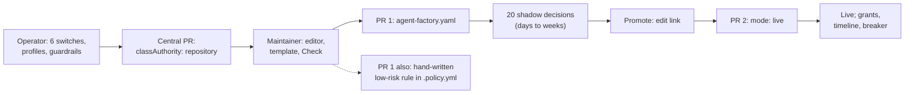

# Merge policy: UX review before v0.40.0

**Date:** 2026-11-08 · **Status:** review, P0 items implemented as PRs · **Reviews:** [the merge
policy self-service design](2026-11-04-merge-policy-self-service-design.md) and its stage 1–6
plans, read against Maku `origin/main` `78aa0b78`, this repository's `origin/main`, and
cloud-native-ref's `.github/agent-factory.yaml` and `.policy.yml` on `origin/main`

## Conclusion

The gate's model is right and in line with the field: a closed predicate vocabulary, deny before
approval before allow, shadow before live, and an independent second evaluator. Mergify and
policy-bot settled on the same shape. The vocabulary already covers the criteria comparable tools
use most, and it goes beyond them on evidence (shadow decisions, the breaker, monitors). Three
things stand between the six merged stages and a good default experience:

1. **The deployed configuration has no guardrails.** `mergeGuardrails` is unset in
   `tooling/base/agent-factory/helm-values-configmap.yaml`, so no central protected path or cap
   applies. The self-modification fence (MP14) is enforced only by `.policy.yml`, which repeats a
   30-path gate list in every rule.
2. **First-time setup failed on its first click.** Two of the three editor templates picked the
   `adopted-none` profile and failed validation. A file with one new class also failed on two
   required classes the maintainer never wrote. Fixed in Maku #412.
3. **A class could be unbounded.** A `live` or `shadow` agents class with no `allowedFiles` was
   valid, so every path of the repository was in it. Error messages also gave no location. Fixed in
   Maku #409.

Everything else is P1 or P2. The largest P1 is generating the policy-bot `low-risk:` rule from
the class, because hand-editing `.policy.yml` is now the slowest step of a new class.

## What a repository gets with zero config

| Situation | What happens | Safe | Useful |
|---|---|---|---|
| Enrolled centrally, fence file `factory: aws-0` only | The central config must declare `docs-links` and `revert`, or it fails validation (OD-8). Every other task is `review`, so a human merges | Yes | No: nothing auto-merges and no shadow evidence is collected |
| Cut over (`classAuthority: repository`), fence file with no classes | No class, so `class_unarmed`, so a human merges | Yes | No |
| Any class `mode: live` with no conditions (before #409) | Merges any agent PR, any path, any size, once CI is green and policy-bot agrees | Only through policy-bot | — |
| `policyBot: false` (demo) | Nothing fences `.github/` or `.policy.yml`: the gate has no built-in gate paths | **No** | — |

The default is safe because every "no" goes to a human. It is not useful: zero configuration
records no shadow decisions, so a repository that wants auto-merge later starts from zero
evidence. The rest of the field ships the same inert default (below). Maku can do better at no
risk, because shadow decides and never merges.

## How comparable tools do it

| Tool | Zero-config default | Composition | Discoverability |
|---|---|---|---|
| Mergify | Queue merges when branch protection's checks and reviews pass; never drafts or conflicts [1][2][6] | List = AND; `and:` / `or:` / `not:`; first matching queue rule [1][2] | JSON Schema, `config validate`, `config simulate <PR>`, a dashboard editor evaluated on real PRs [5] |
| policy-bot | No file, no status; `invalidate_on_push: false` [7] | `policy.approval` is an AND of rules or nested `and`/`or`; a rule's `if` is an AND [7] | `/api/validate`, `POST /api/simulate` [7] |
| GitHub rulesets | 0–10 approvals; strict required checks; rules stack, strictest wins [8][20] | No OR | UI and API |
| Renovate | `automerge: false`; opt in by preset (`:automergePatch`, `:automergeMinor`) [11][13] | `packageRules` matchers, AND within a rule | Presets; `minimumReleaseAge` soak, 14 days recommended [14][15] |
| Kodiak | Merges only with the `automerge` label; `WIP:` titles block [3][4] | Flat | One-line config |
| Bulldozer | No config, no action [17] | Trigger ANY, ignore wins | YAML |
| Prow / Tide | `lgtm` + `approve` labels, OWNERS per directory [18][26] | Query = AND of labels; several queries OR | Labels |
| Gerrit | Submit requirements with `applicableIf`, `submittableIf`, `overrideIf` [23] | Query syntax | `check.submit_requirement` dry run |
| Copilot coding agent | Workflows wait for a human; the requester's approval does not count [24][25] | Platform rules | — |
| Devin, Sweep, OpenHands | No auto-merge gate published; defer to the platform [29][30] | — | — |

Criteria frequency across the 12 tools surveyed:

| Criterion | Tools | Maku |
|---|---|---|
| Required CI checks | 12/12 | Fixed base (`requiredChecks`), plus `holdoutChecks` per class |
| Approval count or owners | 10/12 | `maintainers`, `approveToMerge`, `requiresApproval` subsets; **no CODEOWNERS** |
| Label opt-in or block | 6/12 | `requiredLabel`, adopted classes only; **no hold label on a PR** |
| Author or bot identity | 6/12 | `author: agents` / `adopt.logins`, plus provenance and head pinning |
| Base up to date / queue | 8/12 | Delegated to branch protection |
| Draft, conflicts | 5/12 | Delegated to GitHub |
| Path globs | 3/12 (Mergify, policy-bot, Gerrit) | `allowedFiles`, `protectedFiles`, `changedFiles` |
| Size caps | 2/12 (Mergify, policy-bot) | `maxPatchFiles`, `maxModifiedLines` |
| Soak time | 1/12 (Renovate) | `releaseAgeCheck` |
| Time window or freeze | 3/12 | Breaker and pause only; **no schedule** |
| Signed commits | 3/12 | Not needed: provenance pins the head to the task's runs |
| Shadow mode with evidence | 0/12 | `mode: shadow`, 20 decisions, Clopper-Pearson bound |

Path and size criteria are niche among human-PR tools but central for agent PRs. They are what
bounds blast radius, and Maku has both. Examples users write are tiny: Mergify's canonical
automerge rule is two conditions, and Kodiak's is one line [4][6]. No published usage statistics
exist. The 2026-10-29 [criteria study](2026-10-29-automerge-criteria-research.md) reached the same
vocabulary from the agent side.

## Vocabulary: what to add, what to hide

| Item | Verdict | Why |
|---|---|---|
| `allowedFiles`, `protectedFiles` (deny), `maxPatchFiles`, `maxModifiedLines`, `holdoutChecks`, `modifyOnly`, `limits.maxPerDay`, `monitor.followUpWindow` | **Core**: show first in the form | The blast-radius and proof criteria; every template uses them |
| `requiresApproval.changedFiles` | Core | Human approval for a sensitive subset, the GitLab/CODEOWNERS idea in typed form |
| `diffShape`, `releaseAgeCheck`, `adopt` | Advanced, adopted classes only | Renovate lanes; the form should show them only for `author: adopt` |
| `oracle`, `companionFiles`, `requiredLabel` | **Expert only** | Each is valid in one narrow combination: an oracle needs links-only, modifyOnly, holdouts and allowedFiles; `companionFiles` needs `added-entry`; `requiredLabel` needs adopt. Today the form shows `requiredLabel` and `companionFiles` to every class, and setting either on an agents class fails validation |
| `any` branches | Expert only | No real file uses them; one level is enough |
| Hold label (`factory/hold` on the PR blocks arm) | **Add, P1** | Universal in label-driven tools (Kodiak `blocking_labels`, Prow `do-not-merge/hold`, Mergify `label!=`). Today a maintainer stops a live merge only with "request changes", which starts a revision run |
| CODEOWNERS approval | P2 | 10/12 tools have owner approval, but `requiresApproval` plus `maintainers` covers the single-team case. Add it when a repository with several teams enrolls |
| Merge window / freeze | P2 | Breaker and pause cover incidents; a calendar adds config for little gain at two merges a day |
| Base up to date, conflicts, drafts, signatures | Do not add | GitHub owns them; duplicating them only lets the two disagree |

## The proposed default

Two layers. The central guardrails are the floor every class inherits. The starter file is what
`maku policy init` (P1) or the editor writes for a new repository. Everything in it is shadow, so
it records evidence from day one and merges nothing.

```yaml
# Central factory config (tooling/base/agent-factory/helm-values-configmap.yaml): P1, set at cutover
mergeGuardrails:
  protectedFiles:                       # MP14: the self-modification fence, once instead of per rule
    - '^\.github/'
    - '^\.policy\.yml$'
    - '(^|/)(AGENTS|CLAUDE)\.md$'
    - '^\.(agents|claude)/'
    - '(^|/)(go\.sum|package-lock\.json|pnpm-lock\.yaml|uv\.lock|Cargo\.lock)$'
  maxPatchFiles: 20
  maxModifiedLines: 400
  maxPerDay: 5
  # minPromotionEvidence: 20 and maxGrantLifetime: 90d are already the code defaults
```

```yaml
# .github/agent-factory.yaml: the starter file
factory: aws-0
classes:
  docs-links:
    mode: shadow
    author: agents
    harness: plain
    conditions:
      all:
        - holdoutChecks: ['<the docs link check>']
  revert:
    mode: shadow
    author: agents
    harness: plain
    conditions:
      all:
        - holdoutChecks: ['<the docs link check>']
  docs:
    mode: shadow
    author: agents
    harness: plain
    conditions:
      all:
        - allowedFiles: ['^docs/.+\.md$', '^README\.md$']
        - maxPatchFiles: 5
        - maxModifiedLines: 100
      deny:
        - protectedFiles: ['^docs/(adr|decisions|security)/']
    limits:
      maxPerDay: 2
    monitor:
      followUpWindow: 168h
# Anything outside these classes is review: a human merges it.
```

| Default | Value | Source of the value |
|---|---|---|
| Mode | `shadow` everywhere | MP7; Renovate and Kodiak are opt-in as well |
| CI | Fixed base: `requiredChecks` green, leak scan, policy-bot | Universal criterion |
| Author | `agents` only; adoption is opt-in per bot | Copilot: the requester cannot approve its own agent |
| Paths | Allow-list per class; the guardrail deny list above | policy-bot `only_changed_files` / `no_changed_files` |
| Size | 5 files / 100 lines per docs class; 20 / 400 central ceiling | cloud-native-ref's live classes stay under 3 / 20 |
| Rate | 2 a day per class, 5 a day in total | `autoMergesPerDay` today |
| Everything else | `review`: a human merges | Every tool's default |

A guardrail applies only to repository classes (`mergepolicy.Resolve`). Setting one before
cloud-native-ref's cutover therefore makes the dual evaluation record stricter repository
decisions than central ones. Set the guardrails in the same central PR as the cutover, or teach
`Compare` to apply them to both sides (P1).

## The experience, end to end



| Phase | Steps today | Friction | Fix |
|---|---|---|---|
| Operator setup | 6 switches (`read`, `simulation`, `dualEvaluation`, `repositoryAuthority`, `approvalMemory`, `promotion`), operators, profiles, then a separate cutover PR per repository | Six switches each need `read`; order is in prose only | P2: one `policyManagement.stage: 0..6` |
| New class | Open the settings page, pick a template, name it, edit, **Check**, open the edit link, paste, open PR; then hand-write a ~40-line `low-risk:` rule in `.policy.yml` with the 30-path gate list | Before #412 the first Check failed for 2 of 3 templates. The policy-bot rule is the longest step and the parity test catches drift only in CI | #412; P1: generate the rule |
| Editing | Guided form over `all`; `any`, oracle and comments only in YAML | The form rewrites the file without comments. `requiredLabel` and `companionFiles` are shown to every class and are invalid there. Renaming a template class after an edit leaves the old key in the file | P1: hide the expert leaves per author; keep comments in YAML mode; fix the rename |
| Validation | Strict decode, then guardrails | Before #409, `key "maxFiles" is not a field` with no location and no hint; first error only | #409 |
| Simulation | Fixtures replayed; counts plus a table | Rows name fixtures, not PRs; "unchanged: 12" says little about whether the class would ever match | P1: show matched PRs from the last 30 days |
| Promotion | Evidence page, Promote, edit link, PR, human merge | Fine: it is the deliberate human step (MP14) | — |
| Approval memory | Merge-and-create-rule on a live class's subset | Inactive in shadow by design, so it is invisible until the first live class | Guide: say so up front |
| Observability | Timeline per PR; `maku_factory_*` metrics | No "why did nothing merge today" view across a repository | P2: a per-class reason histogram on the settings page |
| Rollback | Central PR restoring exported classes; a relaxation returns to shadow | Clear, but only in the spec | Guide: a rollback section |

Count for a maintainer's first auto-merging docs class: about 9 interactive steps and 2 PRs,
plus the evidence wait, and one hand-written `.policy.yml` rule. With the P1 generator it is 2 PRs
and no hand-written YAML, which meets the spec's "under ten minutes without hand-writing YAML".

## The proposal, ranked

| # | Item | Pri | Effort | Risk | Status |
|---|---|---|---|---|---|
| 1 | Validation: located unknown keys with the key meant (aliases from policy-bot, Mergify, Renovate), a "how" for the required classes, no unbounded live/shadow agents class | **P0** | S | Low: repository files only, real files still pass | [Maku #409](https://github.com/Smana/maku/pull/409) |
| 2 | Editor: templates get a profile their author may take; a first class brings `docs-links` and `revert` as `off` | **P0** | S | Low: UI and one additive API field | [Maku #412](https://github.com/Smana/maku/pull/412) |
| 3 | Central `mergeGuardrails` as above, landed with the cloud-native-ref cutover | P1 | S | Medium: changes dual-evaluation agreement if landed alone | — |
| 4 | Generate the policy-bot `low-risk:` rule from a class (`maku policy bot-rule <class>`), shown beside the file in the editor | P1 | M | Low: output checked by the existing parity test | — |
| 5 | `maku policy init` writing the starter file, with the guide's defaults | P1 | S | Low | — |
| 6 | PR hold label (`factory/hold`) as a fixed-base row | P1 | S | Low: tightening only | — |
| 7 | Form shows leaves by author; YAML mode keeps comments; template rename fix | P1 | S | Low | — |
| 8 | Simulation over the last 30 days of real PRs, not fixtures only | P1 | M | Low: same evaluator (MP16) | — |
| 9 | Built-in gate paths in Maku itself (`.github/agent-factory.yaml`, `.policy.yml`, workflows), not only through policy-bot | P2 | M | Medium: adds a diff read to every class's decision record | — |
| 10 | One `policyManagement.stage` switch in place of six booleans | P2 | S | Low | — |
| 11 | CODEOWNERS-backed `requiresApproval` | P2 | M | Low | — |
| 12 | A per-class reason histogram on the settings page | P2 | S | Low | — |

## What the guide and the YAML mode should change

| Audience | Change |
|---|---|
| `docs/merge-policies.md` | Lead with the starter file and the guardrails above. Say that with zero config everything is `review` and no evidence is collected. List the core leaves first and mark `oracle`, `companionFiles`, `requiredLabel` and `any` as expert. State the new rules: every live/shadow agents class needs `allowedFiles`, and a file with classes declares `docs-links` and `revert` (`mode: off` is fine). Say that a new class also needs its `low-risk:` rule in `.policy.yml` until item 4 ships. Map other tools' names (`only_changed_files` → `allowedFiles`, `modified_lines` → `maxModifiedLines`, `check-success` → `holdoutChecks`). Add a rollback section |
| Expert YAML mode | Show Parse's located errors against their line (the path is now in the message, e.g. `classes.docs.conditions.all[0]`). Offer completion from the same key list the error prints. Keep comments, which the guided form drops. Insert `docs-links` and `revert` as `off` when absent, matching #412 |

## Sources

1. Mergify, queue rules: https://docs.mergify.com/merge-queue/rules/
2. Mergify, conditions: https://docs.mergify.com/configuration/conditions/
3. Kodiak, config reference: https://kodiakhq.com/docs/config-reference
4. Kodiak, quickstart: https://kodiakhq.com/docs/quickstart
5. Mergify, file format, validate and simulate: https://docs.mergify.com/configuration/file-format/
6. Mergify, merge action: https://docs.mergify.com/actions/merge/
7. palantir/policy-bot README: https://raw.githubusercontent.com/palantir/policy-bot/develop/README.md
8. GitHub, available rules for rulesets: https://docs.github.com/en/repositories/configuring-branches-and-merges-in-your-repository/managing-rulesets/available-rules-for-rulesets
9. GitHub, merge queue: https://docs.github.com/en/repositories/configuring-branches-and-merges-in-your-repository/configuring-pull-request-merges/managing-a-merge-queue
10. GitHub, automating Dependabot: https://docs.github.com/en/code-security/dependabot/working-with-dependabot/automating-dependabot-with-github-actions
11. Renovate, configuration options: https://docs.renovatebot.com/configuration-options/
12. Renovate, automerge: https://docs.renovatebot.com/key-concepts/automerge/
13. Renovate, default presets: https://docs.renovatebot.com/presets-default/
14. Renovate, security presets: https://docs.renovatebot.com/presets-security/
15. Renovate, upgrade best practices: https://docs.renovatebot.com/upgrade-best-practices/
16. GitHub, auto-merge: https://docs.github.com/en/repositories/configuring-branches-and-merges-in-your-repository/configuring-pull-request-merges/managing-auto-merge-for-pull-requests-in-your-repository
17. palantir/bulldozer README: https://raw.githubusercontent.com/palantir/bulldozer/develop/README.md
18. Prow, Tide config: https://docs.prow.k8s.io/docs/components/core/tide/config/
19. GitLab, approval rules: https://docs.gitlab.com/user/project/merge_requests/approvals/rules/ and auto-merge: https://docs.gitlab.com/user/project/merge_requests/auto_merge/
20. GitHub, about rulesets: https://docs.github.com/en/repositories/configuring-branches-and-merges-in-your-repository/managing-rulesets/about-rulesets
21. Aviator, MergeQueue reference: https://docs.aviator.co/mergequeue/reference/complete-reference-guide.md
22. Trunk, merge queue settings: https://docs.trunk.io/merge-queue/administration/advanced-settings.md
23. Gerrit, submit requirements: https://gerrit-review.googlesource.com/Documentation/config-submit-requirements.html
24. GitHub, reviewing Copilot PRs: https://docs.github.com/en/copilot/how-tos/use-copilot-agents/coding-agent/review-copilot-prs
25. GitHub changelog, skipping approval for Copilot workflows: https://github.blog/changelog/2026-03-13-optionally-skip-approval-for-copilot-coding-agent-actions-workflows/
26. Prow, approvers: https://docs.prow.k8s.io/docs/components/plugins/approve/approvers/
27. Graphite merge queue: https://graphite.com/docs/graphite-merge-queue
28. GitHub changelog, Agent Merge: https://github.blog/changelog/2026-10-28-agent-merge-watches-and-fixes-pull-requests-in-the-cloud
29. Devin SDK, PrAutoMergeInfo: https://docs.devin.ai/sdk/reference/CognitionAcp/types/PrAutoMergeInfo.md
30. OpenHands GitHub Action: https://docs.openhands.dev/openhands/usage/run-openhands/github-action

Not verified from official docs: GitHub merge-queue defaults and ruleset Evaluate mode, Renovate's
global `minimumReleaseAge` default, and Mergify's most-used conditions.
