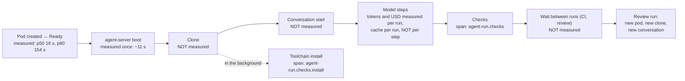

# Caching, performance and costs: measure, then take the free gains, then tune

**Status:** design, interview with the owner 2026-11-14, builder-checked, awaiting approval.
**Scope:** Maku (harness, factory, chart) and this repository's values. Read against Maku
`origin/main` at `c9ee6f5` (v0.47.0) and ANR `47b6557`.

**Outcome.** Prompt caching already works (95.1% of input read from cache), so the remaining gains
are elsewhere: a cold node, a full clone, a condenser left at the SDK's defaults, and one model at
one effort for every role. The work ships in three lots, in this order. Lot 1 measures what is
unmeasured today. Lot 2 changes defaults that cannot lower the quality of a pull request. Lot 3
changes effort and model per role, each change one trial under the live-traffic measurement that
`2026-11-14-workflows-review-design.md` owns. No lot adds a setting a user has to learn. Every
change is validated on aws-0, the cluster these reviews are proven on; gcp-0 is the active one
today and the two alternate.

## Where the time and the money go today

| Figure | Value | Source, date |
|---|---|---|
| Cache reads over input, all agent calls, 24 h | 95.1% (27.40M of 28.83M); $10.40 against $41.64 uncached | [cost snapshot](2026-10-18-cost-snapshot.md), 2026-10-18 |
| Runs on GLM-5.3 | $0.03 (10 steps), $0.17 (36), $1.65 (225, PR opened), $2.65 (319, out of budget) | same |
| Pod created → Ready | p50 16 s, p90 154 s; 18 of 42 pods over 60 s, all on a fresh node | [warm sandboxes](2026-10-16-v2-warm-sandboxes-design.md), 2026-10-16 |
| Same, warm node on | p50 16 s, p90 17 s | same, test A1, 2026-10-17 |
| Warm node, always on / working hours | about $126 / about $38 a month | same |
| Hard-task cohort | factory on GLM-5.3: 0 of 15 for $9.00; Claude: 13 of 15 at $1.22 per accepted | [eval bench](2026-10-22-eval-bench-design.md), cohort of 2026-10-12 |
| Cost per merged pull request | not recorded | — |



Facts the design rests on, read in the code:

| Fact | Where |
|---|---|
| The clone is `git clone --no-tags`, with no filter and no depth | Maku `images/maku-harness/agent_run.py:1401` |
| The harness then runs `diff`, `rev-list`, `merge-base`, `cat-file`, `ls-tree`, `commit`, `push`; never `blame` | same file |
| The toolchain installs with mise at the repository's pinned versions, into an emptyDir, **in the background** right after the clone, bounded at 300 s | `agent_checks.py:32,38`; `agent_run.py:844-851` |
| A run pod mounts only emptyDir, configMap, secret and projected volumes | Maku `charts/maku/templates/run-pod-policy.yaml:68` |
| The condenser is the SDK's default: 80 events, the first 4 kept, summarised by the run's own model at the run's effort | `agent_run.py:381`; `tests/golden/start-request.json:3-43` |
| Effort is `LLM_REASONING_EFFORT` or `high`; the run-controller never sets it | `agent_run.py:354`; `internal/runctl/pod.go:120-127` |
| The search child copies the parent's LLM and only lowers the effort to `low` | `site/agent_search.py:43,257-262` |
| `tier-light` is already allowed to the implementer on both data classes (`glm-5.3-flash`, `claude-haiku-5-5`) | `infrastructure/base/agent-gateway/profiles/implementer.*.yaml`, `llm.yaml:68`, `anthropic.yaml:34` |
| A per-role model applies to public tasks only | Maku `internal/factory/config/config.go:2384-2390` |
| A run gets a second model endpoint and token only when its loop sets a judge: `JUDGE_BASE_URL`, `JUDGE_MODEL` and a `judge-token` whose audience is `<prefix>.<class>.<alias>` | Maku `internal/runctl/config.go:629-630`, `pod.go:166-181,323-335` |
| The harness waits on a head's checks only on the judge's path, for at most 300 s | `agent_run.py:78,1575-1582` |
| Spans: `agent-run`, `agent-run.room_progress`, `agent-run.checks`, `agent-run.checks.install`, `agent-run.contract` | `agent_run.py:238,504,799,992` |
| The warm node is deployed at `replicas: 0`; empty gVisor nodes consolidate after 5 min | `infrastructure/base/karpenter-nodepools-agents/headroom/deployment.yaml:22`, `agents-gvisor-nodepool.yaml:58-59` |
| Cost series: `agent_factory_run_cost_usd` (tier, role, cohort, profile); `agent_factory_task_usd_total` and `agent_factory_task_outcomes_total` (class, cohort, profile, outcome), counted only for tasks with a profile | Maku `internal/factory/fmetrics/fmetrics.go:499-503,564,1191` |

## Decisions

"By" is the owner where the interview or a later answer settled it, the author otherwise (see the
last section).

| # | Lot | Decision | By |
|---|---|---|---|
| CP1 | 1 | Two new spans, `agent-run.boot` and `agent-run.clone`, and a factory-side reading of the wait between two runs of a task. | author |
| CP2 | 1 | A cache line per model response and a line per condensation in the run log (prompt-cache decision C1, never built). | owner |
| CP3 | 1 | A "cost per merged pull request" panel, by workflow and by role, in the chart's dashboard. Kimi counts at its list price, as the caps do. | owner; price: author |
| CP4 | 2 | The warm node is on from 08:00 to 19:00 Europe/Paris on weekdays, on aws-0. An ANR choice (v4 D18); Maku documents it. | owner; window: author |
| CP5 | 2 | The clone is blobless (`--filter=blob:none`), with a fall back to a full clone. | owner |
| CP6 | 2 | The condenser is tuned for internal runs: a larger window, and the summary on the light alias at effort `low`. | owner |
| CP7 | 2 | The search child runs on the light alias. | owner |
| CP12 | 2 | The run-controller gives a run the light alias (URL and token) whenever CP6 or CP7 can use it, not only when a judge is set. | author |
| CP8 | 2 | No toolchain cache is built now. CP1's data decides. | author |
| CP9 | 3 | Effort per role, a field of the workflow definition, one trial per role. | owner |
| CP10 | 3 | A per-role model on internal tasks, a field of the workflow definition limited to the `tier-*` aliases, one trial per role. | owner |
| CP13 | 3 | A trial alternates two workflow definitions on live traffic through cohorts; tasks merge normally. The method and the decision rule are the workflows spec's. | owner (Q16) |
| CP11 | — | Out of scope: the implementer's summary in the reviewer's brief, the 1-hour cache TTL, enforcing the daily caps. | owner |
| CP14 | — | Whatever these lots remove or re-key lands before v4.0.0, in two v0.4x minors: release N warns, release N+1 refuses. | owner (Q17) |

## Lot 1: measure

**Spans (CP1).** Children of `agent-run`, exported like the existing ones.

| Span | Starts | Ends | Attributes |
|---|---|---|---|
| `agent-run.boot` | the harness starts agent-server | its health endpoint answers | — |
| `agent-run.clone` | before `git clone` | after the branch checkout | `resumed`, `filter` (`blob:none` or `none`) |

Pod created → Ready stays a Kubernetes reading. The run dashboard's start row shows it beside the
two spans, so one row answers "where did the first minute go".

**The wait between runs (CP1).** The factory records, per task, the time from one run's end to the
next run's start, as a histogram labelled by the next run's role. A harness span cannot measure it:
the harness waits on checks only on the judge's path and gives up after 300 s, and `standard` has
no judge. The share of waits over 5 minutes is the number that sizes a longer cache TTL.

**The cache log (CP2).** Two lines, read from the SDK's per-response usage:

```
agent-run cache: step=41 input=182340 cache_read=176902 cache_write=5438 miss=none
agent-run condensation: step=80 forgotten=76 summary_model=tier-light
```

`miss` is one of `none`, `first` (the first response), `condensation`, `resume`, `unexpected`. Only
`unexpected` is a defect. Public runs print `cache_write=0`: Z.ai does not bill writes.

**Cost per merged pull request (CP3).** Two panels in
`charts/agent-factory/files/dashboards/agent-factory.json`, over the dashboard's range:

```promql
# By workflow: all spend, failed tasks included, over the pull requests that merged.
sum by (profile) (increase(agent_factory_task_usd_total[$__range]))
/
sum by (profile) (increase(agent_factory_task_outcomes_total{outcome=~"accepted|merged_human"}[$__range]))

# By role: each role's spend over the same merges.
sum by (role) (increase(agent_factory_run_cost_usd_sum[$__range]))
/ scalar(sum(increase(agent_factory_task_outcomes_total{outcome=~"accepted|merged_human"}[$__range])))
```

One change makes the first one true: the two task counters count every ended task, not only tasks
with a profile. No series and no label is renamed: the names are the code's `agent_factory_*`, and
`profile` keeps its name and carries the workflow's name as its value. Kimi's row is counted at its
list price, like every other model and like the caps, although the subscription is flat-rate.

## Lot 2: gains with no setting and no effect on the pull request

| # | Change | Expected effect | Verified by |
|---|---|---|---|
| CP4 | `agents-headroom` at one replica, weekdays 08:00–19:00 Europe/Paris, on aws-0 | start p90 from 154 s to about 17 s, for about $38 a month | pod created → Ready p90 over a week |
| CP5 | `git clone --no-tags --filter=blob:none` | unknown until CP1; grows with the repository's history | `agent-run.clone` p50 before and after |
| CP6 | condenser window and summary model, internal runs | fewer full rewrites of the context at $5.00 per M; a cheaper summary call | `condensation` lines per run; `AgentCacheReadShareLow` stays quiet |
| CP12 | the light alias on every run that can use it | none by itself; CP6 and CP7 need it | the run pod's golden file; a search and a condensation answered by the light alias in the gateway's log |
| CP7 | search child on `tier-light` | the same tokens at 0.11× (public) or 0.125× (internal) of the parent's input price | search spend per run; the implementer's own lookups after a search do not rise |

Rollback is the same for each: revert the release, or set the replicas back to 0 for CP4. A
filtered clone that fails falls back to a full one on its own.

**CP4, the warm node.** v4 D18 makes the sandbox nodes the user's, so Maku's install page gets one
paragraph and the chart nothing. Here the replicas follow the schedule in the aws-0 overlay; gcp-0
keeps `replicas: 0` until it is the cluster under test. The mechanism must own the `replicas`
field so Flux does not revert it. The pre-pulled images come from the Crossplane composition
today; after v4 D5 they are the run-controller's `images.harness` and `images.bridge`.

**CP5, the blobless clone.** It keeps every commit and tree, so `merge-base`, `rev-list`, `diff`
against the base and `push` behave as today; git fetches a blob when a command needs one, through
the same credential and egress rule as the clone. A shallow clone is rejected: it breaks
`merge-base` on an old base. If a forge refuses filters, the harness clones in full and the span
says `filter=none`.

**CP6, the condenser.** Only for `internal` runs, the ones on Anthropic, where a condensation
rewrites the context at the cache-write price. `max_size` and `keep_first` rise within the SDK
validator's bound (prompt-cache decision C4), and the summary moves to the light alias at effort
`low`. Public runs keep the default: Z.ai bills no cache write.

**CP7, the search child.** `child_agent` points the child at the light alias instead of copying
the parent's LLM.

**CP12, the light alias on the run.** This is a run-controller and chart change, not a harness
tweak. In gateway mode each alias has its own path (`/m/<alias>/v1`) and its own token, and a run
receives the second pair only when its loop sets a judge, which `standard` no longer does. The
run-controller therefore provisions a light alias on every internal run (for the condenser) and on
every run with search on:

| Item | Design |
|---|---|
| Which alias | a run-controller value, default `tier-light`; refused at load when the listener does not serve it, as `judgeModel` is today |
| Token | the existing projected `judge-token`, audience `<prefix>.<class>.<alias>`. No new audience: a judge on the same alias already holds exactly this token |
| Environment | `LIGHT_BASE_URL`, `LIGHT_MODEL`, `LIGHT_API_KEY_FILE`, read by the condenser and the search child. `JUDGE_*` stays, for a judge on another alias |
| Portable runtime | no gateway: the pod's own endpoint with the model Secret's `judge_model`, or the run's model without it, as the judge does today |
| Gateway | routes unchanged: both implementer profiles already allow `tier-light`. What grows is the set of runs that hold a light-alias token |

**CP8, the toolchain.** The install already runs in the background while the model reads the task.
Per-repository versions rule out baking tools into the harness image, and the admission rule
leaves two shapes only, a per-repository image or a read-only artifact cache, each filled by a
trusted job and each a new component. Neither is built unless `agent-run.checks.install` shows
runs waiting on it.

## Lot 3: effort and model per role

These change what a role produces, so each is one trial under the measurement defined in
`2026-11-14-workflows-review-design.md`: live tasks are drawn into two arms by the existing cohort
mechanism, run and merge normally, and the arms are compared on cost per merged pull request and
merge rate, 30 tasks an arm. This spec adds the mechanism that makes two arms differ, and the
order. The threshold, and what an indecisive result means (the default does not change), are that
spec's.

**How two arms differ.** Effort and model per role become two fields of a workflow definition, in
the advanced layer a user never has to open:

```yaml
workflows:
  standard:
    effort: {reviewer: medium}        # absent: high, today's value for every role
    models: {reviewer: tier-standard} # absent: the run's own alias
```

A trial is a second definition that differs from the shipped one in one field. The cohort draw
sends half of the eligible tasks to it, and the `cohort` label already on the cost series separates
the arms in CP3's panels. The factory writes the effort on the run and the run-controller passes it
as `LLM_REASONING_EFFORT`. `ModelFor` honours a role's model on an internal task when the alias is
`tier-light`, `tier-standard` or `tier-frontier`: those resolve inside the internal listener, so
internal content never reaches another provider. Today's `loops.<class>.models` rows move to these
fields when the workflows spec re-keys `loops` by workflow (release N+1).

| Order | Trial | Runs on | Waits for |
|---|---|---|---|
| 1 | scoper at effort `medium` | `careful` tasks | the workflows comparison `standard` against `careful` keeping the scoper |
| 2 | reviewer at `medium` | `standard` tasks | the comparison `quick` against `standard` keeping the reviewer |
| 3 | reviewer on `tier-standard`, internal tasks (Sonnet 5.5, half of Opus's price) | `standard` tasks, internal | trial 2 |
| 4 | triager at `medium` | investigations | — |
| 5 | triager on `tier-standard` or `tier-light`, internal | investigations | trial 4 |

One trial at a time for a given workflow, so two changes never share an arm; a role the workflows
measurement removes is not trialled. The scoper and the triager are both triager runs, told apart
by the task. Investigations merge nothing, so trials 4 and 5 read cost per investigation and the
share whose issue a maintainer accepts; if they never reach 30 an arm, nothing changes. The
implementer's effort and model are not trialled.

**Spend.** No budget is set aside: every trial task is a task that would have run anyway, bounded
by the run and task caps.

## Out of scope (CP11)

| Item | Reason |
|---|---|
| The implementer's summary in the reviewer's or a revision's brief | Model-written text would enter another role's instructions (a prompt-injection path), and the reviewer would stop being an independent reader. |
| A 1-hour cache TTL | The gateway emits `cache_control` with no TTL; prompt-cache decision C3 waits on an upstream change. CP1's reading of the wait between runs gives the share over 5 minutes, which sizes the gain. |
| Enforcing the daily caps | A governance decision (`enforcePrincipal: false`), not an optimisation. |

## Approaches considered

| Approach | Verdict |
|---|---|
| **Measure, then defaults, then trials** | Chosen. Every later decision reads a number lot 1 produces. |
| Cheaper models first | Rejected. The cohort showed the cheaper arm at 0 of 15 for $9.00 against 13 of 15 at $1.22 per accepted. |
| A workspace kept between roles (clone, toolchain, conversation) | Rejected. It needs a volume the admission rule forbids, and it ends the reviewer's fresh read. |
| Expose effort and condenser as per-class settings | Rejected. It adds knobs to a model the workflows review is shrinking. |
| Trials on replayed, paired tasks | Rejected by the owner (Q16): it needs a seeded mirror and hand grading. |

**Goals.** A known cost per merged pull request; a first minute under 30 s at p90 in working
hours; lower spend on roles whose output is checked downstream.

**Non-goals.** The implementer's model or effort; self-hosted models; a semantic cache.

**Anti-goals.** A lower cost per run with a higher cost per merged pull request. A new setting per
optimisation. A cache one run writes and another reads.

**Constraints.** v4 D5 (the run-controller is the run path), D7 (agentgateway only), D16 (no
Kueue), D17 (the volume rule), D18 (the nodes are the user's), D21 (dashboards and alerts ship in
the chart; ANR's VMRule copies go), D13 (no breaking value change after v4.0.0, hence CP14).
Public content never goes to Anthropic.

## Who changes what

| | Maku | ANR |
|---|---|---|
| Lot 1 | the two spans; the wait histogram; the two log lines; the two panels; the task counters count every task | pin the release in base; the aws-0 live check |
| Lot 2 | the light alias on the run (run-controller, chart, golden files); blobless clone with fall back; condenser for internal runs; search on the light alias; one paragraph on warm nodes | the headroom schedule in the aws-0 overlay; its image list from the run-controller's values |
| Lot 3 | `effort` and `models` on a workflow definition; effort through the run-controller; `ModelFor` on internal tasks for tier aliases; the shipped defaults after each trial | the trial's second workflow definition and the cohort share, in the aws-0 overlay; a session ledger entry per trial |

Lot 1 and lot 2 are additive and fit Maku's release N. Lot 3's fields arrive with the re-keyed
`loops` in release N+1 (CP14), so no key is added to be moved a release later.

## Left to the builder

- How the harness reads usage per response (an SDK event or a delta of `conversation_stats`).
- The condenser's `max_size` and `keep_first`, within the validator's bound of the pinned SDK
  (agent-server 1.56.0).
- The scheduler for CP4, provided it owns `replicas`.
- Whether `agent-run.boot` also needs a `conversation_start` child, if the gap between boot and the
  first response turns out large.
- The names of the three `LIGHT_*` variables and of the run-controller's value for the alias.
- Whether the wait histogram is a new series or a field on an existing task event read by the
  dashboard.

No question is left for the owner.

## Calls made after the interview

| Call | Why it departs from what was said |
|---|---|
| No toolchain image layer (CP8) | The interview listed "toolchain in an image layer". The install is already in the background, the versions are per repository, and the admission rule leaves only shapes that add a component. |
| The warm node is ANR's alone (CP4) | v4 D18: the sandbox nodes are the user's. |
| The panels go in Maku's chart and reuse two existing counters (CP3) | v4 D21; the counters already carry the outcome and only miss tasks without a profile. |
| The condenser change is limited to internal runs (CP6) | The cache-write price it avoids exists only on Anthropic. |
| The wait between runs is read by the factory, not by a harness span | The builder check showed the harness waits on checks only on the judge's path, for 300 s at most; a span there could never see a wait over 5 minutes. |
| The light alias is provisioned by the run-controller, on the judge's audience (CP12) | The first draft said "no gateway change"; true of the routes, but the URL and token reach a run only when a judge is set. No new audience is created. |
| Effort and model per role are fields of the workflow definition (CP9, CP10) | Two arms of a trial must differ in something a cohort can select. It is not a setting a user is asked to learn. |
| Trial order follows the workflows comparisons; trials 4 and 5 read investigations, not merges | A role is tuned only once it is known to stay; an investigation merges nothing. |
| No trial budget | Under Q16 a trial task is live traffic, bounded by the existing caps. |
| Warm node window, and Kimi at list price | The owner named the cluster (Q18); the hours are the author's. List price matches the caps. |
| No metric or label renamed | The `profile` label carries the workflow name as a value; the UX spec lists renaming metrics as a non-goal. |
