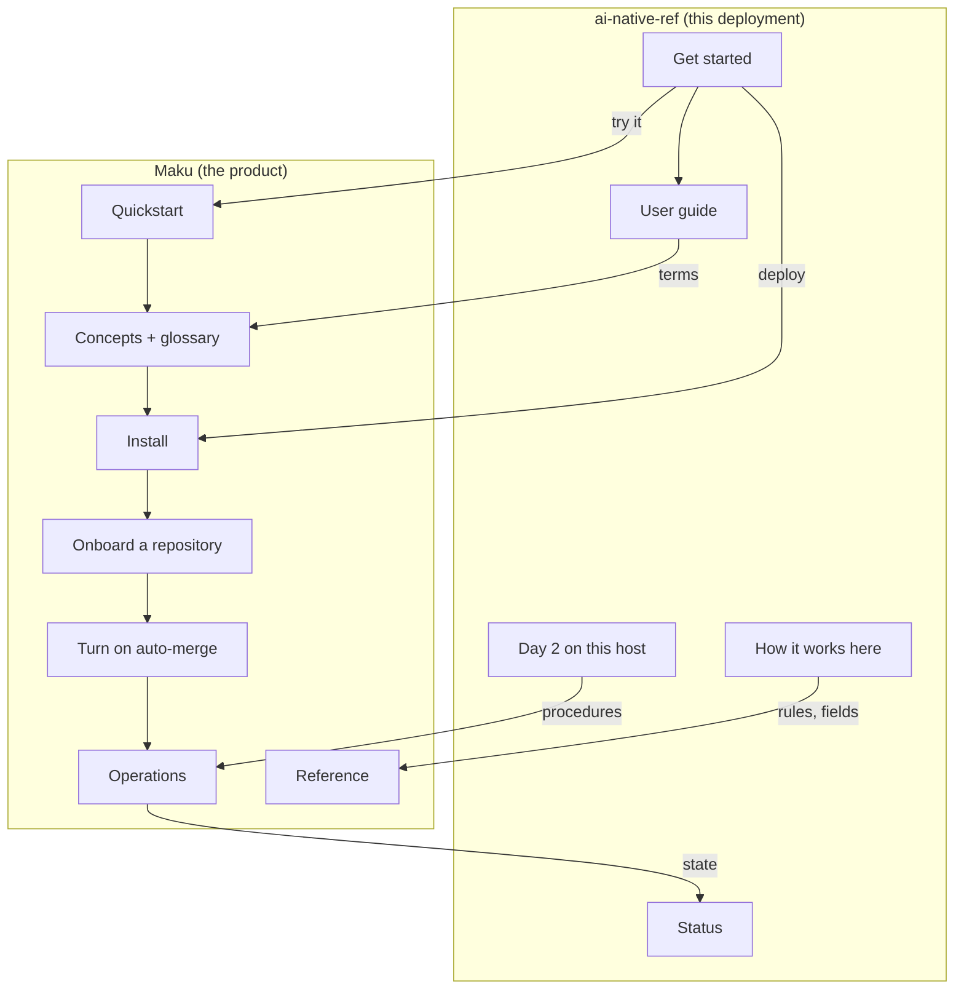

# Documentation review: one home per fact, across Maku and ai-native-ref

**Status:** design, interview with the owner 2026-11-14, builder-checked, awaiting approval. Read
at Maku `origin/main` `c9ee6f5` (v0.47.0 plus 19 commits) and ai-native-ref `47b6557`.

**Outcome.** Maku owns the product's documentation; ai-native-ref (ANR) documents only this
deployment and links to Maku by release tag. The product is called Maku everywhere. Four reader
paths get a first page each, and a correctness pull request fixes what is false today before any
page moves.

| Corpus | Today (words) | Target |
|---|---|---|
| Maku `README.md` + `docs/*.md` | 176,976 | about 132,000 |
| of which guides (not reference) | about 118,000 | about 75,000 |
| ANR site (`website/content`) | 85,026 | about 63,500 |
| ANR `README.md` | 2,064 | 900 |
| ANR runbooks (`docs/runbooks/agent-factory/`) | 65,025 | unchanged, minus the README's "State" section |

## The ownership rule (DOC1)

| Topic | Said in | The other repository |
|---|---|---|
| What Maku is, concepts, the one glossary | Maku `docs/concepts.md` | ANR links the term |
| Try it on a laptop | Maku `docs/quickstart.md` | ANR "Get started" links it first |
| Install on a cluster, the seams | Maku `docs/install.md` and its seam pages | ANR states its values for each seam |
| Onboard a repository | Maku `docs/onboard-a-repository.md` (new) | ANR lists its repositories |
| Merge gate, merge policies, gate reasons | Maku | ANR lists which policies are bound, and in which mode |
| Commands, MCP tools, Slack install, fields, config keys, API | Maku, under `docs/reference/` | ANR never restates one; it keeps the user's Slack flow |
| Operations, alerts, upgrade | Maku | ANR day-2 page: this host's pins, kill switch, restore |
| Host contract, model serving, routing and prices here | ANR | Maku links nothing host-specific |
| What is switched on here, measurements, ADRs; versions and clusters on `status.md` only | ANR | Maku links `status.md` once |
| The user guide (a person using a running factory) | ANR `use/guide/` | Maku links it from its README |

## Decisions

| # | Decision |
|---|---|
| DOC1 | Maku owns the product; ANR owns this deployment (the table above). |
| DOC2 | The product is **Maku**; the factory, rooms and the model gateway are its components. Rule 18 is rewritten. |
| DOC3 | "Model gateway" is the reader's term; `agent-router` names the Deployment in manifests only. |
| DOC4 | ANR links to Maku by release tag, through one shortcode reading the pinned version: a literal tag is what went stale. |
| DOC5 | A Maku version, or which cluster is active, appears on `status.md` and nowhere else in ANR. |
| DOC6 | Maku's `factory.md` is split by page type; no page mixes explanation and reference. |
| DOC7 | Two new Maku how-tos: "Onboard a repository" and "Turn on auto-merge". |
| DOC8 | The one-run quickstart, the k3d intake test and the CI job move to `docs/contributing/`. |
| DOC9 | `naming.md`, `v4-readiness.md` and `maku-group-migration.md` leave Maku's reader docs. |
| DOC10 | Design ids (`D1`–`D26`, `AM6`, `MP15`, "rollout step 7") leave Maku's reader prose (positioning D3). |
| DOC11 | Correctness first: one pull request per repository fixes every false statement before a page moves. |
| DOC12 | aws-0 and gcp-0 alternate; one runs the factory at a time. `status.md` names the active one. |
| DOC13 | Guards in `task docs` (ANR) and `hack/docs.sh` (Maku) hold DOC4, DOC5 and DOC10 without review. |
| DOC14 | Every breaking removal lands before v4.0.0, in two v0.4x minors: release N warns, N+1 refuses. A page says what is true at the version this platform pins. |
| DOC15 | The sibling designs' changes are validated on aws-0 only; ANR's changes go in base plus the aws-0 overlay. |

**Rule 18, rewritten.** "Maku is the product. Name a component (the factory, a room, the model
gateway) when you mean that part. 'Agent Factory' survives only in the release names
`Agent Factory v1` to `v3`."

## Which cluster runs the factory (DOC12)

**Both exist and alternate; gcp-0 is active now.** The owner runs a phase of work on one
cluster, then switches, which proves the platform on both. The ownership fence
(`.github/agent-factory.yaml`) names the active one.

Evidence: the fence here (`factory: gcp-0` since #343, 2026-11-11) and cloud-native-ref's agree;
both clusters are `suspend: false` on cloud-native-ref; the owner confirmed it on 2026-11-14.

`status.md` gets a "Clusters" section: both clusters, one sentence on the alternation, the active
one with `lastVerified`. Five pages state a teardown or an active cluster as fact; each loses the
sentence and links `status.md`:

- `README.md:111-113`: gcp-0 "torn down on 2026-10-29"; the factory "runs on `aws-0`".
- `docs/runbooks/agent-factory/README.md:1,9`: titled "aws-0", "live on aws-0 since 2026-10-30".
- `docs/runbooks/agent-factory/14-gcp-0-session.md:11`: "gcp-0 was torn down".
- `clusters/gcp-0-agent-platform/README.md:4-5` and `clusters/aws-0-agent-platform/README.md:4`:
  "ran the factory until its teardown".

## The four reader paths

| Goal | Today | After | Budget |
|---|---|---|---|
| Try it | Maku README → `quickstart.md` (4,693 words, five audiences) | ANR "Get started" or Maku README → `quickstart.md` | 1,200 words, 15 minutes to a merged pull request |
| Onboard my repository | No page; pieces in four | `onboard-a-repository.md` | 1,000 words, one page |
| Turn on auto-merge | Four ANR pages, then Maku `merge-policies.md` and `factory.md` | `auto-merge.md`, with `merge-gate.md` for the why | 1,200 words, then reference on demand |
| Operate it | ANR `operate/` → runbooks → Maku `operations.md` (17,481 words) | ANR day-2 page → one of three Maku operations pages | 800 words, then one 4,000-word page |

## Page types and word ceilings

Each page declares its type in front matter; the guard reads it, so no page is listed by name.

| Type | Ceiling | Examples |
|---|---|---|
| Tutorial, how-to (a guide) | 1,500 | `quickstart.md`, `onboard-a-repository.md`, `auto-merge.md`, `cli.md` |
| Explanation | 4,000 | `architecture.md`, `factory.md`, `hardening.md`, `merge-gate.md` |
| Operations | 4,000 | the three operations pages, `drills.md` |
| Reference | none | `docs/reference/`, `upgrading.md`, the install seam pages |
| ANR "values here" page | 500 | the reduced site pages |

The site keeps rule 9's own limits. The ceilings split four more Maku pages: `security.md`,
`install.md`, `web-ui.md` and `slack.md`.

## Target pages: Maku

Readers: E evaluator, N new user, R repository onboarder, O operator, C contributor.

| Page | Today | Decision | Target | Reader |
|---|---|---|---|---|
| `README.md` | 1,387 | Features on one screen | 700 | E |
| `docs/README.md` | 820 | The four reader paths | 500 | all |
| `quickstart.md` | 4,693 | `task demo` only (DOC8) | 1,200 | N |
| `concepts.md` | 2,441 | Explanation and the one glossary; the Room CRD moves to reference | 1,200 | N |
| `onboard-a-repository.md` | — | New (DOC7) | 1,000 | R |
| `auto-merge.md` | — | New (DOC7): bind, read shadow, promote, roll back; the three worked examples of `2026-11-14-merge-policies-review-design.md` | 1,200 | R |
| `merge-gate.md` | — | Explanation, split out | 1,500 | E, R |
| `factory.md` | 36,455 | Triggers, a task's life, budgets, the kill switch | 4,000 | R |
| `hardening.md`, `multi-repository.md` | — | Split from `factory.md` | 3,000, 1,500 | O, R |
| `merge-policies.md` | 10,089 | Whole, defect fixes only, until release N+1; then dissolved into the two pages above and reference | — | — |
| `reference/` | — | The CRDs, config, policy fields, gate reasons and settings from the splits; `api.md`, `event-envelope.md`, `room-log.md` and every command moved in | about 52,000 | C, O |
| `cli.md` | 8,647 | How-to: install, configure, the daily commands | 1,500 | N |
| `web-ui.md`, `slack.md`, `github-link.md` | 13,707 | Host wording out; `web-ui.md` and `slack.md` each a guide plus reference settings | 3 × 1,500 + reference | N, O |
| `install.md` | 2,350 | One "from zero" order diagram; detail to the seam pages | 1,500 | O |
| `architecture.md` | 6,187 | Keep; trim to explanation | 4,000 | E |
| `security.md` | 10,182 | Split: the threat model, with a diagram, and a reference of controls | 4,000 + reference | E, O |
| `integration.md` | 4,270 | What each release ships and what a consumer pins | 1,500 | O |
| `operations.md` | 17,481 | Split: rooms, factory, failures | 3 × 4,000 | O |
| `upgrading.md`, `drills.md`, the seven seam pages | 20,766 | Keep; `upgrading.md` headed by version number | as is | O |
| `roadmap.md` | 1,111 | One screen | 400 | E |
| `development.md`, legacy quickstart | 1,325 + about 2,500 | Move to `docs/contributing/` | as is | C |
| `naming.md`, `v4-readiness.md`, `maku-group-migration.md` | 6,578 | Move to `docs/superpowers/` (DOC9) | — | owner |

## Target pages: ai-native-ref

| Page | Today | Decision | Target |
|---|---|---|---|
| `README.md` | 2,064 | One table instead of three; no version, no cluster (DOC5) | 900 |
| `get-started/_index.md` | 955 | A path: try (Maku quickstart), deploy on the host, first task | 500 |
| `get-started/agent-factory.md` | 1,972 | Glossary and "target architecture" figure deleted; "Why self-host" to `how-it-works/providers.md`; the rest into `how-it-works/_index.md` | — |
| `use/guide/` chapters 1–10, cheat sheet | 11,237 | Keep; terms link Maku's glossary; no command or field table | about 11,000 |
| `use/guide/merge-policies.md`, `how-it-works/merge-gate.md`, `operate/auto-merge-safety.md` | 3,467 | What is switched on here: bound policies, modes, drill and breaker values | 400 each |
| `use/slack.md` | 2,624 | The user's flow only | 1,500 |
| `use/coding-clients.md` | 2,116 | This host's URL, CA and login; setup links Maku `cli.md` | 1,200 |
| `how-it-works/routing-and-cost.md`, `alternatives.md`, `gateways.md` | 12,262 | Measurements move to `docs/superpowers/specs/` (rule 6) | 1,500 each |
| `how-it-works/` others | 6,620 | Keep; `roles.md` and `factory.md` link Maku for the mechanism | about 6,000 |
| `operate/tune-a-run.md` | 3,044 | How-to under the style limit; settings link the reference | 1,200 |
| `operate/day-2.md` | — | New: kill switch, the upgrade pins, restore, each linking its runbook | 800 |
| `reference/commands.md`, `gate-reasons.md`, `factory-configuration.md`, `planner.md` | 4,166 | This platform's values and a link; no restated table | 300–500 each |
| `reference/harness.md` | 2,297 | The values set here; the settings table is Maku's | 1,000 |
| `status.md` | 4,373 | The version, rendered from `params.makuVersion` (the pin, not a live check), and the clusters, with `lastVerified` on the active one | 2,500 |
| `decisions/`, `HOST-CONTRACT.md`, runbooks, `clusters/*/README.md` | 94,735 | Keep, minus the runbooks README's "State" section and each "ran until" sentence | — |

Every moved or deleted site page keeps its URL through `aliases:` (rule 14).

## Defects to fix first (DOC11)

Re-verified on 2026-11-14: false statements, then contradictions, then duplicates.

| # | Where | Defect | Fix |
|---|---|---|---|
| 1 | ANR `README.md:103`, `docs/runbooks/agent-factory/README.md:9`, `reference/harness.md:23` | "Maku v0.38.0"; the manifests pin v0.47.0 | Delete the version; link `status.md` |
| 2 | ANR `status.md:16`, `reference/factory-configuration.md` | "Maku v0.41.1"; the pin is v0.47.0 | Render the pin from `params.makuVersion` on `status.md`; delete it elsewhere |
| 3 | ANR `how-it-works/roles.md:93`, `reference/gate-reasons.md:81` | Links to Maku `blob/v0.38.0/`; the other eight Maku links use `main` | The DOC4 shortcode |
| 4 | ANR `use/guide/merge-policies.md:44,110,121` | Teaches `classes` in `.github/agent-factory.yaml`, which v0.47.0 refuses | Rewrite to bindings |
| 5 | ANR `operate/auto-merge-safety.md:15` | "`shadow: true` under `repositories[].classes.<class>`" | `mode:` under `Repository.spec.mergePolicies` |
| 6 | ANR `get-started/agent-factory.md:118` | Lists multi-repository intake as still needed; four repositories are served | Delete |
| 7 | ANR `get-started/agent-factory.md:78` | "the whole programme once built. Its legend marks…" breaks rules 2 and 16 | Delete the figure |
| 8 | ANR, the five pages under DOC12 | State a teardown or an active cluster as fact | As listed there |
| 9 | Maku `integration.md:4` | "two CRDs", two charts; there are six of each | Correct |
| 10 | Maku `operations.md:4`, `security.md:337` | "The manifests live in cloud-native-ref" | "in your GitOps repository"; ANR as the example |
| 11 | Maku `factory.md:8`, `merge-policies.md:65` and 15 other `aws-0`/`gcp-0` hits | Host state in product docs | Delete; link the status page once |
| 12 | Maku `roadmap.md:7` | "As of v0.42.0" | Delete the stamp |
| 13 | Maku `api.md` (21 hits), `factory.md` (8), `slack.md` (6), `web-ui.md:12`, `concepts.md` | "ZITADEL" and "the tailnet" where `identity.md` says any OIDC issuer | "your identity provider"; ZITADEL as a labelled preset |
| 14 | Maku `docs/README.md` | Operator path names `charts/maku-factory/README.md` and skips `install.md` | The four paths |
| 15 | Maku `install.md`, `factory.md`, `operations.md`, `upgrading.md`, `slack.md:277` | 21, 53, 25 and 13 design ids; headings such as "(v0.4x, v4 rollout step 7)" | DOC10 |
| 16 | Both | The same glossary in Maku `concepts.md` and ANR `get-started/agent-factory.md` | Keep Maku's |
| 17 | ANR `README.md` and `reference/host-contract.md` | The same `flux resume` block | Keep the reference page's |
| 18 | Both | Class modes: `live / shadow / "off"` in Maku, `live / shadow / unarmed` on the site | Now: Maku's words at the pin (`"off"`; `class_unarmed` only as the reason code). With release N+1: `disabled` and `no_policy_matched`, per the vocabulary in `2026-11-14-ux-review-design.md` |

Out of scope, because it is code: the Room CRD's `repository` field defaults to
`Smana/cloud-native-ref`.

## Guards (DOC13)

What exists: ANR's `task docs` builds the site and runs `verify-doc-paths.sh` and
`check-reader-first.py` (rules 1, 4, 5); Maku's runs `hack/docs.sh` (positioning D7).

| Guard | Repository | Enforces |
|---|---|---|
| A `maku` shortcode builds every Maku link from `params.makuVersion`; a raw `github.com/Smana/maku/blob/` link fails | ANR | DOC4 |
| `params.makuVersion` equals the chart's image tag (`tooling/base/agent-factory/helm-values-configmap.yaml`) | ANR | DOC4: the bump travels with the pin |
| No Maku version ("Maku" then `v0.<n>.<n>`, or one in a Maku URL) outside `status.md` and `decisions/`; other tools' versions pass. `README.md` joins the reader-first scan | ANR | DOC5 |
| Word ceilings by page type, read from front matter | ANR | Rule 9, which nothing checks today |
| "Agent Factory" is refused unless it matches `Agent Factory v[0-3]`, outside `decisions/` | ANR | DOC2 |
| Design ids and cluster names refused outside `docs/superpowers/` and `docs/contributing/` | Maku | DOC10, defect 11 |
| Word ceilings by page type, read from front matter | Maku | DOC6 |

The vocabulary pass and defects 1 to 3 clear today's 40 "Agent Factory" hits and seven Maku
version literals before the guards arm.
`decisions/` is exempt as a directory, because ADRs are records; no guard lists a page. "No
restated field table" is not checkable; the 500-word ceiling is its proxy.

## Sequencing with the sibling specs

The siblings ship in two Maku releases before v4.0.0 (DOC14): **N** (the three workflows, the
catalog, warnings on old fields) and **N+1** (the diff-chosen gate, every removal).

| When | Pages | Why |
|---|---|---|
| 1. Now, at the v0.47.0 pin | Both correctness pull requests (ANR defects 1–8 and 16–18, Maku 9–15). In ANR also: the README, the "Clusters" section, rule 18 with "Maku" and "model gateway", `operate/day-2.md`, the guards that need no Maku link | Nothing pending changes what these say |
| 2. Now, in Maku | The `factory.md`, `operations.md` and `security.md` splits without the merge-gate part; `docs/reference/`; `quickstart.md`; `docs/README.md`; the DOC8 and DOC9 moves; `onboard-a-repository.md` as a checklist; the Maku guards | True of v0.47.0. The checklist is the third-party path: two Apps, the fence file, a `Repository`, the `maku/merge-gate` ruleset; policy-bot is optional (`docs/github-apps.md`) |
| 3. After the Maku release that carries step 2, and the pin bump here | ANR's reduced pages, "Get started", the shortcode and its two guards | The split pages do not exist at v0.47.0, and the docs version never leads the image tag |
| 4. With release N | Maku's roles text and `onboard-a-repository.md` rewritten around `maku repo add`; ANR `how-it-works/roles.md` and the guide chapters that name roles or profiles | Five roles, three workflows; "workflow" replaces profile, template and class |
| 5. With release N+1 | `merge-policies.md` dissolved into `auto-merge.md` with its three examples, `merge-gate.md` and `reference/merge-policy-fields.md`; `disabled` and `no_policy_matched` on the site | The catalog and diff-chosen policies change every paragraph |
| 6. With the UX change | `cli.md`, `reference/cli.md`, `slack.md`; ANR `use/slack.md`, `coding-clients.md`, the cheat sheet; the rest of the vocabulary pass | Tool names and Slack actions change |

A waiting page gets defect fixes only. ANR rows from 3 on follow a pin bump and are checked on
aws-0 (DOC15).

## Approaches considered

| Approach | Trade-off | Verdict |
|---|---|---|
| A. Maku owns the product, ANR this deployment | Removes the cause of staleness | Chosen by the owner |
| B. Each repository stays self-contained; fix what is stale | Fast; every Maku release stales the site again | Rejected |
| C. One site, Maku's; ANR keeps a README | Clearest for a reader; v4 D22 keeps ANR's site | Rejected |

## Goals, non-goals, anti-goals

- **Goals.** Each fact has one home. Each of the four paths starts on one page. Nothing on either
  site is false at the pinned version. The guards keep it so.
- **Non-goals.** A rendered site for Maku. Rewriting the ADRs or runbooks. Shortening the
  reference.
- **Anti-goals.** A reorganisation that leaves false statements in place. A site page that
  restates a Maku table. Guards that need an allowlist.

## The two plans

ANR's plan is rows 1 and 3 of the sequencing table; Maku's is rows 1 and 2. Rows 4 to 6 belong
to the sibling designs' plans.

## Calls made after the interview

| Call | Why |
|---|---|
| The user guide stays on the ANR site | The owner's rule did not place it; it is the only rendered site. |
| `auto-merge.md` and the "now" onboarding checklist present `maku/merge-gate` as the gate, policy-bot as optional | Maku's v4 D11 and D22; v0.47.0 supports it, and policy-bot is this platform's value until it flips. |
| `operations.md` becomes three pages; `roadmap.md` stays at one screen | Supersedes positioning D8; follows positioning D4. |
| `onboard-a-repository.md` is written twice | A checklist now, the command later: the hole is too large to wait. |
| Word ceilings by page type; four more Maku pages split | One 1,500-word ceiling contradicted eight targets. |
| `merge-policies.md` stays whole until N+1; ANR's reduced pages wait for a Maku release and the pin bump | No model is documented twice; the docs version never leads the image tag. |
| `status.md` renders the pin from a site parameter; the site writes `"off"` now and `disabled` with N+1 | Nothing on the site may be false at the pin; only the active cluster is a verified claim. |
| The version guard matches Maku versions only; "Agent Factory" passes only as `Agent Factory v[0-3]` | Other tools' versions are legitimate; no allowlist. |

## Left to the builder

- The exact section-to-page mapping of the `factory.md` and `security.md` splits, keeping every
  anchor other pages link to.
- The shortcode's form, and whether the site's absolute-link check should fetch Maku links.
- The front-matter key that carries a page's type, in each repository.

## Open to the owner

1. Do ANR releases keep the name "Agent Factory v3.x", or become "ai-native-ref v3.x"? Until
   decided, the rule 18 guard allows `v[0-3]`.
2. Should the user guide move to Maku when Maku gets a rendered site?
