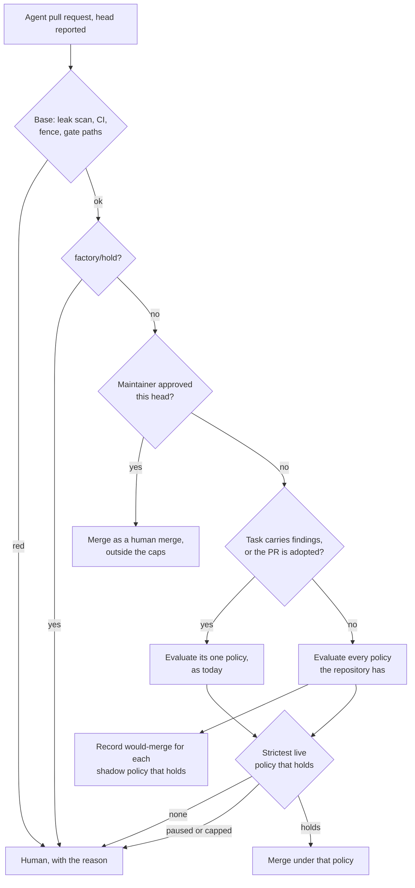

# Merge policies review: the gate reads the diff, and a new repository binds nothing

**Status:** design, interview with the owner 2026-11-14, builder-checked, awaiting approval. Facts
read on Maku `origin/main` (`c9ee6f5`, v0.47.0) and ai-native-ref `main` (`47b6557`).

**Outcome.** A pull request no longer needs a label to be considered for auto-merge. The gate
evaluates its diff against every merge policy the repository has, records shadow evidence for each
one that holds, and merges under the strictest live one. Maku ships four bounded policies that
every repository evaluates in shadow from its first task, so onboarding writes no policy and no
binding. A policy is promoted on 5 or 20 clean decisions depending on how mechanically its diff is
checked. The surface shrinks: workflow fields leave `MergePolicy`, six switches become one, and
an unbounded policy is refused again. Every removal lands before v4.0.0, and the change is
validated on aws-0.

## Why

The goal is to auto-merge more standard cases over time while the developer experience stays
simple. These facts stand in the way today.

| Fact | Where |
|---|---|
| The class is fixed at intake (label, schedule or plan, else `review`) and the gate decides only on that class. An unlabelled task yields no shadow decision, so no evidence | Maku `docs/factory.md:596-604`; `internal/factory/reconciler/arm.go:159-242` reads `Task.Spec.PredictedClass` |
| Every declared condition already reads the diff alone: files, sizes, shape, holdouts | Maku `internal/factory/reconciler/gate.go:36-93` |
| A diff-to-class inference exists, used only on a triager's predicted paths: `filefence.Infer` picks the one class whose `allowedFiles` admit every path | Maku `docs/factory.md:1026-1033` |
| An empty policy is valid. Five of ANR's twelve are `spec: {}` or nearly, and the only bound rule left covers a **live** class with `policyBot: false` | ANR `tooling/base/agent-factory/resources/mergepolicy-{dashboards,scripts,tests,review,docs}.yaml`; Maku `internal/factory/config/binding.go:316`, `config.go:2287-2291` |
| `mergeGuardrails` is unset on the platform, and every cap defaults to 0, no cap | ANR `tooling/base/agent-factory/resources/factory.yaml`; Maku `internal/factory/config/mergepolicy.go:57-76` |
| Seven of cloud-native-ref's eleven bindings merge nothing (`mode: "off"`, or `review`) | ANR `tooling/base/agent-factory/resources/repository-cloud-native-ref.yaml` |
| Promotion needs 20 clean shadow decisions and one drill per class; the code refuses a lower number | Maku `mergepolicy.go:86-92` (`MinPromotion` takes the max with 20); `docs/merge-policies.md:769-776` |
| At one finding a week `dead-links` needs about five months; `deps-patch` about three weeks | ANR `docs/superpowers/specs/2026-10-22-merge-gate-classes-design.md:255-256` |

## Decisions

| # | Decision | From |
|---|---|---|
| MR1 | **The gate selects the policy from the diff.** The class stops selecting anything a person sets: in release N it still names the workflow, in N+1 it does not (see "Class and workflow") | Q2; reverses MP5 |
| MR2 | **Maku ships a catalog** of four policies (`docs-links`, `revert`, `deps-patch`, `docs`), evaluated in shadow by every served repository with no binding | Q3 |
| MR3 | **A binding is an exception**: it takes a policy live, disables it, or tightens it. A platform still writes its own `MergePolicy` objects | Q3 |
| MR4 | **Promotion evidence is the policy's**: `evidence: low` (5 clean decisions) or `standard` (20). The drill is once per repository. Promotion stays a maintainer's pull request | Q4 |
| MR5 | **No second fence is written by hand.** The design builds on `maku/merge-gate` (v4 D11); nothing is built for policy-bot | replaces Q5, see below |
| MR6 | **Every evaluated policy is bounded**: `allowedFiles` or a `diffShape`, in live and in shadow | Q6.1 |
| MR7 | **Guardrails ship with defaults** instead of empty | Q6.1 |
| MR8 | **Fields are documented in three tiers**; the reference keeps one flat table | Q6.2 |
| MR9 | **Workflow fields leave `MergePolicy`**; `requires` and `mode: "off"` go; the six `policyManagement` switches become `stage`; `autoMergesPerDay` becomes `maxPerDay` | Q6.3 |
| MR10 | **`factory/hold`** on a pull request keeps it from auto-merging | Q6.4 |
| MR11 | **The docs carry three worked examples** of evolving and writing a policy (below) | Q3, owner's condition |
| MR12 | **No shape, no oracle: a reviewer's verdict is required.** A policy with a `diffShape` or an `oracle` may merge with no reviewer in the workflow. Any other policy holds only on a favourable verdict; without a reviewer the pull request waits for a human | Q15 |
| MR13 | **Every removal lands before v4.0.0**, in two v0.4x minors: N accepts the old field with a `Deprecated` condition, N+1 refuses it | Q17 |
| MR14 | **Validated on aws-0 only.** aws-0 and gcp-0 alternate, one active at a time; ANR's changes go in base and the aws-0 overlay | Q18 |

### Calls made after the interview

The owner did not decide these. Each is mine and can be overturned.

| Call | Why |
|---|---|
| **MR5 replaces the Q5 answer** ("generate the policy-bot rule"). I recommended it without having read v4 D11 and D22, ruled by the owner on 2026-11-12: `maku/merge-gate` is the gate and policy-bot leaves ANR. Generating `.policy.yml` would build for a path being retired. ANR still runs `gateStatus: false, policyBot: true` (readiness row 14), so this design **depends on that flip** | Maku `docs/superpowers/specs/2026-11-12-v4-production-path-design.md` D11, D22; `docs/v4-readiness.md` row 14 |
| The flip costs the independent second evaluator; MR6, MR7, MR12 and the gate-path hold (`withGatePath`, `arm.go:249-262`) replace it | — |
| The selection rule's order and its no-fall-through rule (below) | "Strictest" needed a definition |
| `mode: disabled` on a binding, for switching a catalog policy off | Q3 said a binding can cut a policy; Q6 removed `"off"`. One unquoted word covers the remaining need |
| `stage` defaults to `manage` | It only proposes pull requests |
| A binding's `allowedFiles` narrows a policy's that already has one (both must admit the path), instead of today's fill-once refusal (`ParameterTwice`) | Q3 lets a binding restrict a catalog policy's paths; the catalog's `docs` already declares them |
| `revert` stays in the catalog, and `docs` covers `^.+\.mdx?$` | The interview named four policies; a binding narrows the paths (example 1) |
| One sequence with the workflows design: release N is additive, N+1 carries the diff-chosen gate, MR12, workflows stage B and the removals together | Diff selection without stage B would leave the class owning the workflow |
| The bound rule reads the policy **as resolved with its binding** | `alert-rules` is bounded only by its bindings today; checked alone it would be refused on upgrade |
| The decision names its policy: "Merged automatically by policy `<name>`" or "Waits for a human: `<reason>`" | `PolicyDecision` returns fixed sentences today. This design owns the string; the UX design owns where it shows |
| Nothing names a policy before a pull request exists; no prediction is built | Under MR1 the policy is unknown until the head is reported |

## The design

### Selection (MR1)



| Rule | Detail |
|---|---|
| Candidates | The catalog's policies not disabled, plus the bound ones. Adopted and oracle-backed policies are excluded from the diff match |
| A policy holds | Every condition it declares holds on the diff, with the reported head and the trailer as today, and the reviewer's verdict under MR12. A missing verdict is the reason `reviewer_verdict_missing` |
| Strictest | Sort the live policies that hold by: has a `diffShape` first; then the lower `maxModifiedLines`; then the lower `maxPatchFiles` (0 sorts last in both); then name. The first decides |
| No fall-through | If that policy's breaker is open or its `maxPerDay` is spent, the pull request goes to a human. A looser policy never takes over, so a breaker cannot be bypassed |
| Shadow | Each shadow policy that holds records one `shadow_would_arm`, whether or not a live policy merged. Evidence accumulates on all traffic |
| No match | `no_policy_matched`, replacing `class_unarmed` and, for agent pull requests, `class_mismatch` |
| Oracle policies | Chosen by the task, not the diff: the `oracle` condition reads `Task.spec.findings`, which only a schedule's probe sets. Unchanged |
| Adopted policies | Chosen by the poller on author, branch, `requiredLabel` and files, as today (`filefence`, `AmbiguousAdoption`). Unchanged |
| Schedules | From N+1 a schedule's `class` names an oracle policy only (one with a `probe`); its workflow is the schedule's `workflow` field |
| Approve-to-merge | Unchanged, and still before any policy is read |
| `review` | No longer a policy. "No policy matched" is the same outcome |

The decision record keeps `class=` for the matched policy, so `shadow-merge-tally.sh` keeps
working, and gains `considered=<policy>:<reason>,…` for the ones that did not hold.

**Why shaping a diff to fit is bounded.** An agent can aim for a permissive policy. It still meets
the guardrails' protected paths and caps, the policy's own caps, the repository's required checks,
the per-day counts and the breaker. Where no shape checks the diff, MR12 requires a reviewer's verdict, so `quick` auto-merges links,
reverts and dependency patches and nothing else. Under v4 D12 its token can never approve or merge.

### Class and workflow, release by release

| | Release N (additive) | Release N+1 |
|---|---|---|
| Policy chosen by | the intake class, as today | the diff (MR1), with MR12 |
| Workflow chosen by | the class's `harness` | the planner's default, a `workflow:<name>` label or the choice at confirmation; `Repository.spec.workflow.default` (workflows design) |
| `Task.Spec.PredictedClass` | read by the gate | kept only for oracle and adopted tasks |
| `loops` rows | keyed by class | keyed by workflow (workflows design); ANR's per-class reviewer-model rows go where the class runs `quick`, which the builder verifies |

### The catalog (MR2, MR6)

Shipped by the `agent-factory` chart as `MergePolicy` objects (`mergePolicies.catalog: true`). A
platform owning objects of these names (ANR does) deletes its copies in the change that turns the
catalog on; a copy that carries workflow fields (ANR's `docs`: `checks`) stays ANR's object until
N+1, with the catalog's fields copied in.

```yaml
kind: MergePolicy
metadata: {name: docs-links}
spec:
  description: Link targets in Markdown, nothing else.
  diffShape: links-only
  modifyOnly: true
  maxModifiedLines: 20
  evidence: low
---
kind: MergePolicy
metadata: {name: revert}
spec:
  description: A revert whose diff changes link targets only.
  diffShape: links-only
  modifyOnly: true
  maxModifiedLines: 20
  evidence: low
---
kind: MergePolicy
metadata: {name: deps-patch}
spec:
  description: Renovate patch updates, after their release age.
  author: {adopt: {logins: ["renovate[bot]"], branches: ['^renovate/']}}
  diffShape: semver-patch
  modifyOnly: true
  maxPatchFiles: 3
  maxModifiedLines: 10
  releaseAgeCheck: renovate/stability-days
  maxPerDay: 2
  evidence: low
---
kind: MergePolicy
metadata: {name: docs}
spec:
  description: Prose in Markdown files, small changes.
  allowedFiles: ['^.+\.mdx?$']
  maxPatchFiles: 5
  maxModifiedLines: 100
  maxPerDay: 2
  evidence: standard
```

`docs-links` and `revert` state the shape the code builds in today (`BuiltInShape`,
`classes.go:203-208`). `deps-minor` stays out: 3 breakages in 111 merges.

### A Repository, before and after

```yaml
# before: 11 bindings, 7 of which merge nothing
mergePolicies:
  - {name: docs-links, mode: live, holdoutChecks: ["Check the documentation links 🔗"]}
  - {name: revert, mode: live, holdoutChecks: ["Check the documentation links 🔗"]}
  - {name: docs, mode: "off"}        # and tests, dashboards, scripts, review
  - {name: alert-rules, mode: shadow, allowedFiles: ['^observability/.+\.ya?ml$']}
  # … dead-links, deps-patch, deps-minor
```

```yaml
# after: a new repository has no mergePolicies key at all; cloud-native-ref keeps its exceptions
mergePolicies:
  - {name: docs-links, mode: live, holdoutChecks: ["Check the documentation links 🔗"]}
  - {name: revert, mode: live, holdoutChecks: ["Check the documentation links 🔗"]}
  - {name: alert-rules, mode: shadow, allowedFiles: ['^observability/.+\.ya?ml$']}
  - {name: dead-links, mode: shadow, allowedFiles: ['^(docs|website/content)/.+\.md$'], oracleWorkflow: dead-links.yaml}
  - {name: deps-patch, mode: shadow, protectedFiles: ['^security/base/zitadel/']}   # the host's list
```

### Field tiers (MR8)

| Tier | Policy fields | Binding fields |
|---|---|---|
| Essential | `allowedFiles`, `maxPatchFiles`, `maxModifiedLines`, `maxPerDay`, `evidence`, `description` | `name`, `mode` (`live`, `shadow`, `disabled`) |
| Shape and checks | `diffShape`, `modifyOnly`, `protectedFiles`, `holdoutChecks`, `releaseAgeCheck`, `monitor` | the same lists, added to the policy's; the three caps, lowered |
| Expert | `oracle`, `companionFiles`, `requiredLabel`, `author.adopt`, `requiresApproval` | `oracleWorkflow`, the fill-once fields |

The seven check names are not renamed. The docs explain them in one table.

### Removals and renames (MR9)

| Today | After | Compatibility |
|---|---|---|
| `harness`, `harnessAllowed`, `escalation`, `testFirst`, `checks` on a policy | Leave the kind; their new home is in `2026-11-14-workflows-review-design.md` | Release N reads them and sets a `Deprecated` condition; N+1 refuses them, as `classes:` was removed |
| `requires` | Gone. MR6's rule and the fill-once rule already refuse an incomplete binding | Same |
| Binding `mode: "off"` | Gone. Do not bind; `disabled` for a catalog policy | N reads `off` as `disabled` |
| `policyManagement.{read, simulation, dualEvaluation, repositoryAuthority, approvalMemory, promotion}` | `policyManagement.stage`: `read` (settings pages and evidence, read-only), `simulate` (adds `maku policy simulate` and `diff`, and dual evaluation), `manage` (adds promotion, exceptions, approval memory, and `classAuthority: repository` where a Repository sets it). `operators` stays | N maps the switches to the highest stage they cover |
| `merge.autoMergesPerDay` | `merge.maxPerDay` | N reads both |
| `mergeGuardrails.minPromotionEvidence` | Gone; `evidence` on the policy | N ignores it with a warning |
| MergePolicy CRD inlining `live` and `shadow`, refused by CEL | Not in the schema | N+1 |

### Bound rule and guardrail defaults (MR6, MR7)

A policy is refused, with `Unbounded`, unless it declares `allowedFiles` or a `diffShape` once
resolved with its binding. A catalog policy, which has no binding, must carry its bound itself. The
rule extends `binding.go:316` from "live, without policy-bot" to every evaluated policy, and
accepts a shape as the bound. `allowedFiles` stays anchored (`^…$`, `classes.go:258-266`).

```yaml
mergeGuardrails:           # chart defaults; a platform may only tighten per policy
  protectedFiles: ['^\.github/', '^\.policy\.yml$', '^CODEOWNERS$']
  maxPatchFiles: 10
  maxModifiedLines: 300
  maxPerDay: 5
```

### Evidence and promotion (MR4)

| | `low` | `standard` |
|---|---|---|
| Clean shadow decisions merged unchanged at the judged head | 5 | 20 |
| Allowed when | the policy has a `diffShape` or an `oracle` | always; the default |
| Bad mature outcome | blocks | blocks |
| Drill | one merged `factory/drill` revert per repository | the same |

With five decisions the mechanical check carries the confidence, and the breaker (1 revert in 10)
demotes at once. Operator exceptions stay as they are.

### `factory/hold` (MR10)

A pull request carrying `factory/hold` is handed to a human with `held`, before any policy is
read. Anyone who can label may apply it: it only ever stops a merge. Removing it lets the next
pass decide.

## Worked examples (MR11)

**1. Restrict `docs` to the site and take it live.** *Need:* ANR wants prose fixes under
`website/content/` merged, and nothing under `docs/superpowers/`.

```yaml
# Repository ai-native-ref
mergePolicies:
  - {name: docs, mode: shadow, allowedFiles: ['^website/content/.+\.md$'], maxModifiedLines: 60}
```

The binding's `allowedFiles` is a second filter: a path must match the policy's list and the
binding's, so a binding can only narrow (MR3). *Shadow shows:*
`class=docs decision=shadow:shadow_would_arm files=2/5 lines=31/60`. *Promotion:* at 20 clean
decisions the Evidence page proposes the one-line change `mode: live`; a maintainer merges it.

**2. Create `alert-rules`.** *Need:* threshold tweaks in alert YAML, verified after the merge.

```yaml
kind: MergePolicy
metadata: {name: alert-rules}
spec:
  description: Alert rule changes, verified after the merge.
  allowedFiles: ['^observability/.+\.ya?ml$']
  modifyOnly: true
  maxPatchFiles: 3
  maxModifiedLines: 40
  monitor: {verification: {within: 2h}, followUpWindow: 2h}
---
# Repository cloud-native-ref
mergePolicies:
  - {name: alert-rules, mode: shadow}
```

*Shadow shows* which alert pull requests would have merged and, in `considered=`, why the others
did not (`alert-rules:file_added_or_deleted`). No shape checks this diff, so it merges only with a
reviewer's verdict (MR12). *Promotion:* `standard`, 20 decisions.

**3. Create `dead-links` with an oracle.** *Need:* a daily scan lists dead links; the fix must
remove exactly those and touch nothing else.

```yaml
kind: MergePolicy
metadata: {name: dead-links}
spec:
  description: Fixes for the dead links the scan reported.
  diffShape: links-only
  modifyOnly: true
  maxModifiedLines: 20
  oracle: {probe: dead-links, maxFindings: 10}
  monitor: {oracleRuns: 2, followUpWindow: 168h}
  maxPerDay: 1
  evidence: low
---
# Repository
schedules:
  - {name: dead-links, cron: "0 7 * * *", class: dead-links, probe: dead-links, workflow: quick, text: Fix the dead external links listed below.}
mergePolicies:
  - {name: dead-links, mode: shadow, allowedFiles: ['^(docs|website/content)/.+\.md$'], oracleWorkflow: dead-links.yaml}
```

*Shadow shows* `oracle=ok` only when every finding is gone from the head. *Promotion:* 5 decisions,
about five weeks at one finding a week instead of five months.

## Approaches considered

| Question | Rejected | Why |
|---|---|---|
| Who picks the policy | Keep the intake class and suggest labels better | Anything mislabelled stays invisible; evidence stays slow |
| Where policies come from | A catalog nothing evaluates by default; or examples and `maku policy init` | Both keep an onboarding step, and an unbound repository gathers no evidence |
| Promotion | 20 everywhere; or a time window | Rare policies never go live; a window promotes a policy that saw almost nothing |
| Second fence | Generate the policy-bot rule | v4 D11 retires it (MR5) |
| Parameters | Rename the seven check names | Breaks every config for readability only |
| Unreviewed merges | A verdict always; or never without a reviewer in the workflow | The first charges `docs-links` and `revert` a reviewer after a month live with none; the second merges unread prose |
| Removals | After v4.0.0, in v5 | v4 would freeze a model already replaced; the project can still break |

## Goals, non-goals, anti-goals

- **Goals:** a first shadow decision with zero policy YAML; evidence from every agent pull
  request; one bounded, default-safe surface; three examples a platform team can copy.
- **Non-goals:** a policy for code changes; new diff shapes; changing approve-to-merge, the
  breaker or the monitor; GitLab.
- **Anti-goals:** a policy that merges without a path or shape bound; an unread diff merged with no
  shape to check it; a looser policy taking over from a paused one; any merge the decision record
  cannot explain.

**Constraints.** v4 D11 (`maku/merge-gate`), D12 (an agent token never merges), D13 (chart
defaults fail closed; breaking values change in a major only, hence MR13), D3 (the catalog applies to served repositories only). The platform constitution
applies unchanged.

## Who changes what

**Maku, release N** (additive)
1. Catalog in the `agent-factory` chart, evaluated in shadow without a binding; `mode: disabled`.
2. `evidence`, the per-repository drill, `Unbounded` on the resolved policy, guardrail defaults.
3. `stage`, `merge.maxPerDay`, `factory/hold`, the `Deprecated` conditions.

**Maku, release N+1** (with workflows stage B)
4. Gate: candidate set, selection order, MR12, shadow recording, `no_policy_matched`,
   `considered=`, the policy named in the decision.
5. The removals; the Schedule `workflow` field.

**ai-native-ref**, base and the aws-0 overlay, validated on aws-0
1. Flip `gateStatus: true, policyBot: false` (readiness row 14) — a prerequisite, tracked there.
2. Adopt N: turn the catalog on and delete ANR's `docs-links`, `revert` and `deps-patch` objects
   in the same change, moving `deps-patch`'s host paths to its binding; set `stage`; rename
   `autoMergesPerDay`. Nothing else is deleted.
3. Adopt N+1: delete the remaining empty policies and the `"off"` bindings.
4. Gates: `scripts/ci/tests/test-agent-merge-gate-parity` follows the new shape.

Vocabulary, and what Slack, the CLI and MCP show of a decision, are in
`2026-11-14-ux-review-design.md`. Pages are in `2026-11-14-docs-review-design.md`.

## Left to the builder

- The exact Go for the sort and where `filefence.Infer` is reused.
- The `Deprecated` condition's wording and the release numbers of N and N+1.
- How evidence gathered under a label-chosen class is carried over to the diff-matched policy.

## Open questions for the owner

None. The interview and the builder check settled them (MR12 to MR14 and the calls above).

## Amendments found while planning

Reading the code for the plans showed three statements above cannot be built as written. The plans carry the corrected form; it wins over the text above.

| Above | What the plans do instead | Why |
|---|---|---|
| The catalog's `deps-patch` replaces a platform's own | `mergePolicies.catalog.exclude` lists catalog policies a platform keeps as its own; ANR excludes `deps-patch` and `docs` | ANR's `deps-patch` carries a `monitor`, which a binding cannot add |
| Guardrail defaults are chart values | They are defaults in the factory's code | The `Factory` object is the platform's; no chart renders it |
| `stage` defaults to `manage` | Same default, and the broker's start-up check on `factoryURL` is relaxed | A broker with no `factoryURL` would otherwise refuse to start |
