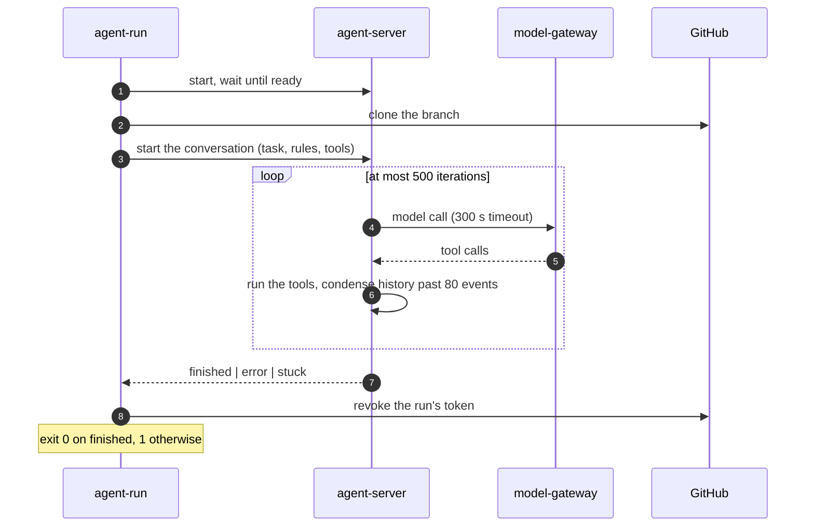
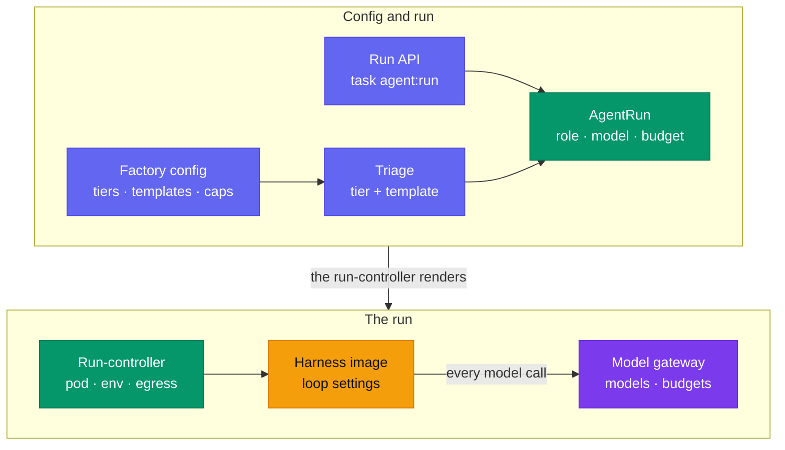
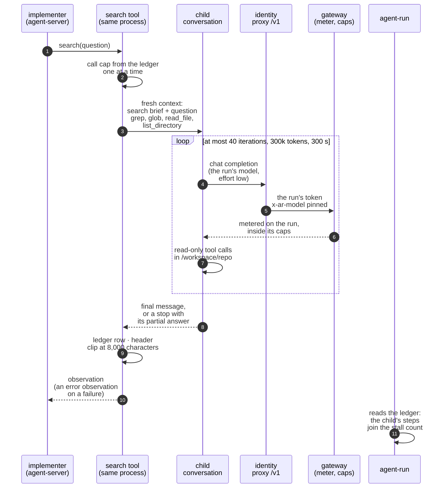

# Model routing, gateways, harness tuning and cost: measurements and reference tables

Moved verbatim from `website/content/docs/how-it-works/routing-and-cost.md` (read in October 2026 at `2f71a8c`), `website/content/docs/how-it-works/gateways.md` (read in November 2026 at `2f71a8c`) and `website/content/docs/operate/tune-a-run.md` (read in October 2026 at `2f71a8c`) under rule 6 of [`docs/docs-style.md`](../../docs-style.md).

## From `how-it-works/routing-and-cost.md` (October 2026, `2f71a8c`)

### What is built {#what-is-built}

| Piece | Built? | Source |
|---|---|---|
| Agent model per data class (`public` → Z.ai, `internal` → Anthropic) | Yes, on by default | [ADR-0054](../../../website/content/docs/decisions/0054-agent-model-providers-anthropic-direct.md) |
| `tier-light`, `tier-standard`, `tier-frontier` served by the model gateway | Yes. No factory tier asks for them: every tier names `agent-default` | `model-gateway/helmrelease.yaml`, factory values |
| `kimi-frontier`, `mistral-standard`, `mistral-light` on the `public` listener | Yes, public data only, selectable per class with `loops.<class>.models`, which no class sets by default | [Providers](../../../website/content/docs/how-it-works/providers.md) |
| Triage classifier (`complexity-classifier`) | No. The URL is configured and nothing answers it, so every task falls back to `standard` with `classifier: static` | factory values, `Task` status |
| 10% control group at `frontier` (`triage.controlPercent`) | Yes | `Task` status |
| Run meter priced in USD, cache reads at their own rate | Yes | factory values |
| Gateway budgets B1, B2, B6 | Yes, enforced: a call over its bucket is refused `429` | [runbook 04, Part D](https://github.com/Smana/ai-native-ref/blob/main/docs/runbooks/agent-factory/04-gateway-secrets-budgets.md#part-d--enforcing-the-agents-budgets) |
| `ai-gateway` with `tier-frontier` (GLM-5.3) | Yes, CPU only | `aigatewayroute.yaml` |
| Semantic Router `MoM` cascade | Yes, idle while `llm-platform` is suspended: no vLLM model exists to route to | `kubectl get ks llm-platform` |
| SR `complexity` signal, PII-gated frontier escalation, SR fail-open | No, designed for SR 0.3.0 | [routing design §2](https://github.com/Smana/ai-native-ref/blob/main/docs/superpowers/specs/2026-09-23-llm-complexity-routing-design.md#2-complexity-signal-for-chat-mom) |
| LoRA canary on `xplane-qwen-coder` | Yes, serves only while `llm-platform` runs | `apps/base/ai/llm/qwen-coder.yaml` |
| Endpoint picker (Gateway API Inference Extension) | Yes, enabled on no claim | [serving known gaps](../../../website/content/docs/how-it-works/serving/_index.md#known-gaps) |

### Every routing decision {#every-routing-decision}

| # | Decision | Decided by | When | Input | Tuned in |
|---|---|---|---|---|---|
| 1 | Which local model answers `MoM` | Semantic Router, `ext_proc` at filter index 0 | Per request | The prompt: domain classifier, keywords, length | `infrastructure/base/vllm-semantic-router/helmrelease.yaml` |
| 2 | Which backend a model name reaches | `AIGatewayRoute` rule on `x-ai-eg-model` | Per request | The model name only | `infrastructure/base/llm-gateway/aigatewayroute.yaml`; claims with `gateway.enabled` |
| 3 | Base model or LoRA adapter | Route weights rendered from `gateway.canaries` | Per request, random | None | `apps/base/ai/llm/qwen-coder.yaml` |
| 4 | A task's tier and template | Factory triage | Once, in `Received` | The classifier's tier (static fallback today), the class, `controlPercent` | The `Factory`, `tooling/base/agent-factory/resources/factory.yaml` |
| 5 | The model name a role asks for | The factory | Per run | Tier, role, template | same file: `tiers`, `templates.<name>.reviewerModel` |
| 6 | Which provider may see the data | The run's token audience | Per run, fixed | `spec.dataClass` | the task (`investigate` forces `internal`) |
| 7 | Which provider model a name means | The alias's backend, which forces the model | Per request, static | The alias the run's token names | `aliases` in `infrastructure/base/agent-gateway/model-gateway/helmrelease.yaml` |

### Serving side signals, designed cascade and capacity {#serving-side-signals-and-cascade}

| Signal | Configured | Effect on routing today |
|---|---|---|
| `domain` (MMLU categories) | 5 categories: `math`, `physics`, `code`, `multilingual`, `other` | Picks the model. `multilingual` maps to `philosophy` and `law`, a proxy rather than a language detector |
| `keyword` | `code_keywords` (16 terms: `kubectl`, `yaml`, `debug`…), `reasoning_keywords` (12: `why`, `explain`, `compare`…) | Code keywords catch what the classifier misses. Reasoning keywords turn on chain-of-thought, the dearest knob in tokens |
| `context` | `long_query`: 500 to 32,000 tokens | Turns on reasoning for long code prompts |
| `jailbreak` (`prompt_guard`) | threshold 0.7 | Blocks. A filter, not a route |
| `pii` | model loaded, threshold 0.7, every model `allow_by_default: true` | **None**: no decision reads it |
| `complexity` | not configured | **None**. Designed as a hard–easy margin of 0.12. The documented 0.70–0.75 never fires, because the margin stayed at or below 0.197 in tests ([semantic-router#3246](https://github.com/vllm-project/semantic-router/issues/3246)) |
| `semantic_cache` | **off** | Would answer from a similar past prompt. Off because tool-calling clients' prompts all look alike, and a cached error re-poisons every retry |

#### The designed cascade (not built)

The routing design replaces fleet names with roles that claims opt into (`spec.gateway.aliases`), and
adds the one escalation that leaves the cluster:

| Band | Role | Served by |
|---|---|---|
| hard, no PII | `tier-frontier` | GLM through `llm-gateway` |
| hard with PII, medium, math or physics | `mom-standard`, thinking on | `xplane-qwen3-8b` |
| code | `mom-code` | `xplane-qwen-coder`, canary still applied |
| easy, default, or router down | `mom-light` | `xplane-qwen3-8b`, thinking off |

Its verdict rule (SC-9) is set in advance: unless routed `MoM` reaches 95% of always-frontier's
promptfoo pass rate at 50% of its cost or less over 14 nightly runs, `MoM` defaults to
`mom-standard`. It is the right bar: an independent evaluation found router gains *"track
selected-tier composition more closely than demonstrated task-specific targeting"*
([arXiv 2608.14641](https://arxiv.org/abs/2608.14641)). A router has to beat a fixed tier, not
simply exist.

#### After the model is chosen: canary, endpoint picker, autoscaling

| Mechanism | What it routes | Knob | Interplay |
|---|---|---|---|
| LoRA canary | 10% of `xplane-qwen-coder` requests to the `xplane-qwen-coder-sql-dpo` adapter, on the same pod | `gateway.canaries[].weightPercent` | The adapter name is matched verbatim: a typo routes to nothing, with no error ([LoRA canaries](../../../website/content/docs/how-it-works/gateways.md#lora-canaries)) |
| Endpoint picker | Which replica, from KV-cache and queue state | enabled per claim | Mutually exclusive with canaries; worth it from two replicas up ([roadmap](../../../website/content/docs/status.md#serving-roadmap)) |
| KEDA | How many replicas a model gets | `model.maxNumSeqs`, trigger thresholds 0.7 / 0.6 / 8 | Routing chooses whose queue grows. Every `MoM` default lands on `xplane-qwen3-8b`, so it saturates first. Its `max: 2` and the pool's 4-GPU cap bound it ([autoscaling](../../../website/content/docs/how-it-works/serving/autoscaling-and-gpu.md#three-triggers-or-combined)) |

### Complexity routing for tasks: kept out of the request path {#complexity-routing-for-tasks}

| Choice | Decision | Rejected | Why |
|---|---|---|---|
| Where to classify | Once per task, at factory intake | Per request in the data path | Switching models mid-run loses the prompt cache and the tool state, and one under-routed step can fail a whole trajectory |
| Which classifier | The Semantic Router's own complexity signal through `POST /api/v1/eval`: OSS first | LiteLLM's complexity router; NeMo Switchyard; Jev in the path | One thin service insulates the factory from router API churn (0.2 → 0.3 broke the config) |
| Jev (TypeSafe AI, SaaS) | An optional adapter in **shadow** only, on `dataClass: public` text, never acting | Jev deciding tiers | Latency, availability and data exposure; about $0.08 per 1,000 tasks if turned on |

Source: [factory design](https://github.com/Smana/ai-native-ref/blob/main/docs/superpowers/specs/2026-09-23-agent-factory-design.md)
and [routing design §3](https://github.com/Smana/ai-native-ref/blob/main/docs/superpowers/specs/2026-09-23-llm-complexity-routing-design.md#3-complexity-classifier-c7).
None of it is built: every task reads `classifier: static, fallback: static`.

### What a call costs: price tables, charge series, worked example and budget layers {#what-a-call-costs}

| Reader | Its copy of the table | Held by |
|---|---|---|
| The run meter: USD run and task caps, `maku_factory_run_cost_usd`, the `Task`'s `costMicroUSD` | The factory's config itself | — |
| The *Spend per identity* dashboard (`agent-identity`): `maku_factory_charged_usd_total` and the day gauges | The factory's meter: no copy of the table | — |
| Gateway budgets B1, B2, B6 | A CEL cost string in `infrastructure/base/agent-gateway/policy-budgets.yaml` | The CI gateway check (`scripts/ci/flux-schema/assert-agent-gateway.py`) regenerates it |
| The `agent-run` dashboard's *Cost (USD)* panel, `AnthropicFleetNearCap` | `llm_gateway:charge_usd_per_mtoken`, the `llm-gateway-prices` group of `infrastructure/base/llm-gateway/vmrule-llm-gateway.yaml` | `test-agent-prices`: the group is what `scripts/ci/gen-prices.py` renders |

`meter.prices`, USD per million tokens. Example (the reference host's list prices):

| Model | Input | Cache read | Cache write | Output | Cache read vs input |
|---|---|---|---|---|---|
| `glm-5.3` | 1.40 | 0.26 | not billed (priced as input) | 4.40 | 19% |
| `glm-5.3-flashx` | 0.37 | 0.075 | not billed | 1.25 | 20% |
| `glm-5.3-flash` | 0.15 | 0.03 | not billed | 0.50 | 20% |
| `claude-opus-5-5` | 4.00 | 0.20 | 5.00 | 20.00 | 5% |
| `claude-sonnet-5-5` | 2.00 | 0.10 | 2.50 | 10.00 | 5% |
| `claude-haiku-5-5` | 0.50 | 0.05 | 0.625 | 2.50 | 10% |

Haiku is at its over-100K-prompt rate, which an agent's context soon reaches. Over-counting is the
safe direction for a cap.

A nightly workflow, `.github/workflows/price-drift.yaml`, compares every row with genai-prices,
LiteLLM and models.dev. A disagreement, or a row a catalog stops listing, opens or updates one issue
labelled `prices-drift`, and the first clean run closes it. The check never edits the table: catalogs
copy the providers' page mistakes, so a person confirms each finding on the provider's page first.

#### The charge series

The gateways count cache tokens inside `input` (see the meter's formula below), so the recording
rule holds a charge, not a price: what one counted token of each type adds to the cost.

| `gen_ai_token_type` | Charge | `claude-opus-5-5` |
|---|---|---|
| `input` | `input` | 4.00 |
| `output` | `output` | 20.00 |
| `cached_input` | `cacheRead` − `input` | −3.80 |
| `cache_creation_input` | `cacheWrite` − `input`; 0 where no write is billed (Z.ai) | 1.00 |

A cost over a window is one join, to which each reader adds its own selector:

```promql
sum(
  sum by (gen_ai_request_model, gen_ai_token_type) (
    increase(gen_ai_client_token_usage_sum{gen_ai_token_type=~"input|output|cached_input|cache_creation_input"}[24h])
  )
  * on (gen_ai_request_model, gen_ai_token_type) group_left() llm_gateway:charge_usd_per_mtoken
) / 1e6
```

The reply the wire test sends on Opus, 1,050 input of which 900 read and 50 written, and 10 output,
reads 1050 × 4.00 − 900 × 3.80 + 50 × 1.00 + 10 × 20.00 = 1,030 per million, **$0.00103**: the
meter's 100 × 4.00 + 900 × 0.20 + 50 × 5.00 + 10 × 20.00. The list-price rule it replaced read 4.3×
that. `reasoning` is inside `output` and has no charge. The join prices the whole window at the current
charges; what each run was charged stays in `maku_factory_run_cost_usd` and the `Task`'s
`costMicroUSD`.

#### Worked example: a real run {#worked-example}

Example (the reference host): an implementer on a `standard` task, `public`, served by `glm-5.3`,
which opened a pull request. Its gateway counters:

| Series | Tokens | × price | USD |
|---|---|---|---|
| `input` 4,433,376 − `cached_input` 4,161,472 = fresh | 271,904 | × 1.40 | 0.3807 |
| `cached_input` | 4,161,472 | × 0.26 | 1.0820 |
| `output` | 42,275 | × 4.40 | 0.1860 |
| **Run cost** | | | **1.6487** |

The meter recorded `costMicroUSD: 1648658` on the `Task`: an exact match. The same run under the
old token cap would have been revoked at 1.5 M of its 4.48 M tokens, with the work unfinished.
Priced with no cache discount it would show as $6.39.

The same token mix on other models, as arithmetic from `meter.prices` and not a measurement:

| Model | Cost | vs `glm-5.3` |
|---|---|---|
| `glm-5.3-flash` | $0.19 | 0.11× |
| `glm-5.3-flashx` | $0.47 | 0.28× |
| `glm-5.3` | $1.65 | 1× |
| `claude-opus-5-5`, cache writes excluded | $2.77 | 1.7× |
| `claude-opus-5-5`, no cache | $18.58 | 11× |

**With caching, Opus is not ten times GLM.** Opus's cache read ($0.20) is cheaper than GLM-5.3's
($0.26), so on a 94%-cached run the list-price gap narrows from about 3× on input to 1.7× overall.
Anthropic does bill cache writes ($5.00 per million on Opus), which this estimate leaves out. One
measured internal run, a triager on Opus 5.5, cost **$0.477** for 303,477 input tokens, 85% of them
cache reads.

#### Budget layers {#budget-layers}

| Layer | Unit | Enforced | Note |
|---|---|---|---|
| `runUSD`, `taskUSD` | USD, cache-aware | **yes** | The cap that decides a run's fate |
| `factoryDailyUSD`, `humanDailyUSD` | USD, cache-aware: the same `meter.prices` | **shadow**, the fleet's day and each person's: with `enforcePrincipal: false` a run past its day is admitted and counted as `budget-principal-shadow` | `AgentFactoryDailyBudgetHigh` fires at 80%. The day's ledger is `agent-factory-ledger-usd-<YYYYMMDD>`, in micro-USD |
| B1, B2, B6 | reference tokens: USD ÷ $1.70 per million, at `meter.prices` | **yes** (`SHADOW_MODE: "false"`, `infrastructure/base/agent-gateway/ratelimit.yaml`): `429 agent_budget_exhausted` | Sized above the factory's caps, so the gateway never refuses what the factory admits. The CI gateway check holds B2 at or above `factoryDailyUSD` plus four frontier runs |
| local limit | raw tokens per hour, per replica | always | Above the largest admitted run: $6.80 of Opus cache reads is 34M tokens |

**The daily caps count dollars.** A cap in raw tokens counts a cache read as a full token, so a
cache-heavy day runs out after a fraction of its real budget. `factoryDailyUSD` ($42.50) and
`humanDailyUSD` ($8.50) are days at the reference $1.70 per million, priced as the run caps are. They stay in shadow until a record in
dollars shows that enforcing would refuse only what it should. The raw-token alerts
`AgentRunTokenSpendHigh` (5M in 8 h) and `AgentFleetTokenSpendHigh` are unchanged: they still fire
on cache-heavy runs well inside their USD caps.

### Efficiency and cohort results {#efficiency-and-cohort-results}

| Provider | How the cache engages | What to keep stable |
|---|---|---|
| Z.ai GLM | Automatic, no marker; cache writes not billed | The prompt prefix: system prompt, tool list, early turns |
| Anthropic | Explicit breakpoints. The harness rewrites the SDK's `cache_control` as `prompt_cache_breakpoint`, the only marker agentgateway 1.6 carries from Chat Completions to Messages (Maku `images/maku-harness/site/sitecustomize.py`) | The same, and the breakpoint itself: an agentgateway upgrade that drops the field silently re-prices every internal run at the input rate |

#### Caps in USD, not tokens

Example (the reference host), two `standard` runs ($2.55 cap):

| Tokens | Meter USD | Under a 1.5M token cap | Outcome |
|---|---|---|---|
| 4.48M | $1.65 | revoked at a third of its work | finished, PR opened |
| 7.42M | $2.56 | revoked far earlier | revoked at its USD cap: `budget-run`, fit `under` |

#### Cheaper tiers: priced, not measured

Moving `light` and `standard` to their own names would cut the price of the same tokens to 0.11×
and 0.28× (worked example above). Whether those models finish factory tasks is unmeasured. The one
model comparison on record points the other way: on harder tasks the gap followed the model.

| Arm | Model | Accepted | USD | USD per accepted |
|---|---|---|---|---|
| A, the factory | GLM-5.3 | 0 of 15 | 9.00 | n/a |
| B, Claude Code Action | Claude | 13 of 15 | 15.80 | 1.22 |
| C, Claude Code Action | GLM-5.3 | 0 of 15 | 25.65 | n/a |

C ran B's harness on A's model and hit the 60-turn cap on all 15 issues, at $1.13–2.33 each.
**A cheaper model that fails costs more per accepted outcome than a dearer one that succeeds.** The
cohort's caveat holds: fifteen issues separate only large differences, and A was stopped by its old
token cap.

#### Self-hosted against an API {#self-host-vs-api}

| Question | Answer from the repository |
|---|---|
| Is self-hosting a cost play? | **No.** Four always-warm L4 models are about **$876 a month** on spot ($0.30 an hour each, the May design's AWS estimate, `docs/superpowers/specs/2026-05-06-oss-llm-foundation-showcase-design.md`). That buys about 2.4B GLM-5.3 tokens a month at a blended $0.357 per million |
| Can the local fleet serve agents? | **No, by design.** "Local 7–8B models are never agent tiers" (routing design §5): agents need frontier capability with zero GPUs |
| Why self-host at all | Prompts that never leave the tailnet, a model pinned to a commit, sub-200 ms tab completion on a warm replica ([why self-host](../../../website/content/docs/how-it-works/providers.md#why-self-host-at-all)) |
| When does the trade change | The [serving roadmap](../../../website/content/docs/status.md#serving-roadmap) triggers: a bigger coder when the 7B hits its limits, L40S or tensor-parallel when quantized quality loss becomes measurable, cost per tenant when several consumers share the platform |

### Tuning, measuring and known gaps {#tuning-and-measuring}

| Goal | Knob | Trade-off | Measure with |
|---|---|---|---|
| Cheaper agent runs | `tiers.<tier>.model: tier-standard` or `tier-light` | 0.28× or 0.11× the price; quality unmeasured | `maku_factory_tier_fit_total`, `maku_factory_pr_outcomes_total`, cost per merged task |
| Better hard-task outcomes | `defaults.dataClass` or the task's class, `internal` → Opus | Data class first, cost second: only internal data may reach Anthropic (ADR-0054) | the cohort's measure: accepted outcomes and USD per accepted |
| A reviewer independent of the implementer | `loops.<class>.models.reviewer.frontier: kimi-frontier` | Another family on `public` work only, processed in China; ADR-0058 rejected a Claude reviewer on data class and cost. On for the self-merging classes | review verdicts against maintainer rejections |
| Measure model fit, not only budget fit | `triage.controlPercent` (10) | More control tasks run `frontier` with `trio`, at about 2.7× the run cap | `maku_factory_tier_fit_total{fit}` |
| Fewer runs revoked mid-work | `tiers.<tier>.runUSD`, `taskUSD` | A run cap above $6.80 also needs B1 and the local limit raised: the CI gateway check enforces it | `maku_factory_run_revocations_total`, `budget-run` reasons |
| A longer or shorter day | `budgets.factoryDailyUSD`, `humanDailyUSD` | Above $42.50, `factoryDailyUSD` also needs B2 raised: the CI gateway check fails otherwise. Both count in shadow until `enforcePrincipal` | `maku_factory_budget_spent_usd` against `maku_factory_budget_cap_usd` |
| Gateway budgets that only count | `SHADOW_MODE: "true"` in `ratelimit.yaml` | Nothing past a bucket is refused: the backstop under the factory's caps is gone | `agent_router:budget_shadow_overrun_tokens:increase10m` |
| Lower chat latency | Clients name the model instead of `MoM` | Loses automatic choice; saves 250–300 ms | gateway TTFT on *LLM Gateway* |
| Less chain-of-thought spend in chat | Trim `reasoning_keywords`, raise `long_query.min_tokens` | Fewer `use_reasoning: true` decisions; weaker answers on multi-step prompts | output tokens per model, promptfoo pass rate |
| Better coding answers in chat | Widen `code_keywords` or the `code` categories | More traffic, and more KEDA pressure, on the coder | `vllm:num_requests_running` per model |
| Adapter rollout | `gateway.canaries[].weightPercent` | More users on a less-proven adapter; no endpoint picker while a canary exists | *LLM Gateway* base vs canary panels, canary SLO alerts |
| Throughput per GPU | `model.maxNumSeqs` | Also raises the scale-up bar: trigger 1 divides by it | `vllm:num_requests_waiting`, KV-cache usage |

**Move a tier to its own model:**

```yaml
# tooling/base/agent-factory/resources/factory.yaml, spec
tiers:
  # tier-light is glm-5.3-flash on public, claude-haiku-5-5 on internal (model-gateway's aliases);
  # both are priced in meter.prices, so the USD caps keep working.
  light: {model: tier-light, runTokens: 300000, taskTokens: 600000, runMinutes: 20, runUSD: 0.51, taskUSD: 1.02}
```

Do it with a measurement in place: run a cohort on the tier with fixed-tier arms, and compare accepted outcomes and USD per accepted outcome.

**Change a provider model behind a name** (the alias, and its price row):

```yaml
# infrastructure/base/agent-gateway/model-gateway/helmrelease.yaml, values
aliases:
  public:
    tier-standard: {provider: zai, model: glm-5.3-flashx}   # a new model needs its price row in modelCatalog and meter.prices
```

In-flight runs see a mapping change on their next request. Use the factory's pause first when that
matters.

**Tune the chat cascade** (Semantic Router 0.2 schema):

```yaml
# infrastructure/base/vllm-semantic-router/helmrelease.yaml
context_rules:
  - name: long_query
    min_tokens: 500    # raise to turn reasoning on for fewer code prompts
    max_tokens: 32000
```

The `complexity` signal and role targets need SR 0.3.0. Do not add a `complexity` rule
to the 0.2 config with the documented 0.70–0.75 threshold: it never fires.

#### Measuring {#measuring}

| Question | Query or panel |
|---|---|
| Tokens by served model and type | `sum by (gen_ai_request_model, gen_ai_token_type) (increase(gen_ai_client_token_usage_sum{namespace="agent-gateway"}[24h]))` |
| Cache-read share | `sum(increase(gen_ai_client_token_usage_sum{namespace="agent-gateway",gen_ai_token_type="cached_input"}[24h])) / sum(increase(gen_ai_client_token_usage_sum{namespace="agent-gateway",gen_ai_token_type="input"}[24h]))` |
| USD per model, as the meter priced it | `sum by (model) (maku_factory_model_cost_usd_total)` |
| USD per run, by tier | `sum by (tier) (maku_factory_run_cost_usd_sum) / sum by (tier) (maku_factory_run_cost_usd_count)` |
| One run's cost, exactly | `kubectl get task <id> -n agent-system -o jsonpath='{.status.runs[*].costMicroUSD}'` |
| Did the tier fit? | `maku_factory_tier_fit_total{classifier, tier, fit}`: `under`, `fit`, `over` |
| Model latency | `histogram_quantile(0.95, sum by (le, gen_ai_request_model) (rate(gen_ai_server_request_duration_seconds_bucket{namespace="agent-gateway"}[1h])))` |
| What B1, B2 and B6 refused | `agent_router:budget_refused_tokens:increase10m` by `key1` (`AgentBudgetRefused`) |
| Daily budget left, in USD | `maku_factory_budget_remaining_usd / maku_factory_budget_cap_usd` by `principal`; `maku_factory_budget_spent_usd` is today's spend, unclamped |
| Serving: which model is hot | `vllm:num_requests_running`, `vllm:kv_cache_usage_perc`, `vllm:num_requests_waiting` by `model_name` |

| Dashboard (`uid`) | Read it for |
|---|---|
| `agents-overview` | The landing page: is the factory healthy, today's spend against the caps, what waits for a human, what landed. Every tile opens the dashboard below |
| `agent-gateway` | Tokens by type as the meter reads them, tokens per agent, B1–B2 counted and would-refuse, model latency |
| `agent-factory` | Tokens per finished task p90, budget left today, budget fit by classifier, class mismatches |
| `agent-fleet` | Tokens per run, tier against tokens and steps, tokens by tier |
| `agent-room` | One room: its runs with phase, duration and priced spend, its wait for a human, and the broker's approvals and notes |
| `agent-run` | One run: tokens against budget, model calls. Its *Cost (USD)* panel prices the run from `llm_gateway:charge_usd_per_mtoken`; see [costs](#what-a-call-costs) |
| *LLM Gateway — Envoy AI Gateway GenAI Telemetry*, *LLM Platform — Self-hosted vLLM Fleet* | Serving: tokens per model, base against canary, TTFT, queue and KV cache. Folder `llm`, present only while `llm-platform` runs |

#### Known gaps {#known-gaps}

| Gap | Effect | Closes with |
|---|---|---|
| No triage classifier | Every task is `standard`; the tier never reflects difficulty | The classifier ([routing design §3](https://github.com/Smana/ai-native-ref/blob/main/docs/superpowers/specs/2026-09-23-llm-complexity-routing-design.md#3-complexity-classifier-c7)) |
| Every tier is `agent-default` | Tiers change caps, not models; outside the self-merging classes, the reviewer shares the implementer's model | A measured tier move |
| The router fails closed, on one replica | A router outage fails every `ai-gateway` request, `tier-frontier` included | Two replicas, a PDB and fail-open (SR 0.3.0) |
| PII classifier loaded, read by no decision | No data-class protection on `MoM` today. Harmless while every `MoM` target is local | `NOT pii_any` on the frontier decision (SR 0.3.0) |
| No Semantic Router series in VictoriaMetrics | The router's decisions cannot be read from metrics | Tracked on the [status page](../../../website/content/docs/status.md#before-v3) |

---

## From `how-it-works/gateways.md` (November 2026, `2f71a8c`) {#gateway-routing-and-budgets}

### Semantic routing — `model: MoM`

Sending `model: MoM` lets the Semantic Router pick from the prompt. Its
decision list, highest priority first
(`infrastructure/base/vllm-semantic-router/helmrelease.yaml`):

| Priority | Decision | Target |
|---|---|---|
| 110 | code + reasoning | `xplane-qwen-coder` (`use_reasoning: true`) |
| 100 | code | `xplane-qwen-coder` |
| 90 | reasoning (math / physics) | `xplane-qwen3-8b` (`use_reasoning: true`) |
| 80 | multilingual | `xplane-qwen3-8b` |
| 50 | general (the default) | `xplane-qwen3-8b` |

`xplane-llamaguard3-1b` and the two LoRA adapters on `xplane-qwen-coder`
appear in **no** rule above. They hold serving capacity and are reachable only
by naming them directly. The router's own in-pod `prompt_guard` classifier
blocks jailbreak attempts, but that is a filter, not a routing decision —
there is no automatic guardrail dispatch (see
[known gaps](../../../website/content/docs/how-it-works/serving/_index.md#known-gaps)).

### Frontier models and token budgets on `ai-gateway`

The gateway strips `x-ar-agent`, `x-ar-human` and `x-ai-gateway-client-id` from every request before
authentication runs, so a client-forged value never survives to be charged. Today only
`x-ai-gateway-client-id` is then set — from the API key that matched. `x-ar-agent` belongs to the agent
side, where the verified token sets it; `x-ar-human` arrives with `ai-gateway`'s `oidc` listener. A
client cannot choose whose budget it spends.

Daily token budgets per API-key client (5M), per human (10M) and on all frontier spend (20M) are
counted in **shadow mode**: nothing is rejected yet
([ADR-0050](../../../website/content/docs/decisions/0050-token-budgets-envoy-gateway-rate-limit.md)).

### Legacy `agent-router` and model-gateway budgets

The older Gateway, `agent-router`, still runs beside the model gateway with its MCP federation
(`agent-mcp`: Flux, VictoriaMetrics and VictoriaLogs reads) and the capability profiles in
`infrastructure/base/agent-gateway/profiles/`. No run calls it.

ADR-0050's agent budgets, on a rate-limit server of their own so they never share a bucket with the
human ones (`model-gateway/policy-budgets.yaml`, `ratelimit.yaml`, `kvstore.yaml`):

| Budget | Bucket | Limit per day | Above the factory's |
|---|---|---|---|
| B1 | per caller (the verified `sub`) | 5M reference tokens ($8.50) | dearest run cap, $6.80 |
| B2 | the whole fleet | 41M reference tokens ($69.70) | daily budget plus four runs in flight |
| B6 | Anthropic, on `internal` | 10M reference tokens ($17) | nothing: a provider cap |

They are a backstop: the factory's run meter stays the exact cap, and the gateway never refuses a
call the factory would admit. Each call is charged at the meter's own prices, so a cache read costs
its cache rate; the CI gateway check holds the gateway's price expression and limits to the factory's
values. The planner's calls count in the broker's own B1 bucket and in B2. The budgets are
**enforced** (`SHADOW_MODE: "false"` on the server): a call over budget gets a `429`, which the
harness treats as the end of the run
([runbook 04, Part D](https://github.com/Smana/ai-native-ref/blob/main/docs/runbooks/agent-factory/04-gateway-secrets-budgets.md#part-d--enforcing-the-agents-budgets)).
The server is `envoyproxy/ratelimit` (`agent-ratelimit`) on the Valkey `KVStore`
`xplane-agent-ratelimit`; if it is down the gateway fails open and `AgentRateLimitDown` fires.

### What the two gateways share, and what they keep apart

From the [model routing and budgets design](https://github.com/Smana/ai-native-ref/blob/main/docs/superpowers/specs/2026-09-23-llm-complexity-routing-design.md):

| Concern | Decision | Why |
|---|---|---|
| Semantic Router | On `ai-gateway` only; agents use their own Gateway | The router can be neither a single point of failure nor a prompt reader for agents |
| Agent model choice | Every agent alias maps to one backend: no weights, canaries or fallback | Nothing re-routes a trajectory mid-run; escalation is a new run at the next tier |
| Backends | One set per gateway, each with its own provider key | Revoking the agents' key never breaks chat or RunLore, and provider spend splits by key |
| Budgets | Token budgets at both gateways, in token units, each through its own `envoyproxy/ratelimit` and Valkey (ADR-0053) | One mechanism for every principal, no shared bucket; the factory still revokes a run at its exact cap |

---

## From `operate/tune-a-run.md` (October 2026, `2f71a8c`) {#harness-tuning-measurements}

### Start here cards {#start-here-cards}

- **A run burned its budget** (`#recipes`): Hundreds of reads and no commit: give the task a scope and an exit.
- **A long task needs more room** (`#recipes`): Raise the tier's money and time together, so a resume still fits.
- **Reviews cost too much** (`#recipes`): Fewer rounds, solo for mechanical classes, or a smaller reviewer.
- **A run loops or fails** (`#debug`): Read its end state, its step mix, then its room.
- **Use another model** (`/docs/how-it-works/routing-and-cost/#agent-routing`): Change the tier's model and add its price row.
- **Every setting** (`/docs/reference/harness/`): Tiers, templates, caps, the AgentRun, the run-controller, harness.

### Failure modes: tester contract, environment and rooms {#failure-modes-tester-and-rooms}

#### The tester's contract

| You see | Do this |
|---|---|
| `contract_not_red`, "the runner could not run" | The toolchain, not the tester: fix the sandbox's runner, then retry |
| `contract_outside_tests` | The tester wrote outside the repository's test paths: the commit is dropped, read the room |
| `not_testable` | The tester answered once that the issue has no test to write: a human decides |

#### Environment and rooms

| You see | Do this |
|---|---|
| The same refused action for minutes, in a room | Read the bridge's refusal; approve it, or fork with more egress |
| Pod `Pending` 15 min, then `run_unschedulable` | No gVisor node yet: wait 1.5–3.5 min. Where the weekday headroom schedule is enabled, one node stays warm from 08:00 to 19:00 Europe/Paris; outside that window the first run pays the cold start |
| An internal run costs as much as a public one | Prompt caching is off: the harness logs `prompt cache NOT applied` at start, and `AgentCacheReadZero` fires once the run passes 100k input tokens |

### How a run works {#how-a-run-works}

`agent-run` starts `agent-server`, clones the repository, hands it the task, then follows it until
the conversation ends.



#### The tester's run

A tester run writes tests under the repository's test paths and commits them. The harness then runs
them red on the base, signs the commit and pushes it, or answers once (`not_testable`) and pushes
nothing. The implementer that follows cannot commit a change to those files, and is told when they
still fail. The model itself never pushes. `testFirst` is off by default; an operator turns it on
per class ([runbook 21](https://github.com/Smana/ai-native-ref/blob/main/docs/runbooks/agent-factory/21-test-first-tester.md)),
and a class without it runs without a tester ([the roles](../../../website/content/docs/how-it-works/roles.md#tester)).

One line per action, never its output, redacted for tokens. It is what you read most.

```text
agent-run step 3: terminal | List crossplane controller dir and kustomization | ls /workspace/repo/... | trace_id=706f…
agent-run model retry 1/2 in 10s: ServiceUnavailableError …
agent-run: conversation ended with execution_status=finished
agent-run summary: 21 steps, 0 model retries
```

### Where settings come from {#where-settings-come-from}

Each layer lives in its own repository and is pinned into the next. A run's settings are fixed when
it is created; only its token cap can be raised while it runs.



| Layer | Repository | A change reaches |
|---|---|---|
| Factory config | ai-native-ref | New runs, once Flux applies the release |
| Run API | `task agent:run` flags | That run only |
| `AgentRun` and run-controller | Maku, pinned in ai-native-ref | Runs created after the chart upgrade |
| Harness image | Maku | Runs created after its digest reaches the run-controller's values |
| Gateway | ai-native-ref | Every call, running runs included |

### What real runs look like {#what-real-runs-look-like}

Example (the reference host): typical runs, all on GLM-5.3.

| Task | Steps | Cost | End |
|---|---|---|---|
| docs-links | 10 | $0.03 | ✅ succeeded |
| docs | 36 | $0.17 | ✅ PR opened |
| docs-links | 225 | $1.65 | ✅ PR opened |
| dashboards | 319 | $2.65 | ❌ out of budget, nothing pushed |
| dashboards, frontier | 444+ | $4.46+ | ⏳ still running at 66 min |

**Step count, not tier, separates runs.** Most finish in 10–40 steps for under $0.20. And with 95%
of input read from cache, a dollar cap fits better than a token cap: the out-of-budget run above read 7.7 M tokens
for $2.65.

### Loop policy details {#loop-policy-details}

| Piece | What it does |
|---|---|
| Stall rule | An implementer run with no commit by `stallSteps` steps, or two continuations in a row that add none, stops and posts what it found |
| Completion judge | After the run ends on its own, a fresh-context judge reads the acceptance checks and says `met`, `not_yet` or `impossible` |
| Continuation | A `not_yet` continues the same conversation, so the prompt cache survives, at most `continuations` times, each time-boxed to 15 minutes |

**The switch** is the factory's `loops` key, one row per class (`default`, `review`, or a class a
repository declares). A row that sets any of its three keys switches that class on. No row, or a row
without them, runs with no loop policy. Example (the reference host): **`docs` and `scripts` set them**; `scripts` has `judge: tier-light`, so the defaults apply (a stall at 80 steps, 2 continuations), and `default: {scope: off}` switches nothing on.

| Key | Default once a row exists | Bounds |
|---|---|---|
| `stallSteps` | 80 | 1 … 500 |
| `continuations` | 2 | 0 … 5 |
| `judge` | `tier-light` | one of the four model aliases, or `none` for no judge |

The factory copies the row into the run as `spec.loop`, on every implementer run of the task:
the first run, revisions, CI fixes, retries and resumes. Reviewers, testers and triagers never carry
it. The run-controller hands it to `agent-run` as `AGENT_LOOP`, a JSON object with `stallSteps`,
`continuations` and `judgeModel`, and gives a judge its own model token for its alias.

**The three ends.** `met` is not an end: the run finishes and the task goes to the next role.

| End | Room | Task | Issue | Counter |
|---|---|---|---|---|
| `judge_impossible` | `harness_end` event, then the judge's text as a run note | `Escalated`, reason `judge_impossible` | Fixed narration with the reason category only, no judge text | `maku_factory_loop_runs_total{end="judge_impossible"}` |
| `stalled` | `harness_end` event, then the run's findings as a note | `Escalated`, reason `stalled` | The same | `end="stalled"` |
| `not_met` | `harness_end` event, then the last `not_yet` reason as a note | `Escalated`, reason `not_met` | The same | `end="not_met"` |

The counter also reads `finished` for a run under the policy that ended normally, and `other` for any end not listed above, by `class`.

**A pending check is waited for.** A `not_yet` whose only unmet check is still running waits for the check inside the 15-minute box, and spends no continuation. When a check fails, the judge is shown the log's last 60 lines, for up to 3 jobs. **That quote is empty unless the harness's egress allows the Actions log host** (`productionresultssa*.blob.core.windows.net`); allowing it is a security decision for your platform.

Switching a class on is last: add its row only after you have tried it on one class. The
meter and the factory's outcomes then say whether cost per accepted pull request fell.

### Search details {#search-details}

Experimental. The implementer can ask a read-only helper one
question about the repository instead of reading it file by file. Its benefit is unmeasured.
Example (the reference host): **only `docs` has `search: true`**, so every other run behaves as before.



| Case | The child | The implementer sees | Ledger outcome |
|---|---|---|---|
| Answered | `finish` | the answer | `complete` |
| 40 iterations, 300k tokens or 300 s | stopped (the SDK's limit or the watchdog's pause) | error observation: the bound and the partial answer | `budget` |
| A model error after the transient retries | stopped | error observation with the reason | `error` |
| A budget 429 | stopped | error observation; the run then ends on its own next call | `error` |
| The 7th call | not started | "no searches left: read the files yourself" | `refused` |
| The stall rule fires mid-search | paused by the executor when the parent is interrupted | — the run ends `stalled` | `interrupted` |
| The pod stops mid-search | lost with the process | on resume, the call's error, as for any interrupted tool | none |
| `agent_search` fails to import | — | no `search` tool, a run as today | — (`search off` logged) |

The child sees nothing of the conversation, reads the uncommitted tree, never writes and never reaches
the room. Its calls are metered on the run and bounded by the run's USD cap, and the bridge classes the
call plain. The switch is `loops.<class>.search: true` ([reference](../../../website/content/docs/reference/harness.md#caps)),
which does not switch the loop policy on.

### Not tunable today {#not-tunable-today}

| Wanted | What it takes |
|---|---|
| Per-task reasoning effort, iterations, condenser | A harness change reading new env vars, set by the run-controller |
| A bigger sandbox for a factory run | A factory change: it always writes `size: small` |
| A tier picked by task difficulty | The complexity classifier, not deployed: every task is `standard` |
| A different harness | A new harness in Maku's run-controller |
