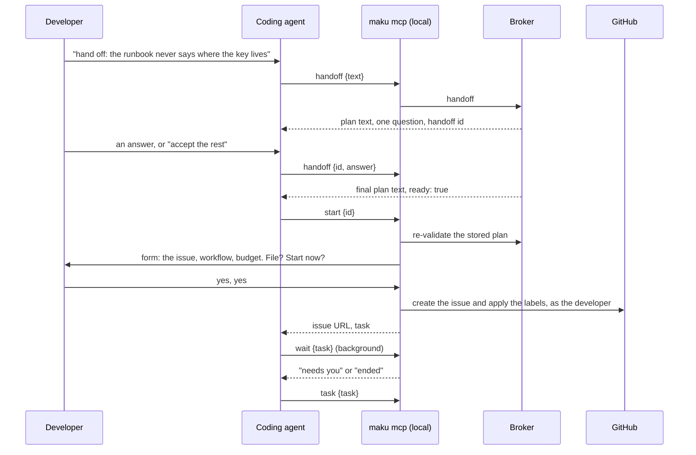
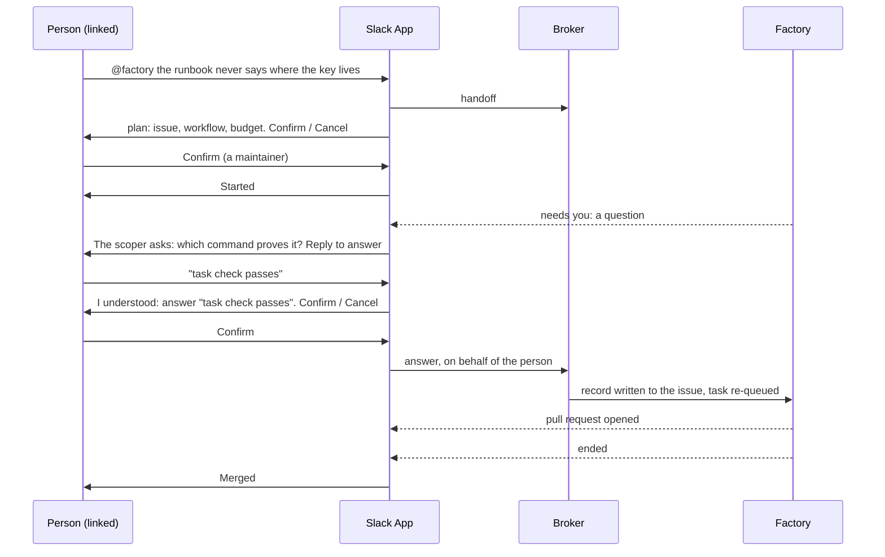

# The user experience from a coding agent and from Slack: review and design

**Status:** design, interview with the owner 2026-11-14, builder-checked, awaiting approval.
**Scope:** Maku (the MCP server, the CLI, the Slack App) and this platform's values. Maku paths
below are on `origin/main` at `c9ee6f5` (v0.47.0 plus unreleased work).

**Outcome.** A coding agent sees six tools instead of up to nineteen, and one of them starts the
work. A Slack thread can stop a task, retry it and answer its question, and it ends on one line
that says what happened, what it cost and what the merge gate decided. Every surface uses the same
words. Nothing new must be configured by the person who files a task.

## Why

The same task is filed, followed and answered through four surfaces (the web room page, the MCP
server with the CLI, Slack, GitHub). They disagree on what a person can do and on what things are
called. Maku's v4 design makes Slack an opt-in component (D20), so the MCP server, the CLI and the
web page must be enough alone, and Slack must not be the only place where filing also starts.

### Facts this design rests on

| Fact | Source |
|---|---|
| A coding agent lists up to 19 tools: 7 to 13 from the broker depending on switches, 6 local. Seven of them read a task | `internal/humanapi/mcp.go` (`mcpTools`), `internal/humanapi/intake.go`, `internal/maku/localtools.go:60-67` |
| Filing takes four tools, and the client model edits a `{plan, hash, candidate}` envelope. The contract is repeated in five places | `internal/humanapi/mcp.go` (`intakeLoopInstructions`) |
| `issue_file` is local on purpose: "the broker never files an issue". It files with the developer's own `gh`; `file` and `start` are form fields the agent cannot answer | `internal/maku/issuefile.go:23` |
| The form offers `start` only for a repository in `human.mcp.sessionStart`, which is `[]` in this platform's base. In Slack, a maintainer's **Confirm** files and starts | `internal/humanapi/issuedraft.go` (`canStart`), `infrastructure/base/room-broker/config.yaml:87` |
| `need_answer` appends one record to the issue body's `## Decisions` section with the developer's `gh` and never labels. A scoper's question leaves the task `Escalated` with `factory/needs-author`; a re-applied `factory/ready` makes a new task, scoped again, while `/factory retry` proceeds on the scoper's first assumption | `internal/maku/needanswer.go` (`AppendDecision`), Maku `docs/factory.md:442` |
| Slack's `stop` phrase calls nothing; no stop or retry route is built. The room page has no stop button either: stopping is the `factory/stop` label | Maku `docs/slack.md`; `git grep slackStop origin/main` returns nothing |
| Slack decides one approval class, `forge.push`, and never shows the spend. Nine transitions post a thread line here | Maku `docs/slack.md`, `tooling/base/agent-factory/slack-app/config.yaml:25` |
| `room.ended` fires once, at the task's first coarse end (`done`, `failed`, `stopped`); `room.merged` and `room.reverted` are separate events | Maku `docs/api.md:1393-1397` |
| The room summary already holds the spend, whether it is final, and the gate's decision, as fixed sentences that name no policy | `internal/summary/summary.go:207-210`, `internal/summary/policy.go` |
| The Slack proposal already carries a profile select bound to the plan's hash and revision | `internal/slackapp/proposal.go:36-38` |

### Who can do what today

| Act | Web | MCP and CLI | Slack |
|---|---|---|---|
| File a task | no | yes | yes |
| Start it in the same step | no | only where `sessionStart` lists the repository | yes |
| Stop a task | the `factory/stop` label on GitHub | no | no |
| Retry an escalated task | a `/factory retry` comment on GitHub | no | no |
| Answer the scoper's question | link to the issue | `need_answer`, then a maintainer re-labels | no |
| Queue a note for the next run | yes | `room_queue` | no |
| Decide an approval | all six classes | none | `forge.push` |
| See the spend and the gate's decision | yes | yes | no |

## Decisions

| # | Decision |
|---|---|
| UX1 | **Six tools:** `handoff`, `start`, `inbox`, `task`, `wait`, `answer`. Five rare tools are listed only with `--advanced`. The tools they replace are removed in release N+1 (owner, Q11 and Q17). |
| UX2 | **`handoff` holds the plan on the broker.** The client sends words and answers; it never sees or edits a plan envelope. |
| UX3 | **`start` keeps `issue_file`'s properties:** local, filed with the developer's `gh`, confirmed in a form the agent cannot answer. "Start now" defaults to yes wherever the planner serves the repository (owner, Q11). |
| UX4 | **`task` is the one read:** where the task stands, what it needs from you, what changed since you last looked, the spend, and the gate's decision once there is one. |
| UX5 | **`answer` re-queues the task itself** when the person answering may start work on that repository. |
| UX6 | **Slack stops and retries a task** behind a confirm, and takes the answer to a scoper's question in the thread (owner, Q12). Any maintainer of the repository may press the button. |
| UX7 | **A thread ends on one line:** outcome, spend against budget, duration, the gate's decision. A later merge or revert edits that line. `status` answers with the spend too. |
| UX8 | **Four transitions post by default:** started, needs you, pull request opened, ended. |
| UX9 | **The draft grammar is removed.** With no planner, a Slack mention and `handoff` both answer one fixed line. |
| UX10 | **Approvals other than `forge.push` stay on the room page.** |
| UX11 | **One vocabulary** on every surface (the table below). This spec owns it; the docs review references it. |
| UX12 | **The product is Maku** (owner, Q14). The MCP server is registered as `maku`. "Model gateway" names the routing component. The Slack bot keeps the name its install gave it: `@factory` here. |
| UX13 | **`maku setup <client>` is the whole setup:** it configures, signs in, registers the server and runs the checks. |
| UX14 | **No policy is named before a pull request exists.** The plan shows the workflow and the budget; the merge line appears once the gate has evaluated the pull request. |
| UX15 | **The workflow is shown at confirmation with its default and can be changed there**, never as a required input. |

## The design

### From a coding agent



| Tool | Where | Description shown to the model | Input | Replaces |
|---|---|---|---|---|
| `handoff` | broker | "Use when the developer wants Maku to do a piece of work. Returns a plan to show as it is and, when something is unclear, one question to ask." | `{text}` to begin; `{id, answer}` or `{id, acceptRest: true}` to continue | `intake_plan`, `plan_check`, `issue_draft`, `classes_list` |
| `start` | local | "Use when the plan is ready. Shows the developer a form; only their answer files the issue and starts the work." | `{id}` | `issue_file` |
| `inbox` | broker | "Use to see what is waiting for the developer across their tasks." | `{repo?}` | `needs_list`; `rooms_list {mine}` when needs are off or the list is empty |
| `task` | broker | "Use to see where one task stands, what it needs and what changed since you last asked." | `{task, since?}` | `room_summary`, `room_brief`, `room_changes` |
| `wait` | local | "Use in a background task to be told when a task needs the developer, opens a pull request or ends." | `{task, timeout?}` | `room_wait` |
| `answer` | local | "Use when the developer answers a task's question or wants to leave a note for its next run. Shows a form before anything is written." | `{task, text?}` | `need_answer` when a question is open; `room_queue` otherwise |

A `task` argument takes what a room argument takes today: the id, `#<issue>`, `PR #<n>`, a number
or a title fragment. The six are always listed; none depends on a broker switch.

**`handoff` and its id.** The broker stores each plan it shows, keyed by a random id bound to the
caller, for 24 hours. A continuation names the id, and the broker applies the answer to the stored
plan (one bounded model call below the round cap, the deterministic acceptance at the cap, as
today). The plan hash stays, computed and checked on the broker between the stored plan and the
one `start` re-validates; the stored plan and its hash cover the chosen workflow. An expired or
foreign id is refused with one line: start a new handoff. With planning off, `handoff` stays
listed and answers the same fixed line as Slack (UX9).

**`start`.** The relay asks the broker to re-validate the stored plan, then builds the form from
the broker's answer. The form shows the issue, the budget and the workflow (see the
[workflows review](2026-11-14-workflows-review-design.md)). The workflow is an optional field
pre-filled with the default; changing it re-validates the plan, as the Slack select does today.
The form says nothing about the merge (UX14). "File" defaults to no, as today. "Start now"
defaults to yes and appears when the person may start work there: the planner serves the
repository, the person is linked and has write access.

**Where start is offered.** A new key replaces `human.mcp.sessionStart`, which is not inverted:

```yaml
human:
  mcp:
    start: {default: true, except: []}   # except: repositories where the form never offers it
```

Release N honours `sessionStart` with a warning (a listed repository offers start; `start` wins
when both are set). Release N+1 refuses it.

**`task`** in a terminal, once the gate has evaluated the pull request:

```text
#412 docs: runbook 18 never says where the key lives        ai-native-ref
State     waiting for a review
Needs you nothing
Budget    $0.31 of $1.50 (21 %)
Merge     Waits for a human: policy docs is in shadow here
Since you last looked (12 min)
  11:02  pull request #418 opened
  11:04  review started
Room      https://rooms.example/r/k3f7q2ab
```

Before a decision exists the `Merge` row is absent. It is one call: the card of `room_summary`,
the "what was asked" and "next" lines of `room_brief`, and the milestones of `room_changes` after
`since`, with one cursor.

**`answer`.** With an open question, the form shows the question, the recommendation and the diff
of the issue, as `need_answer` does; the record goes to the issue's `## Decisions` section with
the developer's `gh`. A second field, "restart the task", appears and defaults to yes when the
person may start work on that repository; on yes the relay re-applies `factory/ready`, the same
act and the same authority as `start`, so the task is scoped again with the answer. Without that
standing the answer is written and the result names who can restart it. With no open question,
`answer {task, text}` queues the text as a note for the next run.

**`--advanced`.** `maku setup <client> --advanced` registers `maku mcp --advanced`, and the relay
also lists `room_tail`, `room_fork`, `room_checkout` and the three `coordination_*` tools.

**Prompts and commands.** Three prompts remain: `handoff`, `task`, `inbox`. The command file is
`/maku`; the skill is renamed with it.

**`maku setup <client>`.** In order, skipping what is already done: `configure` (asking for the
rooms URL when there is no config), `login`, the registration, `doctor --client`. It ends on the
doctor's lines. A person not yet linked to GitHub gets the link URL there.

### From Slack



The plan, after the vocabulary change:

```text
Plan for Smana/ai-native-ref (revision 2)
docs: runbook 18 never says where the key lives
Workflow  [ standard (implementer, reviewer) ▾ ]
Budget    up to $2.00
[ Confirm ]  [ Cancel ]
```

The select is today's profile select, renamed. It lists the workflows the person may choose, and
its default is the plan's.

**Stop and retry.** A person types `stop` or `retry` in the thread, or presses the button the
"needs you" and "ended: escalated" lines carry. Either draws one confirm addressed to them:

```text
@alice: stop task #412? Its run ends now and the pull request stays open.
[ Stop the task ]  [ Cancel ]
```

Only the person the confirm names may press it. The broker and then the factory check their
standing: a linked maintainer with write access to the task's repository, the standing the
`factory/stop` label and the `/factory retry` comment need. Any such maintainer may start from
the button without having typed anything. Stop applies to a queued or running task; retry to an
escalated one, with `/factory retry`'s meaning (proceed on the scoper's first assumption when the
escalation was a question). The confirm expires after ten minutes.

**Answering a question.** This is a new route, not the intents design's amend route: amend writes
a comment and refuses an ended task, while a question leaves the task `Escalated` and its answer
belongs in the issue body. When the wait is a scoper's question, the line quotes the broker's
question and says "reply to answer". A reply draws a confirm showing the person's exact words. On
confirm:

| The person is | What happens |
|---|---|
| a linked maintainer of the repository | The factory App appends the record to the issue's `## Decisions` section, as `AppendDecision` does, naming their GitHub login; the task is re-queued as a re-applied `factory/ready` would (a new task, scoped again) |
| linked, the issue's author, not a maintainer | The record is written the same way; the line says a maintainer must restart the task |
| anyone else, or not linked | Refused with one line |

Slack has no `gh`, so the factory App writes; the login it names is resolved from the link, never
typed.

**The end line.** One per thread. The App posts it on `room.ended`, after one sponsored read of
the summary. A `room.merged` or `room.reverted` that arrives later edits that line in place and
posts nothing. A task bounced with a question (`Escalated`, `needs_author`) is "needs you", not an
end.

| Part | Example | Source |
|---|---|---|
| Outcome | `Merged #418`, `Ended: stopped`, `Ended: escalated (out of budget)`, `Reverted #418` | the event's `state`, `pr` and `reason`, clipped to the closed vocabulary as today |
| Spend | `$0.16 of $2.00` | `status.spend`; marked `so far` until `spendFinal` is true |
| Duration | `11 min` | first run's `startedAt` to the last run's `endedAt` |
| Gate | `merged automatically by policy docs`; `merged on @alice's approval`; `waits for a human: touches a protected file` | `status.policy.decision` |

The two gate sentences are "Merged automatically by policy `<name>`" and "Waits for a human:
`<reason>`". Naming the policy in the decision is a Maku change owned by the
[merge policies review](2026-11-14-merge-policies-review-design.md); this spec owns where it is
shown. A task that waits for a human merge carries the gate part on its "needs you" line.
`status` in a thread gains the spend and the gate part.

**Default notifications.**

| Today's nine | After |
|---|---|
| `room.task_triaged` | kept: "Started #n. Room link" |
| `room.waiting_for_human` | kept: "Needs you", with the card, the question or the buttons |
| `room.pr_opened` | kept |
| `room.ended` | kept: the end line |
| `room.merged`, `room.reverted` | edit the end line |
| `room.verdict_posted`, `room.budget_reached`, `room.approval_closed` | off by default; still accepted in `notify`, as is `room.reverted` for a channel that wants a new line |

**Approvals.** `forge.push` keeps its card. The other five classes keep the line to the room
page: each needs the diff, the command or the destination to be judged.

**The draft grammar.** The keyword draft (`Should:`, `Acceptance:`) and its edit rules are
deleted. With no planner, a mention answers "Planning is not available here; file on GitHub."

### One vocabulary

| Term | Meaning | Replaces |
|---|---|---|
| **task** | one piece of work, from the request to its end | "room" in tool names and Slack lines (the room stays the page's name), "run" used loosely |
| **hand off** | describe work and get a plan | intake, draft, propose, `factory_intake` |
| **plan** | what Maku proposes to do, shown before anything is filed | proposal, draft, candidate |
| **confirm** | accept the plan | ✅, file, the form's `file` |
| **start** | begin the work | `factory/ready`, `run_create`, "file and start", `sessionStart` |
| **state** | where the task stands | "Phase:" in Slack, "phase" and "state" side by side in `rooms_list` |
| **budget** | the dollar limit, shown as spent of limit | ceiling, `max_cost`, `maxCostUSD`, "Spend" |
| **needs you** | something only a person can do | "needs me", "inbox" as a noun, `waiting_for_human` |
| **answer** | reply to a task's question | decision record, `need_answer`, "edit the issue" |
| **note** | words left for the next run | queue, steer (queued) |
| **stop**, **retry** | end the task; run an escalated task again | `factory/stop`, `/factory retry` |
| **allow the push** | release one push an agent asked for | "Approve" in Slack |
| **approve** | a GitHub review of the pull request, nothing else | "approve" for approvals of any other kind |
| **workflow** | which agents work on the task | profile, template, class (as shown to a person) |
| **policy** | the rule the merge gate applies | class (as shown at merge) |
| **live**, **shadow**, **disabled** | a policy's mode in a repository: it merges, it only records what it would do, it is not evaluated | `"off"`, unarmed |
| **catalog** | the policies Maku ships | — |
| **model gateway** | the component that routes model calls | agent-router, agent gateway |
| **Maku** | the product | Agent Factory, "the factory" as the whole |

"The factory" stays the name of one component. Config keys, event names, metrics and their labels
are not renamed here.

### Who can do what, after

| Act | Web | MCP and CLI | Slack |
|---|---|---|---|
| File and start | no | `handoff`, `start` | plan, Confirm |
| Choose the workflow | no | `start`'s form | the plan's select |
| Stop, retry | GitHub label and comment, as today | no | yes, behind a confirm |
| Answer a question | link to the issue | `answer`, restarts the task | reply, behind a confirm |
| Leave a note | yes | `answer` | no |
| Decide an approval | all six classes | none | `forge.push` |
| See spend and the gate's decision | yes | `task` | end line, `status` |

Stop and retry stay out of the MCP server: its instructions promise that no tool stops or labels
on the agent's say.

## The Slack intents stages

The Slack intents design (Maku `docs/superpowers/specs/2026-11-11-slack-intents-design.md`)
defines the confirm message (SI5), one gated route per action (SI6), the standing per action (SI7)
and the factory routes for stop and retry (SI23). Stage 1 (the classifier in shadow) has shipped.
This design changes the order, three rules, and adds one route.

| Stage | Before | After |
|---|---|---|
| 1 | classifier in shadow | unchanged, keeps running |
| 2 | read intents live | **stop and retry**, reached by the exact phrases and by buttons, with no classifier call |
| 3 | stop and retry, then steer, then amend | **answer**: the new route above |
| 4 | other channels | read intents live |
| 5 | (none) | steer and amend (SI9 unchanged), then other channels |

| Rule | Change |
|---|---|
| SI15 | The exact phrases draw the confirm when the channel lists the action in `intentActions` and the broker serves the route. `intents: on` is no longer required. `retry` and `try again` join the phrase table. |
| SI5 | "Only the reply's author may press" is kept for a typed reply. A button press has no reply, so the confirm names the presser and only they may confirm. |
| Stage gate | Stop, retry and answer do not wait for the classifier's measured precision; that gate applies to stages 4 and 5. |

## Compatibility and rollout

Every removal lands before v4.0.0, over two v0.4x minors (owner, Q17).

| Change | Release N | Release N+1 |
|---|---|---|
| The tools the six replace | served and listed only with `--advanced`, with a deprecation line in their result; the Slack App and sponsored principals move to `handoff`, `task` and `inbox` | removed from the broker and the relay |
| `issue_file` with a client-held plan and hash | accepted with `--advanced` | removed |
| Prompts `factory_intake`, `plan`, `status`, `resume` | served as aliases of `handoff` and `task` | removed |
| Server name `factory`, `/factory` | `maku setup` rewrites a `factory` entry to `maku`; the old entry and command keep working | removed |
| `/.well-known/roomctl` | served beside `/.well-known/maku` | removed |
| `human.mcp.sessionStart` | honoured with a warning | refused |
| Slack draft grammar | on behind `proposals.enabled: false` | removed |
| `notify` default | the new four; a channel that lists its own keeps it | — |

What breaks in N: a saved prompt or a client that names `intake_plan` without `--advanced`. What
breaks in N+1: any caller of a replaced tool.

Order: the tools and `maku setup` first (no dependency on Slack); the end line and the
notification default; stop and retry; answer. This platform validates each step on aws-0, the
cluster these changes are proven on; gcp-0 follows at its next turn as the active cluster.

## Approaches considered

| Approach | Why not |
|---|---|
| Keep every tool, rewrite the descriptions | The client model still chooses among seven reads and still edits the plan envelope |
| List six existing tools, merge nothing | Half the gain; the envelope stays |
| **Six tools, plan held on the broker (chosen)** | — |
| Slack as a follow-up screen only | Every decision sends the person to another tool |
| Full parity with the room page in Slack | A second interface to maintain, and sensitive approvals decided from a short card |
| **Slack acts on the task's life cycle, the page keeps the detail (chosen)** | — |

**Goals.** A first task from a coding agent in one command of setup and two tool calls. No dead
end in a Slack thread for stop, retry and answer. The cost and the gate's decision visible where
the task was filed.

**Non-goals.** Live steering from Slack or from a coding agent. Approvals beyond `forge.push`
outside the room page. Renaming config keys, event types or metrics. A slash command in Slack.

**Anti-goals.** A tool that starts, stops or labels on the agent's say. Raw thread text reaching a
running agent. A setting the person filing a task must fill in.

**Constraints.**

| Constraint | Source |
|---|---|
| Slack is opt-in; every act must exist without it | v4 D20 |
| Identity is any OIDC issuer plus the one-time GitHub link; standing is resolved, never asserted | v4 D8, SI6 |
| The gate line reads the factory's decision, which `maku/merge-gate` also publishes | v4 D11 |
| No agent-written text in a Slack line; closed values and numbers only | Maku `docs/slack.md` (What it never does) |
| From a coding agent, the issue is filed, labelled and edited as the developer, by their own `gh` | `internal/maku/issuefile.go` |

## What changes where

| Maku | This platform (ANR), in base and the aws-0 overlay |
|---|---|
| Broker: `handoff`, `task`, `inbox`; the stored plans and their expiry; `human.mcp.start` | Broker values: `sessionStart` removed from base and the per-cloud copies |
| Relay: `start`, `wait`, `answer`; the list and `--advanced`; the aliases, then the removals | Slack values: `notify` dropped (take the default), `intentActions: [stop, retry]`, then the answer switch |
| `maku setup` as the whole setup; `/.well-known/maku`; server name `maku` | Site: `use/coding-clients.md`, `use/slack.md` and the guide's cheat sheet reduced to this platform's values, linking to Maku |
| Slack App: moved to the new tools; the workflow select; buttons and phrases for stop and retry; the answer confirm; the end line edited in place; the notification default; the draft grammar removed | The vocabulary applied to the site (the [docs review](2026-11-14-docs-review-design.md) carries it) |
| Broker and factory: the stop and retry routes (SI6, SI23) and the new answer route | A live session on aws-0 proving stop, retry and answer, recorded in the runbooks |
| Docs: `cli.md`, `slack.md` and the tool reference in the new words | |

## Calls made after the interview

| Call | Why |
|---|---|
| `start` stays a local tool with a form, and "start now" is a form field defaulting to yes | "Start by default" could read as starting without a question. The form is what keeps the agent from starting work on its own |
| `human.mcp.start {default, except}` replaces `sessionStart` | Reusing the old key with the opposite meaning would silently invert an existing install |
| Stop and retry are not offered to a coding agent | The interview listed them for Slack only; the parity table makes the omission explicit |
| A revert edits the end line; it is not a fifth default line | One end line per thread. A channel that wants a new line lists `room.reverted` in `notify` |
| Slack "answer" is a new route, written by the factory App | The amend route writes a comment and refuses an ended task; a question needs a record in the issue body and a re-queue |
| The issue's author may answer from Slack without being a maintainer; only a maintainer's answer restarts the task | Today the author edits the issue and a maintainer re-labels; the route keeps both standings |
| The broker stores plans for 24 hours | The broker is stateless for plans today; this is new stored data, covered by the existing redactor and retention job |
| No merge line before a pull request exists (UX14) | The gate chooses the policy from the diff, so nothing is known at plan time |
| The workflow is changeable at confirmation (UX15) | The workflows review promises the choice there; the Slack select already exists |
| `handoff` answers a fixed line with planning off | Keeps the list at six everywhere, and matches Slack |
| `--advanced` lists five rare tools only | The owner ruled that replaced names are removed, so nothing else remains to list after N+1 |

## Left to the builder

- The stored plan's table, its retention and its metric.
- The exact text of `task`, kept deterministic like the brief.
- Whether `inbox` and `task` compose existing handlers or replace them.
- The factory route that writes an answer and re-queues, and the App permission it needs on issues.
- Confirming that an `Escalated` task emits `room.waiting_for_human` and not `room.ended`, and
  posting the end line from `room.merged` when it arrives first.
- The duration's exact bounds when a task has several runs with waits between them.
- Renaming `mcp_needs_roomctl` with an alias for release N.

## Amendments found while planning

Reading the code for the plans showed points the text above leaves wrong or implicit. The plans carry the corrected form; it wins over the text above.

| Above | What the plans do instead | Why |
|---|---|---|
| The gate line names the policy from release N | Release N shows today's decision sentences; the sentences naming a policy are a last pull request, after the merge-policies change | The decision does not carry a policy name until then |
| `room.merged` and `room.reverted` leave the default notifications | They post no line of their own, and stay subscribed | The broker must still send them for the end line to be edited |
| `answer` reads `canStart` from `issue_draft` | `task` returns it | `issue_draft` is removed in release N+1 |

Three additions are the planner's: `handoff_check` is an unlisted broker tool, `run_create` takes a handoff id, and the relay filters the tool list.
