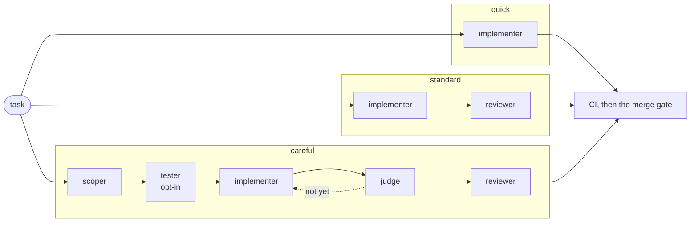
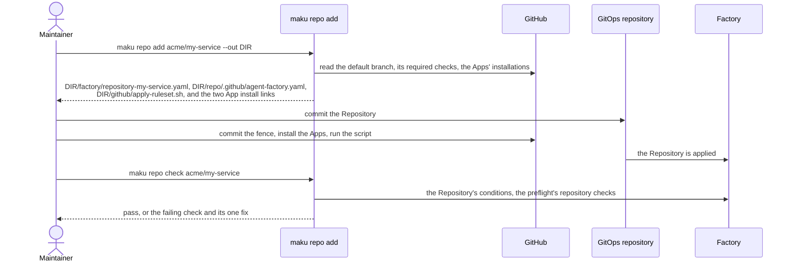

# Workflows, roles and repository onboarding: review and design

**Status:** design, interview with the owner 2026-11-14, builder-checked, awaiting approval. Maku
facts are read on `origin/main` at `c9ee6f5` (v0.47.0 plus unreleased work); ANR facts on `main` at
`47b6557`.

**Outcome.** A person sees one noun, **workflow**, with three shipped values: `quick`, `standard`
and `careful`. The factory picks one; a maintainer may change it with one label or at confirmation.
Five roles remain in the vocabulary instead of eight. No role is added or removed until live
traffic, alternated between two workflows, gives it a cost per merged pull request. Onboarding a
repository becomes one command that writes two small files and a ruleset, and one command that
checks the result.

Two clusters, aws-0 and gcp-0, alternate, one active at a time. Everything here is validated on
aws-0: ANR's changes go in the base and the aws-0 overlay.

Related designs, each owning what this one only names:

| Subject | Owner |
|---|---|
| Merge policy fields, the gate reading the diff | [merge policies](2026-11-14-merge-policies-review-design.md) |
| Vocabulary, the MCP tools, Slack | [UX](2026-11-14-ux-review-design.md) |
| Model and effort per role | [cache and costs](2026-11-14-cache-costs-review-design.md) |
| The onboarding page | [docs](2026-11-14-docs-review-design.md) |

## Why

Six settings decide together which agents run on a task, and the platform uses a fraction of them.

| Fact | Where |
|---|---|
| A template is picked by class and tier: `solo`, `pair`, `trio`, `investigate`, names fixed by the CRD | Maku `docs/factory.md:567-577` |
| A `loops` row is keyed by class and read whole: a class row never inherits `default` | Maku `internal/factory/config/evaluation.go` (`rowOf`), ANR `tooling/base/agent-factory/resources/factory.yaml` (`loops`) |
| A class with `harness` freezes each task into a cohort (`control`, `treatment`, `labeled`) by a stable hash of the task's name; both hashed cohorts run the class's floor, and `treatment` differs only once a scoper's pick applies | Maku `docs/factory.md:603-609`, `internal/factory/reconciler/reconciler.go:1203` (`floorProfile`) |
| The three tiers name the same model, `agent-default` | ANR `factory.yaml` (`tiers`) |
| `triage.classifierURL` is unset: every task is `standard`, except the 10% that `controlPercent` sends to `frontier` | ANR `factory.yaml` (`triage`) |
| No class sets `harness`, so the profile choice shipped in v0.47.0 offers nothing here | ANR `tooling/base/agent-factory/resources/mergepolicy-*.yaml` |
| No role has a measured value | ANR [harness roles design](2026-10-30-harness-roles-design.md), HR6 and HR11 |
| Onboarding has no page and no command; ai-native-ref carries 7 files and 202 lines for it, plus a 50-line `Repository` | ANR `.github/`, `.policy.yml`, `tooling/base/agent-factory/resources/repository-ai-native-ref.yaml` |

"Profile" means five things: a harness profile, a capability profile (role by data class), the
approvals profile, the chart's `profile` value and an egress profile.

## Decisions

| # | Decision | Rejected |
|---|---|---|
| WF1 | **One user-facing noun, "workflow"**, for what a harness profile is today. The other meanings of "profile" are renamed in prose and UI ([the renames](#the-renames)) | Keeping "profile" (five meanings); "team" (a template is already called one) |
| WF2 | **Three workflows ship in the chart**: `quick`, `standard`, `careful`. They are harness profiles, templates and `loops` rows, with no engine change | A single adaptive workflow (every small task pays a scoper); cleaning the six notions without hiding them |
| WF3 | **The default is `standard`.** Scheduled, oracle-backed and revert tasks default to `quick`. `careful` is never a default until WF8 says so | The scoper choosing (`evaluation.mode: apply`) before it is measured |
| WF4 | **A maintainer overrides with one label**, `workflow:<name>`, or at confirmation, where the workflow is shown with its default and may be changed, never as a required input | A per-class allow-list the person must know |
| WF5 | **Templates, `loops` rows, tiers and cohorts become an advanced layer**: kept in the CRD, absent from the user docs | Deleting them (the engine runs on them) |
| WF6 | **Five roles**: scoper, tester, implementer, judge, reviewer. The splitter is "the scoper may propose parts"; search is a tool of the implementer; the triager is named only on the RunLore page | Eight roles in the table |
| WF7 | **The fields that describe a workflow leave `MergePolicy`** ([where they land](#where-the-fields-land)) | Leaving them on an object that no longer selects the workflow |
| WF8 | **Measure first, on live traffic.** New tasks alternate between two workflows by the existing cohort draw and merge as usual; cost per merged pull request and merge rate decide what stays ([the measurement](#the-measurement)). Until then the judge is out of `standard` and no other evaluation surface is added | Paired replay on a mirror with blind grading (a corpus to build, a factory change, hours of grading); removing the judge and search now, on two pull requests and ten drills |
| WF9 | **Dead settings go** ([the list](#settings-that-go)) | Documenting them |
| WF13 | **Every breaking removal lands before v4.0.0**, in two v0.4x minors: release N accepts the old key or label with a warning, release N+1 refuses it. The project can still break | Carrying both models into v4 and removing in v5 |
| WF10 | **A class row inherits `loops.default` key by key** | Rows read whole, where the comments outgrow the config |
| WF11 | **`maku repo add` writes, `maku repo check` verifies**; one onboarding page is written around them ([onboarding](#onboarding-a-repository)) | A page alone (twelve manual acts remain); an App with administration rights |
| WF12 | **The broker reads the repositories it may plan for from the `Repository` objects**, through the catalog it already reads | A second list in broker config |

## The three workflows



| Workflow | Runs | Default for | Task ceiling |
|---|---|---|---|
| `quick` | implementer | work a check verifies mechanically: scheduled findings, reverts, patch bumps | the `light` or `standard` tier's |
| `standard` | implementer, reviewer (2 rounds at most) | everything else | the `standard` tier's |
| `careful` | scoper, implementer with search, judge, reviewer; the tester when the repository opts in | nothing, until measured | the `frontier` tier's |

What the chart ships, in `Factory.spec`. Every key exists today
(`internal/factory/config/mergepolicy.go:43`, `config.go:804`, `config.go:2347`):

```yaml
templates:
  solo: {roles: [implementer]}
  pair: {roles: [implementer, reviewer], maxReviewRounds: 2}
  investigate: {roles: [triager]}
harnessProfiles:
  quick:    {template: solo, description: "One implementer. For changes a check can verify."}
  standard: {template: pair, description: "An implementer and a reviewer. The default."}
  careful:  {template: pair, tier: frontier, loop: careful,
             description: "Scoped first, judged before review. For wide or unclear tasks."}
  none:     {template: none}            # adopted pull requests; never offered to a person
loops:
  default: {scope: "off"}
  careful: {scope: scoper, judge: tier-light, search: true,
            split: {maxChildren: 4, childTier: standard}}
```

`careful` raises the tier, which a profile may do and never undo
(`internal/factory/reconciler/reconciler.go:1198`). A profile's `loop` names its row, so a workflow
carries its loop wherever the class is (`RowFor`, `evaluation.go`).

### Two stages

| Stage | Maku release | What changes | Engine change |
|---|---|---|---|
| A | N | The chart ships the YAML above. A class still names its workflow as `harness`; classes whose floor is `standard`, `review` included, allow `careful`. The docs, the room page and the plan say "workflow". Old keys and labels warn | none, except the measurement's one key |
| B | N+1, with the diff-chosen gate and its reviewer rule ([merge policies](2026-11-14-merge-policies-review-design.md)) | The class no longer selects the workflow. `Factory.spec.workflows` is the only name, the `workflow:` label is the only pin, `loops` rows are keyed by workflow, and every removal is refused | small, listed under [what changes where](#what-changes-where) |

Stage A keeps one rule of the engine that stage B drops: a variant may never run fewer roles than
its class's floor (`belowFloor`, `evaluation.go`), and a live or shadow class has one workflow. So
in stage A a maintainer can move a `standard` task to `careful`, and `quick` is reached only as the
floor of a mechanical class. In stage B a maintainer may pick any workflow, `quick` included. That
is safe because of the gate's rule: a policy with no diff shape and no oracle merges only on a
reviewer's favourable verdict, so an unreviewed `quick` pull request waits for a human.

### How the workflow is chosen (stage B)

First match wins.

1. A maintainer's `workflow:<name>` label, or the choice made at confirmation: Slack keeps today's
   profile select, renamed; the coding agent's form has an optional field. Both are pre-filled with
   the default. Anyone else's label is ignored and narrated, as a refused pin is today.
2. The source: a `Schedule` names its workflow in a new `workflow` field; a revert and an oracle
   finding run `quick`; an adopted pull request runs `none`.
3. `Repository.spec.workflow.default`, which defaults to `standard`.

The planner's suggestion and the scoper's recommendation are shown and recorded, never applied
(`evaluation.mode: observe`), until WF8 decides otherwise.

**What a class still does after stage B.** It names an oracle policy on a `Schedule` (one with a
`probe`), and nothing else: it selects no workflow, no `loops` row and no merge policy.

| Label or key | Release N | Release N+1 |
|---|---|---|
| `profile:<name>` | the pin, with a warning; `workflow:<name>` is read as the same pin | ignored and narrated |
| `class:<name>` | as today | ignored and narrated |
| `harnessProfiles` | read, with a warning; `workflows` is read as the same map | refused |
| `loops.<class>` | read | refused; a row is named by its workflow |

**The profile choice shipped in v0.47.0** keeps its mechanics: the catalog the broker reads from
the factory, the choice at confirmation, the recorded suggestion. It offers workflows instead of
per-class profiles, so its refusal codes about classes (`class_no_profiles`, `class_profile_fixed`,
`profile_not_allowed`) go in stage B.

### Where the fields land

| Field on `MergePolicy` today | Lands on (N+1) | Note |
|---|---|---|
| `harness` | `Repository.spec.workflow.default` | one per repository, `standard` when absent |
| `harnessAllowed` | nothing | every shipped workflow is allowed; a platform removes one by not defining it |
| `escalation` | `Factory.spec.workflows.<name>.escalation` | `standard` may step to `careful` on `notConverged`; off until measured |
| `testFirst` | `Repository.spec.workflow.testFirst` | the repository opts in to the tester, which then runs in `careful`; refused without `merge.contractCheck`, public tasks only, as today |
| `checks` | `Factory.spec.workflows.<name>.checks` | already a harness profile field |

Model and effort per role become fields of a workflow's definition, in the advanced layer; the
[cache and costs design](2026-11-14-cache-costs-review-design.md) owns them. ANR's per-class model
rows (the Kimi reviewer on `docs-links`, `revert`, `dead-links`, `deps-patch`) go with the re-keying
if those tasks run `quick`, which has no reviewer; the builder verifies.

### The roles

| Role | In | What it does | Writes code |
|---|---|---|---|
| Scoper | `careful` | reads the repository, hands off a scope and its checks, asks the author one question, or proposes parts | no |
| Tester | `careful`, opt-in | commits failing tests before the implementer | tests only |
| Implementer | all | the only writer; may call the search tool in `careful` | yes |
| Judge | `careful` | one stateless call when the implementer stops: met, not yet, or impossible | no |
| Reviewer | `standard`, `careful` | a read-only verdict on the pull request | no |

### The renames

Prose, UI and tool descriptions only. No config key moves except `harnessProfiles`, and no metric
or label is renamed: the metrics keep the code's `agent_factory_*` names, and their `profile` label
carries the workflow's name as its value.

| Today | Becomes |
|---|---|
| harness profile, template, class (as shown to a person) | workflow |
| capability profile | role permissions |
| `approvals.profile` (attended, unattended) | approval mode |
| egress profile | egress allow-list |
| chart `profile` | nothing: v4 step 8 deletes the value (Maku v4 design, D13) |

### Settings that go

All are accepted with a warning in release N and refused in N+1 (WF13).

| Setting | Why it is dead |
|---|---|
| `templates.trio` | same roles as `pair`; the CRD's fixed names lose it |
| `triage.classifierURL` | the task classifier was never deployed and the scoper replaced it (`internal/factory/config/hardening.go:654`). It is not the Slack intent classifier of v4 D7, which stays |
| `defaults.template`, `defaults.tier` | read by nothing; `maku install --print` stops writing them (`internal/install/testdata/golden/generic/factory/factory.yaml`) |
| `human.intake.plan.classes` | the catalog replaces it (profile choice plan, stage 5); ANR removes its block with that pin |

`triage.controlPercent` stays a key, set to 0 on ANR: it sends 10% of tasks to `frontier`, which
here changes caps and the reviewer's alias only, and confounds WF8.

## The measurement

This design owns it. The cache and costs design runs its effort and model trials through the same
mechanism and reads the same two figures.

**Question.** Does a workflow's extra role lower the cost of a merged pull request, or raise the
merge rate, by more than the threshold below?

| Part | Choice |
|---|---|
| Traffic | New, real tasks. Nothing is replayed, nothing is filed twice, and every task runs and merges as usual |
| The draw | The existing cohort: `triage.CohortOf` hashes a task's name into `control` or `treatment`, frozen in `status.profile.cohort`. `evaluation.controlPercent: 50` |
| The arms | `control` runs the class's floor. `treatment` runs the workflow named by one new key, `evaluation.treatment`, when the class allows it; today both cohorts run the floor (`floorProfile`), so the draw exists and the second arm does not |
| Excluded | Pinned tasks (`cohort="labeled"`), live and shadow classes (one workflow each), scheduled and adopted work |
| Figures | Cost per merged pull request: `agent_factory_task_usd_total` over `agent_factory_task_outcomes_total{outcome=~"accepted\|merged_human"}`, by `cohort`. Merge rate: the same count over every ended task of the cohort. Cost by role from `agent_factory_run_cost_usd{role}` explains a difference (`internal/factory/fmetrics/fmetrics.go:102`, `:499`, `:564`) |
| Size | 30 ended tasks per arm. No dollar stop: the run and task caps already bound each task |
| Where | The active cluster's traffic; the session is opened and its decision recorded on aws-0 |

| # | Comparison | `control` | `treatment` | When |
|---|---|---|---|---|
| 1 | scoper and judge | `standard` | `careful` | stage A: `careful` adds roles to the floor, which `belowFloor` allows |
| 2 | reviewer | `standard` | `quick` | after stage B: `quick` drops the floor's reviewer, which stage A refuses |

There is no judge-alone comparison: it would need a fourth workflow.

**Decision rule**, fixed before the first task. "Better" and "worse" mean a merge rate at least 15
points apart, or a cost per merged pull request at least 20% apart with the merge rate no worse.

| Result for the arm with the extra role | Decision |
|---|---|
| Better | the role stays. After comparison 1, the scoper may start choosing `careful` (`evaluation.mode: apply`) |
| Worse | the role leaves the shipped workflow and stays in the engine, off. After comparison 1, `careful` is no longer offered |
| Neither (indecisive) | the role stays and the default does not change. The comparison may run 30 more tasks per arm once |

**Frozen meanwhile:** no new evaluation mode, cohort, refusal code or role beyond
`evaluation.treatment`; `evaluation.mode` stays `observe`; `escalation` stays off.

## Onboarding a repository

The target is the product path of the Maku v4 design: tokens minted per run (D10), the
`maku/merge-gate` status in place of policy-bot (D11), two Apps (D12).

| | Today (ai-native-ref) | After |
|---|---|---|
| Files in the repository | 7: the fence, `agent-checks.yaml`, `.policy.yml`, four `.github/chainguard` trust policies (202 lines) | 1 required: the fence, one line. `agent-checks.yaml` is optional |
| Cluster objects | a `Repository` of 27 to 93 lines with 2 to 11 bindings | a `Repository` under 15 lines, no binding |
| Broker config | the repository added to `intake.plan.repositories`, its classes to `intake.plan.classes` | none (WF12) |
| Owner's acts on GitHub | six ([second repository design](2026-10-16-v2-second-repository-design.md)) | two: install the two Apps, run the ruleset script |
| Commands | none | `maku repo add`, `maku repo check` |

The whole `Repository` for a public repository:

```yaml
apiVersion: maku.ogenki.io/v1alpha1
kind: Repository
metadata: {name: my-service, namespace: maku}
spec:
  factoryRef: agent-factory
  repository: acme/my-service
  maintainers: [alice]
  merge:
    requiredChecks: [ci]
    leakScanCheck: ci
```



| Command | Reuses | Adds |
|---|---|---|
| `maku repo add` | `internal/install`: the `Repository` writer (`factory.go`), the ruleset and its `gh` script (`write.go`), `--out`, `--answers`, `--force` | reading the default branch's required checks to fill `merge`; the fence file; `privateCode.acknowledged` asked for a private repository (D3) |
| `maku repo check` | the preflight's `apps`, `merge-gate` and `private-code` checks (`docs/install.md`, the generated table), the `Repository`'s `Accepted`, `BindingsValid` and `PrivateCode` conditions | filtering to one repository; the fence read from the default branch |

**Target:** a public repository onboarded in under 15 minutes by someone who has never done it,
with a `Repository` under 15 lines. The onboarding page's own test is a timed run of it.

## Approaches considered

The decisions table names what each choice beat. The three shapes for the model itself:

| Approach | Verdict |
|---|---|
| A. One noun and three shipped workflows over the existing engine | chosen: three names understood without a page, no engine change to start |
| B. Keep the six notions, remove the dead ones, rename the profiles | its clean-up is kept as WF9 and WF10; the mental model would keep six levels |
| C. One adaptive workflow, the scoper deciding how much to do | rejected: every task pays a scoper, and three of its ten recorded drills ended on budget |

## Goals and limits

| | |
|---|---|
| Goals | A newcomer names what will run on a task in one word. A repository is onboarded with one command and one page. Each role has a cost per merged pull request |
| Non-goals | New roles. A workflow editor. Changing what a role's brief says. Choosing models per role (cache and costs design). Renaming a metric or a label |
| Anti-goals | A fourth workflow shipped to cover a case. A removed role that was never measured. An onboarding command that applies to a cluster or needs administration rights on the repository |
| Constraints | Maku v4: D3, D10, D11, D12, D13, D24. The host's platform constitution (least privilege). Removals follow WF13, before v4.0.0 |

## What changes where

**Maku** (one plan):

| # | Change | Release |
|---|---|---|
| 1 | The chart ships the three workflows; `maku install --print` writes them and stops writing `defaults.template`, `defaults.tier` and `trio` | N |
| 2 | "workflow" in the room page, the plan, the catalog's labels and the narration; the renames | N |
| 3 | The dead settings, `harnessProfiles` and `profile:` warn (WF9, WF13); `workflows` and `workflow:` are read as their synonyms; `loops` rows inherit `default` (WF10) | N |
| 4 | `evaluation.treatment`: the treatment cohort runs the named workflow when the class allows it | N |
| 5 | `Factory.spec.workflows` with `escalation` and `checks`; `Repository.spec.workflow.{default,testFirst}`; `Schedule.spec.workflow`; `loops` keyed by workflow | N+1 |
| 6 | The `workflow:` label as the only pin; a maintainer may pick below the default; the class refusal codes removed; everything warned in N refused | N+1 |
| 7 | `maku repo add`, `maku repo check` (WF11); the broker's repository list from the catalog (WF12) | either |

Items 5 and 6 ship in the same release as the diff-chosen gate.

**ANR** (one plan, base and the aws-0 overlay):

| # | Change | After Maku's |
|---|---|---|
| 1 | Adopt N. `factory.yaml`: the three workflows, the `careful` row; `trio`, the per-class `docs` and `scripts` rows and `triage.controlPercent: 10` removed. Each existing `MergePolicy` keeps `harness`, now naming a workflow; `review` and the other `standard` classes allow `careful`. Nothing is deleted | 1 to 3 |
| 2 | Comparison 1: `evaluation: {controlPercent: 50, treatment: careful}`, its runbook, its results file, the decision recorded in `status.md` | 4 |
| 3 | Adopt N+1. `workflow.default` on each `Repository`, `workflow` on each schedule, `harness` removed from the policies that remain (the merge policies design deletes the empty ones in the same change) | 5, 6 |
| 4 | Comparison 2: `treatment: quick` | 5, 6 |
| 5 | `intake.plan.classes` and `intake.plan.repositories` removed from the broker's config | 7 |
| 6 | The site's roles page and guide use the five roles and the three workflows; details in the docs design | 2 |
| 7 | The four repositories re-rendered with `maku repo add` as its proof, once policy-bot and octo-sts are retired here (v4 readiness, row 14) | 7 |

## Calls made after the interview

The owner decided WF1 to WF13 in the interview and its follow-up (the live-traffic measurement,
removals before v4.0.0, validation on aws-0). These are the author's, settled while writing and
after the builder check; each can be reversed.

| Call | Reason |
|---|---|
| `maku repo add` writes files and opens no pull request by default (`--pr` may come later) | v4 D24: the wizard writes and never applies. The interview said two pull requests |
| The onboarding target has no `.policy.yml` and no trust policy | v4 D10 and D11 retire octo-sts and policy-bot; the interview counted them |
| Two stages: A in release N, B in release N+1 with the diff-chosen gate | the engine refuses a variant below its class's floor, so "any workflow by label" needs the class to stop owning the workflow |
| One new key, `evaluation.treatment` | the existing draw gives two cohorts that run the same floor; the owner's "existing cohort mechanism" needs a second arm |
| The thresholds (15 points, 20%), and "indecisive keeps the role" repeated once at most | fixed before the first task, as the owner asked; the numbers are the author's |
| No judge-alone comparison | it needs a fourth workflow |
| After stage B a class names only an oracle policy on a schedule; `loops` rows are keyed by workflow; a `Schedule` gains `workflow` | one account of class and workflow across the five designs |
| The tester is a repository's opt-in, `Repository.spec.workflow.testFirst` | a factory-wide `testFirst` would be refused for every repository without `merge.contractCheck` |
| `workflows` and `workflow:` are read as synonyms from release N | so a platform can move before the old names are refused |
| `careful` raises the tier to `frontier` | the scoper, judge and search spend inside the task's ceiling; a plain run already ended on `standard`'s $2.55 run cap (cost snapshot) |
| `triage.controlPercent` set to 0 here | it confounds the measurement and changes nothing a person sees |
| `escalation` off until measured | it is evaluation surface, frozen by WF8 |

## Left to the builder

- Whether `checks: true` belongs on `standard` and `careful` by default. It depends on what a run
  does when the repository has no `.github/agent-checks.yaml`; not read for this design.
- Whether Maku's docs, which write `maku_factory_*`, are corrected to the code's names.
- The `split` and `search` values of the `careful` row beyond those shown.
- The exact wording of the workflow descriptions (120 characters at most each).
- How `maku repo add` reads required checks on a repository whose ruleset the caller cannot read.
- Whether ANR's per-class Kimi reviewer rows have any task left once those classes run `quick`.

## Open, for the owner

Nothing blocks the plan.
