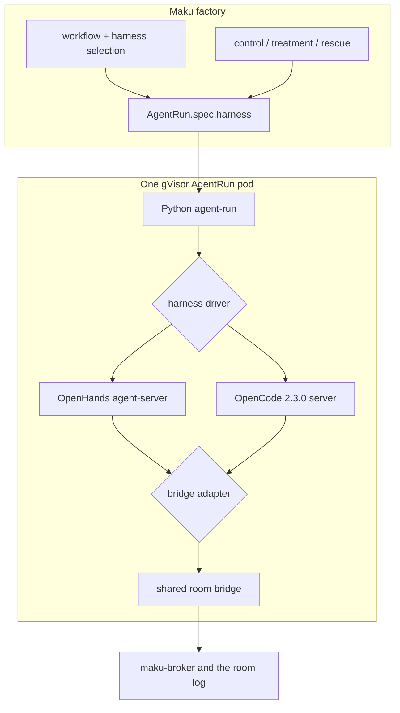

# OpenCode as an optional second Agent Factory harness: design

**Status:** approved through a 27-question owner interview on 2026-11-15; implementation targeted at
platform v5.x · **Research:** [OpenCode/OpenHands evidence](2026-11-15-opencode-harness-research.md) ·
**Plans:** [Maku](../plans/2026-11-15-opencode-harness-maku-plan.md) and
[ai-native-ref adoption](../plans/2026-11-15-opencode-harness-adopt-plan.md) · **Current PR:**
research, design, and plans only; the alternatives page is a separate PR linking here.

## 1. Outcome

Evaluate OpenCode as a second inner agent loop for every AgentRun role without changing the default
or weakening Maku's existing controls. A task-level opt-in selects one harness for the whole task.
OpenHands remains the default and the rollback until measured replacement and soak gates pass.

The current PR changes no runtime code. It records this design and two implementation plans.
Implementation belongs to the platform v5.x programme.

## 2. Owner decisions

| # | Decision |
|---|---|
| H1 | Introduce OpenCode as an optional second harness; keep OpenHands as default until the replacement gates pass |
| H2 | Do not require local/cluster harness parity. Sharing OpenCode locally is an optional bonus; developers may use any local agent |
| H3 | An opt-in selects OpenCode for every role of a task, not only the implementer |
| H4 | Require offline parity before live smoke tests and a measured live comparison before a default change |
| H5 | Require separate explicit authorization before rebuilding or resuming aws-0 |
| H6 | Use one task-level selector propagated to every run of the task |
| H7 | Drive a version-pinned `opencode serve` over loopback; CLI NDJSON is diagnostic only |
| H8 | Implement Maku-owned stuck-loop detection over normalized OpenCode events |
| H9 | Preserve all current checkpoint, final-read, revocation, PVC restoration, and automatic recovery semantics |
| H10 | Validate every enabled provider family offline and in a live smoke test before a default change |
| H11 | Generate least-privilege OpenCode agents per Maku role and retain every external trust boundary |
| H12 | Implement search as a Maku-driven, bounded, synchronous child session |
| H13 | Preserve metadata-only tracing and run correlation; do not enable unreviewed OpenCode OTLP logs |
| H14 | Add no browser in this programme; record Playwright verification as a future separate design |
| H15 | Build a Maku-owned, pinned, non-root production image with every required tool and no auto-update |
| H16 | Upgrade server, generated client, schemas, and image together through compatibility-gated PRs |
| H17 | Require better end-to-end duration or cost per merged PR; image size and startup are supporting evidence only |
| H18 | Apply the strict outcome gate in section 9 |
| H19 | Keep an OpenHands rollback for at least 30 days and 30 ended default tasks after cutover; remove it separately |
| H20 | Keep harness independent of workflows and add a treatment-cohort harness setting |
| H21 | Use one shared room bridge with OpenHands and OpenCode adapters |
| H22 | Keep the shared Python `agent-run` with harness-specific drivers |
| H23 | Require existing regression suites plus real OpenCode binary/server/container/gVisor tests |
| H24 | Allocate new real tasks through the existing stable cohort draw; do not replay duplicate work |
| H25 | Rescue a failed OpenCode task only through an explicit OpenHands retry; never switch harness mid-attempt |
| H26 | Target the platform/ANR v5.x programme; choose the Maku release during implementation |
| H27 | Open the specification/plans PR now; merge the alternatives page in a separate PR linking to it |

## 3. Goals and non-goals

### Goals

- Preserve Maku's role, security, room, budget, recovery, and merge semantics.
- Measure the final production image, harness startup, end-to-end task duration, cost, and quality.
- Make an OpenCode task indistinguishable from an OpenHands task to the factory and room readers,
  except for its recorded harness.
- Permit a clean rollback and truthful accounting of rescued attempts.

### Non-goals

- Replacing Maku's run-controller, gVisor runtime, rooms, gateway, judge, or merge controls.
- Copying a developer's global configuration, credentials, plugins, or approval rules into a pod.
- Mixed-harness roles within one task, automatic cross-harness session migration, or browser tools.
- Rewriting the runner in Go or Rust. That question belongs to a later independent specification.
- Any implementation, release tag, cluster rebuild, or default change in the current PR.

## 4. Architecture



OpenHands and OpenCode listen on loopback only. The existing `HARNESS_URL`, room token, model
identity, git credential helper, network policies, and merge controls stay in place. The bridge and
runner each get a small harness-specific adapter; sequencing, policy, room delivery, repository
checks, tester contracts, and shutdown remain shared.

## 5. Selection and provenance API

### 5.1 Existing and new fields

| Field | Values and meaning |
|---|---|
| `AgentRun.spec.harness` (existing) | Add `opencode` beside `openhands`; immutable, default `openhands` |
| `Factory.spec.defaults.harness` | Optional `openhands` or `opencode`; omitted means `openhands` |
| `Factory.spec.evaluation.treatmentHarness` | Optional harness for the treatment cohort; empty means `openhands` |
| `TaskIntake.harness` | Optional maintainer-approved selection for Slack/coding-agent intake |
| `RunRequest.harness` (`POST /v1/runs`) | Optional one-off run selection; empty means `openhands` |
| `ProfileStatus.harness` | Harness frozen at triage or rescue |
| `ProfileStatus.harnessSource` | `default`, `label`, `treatment`, or `rescue` |
| `runs.Spec.Harness` | Factory-to-claim value; empty writes no new claim key |
| `RunProvenance.harness` | Actual harness recorded on each run, never guessed for an old run |
| `runController.images.opencode` | Digest-pinned Maku OpenCode image |

The issue label is `harness:opencode` or `harness:openhands`. Only a maintainer may apply it, under
the same attribution checks as `workflow:<name>`. A harness label puts the task in the `labeled`
cohort, not the A/B trial. A direct run and the factory intake accept the same two values and reject
every other value.

`evaluation.treatmentHarness` is independent of `evaluation.treatment`. The harness A/B leaves the
latter unset so both arms use the same workflow. Setting both remains valid for later experiments,
but is not used here.

### 5.2 Frozen selection

Triage writes `ProfileStatus.harness` and `harnessSource` once. Every implementer, reviewer, tester,
and triager claim of the task copies that value through `runs.Spec.Harness` into
`AgentRun.spec.harness`. A replay reads the claim and never re-resolves it.

A task with no agent conversation, such as an integration-only coordination run, stays on
`openhands`; OpenCode is not started for a no-model path.

The run-controller writes `AGENT_HARNESS` to the runner and room bridge and selects the image from
`runController.images.harness` or `.opencode`. Pod admission permits `ghcr.io/smana/maku-opencode`
by digest beside the existing harness repository.

### 5.3 Metrics and status

Add the bounded label `harness` (`openhands` or `opencode`) to:

- `agent_factory_task_outcomes_total`;
- `agent_factory_task_usd_total`;
- `agent_factory_run_cost_usd`.

No existing metric or label is renamed. Trial queries group by `cohort` and `harness` and retain
`profile`, `source`, and role breakdowns. Run provenance carries the harness so every result can be
audited back to its claims.

## 6. Runner and bridge contracts

### 6.1 Python runner

Split only the harness-specific parts of `agent_run.py`:

```python
class HarnessDriver:
    def start(self) -> None: ...
    def wait_ready(self) -> None: ...
    def create_conversation(self, request: ConversationRequest) -> str: ...
    def status(self, conversation_id: str) -> str: ...
    def events(self, conversation_id: str, cursor: str) -> EventPage: ...
    def send(self, conversation_id: str, text: str, run: bool = True) -> None: ...
    def interrupt(self, conversation_id: str) -> None: ...
    def close(self, conversation_id: str) -> None: ...
    def stop(self) -> None: ...
```

`OpenHandsDriver` preserves the current SDK request construction and agent-server behavior.
`OpenCodeDriver` starts `opencode serve --hostname 127.0.0.1 --port 8000`, generates the role's
configuration, and speaks the pinned API. Cloning, checks, contracts, the completion judge, safe
outputs, tracing, checkpoints, and revocation stay outside these drivers.

OpenCode generates its own session ID. The driver writes it atomically to
`/workspace/.agent-opencode-session-id`; the bridge waits for that file rather than assuming the
AgentRun UID is an OpenCode session ID. Session state, configuration, and data live under
`/workspace/.opencode/` on the suspendable run's PVC.

### 6.2 Go room bridge

Introduce a consumer-side `HarnessAPI` interface with the current `Ready`, `Conversation`, `Next`,
`Skip`, `Send`, `Message`, `Respond`, `Run`, `Interrupt`, and `AlwaysConfirm` methods. The existing
`Harness` becomes the OpenHands implementation without behavioral changes. `OpenCodeHarness`
implements the same interface using the version-pinned generated client.

`AGENT_HARNESS` selects the implementation in `cmd/maku-bridge`. OpenCode SSE supplies live events;
the message log is the replay authority. Cursor resume re-reads from the last acknowledged durable
event and preserves the existing `ItemsPerEvent` idempotency scheme. Malformed or unknown events
become bounded `harness_event` items, never silent gaps.

### 6.3 Approval and process semantics

The OpenCode adapter maps permission requests to Maku's policy and human decision path. A denied
rule stays denied. Non-interactive `ask` requests wait for Maku rather than auto-approving or
auto-rejecting without policy.

Interruption stops the session and every shell or subagent job it owns. The shutdown test proves no
model call, shell, or process daemon continues to modify the tree before checkpointing. Final-read
completes before server stop and credential revocation.

## 7. Required feature parity

### 7.1 Generated role agents

Generate a fresh `opencode.jsonc` for each run. No home configuration, repository plugin, personal
MCP server, auto-update, or unapproved plugin is loaded. The custom provider is named `maku`, uses
the bundled OpenAI-compatible runtime, and receives its endpoint and placeholder credential through
the environment. No secret appears in argv or a configuration file.

Every agent is primary and denies subagents, skills, web access, and external directories unless a
Maku feature explicitly requires them. Implementer editing and shell permissions follow the current
role. Reviewer, scoper, and triager deny edit and receive only the shell/MCP actions their role
needs. Tester write permissions are limited to the declared test surface; the existing independent
contract check remains authoritative.

A loopback MCP credential proxy reads `MCP_TOKEN_FILE` on every outbound request and adds the current
bearer token and trace context. OpenCode talks only to that proxy, so projected-token rotation works
without storing the token in OpenCode configuration.

### 7.2 Search

Search creates an independent read-only OpenCode session, not an autonomous background subagent.
Maku supplies the query, light alias when configured, low effort, 40-step ceiling, 300k-token
ceiling, 300-second deadline, six-call run limit, and 8,000-character result limit. Maku waits for
completion, interrupts at a limit, and writes the existing ledger.

### 7.3 Stuck detection

A pure `loop_guard` consumes normalized action/observation events and detects:

- four identical action/observation cycles;
- three identical action/error cycles;
- three agent messages without an action;
- six alternating cycles;
- repeated context-window errors.

The OpenCode runner atomically writes `/workspace/.agent-opencode-terminal.json` with the reason
`stuck` and the bounded pattern name, then interrupts the session and all jobs. The bridge maps that
marker to the same terminal `stuck` status as OpenHands. OpenHands behavior is unchanged.

### 7.4 Provider configuration

Define all current aliases and `low`, `medium`, and `high` variants in the generated provider model.
Variant request bodies carry the configured reasoning effort. Internal runs enable the appropriate
prompt-cache compatibility mode; public runs do not send Anthropic-only cache markers.

Provider suites inspect actual requests and responses for GLM/Z.ai, Anthropic, Kimi, and Mistral:
tool calls, retries, terminal 429 behavior, effort, cache read/write, token usage, and condensation.
No new provider runtime package downloads at pod start; everything required is in the image.

### 7.5 Recovery

OpenCode session/configuration/data directories remain on `/workspace` for suspendable runs. A new
pod reuses the stored session ID and server state. The existing 15-second sequence is preserved:

1. interrupt and stop owned jobs within 1 second;
2. checkpoint the implementer's work within 7 seconds;
3. drain the room within 3 seconds;
4. stop the server and its process daemon within 2 seconds;
5. revoke the GitHub token within 1 second.

The steps have independent upper bounds, as in the current harness. An old server or daemon that
cannot be stopped is killed; it must not outlive credential revocation.

### 7.6 Telemetry

Do not set OpenCode's native OTLP endpoint. The runner emits metadata-only spans from normalized
events, preserving model/tool timing, token fields, and run parentage without exporting OpenCode
logs. Model and MCP calls carry the run's W3C trace context. The existing collector remains the
fail-closed content filter.

## 8. Rescue and evaluation accounting

Add `rescue` to the cohort vocabulary. An explicit `/factory retry harness=openhands` performs the
following transaction:

1. Count the current OpenCode attempt as failed under its original cohort and harness, including
   its cost and duration.
2. Mark that cohort counted so a later reconciliation cannot count it again.
3. Preserve the workflow, branch, and room; set `harness=openhands`,
   `harnessSource=rescue`, and `cohort=rescue`.
4. Retry through the normal capped path. Rescue outcomes and spend are visible under `rescue`, but
   excluded from control/treatment comparisons.

Add `OutcomeCountedCohorts []string` beside the existing `ProfileStatus.Counted` and
`OutcomeCounted` marks. The existing marks keep their behavior for ordinary and profile-less tasks.
The new list records each cohort already counted, so a crash between the original-arm count and the
rescue profile write cannot count that arm again. Ordinary tasks still count once; a rescued task
has one original-arm outcome and one rescue outcome.

No automatic fallback occurs. Any other harness change after triage is refused.

## 9. Replacement and removal gates

### 9.1 Offline gate

All current OpenHands suites and goldens pass, then the real pinned OpenCode binary/server passes
scripted-model contract suites for every role and failure mode. Maku `task check`, the image harness
suites, and relevant container/gVisor integration tests pass. No live smoke test starts before this
gate.

### 9.2 Live comparison

Use new real tasks only. The stable task-name hash assigns control/treatment at 50%, with identical
model and workflow. Pinned smoke tasks are `labeled`; scheduled, adopted, and integration-only work
is excluded. Start with 30 ended tasks per arm and extend once to 60 when inconclusive.

Before any default change, run at least one live smoke task for GLM/Z.ai, Anthropic, Kimi, and
Mistral, verifying reasoning effort, retries, tools, usage, and caching.

### 9.3 Strict decision rule

- Zero critical security, audit, or recovery regressions.
- OpenCode merge rate no more than **5 percentage points lower** than OpenHands.
- OpenCode cost per merged PR no more than **10% higher** than OpenHands.
- At least one material win: **≥15% lower cost per merged PR** or **≥15% lower median end-to-end
  task duration**.

The thresholds are an engineering decision rule, not a claim of statistical certainty. Indecisive or
underpowered evidence keeps OpenHands. Record every reading, exclusion, rescue, and verdict in a
results file before changing the default.

### 9.4 Soak and removal

After the strict gate, a separate cutover PR sets `defaults.harness: opencode`. Keep OpenHands
selectable and immediately deployable for at least **30 days and 30 ended default tasks**. A
critical regression or sustained breach of the quality/cost limits restores OpenHands.

Only a later owner-approved PR may remove the OpenHands adapter, image, configuration, and suites.

## 10. Documentation and future work

The separate alternatives PR describes OpenCode's benefits, missing controls, and the conditions
under which it could replace OpenHands, and links back to this specification. It does not claim
OpenCode is available.

Future separate designs:

- Playwright MCP for visual UI verification, including network and security review.
- Go versus Rust for a runner rewrite, after the harness choice and only with a measured reason.
