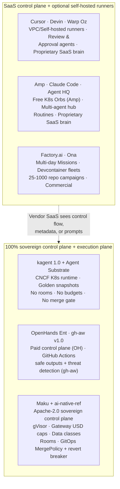

# v5 positioning and landscape research: post-v4 status, late-2026 alternatives, and adoption levers

**Date:** 2026-11-22 · **Status:** research supporting the [v5 roadmap](2026-11-22-v5-roadmap-design.md) · **Follows:** the [v4 landscape research](2026-10-31-v4-landscape-research.md), the [v4 roadmap](2026-10-31-v4-roadmap-design.md), and the [v4 AWS validation](../../runbooks/agent-factory/results-aws-0-2026-11-16.md)

## Executive verdict

Maku and `ai-native-ref` have built rare, deep engineering around zero-trust sandboxes, gateway-enforced USD budgets, and policy-gated merging. At the same time, two shifts in late 2026 narrow the positioning window, and `v4.0.0` shipped before closing several of its own adoption gates.

- **What is commoditized (stop leading with it):** "runs in your cluster / VPC." Cursor (Self-Hosted Machines), Devin (Outposts), Warp (Oz VPC), Claude Code (self-hosted runners), Factory.ai (customer hardware), and **especially Amp (unlimited free self-hosted Docker/Kubernetes Orbs with zero-markup BYOK)** all keep code execution inside customer infrastructure.
- **What remains a genuine moat:** **100% control-plane sovereignty** (no US vendor SaaS orchestrating runs, holding prompts/transcripts, or gating policy), **GitOps-governed earned auto-merge** (`MergePolicy` CRDs, shadow replay, daily blast-radius caps, post-merge monitor + automatic revert breaker, isolated Merger App), **data-class model routing at the gateway**, and a **test-first adversarial tester**.
- **Hard blockers for an external team pilot:** the planner reads public repositories only ([status.md](../../../website/content/docs/status.md)), untrusted-input hardening is still switched off, non-maintainer/team flows remain untested, and neither a generic non-`cloud-native-ref` Kubernetes install nor an outside-user quickstart has been recorded yet.
- **Biggest adoption drag:** two-repository brand confusion (`Smana/maku` described as a room broker and bridge while `Smana/ai-native-ref` and `airef.ogenki.io` carry the product narrative wrapped in `cloud-native-ref` and optional GPU serving) plus heavy Day-1 setup prerequisites.

---

## 1. Post-v4.0.0 reality check: promised vs. shipped

### What `v4.0.0` genuinely delivered

- **Decoupled runtime:** Maku runs without `cloud-native-ref`'s Crossplane `AgentRun` XR, Kueue, `octo-sts`, or `policy-bot`. It ships an umbrella Helm chart, `run-controller` + gVisor pods, ValidatingAdmissionPolicies + `ResourceQuota`, per-run minted GitHub App tokens, and built-in `maku/merge-gate` ([v4 production path](2026-11-12-v4-production-path-design.md)).
- **Simplified developer experience:** collapsed 19 MCP tools into 6 (`handoff`, `start`, `inbox`, `task`, `wait`, `answer`), unified vocabulary across Web/CLI/MCP/Slack, and shipped `maku setup <client>` and `maku repo add/check` ([UX review](2026-11-14-ux-review-design.md)).
- **Measured unit economics:** real AWS EKS tasks completed handoff → PR → approve → merge at **$0.14–$0.54 per PR** with **91–96% prompt-cache read share** ([v4 residuals](../../runbooks/agent-factory/results-aws-0-2026-11-17-residuals.md), [cost snapshot](2026-10-18-cost-snapshot.md)).
- **Agent-to-agent SRE loop:** RunLore alert investigation → fix PR → post-merge verification and KB entry creation proven live ([status.md](../../../website/content/docs/status.md)).

### Unclosed v4 Go-Criteria and live validation gaps

Auditing the [v4 roadmap](2026-10-31-v4-roadmap-design.md) Go-Criteria (`V8`, `V11`, `V20`, `D23`) against [status.md](../../../website/content/docs/status.md) and the 2026-11-16 to 2026-11-19 AWS validation logs exposes six concrete gaps:

| Gate / claim | Promised in v4 roadmap | State at `v4.0.0` (2026-11-22) | Impact on external team PoC |
|---|---|---|---|
| **V20 · Outside-user quickstart** | One non-owner completes the 15-min laptop demo from docs alone and files a friction log | Built; outside-user validation remains ([status.md](../../../website/content/docs/status.md)) | High — hidden setup assumptions stay invisible |
| **V11 / D23 · Generic cluster install** | Proven install on vanilla `k3s` or `kubeadm` outside `cloud-native-ref` | Proven only on our GKE and EKS clusters; generic kubeadm/GKE installs pushed to Next plans ([status.md](../../../website/content/docs/status.md)) | **Critical** — "runs on any Kubernetes" is not yet evidenced |
| **V8 · Day-1 safety tracks** | Repo-declared merge policies and untrusted-input hardening shipped before `v4.0` | Repo-file merge policies Stages 4–5 **off**; Hardening H0 **off**, H1–H5 + red-team drills **in progress** ([status.md](../../../website/content/docs/status.md)) | **Critical** — unsafe on repos with untrusted external or bot inputs |
| **Private-repo handoff** | Plain-English handoff from Slack or a coding agent | **Planner reads public repositories only**; private repos must file issues manually on GitHub ([status.md](../../../website/content/docs/status.md)) | **Blocker** — almost every company repository is private |
| **Live auto-merge & multi-user proof** | Earned auto-merge proven + team authorization tested | Only `docs-links` and `revert` live on one repository (`cloud-native-ref`); M8 blocked on `ai-native-ref`; non-maintainer/second-user tests (L10/L11/L15/L16, W5, M7) not run ([results](../../runbooks/agent-factory/results-aws-0-2026-11-16.md)) | **Blocker** — teams use `write` role + GitHub Teams, not Maintain/Admin |
| **Latency, workflow ROI & demos** | Fast loop, measured workflow value, real walkthroughs | **167–172 s** cold start on Karpenter + ~3 min `agent-checks` (~17 min total for a small docs PR); workflow A/B trial disabled before recording a task; B9 `kb_search` failed `401`; trial screencasts rejected and deleted ([residuals](../../runbooks/agent-factory/results-aws-0-2026-11-17-residuals.md)) | High — slows adoption and leaves no zero-install visual proof |

---

## 2. Late-2026 competitive landscape delta

Since the [October 31 landscape study](2026-10-31-v4-landscape-research.md), three market shifts directly affect Maku's positioning:

1. **Warp (`Oz` + `Warp Factories`) entered the exact "Agent Factory" category** (not covered in the Oct 31 study). Warp evolved from its open-source Rust terminal (AGPL client) into an agentic development environment backed by **Oz** (cloud orchestrator) and **Warp Factories** (automated SDLC pipelines with benchmarks, scorers, and self-improvement loops). Crucially, it supports **multi-agent interoperability** (Warp Agent, Claude Code, Codex, Gemini CLI, OpenCode) plus BYOLLM (Bedrock/Vertex) and VPC/on-prem runners on Enterprise — priced at **$3.00–$3.50/agent-hour** on Start/Scale ($250/mo) and custom Enterprise contracts, with a proprietary Oz control plane.
2. **Amp (Amp Frontier Corporation, spun out of Sourcegraph) neutralized "free self-hosted execution."** Amp offers **unlimited free self-hosted Orbs and runners** (Docker, Kubernetes, Modal, Daytona) plus **BYOK and BYO Claude/ChatGPT subscriptions at 0% token markup** across Hobby ($0), Individual, and Teams tiers, paired with multiplayer threads and live preview Portals. Its orchestration control plane remains Amp's SaaS; Enterprise gates SCIM, audit logs, and MCP/network controls.
3. **Hosted competitors are encroaching on merge-policy governance.** Cursor shipped **Approval Agents** (`APPROVAL_POLICY.md`, risk thresholds, anti-self-relaxation checks) alongside Self-Hosted Machines, Bugbot (~$1–1.50/review + Autofix across GitHub/GitLab/Bitbucket), Automations, and Rollouts. Devin shipped **Autoapprover (beta)** alongside Devin Outposts (VPC), Devin Oncall (GA), native Jira agent, Playbooks→Skills, and its `SWE-2` model. Neither yet matches Maku's GitOps CRD `MergePolicy` + shadow-to-live replay + daily blast-radius caps + post-merge monitor + automatic revert breaker + isolated Merger App — but that lead has a finite window unless proven beyond `docs-links`.

### Positioning map: control-plane sovereignty vs. governance depth

### Head-to-head comparison (November 2026)

| Platform | Pricing & model | Self-hosted execution | Sovereign control plane? | Harness & model flexibility | Governance, budgets & merge gate | Key edge over Maku | Where Maku wins |
|---|---|---|---|---|---|---|---|
| **Devin** (Cognition) | Free / $20 / $200 / Teams ($80+$40/seat) / Ent (ACUs) | Yes — Devin Outposts (VPC) | **No** (Cognition SaaS) | Multi-model + `SWE-2`; proprietary loop | ACU caps, Devin Review + Autoapprover (beta); no shadow replay or auto-revert | Native Jira, Devin Oncall (GA), preflight scripts, live previews | Apache-2.0 sovereign control plane, no seat/ACU markup, shadow replay + caps + revert breaker, data-class routing |
| **Amp** (Amp Frontier) | Hobby $0 / $20 / $200 / Teams ($0 seat fee) / Ent | **Yes — unlimited free** K8s/Docker Orbs | **No** (Amp SaaS) | **BYOK / BYO subs at 0% markup**; Amp harness | Enterprise SCIM, audit logs, MCP controls; no merge gate or USD run caps | Free self-hosted K8s Orbs, zero-markup BYOK, multiplayer terminal + live Portals | Zero SaaS control plane, GitOps CRDs, gateway USD kill-switch caps, multi-role separation, earned auto-merge |
| **Warp** (Oz + Factories) | Start $3.50/agent-hr / Scale $250+$3/hr / Ent VPC | Yes — Oz VPC/on-prem (Ent) | **No** (Oz cloud) | **Multi-agent**: Warp, Claude Code, Codex, Gemini CLI, OpenCode + BYOLLM | RBAC/SSO, allow/deny rules, **benchmarks & scorers** | Pluggable SOTA harnesses, Rust ADE client, built-in eval/scorer loops, cross-OS | Zero per-hour platform tax, 100% OSS control plane, K8s/GitOps policies, merge gate + revert breaker |
| **Cursor** | Per-seat + Bugbot (~$1–1.50/rev) + usage | Yes — Self-Hosted Machines (outbound HTTPS/PrivateLink) | **No** (Cursor cloud loop) | Multi-model; proprietary agent | `APPROVAL_POLICY.md` Approval Agents; Rollouts monitors without reverting | Best IDE-to-cloud continuity, 300-repo envs, PR conflict/bot autofix, visual checks | Sovereign control plane, per-run zero-trust K8s isolation, shadow replay + daily caps + auto-revert |
| **Claude Code** + **Copilot Agent HQ / `gh-aw`** | Subscriptions + premium requests (`gh-aw` OSS) | Claude self-hosted runners; GH Actions self-hosted runners | **No** (Anthropic / GitHub cloud) | Agent HQ arbitrates **Copilot, Claude, Codex**; `gh-aw` multi-engine | `gh-aw` v1.0: safe outputs, threat detection, integrity filter, protected files; Copilot Memory (90% vs 83%) | Zero setup in GitHub, native conflict-fixing Agent Merge, `--teleport` cloud↔local | Multi-provider data-class routing, optional self-hosted vLLM, K8s rooms + live steering, policy-gated auto-merge |
| **Factory.ai** & **Ona** | Commercial / Enterprise | Customer hardware / VPC devcontainers | **No** (proprietary) | Multi-model; Ona `devcontainer.json` | Factory Off/Low/Med/High + Droid Shield; Ona staged caps (25 conc / 1,000 total) | Multi-day Missions, devcontainer parity, 1,000-repo campaigns, Jira/Linear/Sentry/GitLab | Apache-2.0 OSS, zero license lock-in, live collaborative rooms, earned auto-merge + revert breaker |
| **OpenHands Ent** & **kagent 1.0 + Substrate** | Open-core (OH Ent paid) / CNCF OSS (`kagent`) | Yes (self-hosted K8s) | **Yes** | OpenHands; kagent supports Claude Code, Codex, ADK, BYO gRPC | OH Ent: commercial RBAC/budgets. kagent OSS: permissive auth, 1-agent sessions, no budgets/merge gate | Substrate golden-snapshot warm starts, microVMs, turn suspension, CNCF visibility | Complete vertical factory (rooms, delegated approvals, gateway USD budgets, GitHub lifecycle, merge gate) in Apache-2.0 |

---

## 3. Positioning and target adopters

### Where not to compete

- **Interactive local coding:** do not compete against Cursor, Claude Code, Warp ADE, or Amp on developer laptops. Position Maku as **complementary** — developers keep their preferred local agent and hand off audited, budget-capped async work to Maku in Kubernetes.
- **Self-hosted GPU serving as part of the factory pitch:** the four-GPU L4 serving floor (~$876/month on spot with no scale-to-zero; [cost snapshot](2026-10-18-cost-snapshot.md), [providers.md](../../../website/content/docs/how-it-works/providers.md)) is an optional showcase layer in `ai-native-ref`, not a prerequisite for running Maku.

### Winning positioning statement

> **Maku is the open-source (Apache-2.0), 100% sovereign Kubernetes Agent Factory:** keep Claude Code, Cursor, or OpenCode on your laptop, and hand off asynchronous backlog, maintenance, and SRE tasks to Maku — where every run gets a gVisor sandbox, gateway-enforced USD budgets, data-class model routing, an auditable collaborative room, and GitOps-governed earned auto-merge with automatic rollback.

### Ideal partner profiles

1. **Regulated European and sovereign engineering organizations (FinTech, banking, insurance, healthcare, public sector, defense — 50–500 engineers):** subject to EU DORA, GDPR, SecNumCloud, or strict zero-third-party-control-plane rules where a US vendor SaaS control plane is unacceptable even with VPC runners.
2. **Kubernetes-native platform engineering and SRE teams (GitHub + Flux/Argo CD + Prometheus/Grafana):** teams that want coding agents governed as ordinary Kubernetes workloads with hard USD caps per run/person/team, zero per-seat/per-hour platform fees, and safe automation for Renovate bumps, IaC/Helm maintenance, documentation, test gaps, and alert-to-fix workflows.

---

## 4. Feature gaps and adoption bottlenecks

### Prioritized feature gaps

| Priority | Gap | Why it matters for v5 |
|---|---|---|
| **P0 · Pre-pitch** | Private-repository planner & Slack/MCP handoff | Unblocks v4's core UX on private corporate repositories (using scoped read-only App tokens + `internal` gateway listener) |
| **P0 · Pre-pitch** | Generic Kubernetes Helm install (V11) + external quickstarts (V20) | Closes the unverified "runs on any Kubernetes" claim and removes blind-spot onboarding bugs |
| **P0 · In-pilot** | Untrusted-input hardening (H1–H5) + injection red-team drills | Required before exposing Maku to non-maintainer issues, bot comments, or webhook/alert triggers |
| **P0 · In-pilot** | Team-ready auth & onboarding | Replace Maintain/Admin + Tailscale + custom CA + manual `agents-member` assumptions ([before-your-first-task.md](../../../website/content/docs/use/guide/before-your-first-task.md)) with GitHub `write` role / Teams / `CODEOWNERS`, standard Ingress/HTTPRoute, and standard OIDC / GitHub OAuth |
| **P0 · In-pilot** | Per-repository runtime environments | Partner repos span Node, Python, Java, Rust, etc. Minimal `spec.runtime.image` + setup/cache hook per `Repository` CRD gives 80/20 environment parity inside gVisor |
| **P1 · v5 Core** | Outcome analytics & Day-30 ROI dashboard | Joins already-collected cost, merge, wait, and revert series by repo/class/model/workflow — answers Day-30 leadership ROI questions and powers the "100 Real PRs" proof post |
| **P1 · v5 Core** | Pluggable harness contract (`OpenCode` default + `OpenHands` fallback + best-effort BYO `Claude Code`) | Slashes the 4.0 GB OpenHands image (~277 MB OpenCode base; [opencode research](2026-11-15-opencode-harness-research.md)) while answering enterprise BYO-agent requests without committing to an upstream-churn SLA |
| **P1 · v5 Core** | Spec-driven development (SDD) intake | Native ingestion of open specs (GitHub Spec Kit / OpenSpec / EARS) with fallback to a minimal compatible Maku spec; connects planner → scoper → tester → implementer → judge |
| **P1 · v5 Core** | Live auto-merge beyond `docs-links` | Unblock M8 and prove `deps-patch` (Renovate adoption) or `docs` live with revert drill + second-family reviewer ([ADR-0058](../../../website/content/docs/decisions/0058-reviewer-on-another-model.md)) |
| **P2 · Partner-triggered v5.x** | Full PR continuation loop, `maku takeover`, Review Inbox | Inline comments + merge-conflict rebasing, first-class cloud-to-local handoff (`room_checkout`), and risk-ranked review queue when partner PR volume justifies them |
| **Deferred · Post-PoC #1** | GitLab, Jira/Linear, fleet campaigns, multi-team chargeback, audit export, reviewed repo memory | High value later, but premature before one GitHub + Kubernetes team proves the core loop |

### Adoption levers for a solo maintainer

1. **Fix the product front door (phased):** `Smana/maku` (already named the product by [DOC1/DOC2](2026-11-14-docs-review-design.md)) becomes the standalone GitHub front door with zero `cloud-native-ref` coupling on page 1; `airef.ogenki.io` gets a light homepage/CTA refresh separating Maku standalone from the reference deployment + GPU serving; a dedicated `maku.ogenki.io` Hugo site waits until after PoC #1.
2. **Cut zero-to-aha to 10 seconds:** record one crisp 2-minute real-footage walkthrough video and host a static read-only Room Replay on GitHub Pages in `Smana/maku` (2–3 exported real rooms rendered by Maku's web UI with zero installation).
3. **Two-tier adoption ladder:** **Tier-1 Pilot** (1 GitHub App, shadow-only merge gate, standard Ingress/OIDC, `write`-role/Team access, **gVisor strictly mandatory on private repos**) lowers Week-1 friction while preserving core isolation; **Tier-2 Hardened** adds 3 separated Apps, Cilium FQDN egress, H1–H5 enforcement, and live auto-merge.
4. **Peer-to-peer OSS collaboration instead of SaaS sales:** state plainly that Maku is Apache-2.0 and not a commercial SaaS pitch — offer open-source bootstrap support (plus optional dedicated freelance days if a team wants hands-on integration) while the partner pays only their own cluster and model API bills.
5. **Radical empirical proof:** publish a field report ("100 Real PRs Through a Self-Hosted Kubernetes Agent Factory") reporting real merge rate, revert rate, prompt-cache math, and USD cost per merged PR across workflows and models — numbers no competitor publishes.
