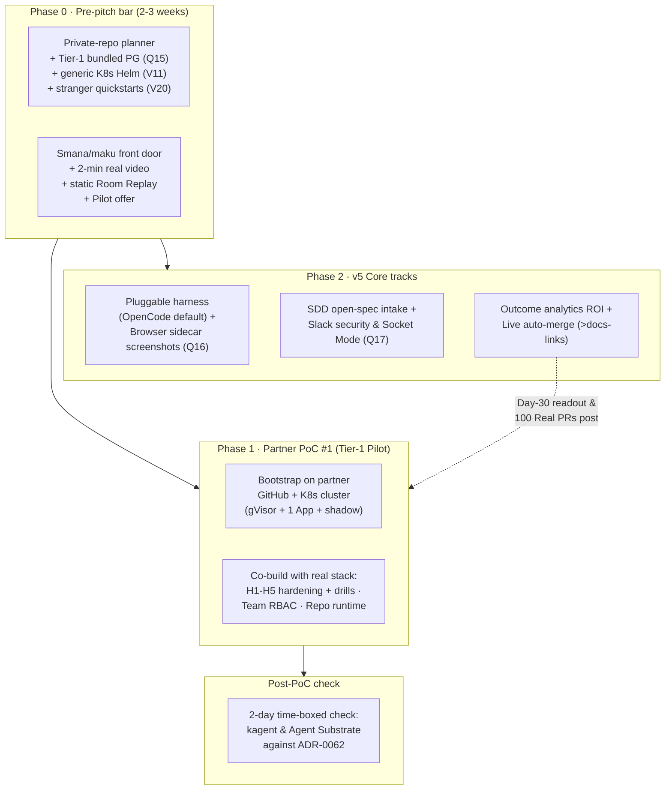

# v5: proven in the field — positioning, partner pilot, and roadmap

**Date:** 2026-11-22 (amended 2026-11-23, 2026-11-25) · **Status:** roadmap approved by the owner 2026-11-22 (decisions [Q1 to Q14](#owner-decisions-2026-11-22)), amended 2026-11-23 ([Q15 to Q17](#owner-decisions-2026-11-23)) and 2026-11-25 ([Q18](#owner-decisions-2026-11-25)) · **Follows:** the [v4 roadmap](2026-10-31-v4-roadmap-design.md), released as `v4.0.0` on 2026-11-21 · **Research:** the [v5 positioning research](2026-11-22-v5-positioning-research.md)

## Outcome and positioning

v4 decoupled Maku from `cloud-native-ref`'s Crossplane, Kueue, `octo-sts`, and `policy-bot` and simplified the developer interface to six MCP tools and Slack. v5 proves Maku **in the field**: one external GitHub and Kubernetes engineering team running Maku on its own private repositories, with what that team needs driving the backlog.

**Positioning lead (Q9):** Maku is a **100% sovereign, Kubernetes-native coding-agent factory (Apache-2.0)** — no third-party SaaS control plane, gVisor isolation per run, gateway-enforced USD budgets, data-class model routing, auditable collaborative rooms, and GitOps-governed earned auto-merge with automatic rollback. It complements local coding agents (Claude Code, Cursor, OpenCode) rather than competing with them on developer laptops.

---

## Owner decisions, 2026-11-22 {#owner-decisions-2026-11-22}

Each decision below was settled during the 2026-11-22 roadmap review and governs priority whenever scope competes.

| # | Area | Decision |
|---|---|---|
| **Q1** | **v5 primary outcome** | Land and succeed with **one real external team PoC** on private repositories, plus minimal public packaging to attract that team. Ruthlessly cut non-PoC work. |
| **Q2** | **Partner qualification** | Strictly qualify PoC #1 on **GitHub (Cloud or Enterprise Server) + Kubernetes** teams. Defer GitLab, Jira, and Linear until after PoC #1 proves the loop. |
| **Q3** | **Product front door** | Make **`Smana/maku`** unmistakably the standalone product front door (rewrite repo description and README, host standalone Helm install and pilot offer with zero `cloud-native-ref` coupling on page 1). Position `Smana/ai-native-ref` and `airef.ogenki.io` as the reference deployment and optional GPU serving showcase. |
| **Q4** | **Pre-pitch bar & sequencing** | Ship a **2–3 week minimal pre-pitch bar** (private-repo planner, one verified generic Kubernetes Helm install, 2–3 outside-user quickstart runs, pilot offer) — then start outreach immediately and co-build H1–H5 hardening, team RBAC, and per-repository runtime images against the partner's real stack. |
| **Q5** | **`kagent` & Agent Substrate** | Keep in v5, downgraded to a **strict 2-day time-boxed check AFTER PoC #1 ships (never before)** against [ADR-0062](https://maku.ogenki.io/docs/decisions/0062-agent-runtime-remains-agent-sandbox/)'s reconsideration triggers. |
| **Q6 / Q6b** | **Harness strategy** | Turn `AgentRun.spec.harness` into a **pluggable 3-tier contract**: **Tier 1** recommended default = `OpenCode`, **Tier 2** proven fallback = `OpenHands`, **Tier 3** best-effort BYO (minimal guarantees, no upstream-churn SLA) = `Claude Code`. Sequence right after the 2–3 week pre-pitch bar so outreach is not delayed. |
| **Q7** | **SDD spec format** | **Ingest open spec formats** (GitHub Spec Kit, OpenSpec, or EARS markdown sections in issues or repository `specs/*.md`) natively when present; **fall back to a minimal, compatible Maku-owned markdown spec** emitted by the planner and scoper when none is present. |
| **Q8** | **Pilot vs. hardened tiers** | Formalize **Tier-1 Pilot** (1 GitHub App, shadow-only merge gate, standard Ingress/HTTPRoute + existing OIDC/GitHub OAuth, `write`-role/Team access, **gVisor strictly mandatory on private company repos**). **Tier-2 Hardened** adds 3 separated GitHub Apps, Cilium FQDN egress, H1–H5 enforcement, and live auto-merge + revert breaker. |
| **Q9** | **Positioning narrative** | Lead with **"100% Sovereign Control Plane + Kubernetes Governance"** (zero US SaaS control plane, EU/DORA/regulated-ready, gateway USD budgets, data-class routing, GitOps earned auto-merge), explicitly complementary to local editors/agents. |
| **Q10** | **Pre-pitch proof assets** | Ship all three inside the 2–3 week pre-pitch bar: rewritten `Smana/maku` front door + pilot collaboration offer, **one crisp 2-minute real-footage walkthrough video**, and a **static read-only Room Replay on GitHub Pages** (zero-install 10-second demo). |
| **Q11** | **v5 Core vs. v5.x** | **Promote to v5 Core:** Outcome Analytics (Day-30 ROI dashboard + "100 Real PRs" proof) and Live Auto-Merge beyond `docs-links` (`deps-patch` or `docs` + second-family reviewer). **Keep as partner-triggered v5.x fast-follows:** Full PR Continuation Loop (inline comments + merge conflicts), first-class `maku takeover` (cloud-to-local), and Review Inbox. |
| **Q12** | **Collaboration model** | Non-commercial Apache-2.0 collaboration (not building a commercial product to sell for now): the maintainer supports bootstrapping the install and collaborates with the team to improve Maku, with optional paid freelance days if the company wants dedicated hands-on integration; the partner pays only their own Kubernetes and model API costs. |
| **Q13** | **How v5 is judged** | Five falsifiable Go criteria covering external private-repo PRs, generic K8s + stranger quickstarts, OpenCode default + SDD live proof, live auto-merge expansion, and the post-PoC 2-day `kagent`/Substrate check (details [below](#how-v5-is-judged)). |
| **Q14** | **Website split (phased)** | Protect the 2–3 week pre-pitch bar: keep `Smana/maku`'s GitHub README + `docs/` as the standalone product front door (using GitHub Pages strictly for the static Room Replay), apply a light homepage/CTA refresh on `airef.ogenki.io` separating Maku standalone from the reference deployment + GPU serving, and defer a dedicated `maku.ogenki.io` Hugo site until after PoC #1. |

## Owner decisions, 2026-11-23 (roadmap challenge) {#owner-decisions-2026-11-23}

Three candidate v5 additions were challenged and settled through an owner grill interview on 2026-11-23, each recorded in its own design specification:

| # | Area | Decision | Spec |
|---|---|---|---|
| **Q15** | **Database adoption** | **Keep PostgreSQL-only** (rejecting SQLite + Litestream and dual-dialect maintenance to preserve T12 DB-enforced immutability and avoid rewriting Maku's 12.3k-LOC store). Cut Week-1 install friction in **Phase 0** by unlocking a **hardened bundled PostgreSQL StatefulSet for Tier-1 Pilot** (1 replica, PVC, TLS, auto-bootstrapped 3 roles, optional S3/GCS backup) plus a **1-step Tier-2 CNPG/external-PG bootstrapper**. | [v5 database adoption design](2026-11-23-v5-database-adoption-design.md) |
| **Q16** | **Harness visual verification (screenshots)** | Add opt-in **Playwright MCP** visual verification in **Phase 2 (v5 Core)** via a dedicated **`maku-browser` sidecar container** inside gVisor `AgentRun` pods (`implementer` + `tester`, per-`Repository` opt-in, **loopback-only** `127.0.0.1`, keeping the ~277 MB OpenCode image slim). **Phase A:** in-loop agent vision self-verification first; **Phase B:** human-visible PR/Room screenshots deferred to a safe-output artifact follow-up. | [v5 harness screenshots design](2026-11-23-v5-harness-screenshots-design.md) |
| **Q17** | **Slack security model** | Evolve `maku-slack` in **Phase 2 (v5 Core)** (Socket Mode pull-forward eligible in Phase 1 if PoC #1 uses Slack) to a **hybrid "personal-bound principal, team-visible rooms"** model: one bot (`xoxb-` only, never Amp-style `xoxp-` user tokens), DM/App Home personal intake + per-person USD budgets + strict author-only thread isolation, **Socket Mode** as Tier-1/sovereign default (zero public ingress; unsigned `forge.push` buttons off by default), **Events API** with **broker-verified raw `X-Slack-Signature`** closing the T12 `maku-slack` forging-deputy residual, and **Invariant 8** (no live steering from Slack) preserved. | [v5 Slack security model design](2026-11-23-v5-slack-security-model-design.md) |

## Owner decisions, 2026-11-25 {#owner-decisions-2026-11-25}

| # | Area | Decision | Spec |
|---|---|---|---|
| **Q18** | **Gemini as a model provider** | **Gemini support is on the roadmap**, tested carefully, Gemini 4 Neon first (owner). The design recommends, for review: a **selectable, public-only** provider (never `agent-default`) with Maku `gemini` (API key) and `vertex` (Vertex AI, Workload Identity, no key) gateway presets; on gcp-0, **Gemini 4 Neon** (`gemini-standard`) and **Gemini 4 Hydrogen** (`gemini-light`) through Vertex `eu`. A paired live comparison against `agent-default` on 10 issues (planner, implementer and reviewer on both harnesses, metering) runs on gcp-0 **after the OpenCode harness trial closes**; its verdict decides a 30+30 trial, a tier, the second-family reviewer seat, or nothing. | [Gemini provider design](2026-11-25-gemini-provider-design.md) |

---

## Phase 0 · Pre-pitch readiness bar (~2–3 weeks)

Everything required before active partner outreach starts. No feature outside this table delays outreach (Q4, Q6b, Q10, Q14).

### Technical bar

| Item | Outcome | Closes |
|---|---|---|
| **Private-repository planner** | `handoff` (MCP/CLI) and Slack planning read private repositories via scoped, short-lived read-only GitHub App tokens and route planning calls over the `internal` model-gateway listener | [status.md](../../../website/content/docs/status.md) known limitation; PoC #1 Day-0 blocker |
| **Tier-1 bundled Postgres & Tier-2 bootstrapper** | Unlock hardened bundled PostgreSQL 16+ StatefulSet (PVC + TLS + auto-3-roles + optional S3 backup) for `profile: pilot`, plus 1-step CNPG/external-PG bootstrapper for Tier-2 (Q15) | [v5 database adoption design](2026-11-23-v5-database-adoption-design.md); removes Day-1 DB friction for `V11` |
| **Generic Kubernetes Helm install** | One recorded Tier-1 install from `Smana/maku`'s umbrella Helm chart on a vanilla cluster (`k3s`, `kubeadm`, or plain EKS/GKE outside `cloud-native-ref`) with both Flux and Argo CD examples, passing smoke tests from the docs alone | v4 roadmap `V11` / `D23` |
| **Outside-user quickstart validation** | At least 2–3 platform engineers other than the owner complete the laptop quickstart from `Smana/maku` docs and log friction; every blocking stumble is fixed | v4 roadmap `V20` |

### Minimal public packaging

| Asset | Home | Purpose |
|---|---|---|
| **Standalone product front door** | `Smana/maku` GitHub description, `README.md`, and `docs/install.md` | Present Maku as a standalone sovereign Kubernetes agent factory with zero `cloud-native-ref` coupling on page 1 (Q3, Q9) |
| **Pilot collaboration offer** | `Smana/maku` (`README.md` / `docs/pilot.md`) + light CTA refresh on `airef.ogenki.io` | Concrete, zero-sales-pitch Apache-2.0 bootstrap collaboration + optional freelance integration days (Q12, Q14) |
| **2-minute real-footage walkthrough** | Embedded on `Smana/maku`, `Smana/ai-native-ref`, and `airef.ogenki.io` | Plain-English handoff → live room steering → PR + reviewer verdict → `$0.25` cost breakdown → merge gate + revert drill (replaces rejected S1/S2 clips; Q10) |
| **Static read-only Room Replay** | GitHub Pages in `Smana/maku` | 2–3 exported real rooms rendered by Maku's static web UI so evaluators inspect timeline, diff, judge decision, cost card, and gate trace in 10 seconds without installing anything (Q10, Q14) |

---

## Tier-1 Pilot vs. Tier-2 Hardened (Q8)

Splitting adoption into two explicit profiles removes Week-1 corporate friction without compromising sandbox isolation on private code.

| Control | Tier-1 Pilot (PoC Week 1–4) | Tier-2 Hardened Production |
|---|---|---|
| **Sandbox isolation** | **gVisor strictly mandatory** on private repositories (non-negotiable) | Dedicated gVisor node pool + warm headroom (`agents-headroom`) |
| **GitHub identity** | **1 GitHub App** (`apps.merger.mode: factory`) | **3 separated GitHub Apps** (Agents, Factory, dedicated Merger App) |
| **Merge posture** | **100% human-approved merges**; `MergePolicy` in **shadow mode** only | Earned **live auto-merge** on proven classes with daily caps + revert breaker |
| **Database** | **Hardened bundled PostgreSQL 16+** StatefulSet (1 replica, PVC, TLS, auto-3-roles, T12 intact, optional S3/VolumeSnapshot backup) (Q15) | **External HA PostgreSQL 16+** (CNPG Cluster / RDS / Cloud SQL) via 1-step bootstrapper + multi-replica broker HA (T12 + HA) |
| **Ingress & TLS** | Standard Kubernetes Ingress or Gateway API `HTTPRoute` with org TLS; **Slack Socket Mode** (zero public ingress, unsigned `forge.push` buttons off by default) (Q17) | Private tailnet / internal Gateway + PKI certificates; optional Slack **Events API** with broker-verified `X-Slack-Signature` (closes T12 Slack deputy) |
| **Auth & team RBAC** | Existing OIDC (Okta, Entra ID, Keycloak, ZITADEL) or GitHub OAuth; GitHub `write` role / Teams / `CODEOWNERS` | Hardened OIDC + org group mapping + admin separation |
| **Network egress** | Default-deny `NetworkPolicy` + egress proxy | Cilium FQDN egress policy (closes DNS-tunnelling residual) |
| **Input hardening** | Co-enabled with partner during PoC (H1–H5) | Full H1–H5 enforcement + scheduled Promptfoo injection red-team drills |

---

## Phase 1 · Partner PoC co-builds (built with the team's real stack)

Once outreach lands PoC #1, these three P0 tracks execute against real private repositories rather than synthetic guesses (Q4):

1. **Untrusted-input hardening (H1–H5) & injection red-team drills:** finish and enable safe-output enforcement, output threat detection, author-trust filtering, and protected files (`AGENTS.md`, CI workflows, manifests) per the [hardening design](2026-11-07-untrusted-input-hardening-design.md), and run the nightly Promptfoo suite against Maku's agent roles.
2. **Team-ready RBAC & multi-user validation:** support GitHub `write` access + GitHub Teams / `CODEOWNERS` + OIDC group claims instead of Maintain/Admin + manual `agents-member` assignment; close the untested multi-user/non-maintainer validation cases (L10/L11/L15/L16, W5-untrusted, M7 authz).
3. **Per-repository runtime environments (80/20 parity):** add lightweight `spec.runtime.image` (or `devcontainer.json` base extraction) plus optional setup command and dependency cache volume on the `Repository` CRD so partner languages and test suites (Node, Python, Java, Rust, etc.) run cleanly inside gVisor.

---

## Phase 2 · v5 Core tracks

Each track runs in dependency order alongside or immediately following Phase 0/1, without delaying partner outreach.

| Track | Scope & design boundary | Reference |
|---|---|---|
| **1. Pluggable 3-tier harness** | Stabilize `AgentRun.spec.harness` with **Tier 1** recommended default = `OpenCode` (slim image, Maku stuck-loop detector over normalized events, SSE room bridge, provider/cache parity), **Tier 2** proven fallback = `OpenHands`, **Tier 3** best-effort BYO (minimal guarantees, no upstream-churn SLA) = `Claude Code` (Q6/Q6b). | [OpenCode research](2026-11-15-opencode-harness-research.md), [OpenCode design](2026-11-15-opencode-harness-design.md) |
| **2. Spec-driven development (SDD) intake** | Ingest open markdown spec formats (**GitHub Spec Kit**, **OpenSpec**, or **EARS** sections in GitHub issues or repository `specs/*.md`) natively when present; fall back to a minimal, compatible Maku markdown spec (Goal, Acceptance Criteria, Constraints, Out-of-Scope, Verification) emitted by the planner and scoper when absent (Q7). | Feeds Scoper → Tester → Implementer → Judge → Reviewer |
| **3. Outcome analytics & Day-30 ROI dashboard** | Join already-collected PR outcomes, duration, human wait, reverts, and role/identity USD costs into one Grafana/broker view by repository, policy class, model, and workflow (`quick` / `standard` / `careful`). Powers both the partner Day-30 readout and the public "100 Real PRs" empirical report (Q11). | Built on existing Maku metrics & [workflows review](2026-11-14-workflows-review-design.md) |
| **4. Live auto-merge beyond `docs-links`** | Unblock M8 and prove at least one engineering class (`deps-patch` Renovate adoption or `docs`) in `live` mode with a recorded revert drill and a second-family reviewer (Q11). | [ADR-0058](https://maku.ogenki.io/docs/decisions/0058-reviewer-on-another-model/), [results](../../runbooks/agent-factory/results-aws-0-2026-11-16.md) |
| **5. Time-boxed `kagent` & Agent Substrate check** | Strictly **after PoC #1 ships**, spend at most **2 days** re-evaluating current releases against [ADR-0062](https://maku.ogenki.io/docs/decisions/0062-agent-runtime-remains-agent-sandbox/)'s triggers (non-bypassable OSS auth, attributed rooms, delegated approvers, EKS/GKE Spot recovery, net code deletion). Adopt, borrow, or keep deferring (Q5). | [ADR-0062](https://maku.ogenki.io/docs/decisions/0062-agent-runtime-remains-agent-sandbox/) |
| **6. Harness visual verification (screenshots)** | Opt-in `maku-browser` sidecar inside gVisor pods (`implementer` + `tester`, per-`Repository` opt-in, loopback-only `127.0.0.1`, Playwright MCP `--isolated`, zero base-image bloat). Phase A: in-loop vision self-verification; Phase B: human-visible PR/Room screenshots deferred (Q16). | [v5 harness screenshots design](2026-11-23-v5-harness-screenshots-design.md), [OpenCode design](2026-11-15-opencode-harness-design.md) |
| **7. Slack security model & personal-bound principals** | Hybrid "personal-bound principal, team-visible rooms": bot-only (`xoxb-`), DM/App Home intake + dynamic per-user repos + per-person USD budgets, strict author-only thread isolation, Socket Mode default (zero public ingress) + Events API broker-verified `X-Slack-Signature` closing T12 deputy, Invariant 8 preserved (Q17). | [v5 Slack security model design](2026-11-23-v5-slack-security-model-design.md), [Slack push-approval design](2026-11-05-v3x-slack-push-approval-design.md) |
| **8. Gemini as a model provider** | Selectable, public-only Gemini through the model gateway: `gemini` and `vertex` presets, thought signatures carried end to end, `model:<alias>` pin, `evaluation.treatmentModel`, `maku stages --by model`; Vertex via Workload Identity on gcp-0; paired comparison against `agent-default` (Q18). | [Gemini provider design](2026-11-25-gemini-provider-design.md), [plan](../plans/2026-11-25-gemini-provider-plan.md) |

---

## Order of work

---

## Partner-triggered v5.x fast-follows and explicit non-goals

### Partner-triggered v5.x (pull in immediately if PoC #1 hits them)

- **Full PR continuation loop:** react to inline review threads, bot comments (capped), and automatic merge-conflict rebasing.
- **First-class cloud-to-local handoff (`maku takeover`):** elevate `room_checkout` out of `--advanced` so a developer pulls a stalled task's branch, condensed room brief, and failing checks directly into local Claude Code / OpenCode / Cursor.
- **Review inbox & risk-ranked queue:** one cross-repository queue prioritized by risk, class, and wait time once agent PR volume exceeds ~15–20 PRs/week.

### Explicitly out of v5 (deferred until after PoC #1)

- **GitLab, Jira, and Linear integrations** (PoC #1 is strictly qualified on GitHub + Kubernetes, Q2).
- **Dedicated `maku.ogenki.io` Hugo website** (initially deferred until after PoC #1, Q14).
  - *Amendment (2026-11-27):* Launched `https://maku.ogenki.io/` ahead of PoC #1 in `Smana/maku` (see [`Smana/maku/docs/superpowers/specs/2026-11-27-maku-website-design.md`](https://github.com/Smana/maku/blob/main/docs/superpowers/specs/2026-11-27-maku-website-design.md)) so external teams evaluating a Tier-1 Pilot have one cohesive Ogenki-themed product front door, interactive `/demo/` room replay, 12-chapter User Guide, and product ADRs (`0041`–`0062`), while `airef.ogenki.io` slims down to Self-hosted GPU Model Serving, Maku-on-CNR reference deployment, Host contract, 7 serving/host ADRs, and Reference Status with cross-domain redirect stubs for all moved URLs.
- **Fleet campaigns across N repositories** and **event/cron trigger expansion** (reopen once single-repo PoC + hardening are proven).
- **Self-hosted GPU serving improvements** (optional showcase in `ai-native-ref`, not part of Maku's pilot path).
- **Commercial / open-core productization, multi-team billing/tenancy, SIEM audit export, reviewed repository memory, and signed provenance** (reopen only when field adoption creates concrete demand, Q12).

---

## How v5 is judged {#how-v5-is-judged}

v5 is complete when all five criteria hold with recorded evidence (Q13):

| # | Criterion | Go when |
|---|---|---|
| **1** | **External team private-repo pilot** | At least one external GitHub + Kubernetes team runs Maku (Tier-1 Pilot with mandatory gVisor) on its own private repositories and lands **≥10 real merged pull requests**, with measured cost per merged PR, merge rate, and revert rate recorded |
| **2** | **Installability outside `cloud-native-ref`** | One generic Kubernetes Helm install (V11) passes its smoke test from docs alone, and **≥2 outside users** complete the laptop quickstart (V20) with friction logged and resolved |
| **3** | **Pluggable harness + SDD live proof** | `OpenCode` passes the parity bar as the Tier-1 default behind `AgentRun.spec.harness` (with `OpenHands` retained as fallback and minimal BYO `Claude Code` documented/wired), and SDD open-spec ingestion + Maku fallback spec are proven end to end |
| **4** | **Earned auto-merge beyond `docs-links`** | At least one engineering policy class (`deps-patch` or `docs`) is proven in `live` mode with a recorded revert drill and a second-family reviewer |
| **5** | **Runtime re-check closed** | After Criterion 1 ships, the strict 2-day `kagent` and Agent Substrate check against [ADR-0062](https://maku.ogenki.io/docs/decisions/0062-agent-runtime-remains-agent-sandbox/) is recorded with a clear adopt / borrow / defer verdict |

---

## Collaboration model (Q12)

Maku and `ai-native-ref` stay **Apache-2.0 open source** with no commercial SaaS or enterprise license pitch attached to v5. For an external team willing to run PoC #1 on real repositories:

- **What the team owns:** its own Kubernetes cluster (with gVisor), GitHub repositories, and model API keys/bills.
- **What the maintainer provides:** best-effort open-source support to bootstrap Tier-1 Pilot and collaborate directly with the team to fix friction and prioritize v5 co-builds — with **optional dedicated freelance days** if the company wants hands-on integration work.
- **What both sides get:** the team gets a 100% sovereign, zero-seat-tax coding-agent factory on its own infrastructure; Maku gets real private-repo validation, friction logs, and (where acceptable to the partner) anonymized unit-economics metrics.
