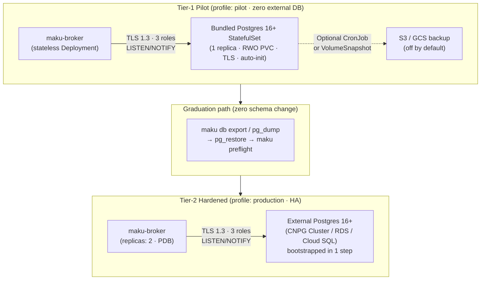

# v5 Database Strategy: Challenging SQLite/Litestream and Removing PostgreSQL Adoption Friction

**Date:** 2026-11-23 · **Status:** approved through owner grill interview 2026-11-23 (decisions [DB1 to DB6](#owner-decisions)) · **Track:** [v5 roadmap](2026-11-22-v5-roadmap-design.md) Phase 0 (Pre-pitch bar) · **Related:** [ADR-0044](../../../website/content/docs/decisions/0044-room-session-protocol.md), [v4 production path](2026-11-12-v4-production-path-design.md)

*Paths: `maku/…` refers to the `Smana/maku` repository inspected on 2026-11-23; everything else is this repository.*

---

## 1. Outcome and problem statement

Maku's current production install path imposes heavy Day-1 database friction. Under `profile: production`, the umbrella chart refuses its bundled PostgreSQL (`postgres.enabled: false` required) and forces every adopter to bring PostgreSQL 16 or later, manually create three fixed login roles (`rooms_owner`, `rooms_broker`, `rooms_retention`), configure TLS CA validation, wire three separate DSN Secrets plus `caSecret`, and configure database egress NetworkPolicies before running a single task (`maku/docs/database.md`, `maku/docs/install.md`).

To improve adoption and simplify installation for v5, we challenged the database choice head-on — specifically evaluating **SQLite + Litestream** (and distributed SQLite alternatives) against Maku's real storage layer and security invariants.

**Verdict:** Keep **PostgreSQL-only**, preserve **T12 DB-enforced audit immutability** in both Tier-1 Pilot and Tier-2 Hardened, avoid a permanent dual-dialect maintenance tax on Maku's 12,358-LOC store, and eliminate Week-1 friction directly in Phase 0 by:

1. **Unlocking a hardened bundled PostgreSQL StatefulSet for Tier-1 Pilot** (`profile: pilot` / `postgres.mode: bundled`): single replica with PVC, mandatory TLS, automatic 3-role + DSN Secret bootstrap, default-deny NetworkPolicy, and optional S3/GCS backup (working out of the box on PVC alone).
2. **Shipping a 1-step Tier-2 bootstrapper** for external and CloudNativePG (CNPG) databases (`maku install --print --db cnpg` and a `maku-db-bootstrap` Job for RDS/Cloud SQL/Azure), with a documented `pg_dump` / `pg_restore` graduation path from Tier-1 to Tier-2.

---

## 2. Owner decisions, 2026-11-23 {#owner-decisions}

| # | Area | Decision |
|---|---|---|
| **DB1** | **Database engine** | **Keep PostgreSQL-only.** Do not replace PostgreSQL with SQLite + Litestream and do not maintain a dual SQLite/PostgreSQL backend. |
| **DB2** | **Invariants by tier** | **Tier-1 Pilot** may relax HA (1 PostgreSQL replica; brief upgrade or node-drain downtime accepted) while **preserving T12 DB-enforced immutability** (3 roles, column `GRANT`s, RLS, immutable triggers). **Tier-2 Hardened** requires both T12 and multi-replica HA. |
| **DB3** | **Tier-1 zero-external-DB path** | Promote Maku's existing bundled PostgreSQL template (`maku/charts/agent-factory/templates/postgres.yaml`) into a **hardened bundled StatefulSet** allowed under Tier-1 Pilot (`PVC` + `TLS` + auto-bootstrapped 3 roles + auto-wired DSN Secrets). |
| **DB4** | **Backups in Tier-1 Pilot** | **Optional.** Tier-1 Pilot works out of the box with PVC-only (plus documented Kubernetes `VolumeSnapshot` guidance), and supports optional scheduled S3/GCS backups when an object store is configured. |
| **DB5** | **Tier-2 adoption path** | Provide a **1-step CNPG `Cluster` generator** in `maku install --print` and a **1-step external-PG role bootstrapper Job** for RDS / Cloud SQL / Azure Flexible Server so "bring your own PG" no longer requires hand-crafted SQL or three manual DSN Secrets. |
| **DB6** | **v5 sequencing** | Land in **Phase 0 (Pre-pitch bar)** to unblock the generic Kubernetes Helm install (`V11`) and PoC #1 Week-1 bootstrap without delaying outreach. |

---

## 3. Research and codebase audit: why SQLite + Litestream was challenged and rejected

### 3.1 What Maku's store actually depends on

Auditing `maku/internal/store` (`*.go` and 18 SQL migrations under `maku/internal/store/migrations/`) shows **12,358 lines** tightly engineered around PostgreSQL 16+ capabilities:

| Capability | Where used in Maku | Why it exists |
|---|---|---|
| **3 login roles + column `GRANT`s** | `rooms_owner`, `rooms_broker`, `rooms_retention` across all 18 migrations; verified at startup (`maku/internal/store/check_test.go`) | **T12 boundary:** a compromised `maku-broker` process cannot `UPDATE`/`DELETE` events, unseal a room, rewrite `binding_branch` or `bundle_digest`, or bypass schema ownership |
| **Row-Level Security (RLS)** | `rooms`, `events` (`20260927120000_rooms.sql`) | `rooms_retention` can only `SELECT`/`DELETE` rows where `sealed AND closed_at < now() - retention`; startup refuses `SUPERUSER` or `BYPASSRLS` |
| **PL/pgSQL & deferred constraint triggers** | `rooms_move_forward`, `rooms_seq_has_event` (`DEFERRABLE INITIALLY DEFERRED`), `events_take_next_seq`, `events_are_immutable`, `approvals_are_their_events`, `queue_is_its_event` | Enforces gapless per-room `seq`, forward-only seals, and 1:1 correspondence between state tables (`approvals`, `queue`) and immutable room-log events |
| **Row locks + DB clock fencing** | `SELECT … FOR UPDATE`, `now()` inside `store.Decide` (`maku/internal/store/approvals.go`) | Single-decision race fence across concurrent web/Slack clicks and broker replicas, independent of pod clock skew |
| **`LISTEN` / `NOTIFY`** | `rooms_events` channel (`maku/internal/store/listen.go`, [ADR-0044](../../../website/content/docs/decisions/0044-room-session-protocol.md)) | Transaction-ordered wake-up fan-out across `replicas: 2` broker pods with zero external message broker |
| **Native Postgres types & indexes** | `jsonb`, `text[]`, `timestamptz`, `interval`, regex `CHECK (~)`, partial indexes, 8 MiB `output_bundles` | Compact schema, strict DB-enforced envelope validation, and indexed broker/retention sweeps |

Throughput reality: a team running 10–100 PRs/day generates modest write load (~1–10 writes/sec steady state, ~50 writes/sec burst) and tens to hundreds of megabytes of room history. Throughput is **not** why SQLite falls short — **security invariants (T12), operational topology, and solo-maintainer dialect cost** are.

### 3.2 Candidate comparison matrix

| Option | Install friction (Tier-1) | Preserves T12 (roles / RLS / triggers)? | Multi-replica broker HA (`LISTEN/NOTIFY`)? | Backups & DR | Engineering & maintenance cost | Verdict |
|---|---|---|---|---|---|---|
| **A. Hardened bundled PG (Tier-1) + External/CNPG PG + bootstrapper (Tier-2)** | **Low** (`helm install`, zero external DB) | **Yes** (100% identical in Tier-1 & Tier-2) | **Tier-1:** 1 PG replica, 1–2 broker replicas (`LISTEN/NOTIFY` works) · **Tier-2:** full HA | PVC-only default + optional S3/GCS `pg_dump` or `VolumeSnapshot`; CNPG/RDS native in Tier-2 | **Low** (~200 lines of chart/Job work; **0 lines** of Go store rewrite) | **Selected (DB1–DB6)** |
| **B. SQLite + Litestream (replace PG everywhere)** | Very low (embedded in broker) | **No** — no roles/RLS; compromised broker owns DB file & can `DROP TRIGGER` | **No** — single-replica RWO StatefulSet; downtime on every deploy/Spot drain; loses `LISTEN/NOTIFY` | Litestream is **DR, not HA** (async WAL → RPO > 0, pod-restart restore RTO) and still adds an S3 + credentials + egress seam | **Very high** — rewrites 12,358 LOC store + 18 migrations; breaks `ai-native-ref` / CNPG | **Rejected** |
| **C. Dual backend (SQLite Tier-1 + PG Tier-2)** | Very low in Tier-1 | Relaxed in Tier-1, kept in Tier-2 | Single replica in Tier-1, HA in Tier-2 | Litestream in Tier-1, PG backups in Tier-2 | **High permanent tax** — two SQL dialects, two migration trees, two test matrices for a solo maintainer | **Rejected** |
| **D. Distributed SQLite (`rqlite` / `dqlite`)** | Medium (3-pod Raft cluster) | **No** — no Postgres roles, RLS, or PL/pgSQL constraint triggers | Raft write consensus; no `LISTEN/NOTIFY`; unfamiliar to enterprise K8s teams | Raft snapshots + S3 | **Very high** — full store rewrite + Raft operational surface | **Rejected** |
| **E. External PG only + CNPG/Job bootstrapper** | Medium (still requires external PG or CNPG operator pre-installed) | **Yes** | **Yes** | Operator/managed DB | Low, but leaves vanilla `k3s`/`kubeadm` pilots without a zero-prereq install | **Folded into Option A (Tier-2)** |

### 3.3 Why bundled PostgreSQL beats SQLite + Litestream on Maku's actual goals

1. **Zero compromise on sovereign audit positioning (Q9):** Regulated European and platform teams evaluating Maku specifically value that a compromised broker pod cannot rewrite its own audit trail. Hardened bundled Postgres preserves T12 from Minute 1 of a Tier-1 Pilot.
2. **Already 70% built:** `maku/charts/agent-factory/templates/postgres.yaml` already ships a 126-line non-root StatefulSet with a PVC and `rooms-db-init` creating `rooms_owner`, `rooms_broker`, and `rooms_retention`. The only reasons `profile: production` currently rejects it are missing TLS, missing optional backups, and single-replica HA.
3. **Cleaner broker lifecycle:** Even with a single Postgres replica in Tier-1, `maku-broker` remains a **stateless Deployment** (fast rolling upgrades, 1–2 replicas sharing `LISTEN/NOTIFY`), rather than turning the broker itself into a stateful RWO pod that suffers volume attach/detach downtime on every Maku release.
4. **Fits Phase 0's 2–3 week bar (Q4):** Hardening the bundled chart and adding a bootstrapper takes days, not weeks, directly accelerating `V11` (generic Kubernetes Helm install) without delaying PoC #1 outreach.

### 3.4 Reconsideration triggers

Reopen SQLite (or an embedded backend) only if **either** of these occurs:
- Maku ships a **single-binary, Kubernetes-free laptop or edge mode** (`maku local`) where running a PostgreSQL container is unacceptable and T12 is explicitly out of scope.
- A future architecture decision formally retires PostgreSQL-enforced T12 in favor of an external WORM audit sink (e.g., signed transparency log) and accepts a single-replica broker topology.

---

## 4. Architecture: two-tier PostgreSQL adoption ladder

### 4.1 Chart profiles and database modes

Introduce an explicit `pilot` profile (aligning the umbrella chart with [v5 roadmap Q8](2026-11-22-v5-roadmap-design.md)) and replace the boolean `postgres.enabled` with an explicit `postgres.mode` (keeping `postgres.enabled` mapped cleanly for backwards compatibility):

| Chart profile | Allowed `postgres.mode` | TLS (`sslmode=verify-full`) | T12 roles / RLS / triggers | Broker HA | Install banner note |
|---|---|---|---|---|---|
| `demo` | `bundled` (ephemeral/local) | Optional | Enforced | 1 replica | `demo_profile` |
| `pilot` (Tier-1) | `bundled` (default) or `external` | **Required** (auto-provisioned in `bundled`) | **Enforced** | Stateless broker; 1 PG replica (`db_single_replica`) | `db_single_replica` (and `db_backups_off` when backup CronJob is disabled) |
| `production` (Tier-2) | `external` only (CNPG / RDS / Cloud SQL) | **Required** | **Enforced** | Multi-replica broker + HA PG | None |

In `profile: pilot` with `postgres.mode: bundled`, the user configures **zero database Secrets and zero SQL commands**. The chart renders everything required to pass `maku preflight`'s `database` check out of the box.

### 4.2 Hardened bundled PostgreSQL StatefulSet (`postgres.mode: bundled`)

Extends `maku/charts/agent-factory/templates/postgres.yaml` with five production-hygiene additions:

1. **TLS 1.3 by default:**
   - When `tls.issuer` (cert-manager `ClusterIssuer` / `Issuer`) is configured, render a `Certificate` for `rooms-db.<namespace>.svc.<clusterDomain>` and mount its CA Secret as `broker.database.caSecret`.
   - When cert-manager is absent on a vanilla cluster, support an operator-supplied TLS Secret (`postgres.bundled.tls.existingSecret`) or a Helm-generated self-signed CA + server cert persisted in a Kubernetes Secret (`lookup` or pre-install hook, documented for GitOps).
   - PostgreSQL starts with `ssl=on`, `ssl_min_protocol_version='TLSv1.3'`, `password_encryption=scram-sha-256`, and `pg_hba.conf` requiring `hostssl` for all non-loopback connections.
2. **Automatic 3-role & DSN Secret wiring:**
   - A Helm-managed (or `maku install --print`-generated) password Secret seeds `postgres`, `rooms_owner`, `rooms_broker`, and `rooms_retention`.
   - `rooms-db-init` creates the three roles (zero `SUPERUSER`, `CREATEROLE`, `CREATEDB`, `BYPASSRLS`) and `rooms` database on first boot.
   - The chart renders the three DSN Secrets (`rooms-owner-dsn`, `rooms-broker-dsn`, `rooms-retention-dsn`) automatically with `sslmode=verify-full&sslrootcert=/etc/room-broker/db-ca/ca.crt`, eliminating manual DSN assembly.
3. **Network & Pod Security hardening:**
   - Default-deny `NetworkPolicy` (and `CiliumNetworkPolicy` in `cilium` mode): ingress on `:5432` **only** from `maku-broker` (including its `migrate` init container), `room-broker-retention`, `maku-preflight`, and the optional backup CronJob; egress denied except DNS (and object storage only when backups are enabled).
   - Restricted `PodSecurityContext`: `runAsNonRoot: true`, `runAsUser: 999`, `fsGroup: 999`, `allowPrivilegeEscalation: false`, `capabilities: {drop: [ALL]}`, `seccompProfile: {type: RuntimeDefault}`, explicit CPU/memory requests & limits, digest-pinned official PostgreSQL 16+ image.
4. **Persistence & safe upgrades:**
   - RWO `volumeClaimTemplates` with configurable `storageClassName` and size (default `20Gi`).
   - `maku-broker` startup checks (`maku/docs/database.md`) run unchanged, proving T12 and schema currency on every start.
5. **Optional backups (DB4):**
   - **Default (`postgres.bundled.backup.enabled: false`):** Works immediately on PVC-only; install docs provide a ready-to-copy `VolumeSnapshot` example for CSI drivers that support snapshots, and the install banner surfaces `db_backups_off` as an informational reminder (never blocking `preflight`).
   - **Optional S3/GCS backup (`postgres.bundled.backup.enabled: true`):** Renders a scheduled `CronJob` (default daily `02:15 UTC`) running `pg_dump --format=custom --no-owner` under a dedicated read-only backup role (`rooms_backup`, granted `SELECT` on `public` tables, no `SUPERUSER` or write privileges) and uploading encrypted dumps to an S3-compatible or GCS bucket via workload identity or a Secret, with explicit retention count and restore instructions tested in CI.

### 4.3 Tier-2 1-step bootstrapper (CNPG and managed PostgreSQL)

For teams already running CloudNativePG or managed Postgres (RDS, Cloud SQL, Azure Flexible Server):

1. **CNPG generator (`maku install --print --db cnpg`):**
   - Emits a complete, constitution-compliant `Cluster` (`postgresql.cnpg.io/v1`, PostgreSQL 16+, `instances: 2` or `3`, `managed.roles` for `rooms_owner`, `rooms_broker`, `rooms_retention`, `Database` owned by `rooms_owner`, TLS CA wired to `caSecret`, and optional Barman/object-store backup stanza) plus the corresponding `ExternalSecret` or Secret templates.
2. **External-PG bootstrap Job (`maku-db-bootstrap` / `maku db bootstrap`):**
   - Accepts a one-time admin DSN (supplied interactively or via a temporary Secret that is deleted after completion) and idempotently executes:
     - `CREATE ROLE` for `rooms_owner`, `rooms_broker`, `rooms_retention` with generated `scram-sha-256` passwords;
     - Automatic detection of non-superuser cloud admins (RDS/Cloud SQL/Azure): runs `GRANT rooms_owner TO CURRENT_USER;` automatically before `CREATE DATABASE rooms OWNER rooms_owner;` (eliminating the manual Postgres 16 cloud gotcha in `maku/docs/database.md`);
     - `GRANT CREATE, USAGE ON SCHEMA public TO rooms_owner;`;
     - Verifies none of the three roles holds `SUPERUSER`, `CREATEROLE`, `CREATEDB`, or `BYPASSRLS`;
     - Outputs the three Kubernetes DSN Secrets (`rooms-owner-dsn`, `rooms-broker-dsn`, `rooms-retention-dsn`) ready for Helm/Flux/Argo CD.

### 4.4 Tier-1 to Tier-2 graduation path

Because both tiers run identical PostgreSQL 16+ schemas and roles, migrating from Tier-1 bundled Postgres to Tier-2 CNPG/RDS/Cloud SQL requires **zero schema translation**:

1. Scale `maku-broker` and `maku-factory` to `0` (maintenance window, typically <5 minutes).
2. Run `pg_dump --format=custom --no-owner` against `rooms-db`.
3. Bootstrap the Tier-2 target via CNPG manifest or `maku db bootstrap`.
4. Run `pg_restore` into the Tier-2 `rooms` database as `rooms_owner` and apply `maku-broker migrate` (verifies `room_broker_revisions`).
5. Switch umbrella values from `profile: pilot` + `postgres.mode: bundled` to `profile: production` + `postgres.mode: external`, re-enable workloads, and run `maku preflight`.

---

## 5. Security analysis and residuals

| Risk | Control | Residual |
|---|---|---|
| Compromised `maku-broker` rewrites room history (T12) | Identical in Tier-1 and Tier-2: 3 separated PG roles, column `GRANT`s, RLS, immutable PL/pgSQL triggers, startup `BYPASSRLS` check | None added vs. existing Tier-2 design |
| Plaintext DB traffic or credential sniffing | `ssl=on`, `TLSv1.3`, `hostssl` in `pg_hba.conf`, `sslmode=verify-full` + `caSecret` mandatory in `pilot` and `production` | None on the wire |
| Lateral access to bundled Postgres from run pods | Default-deny `NetworkPolicy` / `CiliumNetworkPolicy` admits `:5432` only from broker, retention job, preflight, and backup job; runs live in separate `agents` namespace | Requires CNI NetworkPolicy enforcement (already checked by `run-path` preflight) |
| Data loss on PVC failure in Tier-1 Pilot | Optional S3/GCS backup CronJob + documented CSI `VolumeSnapshot` + `db_backups_off` install banner when off | If a Tier-1 team leaves backups off and loses the underlying disk, room history is lost (code and PRs remain safely on GitHub) |
| Node drain or PG upgrade downtime in Tier-1 Pilot | `db_single_replica` banner documents Tier-1 RTO explicitly; `maku-broker` reconnects automatically after PG restart; Tier-2 graduation removes SPOF | 30 s–3 min downtime during PG pod reschedule in Tier-1 Pilot |
| Admin credential persistence after Tier-2 bootstrap | `maku db bootstrap` uses a one-time admin DSN never mounted by the broker, factory, or retention job | Operator must delete any temporary bootstrap Secret after running the Job |

---

## 6. Acceptance criteria (Phase 0)

| # | Criterion | Verification |
|---|---|---|
| **AC1** | **Zero-external-DB Tier-1 Pilot install** | `helm install` with `profile: pilot` and `postgres.mode: bundled` on a vanilla `k3s` / `kubeadm` / EKS / GKE cluster passes `maku preflight` (including `database` check, TLS `verify-full`, and T12 role/RLS checks) with zero manual SQL or manual DSN Secrets |
| **AC2** | **T12 parity proved on bundled Postgres** | Existing `maku/internal/store` immutability, RLS, and role-enforcement test suites pass against the bundled Postgres instance |
| **AC3** | **Network isolation proved** | Negative control confirms an `agents` run pod and an arbitrary pod in the release namespace cannot connect to `rooms-db:5432` |
| **AC4** | **Optional backup & restore drill** | Enabling `postgres.bundled.backup.enabled: true` against an S3-compatible endpoint produces a dump that restores cleanly into a fresh Postgres 16+ instance and passes `maku preflight` |
| **AC5** | **Tier-2 bootstrapper parity** | `maku install --print --db cnpg` renders a valid CNPG `Cluster` + roles; `maku db bootstrap` succeeds against a simulated non-superuser cloud admin (RDS/Cloud SQL semantics) and passes `maku preflight` |
| **AC6** | **Profile gate enforcement** | `profile: production` continues to refuse `postgres.mode: bundled` at Helm render time; `profile: pilot` surfaces `db_single_replica` (and `db_backups_off` when backups are off) on the install banner |
| **AC7** | **Zero Go store regression** | Zero changes to Maku's PostgreSQL dialect, migrations, or `LISTEN/NOTIFY` path; all existing `maku` and `ai-native-ref` CI suites stay green |
