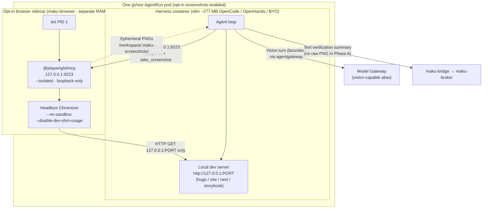

# v5 Harness Visual Verification: Opt-in Browser Sidecar and Playwright MCP

**Date:** 2026-11-23 · **Status:** approved through owner grill interview 2026-11-23 (decisions [VS1 to VS7](#owner-decisions)) · **Track:** [v5 roadmap](2026-11-22-v5-roadmap-design.md) Phase 2 (v5 Core, following OpenCode harness cutover) · **Closes:** [OpenCode harness design](2026-11-15-opencode-harness-design.md) H14 / §10 future work · **Related:** [untrusted-input hardening](2026-11-07-untrusted-input-hardening-design.md)

---

## 1. Outcome and problem statement

When Maku agents edit web applications, dashboards, component libraries, or Hugo documentation sites, unit tests and builds confirm compilation but miss visual regressions — broken layouts, overlapping elements, missing CSS bundles, or unreadable dark/light themes.

This specification adds **opt-in browser inspection and screenshot capability** to Maku's sandboxed `AgentRun` pods without compromising Maku's core invariants:

- **No base-image bloat:** The default ~277 MB OpenCode harness image stays slim for non-UI repositories.
- **No egress widening:** The headless browser visits **loopback (`127.0.0.1` / `localhost`) only** — dev servers started inside the same sandbox pod. Zero new network egress rules, zero SSRF, zero external CDN or staging leaks.
- **Harness-agnostic:** Exposed over **Playwright MCP** (`@playwright/mcp`), working identically across Tier-1 `OpenCode`, Tier-2 `OpenHands`, and Tier-3 BYO `Claude Code`.
- **Phased artifact scope:** **Phase A** delivers in-loop agent visual self-verification (ephemeral screenshots in `/workspace`, zero blob store required). **Phase B** adds human-visible PR and Room UI screenshots once a bounded safe-output artifact pipeline is in place.

---

## 2. Owner decisions, 2026-11-23 {#owner-decisions}

| # | Area | Decision |
|---|---|---|
| **VS1** | **Phased consumers** | **Phase A:** In-loop agent visual self-verification first (ephemeral PNGs in `/workspace` inspected by a vision-capable model). **Phase B:** Human-visible Room UI and PR screenshots once a dedicated safe-output artifact store is wired. |
| **VS2** | **Packaging** | **Opt-in `browser` sidecar container** inside the gVisor `AgentRun` pod, enabled per `Repository` CRD, sharing pod loopback `127.0.0.1` with its own isolated CPU/memory limits. |
| **VS3** | **Network boundary** | **Loopback-only (`127.0.0.1` / `localhost`).** The browser renders only local dev servers started inside the sandbox. Zero egress widening and zero external URLs. |
| **VS4** | **Tool interface** | **Playwright MCP** (`@playwright/mcp`) over loopback, providing accessibility-tree snapshots (`browser_snapshot`) + `browser_take_screenshot`, running `--isolated` with unsafe JS evaluation disabled. |
| **VS5** | **Allowed roles** | **`implementer` and `tester` only** in Phase A. `triager`, `scoper`, and `reviewer` do not receive the browser sidecar. |
| **VS6** | **gVisor compatibility** | Run Chromium headless inside gVisor (`runsc`) with `--no-sandbox`, `--disable-setuid-sandbox`, `--disable-dev-shm-usage`, `--disable-gpu`, dedicated writable `/tmp` `emptyDir`, and `tini` as PID 1 to reap renderer processes cleanly. |
| **VS7** | **v5 sequencing** | Land in **Phase 2 (v5 Core)** immediately after OpenCode harness stabilization, without delaying Phase 0 outreach. |

---

## 3. Architecture



### Why an opt-in sidecar beats alternatives

| Packaging option | Base image impact | Memory/OOM isolation | Multi-harness support | Verdict |
|---|---|---|---|---|
| **Opt-in `browser` sidecar (`maku-browser`)** | **0 MB** on default harness (~277 MB preserved) | **Isolated** container `limits.memory` — Chromium OOM cannot kill or corrupt harness checkpointing | **Identical** across OpenCode, OpenHands, and BYO Claude Code via loopback MCP | **Selected (VS2)** |
| Separate `-browser` harness variant (`maku-opencode-browser`) | 0 MB on default, duplicates every harness image | Shared cgroup with harness | Must duplicate per harness (`opencode`, `openhands`, `claude`) | Rejected |
| Bake Chromium into default harness | **+600 MB–1.2 GB** on every run pod | Shared cgroup | Coupled to harness image | Rejected |

---

## 4. gVisor runtime, container hardening, and lifecycle

### 4.1 `maku-browser` container specification

Maku publishes one digest-pinned, multi-arch (`linux/amd64`, `linux/arm64`) image: `ghcr.io/smana/maku-browser@sha256:<digest>`, built from a minimal Debian/Node base with pinned `@playwright/mcp`, pinned headless Chromium, standard system fonts (so text renders deterministically), and `tini`.

- **No auto-download:** `PLAYWRIGHT_SKIP_BROWSER_DOWNLOAD=1` at runtime; `browser_install` tool disabled. Every binary is digest-pinned at image build time.
- **gVisor launch flags:** Chromium launches with:
  - `--no-sandbox` and `--disable-setuid-sandbox` (gVisor `runsc` is the kernel sandbox boundary; Chromium's nested namespace/setuid sandbox fails under `runsc` Sentry);
  - `--disable-dev-shm-usage` (routes shared memory through a dedicated writable `/tmp` `emptyDir`, preventing 64 MiB `/dev/shm` crashes under gVisor);
  - `--disable-gpu`, `--disable-software-rasterizer`, `--disable-extensions`, `--disable-sync`, `--mute-audio` (minimizes syscall volume under gVisor `systrap`);
  - Configurable `--no-zygote` fallback if high-churn runs hit gVisor task-table pressure.
- **Zombie reaping:** `tini` runs as PID 1 inside `maku-browser` so crashed or closed Chromium renderer processes are reaped immediately.
- **Security context (platform constitution):**
  - `runAsNonRoot: true`, `allowPrivilegeEscalation: false`, `readOnlyRootFilesystem: true`, `capabilities: {drop: [ALL]}`, `seccompProfile: {type: RuntimeDefault}`;
  - Writable `emptyDir` mounts strictly for `/tmp` (size-capped, e.g. `512Mi`) and `/home/browser/.cache` (`128Mi`);
  - **No GitHub tokens, no model tokens, no broker tokens, and no `/workspace` mount** — `maku-browser` returns screenshots over loopback MCP while the harness writes ephemeral copies under `/workspace/.maku-screenshots/`. Chromium never reads repository source files or credentials directly, only HTTP responses from `127.0.0.1:<port>`.
- **Resource limits:** Separate container budget (default `requests: {cpu: 250m, memory: 512Mi}`, `limits: {cpu: "2", memory: 2Gi}`), overridable per `Repository` within a platform ceiling. Operators enabling screenshots must size the `agents` namespace `ResourceQuota` accordingly.

### 4.2 Pod admission (`ValidatingAdmissionPolicy`)

Extend `maku-<namespace>-run-pods` so `ghcr.io/smana/maku-browser` (by `@sha256:` digest) is admitted **only** when:
- the pod is created by `run-controller` for an `AgentRun` with `spec.screenshots.enabled: true`,
- the run role is in `[implementer, tester]`,
- the container keeps `readOnlyRootFilesystem: true`, non-root, no projected tokens, and no secret volumes.

### 4.3 Suspension, checkpointing, and git hygiene

- During the 15-second Spot/shutdown sequence ([OpenCode design §7.5](2026-11-15-opencode-harness-design.md)), the harness stops its local dev server and closes browser contexts before checkpointing. Because `maku-browser` runs `--isolated`, no browser state needs persistence across pod resumption.
- `/workspace/.maku-screenshots/` is injected into `.git/info/exclude` by the runner and explicitly rejected by the `push` safe-output bundle checker so temporary PNGs can never be accidentally committed to a PR branch.

---

## 5. Playwright MCP contract and loopback enforcement

### 5.1 Exposed tool surface (least privilege)

`@playwright/mcp` listens strictly on `127.0.0.1:9223` (never `0.0.0.0`) inside the pod network namespace and is wired into the generated harness config (e.g. `opencode.jsonc` for OpenCode, MCP config for OpenHands/BYO) only when `AgentRun.spec.screenshots.enabled` is `true`:

| Allowed tools | Purpose |
|---|---|
| `browser_navigate`, `browser_navigate_back` | Visit `http://127.0.0.1:<port>/…` or `http://localhost:<port>/…` |
| `browser_snapshot` | Token-efficient accessibility tree (default inspection mode before taking pixels) |
| `browser_take_screenshot` | Capture viewport or element image for visual layout/styling checks |
| `browser_click`, `browser_type`, `browser_select_option`, `browser_press_key`, `browser_resize`, `browser_wait_for` | Basic UI interaction and responsive viewport testing (desktop/mobile breakpoints) |
| `browser_console_messages`, `browser_network_requests` | Inspect client-side console errors and failed local asset loads |

**Explicitly disabled tools:**
- `browser_evaluate` / `browser_run_code` (arbitrary JS execution in server/page context — disabled by default to limit attack surface);
- `browser_file_upload` / `browser_pdf_save` / `browser_install` (unneeded for visual verification).

### 5.2 Defense-in-depth loopback enforcement

Two independent layers guarantee the browser cannot reach outside the sandbox pod:

1. **MCP / Chromium origin gate:** A thin origin allowlist enforces `scheme == "http"` and host in `{"127.0.0.1", "localhost", "[::1]"}` only. **`file://`, `data:`, `chrome://`, and every non-loopback host or IP are refused before navigation.**
2. **Pod network boundary:** `maku-browser` receives **zero** `HTTPS_PROXY` environment variable and **zero** additional egress rules in the run's `CiliumNetworkPolicy` / `NetworkPolicy`. Even if a local web page references external CDNs, analytics scripts, or tracking pixels, outbound connections from `maku-browser` are dropped by the CNI (fast-fail, zero exfiltration).

### 5.3 Prompt-cache and cost bounds

Sending uncompressed full-page PNGs into an LLM conversation can destroy Maku's 91–96% prompt-cache hit rate and spike per-PR costs. The harness driver enforces four strict guardrails:

- **Accessibility tree first:** System prompt instructs the agent to use `browser_snapshot` for structural checks and call `browser_take_screenshot` only to verify visual rendering, layout, or styling.
- **Resolution and payload cap:** Default viewport `1280×800` (max `1920×1080`), compressed JPEG/WebP/PNG capped at **512 KiB** per capture; oversized captures are resized/recompressed or refused.
- **Per-run screenshot cap:** Configurable `maxScreenshots` (default **10** per run); further calls return a bounded refusal (`screenshot_cap_reached`).
- **Ephemeral vision window:** After the model's immediate next turn processes a screenshot, the runner replaces historical image blocks in older conversation turns with a compact text placeholder (`[screenshot #N inspected: 1280x800, 142 KiB]`) during history condensation so image bytes are never re-billed across subsequent turns.

---

## 6. Model gateway multimodal compatibility

Not every configured model alias supports multimodal image inputs. Before enabling screenshots on a repository:

1. **Model catalog declaration:** Each alias in `maku-gateway`'s model catalog declares `capabilities.vision: true | false`.
2. **Preflight & admission check:** When `Repository.spec.screenshots.enabled: true`, the factory verifies that the repository's configured implementer/tester model alias supports `vision: true` (or that a dedicated `visionAlias` is configured on the same `dataClass` listener — e.g. `internal` for private repositories).
3. **Fail-closed fallback:** If a run's selected model alias has `vision: false`, `browser_take_screenshot` is omitted from the tool list while `browser_snapshot` (text accessibility tree) remains available, and a bounded warning is recorded in run provenance.
4. **Gateway verification:** `agentgateway` request/response suites verify multimodal `image_url` / base64 blocks across enabled provider families (Anthropic, GLM/Z.ai, Kimi, Mistral) and confirm token usage and USD metering account accurately for vision tokens.

---

## 7. CRD and configuration surface

Opt-in strictly at the `Repository` CRD level — never toggleable by an untrusted issue body or non-maintainer label:

```yaml
apiVersion: maku.ogenki.io/v1alpha1
kind: Repository
metadata:
  name: docs-site
spec:
  repository: owner/repo
  screenshots:
    enabled: true                # default: false
    roles: [implementer, tester] # default & maximum allowed set in Phase A
    maxScreenshots: 10           # default: 10, hard platform ceiling: 25
    memoryLimit: "2Gi"           # default: 2Gi, bounded by Factory ceiling
```

`AgentRun.spec.screenshots` freezes `{enabled, maxScreenshots}` at triage time, and `RunProvenance` records `{screenshotsEnabled, screenshotsTaken}` alongside harness and model metrics.

---

## 8. Security analysis and residuals

| Risk | Control | Residual |
|---|---|---|
| **SSRF / external network exfiltration** via rendered page or agent-supplied URL | Loopback-only URL filter (`127.0.0.1` / `localhost` only) **plus** zero `HTTPS_PROXY` and default-deny pod egress CNP/NetworkPolicy | None — outbound packets from `maku-browser` are dropped by the CNI |
| **Local file read (`file://`)** of sandbox secrets or repo files | Scheme allowlist refuses `file://`, `chrome://`, `data:`; `maku-browser` mounts **no** `/workspace`, **no** GitHub tokens, and **no** model tokens | None |
| **Visual prompt injection** (adversarial text rendered inside a page/canvas/SVG bypassing T2/T5 text sanitizers) | Browser only visits local dev servers serving repository code already subject to the run's `inputTrust`; under Hardening H1–H5, safe outputs (`push`, `pr`, T1–T4) remain the authoritative write boundary | A malicious string committed to a repository branch could render visually and attempt to steer the model — identical trust class to text already in the repository, bounded by safe outputs and the reviewer |
| **Secrets rendered into pixels** (gitleaks redactor scans JSON text, not PNG pixels) | Phase A keeps screenshots strictly ephemeral inside the run and sends them **only** to the run's data-class-routed model gateway (`privateCode.acknowledged: true` required for private repos); zero PNG bytes are written to Postgres, room logs, Slack, or GitHub | Model provider sees the rendered viewport of the local dev server (same trust scope as repository source code sent to that model) |
| **Chromium renderer exploit / sandbox escape** | Runs inside gVisor (`runsc`), `readOnlyRootFilesystem`, non-root, `drop: [ALL]`, no credentials mounted, no write token under H1–H5 | Contained to an ephemeral, credential-less gVisor pod with zero network egress |
| **Resource exhaustion / OOM / zombie leak** | Isolated sidecar memory limit (`2Gi`), `tini` PID 1 reaping, `ResourceQuota`, per-run screenshot cap (`10`) | Chromium OOM kills only the sidecar container; runner logs `browser_unavailable` and continues or fails cleanly |

---

## 9. Phase B boundary (human-visible PR and Room screenshots — deferred)

Attaching screenshots to the **Room UI** and **GitHub pull requests** is explicitly deferred to **Phase B** (a separate follow-up spec) because it introduces two new surfaces Phase A deliberately avoids:

1. **Binary artifact storage:** Room events in Postgres (`events.payload jsonb`) are capped and must not store multi-megabyte PNGs. Phase B requires a bounded artifact store (e.g. per-install object bucket or broker-proxied signed artifact endpoint with TTL matching room retention and identical GitHub-read access control).
2. **Safe-output image publishing:** Under Hardening H1–H5, sandboxes hold no GitHub write token. Phase B will add a typed `output_screenshot` safe output on `platform` MCP (validated dimensions, EXIF stripped, re-encoded PNG, per-PR cap, private-repo visibility check so private screenshots are never posted to public URLs).

---

## 10. Acceptance criteria (Phase 2)

| # | Criterion | Verification |
|---|---|---|
| **AC1** | **Zero impact on non-UI repos** | Default `maku-opencode` image size increases by 0 bytes; runs for repos with `screenshots.enabled: false` spawn zero `maku-browser` sidecars |
| **AC2** | **gVisor live proof** | Inside a real gVisor (`runsc`) pod, `implementer` starts a local dev server (e.g. `hugo server` or Vite on `127.0.0.1`), inspects it via `browser_snapshot` and `browser_take_screenshot`, detects a planted visual layout bug, fixes it, and re-verifies |
| **AC3** | **Fail-closed loopback & scheme checks** | Negative integration tests prove `https://example.com`, `http://169.254.169.254`, `http://<cluster-service>`, and `file:///etc/passwd` are all refused by both the MCP origin gate and the pod's network policy |
| **AC4** | **No credential exposure & no git leaks** | `maku-browser` has zero mounted secrets/tokens and cannot read `/workspace`; `.maku-screenshots/` is excluded from git status and rejected if forced into a `push` bundle |
| **AC5** | **OOM and process hygiene** | Intentionally triggering Chromium OOM kills only `maku-browser` without corrupting harness checkpointing; after 10 sequential captures and pod shutdown, 0 zombie Chromium processes remain |
| **AC6** | **Cost & prompt-cache discipline** | Ephemeral vision window keeps prompt-cache read share within 5 percentage points of non-screenshot baseline runs and enforces `maxScreenshots` ceiling |
| **AC7** | **Multi-harness parity** | Playwright MCP contract passes offline suites on both `OpenCode` and `OpenHands` drivers (and is documented for BYO `Claude Code`) |
| **AC8** | **Vision metering accuracy** | `agentgateway` meters vision-turn token usage and USD cost accurately against configured provider pricing with zero unpriced fallbacks |
