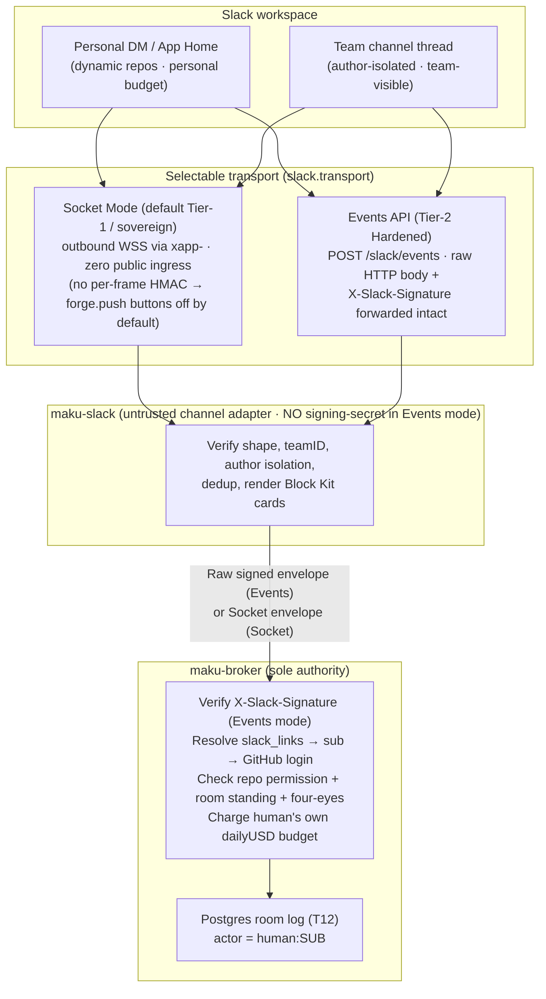

# v5 Slack Security Model: Personal-Bound Principals, Socket Mode, and Deputy Hardening

**Date:** 2026-11-23 · **Status:** approved through owner grill interview 2026-11-23 (decisions [SS1 to SS7](#owner-decisions)) · **Track:** [v5 roadmap](2026-11-22-v5-roadmap-design.md) Phase 2 (v5 Core; Socket Mode eligible for Phase 1 pull-forward if PoC #1 uses Slack) · **Amends:** [Slack push-approval design](2026-11-05-v3x-slack-push-approval-design.md), `maku/docs/security.md` (T12, Slack App), `maku/docs/slack.md` · **Related:** [untrusted-input hardening](2026-11-07-untrusted-input-hardening-design.md), [Slack user guide](../../../website/content/docs/use/slack.md)

---

## 1. Outcome and problem statement

Maku's current Slack App (`maku-slack`) is built around a **shared channel deputy** behind Maku's **only public internet endpoint** (`POST /slack/events`). Reviewing it against Amp's **"talk to your own agent"** (Puck) model and v5's sovereign Kubernetes positioning exposes three concrete weaknesses:

1. **Public internet attack surface:** `POST /slack/events` forces every Slack-enabled cluster to expose a public HTTPS route — violating zero-public-ingress expectations for private corporate and regulated clusters and complicating generic Kubernetes installs.
2. **T12 compromised-pod deputy residual:** `maku-slack` holds the `system:slack-app` client credentials and asserts `{team, user}` on `POST /api/slack/decisions` and task actions. As documented in the [Slack push-approval design](2026-11-05-v3x-slack-push-approval-design.md#owner-signoff), a compromised `maku-slack` pod can currently forge `forge.push` approvals (or file/stop/retry tasks) as *any linked human* without a Slack click.
3. **Shared channel UX and budget coupling:** Every repository requires static GitOps channel bindings (`channels.<id>.repositories`), users cannot DM their own factory agent directly, and tasks draw from a shared `system:slack-app` daily budget pool rather than each user's personal budget.

At the same time, copying Amp's personal Slack integration wholesale would **degrade** Maku's security: Amp allows personal Slack user tokens (`xoxp-`) that let an agent read, search, and post across a developer's private DMs and channels — an unacceptable blast-radius expansion under prompt injection.

**Outcome:** Move Maku's Slack integration to a **hybrid "personal-bound principal, team-visible rooms"** model that:

- Keeps **one workspace bot** (`xoxb-` only — **never `xoxp-` user tokens**), adds **DM / App Home personal intake** with dynamic per-user repository access and **per-person USD budgets**, and enforces **strict author-only thread isolation** so nobody in a shared channel can hijack another user's agent session;
- Supports **Slack Socket Mode** (`transport: socket`, outbound WSS, zero public ingress) as the default for Tier-1 Pilot and sovereign clusters, alongside **Events API** (`transport: events`) for Tier-2 Hardened;
- Closes the T12 `maku-slack` forging-deputy residual in Events API mode by **forwarding raw Slack-signed payloads for independent `X-Slack-Signature` verification in `maku-broker`**, while **failing closed** on unsigned Socket Mode `forge.push` approvals by default;
- Preserves **Invariant 8** (no live agent steering from Slack; live steering stays in the OIDC-authenticated Room Web UI).

---

## 2. Owner decisions, 2026-11-23 {#owner-decisions}

| # | Area | Decision |
|---|---|---|
| **SS1** | **Interaction & identity model** | **Hybrid "personal-bound principal, team-visible rooms":** one workspace bot (never `xoxp-` user tokens), add DM / App Home personal intake with dynamic per-user GitHub repo resolution and per-person USD budgets, and enforce strict author-only thread isolation in shared channels. |
| **SS2** | **Transport** | Support **Slack Socket Mode** (outbound WebSocket, zero public ingress) as the default for Tier-1 Pilot and sovereign clusters, while keeping **Events API** (`POST /slack/events`) as an opt-in mode. |
| **SS3** | **Deputy hardening (Events API)** | On high-risk state-changing actions (`Confirm`, `forge.push` Decide, `Stop`/`Retry`, scoper `Answer`), forward the **raw Slack-signed HTTP body + `X-Slack-Signature` + `X-Slack-Request-Timestamp`** to `maku-broker`, which holds `signing-secret` exclusively and verifies the HMAC independently — eliminating `maku-slack` as a forging deputy. |
| **SS4** | **Honest Socket Mode bound** | Because Slack Socket Mode frames carry **no** `X-Slack-Signature` HMAC header, `transport: socket` **disables Slack `forge.push` decision buttons by default** (cards link to the OIDC-authenticated Room Web UI). Opting into unsigned Socket Mode decisions requires an explicit flag (`socketMode.allowUnsignedDecisions: true`) that surfaces a `slack_socket_mode_deputy` install banner warning. |
| **SS5** | **Live steering (Invariant 8)** | **Keep Invariant 8.** No live agent steering from Slack. Slack handles planning, scoper Q&A, stop/retry, and `forge.push` (when verified/opted in); live steering stays in the Room Web UI where the full redacted diff and transcript are visible. |
| **SS6** | **Team visibility** | Tasks started from a personal DM still create standard repo-scoped `Room` CRs, GitHub issues, and pull requests visible to every repository reader (preserving auditability and four-eyes). |
| **SS7** | **v5 sequencing** | Land in **Phase 2 (v5 Core)**; pull Socket Mode forward into Phase 1 if PoC #1 uses Slack on a private cluster without public ingress. |

---

## 3. Comparison: current Maku vs. Amp "talk to your own agent" vs. Maku v5 hybrid

| Dimension | Current Maku (`v4.0`) | Amp "talk to your own agent" (Puck) | Maku v5 Hybrid (this spec) |
|---|---|---|---|
| **Slack credentials** | One workspace bot (`xoxb-`) | Workspace bot **or** personal user token (`xoxp-`) | **One workspace bot (`xoxb-`) only** — `xoxp-` strictly forbidden |
| **Intake surface** | Pre-bound team channels only (static GitOps `channels:` map) | Personal DM / personal Puck + channel `@Amp` mentions | **Personal DM / App Home** (dynamic repos) **+ team channels** |
| **Repo authorization** | Channel allowlist + `slack_links` → maintainer | Personal Amp account + workspace rules | **`slack_links` → current GitHub login → per-repo `write`/maintainer** (dynamic in DMs; bounded by channel allowlist in channels) |
| **Budget attribution** | Shared `system:slack-app` `dailyUSD` pool | User's personal Amp account / BYOK billing | **Linked human's own `dailyUSD` budget** (+ outer `system:slack-app` circuit breaker) |
| **Cross-user thread safety** | Replies ignored after filing; edits author-only | Routes mentions through sender's personal agent | **Strict author-only thread isolation** (non-author free text dropped before planner/classifier/broker); only typed, server-authorized buttons cross users |
| **Public internet ingress** | Required (`POST /slack/events`) | Amp SaaS receives Slack webhooks (US cloud) | **Zero public ingress in Socket Mode** (Tier-1/sovereign default); optional Events API for Tier-2 |
| **Compromised bot pod blast radius** | Can forge `forge.push` & task actions as any linked user (T12 residual) | SaaS control plane holds user/bot tokens & Slack data | **Events API:** cannot forge high-risk actions (`maku-broker` verifies `X-Slack-Signature`) · **Socket Mode:** `forge.push` buttons off by default |
| **Live steering from Slack** | Forbidden (Invariant 8) | Conversational agent steering in Slack | **Forbidden (Invariant 8 preserved)** — full diff/transcript stays in Room Web UI |
| **Team auditability & four-eyes** | Full Room log + GitHub + four-eyes | Personal Puck threads unless shared | **Full Room log + GitHub + four-eyes**, even for DM-originated tasks |

---

## 4. Architecture



### 4.1 Personal-bound principal, DM / App Home intake, and per-person budgets

1. **Bot-only scopes (no `xoxp-`):** Add `im:history` (and `message.im` bot event, plus optional `app_home_opened`) to the existing bot manifest (`maku/docs/slack.md`). Never request `search:read`, `im:read` of other users' conversations, or any user OAuth (`xoxp-`) token.
2. **DM intake without static channel maps:** When a linked human messages `@factory` in a 1:1 DM (or uses the App Home "Start a task" view), `maku-slack` does not require a static `channels.<id>.repositories` entry:
   - The user names a repository (or selects from their eligible repositories fetched from the broker).
   - `maku-broker` resolves `slack_links(team, user)` → `sub` → current GitHub login → intersects the factory's owned `Repository` CRs with repositories where that login holds the required role (`write` in Tier-1 Pilot per Q8; `maintain`/`admin` where required by repo policy).
   - An unlinked user or a user with zero eligible repositories receives the standard single-line anti-oracle refusal (`@factory link` pointer or "no repositories available").
3. **Per-person USD budget attribution:**
   - Today, Slack tasks charge `system:slack-app`'s shared `dailyUSD` bucket, meaning one heavy user can block an entire team's Slack intake.
   - Under v5, `run_create` from Slack resolves the linked human's `sub` and reserves/charges spend against **that human's own `dailyUSD` quota** (`requestedBy: human:<sub>`, `sponsor: <github-login>`).
   - `system:slack-app` retains a separate, higher **aggregate circuit-breaker cap** (`slackAggregateDailyUSD`) so a runaway loop across many accounts still trips a global breaker without coupling normal teammates' daily limits.
4. **Team-visible rooms (SS6):**
   - A task filed from a DM creates an ordinary `Room` CR, GitHub issue, and pull request governed by the repository's `MergePolicy` and four-eyes rules.
   - Optionally, a `Repository` or channel config may subscribe to read-only lifecycle summaries (`room.pr_opened`, `room.merged`, `room.reverted`) in a team channel so teammates retain visibility without exposing the DM conversation.

### 4.2 Strict author-only thread isolation

Shared channels remain useful for team coordination, but they are the prime venue for cross-user prompt hijacking (Alice starts a task; Bob — an unprivileged user or external guest — replies in Alice's thread to steer the planner or inject instructions).

Maku v5 hardens shared channel threads with four rules:

1. **Immutable thread owner:** Every proposal and filed thread records `author` (the originating Slack user ID) in Slack message metadata (`factory_proposal` / `factory_filed`) and verifies it on every follow-up event.
2. **Non-author free text dropped at the edge:** Any free-text reply in a proposal thread or filed thread from a user `!= author` is **dropped before calling the planner (`intake_plan`), classifier (`intent_classify`), or broker** (except the bounded read-only status queries `status`, `needs me`, `what changed`, `pr` from linked users who hold read access to the room's repository, verified by the broker).
3. **Zero thread-history scraping of strangers:** When re-planning a proposal on author follow-up, `maku-slack` collects **only** messages authored by `author` (plus the bot's own prior proposal), never concatenating other participants' messages in the thread into the planner prompt.
4. **Typed cross-user actions only:** The only cross-user actions permitted in a shared channel are explicit Block Kit button clicks whose authority is independently re-checked by `maku-broker`:
   - **Confirm** a proposal (requires repo maintainer/write standing; binds exact `planHash`);
   - **`forge.push` Approve / Deny** (requires room approver + repo write + four-eyes, and verified signature in Events API mode);
   - **Stop / Retry** confirmation button (addressed solely to the clicking maintainer).

### 4.3 Dual transport: Socket Mode (Tier-1 / sovereign default) and Events API (Tier-2 Hardened)

Add `slack.transport: socket | events` (default `socket` under `profile: pilot`; explicit choice under `profile: production`):

| Aspect | `transport: socket` (Socket Mode) | `transport: events` (Events API) |
|---|---|---|
| **Public HTTPS endpoint** | **None** — `expose.slack` and public `HTTPRoute`/`Ingress` are not rendered | Required: `POST /slack/events` exact match |
| **Network egress (`maku-slack`)** | Outbound `443` to `slack.com` (`apps.connections.open`) and `wss-*.slack.com` | Outbound `443` to `slack.com` only |
| **Secrets** | `bot-token` (`xoxb-`), `app-token` (`xapp-`, scope `connections:write`), `bot-user-id`, `webhook-key` | `bot-token` (`xoxb-`), `bot-user-id`, `webhook-key`; **`signing-secret` moves to `maku-broker`** |
| **Broker cryptographic click verification** | **Not possible** (Slack Socket Mode sends JSON WebSocket frames with no `X-Slack-Signature` HMAC) | **Enforced** (`maku-broker` verifies raw body + `X-Slack-Signature` + timestamp) |
| **Default `forge.push` buttons** | **Off** (cards render read-only link to OIDC Room Web UI; opt-in via `socketMode.allowUnsignedDecisions: true` raises banner warning) | **Available** (per-channel `approvals: true`, broker-verified) |
| **Best fit** | Tier-1 Pilot, private/air-gapped/sovereign clusters without public ingress | Tier-2 Hardened clusters that want mobile `forge.push` buttons with zero `maku-slack` deputy trust |

### 4.4 Eliminating the T12 `maku-slack` forging deputy in Events API mode

Today `maku-slack` holds `signing-secret`, verifies `X-Slack-Signature`, parses the click, and sends structured JSON `{team, user, approvalId, branch, decision}` to `maku-broker` (`2026-11-05-v3x-slack-push-approval-design.md` §1). Because `maku-broker` trusts `maku-slack`'s JSON, a compromised `maku-slack` pod can forge any decision as any linked human.

**The structural fix (`transport: events`):**

1. **Key separation:** Move `signing-secret` out of `maku-slack` and mount it **exclusively in `maku-broker`** (mounted file, re-read at use, never in config or env).
   - *Note on DoS filtering at the edge:* Because `maku-slack` no longer holds `signing-secret`, `maku-slack` performs cheap structural, `Content-Type`, 1 MiB body-size, and per-IP/global rate-limit checks, acknowledges Slack within 3 seconds only after synchronous broker verification (or validates via a fast `POST /api/slack/verify` / combined action call to `maku-broker` under a 2 s timeout — broker HMAC verification is <1 ms in-cluster!). Unverified traffic is dropped at `maku-broker` with `401 bad_signature` and counted in `maku_broker_slack_bad_signature_total`.
2. **Signed envelope pass-through:** For every high-risk state-changing action — `forge.push` Decide (`POST /api/slack/decisions`), proposal `Confirm` (`run_create`), `Stop` / `Retry`, and scoper `Answer` — `maku-slack` sends `maku-broker`:

   ```json
   {
     "signature": "v0=<hex>",
     "timestamp": "1763890000",
     "contentType": "application/x-www-form-urlencoded",
     "rawBodyBase64": "<exact raw bytes received from Slack>"
   }
   ```

3. **Broker-authoritative verification & parsing:**
   - `maku-broker` decodes `rawBodyBase64` (capped at 1 MiB), checks `|now() - timestamp| <= 300s`, computes `v0=HMAC-SHA256(signing_secret, "v0:<timestamp>:<rawBody>")`, and compares in constant time.
   - `maku-broker` parses `team.id`, `user.id`, `channel.id`, `action_id`, `action_ts`, `container.message_ts`, and button `value` **exclusively from the verified raw bytes** — never from outer JSON fields supplied by `maku-slack`.
   - `maku-broker` persists a short-lived replay fence (TTL 10 min, covering the ±5 min signature window) keyed on `sha256(signature)` / `(team, action_ts, action_id)` in Postgres so a compromised `maku-slack` pod cannot replay a previously captured signed click across replicas or restarts.
   - All existing authorization steps remain unchanged: `team == teamID` → `slack_links` → `sub` → active user + current GitHub login → dual standing (Room CR approver/owner + repo write) → four-eyes → binding check → `store.Decide` (`actor_id = human:<sub>`).

**What a compromised `maku-slack` pod can and cannot do after this change (Events API mode):**
- **Cannot** forge a `forge.push` approval, cannot forge a proposal `Confirm`, cannot forge a `Stop` or `Retry`, and cannot forge a scoper `Answer` as any human.
- **Cannot** replay an old signed click past its single-use fence or 5-minute window.
- **Can still** (residual) drop notifications, render misleading Slack text to a user (mitigated because the broker recomputes class, branch, room, and plan hash from its own stores and Invariant 7 prohibits room text in Slack), or abuse read-only sponsored queries within its rate limit.

### 4.5 Keeping Invariant 8 intact (no live steering from Slack)

Amp's Puck encourages full conversational steering inside Slack threads. Maku deliberately **does not** allow live agent steering from Slack (SS5):
- Steering a running agent injects instructions directly into an active sandbox turn; a mobile Slack thread lacks the full redacted diff, tool-call trace, and token/budget context needed to steer safely.
- Invariant 8 remains enforced by named tests: no Slack reply steers a running agent, no Slack button decides any approval class other than `forge.push`, and no Slack decision carries free-text reason prose.

---

## 5. Security analysis and residuals

| Threat | Control | Residual |
|---|---|---|
| **Compromised `maku-slack` forging `forge.push` or task actions (T12)** | **Events API:** `signing-secret` lives only in `maku-broker`; broker verifies raw `X-Slack-Signature` + replay fence and parses actor/action from verified bytes. **Socket Mode:** `forge.push` buttons disabled by default (`approvals` link to OIDC Room Web UI) | **Events API:** closed (requires compromising `maku-broker` itself). **Socket Mode:** if operator explicitly sets `socketMode.allowUnsignedDecisions: true`, `maku-slack` retains T12 deputy power for `forge.push` (flagged on banner as `slack_socket_mode_deputy`, guarded by single-class + four-eyes + `SlackDecisionsSpike`) |
| **Cross-user prompt hijacking in shared Slack channels** | Immutable `author` metadata; non-author free-text replies dropped before planner/classifier/broker; re-planning reads only `author`'s messages | A compromised Slack account of the thread's own author can act as that author (bounded by repo permissions, budgets, four-eyes, and merge gate) |
| **Agent/bot reading private user DMs or channels (`xoxp-` blast radius)** | Bot token (`xoxb-`) only; `xoxp-` user tokens and Slack search scopes forbidden by design; bot sees only channels it is invited to and DMs addressed to it | None — agent pods never hold any Slack token |
| **Public internet exploitation of `POST /slack/events`** | **Socket Mode** removes the public ingress entirely; **Events API** enforces exact-path match, 1 MiB cap, rate limit, and constant-time broker HMAC verification | In Socket Mode, outbound WSS requires egress to `slack.com` and `wss-*.slack.com` from `maku-slack` only (broker keeps zero Slack internet egress) |
| **Replay of a captured signed Slack click** | ±5 min timestamp window **plus** durable 10-min signature/action replay table in Postgres (`maku-broker`) and single-use `store.Decide` fence | None |
| **One user exhausting team Slack budget** | Per-person `dailyUSD` reservation against linked `human:<sub>`, plus separate higher aggregate `system:slack-app` circuit breaker | Aggregate breaker could still trip during a coordinated workspace-wide spike (alerted separately) |
| **Stale DM repo access after GitHub offboarding** | Broker resolves `slack_links` → `sub` → active IdP check + current GitHub permission on every DM request (cached ≤ 5 min, fail-closed) | Up to 5-minute permission cache window (same as existing T16) |

---

## 6. Acceptance criteria (Phase 2 / Socket Mode pull-forward)

| # | Criterion | Verification |
|---|---|---|
| **AC1** | **Zero-public-ingress Socket Mode E2E** | Umbrella chart with `slack.enabled: true` and `slack.transport: socket` renders **no** public `HTTPRoute`/`Ingress` for Slack, passes `maku preflight`, and completes DM intake → Confirm → thread updates end to end |
| **AC2** | **Socket Mode fails closed on unsigned `forge.push`** | Under `transport: socket` with defaults, a `forge.push` wait renders a read-only link to the Room Web UI (no Approve/Deny buttons), and `POST /api/slack/decisions` refuses unsigned calls; opting into `socketMode.allowUnsignedDecisions: true` displays `slack_socket_mode_deputy` on the install banner |
| **AC3** | **Events API closes T12 `maku-slack` forging deputy** | Under `transport: events`, `maku-slack` mounts no `signing-secret`; simulated compromised `maku-slack` sending altered `user.id`, forged `decision`, bad signature, stale timestamp (>5 min), or replayed signature is rejected by `maku-broker` (`401`/`409`) with zero room-log writes |
| **AC4** | **Personal DM intake & dynamic repo scoping** | Linked user starts a task via 1:1 DM without any static `channels:` entry; broker offers only repos where the user holds required GitHub access and refuses unauthorized repos with an anti-oracle message |
| **AC5** | **Per-person budget isolation** | Exhausting User A's `dailyUSD` via Slack blocks User A's next Slack task (`budget-person`) while User B's Slack task succeeds normally |
| **AC6** | **Strict author-only thread isolation** | Non-author replies in a shared channel proposal thread or filed thread are dropped before `intake_plan` / `intent_classify` / broker calls, and never appear in the planner prompt on author re-plan |
| **AC7** | **Invariant 8 & bot-only scopes preserved** | `TestSlackNeverDecidesOnAThreadReply`, `TestSponsoredToolList`, and `TestSlackDecidesForgePushOnly` remain green; Slack manifest requests zero `xoxp-` user scopes and zero search scopes |
| **AC8** | **Team visibility for DM tasks** | A task filed from a DM produces a standard `Room` CR, GitHub issue, and PR readable by other repository collaborators and governed by four-eyes and `MergePolicy` |
