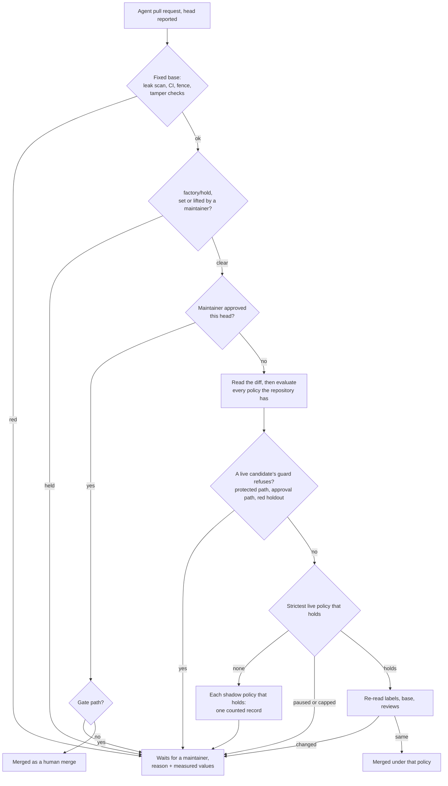
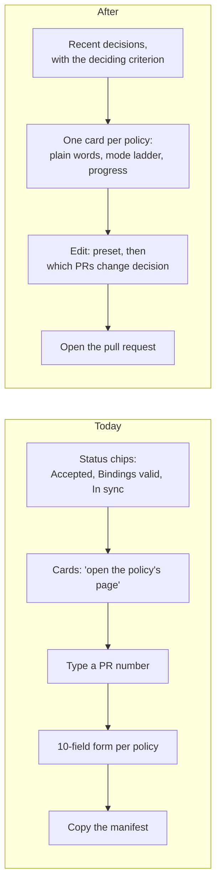
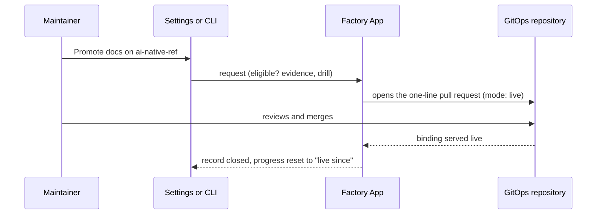

# Merge policies: a gate you can trust, a decision you can read, a promotion in one click

**Date:** 2026-11-24 · **Status:** design, owner decisions of 2026-11-24 ([MT1 to MT4](#owner-decisions)), awaiting the owner's review of this text · **Track:** [v5 roadmap](2026-11-22-v5-roadmap-design.md) track 4 (live auto-merge beyond `docs-links`) and Go criterion 1 (an external team must understand these pages unaided) · **Builds on:** [merge policies review](2026-11-14-merge-policies-review-design.md) · **Facts read on:** Maku `origin/main` `2e0c6fd3` (v0.53.11), ai-native-ref `origin/main` `822fed7`

## Outcome

Three things change, in this order.

1. **The gate is safe to take live again.** `links-only` can today pass a regex change in a YAML file as a "link retarget", `factory/hold` can be lifted by the agent it stops, and a refused `mode: disabled` keeps the old live policy serving. Those are fixed first, in patch releases, before any live session.
2. **A person can read a decision and act on it.** The pull request comment names the policy, the measured values and the next step. The settings pages lead with recent decisions and say in plain words what each policy allows. `maku policy` answers "why did this pull request wait?".
3. **Promotion is one click and one merge.** Maku opens the `mode: live` pull request; a maintainer merges it.

The criteria grow by one mechanism rather than by a list of new shapes: a policy can name a **proof check**, a CI check that proves the diff is equivalent to something already trusted.

## Why

The 2026-11-14 design made configuration almost free: every repository evaluates four catalog policies in shadow with no YAML. A review of what shipped (six parallel reads of the code, the pages and the field, 2026-11-23) found the cost moved elsewhere.

| Area | Findings | What a user meets |
|---|---|---|
| Gate safety | 21 | A shape that reads non-Markdown files; a hold label an agent can remove; a revert merged at an unpinned head |
| Policy model | 23 | An edit that fails open; a documented cutover that is always refused; evidence that survives a loosened policy |
| Messages, CLI, guide | 25 | "it changes more files or lines than its class allows", with no number; a comment that credits policy-bot; no CLI on the default path |
| Settings pages | 6 | A form 8,876 px tall for four policies; a mode (`off`) the factory refuses; no list of recent decisions |
| ai-native-ref adoption | 4 | The gate-path list sits in a file nothing reads |

Every finding with its evidence is in [Findings](#findings).

### What the field says

Two research passes (sources at the end) asked what can be merged with no human at all, and how products make such a policy easy to set.

| Finding | Consequence here |
|---|---|
| Unattended merges are proven by **provenance plus scope** (a named identity, a path allow-list, a diff derivable from a trusted source), never by green CI alone [R1] | Keep the bound rule; add proofs, not looser paths |
| Only **equivalence proofs** replace a reviewer: formatter reproduction, syntax-tree equality, artifact equality, generator reproduction, rendered-manifest equality, IaC plan no-op, pure revert [R2] | MT2: one `proof` field carries all of them |
| An AI reviewer's verdict is a veto, not an approval: best independent F1 19 %; two model families agree 60 % of the time when both are wrong [R2] | MR12 stays; a verdict never replaces a shape or a proof |
| Agents weaken tests when a task cannot be met (over 79 % of cheating by test edits on impossible tasks) [R2] | MT2: tamper checks in the fixed base |
| Policy that a pull request can change for itself is the recurring hole; every 2026 product reads policy from the base branch [R3] | Already true for objects; the proof's workflow must be pinned the same way |
| Products converge on one mode ladder, presets with a visible expansion, a backtest that lists **which past pull requests change decision**, and the list of wrong approvals as the trust artifact [R3] | MT3: the settings pages are rebuilt around decisions |
| No merge-autonomy product documents an automatic demotion [R3] | The breaker is ahead of the field: keep it, show it |

## Owner decisions, 2026-11-24 {#owner-decisions}

| # | Decision |
|---|---|
| **MT1** | One spec, three plans: Maku safety and correctness first (patch releases), Maku usability second, ai-native-ref adoption third. New criteria are designed here and planned after the first two ship |
| **MT2** | New criteria: a generic **proof check**, a **rendered-manifest** proof built on it, and **tamper checks** as fixed base rows. No pure-revert shape for now |
| **MT3** | The settings pages are **redesigned around decisions**, with presets and a backtest |
| **MT4** | **Maku opens the promotion pull request**; a maintainer still merges it |

### Calls made while writing

Mine, not the owner's. Each can be overturned.

| Call | Why |
|---|---|
| `links-only` is Markdown-only by construction (`\.mdx?$`), whatever `allowedFiles` says | A shape that reads any text file is not a bound (S2) |
| Auto-merging the factory's own rollback becomes `merge.autoRevert`, and `revert` leaves the catalog | Today `revert: live` is both a hidden rollback switch and a duplicate of `docs-links` that can never gather evidence (M4). MT2 declined a pure-revert shape, so the switch is all that remains |
| A guard refusal on any live candidate blocks the merge: `protectedFiles`, `requiresApproval`, a red holdout | Otherwise a looser live policy merges what a stricter one protects (S6). Same reasoning as no fall-through |
| A guardrail below a catalog cap clamps the cap instead of refusing the policy | The operator's stricter word should not switch four policies off in every repository (M11) |
| Evidence counts only decisions taken under a policy at least as tight as the current one | A loosened policy otherwise inherits trust it did not earn (M6) |
| Repository-file authority (`classAuthority: repository`), policy-bot and the `policyManagement.stage` ladder move out of the guide into `upgrading.md`. Nothing is removed from the code | A third of the guide serves a path no v4 newcomer takes. Removal is a v5 major's decision, not this one's |
| The user-facing word is **policy** everywhere; `class=` stays as a wire name | 55 uses of "class" in a guide that never defines it |

## The design

### 1. Gate safety and correctness



What changes against today is the tamper checks in the base, the actor check on the hold, the diff read before any holdout is judged, the guard row, and the re-read before the merge.

**`links-only`.**

| Rule | Today | After |
|---|---|---|
| Files | Any text file | `\.mdx?$` only; any other file refuses `class_mismatch` |
| A listed file whose two sides read equal | Skipped | Refused: submodule, mode change, empty file, empty diff |
| Non-regular file | Read as empty | Refused, as `file()` already does |
| Footnote definition, `](` outside a link | A "target" | Not a link |
| Host | Same host, or any `web.archive.org` URL | Same host **and** same first path segment on hosts with user-owned paths (`github.com`, `gitlab.com`, `raw.githubusercontent.com`); the archive only of the same URL |

**Human controls.**

| Control | Today | After |
|---|---|---|
| `factory/hold` | Any token with `pull_requests: write` removes it | A removal by anyone but a maintainer leaves the pull request held; more than 30 labels fails closed |
| Between decision and merge | Only the head is pinned | Labels, base branch and review state are read again before the status turns green |
| The factory's revert pull request | Merged at whatever head the branch has | Merged only at the head GitHub created for the revert |
| Leak scan | `SKIPPED` and `NEUTRAL` pass | Needs a raw `SUCCESS` |
| Ledger labels (`auto-merged`, `revert-of`, `follow-up-of`) | Trusted | The labeller must be the merger or a maintainer, as for the drill |

**Edits that fail open or cannot be made.**

| Case | Today | After |
|---|---|---|
| A binding edit is refused | The last resolved policy keeps serving at its **old mode** | Never above the mode the binding now asks for; `disabled` is dropped before resolution; a deleted policy is not put back |
| `classAuthority: repository` with the catalog on | Always refused ("classes are declared centrally too") | Implied catalog bindings are skipped for a cut-over repository, which keeps the default guardrails |
| `merge.maxPerDay` unset | Zero merges, with no message | Defaults to the guardrail's cap |
| A live policy without `holdoutChecks` | Warned "refused from the next minor" (TO5), which the docs' one-line promotion would hit | TO5 is dropped: `mandatoryChecks` and the repository's required checks are the floor |
| Guardrail below a catalog cap | Policy refused in every repository | Cap clamped |
| A file the contents API cannot inline | Silent error loop, no status | Hand-off `diff_unreadable` |
| A holdout from a path-filtered workflow | Unrelated pull requests wait out the CI bound | The diff is read first; a holdout is awaited only for a policy whose diff conditions hold |

**Evidence.**

| Rule | Today | After |
|---|---|---|
| What is counted | The newest comment's prose, one policy per pull request | Every decision record line, one per policy per pull request (the tally script already does this) |
| Who merged | Anyone but the merger | A maintainer |
| `shadow_would_require_approval` | Counted as clean | Not counted |
| After a policy is loosened | Counts kept | Only decisions under a policy at least as tight count |
| Comment author | A login that equals the App's slug | The App's full bot login |

### 2. Criteria: proofs and tamper checks (MT2)

**One new policy field.**

```yaml
kind: MergePolicy
metadata: {name: formatting}
spec:
  description: A diff the formatter itself produces.
  allowedFiles: ['^.+\.(go|py|tf)$']
  proof: {check: "Formatter reproduces the diff", kind: formatter}
  evidence: low
```

| Rule | Detail |
|---|---|
| What it is | A check run that proves the head is equivalent to something already trusted. `kind` is `formatter`, `generator`, `rendered` or `custom`; it sets the words shown and, for `rendered`, the extra rule below |
| Pinning | The check must come from GitHub Actions, on the judged head, from a workflow file **unchanged from the base branch**. Its workflow file is a gate path, like a holdout's |
| Bound | A proof counts as a bound, beside `allowedFiles` and `diffShape` (MR6) |
| Reviewer | A policy with a proof needs no reviewer verdict, like a shape (MR12) |
| Evidence | A proof allows `evidence: low` (MR4) |
| Missing or pending | `proof_pending`, then `proof_missing` at the CI bound; red is `proof_red` |
| `custom` | Allowed, shown as "custom proof" on every surface, and never eligible for `evidence: low` |

The gate does not run formatters or renderers. Each repository brings its proof as a workflow, and Maku ships three reusable ones under `examples/proofs/` (formatter, generator, rendered manifests) that a repository copies.

**Rendered manifests.**

```yaml
kind: MergePolicy
metadata: {name: gitops-refactor}
spec:
  description: A change to Flux or Helm sources that renders to the same manifests.
  allowedFiles: ['^(apps|infrastructure|observability|security|tooling)/.+\.ya?ml$']
  proof: {check: "Rendered manifests", kind: rendered, changedFields: []}
  evidence: low
```

The workflow renders base and head and writes the changed field paths into the check's output as one JSON line. `changedFields: []` demands an empty rendered diff; `changedFields: ['spec.template.spec.containers[].image']` admits an image move and nothing else. A field outside the list refuses `proof_fields`. This is the pattern cloud-native-ref's "Rendered manifest diff 📝" job already half-implements.

**Tamper checks, in the fixed base for every policy.**

| Check | Refuses with |
|---|---|
| Bidirectional, zero-width or tag characters in an added line | `hidden_unicode` |
| A test file deleted, or a skip marker added, in a pull request that also changes non-test files | `test_weakened` |
| Default protected paths gain agent instructions and lockfiles: `(^|/)(AGENTS|CLAUDE)\.md$`, `^\.(agents|claude)/`, the common lockfiles, and every location GitHub reads `CODEOWNERS` from | `file_protected` |

`test_weakened` needs to know what a test file is: `Repository.spec.merge.testFiles`, a list of patterns, with a default covering `_test.go`, `test_*.py`, `*.test.ts` and `tests/`. A repository with none of these is unaffected.

### 3. A decision a person can read

One table of words per reason, used by the GitHub comment, the commit status, the room, Slack and the MCP tool. Today five maps disagree.

| Surface | Today | After |
|---|---|---|
| Merged | "CI is green and policy-bot matched the live class `review`" | "Merged automatically by policy `docs`: 2 of 5 files, 31 of 100 lines, reviewer approved. Undo with `factory/revert` within 7 days." |
| Shadow | "would auto-merge: `docs` … in shadow until the merge wave" | "Policy `docs` would have merged this (2 of 5 files, 31 of 100 lines). It is in shadow here. Merge it unchanged if you agree: that makes 7 of 20 clean decisions toward going live." |
| Not matched | "no merge policy of the repository holds on this diff" | "Waits for a maintainer. `docs`: 131 lines changed, limit 100. `docs-links`: not a links-only diff." |
| Commit status | `review: merging` | `docs: merging` |

The values already exist in the hidden record (`files=`, `lines=`, `considered=`); this renders them.

**CLI.** The default path gets its verbs; the file-era ones move.

| Command | Does |
|---|---|
| `maku policy list [repo]` | Policies, modes and progress per repository |
| `maku policy explain owner/name#123` | The decision above, from a terminal |
| `maku policy validate FILE...` | What `maku config validate` does today for policy manifests, under the name people look for |
| `maku policy backtest FILE --repository o/n --since 30d` | Which recent agent pull requests change decision under the edited policy |
| `maku policy promote o/n <policy>` | Opens the promotion pull request (MT4) |
| `maku policy pause o/n [--reason]` | Sets `Repository.spec.merge.paused`; every policy decides `paused` |
| `maku config migrate export\|check` | Today's `policy export` and `policy check` |

**Kubernetes.** `kubectl explain mergepolicy.spec` is rewritten without decision ids; `diffShape` gets an enum and caps a minimum; printer columns say `POLICIES` and gain `BindingsValid`; a `Ready` condition is false while an edit is refused, and each binding reports `servedMode`.

**Guide.** Page one becomes: what ships, how to read a decision, how to promote, how to narrow or write one policy. The first rollback drill is written out. One field table with default, unit, who sets it and an example. Seven pages that name refused switches are swept.

### 4. Settings pages (MT3)



| Page | Leads with | Then |
|---|---|---|
| Merge policies (all repositories) | One row per repository: merged on its own, would have merged, waited (7 days), and the policy closest to going live | A health note only for a repository with a refused binding |
| A repository | **Recent decisions**: pull request, outcome, policy, deciding criterion with numbers, link | One card per policy, shipped ones marked as such |
| A policy card | One sentence built from the fields: "Markdown under `website/content/`, at most 5 files and 60 lines, 2 a day; a reviewer must approve" | The mode ladder (Off · Shadow · Live), "7 of 20 clean decisions", the wrong calls if any, **Promote** |
| Edit | Presets (the shipped policies and the proofs), each with "show the YAML" | Essential fields only; shape, checks and expert fields behind two folds, and only those valid for this policy |
| Before saving | The **backtest**: the pull requests of the last 30 days whose decision changes, each with before and after | Errors located on the field; a warning when the rule matched none of them |
| Promotion | "20 of 20 clean, drill passed, 0 wrong calls" and the list of pull requests it rests on | One button that opens the pull request |

Words that leave the pages: class, generation, consumer, "current", "worst-case bad rate ≤ 19 %", "29 / 46 / 61 merges", raw regular expressions without a gloss. The statistics move to a fold named "How sure is this?".

Bugs fixed on the way: the binding editor offers `off`, which the factory refuses, and not `disabled`; the meaning fields still list `harness`, `requires` and three more removed fields; the editor refuses a file the factory accepts (the `docs-links` and `revert` rule, which this design deletes).

### 5. Promotion (MT4)



| Rule | Detail |
|---|---|
| Who writes | The factory App, on a branch `factory/promote-<repository>-<policy>`, in the repository `Factory.spec.gitops` names (`repository`, `path`). Unset, the button prints the ready `gh pr create` command instead |
| Who decides | A maintainer's merge. The pull request is never auto-merged: the manifests are a gate path |
| Bookkeeping | The record closes when the served binding turns live, and is abandoned when the pull request closes unmerged. The "Merged" and "Abandon" buttons go |
| A refusal | Returns the blockers with counts ("needs 16 more clean decisions"), not `not_eligible` |
| The first drill | Documented as three steps, and `maku policy drill owner/name#PR` opens the revert with the label set |

## Findings {#findings}

Severity as the reviewers gave it. `S` gate, `M` model, `U` messages, CLI and guide, `W` web, `A` adoption. Paths are Maku's unless they start with `tooling/`, `website/` or `scripts/`. Confidence is "read in the code" unless noted; nothing was executed against a cluster.

### High

| # | Finding | Where |
|---|---|---|
| S1 | `links-only` skips a listed file whose two sides read equal: a submodule move, a mode change, an empty file, an empty diff | `internal/factory/mdlinks/mdlinks.go:307`, `internal/factory/forge/github.go:1679` |
| S2 | `links-only` reads any text file; a regex group, a call argument or a footnote passes as a retarget. Replayed against the copied expression | `internal/factory/mdlinks/mdlinks.go:22`, `charts/agent-factory/templates/merge-policies-catalog.yaml:13` |
| M1 | A refused binding edit keeps the last resolved policy at its old mode | `internal/factory/resources/bindings.go:197`, `internal/factory/config/binding.go:279` |
| M2 | `classAuthority: repository` is refused whenever a catalog policy is served | `internal/factory/resources/bindings.go:126`, `internal/factory/config/mergepolicy.go:247` |
| U1 | The visible decision has no number and no failing policy | `internal/factory/narrate/narrate.go:317`, `internal/factory/decision/decision.go:79` |
| U2 | The shadow comment says "until the merge wave" and hides that merging unchanged is the evidence | `internal/factory/narrate/narrate.go:714` |
| U3 | The merged comment and the status credit policy-bot and the intake class | `internal/factory/narrate/narrate.go:704`, `internal/factory/reconciler/gatestatus.go:54` |
| U4 | `maku policy` serves only the repository file; the default path has no policy command | `internal/app/maku_policy.go:26` |
| U5 | A third of the guide is migration and authority machinery | `docs/merge-policies.md` |
| U6 | The first rollback drill is undocumented | `docs/merge-policies.md`, `docs/factory.md` |
| U7 | Seven pages and one usage string name switches the loader refuses | `internal/factory/config/deprecated.go:63`, `docs/reference/config.md` |
| W1 | The binding editor offers `off`, not `disabled` | `web/src/binding-editor.ts:41`, `internal/factory/config/binding.go:16` |
| W2 | The bindings form shows ten parameters for every policy: 8,876 px for four | `web/src/policy-fields.ts`, `web/src/binding-editor.ts` |
| A1 | ai-native-ref's gate paths are listed only in `.policy.yml`, which no required status reads | `.policy.yml`, `tooling/base/agent-factory/resources/factory.yaml`, `internal/factory/reconciler/arm.go:317` |

### Medium

| # | Finding | Where |
|---|---|---|
| S3 | The host rule admits another owner on a shared host, and any archive URL | `internal/factory/mdlinks/mdlinks.go:284` |
| S4 | The factory's revert merges on CI alone at an unpinned head | `internal/factory/reconciler/merge.go:1321` |
| S5 | `factory/hold` is honoured without an actor check | `internal/factory/reconciler/arm.go:647`, `internal/factory/minter/roles.go:67` |
| S6 | A policy's guards are skipped when another live policy holds | `internal/factory/reconciler/select.go:138` |
| S7 | A pending holdout blocks the diff read | `internal/factory/reconciler/gate.go:259`, `internal/factory/reconciler/select.go:152` |
| S8 | The Go evidence reader ignores the per-policy shadow lines | `internal/factory/evidence/evidence.go:203` |
| S9 | An unreadable file loops silently | `internal/factory/forge/github.go:1642` |
| S10 | Approval memory is keyed on the intake class | `internal/factory/reconciler/grants.go:46` |
| S11 | Required checks pass when skipped or neutral | `internal/factory/forge/github.go:1149` |
| M3 | Shadow evidence accrues to one policy per pull request | `internal/factory/evidence/evidence.go:203`, `internal/factory/reconciler/select.go:167` |
| M4 | `revert` is a rollback switch and a duplicate of `docs-links` | `internal/factory/reconciler/merge.go:1321`, `internal/factory/reconciler/select.go:43` |
| M5 | Default guardrails are skipped for a file's bindings | `internal/factory/mergepolicy/resolve.go:139` |
| M6 | Evidence survives a loosened policy | `internal/factory/evidence/evidence.go:157` |
| M7 | `merge.maxPerDay` unset means zero | `internal/factory/reconciler/arm.go:304` |
| M8 | TO5 would refuse the documented promotion | `internal/factory/config/config.go:1758` |
| M9 | The "docs-links and revert are required" rule is enforced three ways | `internal/factory/config/config.go:2192`, `internal/factory/policyview/bindings.go:83` |
| M10 | Objects and files default the same list differently | `internal/factory/mergepolicy/resolve.go:88` |
| M11 | A guardrail below a catalog cap refuses the policy | `internal/factory/config/binding.go:349` |
| M12 | "Clean" does not need a maintainer's merge | `internal/factory/evidence/evidence.go:230` |
| M13 | Status reports the written mode, and there is no `Ready` | `internal/factory/statuswriter/desired.go:256` |
| U8 | Promotion is six manual actions | `internal/humanapi/policy.go:340` |
| U9 | The shipped `docs` policy admits `AGENTS.md` and added or deleted files | `charts/agent-factory/templates/merge-policies-catalog.yaml:17` |
| U10 | Five reason-to-words maps disagree | `internal/factory/narrate/narrate.go:193`, `internal/slackapp/endline.go:33` |
| U11 | The reasons table says "a human merges" for the commonest refusals | `docs/merge-policies.md` |
| U12 | `kubectl explain` reads as internal notes; no enum, no minimum | `config/crd/maku.ogenki.io_mergepolicies.yaml` |
| U13 | No auto-merge share panel, no shipped policy alert | `charts/agent-factory/files/dashboards/agent-factory.json` |
| U14 | No single pause for one repository | `docs/merge-policies.md` |
| W3 | A policy card never says what the policy allows | `web/src/class-card.ts`, `web/src/policy-page.ts:74` |
| W4 | No list of recent decisions | `web/src/settings.ts` |
| W5 | The healthy state is implementation status | `web/src/settings.ts`, `web/src/policy-page.ts:53` |
| W6 | The pages speak the pre-v4 model: class, `harness`, `requires`, "Off" | `web/src/policy-fields.ts:24`, `web/src/policy-describe.ts:28` |
| A2 | `dead-links` and `kb-entries` lack `evidence: low`: 20 decisions where 5 would do | `tooling/base/agent-factory/resources/mergepolicy-dead-links.yaml`, `tooling/base/agent-factory/resources/mergepolicy-kb-entries.yaml` |
| A3 | The site guide states wrong Maku defaults and misnames `deps-patch` | `website/content/docs/use/guide/merge-policies.md` |
| A4 | Six resource comments describe `.policy.yml` rules | `tooling/base/agent-factory/resources/` |

Low findings (fourteen: cache-read caps, binary files under a line cap, `added-entry` insertion, stale comments, the catalog label honoured on any object) are carried in the plans' task lists, not here.

### Keep

| What | Where |
|---|---|
| The merge pinned to the judged head, and truncated diffs failing closed | `internal/factory/forge/github.go:1375` |
| No fall-through for the breaker and the cap | `internal/factory/reconciler/arm.go:303` |
| Checks pinned to their source | `internal/factory/reconciler/gate.go:103` |
| The reviewer verdict bound to run, role and head | `internal/factory/rooms/rooms.go:134` |
| Parser errors that teach ("did you mean `maxPatchFiles`?") | `internal/factory/mergepolicy/policy.go:228` |
| One refused binding never refuses its repository | `internal/factory/config/binding.go:24` |

## Approaches considered

| Question | Rejected | Why |
|---|---|---|
| New criteria | One shape per proof, computed by the gate | The gate would run formatters, generators and Helm; each repository pins those differently |
| | An LLM risk score as a criterion | The verdict is unstable and is a veto at best [R2]; the field uses it only under a ceiling [R3] |
| Promotion | Automatic at the threshold | No precedent, and the owner's merge is the audit event [R3] |
| | Keep "Maku never writes" | Six actions, two of them bookkeeping a machine can observe |
| Settings pages | Fix the form in place | The form is the problem: it mirrors the object, not the decision |
| Guide | Delete the repository-file path now | A breaking removal belongs to a major |

## Goals, non-goals, anti-goals

- **Goals:** no known way to merge outside a policy's bound; a decision readable without the page source; a first live policy by a stranger in under ten minutes of their own time, evidence wait excluded.
- **Non-goals:** a policy for application code; an LLM-scored policy; GitLab; removing repository-file authority.
- **Anti-goals:** a proof whose workflow the pull request can edit; a promotion without a maintainer's merge; a number on a page with no list behind it.

## Who changes what

| Plan | Repository | Releases |
|---|---|---|
| [Safety and correctness](../plans/2026-11-24-merge-policies-safety-maku-plan.md) | Maku | Patch releases on v0.53; nothing new to configure |
| [Usability](../plans/2026-11-24-merge-policies-usability-maku-plan.md) | Maku | One minor: messages, CLI, CRD help, guide, settings pages, promotion |
| [Adoption](../plans/2026-11-24-merge-policies-usability-adopt-plan.md) | ai-native-ref | With each Maku pin; gate paths and `evidence: low` need no new release |
| Proofs and tamper checks (section 2) | Maku, then both | Planned after the first two ship; validated on the next live cluster |

## Open questions for the owner

1. **Removal in v5.** Should the v5 major delete repository-file authority, policy-bot and the stage ladder? This design only moves them out of the guide.
2. **`test_weakened` default.** Fixed base for everyone, or opt-in per repository until one live session has measured its false positives?
3. **Live validation.** No cluster runs today. The safety plan is provable offline (unit and envtest); the promotion pull request and the pages need the next live session.

## Sources

Research notes of 2026-11-23, three passes over primary documentation, engineering posts and papers. Vendor-reported numbers are marked in the notes.

- **[R1] Fully automated change classes.** Chromium Rubber Stamper and autorollers (`chromium.googlesource.com/chromium/src/+/main/docs/code_reviews.md`); googleapis auto-approve (`github.com/googleapis/repo-automation-bots`, `packages/auto-approve`); Spotify fleet management (`engineering.atspotify.com/2023/4/spotifys-shift-to-a-fleet-first-mindset-part-1`); Meta dead-code removal (`engineering.fb.com/2023/10/24/data-infrastructure/automating-dead-code-cleanup`); the axios 1.14.1 bot merges (`blog.gitguardian.com/renovate-dependabot-the-new-malware-delivery-system`); DORA on change approval (`dora.dev/capabilities/streamlining-change-approval`).
- **[R2] Machine-checkable criteria.** Rubber Stamper's "programmatically prove that the CL is benign"; Kubernetes `hack/lib/verify-generated.sh`; `terraform plan -detailed-exitcode`; AI review benchmarks (`arxiv.org/abs/2509.01494`, `arxiv.org/abs/2603.26130`); correlated model errors (`arxiv.org/abs/2506.07962`); ImpossibleBench (`arxiv.org/abs/2510.20270`); METR on test-passing pull requests (`metr.org/notes/2026-03-10-many-swe-bench-passing-prs-would-not-be-merged-into-main`).
- **[R3] Configuration and trust UX.** Dash0 AutoMerge (`dash0.com/docs/dash0/darkplane/automerge`); Renovate presets (`docs.renovatebot.com/presets-default`); Cursor approval agents (`cursor.com/docs/approval-agents`); CodeRabbit approval policies (`docs.coderabbit.ai/pr-reviews/approval-policies`); Tide's status wording (`github.com/kubernetes-sigs/prow`, `pkg/tide/status.go`); GCP Policy Simulator; Rootly's back-test (`rootly.com/blog/when-should-ai-be-allowed-to-approve-a-pull-request`).
