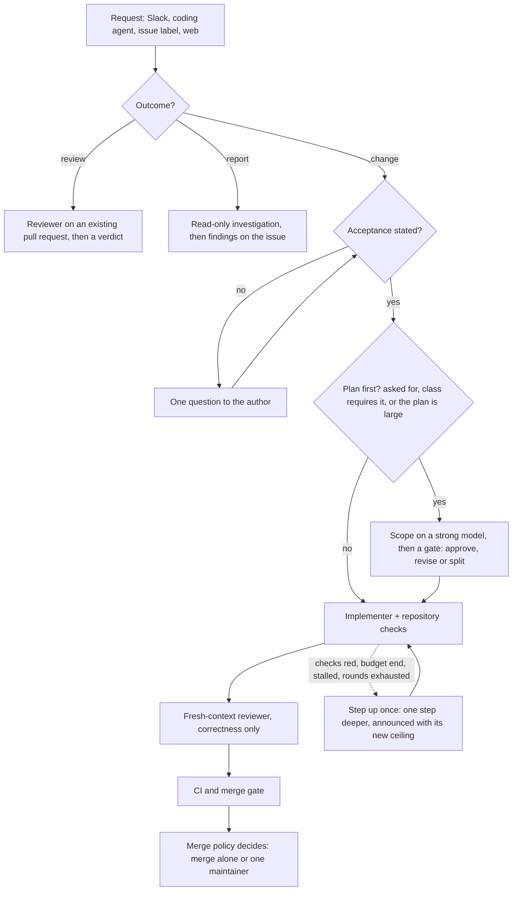
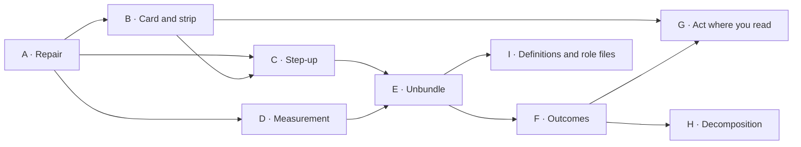

# Workflows and roles redesign: one path that grows on evidence

**Date:** 2026-11-24 · **Status:** design, four owner rulings recorded 2026-11-24 ([WR-O1 to WR-O4](#owner-decisions)), the rest proposed and awaiting review · **Track:** [v5 roadmap](2026-11-22-v5-roadmap-design.md), new Track 8 · **Research:** [workflows and roles redesign research](2026-11-24-workflows-roles-redesign-research.md) · **Plans:** [Maku plan](../plans/2026-11-24-workflows-roles-redesign-maku-plan.md), [adoption plan](../plans/2026-11-24-workflows-roles-redesign-adopt-plan.md) · **Supersedes in part:** [workflows review](2026-11-14-workflows-review-design.md) (WF2, WF8), [harness roles](2026-10-30-harness-roles-design.md) (HR1), [splitter](2026-10-23-splitter-design.md) (SL7), [UX review](2026-11-14-ux-review-design.md) (web rulings)

Maku facts are read on `origin/main` at `2e0c6fd3` (v0.53.11 plus 11 commits); this repository's on
`main` at `822fed7`. No cluster was running: every claim about behaviour comes from code, manifests
and recorded results.

## Outcome

A person files a task and never has to think about workflows. The factory starts every task on the
cheapest path that fits what the change touches, says in one line what will run, why, and what it
may cost, and grows the path only on evidence: a verified failure, a large plan, or a person asking.
The same card and the same controls appear in the web room, Slack, the CLI, coding-agent clients and
GitHub. A platform team that wants its own shape copies one readable definition and edits it.



`quick`, `standard` and `careful` stay, as names for points on this path.

## Owner decisions, 2026-11-24 {#owner-decisions}

| # | Question | Ruling |
|---|---|---|
| **WR-O1** | Lift the "measure first" freeze (WF8)? | **Lifted.** Step-up and passive per-role measurement are built without waiting for an A/B cohort. The comparison stays possible; it stops being a precondition |
| **WR-O2** | Scope | **All nine proposals, targeted at v5**, in the phases [below](#order-of-work) |
| **WR-O3** | Do low-risk classes drop the reviewer? | **No.** The reviewer stays on every pull-request task until measurement prices it; the gate's reviewer-verdict rule is untouched |
| **WR-O4** | Naming | **Keep "workflow" and `quick` / `standard` / `careful`.** `profile` is renamed in the strings a person reads; API keys, refusal codes and metrics keep their names |

## Why

The full evidence is in the [research](2026-11-24-workflows-roles-redesign-research.md). The facts
that drive the design:

| Fact | Where |
|---|---|
| A workflow is a bundle (template, tier raise, `checks` flag, `loops` row) frozen at triage; the engine runs one hard-coded order | Maku `internal/factory/config/workflows.go:23-40`, `internal/factory/reconciler/reconciler.go:1567-1602` |
| `careful` ties scoper, judge, search, splitter and the frontier budget together, so none can be chosen or measured alone | same; [workflows review](2026-11-14-workflows-review-design.md) "no judge-alone comparison: it would need a fourth workflow" |
| `standard`, the default, has no stall rule and no judge; two site pages say it has a judge | Maku `internal/factory/config/config.go:2516`; `website/content/docs/use/guide/writing-a-good-task.md:101` |
| The `careful` split is unreachable here: no classifier, no `split.anyTier` | Maku `internal/factory/reconciler/split.go:31-44`, `internal/factory/triage/classify.go:112-118` |
| The tester runs only when the workflow's name is the constant `careful` | Maku `internal/factory/config/workflows.go:112-116` |
| Nothing picks per task: the repository default applies unless a maintainer pins; the planner's and scoper's suggestions are never applied | Maku `internal/factory/triage/workflow.go:23-48`, `internal/factory/reconciler/profile.go:20-64` |
| A task cannot change workflow after filing; `escalation` is set nowhere | Maku `internal/factory/reconciler/stepup.go:18-87`, `watch.go:381-441` |
| Six of seventeen user scenarios have no path: design approval before code, report-only work, parallel parts, multi-repository execution, change of course after filing, a team's own roles or order | research, "Six of seventeen scenarios" |
| No role has a measured value; the one trial recorded zero tasks | `website/content/docs/status.md:86` |
| The room's run rail already draws done, running and planned roles with cost; no other surface shows it, and its needs-you cards end in "Answer it on GitHub" | Maku `web/src/rail.ts:296-306`, `web/src/needs.ts:61-96` |
| Outside evidence: fixed multi-agent topologies trail a single agent on coding work; start-low-then-escalate matches fixed top effort at lower cost; LLM judges that read the agent's narrative detect false success poorly; reviewers are needed and imprecise | research, "The evidence backs one writer" |

## Decisions

| # | Decision | Rejected |
|---|---|---|
| WR1 | **One path, three questions.** Verification follows what the change touches (class and paths); depth follows a verified failure or a person's request; decomposition follows the size of the plan. A workflow name is a starting point on that path, not a fixed bundle | A fourth named workflow; a depth dial replacing the names (WR-O4); a difficulty classifier on the request text (routers score near chance on coding tasks) |
| WR2 | **Repair first.** The shipped configuration is made to match its description before anything is added ([phase A](#phase-a)) | Documenting the defects |
| WR3 | **One card on every surface**: what will run, why, what it may cost, and one way to change it ([the card](#the-card)) | Bare workflow names in a select; a confidence score nobody can calibrate yet |
| WR4 | **Step up once on a verified failure**, and offer "run again deeper" to a person. One automatic step, announced with its trigger and its new ceiling, never on a pinned task without asking ([phase C](#phase-c)) | The adaptive workflow rejected on 2026-11-14 (every task paid a scoper; here only failed tasks pay); mid-run model switching; unlimited climbing |
| WR5 | **Every role is measured on every task**, passively: cost, and whether its output changed the outcome ([phase D](#phase-d)) | Waiting for a cohort trial; changing a default from these numbers without an owner ruling |
| WR6 | **`careful` is unbundled into stage switches.** A workflow lists which stages it turns on; the three presets become three lists ([phase E](#phase-e)) | Keeping the tester bound to a workflow's name; a second or specialist reviewer as a default |
| WR7 | **The roles stay five, and three change shape**: the acceptance question moves to intake for every workflow; the scoper's plan step runs on the strong model; the judge reads machine evidence, not the run's narrative ([roles](#roles)) | Reviewer lenses, an architect, a doc-writer, best-of-N, a learned critic (HR1's rejections stand) |
| WR8 | **A task has an outcome**: `change` (default), `plan-first`, `review`, `report`. It is inferred and shown on the card; a person may set it ([phase F](#phase-f)) | A three-document spec flow; approval between every stage; a two-human approval count (that belongs to the merge policy and GitHub rulesets) |
| WR9 | **Act where you read.** Answer, accept a split, retry, run again deeper and file a task from the room and the CLI; one typed inbox everywhere ([phase G](#phase-g)) | Live steering of a running agent from Slack; settings pages that write |
| WR10 | **Decomposition fits the evidence**: every part of a confirmed plan is filed with its dependencies; parts run in parallel only when the plan declares disjoint files; dependent parts form a stack ([phase H](#phase-h)) | Parallel writers on one branch; an integrator role; children of children; runs messaging each other |
| WR11 | **A workflow becomes one readable definition** in `Factory.spec.workflows`, and a role becomes a file bound to a closed capability profile. The presets compile to it ([phase I](#phase-i)) | A `Workflow` CRD (one more object and RBAC surface for the same data); a visual editor; a model routing between personas |
| WR12 | **Budgets only narrow down the chain.** A repository may lower a ceiling or add a stage the platform allows; it never raises a ceiling or removes a stage the platform requires | Per-repository freedom to raise spend |
| WR13 | **Every human wait is a state with a reason, a default and a deadline, holding no pod** | A run that idles while a person decides |

## The card {#the-card}

The same four facts, in the same order, wherever a task is named. Everything on it already exists in
the task's status or the catalogue except the "up to" figure.

```text
Fix the broken link checker on the docs site          smana/ai-native-ref
Workflow   standard · this repository's default
Will run   implementer → reviewer → CI → merge gate
Cost       up to $5.10 · up to $13.60 if it steps up
[ Start ]  [ Change workflow ▾ ]  [ Plan first ]
```

| Surface | Where the card goes | Change control |
|---|---|---|
| Slack | The plan message | A select whose options carry the description and the ceiling, not a bare name |
| Coding agent (`start`) | The confirmation form | A described option list; the field stays optional |
| GitHub | The first comment, posted before the first run, and the pinned status comment | The `workflow:<name>` label, named in the comment |
| CLI | `maku status <room>` and `maku task` | `maku retry --deeper`; the `start` tool's optional `workflow` argument |
| Web room | The task header, open by default | The same select, for a maintainer |

Rules for the card:

- **The reason is built from facts, never from a model's prose**: "this repository's default",
  "pinned by @name", "touches `infrastructure/`", "the planner suggested `quick`", "stepped up after
  a red check".
- **Roles are named as roles**: the scoper's run is "scoper" (a recorded comment called it
  "(triager)").
- **Money is dollars** on every surface. The word "tier" leaves user-facing strings; the line
  "(tier standard)" beside a `quick` task goes.
- **The path strip** is the room rail's one-line form, reused as text:
  `scoper ✓ · implementer ● · reviewer ○`. It is appended to the pinned GitHub comment, the Slack
  thread's status line and `maku status`.
- **One status vocabulary** on every surface: planning, working, checking, waiting on you, waiting
  on a check, done, stopped.
- **"Typical cost"** appears beside the ceiling only once [phase D](#phase-d) has data for the class.

## Phases

Each phase is shippable alone, behind its own switch where it changes behaviour.

### Phase A · Repair the shipped model {#phase-a}

No new key, name or behaviour.

| Repair | Detail |
|---|---|
| Stall rule in every workflow | The default `loops` row gains the stall rule, with the judge still off, so `standard` and `quick` stop a run that commits nothing. Confirm first that a row may set `stallSteps` with `judge: none` without turning continuations on (`config.go:2516`) |
| Reachable split | The shipped `careful` row sets `split.anyTier: true`; this repository's `factory.yaml` matches what the site already claims |
| Tester by key | The constant `careful` behind `testFirst` becomes a row key (`tests: true`), set on the shipped `careful` row |
| Dead label | `maku start` stops applying `class:<c>`, which triage announces as unread |
| Stale pages | The pages that say `standard` has a judge, that the planner picks the workflow, that list keys a workflow does not have; Maku's `docs/factory.md:148` (removed classifier) and `docs/roadmap.md:14`; the workflow-comparison results file that still says "collecting"; runbook 27's columns |

### Phase B · One card, one strip, one vocabulary {#phase-b}

Display only. Implements [the card](#the-card) on the five surfaces, the path strip as text, and the
vocabulary: "workflow" in every visible string, with the `profile_*` codes kept as aliases
(`workflow_unknown` shown, `profile_unknown` still accepted and emitted in the API). Metrics keep
their names (WR-O4). The workflow descriptions in `Factory.spec` reach every confirmation surface.

### Phase C · Step up once, and "run again deeper" {#phase-c}

The ladder is `quick` → `standard` → `careful`. The engine's `stepUp` already enforces once only,
never the same workflow, and fits the budget.

| Rule | Value |
|---|---|
| Triggers | Budget spent, stalled, judge `not_yet` at the round limit, review rounds exhausted, repository checks red at run end. Never `impossible`, never a question to the author |
| Steps | One automatic step per task. A second failure escalates to a maintainer, as today |
| Pinned tasks | A maintainer's pin is not stepped past automatically: the task asks, with the button |
| Who pays | The step-up spends from the same task. It is automatic only when the "up to … if it steps up" figure was on the card the person confirmed, or the task came by label on a repository whose `Repository.spec.workflow.stepUp` is `auto` (the shipped default). A Slack request capped below the stepped-up ceiling asks instead |
| Announcement | One message in the thread, the room and the pinned comment: what changed, the trigger, the new ceiling, how to stop |
| By hand | "Run again deeper" on an escalated or no-op task: a button in the room and Slack, `maku retry --deeper`, the `/factory retry deeper` comment. Maintainers only, like a pin |
| Same task | The step-up and the manual retry keep the task, its room, its branch and its spend. The route that supersedes a task with a new one (`factory/ready` re-applied) stays as it is |

This reverses the Slack-intents ruling SI11 ("change the workflow is not an intent") for the one
intent "run again deeper".

### Phase D · Measure every role on every task {#phase-d}

Recorded per task, from events the broker already holds:

| Role | What is recorded |
|---|---|
| All | Dollars, tokens, duration per run (exists) |
| Reviewer | Whether `changes` led to a commit; whether the maintainer's merge decision agreed with its `approve` |
| Judge | Its verdict against the task's eventual outcome (a confusion matrix) |
| Scoper | Whether it asked; whether the answer changed the bounded task; whether a split was accepted |
| Tester | Whether the contract held; whether it was disputed |
| Step-up | Whether the task then finished |

Reported by repository, merge-policy class and **stage**, not by workflow name (the names do not
mean the same thing on two installs). The card's own health is reported beside it: the share of
automatic choices left unchanged, the override rate per class, the share of tasks that stepped up,
and the error between the "up to" figure and the actual cost. This lands inside v5 Track 3 (outcome
analytics), which changes its dimension from workflow to stage.

### Phase E · Unbundle `careful` {#phase-e}

A `loops` row already holds most of the switches; this phase makes each one independent and adds the
missing ones. The three presets after the change:

| Stage switch | `quick` | `standard` | `careful` | Note |
|---|---|---|---|---|
| `ask` (acceptance guard at intake) | on | on | on | Deterministic and free; asks at most one question |
| `plan` (scoper run) | off | off | on | Runs on the strong model |
| `tests` (tester) | off | off | repository opt-in | By row key, and by class when a `MergePolicy` names it |
| `search` | off | off | on | |
| `judge` | off | off | on | Machine evidence only, as today |
| `review` | off | on | on | WR-O3: `quick` stays for work a check verifies (reverts, oracle findings, schedules) |
| `split` | off | off | on | |
| Budget | standard | standard | frontier | |

A `MergePolicy` class may **require** stages for the paths it covers (`requires: [plan, tests]`), so
a one-line change to a deploy manifest gets the plan gate and a 400-line docs rewrite does not. A
class requirement adds stages to whatever workflow the task runs; it never removes one.

### The roles after the change {#roles}

| Role | Stays | Changes |
|---|---|---|
| Scoper | Bounds the task, proposes a split, read-only | Its one question moves to intake for every workflow (`ask`). Its plan step runs at the frontier tier's model, not the light one. With `plan-first`, its plan waits at a gate |
| Tester | Failing tests as a contract the implementer may not change; `contract_disputed` | Gated by a row key and by class, not by the name `careful` |
| Implementer | The only code writer | Starts at the workflow's effort; a step-up raises effort and budget |
| Judge | One fresh-context call: met, not_yet, impossible | Already reads the acceptance checks, the diff and the head's check runs, never the run's closing narrative; a test pins that, and it gains the repository checks' exit codes and pass/fail counts. Its design is settled with v5 Track 1, since the judge and the stall rule live in the harness image |
| Reviewer | Fresh context, no implementer transcript, verdict on the pull request | Correctness only, against the diff and the acceptance checks; allowed to say nothing |

### Phase F · Outcomes beyond a pull request {#phase-f}

`Task.spec.outcome`, inferred by the planner from the request and shown on the card.

| Outcome | Runs | Ends with | Entry |
|---|---|---|---|
| `change` | Today's path | A pull request | Default |
| `plan-first` | Scoper, then a gate, then `change` | The plan on the issue: **Approve**, **Revise** (one comment), **Split** | The card's button, the `plan-first` label, a class that requires `plan` |
| `review` | Reviewer alone, on a pull request the factory did not write | A verdict comment; never a merge, never a push | `factory/review` label on the pull request, a Slack mention with its URL, a room button |
| `report` | The read-only investigating role | Findings on the issue and an offer to file the fix as a `change` | "investigate", "why", "find out" in the request; the `report` label |

The plan gate is a tracker event, not a held pod (WR13): it waits 72 hours by default, then stays
parked and says so. A repository may pre-answer it (`planGate: auto`) so the same task runs
unattended. `report` on a public repository uses the `investigate` template that RunLore uses today
for internal sources. `review` keeps the reviewer's read-only token; the merge gate ignores its
verdict on pull requests the factory did not open.

### Phase G · Act where you read {#phase-g}

| Act | Web room | CLI | Slack | GitHub |
|---|---|---|---|---|
| Answer a question | Button and text box on the card | `maku answer` | Reply in thread | Comment (today) |
| Accept or decline a split | Buttons | `maku split accept` | Buttons | `/factory split` (today) |
| Retry, run again deeper | Buttons | `maku retry [--deeper]` | Buttons | `/factory retry [deeper]` |
| Approve a plan | Buttons | `maku plan approve` | Buttons | Comment |
| File a task | "New task", over the existing planner | `maku start`, a new terminal command over the `start` tool | Mention (today) | Label (today) |
| Stop | One button, one word | `maku cancel` | Button | `factory/stop` |

The inbox has five types on every surface (question, plan to review, pull request to review,
blocked, failed), grouped by task, cleared when stale. Notifications have three classes: *needs you*
(a mention with one recommended action and what happens if you do nothing), *changed* (in the
thread, no mention), *done* (one mention). This reverses the UX review's "File a task: web no" and
"Choose the workflow: web no".

### Phase H · Decomposition {#phase-h}

| Rule | Value |
|---|---|
| Whole plans | `start` and Slack file every issue of a confirmed plan with its `dependsOn`, not the first only |
| Default | Parts run one after another |
| Parallel | Two parts at most at once, and only when the plan declares disjoint files and each part has its own checks. Four parts at most per parent (today's `maxChildren`) |
| Dependent parts | A GitHub stack, so the merge gate's unit stays one pull request |
| Who splits | The scoper, on the strong model; a maintainer accepts (unchanged) |
| One writer | One writer per branch always (L1 stands) |
| View | One tree: a summary line in the thread, a table on the parent issue, a lane per part in the room |

Multi-repository execution keeps its own blockers and design.

### Phase I · A workflow as one definition, a role as a file {#phase-i}

Template, tier and `loops` row collapse into one entry of `Factory.spec.workflows`. The presets ship
in this form, so a platform team copies one and edits it.

```yaml
workflows:
  standard:
    description: "An implementer and a reviewer. The default."
    budget: standard
    stepUp: careful
    stages:
      - {role: implementer, checks: true, stall: true}
      - {role: reviewer, maxRounds: 2}
  careful:
    description: "Planned first, judged before review. For wide or unclear tasks."
    budget: frontier
    stages:
      - {role: scoper, split: {maxParts: 4}, gate: {when: plan-first}}
      - {role: tester, when: repository.testFirst}
      - {role: implementer, checks: true, search: true, stall: true, judge: evidence}
      - {role: reviewer, maxRounds: 2}
```

A role is a file in the factory's configuration: a brief, a model alias and an effort, bound to one
of a closed set of **capability profiles**, where the enforcement lives.

| Capability profile | May write | Token |
|---|---|---|
| `read` | Nothing | Read-only |
| `tests` | Test paths only | Write, path-limited |
| `write` | The task's branch | Write |

```yaml
roles:
  security-reviewer:
    capability: read
    model: agent-default
    brief: roles/security-reviewer.md
```

Rules: inputs are typed and validated at admission; a stage list is linear, with one bounded loop
per stage and one optional gate; `Repository.spec.workflow` may only narrow (WR12); a custom role
with the `read` capability may be added as a stage, and the merge gate keeps reading the built-in
reviewer's verdict only. `maku workflow dry-run <name>` answers "what would this have run and cost
on the last twenty tasks?".

## What stays out

Parallel writers on shared code, persona hierarchies routed by a model, an integrator role, a
difficulty classifier that picks roles from the request text, mid-run model switching, approval
between every stage, a visual workflow editor, and a fourth named workflow. Each is contradicted by
a measured result or a vendor's recorded retreat; several are this project's own earlier rejections.

## What this supersedes

| Ruling | Document | Now |
|---|---|---|
| WF2 three fixed bundles; no adaptive behaviour | [workflows review](2026-11-14-workflows-review-design.md) | Names kept, bundles become stage lists (WR6); step-up on failure (WR4) |
| WF8 measure first, `escalation` off | same | Lifted (WR-O1) |
| Non-goals "New roles. A workflow editor. Changing what a role's brief says" | same | Roles as files in phase I; still no editor |
| HR1 "Keep every role; add none; merge none" | [harness roles](2026-10-30-harness-roles-design.md) | Five built-in roles kept; custom read-only roles in phase I |
| SL7 "One child at a time, in order" | [splitter](2026-10-23-splitter-design.md) | Parallel for disjoint parts only (WR10) |
| CD19 a plan "never turns one outcome into parts"; plan-approval gate deferred | [conversational devex](2026-11-05-v3x-conversational-devex-design.md) | Whole plans filed (phase H); the gate is built (phase F) |
| "File a task: web no", "Choose the workflow: web no" | [UX review](2026-11-14-ux-review-design.md) | Reversed (WR9) |
| SI11 changing the workflow "is not an intent" | Maku Slack intents design | "Run again deeper" is one (phase C) |
| L1 one writer, sequential roles | [loops and teams](2026-10-21-loops-and-teams-design.md) | **Stands** |

## Order of work {#order-of-work}



| Phase | Lands in | Depends on outside this design |
|---|---|---|
| A, B | v5 Phase 0, before the partner pitch: a reader must see a factory that matches its description | Nothing |
| C, D | v5 Phase 2, with Track 3 (analytics) | Nothing |
| E | v5 Phase 2 | Track 1 (harness): the judge and the stall rule must exist in the OpenCode harness |
| F, G | v5 Phase 2 | Track 2 (spec intake) feeds `plan-first`; Track 7 (Slack model) owns who may press a button |
| H | v5.x | GitHub stacks on the forge; the multi-repository design |
| I | v5.x, last | Phase D's numbers, so a team forks a definition knowing what each stage costs |

Every Maku change that this repository adopts follows the standing rule: a Maku release, then a pin
bump here with the site pages and `tooling/base/agent-factory/resources/` changes.

## To settle in the plans

| Question | Why it is open |
|---|---|
| May a `loops` row set a stall rule with `judge: none`? | The audit read the three keys that turn the loop on, not their combinations |
| Where do the judge and the stall rule live under OpenCode? | Both are in the OpenHands image today; Track 1 owns the answer |
| Does approve-to-merge pass a two-approval ruleset? | Phase F leaves two-human sign-off to rulesets; the audit did not verify the interaction |
| The parallel cap (two) and the plan-gate wait (72 hours) | Proposed values; the owner confirms or changes them in review |
| Which end reason carries "repository checks red" | The harness records the repository's checks as evidence and ends no run on them; the Maku plan's first step-up task chooses between a new reason and `ci_red` |
| When a class's `requires` binds | The class is read from the diff at the gate; before a diff exists only the predicted class is known, so a requirement is evaluated again after the scoper's plan and after the first push |

## How this is judged

| Measure | Target |
|---|---|
| Concepts a person must know to file and follow a default task | Three: task, workflow, merge policy |
| Scenarios with no path, of the seventeen walked | From six to one (multi-repository execution) after phase H |
| A task's workflow, reason and ceiling visible before the first run | On all five surfaces after phase B |
| Share of escalated tasks rescued by one step-up | Reported after phase C; no target until there is a baseline |
| Every role has a cost and an effect figure per class | After phase D, on the first thirty merged tasks |
| A custom workflow with a tester and a second read-only reviewer | Expressible without a code change after phase I |
