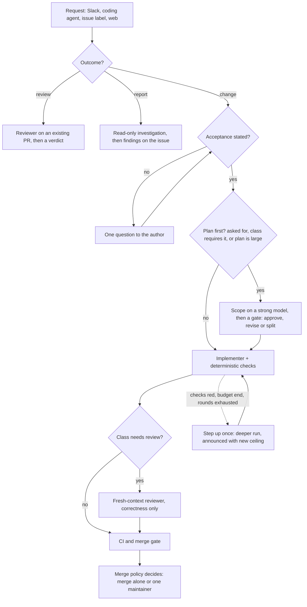

# Workflows and roles redesign: research

**Date:** 2026-11-24 · **Feeds:** [workflows and roles redesign design](2026-11-24-workflows-roles-redesign-design.md) · **Method:** seven research notes (engine audit of Maku at `2e0c6fd3` and this repository at `822fed7`, a walk of seventeen user scenarios with a UI audit, the project's earlier reviews, commercial products, open-source frameworks, empirical evidence, selection and scaling patterns), synthesised into one report. Nothing was run against a cluster.

## Replace three bundles with one growing path

Agent Factory should stop asking people to pick a bundle of roles up front and instead run **one path that starts cheap and grows on evidence**: an implementer plus deterministic checks by default, verification added by what the change touches, depth added when a check or a person says the cheap path failed, and decomposition added only when the plan is large. The three workflows are not wrong as names, but each hides several independent choices: `careful` alone bundles the scoper, the judge, search, the splitter and the frontier budget, so its parts can be neither chosen nor measured apart, and no role has a measured value because the one comparison built to price them recorded zero tasks. The external evidence points one way: fixed multi-agent topologies scored 2.1% to 14.9% below a single agent on SWE-bench Verified at 1.6 to 6.2 times the turns, while "start low, escalate after a verified failure" matched or beat always-maximum effort on every model tested. The products that survived 2026 converged on one default agent, an optional plan step, a separately triggered fresh-context reviewer, and (in the two that expose pipelines as data, Warp and Kiro) stages that are responsibilities rather than agents. Six of seventeen user scenarios have no path today because the unit of work is hard-wired to "one issue, one pull request, one maintainer approval": design approval before code, report-only work, parallel parts, multi-repository execution, any change of course after filing, and a team's own roles or order. The redesign below is ranked so that the first four proposals need no new engine concept: repair what the shipped configuration gets wrong, show one honest card on every surface, turn on the step-up the engine already has, and measure roles passively. The owner has eight decisions to make, the first being whether to lift the "measure first" freeze that currently blocks every one of the cheaper wins.

## The three workflows bundle choices that vary independently

### A workflow is a config bundle, and the shipped bundles disagree with their own description

In code a workflow is not an engine concept. It is a named bundle of one of three fixed templates (`solo`, `pair`, `investigate`), an optional tier raise, a `checks` flag and a `loops` row, frozen onto the task at triage; the engine then runs one hard-coded order, scoper → tester → implementer (with the judge inside its harness) → reviewer → CI → gate ([workflows.go](https://github.com/Smana/maku/blob/2e0c6fd3/internal/factory/config/workflows.go#L23-L40), [reconciler.go](https://github.com/Smana/maku/blob/2e0c6fd3/internal/factory/reconciler/reconciler.go#L1567-L1602)). Reading the shipped definitions against the reference manifests gives a table that differs from what the site tells users.

| Workflow | What runs on the reference host | Task ceiling | What the name suggests but does not hold |
|---|---|---|---|
| `quick` | implementer → CI → gate; no repository checks | $5.10, same as `standard` | "Quick" names fewer roles, not a smaller budget; under a policy that needs a verdict it never merges alone |
| `standard` | implementer → reviewer (2 rounds at most) → CI → gate | $5.10 | **No completion judge and no stall rule**, although two site pages say it has a judge |
| `careful` | scoper → [tester, on opt-in] → implementer with search and in-harness judge → reviewer → CI → gate | $13.60 | The split it advertises is **unreachable**; the tester is wired to the name by a constant |

The sources for that table are the config defaults, the ANR overrides and the tier caps ([workflows.go](https://github.com/Smana/maku/blob/2e0c6fd3/internal/factory/config/workflows.go#L23-L40), [factory.yaml](https://github.com/Smana/ai-native-ref/blob/822fed7/tooling/base/agent-factory/resources/factory.yaml#L30-L58)). Three of its cells are defects rather than design. First, the stall rule and the judge are on only when a loops row sets one of three keys, and `standard`'s row sets none, so the default workflow has no protection against the wandering run that motivated the loop work in the first place ([config.go](https://github.com/Smana/maku/blob/2e0c6fd3/internal/factory/config/config.go#L2516)); the operator guide still records that an open "find out why" "once spent its whole $2.55 on 319 `grep` steps and pushed nothing" ([tune-a-run.md](https://github.com/Smana/ai-native-ref/blob/822fed7/website/content/docs/operate/tune-a-run.md#L20-L21)). Second, a split is offered only when the classification tier is `frontier` or the row sets `anyTier`; no classifier is wired, every task is classified `standard`, and neither the shipped row nor ANR sets `anyTier`, so the scoper is never offered a split on the reference host while the site presents it as part of `careful` ([split.go](https://github.com/Smana/maku/blob/2e0c6fd3/internal/factory/reconciler/split.go#L31-L44), [classify.go](https://github.com/Smana/maku/blob/2e0c6fd3/internal/factory/triage/classify.go#L112-L118)). Third, the tester runs only when the workflow's name equals the constant `careful`, so a custom workflow can never run it ([workflows.go](https://github.com/Smana/maku/blob/2e0c6fd3/internal/factory/config/workflows.go#L112-L116)).

The names also carry no fixed meaning across installs. Maku's own laptop demo redefines `solo` with a reviewer and gives `standard` a scoper and a judge, so `quick` has a reviewer in the demo and none on the reference, and the merge gate's reviewer rules read the template's roles rather than the workflow's name ([values-demo.yaml](https://github.com/Smana/maku/blob/2e0c6fd3/charts/agent-factory/values-demo.yaml#L144-L185), [arm.go](https://github.com/Smana/maku/blob/2e0c6fd3/internal/factory/reconciler/arm.go#L663-L681)). v5's analytics "by workflow" would therefore compare unlike things between two installs.

### Nothing picks per task, and nothing can change after filing

Selection is deterministic and happens once: an adopted pull request runs `none`; a maintainer's pin wins; reverts, oracle findings and schedules get `quick`; everything else gets the repository default, `standard` ([workflow.go](https://github.com/Smana/maku/blob/2e0c6fd3/internal/factory/triage/workflow.go#L23-L48)). The planner's suggestion is display only and the scoper's recommendation is recorded and never applied; with the shipped workflows it cannot be applied even in `apply` mode, because the scoper runs only on tasks that were pinned or drawn into an arm ([profile.go](https://github.com/Smana/maku/blob/2e0c6fd3/internal/factory/reconciler/profile.go#L20-L64)). So the sentence on the site, "The planner picks the workflow", overstates what happens: the factory applies the repository default unless a maintainer intervenes ([writing-a-good-task.md](https://github.com/Smana/ai-native-ref/blob/822fed7/website/content/docs/use/guide/writing-a-good-task.md#L105)). After filing, `/factory retry` re-runs the same workflow, the automatic step-up exists in the engine but no shipped workflow sets `escalation`, and the only way to try again deeper is to relabel and re-apply `factory/ready`, which creates a new task ([watch.go](https://github.com/Smana/maku/blob/2e0c6fd3/internal/factory/reconciler/watch.go#L381-L441), [stepup.go](https://github.com/Smana/maku/blob/2e0c6fd3/internal/factory/reconciler/stepup.go#L18-L87)).

### Six of seventeen scenarios have no path, and they share one cause

The journey audit walked seventeen needs from a typo to a team-defined shape. Three are covered well (a one-line docs fix, a small bug with a reproduction, fixes on the factory's own pull requests), eight awkwardly, and six not at all: approving a design before code, multi-repository execution, parallel sub-tasks, a question or spike that ends in a report, pausing or changing the workflow mid-task, and a team's own roles or order. Review of a human's pull request is reachable only by a power-user route of room → data class → "start a run as reviewer" → pull-request URL, and two-human sign-off has no setting. The common cause is structural: every uncovered scenario is one where the unit of work is not "one issue → one pull request → one maintainer approves once". Either the outcome is not a pull request, or there is more than one, or the human gate sits somewhere other than the merge. The engine confirms each wall: split parts open strictly one after another ([split.go](https://github.com/Smana/maku/blob/2e0c6fd3/internal/factory/reconciler/split.go#L450-L510)); a plan holds up to three issues but `start` files the first and Slack refuses the plan outright ([start.go](https://github.com/Smana/maku/blob/2e0c6fd3/internal/maku/start.go#L278-L280), [proposal.go](https://github.com/Smana/maku/blob/2e0c6fd3/internal/slackapp/proposal.go#L79)); multi-repository `execute` "refuses every filing and admission" in this release ([multi-repository.md](https://github.com/Smana/maku/blob/2e0c6fd3/docs/multi-repository.md#L8-L9)); and roles and templates are closed lists in Go and in the Task CRD ([config.go](https://github.com/Smana/maku/blob/2e0c6fd3/internal/factory/config/config.go#L1457)). The concept load shows the same cliff: three or four concepts for the default path, nine concepts and two command syntaxes (labels and `/factory` comments) as soon as a `careful` task asks a question and proposes a split.

Recorded tasks show where the static choice costs money. A broad issue on the default "exhausted its run budget before a PR", and a `standard` fix run spent 1.8 M tokens on a CI failure outside its diff before escalating ([results 2026-11-16](https://github.com/Smana/ai-native-ref/blob/822fed7/docs/runbooks/agent-factory/results-aws-0-2026-11-16.md#L54), [residuals](https://github.com/Smana/ai-native-ref/blob/822fed7/docs/runbooks/agent-factory/results-aws-0-2026-11-17-residuals.md#L17)). A `workflow:quick` docs fix used 1.2 M tokens and 41 minutes from label to merge, another 338 k tokens in 15 minutes, so even the cheapest workflow has no predictable cost ([issue #433](https://github.com/Smana/ai-native-ref/issues/433), [issue #469](https://github.com/Smana/ai-native-ref/issues/469)). Two `standard` tasks cost $0.54 and $0.25, of which the reviewer was $0.09 and $0.08 ([results 2026-11-16](https://github.com/Smana/ai-native-ref/blob/822fed7/docs/runbooks/agent-factory/results-aws-0-2026-11-16.md#L33)). These are single readings, not rates: the status page records that "the reference trial was turned off (#414) before it recorded a task" ([status.md](https://github.com/Smana/ai-native-ref/blob/822fed7/website/content/docs/status.md#L86)).

### The surfaces name the workflow without explaining or pricing it

At confirmation the workflow is an enum of bare names in the coding-agent form and "Workflow: <name>" options in Slack; the one-line descriptions exist in config and reach no confirmation surface ([start.go](https://github.com/Smana/maku/blob/2e0c6fd3/internal/maku/start.go#L259-L270), [pin.go](https://github.com/Smana/maku/blob/2e0c6fd3/internal/slackapp/pin.go#L87-L101)). On the label path a person learns the workflow only after money is being spent, and on `careful` four minutes after the first run began, in a comment that called the scoper's run "(triager)" ([issue #438](https://github.com/Smana/ai-native-ref/issues/438)). The reason offered is "(default)" or "(pinned by a maintainer)"; cost appears as a ceiling before, as dollars in the room, and as tokens and minutes on GitHub, where every run-start comment also prints "(tier standard)" beside a workflow that may be `quick` ([narrate.go](https://github.com/Smana/maku/blob/2e0c6fd3/internal/factory/narrate/narrate.go#L379-L380)). The word "profile" survives in every identifier a person can meet (`profile_unknown`, `status.profile`, the catalogue's `"profiles"` key), and `start` still applies a `class:` label that triage then announces as unread. The best asset is already built and under-used: the web room's run rail draws every run as done, running or **planned**, with duration, dollars and model, and renders as a one-line strip ("scoper ✓ · tester ✓ · implementer ● · reviewer ○") on narrow screens ([rail.ts](https://github.com/Smana/maku/blob/2e0c6fd3/web/src/rail.ts#L296-L306)). That strip exists on no other surface, and most "needs you" cards in the room end in "Answer it on GitHub" or "comment /factory retry" ([needs.ts](https://github.com/Smana/maku/blob/2e0c6fd3/web/src/needs.ts#L61-L96)).

## The evidence backs one writer, fresh-context review and escalation on failure

### Adding agents does not raise coding success; it raises cost

The largest controlled study (260 configurations, eight models on the coding benchmarks, reasoning-token budget matched) found every multi-agent topology below the single agent on SWE-bench Verified, from −2.1% (hybrid) to −14.9% (independent), with 3.6 to 6.2 times the turns for coordinated topologies and 13.6 to 42.4 successes per 1,000 tokens against 67.7 for the single agent ([Kim et al., v3](https://arxiv.org/html/2512.08296v3)). Its mechanism matters for this platform: once a single agent solves more than about 45% of a task class, coordination has little left to add. Two agents implementing separable but conflicting features reached 25.8% to 28.1% where one agent doing both reached 47.1% to 48.3% ([CooperBench](https://arxiv.org/html/2601.13295)). Anthropic's own guidance prices multi-agent implementations at "3-10x more tokens" and reports that in an internal planner, implementer, tester and reviewer experiment "the subagents spent more tokens on coordination than on actual work" ([Anthropic, 2026-01-23](https://claude.com/blog/building-multi-agent-systems-when-and-how-to-use-them)). The standardised SWE-bench Pro leaderboard's top five rows are all a 100-line single agent with one bash tool; rows differ by model and effort, not by roles ([Scale leaderboard](https://labs.scale.com/leaderboard/swe_bench_pro_public)).

Two cautions keep this honest. A sequential pipeline with one writer is not the parallel-writers case those negative results target, and no controlled study measures a scoper/tester/implementer/judge/reviewer chain against a single agent at matched cost. And leaderboards score test-passing, which overstates mergeability by about half, so the absence of reviewers in top entries is evidence about test-passing only.

### What the evidence says about each role

| Role | What the evidence supports | What it does not support | Strength |
|---|---|---|---|
| Implementer | The default, alone, at modest effort; a retry at higher effort after a verified failure | Maximum effort everywhere | Moderate to strong |
| Reviewer | A fresh-context, correctness-only filter over the diff and the acceptance check, allowed to stay silent | Acting as the approving authority; a cheaper second-family model | Moderate |
| Scoper | An ambiguity gate that asks one question; splitting large work on a strong model | A mandatory planning stage for small or well-specified tasks; planning on a weaker model than the writer | Moderate (asking), weak (planning) |
| Judge | Deterministic checks first, then triage over machine evidence only | An LLM reading the agent's narrative to decide "done" | Moderate to strong against the current form |
| Tester | An immutable, red-on-base contract for reproducible bug fixes, with a dispute path | A default stage; test-first for docs, config or refactors | Strong for valid tests, untested for independence |

**The reviewer has the clearest unmet need and the weakest raw instrument.** Maintainers of scikit-learn, Sphinx and pytest would merge roughly half of the agent pull requests that pass SWE-bench's tests, a 24.2-point gap to the automated grader ([METR, 2026-03-10](https://metr.org/notes/2026-03-10-many-swe-bench-passing-prs-would-not-be-merged-into-main/)). Yet the best review system on 1,000 real pull requests reached 16.65% precision and 19.38% F1, with functional defects detected at about twice the recall of maintainability ones ([SWR-Bench](https://arxiv.org/html/2509.01494v1)); more context made all eight tested models worse ([SWE-PRBench](https://arxiv.org/html/2603.26130v1)); and pull requests reviewed only by agents merged 45.20% of the time against 68.37% for human-only review ([MSR 2026](https://arxiv.org/html/2604.03196v1)). Production systems that report good numbers all filter for precision: Uber suppresses style and readability findings and grades confidence with a second model ([Uber](https://www.uber.com/bd/en/blog/ureview/)). A different model family finds partly different errors only when it is as strong as the first ([Song, 2026-10](https://arxiv.org/abs/2610.01471)).

**The scoper is two jobs with different evidence.** Separating underspecification detection from execution lifted the resolve rate on underspecified issues to 69.40% while conserving questions on simple tasks ([Edwards and Schuster](https://arxiv.org/abs/2603.26233)), and a small clarification module matched a frontier model with 41% fewer questions ([CLARITI](https://arxiv.org/abs/2604.14624)). The factory's deterministic acceptance-heading guard is exactly that separate detector, but it runs only on `careful`. Planning is different: explicit planning gained the weakest model 11.6 points and cost the two strongest 0.4 to 2.0 points on SWE-bench Verified, the authors concluding that "Planning shifts from an accuracy scaffold for weaker models to a cost saver for stronger models" ([Fan et al.](https://arxiv.org/abs/2609.20804)); and "A subpar plan hurts performance even more than no plan at all" ([Liu et al.](https://arxiv.org/abs/2604.12147)). The scoper runs at the `light` tier's caps today, which is the risky assignment: the field puts the strong model on the plan and the cheap one on execution ([Cursor, 2026-07-20](https://cursor.com/blog/agent-swarm-model-economics)).

**The judge's measured failure is that it believes the closing narrative.** Across five judges and five prompt strategies no configuration exceeded AUROC 0.65 on false-success detection, and 0.54 on API-call traces, because judges rely on "confident closing language" ([Advani](https://arxiv.org/abs/2606.09863)). On patch correctness LLM judges reached 77.3% to 80.4% accuracy with 17.2% to 22.1% false positives ([ESEM 2026](https://drops.dagstuhl.de/storage/00lipics/lipics-vol394-esem2026/LIPIcs.ESEM.2026.21/LIPIcs.ESEM.2026.21.pdf)). The production judge with a published role, Spotify's, runs after deterministic verifiers and asks a narrower question (does the diff match the prompt?); it vetoes about a quarter of sessions, most often for scope creep, and Spotify states it has no evals for it ([Spotify](https://engineering.atspotify.com/2025/12/feedback-loops-background-coding-agents-part-3)).

**The tester's validity bottleneck has closed; its independence is unmeasured.** Human-written tests supplied up front gave 94.3% on SWE-bench Verified; generated ones gave 68.0% at four times the cost, $2.83 of $4.12 going to test resolution ([TDFlow](https://arxiv.org/html/2510.23761v2)). By November 2026 a general-purpose single agent writes a valid fail-to-pass test for 87.8% of SWT-Bench Verified issues, within four points of the best specialised system ([SWT-Bench](https://swtbench.com/)). No study compares a separate tester run with "the implementer writes the failing test first".

### Start cheap and escalate on a verified failure

The one counterfactual study of effort found that starting at the lowest effort and retrying once at the highest after a failed external check "matches or improves on fixed top effort across all models and benchmarks", with a median 15.5% cost saving on SWE-bench Pro, while the highest effort cost up to 42 times the lowest on tasks every level solves ([Sun et al.](https://arxiv.org/abs/2610.34491)). Higher reasoning effort reduced accuracy in 21 of 36 runs of a 21,730-rollout evaluation ([HAL](https://arxiv.org/abs/2510.11977)). A cascade that tries the single agent first and the multi-agent system only when needed improved accuracy 1.1% to 12% while cutting cost up to 20% ([Gao et al.](https://arxiv.org/abs/2505.18286)). Conversely, sizing from the request text does not work as a difficulty oracle: prompt-only routers scored Route-AUC 0.37 to 0.57 on coding tasks ([SWE-Router](https://arxiv.org/html/2607.00053v1)), and the one production A/B of an up-front router cut median cost 64% with no change in merged pull requests but reported no mis-sizing rate ([LangChain](https://www.langchain.com/blog/how-to-build-a-model-router-in-the-harness)). The policy needs one thing the factory already has: a deterministic failure signal (checks red, budget end, review rounds exhausted). The support is moderate, not strong: the coding half of the effort study is a 44-instance pilot, and part of the laddering gain is simply the second attempt, which the fixed-effort arm does not get.

### Task type sets the base rate a workflow must beat

On 7,156 reviewed agent pull requests, chores merged at 84.0% and docs at 82.1% with no special pipeline, features at 66.1%, fixes at 66.0% and performance work at 55.4%; the 29-point task-type gap exceeds the variance between agents ([Pinna et al., MSR 2026](https://arxiv.org/html/2602.08915v1)). Extra roles have little headroom on docs and chores and 15 to 30 points on features and fixes. Stripe merges over a thousand agent-produced pull requests a week with one agent loop interleaved with deterministic lint and test steps and "at most two rounds of CI" ([Stripe](https://stripe.dev/blog/minions-stripes-one-shot-end-to-end-coding-agents)). Long-horizon work is where single runs still fail (GPT-5 at 23.3% on SWE-bench Pro at launch, against over 70% on Verified; the standardised board's best row is 61.5% a year later), which argues for splitting large work into small tasks that each take the simple path rather than a larger team on one task ([SWE-bench Pro](https://arxiv.org/abs/2509.16941)).

## Other products converged on one default, optional plans and stages that are not agents

### No hosted product asks the user to assemble roles for an ordinary task

Across GitHub Copilot, Cursor, Devin, Codex, Claude Code, Factory, Amp, Warp and Kiro the same four layers recur: a single default agent, an optional read-only plan step, on-demand sub-agents, and a separately triggered review agent with its own effort dial (Bugbot's Low/Default/High/Smart, Copilot's Lite/Balanced/Max/Adaptive, Claude Code's `/code-review low…ultra`) ([Cursor Bugbot](https://cursor.com/docs/bugbot), [Copilot code review](https://docs.github.com/en/copilot/concepts/agent-capabilities/agent-powered-workflows-and-operations/code-review), [Claude Code Review](https://code.claude.com/docs/en/code-review.md)). The two products that express the issue-to-pull-request pipeline as editable data keep separation as the exception. Warp's default Blueprint is Triage → *Plan needed?* → Planning → Human plan review → Implementation → Independent review → Human PR review, but its default workers are only three, and its docs say so directly: "Triage, planning, implementation, and review are stage responsibilities, not a requirement to create a separate worker for each one" ([Warp workers](https://docs.warp.dev/factories/factory-agents/)). The amount of process is decided per request by prose conditions ("The request has unresolved decisions or explicitly requires a plan" → plan; "The request is fully defined" → implement), and human approval is a named gate with an optional condition ([Warp transitions](https://docs.warp.dev/factories/blueprints/routes/), [Warp gates](https://docs.warp.dev/factories/blueprints/gates/)). Kiro ships named tracks (Default, Spec, Quick Spec, Bug Fix, Plan) and a three-position dial for when it may start a multi-agent workflow on its own, defaulting to "Only when asked" after it walked back auto-starting ([Kiro Workflows](https://kiro.dev/docs/workflows.md)).

### Preset names that hide several choices get removed

Amp is the best-documented case. It retired its named modes because "The old modes were models in disguise: each name hid a model, a prompt, a reasoning effort", replaced them with a dial that asks one question ("how hard is this task?"), found that 69% of users never moved it off `medium`, cut per-role model tuning back to one role per mode, and removed the dial itself four months later when it leaked who was paying ([The Dial](https://ampcode.com/news/the-dial), [Who Cares About the Model?](https://ampcode.com/news/who-cares-about-the-model), [Bye Bye, Dial](https://ampcode.com/news/bye-bye-dial)). The parallel to `quick`/`standard`/`careful` is direct: each hides a template, a tier and a loops row. The opposite failure is an automatic choice with hidden cost: ChatGPT's router-only launch and Cursor's "Auto" pricing both drew backlash and were followed by restored pickers and usage visibility ([TechCrunch on GPT-5](https://techcrunch.com/2025/08/12/chatgpts-model-picker-is-back-and-its-complicated/), [TechCrunch on Cursor](https://techcrunch.com/2025/07/07/cursor-apologizes-for-unclear-pricing-changes-that-upset-users/)); both are known here through press coverage only. The accepted pattern is automatic by default with a visible reason, a price and a one-step override: Copilot's triage automations record a rationale and a confidence for every automatic decision and apply only high-confidence ones by default ([GitHub](https://docs.github.com/en/copilot/concepts/agent-capabilities/agent-powered-workflows-and-operations/about-automation-rationale-and-approvals)); Claude Code shows the planned phases and a token caution before a workflow runs ([Claude Code workflows](https://code.claude.com/docs/en/workflows)).

### Open-source projects dropped persona hierarchies and kept roles as files

Seven workflow-definition models are in use; the LLM-routed persona middle was archived or demoted through 2026. AutoGen was archived on 2026-11-20, ChatDev moved its CEO/CTO chain to a maintenance branch and rebuilt as a YAML graph engine, Kilo removed its Orchestrator mode, and Agent OS added a roles system and retired it two weeks later as "Too complex, and better handled with standard tooling" ([AutoGen](https://github.com/microsoft/autogen), [ChatDev](https://github.com/OpenBMB/ChatDev), [Kilo](https://kilo.ai/articles/roo-to-kilo-migration-guide), [Agent OS changelog](https://github.com/buildermethods/agent-os/blob/main/CHANGELOG.md)). What survived is a layering: a few named tracks a user picks, each a stored declarative definition a power user can fork. Spec Kit's `speckit`, `bugfix` and `assess` are installable workflow YAML built from a small step vocabulary (command, shell, gate, if, bounded while, fan-out, fan-in, sub-workflow), and its gate can be pre-answered by a declared input so the same definition runs attended or unattended ([Spec Kit step types](https://github.github.com/spec-kit/workflow-steps/types.html)). Microsoft's stated reason for moving orchestration into a document is review: an approval step becomes "a YAML change rather than a code change" ([Microsoft](https://devblogs.microsoft.com/agent-framework/move-agent-orchestration-workflows-out-of-code-with-agent-framework-declarative-workflows-1-0/)). Roles in every surviving tool are a file (prompt, tool permissions, model) that users can add; a fixed role enum is unusual. Scaling down is done by a light track that is the default entry point, and BMAD states the selection rule this report adopts: "Build decides how much ceremony a change needs after investigating it, not before" ([BMAD releases](https://github.com/bmad-code-org/BMAD-METHOD/releases)). Among Kubernetes-native projects, Kelos's `TaskPipeline` is the only purpose-built stages resource found, linear with matrix fan-out and no loop or gate, and its own factory gates work with tracker comments (`/kelos plan`, then `/kelos pick-up`) rather than in-workflow pauses ([Kelos reference](https://github.com/kelos-dev/kelos/blob/main/docs/reference.md), [Kelos self-development](https://github.com/kelos-dev/kelos/blob/main/self-development/README.md)). Agent Factory's enforced per-run dollar and token caps are stronger than anything in these definitions and should stay a first-class field.

### Checkpoints work when they are few, and large work needs a planner with isolated workers

People accepted 93% to 97% of permission prompts and caught 13.6% of dangerous commands in a controlled study, falling to about 5% after fifty prompts ([Anthropic, 2026-08-07](https://claude.com/blog/auto-mode-default-in-claude-code)). Plan approval works as a preference check rather than a correctness check, so plans should be short, default to proceeding, and wait only when the planner is unsure, as Devin's does ([Cognition, Devin 2.1](https://cognition.ai/blog/devin-2-1)). For large work the field converged on one planner that holds the plan, workers that do not talk to each other, and an independent check before integration; Cursor removed its integrator role because "it created more bottlenecks than it solved" ([Cursor](https://cursor.com/blog/scaling-agents)). Devin decomposes large changes into stacked pull requests built on GitHub's native stacks, which reached general availability on 2026-10-06 and land as one merge group ([Devin stacked PRs](https://docs.devin.ai/work-with-devin/stacked-prs.md), [GitHub changelog](https://github.blog/changelog/2026-10-06-stacked-pull-requests-generally-available)). Review depth in large organisations follows what a change touches and how reversible it is, not its size; Meta's risk-stratified funnel reviewed over 535,000 diffs with about one-third the revert rate of other diffs, though the funnel selects low-risk diffs, so that ratio is not a causal effect ([RADAR](https://arxiv.org/abs/2605.30208)).

**What the commercial survey does not cover.** The notes are marked work in progress. Linear and Slack agent integrations, Augment Code, Replit Agent, Tembo, Charlie Labs and Sweep-style services were not surveyed; the Amp profile was added late and the file's own status line still lists it as open; no independent user evidence (forums, reviews) was gathered for any product, so everything above is the vendors' description of themselves; screens were read from documentation, not seen; and the cross-product synthesis sections were left as drafts. No product was found that automatically escalates a failed cheap run to a heavier process, so proposal 3 below has research support but no product precedent.

## The redesign: one card, one ladder, four outcomes, readable definitions

### The model in one picture

The proposal separates three questions that one preset name answers today: how much model and effort (start modest, climb on failure), how much verification (derived from what the change touches), and how much decomposition (derived from the plan's size). The person sees one card and at most three possible stops: what is wanted, is this plan and ceiling acceptable, may this merge.

Presets stay as names for points on this path (`quick` = implementer and checks; `standard` = plus reviewer; `careful` = plus plan gate and frontier budget), so nothing a user has learned is lost; what changes is that the factory may move a task along the path with a visible reason, and that each addition can be turned on without taking the rest.

### Ranked proposals

| # | Proposal | Main evidence | Reverses | Cost | Needs engine work |
|---|---|---|---|---|---|
| 1 | Repair the shipped model so it matches its description | Engine audit: three defects, stale site and Maku pages | Nothing | Small | Config and docs only |
| 2 | One card and one path strip on every surface, one vocabulary | Journey audit; Copilot rationale, Claude Code phase list | "No metric or label is renamed" (display only) | Small to medium | No |
| 3 | Step up once on verified failure, and "run again deeper" by hand | Sun et al., Gao et al.; `stepUp` already built | WF8 "escalation stays off"; SI11 "not an intent" | Medium | Small |
| 4 | Measure every role passively on every task | Zero-task trial; v5 Track 3 | The A/B as the only instrument (WF8) | Medium | Small |
| 5 | Unbundle `careful`: verification from class and paths, scope gate everywhere, tester by class, judge on machine evidence | Role table above; Meta, Google | WF2 bundle; parts of HR1; tester wired to `careful` | Medium | Yes |
| 6 | Outcomes beyond a pull request: plan-first gate, review-only, report-only | Six no-path scenarios; Warp gates, Kiro tracks, Devin Ask | "Every task's product is a pull request"; UX review web rulings | Medium to large | Yes |
| 7 | Act where you read: answer, accept, retry, step up and file from room, CLI and Slack | Journey audit section 6; Warp "Waiting on you" | UX review: no filing or workflow choice on the web | Medium | Mostly wiring |
| 8 | Decomposition that fits the evidence: file whole plans, reachable split, parallel only when disjoint, stacks | CooperBench, Cursor, GitHub stacks | SL7 "one child at a time"; CD19 | Large | Yes |
| 9 | A workflow as one readable, forkable definition; roles as files over closed capability profiles | Warp, Kiro, Spec Kit, Kelos; Agent OS and Amp as warnings | Non-goals "new roles, a workflow editor"; HR1 "add none" | Large | Yes |

Costs are this report's estimates from the audit of what exists, not measured: small means config, strings and docs; medium means one design spec and one plan in Maku with an ANR pin bump; large means a CRD change or a new reconciler path. The rulings each proposal reverses are recorded in these documents:

| Ruling | Where it is recorded | Touched by |
|---|---|---|
| WF2 three workflows, no adaptive one; WF8 measure first, `escalation` off; non-goals "New roles. A workflow editor"; anti-goal "a fourth workflow" | [workflows review](https://github.com/Smana/ai-native-ref/blob/822fed7/docs/superpowers/specs/2026-11-14-workflows-review-design.md#L48-L56) | 3, 4, 5, 9 |
| HR1 "Keep every role; add none; merge none"; reviewer lenses, architect split, best-of-N rejected | [harness roles](https://github.com/Smana/ai-native-ref/blob/822fed7/docs/superpowers/specs/2026-10-30-harness-roles-design.md#L41) | 5, 9 |
| L1 "One writer, sequential roles; no teams, swarms or parallel candidates" | [loops and teams](https://github.com/Smana/ai-native-ref/blob/822fed7/docs/superpowers/specs/2026-10-21-loops-and-teams-design.md#L27) | 8 (kept: one writer per branch) |
| SL4 no child before `/factory split`; SL7 "One child at a time, in order" | [splitter](https://github.com/Smana/ai-native-ref/blob/822fed7/docs/superpowers/specs/2026-10-23-splitter-design.md#L53-L56) | 8 |
| "File a task: web no", "Choose the workflow: web no"; stop and retry out of the MCP server | [UX review](https://github.com/Smana/ai-native-ref/blob/822fed7/docs/superpowers/specs/2026-11-14-ux-review-design.md#L303-L314) | 7 |
| SI11 "'Change the workflow or the merge policy' is not an intent" | [Slack intents](https://github.com/Smana/maku/blob/2e0c6fd3/docs/superpowers/specs/2026-11-11-slack-intents-design.md#L79) | 3 |
| CD19 the plan "never turns one outcome into parts"; plan-approval gate deferred | [conversational devex](https://github.com/Smana/ai-native-ref/blob/822fed7/docs/superpowers/specs/2026-11-05-v3x-conversational-devex-design.md#L147-L159) | 6, 8 |

**1. Repair the shipped model.** Give the default loops row a stall rule (with `judge: none` if the judge stays out of `standard`), so every workflow stops a run that commits nothing; make the `careful` split reachable on a factory with no classifier (ship `anyTier` or drop the tier condition); replace the `careful` name constant behind `testFirst` with a row key; stop `start` applying the dead `class:` label; and correct the pages that contradict code, starting with the two that say `standard` has a judge, the one that says the planner picks the workflow, and the harness reference that lists keys a workflow does not have. *Evidence:* every item is a code-versus-record contradiction in the audit, and the stall rule is the project's own answer to the 319-`grep` run. *Reverses:* nothing; the stall rule in `standard` stays within WF8, which excluded the judge, not the rule. *Cost:* small, though whether a row may set `stallSteps` with `judge: none` without turning continuations on should be confirmed in `config.go` before the change. *Stays out:* any new key, name or behaviour.

**2. One card and one path strip everywhere.** Wherever a task is named, show the same four facts: *what will run* (the planned roles as the rail's strip), *why* (built from deterministic facts: "this repository's default", "pinned by @x", "touches `infrastructure/`", "the planner suggested quick"), *what it is expected to cost* (the ceiling now; a typical range per class once proposal 4 has data), and *change*. Put it in the Slack plan, the `start` form (as a described option list, not an enum of names), the first GitHub comment (posted before the first run, naming the scoper as "scoper", in dollars, without the word "tier"), the pinned status comment, `maku status` and the `task` tool. Finish the vocabulary: one word for the budget, one for stopping, "workflow" in every visible string with `profile_*` codes kept as aliases. *Evidence:* the journey audit's sections 2, 3 and 6; the accepted "auto with a visible reason" pattern; Amp's and Cursor's failures of opacity. *Reverses:* the workflows review's "no metric or label is renamed" only for strings a person reads; metrics keep their names. Use one fixed status vocabulary on every surface (planning, working, checking, waiting on you, waiting on a check, done, stopped), and show the workflow in force in two places, the task header and the thread, since a mode that is active without being visible is the classic source of mode errors ([NN/g](https://www.nngroup.com/articles/modes/)). *Cost:* small to medium; the source, the suggestion, the scoper's why and the planned roles are already in the task's status and the catalogue, and the strip renderer exists. *Stays out:* typical-cost figures until they are measured; a confidence light until its calibration can be checked; any new choice on the card.

**3. Step up once on verified failure, and "run again deeper" by hand.** Set `escalation` on the shipped workflows so a task that ends out of budget, stalled, not met or with review rounds exhausted runs once more one step deeper before a maintainer is asked, and announce it in one message: what changed, the trigger, the new ceiling, and stop. Offer the same act to a person as one button on an escalated or no-op task in the room, Slack and the CLI. Show the worst case before start as "up to $X if it steps up". *Evidence:* laddering matched or beat fixed top effort on all models at a median 15.5% lower cost; cascades improved accuracy while cutting cost; the engine's `stepUp` already enforces once-only, never-same-workflow and fits-the-budget. *Reverses:* WF8's "`escalation` stays off" until measured, and the Slack-intents ruling SI11 that changing the workflow "is not an intent". It does not revive the rejected adaptive workflow, whose flaw was that every task paid a scoper; here only failed tasks pay. *Cost:* medium: config, the notice, the ceiling arithmetic and a manual trigger. Today the manual route is a new `factory/ready` that supersedes the escalated task with a new one; whether that new task keeps the branch, the room and the spend was not established by the audit and must be settled in the spec. *Stays out:* a difficulty classifier on the request text; model switches inside a run; more than one automatic step; stepping up a pinned task without asking.

**4. Measure every role passively.** Stop waiting for an A/B cohort. Record on every task, per role: cost, whether the reviewer's `changes` led to a commit and whether the owner's merge decision agreed with its `approve` (the false-approve rate no vendor publishes), the judge's verdict against the eventual outcome (its confusion matrix), how often the scoper asked and whether the answer changed the scope, and how often a step-up rescued a task. Report cost per merged pull request by class and by stage, not by workflow name, and add the interface's own health signals as hypotheses to watch: the share of automatic choices left unchanged, the override rate per class, the share of tasks that stepped up and how many then finished, and the error between expected and actual cost. *Evidence:* the trial was turned off before recording a task; per-role proofs P1 to P10 have no results; v5 Track 3 and the "100 Real PRs" report already commit to cost per merged pull request; LangChain's stopped always-fast arm shows quality must be in the measure. *Reverses:* WF8's premise that a controlled comparison comes first; the comparison stays possible but stops being a precondition. *Cost:* medium, mostly inside v5's analytics track. *Stays out:* per-user leaderboards; any automatic change of defaults from these numbers without an owner ruling.

**5. Unbundle `careful` and reform the roles.** Derive verification from the class and paths the merge policy already uses, so a one-line change to a deploy manifest gets a reviewer and a 400-line docs rewrite does not need a scoper. Run the acceptance guard on every workflow (it is deterministic and free) and let it ask the one question at intake, where the planner already asks. Make the scoper's plan step a strong-model run reserved for plan-first tasks and large plans. Gate the tester by class (reproducible bug fixes) instead of by workflow name, keep `contract_disputed`, and compare it once against "implementer writes the failing test first". Narrow the judge to machine evidence (check runs, exit codes, numeric pass and fail counts in a structured handoff) and to the question Spotify's asks, whether the diff matches the request. Keep the reviewer on diff plus acceptance, correctness only, silence allowed. *Evidence:* the role table above; risk-based review at Meta and Google; base rates of 82% to 84% on docs and chores against 55% to 66% on features, fixes and performance. *Reverses:* WF2's three-bundle shape in substance while keeping its names; HR1's "merge none" only where the scoper's question moves to intake; the tester's binding to `careful`. *Cost:* medium, in triage and config; the judge's change must be designed together with v5's harness swap, because the judge, the stall rule and the scoper's bound live in the OpenHands image today. *Stays out:* reviewer lenses, a second reviewer and a second-family reviewer as defaults (the last is supported only at equal model strength); a learned critic; best-of-N.

**6. Outcomes beyond a pull request.** Add a second, usually inferred, fact to a task: its outcome. *Change* is today's path. *Plan first* stops after the scope and waits for approve, revise or split, with the gate expressed as a tracker event and pre-answerable by policy, then continues as a change; this is the "plan-approval gate where the scoper's plan waits before code" the project already deferred. *Review* runs the reviewer on a pull request the factory did not write and posts a verdict, from a label, a Slack mention with a URL, or a web button. *Report* runs the read-only investigating role on public work and ends with findings on the issue and an offer to file the fix, so "find out why" stops being a failed task. Each human wait is a state with a reason, a deadline and a stated default (proceeds, or stays parked), holding no pod, which is where Claude Code's workflows ("No mid-run user input") and LangGraph's node re-execution are weakest ([Claude Code workflows](https://code.claude.com/docs/en/workflows), [LangGraph interrupts](https://docs.langchain.com/oss/python/langgraph/interrupts)). *Evidence:* two of the six no-path scenarios plus the power-user-only review route; Warp's gates, Kiro's Plan and Quick Spec tracks, Devin's Ask-then-hand-off, Spec Kit's `assess` and bug `assess → fix → test`; clarification and planning evidence that plan approval is a preference check best made optional. *Reverses:* the implicit rule that every task's product is a pull request; the forcing of `investigate` to internal sources; the factory's "never on a human's pull request" for review-only requests. *Cost:* medium to large: the `investigate` template and hand-started reviewer runs exist, the gate and the narration do not. *Stays out:* a Kiro-style three-document spec flow; approval between every stage; a two-human approval count, which belongs to the merge policy and GitHub rulesets.

**7. Act where you read.** Put Answer, Accept the split, Retry and Run again deeper on the room's needs-you cards and in the CLI; add a web "New task" over the existing planner and a first-class "Review this pull request"; type the inbox the same way on every surface (asked a question, plan to review, pull request to review, blocked, failed), grouped by task and cleared when stale. *Evidence:* cards that end in "Answer it on GitHub"; Slack's multi-issue refusal that sends people to a web UI that files nothing; Warp's typed "Waiting on you" queue; the fatigue data, which argues for one clear action per request with a stated default. *Reverses:* the UX review's "File a task: web no" and "Choose the workflow: web no", and what remains of "stop and retry stay out of the MCP server", already overtaken by the `cancel` tool. Give notifications a budget of three classes: *needs you* (a mention or inbox item with one recommended action and the consequence of doing nothing), *changed* (posted in the thread, no mention) and *done* (one mention). *Cost:* medium; the factory routes for retry and answer exist but serve the Slack App alone. *Stays out:* live steering from Slack or a coding agent; a Slack slash command; settings pages that write.

**8. Decomposition that fits the evidence.** File every issue of a confirmed plan with its `dependsOn`, instead of the first only. Keep parts sequential by default, run them in parallel only when the plan declares disjoint files and independent checks, and express dependent parts as a GitHub stack so the merge gate's unit of evidence stays one pull request. Give the splitting decision the strong model. Show one tree (parent, parts, runs) as a summary line in the thread, a table on the parent issue and a lane view per part. *Evidence:* single runs resolved 23% of SWE-bench Pro at launch; coordination while writing costs 40% to 50% of solo success; planner plus non-communicating workers is the one structure that held at scale; native stacks are generally available. *Reverses:* the splitter's SL7 "one child at a time, in order" for the disjoint case; the conversational design's CD19 that a plan "never turns one outcome into parts"; the single-issue limit in `start` and Slack. *Cost:* large; multi-repository execution stays behind its existing blockers. *Stays out:* parallel writers on one branch; an integrator or coordinator role; children of children; peer messaging between runs.

**9. A workflow as one readable definition, roles as files.** Replace template plus tier plus loops row with one object that lists stages, each with a role, a budget, an optional gate and an optional bounded loop, and compile the three presets to it so a platform team can copy and edit one. Let a role be a file (brief, model, effort) bound to one of a closed set of capability profiles (read-only, write, tests-only paths, which token), which is where the factory's enforcement lives. Borrow three properties from CI components: typed inputs validated at admission, versions that can be pinned, and limits that only narrow down the chain, so a repository's definition can lower a ceiling or add a check and never raise or remove one the platform set ([GitHub reusable workflows](https://docs.github.com/en/actions/sharing-automations/reusing-workflows)). Prefer harvesting to authoring: let a maintainer promote the path a successful task actually took into a named definition, as Claude Code saves a run as a command, and offer a dry run ("what would this have chosen for the last twenty tasks?"). *Evidence:* the layering every surviving tool uses; Warp and Kiro as the commercial precedents; the audit's finding that role and template enums block a second reviewer, another order or a custom brief. *Reverses:* the workflows review's non-goals "New roles. A workflow editor. Changing what a role's brief says"; HR1's "add none"; the devex roadmap's "a workflow engine, a plan DSL" and the profile-choice spec's "no `Workflow` object". *Cost:* large, and last on purpose: Agent OS retired its roles system in two weeks, Amp cut per-role tuning, and 69% of Amp's users never moved the default, so this serves platform teams, not task authors. *Stays out:* a visual editor; an LLM manager that routes between personas; nesting deeper than one call; scripts generated per task as the top level.

### What stays out of the whole redesign

Parallel writers on shared code, persona hierarchies routed by a model, an integrator role, a difficulty classifier that chooses roles from the request text, mid-run model switching, per-step human approvals and a workflow editor are each contradicted by measured results or by a vendor's recorded retreat, and several are the project's own earlier rejections, which the evidence confirms. A fourth named workflow is also out: proposals 5, 6 and 9 remove the pressure for one by making the parts separable.

### Decisions only the owner can make

First, whether to lift WF8's freeze. Proposals 3 and 4 both act before the comparison the project said must come first; the argument for lifting it is that the comparison was switched off after two days without recording a task and no cluster is running. Second, the default for low-risk classes: whether docs and chore tasks drop the reviewer, which saves about a sixth to a third of a small task's cost on two readings but collides with the gate rule that a policy with no diff shape and no oracle merges only when the template holds a reviewer; under v5's Tier-1 pilot every merge is a human's, so there the reviewer buys review help, not merge authority. Third, whether non-pull-request outcomes belong to the product at all; review-only and report-only widen the positioning from "issues to reviewed pull requests". Fourth, whether and when to open roles and workflow definitions, given v5 commits to a harness swap, analytics keyed by three workflow names and a spec format that feeds five roles in today's order. Fifth, who may choose: today only maintainers pin, and a Slack request is capped at $2.00 while `careful` assumes $13.60; a step-up needs a rule for who pays and who is asked. Sixth, naming. In 2026 "workflow" came to mean a script that orchestrates many agents (Claude Code, Devin), which oversells three presets; this report's recommendation is not to rename a third time in a month but to keep "workflow" for the definition of proposal 9, which fits the industry meaning, keep `quick`/`standard`/`careful` as ordered points with their meaning and price printed beside them, and treat "auto" as a value on the same control. The owner must also decide whether to rename `profile` in the API (a breaking change) and settle `/factory`, `/maku` and `@factory` under the standing rule that Agent Factory is the product. Seventh, the cap and conditions for parallel parts, which reverses a ruling made on cost grounds. Eighth, where the judge and the stall rule live once OpenCode is the default harness, since every loop feature depends on harness parity.

## Conclusion

The project's earlier reviews were right about almost every individual rejection (teams, lenses, parallel writers, a learned critic) and the 2026 evidence has since confirmed them. What they got wrong was the frame: they treated the shape of work as fixed and offered three sizes of it, when the evidence says size is the least informative input. Risk decides verification, plan size decides decomposition, and failure decides depth; a name chosen before any of those is known can only be a default, and the factory in practice already treats it as one. The redesign therefore adds very little machinery. It makes the default honest, lets the engine use the step-up it already has, and moves the remaining choices to where the facts are.

The uncomfortable finding is about measurement rather than design. Agent Factory has shipped five roles without a measured value for any of them, and a differentiator its own positioning names, the test-first tester, is off on every reference repository. Passive per-stage recording on real tasks is cheaper than the abandoned trial and is the only thing that will tell the owner which of these proposals paid. Until it exists, the ranking above rests on other people's data and on two priced tasks.
