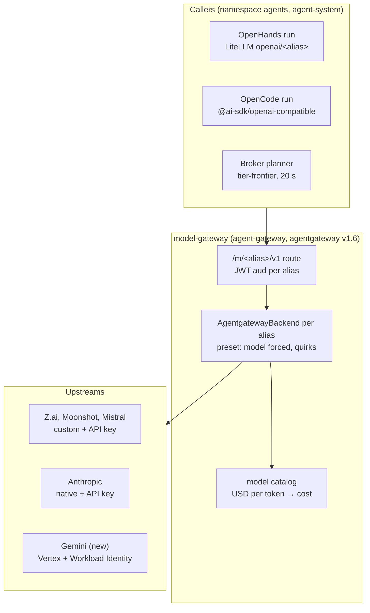

# Gemini as a model provider

**Date:** 2026-11-25 · **Status:** design, for the owner's review; nothing built · **Track:** [v5 roadmap](2026-11-22-v5-roadmap-design.md) Q18 and Phase 2 track 8; the status page's "Gemini as a provider" row · **Plan:** [`2026-11-25-gemini-provider-plan.md`](../plans/2026-11-25-gemini-provider-plan.md) · **Facts read on:** Maku `origin/main` `1943eed1` (v0.54.x), ai-native-ref `origin/main` `8b4bcd2`, cloud-native-ref `origin/main`; Google's documentation on 2026-11-25

## Outcome

1. **Maku can route a run to Gemini** through the model gateway, like Kimi and Mistral today. Two
   new presets do it: `gemini` uses a Gemini API key, and `vertex` uses Vertex AI with the proxy's
   own Google identity.
2. **On gcp-0, Gemini runs through Vertex AI with Workload Identity.** No key exists in OpenBao,
   in a Secret or in any pod.
3. **Gemini is selectable, never a default.** It is public data class only, behind its own
   aliases `gemini-standard` (Gemini 4 Neon) and `gemini-light` (Gemini 4 Hydrogen).
4. **A measured verdict** on Gemini against `agent-default`, recorded in a results runbook. It
   covers the planner, implementer and reviewer on both harnesses, plus metering and cost per merged
   task. The owner then decides whether Gemini takes a tier, the reviewer seat or nothing.

Out of scope: Gemini on the `internal` listener, Gemini as `agent-default`, context caching
beyond the implicit kind, the Interactions API, grounding tools, and Gemini on aws-0.

## What exists, in Google's own words

Read from the official pages on 2026-11-25. Each fact carries its source; [Sources](#sources) lists them.

### "Gemini 4 Neon" is real

Gemini 4 Neon exists. Its model code is **`gemini-4-neon`**: Stable on the Gemini API and GA on
Vertex AI, released 2026-11-18 [G1, V1]. It is one of four Gemini 4 models [G2]:

| Model id | Google's positioning | Thinking levels (default) | Gemini API price, USD per 1M tokens (input / output / cached) |
|---|---|---|---|
| `gemini-4-carbon` | "most capable reasoning model", complex engineering | low, medium, high | 2.00 / 10.00 / 0.10 until 2026-11-30, then 4.00 / 20.00 / 0.20 |
| **`gemini-4-neon`** | mid-tier between Hydrogen and Carbon [P1] | low, medium, **high**, xhigh | **3.00 / 15.00 / 0.15**, no free tier |
| `gemini-4-hydrogen` | "speed and efficiency for everyday coding and agentic workflows" | low, medium, high, xhigh | 1.50 / 7.50 / 0.075, free tier exists |
| `gemini-4-argon` | (the press says Neon replaces it in the app picker [P1]) | low, medium, high | as Carbon |

Prices are the Gemini API's Standard tier [G3]. Batch and Flex halve them; Priority is 1.8x.

Neon facts that shape the design [G1, V1]:

- **Context:** 1,048,576 tokens, shared by input and output. Output is 65,536 by default.
- **Capabilities:** function calling and structured output are supported.
- **Caching:** implicit context caching only. "Explicit caching is not supported."
- **Thinking:** it cannot be switched off on Gemini 4 [G4].
  - `thinking_budget` and `thinking_level="MINIMAL"` return HTTP 400 on Vertex [V1].
  - Over the OpenAI-compatible endpoint, `reasoning_effort` maps `minimal`/`low` to low, `medium` to medium and `high` to high [G4].
  - `xhigh` exists on Neon and Hydrogen only [G4].
- **Vertex AI:**
  - Locations are `global` and the multi-regions `us` and `eu`. There is no single region such as `europe-west4`.
  - Fixed quota is "Not supported".
  - The knowledge cutoff is March 2026.
  - The Chat Completions endpoint is supported [V1].
- **Confirmed live on 2026-11-26** (project `ogenki-435905`, the Agent Platform API, formerly the Vertex AI API, enabled that day): `google/gemini-4-neon` answers the OpenAI-compatible `endpoints/openapi/chat/completions` in `eu` (host `aiplatform.eu.rep.googleapis.com`) and in `global`, with an OAuth access token and no key. `max_tokens` counts reasoning tokens: a 20-token cap returned empty content after 20 reasoning tokens, so the preset must not set a small cap.
- **Not confirmed:** the Vertex price for Neon. The Vertex pricing page did not render for us. Plan task B1 reads it before any price row lands.

Google's benchmark claim puts Neon ahead of Claude Opus 5.5 on the Artificial Analysis index (61
against 59) [P1, P2]. Press reports say independent coding checks were still thin at launch.
This is why the live comparison below exists.

### The Ultra subscription does not give API access

**A Google AI Ultra subscription does not give API access**, and it carries no API quota. Its
developer quota "covers only the AI Studio web interface". Gemini API requests need a paid API
key, billed separately [G5].

What Ultra does give a developer is **monthly Google Cloud credits**: "$40/month (Ultra 5x) or
$100/month (Ultra 20x)", each grant valid 12 months [G5]. The credits apply to a paid Gemini API
key, and "via Vertex AI or Cloud Run" [B1]. You claim them in AI Studio ("Claim free API
credits") or through the Google Developer Program, on a billing account with at least $5 prepaid
[G5, B1].

So the factory needs one of two things:

- a Gemini API key from AI Studio on a billed project, or
- Vertex AI in a GCP project.

The credits can offset either, if they land on the billing account of project `ogenki-435905`.

### The wire

| Surface | Endpoint | Auth |
|---|---|---|
| Gemini API, OpenAI-compatible | `https://generativelanguage.googleapis.com/v1beta/openai/chat/completions` | Bearer API key [G4] |
| Vertex AI, OpenAI-compatible | `https://aiplatform.googleapis.com/v1/projects/{project}/locations/{location}/endpoints/openapi/chat/completions`, model `google/gemini-4-neon` | OAuth access token from Application Default Credentials, valid 1 h [V2] |

**Thought signatures are the main wire risk.** On Gemini 3, a response with a function call carries a
`thought_signature`. It must come back unchanged in the next request: "omitting a required
`thought_signature` for the first `functionCall` part in any step of the current turn results in
a `400` error" [V3].

- **Where it sits:** over Chat Completions, on each tool call at `tool_calls[i].extra_content.google.thought_signature` [V3].
- **The escape hatch:** the value `skip_thought_signature_validator`. Google calls it a last resort that "will negatively impact model performance" [V3].
- **Not confirmed:** the pages do not say whether Gemini 4 enforces signatures the same way. The wire probe (A2) settles it.

## How the factory reaches a model today



- **Gateway** (Maku `charts/maku-gateway`, ANR `infrastructure/base/agent-gateway/model-gateway/helmrelease.yaml`):
  - Each alias gets one `AgentgatewayBackend` and one `/m/<alias>` route. A run's token audience names its alias.
  - A preset (`templates/_presets.tpl`) holds a provider's wire quirks, such as Mistral's forced `reasoning_effort: none` and Moonshot's `temperature: 1`.
  - Upstream auth is always `secretRef`: `mgw.validate` refuses a provider without `existingSecret`.
- **Keys:** they come from OpenBao `agents/<provider>` into `agent-system` (ESO), then are copied into `agent-gateway` by `provider-keys.yaml`.
- **Native Gemini support:** agentgateway's vendored CRD already has native `gemini` and `vertexai` providers. `vertexai` takes `projectId` and `region` (`global`, `us`, `eu` or a region). It also has a backend auth `policies.auth.gcp: {type: AccessToken}`, which uses ambient credentials when `secretRef` is omitted. Maku uses none of them yet.
- **Metering:**
  - agentgateway prices each call from the catalog (`<name>-model-catalog`).
  - The factory meter multiplies tokens grouped by `gen_ai_request_model` by `meter.prices` (ANR `tooling/base/agent-factory/resources/factory.yaml`).
  - AG10 (`scripts/ci/flux-schema/assert-agent-gateway.py`) requires a priced row with `source` and `checkedAt` for every pinned model.
- **Harnesses:**
  - OpenHands sends `reasoning_effort` in the body (`openhands_driver.py`), and it has no per-provider branch except internal caching. Its own cost counter defaults to GLM prices (`LLM_*_USD_PER_MTOK`), and the controller does not set them per alias.
  - OpenCode writes one `maku` provider with a hard-coded alias list (`images/maku-opencode/role_config.py`, `DEFAULT_ALIASES`). Its effort variants are low, medium and high.
  - The contract tests cover glm, anthropic, kimi and mistral.
- **Planner:**
  - It is forced to `tier-frontier` with temperature 0, `max_tokens` 4000, `reasoning_effort: low` and `response_format: json_object`.
  - It must answer within 20 s. That deadline cannot be raised (`internal/config/config.go`), and the gateway allows clients 60 s.
- **Comparison tooling:**
  - `evaluation.treatmentHarness` splits cohorts by harness.
  - Nothing splits them by model.
  - `maku stages` reports per class and stage, with no model dimension.

## Decisions

| # | Decision | Options | Recommendation |
|---|---|---|---|
| **G1** | Access path on gcp-0 | (a) Gemini API key from AI Studio, in OpenBao `agents/gemini`; (b) **Vertex AI through GKE Workload Identity**, no key; (c) Vertex with a service-account key JSON | **(b)**. It needs no secret to rotate or leak, it bills to `ogenki-435905`, and it matches how RunLore and external-dns get GCP access. (c) is refused: a long-lived key is worse than (a). (a) stays the fallback if the host change in G2 stalls |
| **G2** | How the proxy gets its identity | (a) the host's `GCPWorkloadIdentity` claim on the proxy's ServiceAccount, a direct principal binding; (b) a GSA with the `iam.gke.io/gcp-service-account` annotation | **(a)**, as `observability/gcp-0/runlore/workloadidentity.yaml` does. It needs a cloud-native-ref PR first, because the role must join `crossplane_grantable_roles` in `opentofu/gcp/gke/init/iam.tf` |
| **G3** | IAM role | (a) `roles/aiplatform.user`; (b) **a custom role with `aiplatform.endpoints.predict` only**, which is what the OpenAI-compatible call needs | **(b)**, named like `crossplane_dns`. `aiplatform.user` can create and deploy resources, which a proxy must not. If (b) cannot serve the `openapi` endpoint, record the 403 and fall back to (a) |
| **G4** | Vertex location | (a) `global`, the best availability and fewest 429s; (b) **`eu`**, the EU multi-region | **(b)**: data stays in the EU, in line with the v5 sovereignty pitch (Q9). Move to `global` only if the live test shows 429s or latency that break the planner deadline, and only with the owner's word |
| **G5** | How Maku ships it | (a) the `custom` preset with values only; (b) **two presets, `gemini` (custom, API key) and `vertex` (native `vertexai`, `gcp` auth, no `existingSecret`)** | **(b)**. A preset holds the quirks so a values file cannot undo them (GW7). A partner without GCP uses `gemini`, and GKE installs use `vertex` |
| **G6** | Models and aliases | One alias for Neon; **two aliases, `gemini-standard` → `gemini-4-neon` and `gemini-light` → `gemini-4-hydrogen`**; or add Carbon as `gemini-frontier` | **Two aliases**, named like `mistral-*`. Hydrogen gives a cheap pairing for the light tier. Carbon is left out: it costs more than Neon from December, and Google ranks Neon near it |
| **G7** | Data class | public only; public and internal | **Public only**, like Mistral (ADR-0054). Internal needs the owner's data-handling call on Vertex's terms, in its own ADR |
| **G8** | Thought signatures | (a) carry them end to end (client → gateway → Vertex); (b) the gateway injects `skip_thought_signature_validator`; (c) drop Gemini for tool-calling roles | **(a) if the wire probe shows every hop keeps `extra_content`**, else (b) as a preset field with its `why`, measured, while a fix goes upstream. (b) costs quality, and the comparison must say so. (c) applies only if (b) also fails |
| **G9** | Temperature | pass through; force `1` in the preset | **Force `1` only if the probe shows looping or degradation at 0** (the planner and judge send 0). Google's Gemini 3 guide recommends 1.0; the Gemini 4 pages read here do not say |
| **G10** | Effort mapping | Pass `reasoning_effort` through (low, medium, high); add `xhigh` | **Pass through.** Gemini 4 maps it natively, and Maku's three levels fit. `xhigh` waits for evidence |
| **G11** | How the comparison runs | (a) a 50/50 `evaluation.treatmentModel` cohort; (b) **a paired run: the same 10 issues, filed on two scratch copies of one repository, one arm each, the arm pinned by a `model:<alias>` label**; (c) consecutive time windows | **(b)** for the first verdict. Ten tasks give no power in a cohort, (c) confounds with drift, and pairs remove task-difficulty variance. (a) is built too (same mechanism as `treatmentHarness`) for a later 30+30 trial if the paired run is promising |
| **G12** | When it runs | concurrently with the OpenCode harness trial; after it | **After the harness trial closes** with no treatment left enabled. Two treatments at once confound both (the adopt plan's single-variable rule) |

## The design

### 1. Maku: two presets

`templates/_presets.tpl` gains:

```yaml
gemini:
  provider: custom
  host: generativelanguage.googleapis.com
  port: 443
  path: /v1beta/openai/chat/completions
  fields: {}            # G8/G9 fields land here only if the probe proves them
  alwaysReasons: ["*"]  # Gemini 4 cannot stop thinking
vertex:
  provider: vertexai     # native: projectId + region from the provider's values
  host: aiplatform.googleapis.com   # for the network policy; eu → eu-aiplatform.googleapis.com
  port: 443
  auth: gcp              # policies.auth.gcp {type: AccessToken}, ambient credentials
  fields: {}
  alwaysReasons: ["*"]
```

The values for a provider stay as they are, plus `projectId` and `region` for `vertex` only:

<!-- example -->
```yaml
providers:
  vertex: {preset: vertex, projectId: ogenki-435905, region: eu, dataClasses: [public]}
aliases:
  public:
    gemini-standard: {provider: vertex, model: gemini-4-neon}
    gemini-light: {provider: vertex, model: gemini-4-hydrogen}
```

`mgw.validate` changes in three ways:

- `existingSecret` becomes forbidden for `vertex` and required for every other preset.
- `projectId` is required for `vertex` and refused elsewhere.
- `region` must be `global`, `us`, `eu` or a region name.

The network policy dials the region's host. With Workload Identity it also reaches the GKE
metadata server, `169.254.169.254` on ports 80 and 988, for its token.

The chart's README and `docs/gateway.md` say which ServiceAccount the proxy runs as. That account
is what an operator binds.

Whether the native `vertexai` provider sends Gemini models to Vertex's `openapi` path is the
first fact the probe establishes. If it does not, the `vertex` preset falls back to `custom` with
the `openapi` path built from `projectId` and `region`, still with `gcp` auth.

### 2. Maku: callers and comparison

- **OpenCode:** `role_config.py` reads the run's alias list from the run controller (the
  `MAKU_ALIASES` environment), not a hard-coded tuple, so a new alias needs no image release. The
  contract test and matrix gain a `gemini` case.
- **OpenHands:** the run controller sets `LLM_INPUT_USD_PER_MTOK` and `LLM_OUTPUT_USD_PER_MTOK`
  from the alias's catalog row, so the harness's own counter stops pricing every model as GLM.
- **Thought signatures:**
  - A harness or gateway that drops `extra_content` is a bug for every Gemini user.
  - The probe pins which hop drops it, and the fix goes there: an agentgateway issue, a LiteLLM or AI SDK setting, or a preset field.
- **`model:<alias>` label pin:** it works like `harness:<name>`. Only a maintainer can apply it.
  - The pin applies only when the role's capability profile allows that alias.
  - It is recorded as `modelSource: label`.
  - Labelled tasks stay out of cohort statistics.
- **`evaluation.treatmentModel`:** it works like `treatmentHarness`. It changes only the model of
  the roles named in `evaluation.treatmentRoles` (default implementer), and nothing else.
- **`maku stages --by model`:** it groups by the model each stage ran on.
  - Per model: tasks, merged, USD, and USD per merged task.
  - Per stage: `effects`.
  - Merged means `accepted` or `merged_human`, as today.

### 3. ai-native-ref: adoption on gcp-0

**cloud-native-ref (host) PR first:**

- add the custom role `vertex_predict` (`aiplatform.endpoints.predict`);
- add it to `crossplane_grantable_roles` in `opentofu/gcp/gke/init/iam.tf`;
- enable `aiplatform.googleapis.com` on the project if it is off.

**ai-native-ref:**

- **Identity:** `infrastructure/gcp-0/agent-gateway/model-gateway/workloadidentity.yaml` is a
  `GCPWorkloadIdentity` claim, `xplane-model-gateway` (the constitution's `xplane-*` name), for the
  proxy's ServiceAccount, with the one role above. `HOST_REF` moves to the host commit that grants it.
- **Provider and aliases:** the gcp-0 overlay patches the HelmRelease with the `vertex` provider
  and the two public aliases. Base stays provider-neutral, because aws-0 has no Workload Identity
  for GCP.
- **Run controller:** the gcp-0 overlay adds the two aliases to `infrastructure/base/room-broker/helmrelease.yaml`'s
  public alias list.
- **Profiles:** the implementer, reviewer and tester public profiles and `policy-capabilities.yaml`
  gain the aliases, as Mistral's did.
- **Prices:** `meter.prices` gets `gemini-4-neon` and `gemini-4-hydrogen` rows at the Vertex `eu`
  rate, with `source` and `checkedAt`. `gen-prices.py`, `check-price-drift.py`'s mapping and
  `test-model-gateway-values.py` follow.
- **Assertions** (`assert-agent-gateway.py`):
  - A backend with an unknown provider **fails** AG5 and AG15 instead of being skipped. Today
    `provider_name()` returns `None` and the data-class checks pass silently.
  - Google joins `PROVIDER_LISTENERS` as `{public}`.
  - A `vertex` backend carries no `secretRef` and its `gcp` auth is `AccessToken`.
- **Planner:** for the test window only, a gcp-0 patch sets `clients.planner: {provider: vertex,
  model: gemini-4-neon}`. Base keeps Z.ai.

## Offline proofs, before any live minute

| # | Proof | Passes when |
|---|---|---|
| **O1** | Chart render (`helm template` + `kubeconform` + the chart's unit tests) | Both presets render. `vertex` has `vertexai` or the custom `openapi` path, `auth.gcp`, no `secretRef`, and the right host in the policy. Every refusal in `mgw.validate` has a failing fixture |
| **O2** | Gateway wire test (Maku probe, ANR `test-agent-gateway-providers-wire.sh`) against a fake Gemini that **requires** `extra_content.google.thought_signature` | A three-turn tool loop through agentgateway v1.6 succeeds; `model` is forced; `reasoning_effort` arrives; the signature round-trips, or the hop that drops it is named |
| **O3** | Harness contract tests (OpenCode `test_provider_contract.py`, an OpenHands driver test) against the same fake | Each harness sends back the signature it received, uses the alias as model, and sends the chosen effort |
| **O4** | Catalog and cost table | The rendered `catalog.json` has `gemini-4-neon` and `gemini-4-hydrogen` under the catalog key agentgateway emits for the provider; a fixture call's `cost` equals tokens × rate to the micro-dollar; AG10 passes |
| **O5** | ANR `task check` | Green, with the new AG assertions red on a fixture that drops `existingSecret` from `mistral` or adds an unknown provider |
| **O6** | One real call from a laptop, no cluster | `curl` to Vertex `openapi` in `eu` with `gcloud auth print-access-token`. Neon answers a two-tool loop, which proves the signature rule and the model id. This is a few cents, with the owner's go |

## Live test on gcp-0

The test runs after the OpenCode harness trial closes (G12). It needs the Maku release with plan
part A and the host PR merged. The ledger is
`docs/runbooks/agent-factory/results-gcp-0-gemini-<date>.md`, written as the test runs: Maku version
and digest, the window, task counts, and the query outputs behind each number.

### L1 · Wire and metering (about 30 min)

1. `task agentgateway:live-check -- --gateway real --alias gemini-standard`. It is extended with
   the two aliases: a plain call, a tool loop and a streamed call.
2. The proxy logs no Secret mount. The token comes from the metadata server. There are no 401s or
   403s over 1 h, so the token refresh is proven.
3. **Metering:** for five calls, the gateway's `cost`, the meter's USD and Vertex's billed tokens
   agree.
   - Vertex's figures come from the console usage or the response's `usage`.
   - The tolerance is 2 %. Thinking tokens must be in output.
   - `scripts/ops/cost-crosscheck.py` gains the Vertex column.

### L2 · Planner on Neon (about 30 min)

1. Run 20 `maku handoff` plans on fixed prompts, 10 on Z.ai and 10 on Neon, with `reasoning_effort` low.
2. **Pass:** p95 latency is under 15 s, which leaves 5 s of margin to the 20 s deadline, and no plan times out.
3. **Quality:** the owner blind-ranks the 20 plans on grounding, steps and questions.
   - The rubric is the one in the planner grounding work.
   - Neon must not be worse on the median.

### L3 · Roles on both harnesses (about 2 h)

There are three smoke issues per harness, run on `gemini-standard` with a `model:` label:

- one implementer task;
- one reviewer task on an existing pull request, where the verdict must arrive through `room_verdict`;
- one tester task.

**Pass:** for every run, on each harness:

- tool calls succeed, with no 400 from a signature;
- the reviewer's verdict tool is called, with the right commit;
- no stall shows in the stuck-loop detector or the run timeline;
- the run ends within its tier's limits.

### L4 · The paired comparison (one to two days)

1. Pick 10 issues from the real backlog that the factory has not touched. Each has to be
   mergeable on its own, from at least three classes.
2. Make two scratch copies of one repository at the same commit, A and B.
3. File the 10 issues on both. A runs `agent-default`; B runs `model:gemini-standard` on the
   implementer and reviewer.
   - Workflow, harness (OpenHands), efforts, caps and checks are identical.
   - The light tier on B uses `gemini-light`.
4. A maintainer reviews both pull requests of a pair blind to the arm. Each pull request merges
   or closes on its own merits.

For each arm, the report (`maku stages --by model`, and a `scripts/ops/model-comparison-report.py`
modelled on `harness-trial-report.py`) gives:

- the merged share;
- USD per merged task, as the median and the total;
- the median end-to-end duration;
- review effects: verdict counts, rounds before merge, and the changes a maintainer had to ask for;
- runs ended by a cap, a 400 or a stall.

**Directional rule (n=10, not a statistical gate):** Gemini earns a 30+30 `treatmentModel` trial
only if all three hold:

- its merged share is at least A's minus one task;
- its USD per merged task is at most 1.5 × A's;
- it has zero signature 400s.

The rule is frozen before the first task runs. The owner may override it, and the ledger records
the override.

### L5 · Reviewer of another family (optional, about 1 h)

ADR-0058 wants the reviewer on another model family. On the five B-arm pull requests already
reviewed, rerun the review with `agent-default`. Then rerun A's five with `gemini-standard`, and
record the agreement. This feeds v5 track 4's "second-family reviewer".

## Risks

| Risk | Likelihood | What contains it |
|---|---|---|
| A hop drops `extra_content`, so every second tool turn fails with 400 | High: LiteLLM's openai path, the AI SDK and agentgateway's typed Completions parse each may drop unknown fields | O2 and O3 find the hop before live. G8(b) as a measured stopgap, and an upstream fix |
| The native `vertexai` provider does not speak to `openapi` for Gemini in agentgateway v1.6 | Medium | The `custom` fallback in section 1. O1 and O2 decide |
| Neon on `eu` is slow or hits 429 (no fixed quota) | Medium | L1 and L2 measure it. G4 allows `global` with the owner's word. Batch is never used for runs |
| Thinking stays on at every level and spends output tokens | Certain | `alwaysReasons: ["*"]`; metering counts thinking as output [G3]; caps unchanged and their hits recorded |
| USD caps sized for GLM bind sooner on Neon ($15/M out against $4.40) | High | Caps are identical across arms and cap hits are an outcome; no cap is raised for one arm |
| Gemini 4 Carbon and Argon prices double on 2026-12-01; Neon's may change | Medium | `checkedAt` on every row and the nightly drift check. The design does not use Carbon |
| The Ultra credits do not land on `ogenki-435905`'s billing account | Medium | Spend is small (tens of dollars). The owner checks the billing account before L4 |
| Workload Identity gives the proxy a Google identity that every alias shares | Low | The custom role allows prediction only; the gateway already scopes callers to their alias |
| Strict schema rejection: Gemini refuses a tool schema node without `type` | Low: Maku's schema tests already hold this for "strict providers (Moonshot, OpenAI strict mode, Gemini)" | O3 runs the real tool list through the fake's schema check |

## Acceptance criteria

**Offline (each a CI gate):**

1. Maku `task check` is green with the `gemini` and `vertex` presets, their refusals and the
   probe's Gemini case (O1, O2).
2. The OpenCode and OpenHands contract tests pass a three-turn tool loop against a
   signature-enforcing fake (O3).
3. The rendered catalog prices both models, and a fixture call's cost matches to the micro-dollar (O4).
4. In ANR, `task check` is green. AG5 and AG15 fail on an unknown provider, and AG10 holds both new
   rows (O5).
5. `model:<alias>`, `evaluation.treatmentModel` and `maku stages --by model` have unit tests, and
   the `docs/upgrading.md` entry exists.

**Live, on gcp-0, recorded in the ledger:**

6. No provider key for Google exists in OpenBao or any Secret. The proxy authenticates for at
   least 1 h without an error (L1).
7. Gateway cost, meter USD and Vertex usage agree within 2 % on five calls (L1).
8. The planner on Neon has p95 latency under 15 s across 10 plans and no timeout. Its blind-ranked
   quality is not worse than Z.ai's (L2).
9. The implementer, reviewer (with `room_verdict`) and tester run on Gemini on both harnesses, with
   no signature 400 and no stall (L3).
10. The paired comparison on 10 issues is reported with every number from a query. The directional
   rule's verdict is written down, with the owner's decision on what comes next (L4).

## Roadmap rows

- **ai-native-ref:** [v5 roadmap](2026-11-22-v5-roadmap-design.md) Q18 and Phase 2 track 8. The site's status page keeps its existing "Gemini as a provider" row under Next plans until L4's verdict (plan B8).
- **Maku** (another repository, to add in plan PR A-1): in `docs/roadmap.md`, section `## Agent Factory v5: proven in the field`, table `| Feature | What it takes |`, after the "Slack security model and Socket Mode" row:

  ```markdown
  | Gemini as a model provider | `gemini` (API key) and `vertex` (Vertex AI with the proxy's own Google identity, no key) gateway presets, thought signatures carried through both harnesses, a `model:<alias>` pin, `evaluation.treatmentModel` and `maku stages --by model`; selectable and public-only, then a paired comparison against the default model on the reference deployment ([design](https://github.com/Smana/ai-native-ref/blob/main/docs/superpowers/specs/2026-11-25-gemini-provider-design.md)) |
  ```

## Probe P7 findings (2026-11-26)

Maku's gateway probe (`charts/maku-gateway/tests/probe`, P7) ran the chart's own `gemini` and
`vertex` backends through agentgateway v1.6.0 on k3d, against a fake Gemini that enforces thought
signatures and a fake GKE metadata server. One live call settled the thinking question. Where this
design guessed otherwise, the findings win:

| Design said | Found |
|---|---|
| The native `vertexai` provider may call `endpoints/openapi`; if not, fall back to `custom` | It calls `generateContent` on `publishers/google/models/<model>` and translates Chat Completions itself. No fallback is needed: the translation carries signatures better than `openapi` does |
| `eu` dials `eu-aiplatform.googleapis.com` | `eu` and `us` dial `aiplatform.<region>.rep.googleapis.com`, `global` `aiplatform.googleapis.com`, a region `<region>-aiplatform.googleapis.com` |
| G8: signatures ride in `extra_content`, so every hop must keep it | On `vertex`, agentgateway puts each signature inside the tool call id (`<id>__thought__<sig>`). A caller that drops every unknown field still round-trips it, so G8 needs neither (b) nor (c). On `gemini` (the Gemini API's OpenAI endpoint), the gateway passes `extra_content` both ways, and a caller that drops it gets a 400 on its second tool turn |
| G10: pass `reasoning_effort` through | agentgateway 1.6 turns `reasoning_effort` into a `thinkingBudget` for every model but `gemini-3*`, and Gemini 4 answers 400 to a budget (checked live on Vertex `eu`: "Thinking budget is not supported for this model"). The `vertex` preset therefore sets `thinking_config` from `reasoning_effort` (low, none and minimal map to `low`, medium to `medium`, anything else to `high`) |
| A3: the catalog key comes from the probe | `gcp.vertex_ai`. Thinking tokens count as output and are priced at the output rate: 100 input and 20 + 10 output tokens on Neon at 3.00/15.00 cost 0.00075 |
| A4: which ServiceAccount the proxy runs as | `model-gateway`, the Gateway's name, in the release namespace |
| B1: the Vertex price is not confirmed | Read on the pricing page on 2026-11-26 (it renders for `curl`): a **non-global** endpoint, which `eu` is, pays 10 % over global. Neon 3.30 / 0.165 / 16.50 and Hydrogen 1.65 / 0.0825 / 8.25 USD per million input / cache-read / output tokens; output includes reasoning. `gemini-4-hydrogen` answered on Vertex `eu` the same day |

Maku [#750](https://github.com/Smana/maku/pull/750) built the presets on these findings, and the
probe is in its `charts/maku-gateway/tests/probe`.

## Sources

- **[G1]** Gemini 4 Neon model page: <https://aistudio.google.com/docs/models/gemini-4-neon>
- **[G2]** Gemini models: <https://aistudio.google.com/docs/models> (redirected from `ai.google.dev/gemini-api/docs/models`)
- **[G3]** Gemini API pricing: <https://aistudio.google.com/docs/pricing>
- **[G4]** OpenAI compatibility, with the `reasoning_effort` mapping: <https://aistudio.google.com/docs/openai>; thinking levels: <https://aistudio.google.com/docs/thinking>
- **[G5]** Google AI plans and developer credits: <https://aistudio.google.com/docs/google-ai-plans> (from `ai.google.dev/gemini-api/docs/google-ai-plans`)
- **[V1]** Vertex AI, Gemini 4 Neon: <https://docs.cloud.google.com/vertex-ai/generative-ai/docs/models/gemini/4-neon>
- **[V2]** Vertex AI OpenAI compatibility: <https://docs.cloud.google.com/vertex-ai/generative-ai/docs/start/openai>
- **[V3]** Vertex AI thought signatures: <https://docs.cloud.google.com/vertex-ai/generative-ai/docs/thought-signatures>
- **[B1]** Google blog, "New developer tools for Google AI Pro and Ultra subscribers" (2026-01-27): <https://blog.google/innovation-and-ai/technology/developers-tools/gdp-premium-ai-pro-ultra/>
- **[P1]** Press, launch coverage: <https://9to5google.com/2026/11/18/gemini-4-neon-announcement/>, <https://www.digitaltrends.com/computing/google-says-gemini-4-neon-can-hang-with-claude-opus-5-5-and-gpt-6-2-sol-for-less/>
- **[P2]** Independent write-up, not authoritative: <https://www.mindstudio.ai/blog/google-gemini-4-model-lineup>
