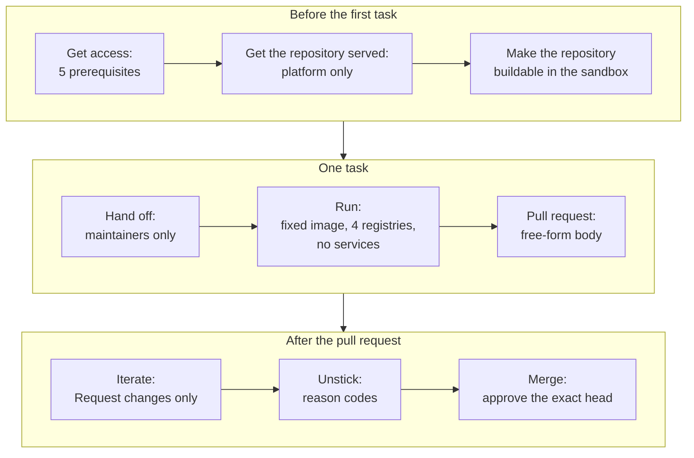

# Developer experience review: Maku seen from a product team

**Date:** 2026-11-26 · **Status:** draft for the owner's review; nothing here is built · **Reads with:** the [v5 roadmap](2026-11-22-v5-roadmap-design.md), the [UX review](2026-11-14-ux-review-design.md), the [docs review](2026-11-14-docs-review-design.md)

## Why this review

Every review so far took the seat of the person who runs the platform. This one takes the seat of an
application developer on a product team: someone with write access to a service repository, a
deadline, and no kubectl.

The short answer: **Maku today serves a maintainer of a docs-and-scripts repository well, and a
product developer barely at all.** The loop itself (issue, sandboxed run, second-agent review,
approve to merge) is sound. What stops a developer comes before and around it: they may not start a
task, the sandbox cannot build or test most product stacks, and when something fails the answer is
written for the platform team.

How to read the evidence:

- `maku:<path>` is a file in `Smana/maku` at commit `a26d990c` (`main` on 2026-11-26).
- Other paths are in this repository at `0a110c6`.
- Everything was read from code and docs. Nothing was run live; the [drills](#drills) are how to
  check the three claims marked **unproven**.

## Personas

| Persona | Works on | Wants from an agent |
|---|---|---|
| **Backend developer** | A Go, Java or Python service with a database and a queue | A fix with passing integration tests |
| **Frontend developer** | A React application, npm or pnpm, Vitest and Playwright | A change that looks like the mockup |
| **Mobile developer** | An iOS or Android application | A build that compiles and a green UI test |
| **Data engineer** | Python or SQL pipelines, dbt, a warehouse | A change validated against real data shapes |
| **Junior developer** | Any of the above, write access, six months in | To hand off small work without learning a platform |
| **Tech lead** | Reviews the agents' pull requests for a team of six | To trust a pull request in five minutes, or reject it in one |
| **Adopting developer** | A company's repository; someone else installed Maku | To be productive on day one without asking the platform team |

## The journey every persona shares

Scores are severity (1 annoys, 2 costs an hour or a colleague, 3 blocks the task) times frequency
(1 rare, 2 weekly, 3 every task).

| Stage | What a developer meets today | Evidence | Score |
|---|---|---|---|
| Start a task | Only a login listed in `Repository.spec.maintainers` may start one, from any surface. Write access is not enough. | `maku:internal/factory/config/config.go:474`, `maku:internal/factory/intake/issues.go:366-375`, `maku:web/src/newtask.ts:178` | 3×3 = **9** |
| Build and test | One platform image, no per-repository image or setup hook. Tools come from `mise.toml`; registries are `pypi`, `npm`, `golang`, `crates` only. | `maku:internal/runctl/config.go:340-360`, `maku:api/v1alpha1/agentrun_types.go:181-192` | 3×3 = **9** |
| Tests that need a service | No Docker under gVisor, no service containers, no way to pass a test secret. Such tests are skipped in the sandbox. | [`.github/agent-checks.yaml`](../../../.github/agent-checks.yaml) line 19, `maku:images/maku-harness/agent_checks.py:47-50`, `maku:internal/runctl/pod.go:145-226` | 3×3 = **9** |
| Make the repository ready | The file a developer must write, `.github/agent-checks.yaml`, has no how-to on either site. | `maku:docs/onboard-a-repository.md` (no mention), [harness reference](https://maku.ogenki.io/docs/concepts/opencode-harness/) (one table cell) | 3×2 = **6** |
| Get access | Private network, platform certificate, `agents-member`, GitHub link, maintainer rights: five things, four from other people. | [Before your first task](https://maku.ogenki.io/docs/guide/before-your-first-task/) | 2×1 = 2, but it is the first hour |
| Get a repository served | `kubectl`, a ruleset admin token and two GitHub Apps. No request path; a label on an unserved repository gets no answer. | `maku:docs/onboard-a-repository.md:15-32`, `maku:internal/factory/reconciler/reconciler.go:305-308` | 3×1 = 3 |
| Describe the work | Images are stripped from the issue, silently. An issue without an acceptance section bounces with no run. | `maku:internal/factory/sanitize/sanitize.go:65-68`, `maku:docs/factory.md:208` | 2×2 = 4 |
| Read the pull request | The body has one rule, `Fixes #N`, plus a machine footer. No fixed summary, no test evidence, no "try it". | `maku:internal/factory/reconciler/text.go:93-102`, `maku:internal/hardening/footer.go:46-47` | 2×3 = **6** |
| Iterate | Only a maintainer's **Request changes** starts a revision. A comment review, an inline thread or an issue comment reaches nobody. A conflict hands off; nothing rebases. | `maku:internal/factory/reconciler/arm.go:429`, `maku:internal/factory/reconciler/merge.go:359-364` | 2×3 = **6** |
| Unstick a failure | 167 of 188 reasons end in the same next step, "a maintainer reviews the task and chooses the next step". The failure guide is written for kubectl. | `maku:internal/factory/reasons/reasons.go:228-230`, `maku:docs/operations/failures.md` | 2×2 = 4 |
| Follow cost | Good: dollars spent against the cap in the room, `maku status` and Slack. The closing GitHub comment reports tokens instead. | [Follow and steer](https://maku.ogenki.io/docs/guide/following-and-steering/), `maku:internal/factory/narrate/narrate.go:1003-1007` | 1×3 = 3 |
| Be told | Good: issue comments with mentions, a Slack thread, `maku needs`, the tab title. No per-person settings, which GitHub's own cover. | `maku:docs/reference/narration.md:11-21` | 1×1 = 1 |

What already works for a developer, and should not be touched: a second agent reviews before a person
does; spend is visible in dollars against a cap; `maku checkout <task>` puts the branch in a worktree
without touching the developer's checkout; the room shows every tool call; approving the pull request
is the merge.

## Journey by persona

Only what differs from the shared journey.

### Backend developer (Go, Java or Python service)

| Stage | Friction | Evidence | Score |
|---|---|---|---|
| Java build | Maven Central and Gradle's hosts are in no egress profile, and the profile names are a fixed list. A JVM service cannot resolve dependencies. | `maku:internal/runctl/config.go:353-359` | 3×3 = **9** |
| Private modules | No `GOPRIVATE`, private npm or PyPI feed, or Artifactory support anywhere. | No match for those names in `maku:` | 3×3 = **9** |
| Integration tests | Testcontainers and Compose need Docker. The harness removes `CI` from the environment so those tests skip rather than fail. | `maku:images/maku-harness/agent_checks.py:47` | 3×3 = **9** |
| Long suites | Checks are capped at 15 minutes, on 2 CPU and 4 GiB. The factory always asks for the small size. | `maku:images/maku-harness/agent_checks.py:39`, `maku:internal/factory/runs/runs.go:262` | 2×2 = 4 |
| Flaky tests | A red check starts a fix run (two by default), then the task ends `ci_red`. Only a cancelled check is re-run. | `maku:docs/factory.md:239` | 2×2 = 4 |
| Private repository | **Unproven:** a run with data class `internal` gets no checks and no registry profile at all. | `maku:internal/factory/reconciler/implement.go:194-205` | 3×? |

### Frontend developer (React)

| Stage | Friction | Evidence | Score |
|---|---|---|---|
| Describe with a mockup | A pasted screenshot becomes its alt text; an `` becomes `⟦image⟧`. Nothing tells the developer. | `maku:internal/factory/sanitize/sanitize.go:65-68,186-193` | 3×3 = **9** |
| Install Node | **Unproven:** `mise` fetches Node from `nodejs.org`, a host in no profile. | `maku:internal/runctl/config.go:353-359` | 3×3 if true |
| See the result | No browser in either image. The planned sidecar's first phase lets the agent look; pictures for people come later. | [Screenshots design](2026-11-23-v5-harness-screenshots-design.md) | 3×3 = **9** |
| End-to-end tests | Playwright's browser download host is in no profile. | Same as above | 2×2 = 4 |

### Mobile developer

| Stage | Friction | Evidence | Score |
|---|---|---|---|
| Everything | No Android SDK, no macOS runner, no emulator. Not planned. | No match in `maku:` for those names | 3×3 = **9** |

Say so on the status page rather than let a mobile team find out. This is a non-goal worth stating,
not a gap worth closing in v5.

### Data engineer

| Stage | Friction | Evidence | Score |
|---|---|---|---|
| Warehouse access | No test secret, no host beyond the profiles. A dbt model cannot be compiled against the warehouse. | `maku:internal/runctl/pod.go:145-226` | 3×3 = **9** |
| Local substitute | DuckDB with fixtures works: it is a wheel from PyPI. The developer has to know to set that up. | `pypi` profile | 2×2 = 4 |
| Large memory | 4 GiB limit, 10 GiB scratch. | `maku:internal/runctl/pod.go:51-58` | 2×2 = 4 |

### Junior developer

| Stage | Friction | Evidence | Score |
|---|---|---|---|
| Permission | Never a listed maintainer, so every start goes through someone else. Slack answers `Not filed: … is not a maintainer of …`. | [When things go wrong](https://maku.ogenki.io/docs/guide/when-things-go-wrong/) | 3×3 = **9** |
| Vocabulary | About 60 Maku-specific terms across the four pages before a first task (3,160 words). | Count over `website/content/docs/use/guide/` chapters 1 to 3 and the index | 2×1 = 2 |
| The CLI | `maku --help` prints one wall: `login` and `status` beside `db bootstrap`, `preflight`, `policy` and `drill`. No per-command help. | `maku:internal/app/maku.go:46-164,248-252` | 1×2 = 2 |
| A wrong premise | The planner writes the request into the issue without checking it against the repository. The guide warns; the product does not. | [Write a good task](https://maku.ogenki.io/docs/guide/writing-a-good-task/) | 2×2 = 4 |

### Tech lead reviewing the agents' pull requests

| Stage | Friction | Evidence | Score |
|---|---|---|---|
| First read | Each body is shaped by the model. The checks' result and the cost are in the room, not on the pull request. | `maku:internal/factory/reconciler/text.go:93-102` | 2×3 = **6** |
| Inline comments | A review submitted as **Comment** is ignored, with no reply saying so. | `maku:internal/factory/reconciler/arm.go:429` | 2×3 = **6** |
| A small fix by hand | The escalation comment suggests "push to the branch yourself". A human commit then blocks the merge bot for good; an admin with ruleset bypass must merge. | `maku:internal/factory/narrate/narrate.go:967`, [Merging](https://maku.ogenki.io/docs/guide/merging/) | 3×2 = **6** |
| Required reviewers | `CODEOWNERS` is a protected path only. Nothing reads who must review. | `maku:internal/factory/config/mergepolicy.go:184` | 2×2 = 4 |
| Why it did not merge | The seven common reasons are explained well. They are still codes: `class_unarmed`, `shadow_would_arm`. | [Merging](https://maku.ogenki.io/docs/guide/merging/) | 1×3 = 3 |
| Shared limits | Caps are for the whole factory. Example (the reference host): five pull requests awaiting review anywhere pause intake for everyone. | [Harness reference](https://maku.ogenki.io/docs/concepts/opencode-harness/) `caps` | 2×2 = 4 |
| Two agents, one file | The only overlap check compares outcomes, not files, and is off by default. The second pull request conflicts and waits as `not_mergeable`. | `maku:docs/factory.md:128`, `maku:internal/factory/reconciler/merge.go:359-364` | 2×2 = 4 |

### Adopting developer (did not install it)

| Stage | Friction | Evidence | Score |
|---|---|---|---|
| Is my repository served? | No list of served repositories. The **New task** picker offers only repositories of rooms the developer already sees: none on day one. | `maku:web/src/view.ts:289-296` | 2×1 = 2 |
| Ask for a repository | The refusal says "an operator adds it" and stops there. | `maku:internal/intake/named.go:111` | 2×1 = 2 |
| Private repository from Slack | `Not proposed: the planner reads public repositories only`. Phase 0 of the roadmap fixes this. | [Status](../../../website/content/docs/status.md) known limitations | 3×3 = **9** |
| Settings | The gear shows merge policies, evidence and approval memory to anyone the policy API answers; the page makes no role check of its own. | `maku:web/src/settingslink.ts:31-42` | 1×2 = 2 |
| Their tracker | No Jira or Linear. The roadmap defers both, and that is the right call for one pilot. | Roadmap Q2 | 2×3 = 6, accepted |

## The top ten gaps

Ranked by score across personas. Sizes: **S** under two days, **M** under a week, **L** more.

| # | Gap | Smallest change that fixes it | Where, size |
|---|---|---|---|
| 1 | **A developer with write access cannot start a task.** | `Repository.spec.access.start: maintainers \| write`. With `write`, anyone GitHub lets write may start, answer and retry; approving and merging stay with maintainers. The write check already runs beside the list check. | Maku, **M** |
| 2 | **The sandbox cannot build most product stacks.** | Three fields on `Repository`: `runtime.image`, `runtime.size`, and `checks.egressHosts` (a platform-approved host list beside the four profiles). Add `maven` and `node` profiles. No devcontainer parsing yet. | Maku, **M** |
| 3 | **Tests that need a database or a secret cannot run.** | First, say it: the first comment lists the steps the sandbox skipped and names CI as the judge. Then one opt-in loopback sidecar list per repository (`postgres`, `redis`), on the pattern the browser sidecar sets. Test secrets stay out. | Maku, **S** then **L** |
| 4 | **Nobody tells a developer how to make a repository agent-ready.** | One how-to, "Make your repository ready": `mise.toml`, `.github/agent-checks.yaml`, `AGENTS.md`, what belongs in `ciOnly`. Four worked files (Go, Node, Python, JVM) under `examples/`. `maku repo check` warns when the file is absent. | Maku docs, **S** |
| 5 | **Pictures are dropped on the way in and missing on the way out.** | Now: the plan and the first comment say "2 images were removed; describe them in words". Later: the factory, not the sandbox, fetches issue images and attaches them to the brief. Move people-visible screenshots ahead of agent-only ones. | Maku, **S** then **M** |
| 6 | **The pull request body has no contract.** | The brief asks for four headings: what changed, why, how it was verified, what was left out. The factory appends facts it owns: the checks table, the spend, `maku checkout <task>`. | Maku, **S** |
| 7 | **Iterating works one way only.** | Reply once to an ignored comment review: "use **Request changes** to start a revision". Start a rebase run on `not_mergeable`. Remove "push to the branch yourself" from the escalation hint. | Maku, **S** + **M** |
| 8 | **A failure is explained to the platform team.** | Write a real next step for the reasons developers meet most (take the top 20 from `maku_factory` metrics). Add `maku why <task>`: the reason in words, the failing step's last lines, the one command to try. | Maku, **M** |
| 9 | **Access and "is my repository served" need other people, and say so badly.** | The **New task** picker lists every served repository the developer can write. An unserved repository answers with the request to send: the `Repository` object to paste. A label on an unserved repository gets one comment. | Maku, **S** |
| 10 | **Platform vocabulary reaches the developer.** | Split the CLI help (`maku help` for everyday commands, `maku help admin` for the rest) and add per-command help. Show the settings gear to maintainers only. One 400-word developer quickstart using eight terms. | Maku and this site, **S** each |

Noted, and left out of the ten:

| Gap | Why it waits |
|---|---|
| No base branch or "continue on this branch" at hand-off (`maku:internal/humanapi/intake.go:212-223`) | Real for release branches; no persona is blocked daily |
| Closing comment in tokens, everything else in dollars | A one-line fix; do it with gap 6 |
| "Agent factory task" and "Maku task" in the same thread; "Proposal" in the guide, "Plan" in Slack | Do it with gap 10 |
| No commit attribution to the person who asked | Matters for audit, not for the day's work |
| No transcript export or documented `docker run` of the harness image | `maku checkout` covers reproduction of the result; the process is in the room |
| Whole-factory caps instead of per-repository or per-team | Becomes real with a second team; one pilot team will not feel it |
| Required reviewers from `CODEOWNERS` | The roadmap's team RBAC track already names it |
| Jira and Linear | Deferred by the roadmap (Q2); agreed |

## How it compares with what developers already use

From the public documentation of each tool as known in mid-2026. Re-check before quoting any of it
outside this file.

| What a developer expects | GitHub Copilot coding agent, Codex cloud, Cursor background agents, Devin, Claude Code on the web | Maku today |
|---|---|---|
| Start with write access | Assign the issue, or mention the agent; write access is enough | A listed maintainer only (gap 1) |
| Shape the environment from the repository | A setup file or script in the repository (`copilot-setup-steps.yml`, a Codex environment, `.cursor/environment.json`, a Devin machine snapshot) | `mise.toml` for the checks' tools; image and network are the platform's (gap 2) |
| Services and secrets for tests | Actions service containers, environment secrets, or a full VM with Docker | Neither (gap 3) |
| Iterate by commenting | Mention the agent in any pull request comment | **Request changes** by a maintainer (gap 7) |
| See a user-interface change | Several attach screenshots to the pull request, and accept images in the request | Neither (gap 5) |
| Take over locally | Open the session in the editor, or teleport it to a terminal | `maku checkout <task>`: the branch, without the conversation |

Where Maku is ahead, from the developer's seat: a second agent on another model reviews before a
person does; the spend and its cap are visible in dollars on every surface; anyone on the team can
watch a run and stop it. Sovereignty and gVisor are the platform team's reasons to choose it; a
developer does not feel them, and the pitch to developers should not lead with them.

## What to drop or hide

A developer should meet eight words: **task, room, workflow, budget, acceptance check, reviewer,
merge policy, maintainer.** Everything below is the platform's.

| Word a developer sees today | Where | Do this |
|---|---|---|
| `Factory`, `Repository`, `MergePolicy` as Kubernetes objects | Guide chapter 11, refusals | Keep in Operate; the guide says "your platform team connects the repository" |
| class, shadow, live, unbound, `class_unarmed`, `shadow_would_arm` | Hand-off comment, guide chapters 4 and 7 | Say "this kind of change always needs your approval"; keep the code in a details fold |
| tier, `light`/`standard`/`frontier` | First comment, budgets section | Show the dollars and minutes only |
| cohort, control, treatment, holdout | `maku:web/src/profile.ts:136`, `maku:web/src/reasons.ts:77` | Admin view only |
| step-up, plan gate | CLI help, `maku:docs/factory.md` | "tries once more with a stronger workflow", "waits for you to approve the plan" |
| driver token, epoch, lease, seq | Room controls, `maku:web/src/reasons.ts:188` | "You are steering" and "someone else is steering" |
| forge, broker, bridge, principal, sponsor, persona, oracle | `maku:web/src/approval-help.ts:16,29`, `maku:web/src/chat.ts:313`, Slack's filed line | Replace with GitHub, Maku, "on behalf of" |
| data class | Room facts, live-session form | Hide when the install has one class |
| harness, `harness:opencode` | Cheat sheet, "Reference › Harness" link from the budgets section | Operate only; link the budgets to a "Limits" page |
| `agents-member`, `agents-admin`, tailnet | Guide chapter 2, first comment ("tailnet only") | "Ask your platform team for access"; the reference host's names stay labelled examples |
| Settings: merge policies, evidence, approval memory | The gear on every page | Maintainers only |
| `install`, `db bootstrap`, `preflight`, `repo add`, `policy`, `drill`, `config migrate` | `maku --help` | `maku help admin` |

The user guide's chapter 11, "Configure merge policies", belongs in Operate for the same reason.

## Three developer drills on `gcp-0` {#drills}

No fixture exists for this: `maku:examples/demo-repo` holds documentation only. Create one sample
application repository first, and keep it as a standing fixture.

**The sample repository** (`Smana/maku-sample-shop`, private, so the private-code path is exercised):

| Part | Contents | What it probes |
|---|---|---|
| `api/` | A Go HTTP service, unit tests, and integration tests against Postgres behind an environment variable | Go toolchain, service-backed tests, the skip path |
| `web/` | A React and Vite application, Vitest, two Playwright tests | Node through `mise`, the npm profile, no browser |
| `jobs/` | A Python job with `uv`, pytest and DuckDB fixtures | The PyPI profile, the local-substitute pattern |
| Root | `mise.toml`, `.github/agent-checks.yaml`, `AGENTS.md`, `CODEOWNERS`, a workflow with a Postgres service container, a ruleset requiring one review | The readiness page (gap 4), required reviewers |

Two GitHub accounts are needed besides the owner's: one listed maintainer, one with write access only.

| Drill | The developer does | Measure | Passes when |
|---|---|---|---|
| **1. Day one, write access only** | With the user guide alone: gets access, finds the repository, hands off "add `GET /orders/{id}` with a store test" from the coding agent, then from an issue label. | Minutes to the first pull request; questions asked of the platform team; which checks ran, skipped or failed on egress. | A pull request opens without a maintainer starting it, and the developer can say which tests ran. |
| **2. A change you have to see** | Files an issue with a screenshot of the cart page and "move the total under the list". Reviews as a tech lead: one inline comment review, then **Request changes**. | Whether the image loss is announced; whether Node installs; a five-point score of the body (what, why, verified, left out, try it); rounds to a correct result. | The developer learns before the run that the picture was dropped, and the comment review gets an answer. |
| **3. Two developers, a bad day** | Two tasks edit the same handler. One integration test is made flaky. A reviewer pushes a one-line fix to the agent's branch, as the escalation hint suggests. | Minutes to unstick each with the room and `maku` only; platform-team questions; whether each message named the next move. | Each of the three is resolved without kubectl and without an admin bypass. |

Expect all three to fail today. That is the point: each failure is one of the ten gaps with a
recorded cost, and the same drills become the acceptance checks for the fixes. They also settle the
three **unproven** claims: `internal` runs without checks, Node through `mise`, and Playwright's
download.

## Re-prioritising the v5 roadmap for developers

What each roadmap item is worth to a developer:

| Roadmap item | Worth to a developer | Change proposed |
|---|---|---|
| Phase 0 · Private-repository planner | High: Slack and hand-off refuse private repositories without it | Keep |
| Phase 0 · Bundled Postgres, generic Helm install, front door, video, room replay | None directly | Keep; they are the platform team's first day |
| Phase 1 · Team RBAC (`write`, Teams, `CODEOWNERS`) | **Highest** (gap 1) | Cut the `write` slice out and ship it in Phase 0 |
| Phase 1 · Per-repository runtime | **Highest** (gaps 2 and 3) | Ship image, size and hosts in Phase 0; prove on the sample repository before a partner's |
| Phase 2 · Screenshots | High for frontend | Reverse the phases: pictures for people and images in the request before agent-only vision |
| Phase 2 · Spec-driven intake | Medium: teams with specs gain, juniors do not | Keep, after runtime |
| Phase 2 · Slack personal principals | Medium: direct-message intake helps; the security work is invisible | Keep |
| Phase 2 · Pluggable harness, outcome analytics, live auto-merge, `kagent` check | None directly | Keep the default harness swap; let tiers 2 and 3 and the `kagent` check slip first when time is short |
| v5.x · Pull request continuation loop | **High** (gap 7) | Promote the two small parts to core: answer comment reviews, rebase on conflict |
| v5.x · `maku takeover` | Medium: `maku checkout` already does most of it | Put the command in the pull request body (gap 6); leave the rest partner-triggered |
| v5.x · Review inbox | Low until volume | Keep |

Missing from the roadmap entirely:

| Missing | Gap |
|---|---|
| A "make your repository ready" page and worked `agent-checks.yaml` files | 4 |
| A contract for the pull request body | 6 |
| Next steps written for developers, and `maku why` | 8 |
| Service containers for tests, and an honest "skipped in the sandbox" line | 3 |
| Images in the request | 5 |
| A developer and an admin face for the CLI, the UI and the docs | 10 |
| A standing sample application repository and the three drills | all |
| A sixth Go criterion | below |

**Proposed criterion 6, developer day one:** a developer with write access, who did not install Maku,
gets a merged pull request on a service with database-backed tests within one working day, with no
question to the platform team. Today's criteria count merged pull requests and installs; none of them
fails if only maintainers of documentation repositories can use the product.

## Open questions for the owner

1. Does `write` access starting a task (gap 1) need a per-person daily cap enforced first? The caps
   are counted in shadow today (`budgets.enforcePrincipal: false` on the reference host).
2. Is a platform-approved host list per repository (gap 2) acceptable under the egress model, or must
   every new host stay a named profile?
3. Are service sidecars (gap 3) in scope for v5 at all, or is "CI is the judge, and we say so" the
   v5 answer?
4. Should the sample repository live under `Smana/` as a public template once the drills pass?
