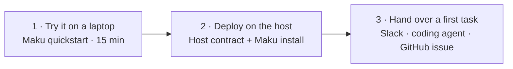

Two halves, one platform. **Serving** runs open-weights models on the cluster's own GPUs behind an
OpenAI-compatible gateway. **Maku** puts models to work: a labelled issue becomes a sandboxed agent
run that opens a pull request, under its own identity and in a room humans can watch and steer.


What runs today, what is experimental and what comes next live on one page:
[Status and roadmap](). Every other page describes the design.


![The AI Platform in one view. On the serving side, developers and coding clients send OpenAI-compatible requests over the tailnet to ai-gateway (Envoy AI Gateway with an API key and the Semantic Router), which routes them to vLLM models declared as InferenceService claims, on L4 GPUs and scaled by KEDA. On the agents side, a maintainer labels a GitHub issue; the factory controller, maku-factory, turns it into a task, starts an agent run in a gVisor sandbox and opens a room on maku-broker that the maintainer watches and steers. Every model call the agent makes goes through the model gateway with a per-run identity, to frontier models (Z.ai GLM and Claude, with Kimi and Mistral for public work only); with a GitHub token the factory minted for the run, the agent pushes a branch and opens a PR. Both halves send traces, logs and metrics to the Victoria stack and Grafana](/images/diagrams/ai-platform-1.svg)

*Source: [`docs/architecture/ai-platform.drawio`](https://github.com/Smana/ai-native-ref/blob/main/docs/architecture/ai-platform.drawio), page 1.*

## Three steps to a running factory {#path}

1. **Try it on a laptop.** Follow Maku's [quickstart]() to run the
   full loop on kind or k3d in about 15 minutes: one command asks for your model endpoint and key,
   creates a demo GitHub App and a repository from a template, watches the agents open a pull request
   in a room, and lets the merge gate decide it.
2. **Deploy it on the host.** On a Cloud Native Reference cluster, resume the umbrella Kustomizations
   (`ai-gateway`, `agent-platform`, and optionally `llm-platform`) as described in the
   [host contract](). To
   install Maku on your own Kubernetes cluster with your own identity provider, secrets store and
   GitOps tool, follow Maku's [install guide]() and
   [repository onboarding guide]().
3. **Hand over a first task.** Once the factory is running, walk through
   [Get started in five minutes]() in the user
   guide to file one small fix from Slack, your coding agent or a GitHub issue, watch the room, and
   approve the pull request.

## Next steps {#next-steps}


  
  
  
  

