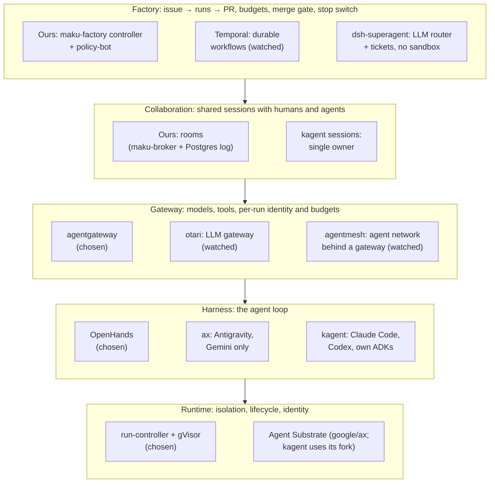


**Work in progress.** The agent ecosystem moves fast. Each detailed evaluation states when it was
checked and what would reopen it, and the page grows as new candidates appear.


What alternatives did we consider for each layer of the Agent Factory, and why did the current
choices win? A new candidate gets a row in [the table](#decisions-at-a-glance). If it could replace a
whole layer, it also gets a section under [projects evaluated in detail](#projects-evaluated-in-detail).

**In short:**
- **No candidate evaluated so far covers more than one or two layers.** The factory, the rooms and
  the controls around them would stay ours whatever we adopted.
- **A choice can be deferred rather than refused.** Each detailed evaluation lists the concrete
  triggers that would make us reconsider it.

## How candidates are evaluated

- **Against code, not announcements.** Claims are checked in the project's repository at a pinned
  commit, and linked.
- **On the work still ahead.** What is already built does not count in its favour; what adopting a
  candidate would still leave us to build does.
- **Against the platform's requirements:**
  - it runs on both EKS and GKE, on spot nodes;
  - every workload gets its own identity and network policy;
  - no long-lived credential reaches a sandbox;
  - open source first.

## Where each tool fits

An agent platform has several layers. Most "agent platforms" cover one or two of them; ours needs
all five.

## Decisions at a glance

| Layer | Chosen | Alternatives considered | Why |
|---|---|---|---|
| **Runtime** | Maku's run-controller + [gVisor](https://gvisor.dev), one pod per run | Agent Substrate (with google/ax or kagent), Kata/Firecracker, OpenHands Enterprise, Coder, E2B/Daytona | Open source; runs on EKS and GKE, on spot nodes; each run gets its own ServiceAccount and network policy, so the constitution's rules apply per run. Kata/Firecracker needs bare-metal hosts or nested virtualisation: the smallest AWS metal host has 128 vCPU, about $1.5/h spot or $5.4/h on demand ([Vantage](https://instances.vantage.sh/aws/ec2/c6i.metal)), against a few cents an hour for a run's spot node. An agent step mostly waits on the model (about 11 s a reply), so gVisor's system-call overhead does not show |
| **Harness** | [OpenHands](https://github.com/OpenHands/software-agent-sdk) agent-server | Headless Claude Code, kagent's harnesses, ax's Antigravity agent, [DeepSeek Harness](#dsh-superagent-prototype) | Open source, headless (an HTTP API), works with any OpenAI-compatible model, supports MCP. Claude Code is proprietary; Antigravity is Gemini-only; DeepSeek Harness has no HTTP API, no stable release, and uploads session logs unless you opt out |
| **Gateway** | [agentgateway](https://agentgateway.dev) | Agent Router 1.1 on Envoy Gateway, [otari](#otari), [agentmesh](#agentmesh) | See [gateways](). otari has no MCP federation, token exchange, listener per data class or OpenTelemetry export, and no Kubernetes packaging: watched. agentmesh is a network between agents, not a gateway: its own guide puts agentgateway in front of it |
| **Gateway guardrails** | The gateways' own guard hooks with open classifiers: agentgateway's `promptGuard` and MCP guardrails, the Semantic Router's jailbreak classifier, LlamaGuard on vLLM | [Google Model Armor](#google-model-armor), NeMo Guardrails, Guardrails AI, LlamaFirewall, ShieldGemma, llm-guard | A filter, not a boundary: a guard earns a block only from the injection drills, and the boundaries stay per-run identity, capability profiles, egress policy and the merge gate. Model Armor is a SaaS in the data path, inline on Google infrastructure only. Where this stands: [status]() |
| **Rooms** | A log we own: maku-broker on PostgreSQL | OpenHands shared conversations, ACP, A2A through a gateway, Valkey Streams, NATS JetStream, ax or Substrate as the session layer, kagent sessions | Two different questions. **Protocols** (OpenHands shared conversations, ACP, A2A, ax or Substrate, kagent sessions): none records who said what among several people and agents, or who may approve. **Brokers** (Valkey Streams, NATS JetStream): an event is written to Postgres first, which fixes its place in the log, then announced with `LISTEN/NOTIFY`. At a few events per second a second stateful system adds nothing, and delivering live before the write would let watchers see events the audit log never records |
| **Factory** | A small custom controller; a runs quota on the namespace rather than [Kueue](https://kueue.sigs.k8s.io/docs/overview/) | Argo Workflows, Tekton, Temporal, a Crossplane `Task` composition, gh-aw, OpenAI's Symphony specification ([below](#openai-symphony)), DeepSeek's dsh-superagent ([below](#dsh-superagent-prototype)) | The factory's state lives in Kubernetes objects and GitHub. Waiting hours on CI or a review is a periodic re-check of that state, so a restart loses nothing. Budgets and the kill switch are domain logic any engine would still need. Argo has no budget concept and a Crossplane composition has no timers. Temporal suits workflows whose state lives in code, and is the one to watch ([below](#temporal)) |
| **Merge gate** | [policy-bot](https://github.com/palantir/policy-bot) behind a repository ruleset | Required reviews, rulesets alone, a custom check, Prow/tide, Mergify, Kodiak | The policy lives in the repository and is reviewable, and the right to merge sits with one dedicated App |

The full records are in the programme's design documents, listed under [Sources](#sources).

## What would make us reconsider

| Current choice | Alternative that could win | Reconsider when |
|---|---|---|
| Custom factory controller | [Temporal](#temporal) | The task lifecycle needs multi-step compensation, timed human waits multiply, retry and resume rules grow, or the factory's bugs cluster around timers and retries |
| Postgres `LISTEN/NOTIFY` for room fan-out | NATS JetStream, for fan-out only: the log stays in Postgres and is written first | Notification latency or database load shows on the room dashboards, or rooms need many broker replicas |
| gVisor | Kata or Firecracker microVMs | Concurrency reaches about 20 sandboxes, enough to fill a metal host; a gVisor incompatibility blocks a class of task; or nested virtualisation becomes available on our node types |
| agentgateway (agents), Envoy AI Gateway (people) | [otari](#otari) | It ships declarative Kubernetes packaging, OpenTelemetry gen_ai export, per-run identity without a key per run and MCP federation (agents); or generic OIDC sign-in and prompt-based model choice (people) |
| One pod per run | [Agent Substrate](#agent-substrate) | See [Reconsidering Substrate](#reconsidering-substrate-not-now-deliberately-open) |
| One cold pod per run, ended when it ends | Pre-warmed pods handed to a run | A run's start time, about 90 s on a fresh node, becomes the bottleneck ([v1 review](https://github.com/Smana/ai-native-ref/blob/main/docs/superpowers/specs/2026-10-12-agent-factory-v1-review.md)) |
| agentgateway alone, every agent on one cluster | [agentmesh](#agentmesh) behind agentgateway, for calls between agents on different clusters | Runs on one cluster must call agents on another; and agentmesh ships declarative policy, per-tool standing grants and end-to-end revocation of delegations |
| OpenHands agent-server | [DeepSeek Harness](#dsh-superagent-prototype) | A stable release with a deprecation policy, an HTTP server API, container images, and session-log upload off by default |
| Open classifiers behind the gateways' guard hooks | [Google Model Armor](#google-model-armor), through agentgateway's `googleModelArmor` guard, on the public listener only | An adopter on GKE needs its compliance record for public data, or no open classifier reaches a usable detection rate in the injection drills |

## Projects evaluated in detail

Candidates that could replace a whole layer. Each section states when it was checked.

### google/ax

*Checked in October 2026 at `ac23328`.*

**What it is.** Google's agent orchestrator: it runs each task as an agent on Agent Substrate and
bootstraps Google's Antigravity agent inside it.

**Why not.**
- **Its control plane has no authentication or authorization.** The issue is open; its reporter
  says Google's security programme rated it critical
  ([ax#376](https://github.com/google/ax/issues/376)).
- **An unvalidated branch name reaches `git fetch`**, a code-execution bug
  ([ax#363](https://github.com/google/ax/issues/363)).
- **Gemini only, with the API key copied into every task**
  ([client.go](https://github.com/google/ax/blob/ac23328/internal/model/client.go#L486-L495),
  [reconciler.go](https://github.com/google/ax/blob/ac23328/internal/controller/reconciler.go#L153-L154)).
- **Still being rewritten**: v0.3.0 dropped its event log and replaced its harness, and the queue and
  controller were replaced a week later
  ([dc4f36c](https://github.com/google/ax/commit/dc4f36c),
  [ac23328](https://github.com/google/ax/commit/ac23328)).

Adopting ax would replace the harness as well as the runtime, and lock the platform to one model
provider.

**Reconsider if** ax closes #376 and #363 and supports other model providers without putting keys in
the sandbox, on top of the [Substrate triggers](#reconsidering-substrate-not-now-deliberately-open).

### Agent Substrate

*Checked in November 2026 at upstream `4ee8f66` (v1.0.0-rc.3) and kagent's pinned fork `563df06`.*

**What it is.** A runtime that packs isolated Actors into shared worker Pods. It supports gVisor and
microVMs, golden-snapshot warm starts, memory-preserving restore, forks and external credential
injection.

**What it would bring.** Faster starts and process-memory continuity across workers. A local spike
showed that OpenHands could resume its conversation after cross-node restoration, but the complete
credentialed factory path and current releases still need proof before those benefits count.

**Why it stays out.**

| Constraint | Evidence |
|---|---|
| Actors are not Pods. Per-run ServiceAccounts, Cilium policies, restricted PSS and Kueue admission need new mappings | [Architecture](https://github.com/agent-substrate/substrate/blob/4ee8f66ac237adfc3303086b12275aefc150fd6f/docs/concepts/architecture.md) |
| Actor JWT injection works, but identity across same-name Actor recreation still has an open cache/certificate concern | [Evaluation](https://github.com/Smana/ai-native-ref/blob/main/docs/superpowers/specs/2026-10-04-kagent-evaluation-research.md) |
| Per-run octo-sts requires a custom external credential provider and snapshot-safe credential handling | [Credential provider contract](https://github.com/agent-substrate/substrate/blob/4ee8f66ac237adfc3303086b12275aefc150fd6f/docs/guides/egress-credential-injection.md#for-credential-provider-developers) |
| Durable Spot recovery needs synchronous suspension and failure testing; worker termination does not suspend automatically | [Eviction contract](https://github.com/agent-substrate/substrate/blob/4ee8f66ac237adfc3303086b12275aefc150fd6f/docs/reference/api-guide.md#eviction) |
| PostgreSQL, snapshot storage, workers and runtime compatibility add a second control plane without removing the factory or rooms | [Security and operations status](https://github.com/agent-substrate/substrate/blob/4ee8f66ac237adfc3303086b12275aefc150fd6f/docs/security/security.md) |
| kagent requires Kubernetes 1.37+ and preview Substrate gates; its version page documents CI on kind/Kubernetes 1.35 | [Installation](https://kagent.dev/docs/kagent/latest/setup/installation/), [version support](https://kagent.dev/docs/kagent/latest/reference/versions/) |

**Decision:** deferred without a proof of concept by
[ADR-0062](). Reconsider
under the [measured triggers](#reconsidering-substrate-not-now-deliberately-open).

### kagent

*Checked in November 2026 at `a08cde76` (v1.0.0).*

**What it is.** A CNCF Sandbox project built on its tested Agent Substrate fork. The 1.0 rewrite
provides A2A Sessions, immutable Agent revisions, MCP tools, native Claude Code and Codex harnesses,
BYO gRPC agents, Actor JWTs, default-deny egress, checkpoints and automatic turn suspension.

**Why it stays out.**

| Gap | Evidence |
|---|---|
| OSS defaults to caller-selected identity and permissive authorization. A trusted proxy still needs external JWT validation and network lockdown | [Identity and authorization](https://kagent.dev/docs/kagent/latest/about/substrate-runtime/identity/) |
| A Session has one Agent and one Actor. Shares are read-only, so they do not create an attributed multi-participant room | [Core concepts](https://kagent.dev/docs/kagent/latest/about/core-concepts/), [sharing](https://kagent.dev/docs/kagent/latest/agents/share-a-session/) |
| HITL records a tool decision, not a distinct authenticated approver; traces are not a tamper-proof audit ledger | [HITL](https://kagent.dev/docs/kagent/latest/agents/human-in-the-loop/), [audit limitations](https://kagent.dev/docs/kagent/latest/observability/audit-prompts/) |
| Cumulative budgets, factory intake, Kueue fairness, GitHub identity and merge controls remain external | [Evaluation](https://github.com/Smana/ai-native-ref/blob/main/docs/superpowers/specs/2026-10-04-kagent-evaluation-research.md) |
| OpenHands needs the BYO A2A adapter. kagent adds a Session database and coupled Substrate upgrades without removing Maku or rooms | [BYO contract](https://kagent.dev/docs/kagent/latest/agents/bring-your-own-agent/), [versions](https://kagent.dev/docs/kagent/latest/reference/versions/) |

**Decision:** deferred by
[ADR-0062](). Direct
Substrate is the cleaner candidate if a measured runtime problem emerges because kagent's main
runtime benefits already come from Substrate.

### Temporal

*Assessed in October 2026 against the factory's needs; no proof of concept.*

**What it is.** A durable-execution engine ([temporalio/temporal](https://github.com/temporalio/temporal),
MIT). Workflows are written as code, and the engine keeps their state through crashes, with durable
timers, signals, retry policies and a full history of every execution.

**What it would bring.**
- Timed human waits, such as remind after a day, escalate after two, close after a week, without
  re-check logic.
- Retry and resume policies declared per step.
- An execution history and UI per task.

It can keep its state in PostgreSQL, so on this platform the database would be a `SQLInstance`
claim, not new infrastructure.

**Why not now.** The factory's waits are re-checks of state that already lives in Kubernetes
objects and GitHub, and a controller restart loses nothing. Temporal would add its server services
and workflows that are versioned as code, which is heavy at today's 20 tasks a day.

**Reconsider** under the conditions in [the table above](#what-would-make-us-reconsider). The first
candidate is the automatic resume of runs lost to spot reclamation: if resume rules multiply, a
workflow engine becomes worth its weight.

### OpenAI Symphony

*Checked in October 2026 at the repository's `SPEC.md`; last push in September 2026.*

**What it is.** An Apache-2.0 *specification* for an orchestrator that polls an issue tracker,
claims ready issues, gives each one an isolated workspace and runs a coding agent in it, with
bounded concurrency, stall and turn-silence timeouts, exponential backoff and restart reconciliation
without a database. An Elixir reference implementation exists; OpenAI calls it a "low-key
engineering preview". The agent is Codex only (its app-server protocol); the tracker is pluggable,
with Linear, GitHub Issues, Jira Cloud, Asana and GitLab adapters in the reference.

**Why not.** It leaves our layers to each implementation: its non-goals include *"Mandating strong
sandbox controls beyond what the coding agent and host OS provide"* and *"Mandating a single
default approval, sandbox, or operator-confirmation posture for all implementations"* (SPEC §2.2).
Workspaces are directories, locally or on SSH workers; tokens are tracked but not enforced; the
merge is whatever the agent does from a hook.

**Worth learning from:** its continuation rule (SPEC §7.1): after each turn the worker re-checks
the issue's state and starts another turn while it stays active, up to `max_turns` per worker
session, rather than spending fixed counters per trigger. It has no total per-issue budget. Its
defaults are a baseline: stall 300 s, `max_turns` 20, backoff capped at 5 min, and a 1 h limit on a
turn's silence (not its length).

**Reconsider if** the spec gains a non-Codex agent adapter and a sandbox hook; even then it would
replace polling and slot logic only.

### otari

*Checked in October 2026 in the code at [`e6226a5`](https://github.com/mozilla-ai/otari/tree/e6226a5cdd42945a29c36e6327afa5394241734e)
(just after v0.30.1) and any-llm [`d6b76fd`](https://github.com/mozilla-ai/any-llm/tree/d6b76fd9e594d308a1932fe5172bc8e37ec4d17d).
Full evaluation, with a code link per claim: [research](https://github.com/Smana/ai-native-ref/blob/main/docs/superpowers/specs/2026-10-20-otari-evaluation-research.md).*

**What it is.** Mozilla.ai's open-source (Apache-2.0) LLM gateway: one Python process serving an
OpenAI-compatible API and a dashboard, built on its `any-llm` SDK, over PostgreSQL. It runs alone,
or as a data plane reporting to the hosted control plane otari.ai. First released in June 2026, it
reached v0.30 four months later with 27 breaking changes.

**What it does well.**
- **Budgets reserved before the call**: the worst case (prompt estimate plus `max_tokens`) is held,
  then settled. Ours charge after the call, so the call that crosses a budget completes.
- **Unpriced models refused by default** (402), fallback models included; prices from your own table.
- Z.ai, Anthropic with prompt caching, vLLM and OpenAI-compatible backends; aliases, failover;
  budgets in USD, tokens or requests per key, user, workspace or provider.

**Why not.**

| Our need | otari |
|---|---|
| A per-run identity checked on every call | A JWT is accepted only once its `sub` is bound to a key by a rule: one key and one rule per run |
| MCP federation with per-role tool allow-lists | MCP client only: no server agents can connect to |
| The token exchange with octo-sts | None |
| A listener per data class | One port; keys and workspaces only approximate it |
| OpenTelemetry gen_ai metrics and traces, JSON logs | Prometheus `gateway_*` metrics and traces in its own database; no export |
| Declarative Kubernetes configuration | No Helm chart, operator or CRDs; allow-lists and identity rules are API-only, and the deprecated `providers:` block is copied to the database once, then ignored |
| No SaaS in the data path | Holds in standalone mode. In hybrid mode otari.ai sees every request's metadata and hands back the provider keys |
| People's gateway: model picked from the prompt, ZITADEL sign-in | Its kNN router needs labelled examples; sign-in is password, passkeys, Google or GitHub only |

**Worth borrowing:** the pre-call reservation, for our gateway budgets, and its re-check of pricing on
every fallback model.

**Reconsider** under the conditions in [the table above](#what-would-make-us-reconsider), or once it
reaches 1.0 with a deprecation policy.

### agentmesh

*Checked in November 2026 at [`e4787a0`](https://github.com/google/agentmesh/tree/e4787a050bccf066d481dca40d219888fabb5b84)
(v0.2.0). Full evaluation, with a code link per claim:
[research](https://github.com/Smana/ai-native-ref/blob/8f8363d73fdf0120429746e05edc588e9733eb18/docs/superpowers/specs/2026-11-04-agentmesh-evaluation-research.md).*

**What it is.** Google's open-source (Apache-2.0, "not an officially supported Google product")
private network for agents. A node beside each agent joins a libp2p overlay, enrols with your OIDC
issuer and receives a Biscuit credential; routers relay encrypted streams; a control plane holds
the policy. The node brokers MCP, model and A2A calls by service name across clusters, clouds and
NAT. Helm charts, no CRDs.

**What it does well.** A holder narrows its credential offline with task blocks (services, tools,
methods, paths, expiry) that only intersect, then seals it. A data-class floor the caller cannot
relax. A2A agent cards rewritten to mesh paths, with discovery.

**Why not.**

| Our need | agentmesh |
|---|---|
| MCP federation, tools listed per role | Six meta-tools; remote tools never in `tools/list`; per-tool grants only in caller-appended blocks |
| One alias, one backend | `/v1` picks a provider mesh-wide by load, round-robin among equals |
| Budgets, octo-sts, OpenTelemetry | None, none, Prometheus only |
| Declarative policy | One document on an API; Helm seeds it once |
| No credential in the sandbox | Its agent-sandbox blueprint passes the task token in as `OPENAI_API_KEY` |
| Revocation on every hop | A banned node's downstream delegations stay valid until they expire |

It replaces nothing we run and adds a control plane, routers and a sidecar per run. One code owner
writes three quarters of it; its alphas fixed three critical or high advisories.

**Worth borrowing:** sealed, task-scoped narrowing of a run's credential; a header that only
tightens the data class.

**Reconsider** under the conditions in [the table above](#what-would-make-us-reconsider).

### Google Model Armor

*Checked in November 2026 against agentgateway `v1.6.0`, the Model Armor documentation and its
release notes. Full evaluation, with the open-source options compared:
[research](https://github.com/Smana/ai-native-ref/blob/8f8363d73fdf0120429746e05edc588e9733eb18/docs/superpowers/specs/2026-11-04-model-armor-oss-equivalents-research.md).*

**What it is.** Google Cloud's hosted screen for model traffic: proprietary classifiers for prompt
injection and jailbreaks, harmful content, sensitive data and malicious URLs, called per request
from a regional endpoint, with "floor settings" that set minimum thresholds across an organisation.
Inline integrations exist for Google's Agent Gateway, Apigee, Gemini Enterprise, Google-managed MCP
servers and Google load balancers. From anywhere else, agentgateway included, it is a REST call per
request.

**What it does well.**
- One API covers prompt, response, documents and images, in nine languages, at a list price of
  $0.10 per million tokens after a free tier.
- Its Agent Gateway screens MCP `tools/call` requests **and results**, the vector that matters for
  agents reading issues and logs.

**Why not.**

| Our need | Model Armor |
|---|---|
| No SaaS in the data path | Every screened request leaves the cluster |
| Internal data reaches Anthropic only | A second reader of every internal prompt |
| EKS and GKE alike | Inline on Google infrastructure only; REST from EKS, same region as its template |
| Open source first | Classifiers are proprietary; the integration is what agentgateway already ships |

**What we do instead.** agentgateway's `promptGuard` (regex, webhook) and MCP guardrails with Meta's
Prompt Guard 2 on CPU, LlamaGuard 3 on the GPU it already holds, the Semantic Router's jailbreak
classifier for people, and Cilium egress policy where Model Armor offers URL detection. A guard
runs in audit until an injection drill shows its detection and false-positive rates. Where this
stands is on the [status page]().

**Worth borrowing:** floor settings, as a CI rule that refuses a model route without a guard
policy; and screening tool results, not only prompts.

**Reconsider** under the conditions in [the table above](#what-would-make-us-reconsider).

### dsh-superagent-prototype

*Checked in November 2026 at [`8c32a9d`](https://github.com/deepseek-ai/dsh-superagent-prototype/tree/8c32a9dc5d72c033816c6a8110b37f40cf94fba4),
the repository's only commit, and DeepSeek Harness at `8bd0733`. Full evaluation, with a code link
per claim: [research](https://github.com/Smana/ai-native-ref/blob/8f8363d73fdf0120429746e05edc588e9733eb18/docs/superpowers/specs/2026-11-04-dsh-superagent-evaluation-research.md).*

**What it is.** DeepSeek's MIT-licensed research prototype of a "super-agent": a long-lived router
session reads GitHub and Feishu, admits requests through a deterministic gate and a model
assessment, and runs one worker session per ticket in a local git worktree. It is a plugin bundle
for DeepSeek Harness (dsh), DeepSeek's TypeScript harness in developer preview. The README calls it
"not an official DeepSeek product".

**What it does well.**
- **Subscriptions**: later comments and CI on a ticket's threads reach its worker without a new
  mention; a person's comment on a merged pull request resumes it, bots never do.
- **Observe mode**: a proactive rule records what it would have accepted before you let it act.
- **Mandates**: an accept records the policy version and requester, revalidated before a resume.

**Why not.**

| Our need | dsh-superagent-prototype |
|---|---|
| Sandbox, per-run identity, Kubernetes | None: one process as the operator's OS user, one GitHub account, tmux and SQLite |
| Harness with an HTTP API and MCP | dsh offers stdio modes and a one-shot headless run; the bundle loads no MCP client |
| Roles, budgets, merge gate | One worker role; no budget; auto-merge is prompt text through a second account's CLI |
| No SaaS in the data path | dsh uploads session logs to DeepSeek unless you opt out |
| Maintained | One commit, issues disabled, no release |

**Worth borrowing:** subscriptions for the pull-request continuation loop, observe mode for any
proactive intake, a mandate on each task, and task stages that name who the task waits for.

**Reconsider** under the conditions in [the table above](#what-would-make-us-reconsider).

## Would rebuilding on kagent + Substrate be simpler?

The 1.0 releases make this a stronger challenge, but the comparison starts with what the current
runtime already does. Maku's run-controller runs each run as one gVisor pod, and the factory
recovers interrupted work from its branch and room log.

| Current limitation | What Substrate could add |
|---|---|
| A replacement Pod reconstructs the agent around its workspace | Restore process memory and root state on another worker |
| Cold starts and image pulls dominate some runs | Start from a golden snapshot |
| A fork starts a fresh run | Carry a runtime snapshot into the fork |
| Each run holds its own short-lived tokens; the gateway holds the provider keys | Inject credentials at an external egress gateway |

A spike verified OpenHands cross-node continuation and fast golden starts, but not the complete
factory, current releases, EKS or Spot loss
([spike](https://github.com/Smana/ai-native-ref/blob/main/docs/superpowers/specs/2026-10-17-substrate-spike.md#conclusion)).

**What we would still build or retain:**
- **The factory**, rooms, approvals, budgets and merge controls.
- **Per-run identity and admission mappings**, because Actors are not Pods.
- **Short-lived GitHub tokens per run and role**, through a custom Substrate credential provider.
- **Spot recovery, observability attribution and backend garbage collection**.
- For kagent, **an OSS authorization boundary and an OpenHands BYO adapter**.

**Net:** both options add moving parts without removing the platform's differentiating controls.
ADR-0062 keeps gVisor + OpenHands and approves neither a migration nor a proof of
concept. Direct Substrate remains the cleaner candidate if a measured runtime need emerges.

## Reconsidering Substrate: not now, deliberately open

`AgentRun` remains the abstraction. A future backend would use a new Composition for new runs, never
change a live run's Composition, and leave backend-generated Actors and Sessions to their own
controllers. Flux would own installation, Crossplane the common per-run resources and one hand-off,
and Maku the task and room intent.

**Reconsider direct Substrate** when a measured cold-start, memory-continuity or density problem
justifies a proof of concept, and the candidate can demonstrate:

- supported EKS and GKE installation and upgrades;
- safe per-run identity and external octo-sts injection;
- per-run DNS/FQDN egress and Kueue-equivalent admission;
- controlled node and Spot loss without lost or duplicated effects;
- complete cleanup and a net reduction in code and operations.

**Reconsider kagent** only when it also provides non-bypassable OSS authorization, attributed
multi-participant sessions, delegated approver evidence, supported OpenHands restoration and a clean
one-run/one-identity mapping. Its adoption must delete more custom code than its adapters and control
planes add. The full evidence and triggers are in the
[kagent evaluation](https://github.com/Smana/ai-native-ref/blob/main/docs/superpowers/specs/2026-10-04-kagent-evaluation-research.md).

## Sources

- [Agent Factory v1 review](https://github.com/Smana/ai-native-ref/blob/main/docs/superpowers/specs/2026-10-12-agent-factory-v1-review.md):
  build-or-adopt per layer, Symphony, agent-sandbox's suspend and warm pools
- [otari evaluation](https://github.com/Smana/ai-native-ref/blob/main/docs/superpowers/specs/2026-10-20-otari-evaluation-research.md)
- [agentmesh evaluation](https://github.com/Smana/ai-native-ref/blob/8f8363d73fdf0120429746e05edc588e9733eb18/docs/superpowers/specs/2026-11-04-agentmesh-evaluation-research.md)
- [Model Armor and its open-source equivalents](https://github.com/Smana/ai-native-ref/blob/8f8363d73fdf0120429746e05edc588e9733eb18/docs/superpowers/specs/2026-11-04-model-armor-oss-equivalents-research.md)
- [dsh-superagent-prototype evaluation](https://github.com/Smana/ai-native-ref/blob/8f8363d73fdf0120429746e05edc588e9733eb18/docs/superpowers/specs/2026-11-04-dsh-superagent-evaluation-research.md)
- [kagent evaluation](https://github.com/Smana/ai-native-ref/blob/main/docs/superpowers/specs/2026-10-04-kagent-evaluation-research.md)
- [ax and Substrate re-check](https://github.com/Smana/ai-native-ref/blob/main/docs/superpowers/specs/2026-10-01-agent-ecosystem-recheck-research.md#2026-10-04-re-check-ax-and-substrate-claims-against-code)
- [Runtime research, with the first ax and Substrate evaluation](https://github.com/Smana/ai-native-ref/blob/main/docs/superpowers/specs/2026-09-23-agent-runtime-identity-research.md)
- Designs: [programme](https://github.com/Smana/ai-native-ref/blob/main/docs/superpowers/specs/2026-09-23-agent-factory-design.md),
  [runtime](https://github.com/Smana/ai-native-ref/blob/main/docs/superpowers/specs/2026-09-23-agent-runtime-identity-design.md),
  [rooms](https://github.com/Smana/ai-native-ref/blob/main/docs/superpowers/specs/2026-09-23-agent-collaboration-rooms-design.md),
  [factory](https://github.com/Smana/ai-native-ref/blob/main/docs/superpowers/specs/2026-09-23-agent-dark-factory-design.md)
