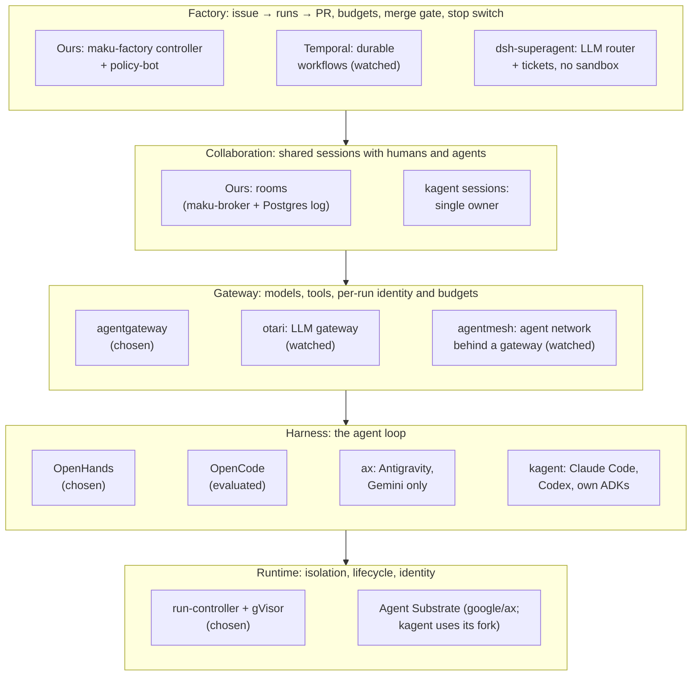


**Work in progress.** The agent ecosystem moves fast. Each detailed evaluation states when it was
checked and what would reopen it, and the page grows as new candidates appear.


What alternatives did we consider for each layer of Maku and this platform, and why did the current
choices win? A new candidate gets a row in [the table](#decisions-at-a-glance). If it could replace a
whole layer, it also gets a section under [projects evaluated in detail](#projects-evaluated-in-detail).

**In short:**
- **No candidate evaluated so far covers more than one or two layers.** The factory, the rooms and
  the controls around them would stay ours whatever we adopted.
- **A choice can be deferred rather than refused.** Each detailed evaluation lists the concrete
  triggers that would make us reconsider it.

## How candidates are evaluated

- **Against code, not announcements.** Claims are checked in the project's repository at a pinned
  commit, and linked.
- **On the work still ahead.** What is already built does not count in its favour; what adopting a
  candidate would still leave us to build does.
- **Against the platform's requirements:**
  - it runs on both EKS and GKE, on spot nodes;
  - every workload gets its own identity and network policy;
  - no long-lived credential reaches a sandbox;
  - open source first.

## Where each tool fits

An agent platform has several layers. Most "agent platforms" cover one or two of them; ours needs
all five.

## Decisions at a glance

| Layer | Chosen | Alternatives considered | Why |
|---|---|---|---|
| **Runtime** | Maku's run-controller + [gVisor](https://gvisor.dev), one pod per run | Agent Substrate (with google/ax or kagent), Kata/Firecracker, OpenHands Enterprise, Coder, E2B/Daytona | Open source; runs on EKS and GKE, on spot nodes; each run gets its own ServiceAccount and network policy, so the constitution's rules apply per run. Kata/Firecracker needs bare-metal hosts or nested virtualisation: the smallest AWS metal host has 128 vCPU, about $1.5/h spot or $5.4/h on demand ([Vantage](https://instances.vantage.sh/aws/ec2/c6i.metal)), against a few cents an hour for a run's spot node. An agent step mostly waits on the model (about 11 s a reply), so gVisor's system-call overhead does not show |
| **Harness** | [OpenHands](https://github.com/OpenHands/software-agent-sdk) agent-server | [OpenCode](#opencode), headless Claude Code, kagent's harnesses, ax's Antigravity agent, [DeepSeek Harness](#dsh-superagent-prototype) | Open source, headless (an HTTP API), works with any OpenAI-compatible model, supports MCP. OpenCode's upstream image is lighter, but it needs a Maku-owned loop guard and room, provider, and recovery adapters. Claude Code is proprietary; Antigravity is Gemini-only; DeepSeek Harness has no HTTP API, no stable release, and uploads session logs unless you opt out |
| **Gateway** | [agentgateway](https://agentgateway.dev) | Agent Router 1.1 on Envoy Gateway, [otari](#otari), [agentmesh](#agentmesh) | See [gateways](). otari has no MCP federation, token exchange, listener per data class or OpenTelemetry export, and no Kubernetes packaging: watched. agentmesh is a network between agents, not a gateway: its own guide puts agentgateway in front of it |
| **Gateway guardrails** | The gateways' own guard hooks with open classifiers: agentgateway's `promptGuard` and MCP guardrails, the Semantic Router's jailbreak classifier, LlamaGuard on vLLM | [Google Model Armor](#google-model-armor), NeMo Guardrails, Guardrails AI, LlamaFirewall, ShieldGemma, llm-guard | A filter, not a boundary: a guard earns a block only from the injection drills, and the boundaries stay per-run identity, per-role tool rules, egress policy and the merge gate. Model Armor is a SaaS in the data path, inline on Google infrastructure only. Where this stands: [status]() |
| **Rooms** | A log we own: maku-broker on PostgreSQL | OpenHands shared conversations, ACP, A2A through a gateway, Valkey Streams, NATS JetStream, ax or Substrate as the session layer, kagent sessions | Two different questions. **Protocols** (OpenHands shared conversations, ACP, A2A, ax or Substrate, kagent sessions): none records who said what among several people and agents, or who may approve. **Brokers** (Valkey Streams, NATS JetStream): an event is written to Postgres first, which fixes its place in the log, then announced with `LISTEN/NOTIFY`. At a few events per second a second stateful system adds nothing, and delivering live before the write would let watchers see events the audit log never records |
| **Factory** | A small custom controller; a runs quota on the namespace rather than [Kueue](https://kueue.sigs.k8s.io/docs/overview/) | Argo Workflows, Tekton, Temporal, a Crossplane `Task` composition, gh-aw, OpenAI's Symphony specification ([below](#openai-symphony)), DeepSeek's dsh-superagent ([below](#dsh-superagent-prototype)) | The factory's state lives in Kubernetes objects and GitHub. Waiting hours on CI or a review is a periodic re-check of that state, so a restart loses nothing. Budgets and the kill switch are domain logic any engine would still need. Argo has no budget concept and a Crossplane composition has no timers. Temporal suits workflows whose state lives in code, and is the one to watch ([below](#temporal)) |
| **Merge gate** | [policy-bot](https://github.com/palantir/policy-bot) behind a repository ruleset | Required reviews, rulesets alone, a custom check, Prow/tide, Mergify, Kodiak | The policy lives in the repository and is reviewable, and the right to merge sits with one dedicated App |

The full records are in the programme's design documents, listed under [Sources](#sources).

## What would make us reconsider

Each layer's reconsideration triggers — when Temporal, NATS JetStream, microVMs, otari, Agent Substrate, warm pools, agentmesh, OpenCode, DeepSeek Harness or Google Model Armor would win — are recorded with the October and November 2026 evaluations in [the repository's design records](https://github.com/Smana/ai-native-ref/blob/main/docs/superpowers/specs/2026-11-14-alternatives-evaluations.md#what-would-make-us-reconsider).

## Projects evaluated in detail

Checked in October and November 2026 across `google/ax`, `Agent Substrate`, `kagent`, `OpenCode`, `Temporal`, `OpenAI Symphony`, `otari`, `agentmesh`, `Google Model Armor`, and `dsh-superagent-prototype` (plus the `kagent` + `Substrate` rebuild comparison); the commit-pinned evaluations and gap tables are in [the repository's design records](https://github.com/Smana/ai-native-ref/blob/main/docs/superpowers/specs/2026-11-14-alternatives-evaluations.md).

## Reconsidering Substrate: not now, deliberately open

`AgentRun` remains the abstraction. A future backend would use a new Composition for new runs, never
change a live run's Composition, and leave backend-generated Actors and Sessions to their own
controllers. Flux would own installation, Crossplane the common per-run resources and one hand-off,
and Maku the task and room intent.

**Reconsider direct Substrate** when a measured cold-start, memory-continuity or density problem
justifies a proof of concept, and the candidate can demonstrate:

- supported EKS and GKE installation and upgrades;
- safe per-run identity and external octo-sts injection;
- per-run DNS/FQDN egress and Kueue-equivalent admission;
- controlled node and Spot loss without lost or duplicated effects;
- complete cleanup and a net reduction in code and operations.

**Reconsider kagent** only when it also provides non-bypassable OSS authorization, attributed
multi-participant sessions, delegated approver evidence, supported OpenHands restoration and a clean
one-run/one-identity mapping. Its adoption must delete more custom code than its adapters and control
planes add. The full evidence and triggers are in the
[kagent evaluation](https://github.com/Smana/ai-native-ref/blob/main/docs/superpowers/specs/2026-10-04-kagent-evaluation-research.md).

## Sources

- [Detailed project evaluations](https://github.com/Smana/ai-native-ref/blob/main/docs/superpowers/specs/2026-11-14-alternatives-evaluations.md)
- [Agent Factory v1 review](https://github.com/Smana/ai-native-ref/blob/main/docs/superpowers/specs/2026-10-12-agent-factory-v1-review.md):
  build-or-adopt per layer, Symphony, agent-sandbox's suspend and warm pools
- [OpenCode as a second harness: research](https://github.com/Smana/ai-native-ref/pull/404) and [design](https://github.com/Smana/ai-native-ref/pull/404)
- [otari evaluation](https://github.com/Smana/ai-native-ref/blob/main/docs/superpowers/specs/2026-10-20-otari-evaluation-research.md)
- [agentmesh evaluation](https://github.com/Smana/ai-native-ref/blob/8f8363d73fdf0120429746e05edc588e9733eb18/docs/superpowers/specs/2026-11-04-agentmesh-evaluation-research.md)
- [Model Armor and its open-source equivalents](https://github.com/Smana/ai-native-ref/blob/8f8363d73fdf0120429746e05edc588e9733eb18/docs/superpowers/specs/2026-11-04-model-armor-oss-equivalents-research.md)
- [dsh-superagent-prototype evaluation](https://github.com/Smana/ai-native-ref/blob/8f8363d73fdf0120429746e05edc588e9733eb18/docs/superpowers/specs/2026-11-04-dsh-superagent-evaluation-research.md)
- [kagent evaluation](https://github.com/Smana/ai-native-ref/blob/main/docs/superpowers/specs/2026-10-04-kagent-evaluation-research.md)
- [ax and Substrate re-check](https://github.com/Smana/ai-native-ref/blob/main/docs/superpowers/specs/2026-10-01-agent-ecosystem-recheck-research.md#2026-10-04-re-check-ax-and-substrate-claims-against-code)
- [Runtime research, with the first ax and Substrate evaluation](https://github.com/Smana/ai-native-ref/blob/main/docs/superpowers/specs/2026-09-23-agent-runtime-identity-research.md)
- Designs: [programme](https://github.com/Smana/ai-native-ref/blob/main/docs/superpowers/specs/2026-09-23-agent-factory-design.md),
  [runtime](https://github.com/Smana/ai-native-ref/blob/main/docs/superpowers/specs/2026-09-23-agent-runtime-identity-design.md),
  [rooms](https://github.com/Smana/ai-native-ref/blob/main/docs/superpowers/specs/2026-09-23-agent-collaboration-rooms-design.md),
  [factory](https://github.com/Smana/ai-native-ref/blob/main/docs/superpowers/specs/2026-09-23-agent-dark-factory-design.md)
