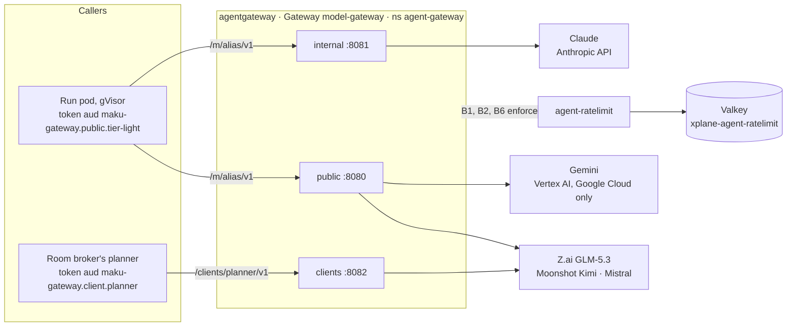

Every model call on this platform crosses one of two gateways, chosen by who is calling. Both speak
the OpenAI API; they differ in how they know the caller and in what they let it do. What runs
today is on the
[status page](). How each gateway picks a model, how to tune
it and what it costs is on [Model routing and cost]().

| | `ai-gateway` | Model gateway |
|---|---|---|
| **Callers** | Humans and coding clients: OpenCode, Continue, OpenWebUI, the nightly Promptfoo eval | Agent runs, each with its own token, and the room broker's planner |
| **Identity** | An API key per client, from AWS Secrets Manager | A projected token per run (JWT), verified on every call |
| **Model choice** | Named by the client, or picked from the prompt by the Semantic Router (`model: MoM`) | The alias the run's token names, mapped statically to one backend; nothing selects per request |
| **Software** | Envoy Gateway + Envoy AI Gateway (Agent Router) `1.1.0` | [agentgateway](https://agentgateway.dev/docs/) `v1.6.0`, Gateway `model-gateway` from Maku's `maku-gateway` chart ([ADR-0053]()) |

![The two gateways side by side. Top: humans and coding clients reach ai-gateway over the tailnet with an API key; the Semantic Router may pick the model, and the request lands on a vLLM model in the serving fleet. Bottom: an agent run calls the model gateway with its own token; the gateway verifies it, meters the run's tokens and routes the alias the token names to a frontier provider (Z.ai GLM, Moonshot Kimi and Mistral for public data only, Claude for internal data). Both gateways write access logs and gen_ai metrics to the Victoria stack](/images/diagrams/ai-platform-2.svg)

*Source: [`docs/architecture/ai-platform.drawio`](https://github.com/Smana/ai-native-ref/blob/main/docs/architecture/ai-platform.drawio), page 2.*

## `ai-gateway`: humans and coding clients

The platform speaks the OpenAI API. A client points at one endpoint, names a
model — or asks the platform to choose one — and never learns which pod
answered.

### Sending a request

```bash
# What's available
curl -sS https://llm.priv.aws.ogenki.io/v1/models \
  -H "Authorization: Bearer $LLM_API_KEY" | jq '.data[].id'

# Name a model explicitly — skips classification entirely
curl -sS https://llm.priv.aws.ogenki.io/v1/chat/completions \
  -H "Authorization: Bearer $LLM_API_KEY" \
  -H 'Content-Type: application/json' \
  -d '{
        "model": "xplane-qwen-coder",
        "messages": [{"role": "user", "content": "Write a Go worker pool."}]
      }'

# Let the Semantic Router choose from the prompt
curl -sS https://llm.priv.aws.ogenki.io/v1/chat/completions \
  -H "Authorization: Bearer $LLM_API_KEY" \
  -H 'Content-Type: application/json' \
  -d '{
        "model": "MoM",
        "messages": [{"role": "user", "content": "Write a Go worker pool."}]
      }'
```

The two calls reach the same pod. The difference is roughly **250–300 ms** of
classification on the `MoM` path — worth it when the client cannot know which
model suits the prompt, wasted when it can. See
[Coding Clients]()
for which client pins which model, and why.

### The request path

The [hop-by-hop request path](/images/diagrams/llm-platform-1.svg) shows each stage below in
one picture.

**Ingress.** External clients arrive over Tailscale at the Cilium Gateway
`platform-tailscale-general` and are forwarded to the Envoy AI Gateway data
plane Service. In-cluster clients — OpenWebUI, the nightly Promptfoo eval —
address that Service directly. Nothing is reachable from the public internet;
see [Private access](https://cnref.ogenki.io/docs/platform/networking/private-access/).

**Authentication.** A `SecurityPolicy` (`apiKeyAuth`) targets the Gateway, so
every route inherits it rather than each declaring its own. Keys come from AWS
Secrets Manager through External Secrets, and the gateway strips the
`Authorization` header before forwarding — vLLM never sees a credential.

**Who holds a key.** Each key names its holder, and that name is all the gateway knows about a
caller: it labels the access log and the spend series, and the caller cannot set it. The key decides
who pays for a call, never which model it may name — every key on this listener reaches every route.

| Client id | Who holds it | What it names |
|---|---|---|
| `openwebui` | OpenWebUI, in cluster | Whatever model its user picks, `MoM` included |
| `promptfoo` | The nightly evaluation, in cluster | The models its suites name |

The room broker's planner holds no key here. It calls the model gateway that runs the agents, with its
own ServiceAccount token ([planner settings]()).

**Prompt classification (`ext_proc`, filter index 0).** The Semantic Router is
wired in as an Envoy `ext_proc` gRPC filter, inserted **ahead of** the AI
Gateway's own extproc by an `EnvoyPatchPolicy` — a raw xDS JSONPatch. The
ordering is not optional and an `EnvoyExtensionPolicy` cannot express it,
because that API can only *append* filters. The router rewrites `body.model`
only when the client sent `model: MoM` (or the literal `auto`); an explicit
`xplane-*` name passes through untouched.

**Routing.** The AI Gateway extproc derives the `x-ai-eg-model` header from the
(possibly rewritten) body and emits `gen_ai_*` telemetry. An `AIGatewayRoute`
matches that header and forwards through an `AIServiceBackend` → `Backend` →
the model's Service on port 8000.

Not every claim routes this way yet: three of the four still use a hand-written route, listed
under [known gaps]().

### Semantic routing — `model: MoM`

Sending `model: MoM` lets the Semantic Router (`infrastructure/base/vllm-semantic-router/helmrelease.yaml`) pick from the prompt; the priority table and guardrail exclusions are in [the repository's design records](https://github.com/Smana/ai-native-ref/blob/main/docs/superpowers/specs/2026-11-14-routing-and-cost-measurements.md#gateway-routing-and-budgets).

### LoRA canaries

`xplane-qwen-coder` carries two LoRA adapters, each addressable as a model name
of its own, and sends 10% of its traffic to one of them:

```yaml
  gateway:
    enabled: true
    canaries:
      - adapter: xplane-qwen-coder-sql-dpo
        weightPercent: 10
```

The adapter name is matched **verbatim** against `loraAdapters[].name` — it is
not derived from the base model's name, so a typo produces a route to nothing
rather than a validation error.

Canaries are mutually exclusive with the Gateway API Inference Extension's
endpoint picker. See the
[roadmap]() for where the
endpoint picker stands and what turning it on would take.

### Frontier models and token budgets

`tier-frontier` is served by GLM-5.3 through Z.ai with the **platform** key, which only the gateway
holds. It needs no GPU, so it answers with `llm-platform` suspended. The `ai-gateway` umbrella generates
its API keys in-cluster (Secret `ai-gateway-api-keys` in `envoy-ai-gateway-system`). Example (the
reference host's EKS endpoint):

```bash
curl -s https://llm.priv.aws.ogenki.io/v1/chat/completions \
  -H "Authorization: Bearer $LLM_API_KEY" -H "Content-Type: application/json" \
  -d '{"model": "tier-frontier", "messages": [{"role": "user", "content": "Say hi"}]}'
```

Identity-header stripping and the shadow token budgets ([ADR-0050]()) are in [the repository's design records](https://github.com/Smana/ai-native-ref/blob/main/docs/superpowers/specs/2026-11-14-routing-and-cost-measurements.md#gateway-routing-and-budgets).

## The model gateway: agent runs {#the-agent-gateway-agent-runs}

Every model call an agent run makes crosses the model gateway, `model-gateway` in namespace
`agent-gateway`, under the run's own identity. It is an [agentgateway](https://agentgateway.dev)
Gateway configured by Maku's `maku-gateway` chart
([ADR-0053]()). The run's
harness calls it with a projected token of its own; only the gateway holds the provider keys (see
[Agent runtime]()). Manifests:
`infrastructure/base/agent-gateway/model-gateway/`.



### Listeners and data classes

| Listener | Port | Audiences | Serves |
|---|---|---|---|
| `public` | 8080 | `maku-gateway.public.<alias>` | `/m/<alias>/v1` for the four tier aliases on Z.ai, and the provider aliases on Moonshot, Mistral or, on Google Cloud, Vertex AI ([providers](), public data only) |
| `internal` | 8081 | `maku-gateway.internal.<alias>` | `/m/<alias>/v1` for the four tier aliases on Claude, through the Anthropic API (ADR-0054) |
| `clients` | 8082 | `maku-gateway.client.<name>` | The broker's planner, on `/clients/planner/v1` ([planner settings]()) |

Each provider serves only the data classes it is declared for: Z.ai, Moonshot, Mistral and Vertex AI `public`,
Anthropic `internal`. An alias a listener does not serve does not exist on it.

### Identity

| Check | Where | A failure answers |
|---|---|---|
| Signature, issuer, `exp` and `sub` present, an audience of this listener | The listener's JWT policy | 401 |
| `sub` is a run of `agents` (`system:serviceaccount:agents:run-*`), or the broker on `clients` | The listener's authorization rule | 403 |
| The token's audience names the alias of the route it calls | The route's authorization rule | 403 |

The backend then forces the model to the alias's own, whatever the request body names, so a run
reaches exactly one model. The run-controller refuses to start a run whose alias, or whose judge's
alias, its listener does not serve. The verified `sub` labels every signal: `ar_agent` on the
`gen_ai_*` metrics (`vmpodscrape.yaml` relabels them), and the run in the access log.

### Tools and budgets {#budgets}

A run's only MCP server is the broker's room tools on `room-broker:8090`, which the run calls directly
with a token of audience `room-tools`; the broker checks it with a TokenReview. A run without a room
has no MCP server.

The legacy `agent-router` deployment, the enforced B1/B2/B6 rate-limit buckets ([runbook 04, Part D](https://github.com/Smana/ai-native-ref/blob/main/docs/runbooks/agent-factory/04-gateway-secrets-budgets.md#part-d--enforcing-the-agents-budgets)) and the side-by-side comparison of the two gateways ([model routing and budgets design](https://github.com/Smana/ai-native-ref/blob/main/docs/superpowers/specs/2026-09-23-llm-complexity-routing-design.md)) are in [the repository's design records](https://github.com/Smana/ai-native-ref/blob/main/docs/superpowers/specs/2026-11-14-routing-and-cost-measurements.md#gateway-routing-and-budgets).
