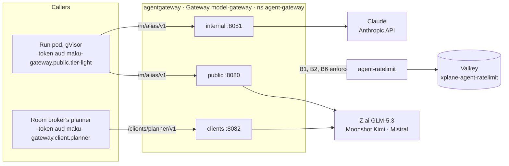

Every model call on this platform crosses one of two gateways, chosen by who is calling. Both speak
the OpenAI API; they differ in how they know the caller and in what they let it do. What runs
today is on the
[status page](). How each gateway picks a model, how to tune
it and what it costs is on [Model routing and cost]().

| | `ai-gateway` | Agent gateway |
|---|---|---|
| **Callers** | Humans and coding clients: OpenCode, Continue, OpenWebUI, the nightly Promptfoo eval | Agent runs, each with its own token, and the room broker's planner |
| **Identity** | An API key per client, from AWS Secrets Manager | A projected token per run (JWT), verified on every call |
| **Model choice** | Named by the client, or picked from the prompt by the Semantic Router (`model: MoM`) | The alias the run's token names, mapped statically to one backend; nothing selects per request |
| **Software** | Envoy Gateway + Envoy AI Gateway (Agent Router) `1.1.0` | [agentgateway](https://agentgateway.dev/docs/) `v1.6.0`, Gateway `model-gateway` from Maku's `maku-gateway` chart ([ADR-0053]()) |

<!-- TODO: redraw ai-platform.drawio page 2 for the model gateway: the picture still shows the identity-proxy sidecar, the MCP tools and octo-sts behind the agent gateway. -->
![The two gateways side by side. Top: humans and coding clients reach ai-gateway over the tailnet with an API key; the Semantic Router may pick the model, and the request lands on a vLLM model in the serving fleet. Bottom: an agent run calls the model gateway with its own token; the gateway verifies it, meters the run's tokens and routes the alias the token names to a frontier provider (Z.ai GLM, Moonshot Kimi and Mistral for public data only, Claude for internal data). Both gateways write access logs and gen_ai metrics to the Victoria stack](/images/diagrams/ai-platform-2.svg)

*Source: [`docs/architecture/ai-platform.drawio`](https://github.com/Smana/ai-native-ref/blob/main/docs/architecture/ai-platform.drawio), page 2.*

## `ai-gateway`: humans and coding clients

The platform speaks the OpenAI API. A client points at one endpoint, names a
model — or asks the platform to choose one — and never learns which pod
answered.

### Sending a request

```bash
# What's available
curl -sS https://llm.priv.aws.ogenki.io/v1/models \
  -H "Authorization: Bearer $LLM_API_KEY" | jq '.data[].id'

# Name a model explicitly — skips classification entirely
curl -sS https://llm.priv.aws.ogenki.io/v1/chat/completions \
  -H "Authorization: Bearer $LLM_API_KEY" \
  -H 'Content-Type: application/json' \
  -d '{
        "model": "xplane-qwen-coder",
        "messages": [{"role": "user", "content": "Write a Go worker pool."}]
      }'

# Let the Semantic Router choose from the prompt
curl -sS https://llm.priv.aws.ogenki.io/v1/chat/completions \
  -H "Authorization: Bearer $LLM_API_KEY" \
  -H 'Content-Type: application/json' \
  -d '{
        "model": "MoM",
        "messages": [{"role": "user", "content": "Write a Go worker pool."}]
      }'
```

The two calls reach the same pod. The difference is roughly **250–300 ms** of
classification on the `MoM` path — worth it when the client cannot know which
model suits the prompt, wasted when it can. See
[Coding Clients]()
for which client pins which model, and why.

### The request path

The [hop-by-hop request path](/images/diagrams/llm-platform-1.svg) shows each stage below in
one picture.

**Ingress.** External clients arrive over Tailscale at the Cilium Gateway
`platform-tailscale-general` and are forwarded to the Envoy AI Gateway data
plane Service. In-cluster clients — OpenWebUI, the nightly Promptfoo eval —
address that Service directly. Nothing is reachable from the public internet;
see [Private access](https://cnref.ogenki.io/docs/platform/networking/private-access/).

**Authentication.** A `SecurityPolicy` (`apiKeyAuth`) targets the Gateway, so
every route inherits it rather than each declaring its own. Keys come from AWS
Secrets Manager through External Secrets, and the gateway strips the
`Authorization` header before forwarding — vLLM never sees a credential.

**Who holds a key.** Each key names its holder, and that name is all the gateway knows about a
caller: it labels the access log and the spend series, and the caller cannot set it. The key decides
who pays for a call, never which model it may name — every key on this listener reaches every route.

| Client id | Who holds it | What it names |
|---|---|---|
| `openwebui` | OpenWebUI, in cluster | Whatever model its user picks, `MoM` included |
| `promptfoo` | The nightly evaluation, in cluster | The models its suites name |

The room broker's planner holds no key here. It calls the model gateway that runs the agents, with its
own ServiceAccount token ([planner settings]()).

**Prompt classification (`ext_proc`, filter index 0).** The Semantic Router is
wired in as an Envoy `ext_proc` gRPC filter, inserted **ahead of** the AI
Gateway's own extproc by an `EnvoyPatchPolicy` — a raw xDS JSONPatch. The
ordering is not optional and an `EnvoyExtensionPolicy` cannot express it,
because that API can only *append* filters. The router rewrites `body.model`
only when the client sent `model: MoM` (or the literal `auto`); an explicit
`xplane-*` name passes through untouched.

**Routing.** The AI Gateway extproc derives the `x-ai-eg-model` header from the
(possibly rewritten) body and emits `gen_ai_*` telemetry. An `AIGatewayRoute`
matches that header and forwards through an `AIServiceBackend` → `Backend` →
the model's Service on port 8000.

Not every claim routes this way yet: three of the four still use a hand-written route, listed
under [known gaps]().

### Semantic routing — `model: MoM`

Sending `model: MoM` lets the Semantic Router pick from the prompt. Its
decision list, highest priority first
(`infrastructure/base/vllm-semantic-router/helmrelease.yaml`):

| Priority | Decision | Target |
|---|---|---|
| 110 | code + reasoning | `xplane-qwen-coder` (`use_reasoning: true`) |
| 100 | code | `xplane-qwen-coder` |
| 90 | reasoning (math / physics) | `xplane-qwen3-8b` (`use_reasoning: true`) |
| 80 | multilingual | `xplane-qwen3-8b` |
| 50 | general (the default) | `xplane-qwen3-8b` |


`xplane-llamaguard3-1b` and the two LoRA adapters on `xplane-qwen-coder`
appear in **no** rule above. They hold serving capacity and are reachable only
by naming them directly. The router's own in-pod `prompt_guard` classifier
blocks jailbreak attempts, but that is a filter, not a routing decision —
there is no automatic guardrail dispatch (see
[known gaps]()).


### LoRA canaries

`xplane-qwen-coder` carries two LoRA adapters, each addressable as a model name
of its own, and sends 10% of its traffic to one of them:

```yaml
  gateway:
    enabled: true
    canaries:
      - adapter: xplane-qwen-coder-sql-dpo
        weightPercent: 10
```

The adapter name is matched **verbatim** against `loraAdapters[].name` — it is
not derived from the base model's name, so a typo produces a route to nothing
rather than a validation error.

Canaries are mutually exclusive with the Gateway API Inference Extension's
endpoint picker. See the
[roadmap]() for where the
endpoint picker stands and what turning it on would take.

### Frontier models and token budgets

`tier-frontier` is served by GLM-5.3 through Z.ai with the **platform** key, which only the gateway
holds. It needs no GPU, so it answers with `llm-platform` suspended. The `ai-gateway` umbrella generates
its API keys in-cluster (Secret `ai-gateway-api-keys` in `envoy-ai-gateway-system`). Example (the
reference host's EKS endpoint):

```bash
curl -s https://llm.priv.aws.ogenki.io/v1/chat/completions \
  -H "Authorization: Bearer $LLM_API_KEY" -H "Content-Type: application/json" \
  -d '{"model": "tier-frontier", "messages": [{"role": "user", "content": "Say hi"}]}'
```

The gateway strips `x-ar-agent`, `x-ar-human` and `x-ai-gateway-client-id` from every request before
authentication runs, so a client-forged value never survives to be charged. Today only
`x-ai-gateway-client-id` is then set — from the API key that matched. `x-ar-agent` belongs to the agent
side, where the verified token sets it; `x-ar-human` arrives with `ai-gateway`'s `oidc` listener. A
client cannot choose whose budget it spends.

Daily token budgets per API-key client (5M), per human (10M) and on all frontier spend (20M) are
counted in **shadow mode**: nothing is rejected yet
([ADR-0050]()).

## The agent gateway: agent runs

Every model call an agent run makes crosses the model gateway, `model-gateway` in namespace
`agent-gateway`, under the run's own identity. It is an [agentgateway](https://agentgateway.dev)
Gateway configured by Maku's `maku-gateway` chart
([ADR-0053]()). The run's
harness calls it with a projected token of its own; only the gateway holds the provider keys (see
[Agent runtime]()). Manifests:
`infrastructure/base/agent-gateway/model-gateway/`.



### Listeners and data classes

| Listener | Port | Audiences | Serves |
|---|---|---|---|
| `public` | 8080 | `maku-gateway.public.<alias>` | `/m/<alias>/v1` for the four tier aliases on Z.ai, and the provider aliases on Moonshot or Mistral ([providers](), public data only) |
| `internal` | 8081 | `maku-gateway.internal.<alias>` | `/m/<alias>/v1` for the four tier aliases on Claude, through the Anthropic API (ADR-0054) |
| `clients` | 8082 | `maku-gateway.client.<name>` | The broker's planner, on `/clients/planner/v1` ([planner settings]()) |

Each provider serves only the data classes it is declared for: Z.ai, Moonshot and Mistral `public`,
Anthropic `internal`. An alias a listener does not serve does not exist on it.

### Identity

| Check | Where | A failure answers |
|---|---|---|
| Signature, issuer, `exp` and `sub` present, an audience of this listener | The listener's JWT policy | 401 |
| `sub` is a run of `agents` (`system:serviceaccount:agents:run-*`), or the broker on `clients` | The listener's authorization rule | 403 |
| The token's audience names the alias of the route it calls | The route's authorization rule | 403 |

The backend then forces the model to the alias's own, whatever the request body names, so a run
reaches exactly one model. The run-controller refuses to start a run whose alias, or whose judge's
alias, its listener does not serve. The verified `sub` labels every signal: `ar_agent` on the
`gen_ai_*` metrics (`vmpodscrape.yaml` relabels them), and the run in the access log.

### Tools

A run's only MCP server is the broker's room tools on `room-broker:8090`, which the run calls directly
with a token of audience `room-tools`; the broker checks it with a TokenReview. A run without a room
has no MCP server.

The older Gateway, `agent-router`, still runs beside the model gateway with its MCP federation
(`agent-mcp`: Flux, VictoriaMetrics and VictoriaLogs reads) and the capability profiles in
`infrastructure/base/agent-gateway/profiles/`. No run calls it.

### Budgets

ADR-0050's agent budgets, on a rate-limit server of their own so they never share a bucket with the
human ones (`model-gateway/policy-budgets.yaml`, `ratelimit.yaml`, `kvstore.yaml`):

| Budget | Bucket | Limit per day | Above the factory's |
|---|---|---|---|
| B1 | per caller (the verified `sub`) | 5M reference tokens ($8.50) | dearest run cap, $6.80 |
| B2 | the whole fleet | 41M reference tokens ($69.70) | daily budget plus four runs in flight |
| B6 | Anthropic, on `internal` | 10M reference tokens ($17) | nothing: a provider cap |

They are a backstop: the factory's run meter stays the exact cap, and the gateway never refuses a
call the factory would admit. Each call is charged at the meter's own prices, so a cache read costs
its cache rate; the CI gateway check holds the gateway's price expression and limits to the factory's
values. The planner's calls count in the broker's own B1 bucket and in B2. The budgets are
**enforced** (`SHADOW_MODE: "false"` on the server): a call over budget gets a `429`, which the
harness treats as the end of the run
([runbook 04, Part D](https://github.com/Smana/ai-native-ref/blob/main/docs/runbooks/agent-factory/04-gateway-secrets-budgets.md#part-d--enforcing-the-agents-budgets)).
The server is `envoyproxy/ratelimit` (`agent-ratelimit`) on the Valkey `KVStore`
`xplane-agent-ratelimit`; if it is down the gateway fails open and `AgentRateLimitDown` fires.

## What the two share, and what they keep apart

From the [model routing and budgets design](https://github.com/Smana/ai-native-ref/blob/main/docs/superpowers/specs/2026-09-23-llm-complexity-routing-design.md):

| Concern | Decision | Why |
|---|---|---|
| Semantic Router | On `ai-gateway` only; agents use their own Gateway | The router can be neither a single point of failure nor a prompt reader for agents |
| Agent model choice | Every agent alias maps to one backend: no weights, canaries or fallback | Nothing re-routes a trajectory mid-run; escalation is a new run at the next tier |
| Backends | One set per gateway, each with its own provider key | Revoking the agents' key never breaks chat or RunLore, and provider spend splits by key |
| Budgets | Token budgets at both gateways, in token units, each through its own `envoyproxy/ratelimit` and Valkey (ADR-0053) | One mechanism for every principal, no shared bucket; the factory still revokes a run at its exact cap |
