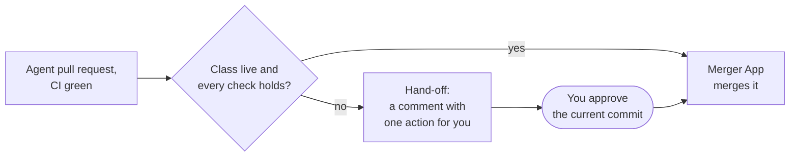

An agent's pull request either merges by itself or waits for a maintainer. The **merge gate** is the
part of the factory that decides which. Three actors take part:

- the **reviewer agent**, which reviews every agent pull request and posts a verdict ([roles]());
- **policy-bot**, a GitHub App that posts a pass or fail status from the repository's merge policy;
- the **merger App**, a second GitHub App and the only one allowed to merge an agent's work.

Examples on this site come from **the reference host**: cloud-native-ref, the platform this repository
is deployed on. Your own repositories set their own values. Every check and reason code is on
[gate reasons]().

## When does an agent's pull request merge? {#when-it-merges}

**It merges by itself only when all four of these hold:**

1. Its [class](#classes) is **live** in that repository.
2. CI is green, policy-bot passes, and the reviewer agent approved the current commit.
3. The change stays inside the class's limits: which files, how many lines, what kind of edit.
4. The class is not paused, and the repository's daily auto-merge limit is not reached (it resets each
   UTC day). The **breaker** pauses a live class after one of its merges was reverted or caused a
   regression; it lifts by itself after enough clean merges
   ([the breaker]()).

The merger App then merges it. Nobody clicks anything.

**In every other case, it waits for your approval.** You approve the pull request's current commit in a
GitHub review, and the merger App merges it within a minute. This needs
[approve-to-merge](#approve-to-merge), a repository setting; without it, you approve and then merge as
for any pull request.

**A few cases need more than an approval.** The main one: someone other than the task's agents pushed a
commit to the branch. The gate no longer trusts the branch, so you read the change, then merge it
yourself with an admin merge or close it ([the hand-off](#hand-off)).

Example (the reference host): only link fixes (`docs-links`) and the factory's own reverts (`revert`)
are live, on one repository. The current modes are on the
[status page]().



## Classes: live, shadow, unarmed {#classes}

A **class** is a kind of change the factory recognises, such as "Markdown link fixes only" or "Renovate
patch bumps". The factory classifies each task when it arrives. Each repository gives each class one of
three modes:

| Mode | What the gate does |
|---|---|
| **live** | Merges it by itself when every check holds |
| **shadow** | Decides and records what it would have done, but merges nothing: you approve it |
| **unarmed** | The class has no mode set. The gate decides nothing: a normal pull request you approve |

Shadow is how a class earns trust. Its records show whether the gate would have been right, and the
class goes live only once they do. Separately, a class can be **monitored**: after each merge, whoever made
it, the factory watches `main` and the class's checks for a while, and a regression pauses the class ([after a merge]()).

Example (the reference host): `docs-links` allows Markdown link targets only, and nothing else; `docs`
and `scripts` allow any change, so they stay unarmed and always need your approval.

## Why no agent can merge its own work {#merge-gate}

The decision and the merge are split across three owners. policy-bot posts its status from the
repository's `.policy.yml`; the factory's gate reads that status, CI, the reviewer's verdict and the diff,
and decides; the merger App merges only the exact commit the gate decided, or the one a maintainer
approved. The agents' own GitHub App cannot merge, and the agents refuse to approve.

Every switch is off by default; a class does only what its mode turns on. The design record:
[ADR-0045]().

## Approve-to-merge {#approve-to-merge}

With `merge.approveToMerge` on, your **approval of the current commit is the merge**. The merger App
merges that commit, outside the daily cap, and labels it `factory/approved-merge`. The task ends `Done`.

A merge you approved is yours. The factory never reverts it on its own if `main` turns red. On a
monitored class, a regression it causes still counts towards pausing that class.

### Approve the commit you read {#approve-the-commit-you-read}


GitHub binds an approval sent without a commit to whatever the head is when it arrives. If a run pushes
while you read, `gh pr review --approve` approves a commit you never saw. Approve from the web UI, which
sends the commit you are looking at, or name the commit:


```bash
gh api repos/<owner>/<name>/pulls/<n>/reviews -f commit_id=<sha> -f event=APPROVE
```

An approval counts only once the branch has stopped moving: the task's last run has ended, and a minute
has passed. An approval that comes earlier, or names an older commit, reads `approval_stale`: approve
again.

## The hand-off: what you see and do {#hand-off}

When the gate does not merge, it **hands off** to you. The task waits (`AwaitingHuman`), and the issue
gets one comment with the reason and one action. The task's room (its live log, in the browser) and the
`maku status` command show the same reason.
On a repository with approve-to-merge, the action reads: "To merge: approve this pull request."

| Reason | Means | Your move |
|---|---|---|
| `class_unarmed` | The class never merges by itself | Review it; approve, or request changes |
| `shadow_would_arm` | Every check holds, but the class is in shadow | Approve to merge, or close |
| `policy_pending` | policy-bot waits for a maintainer's approval | Approve the current commit |
| `approval_stale` | Your approval is of an older commit, or came too early | Approve the current commit again |
| `class_paused` | The breaker paused the class | Approve; or wait, it returns when the pause lifts |
| `auto_merge_cap` | The day's auto-merges are spent | Approve; or wait for the next UTC day |
| `human_commit_in_pr` | A commit no run of the task pushed | Read it, then merge it yourself with an admin merge, `gh pr merge --admin` ([the bypass]()), or close |

A hand-off goes back to the gate by itself when its cause clears: your approval, a new day, a lifted
pause. A few reasons, such as `human_commit_in_pr`, need you to act on the pull request and never return.
The full list: [gate reasons]().
