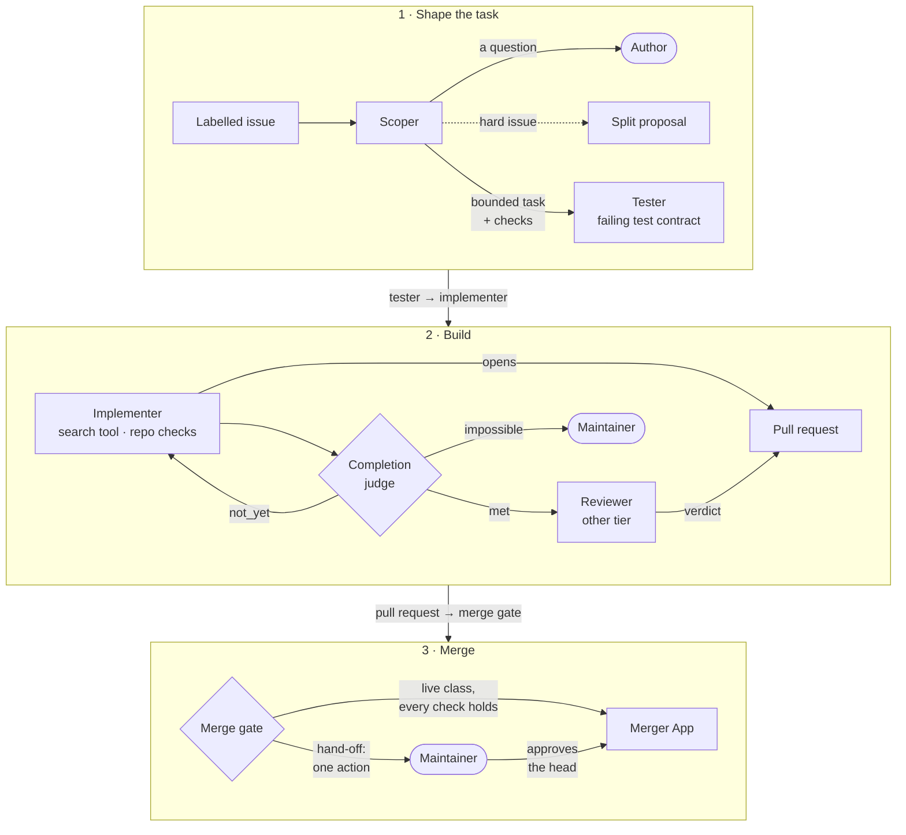
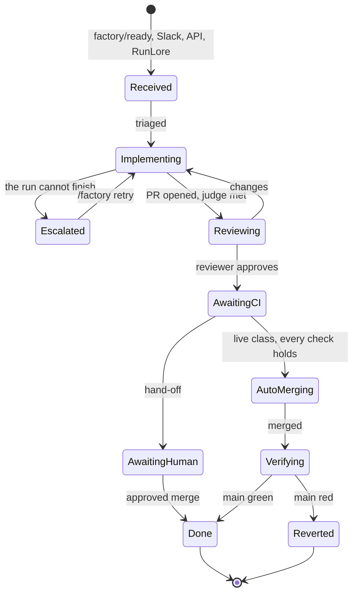

A task is a series of agent runs on one `agent/<task>` branch. Each run has one **role**, and the role
fixes what the run may write and which models and tools it may call. Only two roles write: the tester
and the implementer. Every other role reads and reports.

The factory's [merge gate]() posts the
**`maku/merge-gate`** status on every agent pull request, and one GitHub App stands beside the agents:
the **merger App**, which runs no model and merges what the gate decided or a maintainer approved.



## The roles {#roles}

Five roles run in a task. The task's **workflow** (`quick`, `standard` or `careful`) decides which of
them run: `quick` runs the implementer alone; `standard` runs the implementer, its repository checks,
the completion judge and the reviewer; `careful` adds the scoper before them (including a split
proposal when an issue is too big for one pull request) and the implementer's repository search tool.
A repository switches the **tester** on with `Repository.spec.workflow.testFirst: true`. For RunLore's
incident role, which investigates an alert and proposes an issue, see
[RunLore]().

## Every role in one table {#role-table}

| Role | What it does | Writes? |
|---|---|---|
| **Scoper** | Reads the issue and turns it into a bounded task with acceptance checks. If one thing is unclear, it asks the author one question instead ([what you do then]()); if the issue is too large for one pull request, it proposes splitting it into parts that run one at a time after a maintainer's `/factory split` | No |
| **Tester** | Writes tests that fail on the current code. They become the contract the implementer works to, and the implementer may not change them | Tests only |
| **Implementer** | Writes the change on the task's branch, runs the repository's own checks (and, in `careful`, a read-only repository search tool) and opens the pull request. It runs again for a review's changes or a red CI | Code |
| **Completion judge** | A single model call with a fresh context: is the change done against its acceptance checks? `not_yet` sends the implementer back; `impossible` escalates to you | No |
| **Reviewer** | Reviews the pull request without the implementer's transcript, and posts a verdict. It runs the implementer's model unless the workflow names another for it ([providers]()). On a policy that may merge by itself, the gate needs its approval; otherwise its verdict is advice for you | No |
| **Merger App** (an App) | Merges the commit the gate decided, or the one a maintainer approved; opens the revert of a factory merge | Merges only |

When each role starts and how it ends: [run endings]().
Each task has a **data class**: *public* (an open repository's work) or *internal* (private data, which
only reaches approved providers). Example (the reference host, cloud-native-ref): every role uses GLM-5.3
for public work and Claude Opus 5.5 for internal work; the judge uses their light versions.

## What each role may call {#profiles}

For platform owners. A run calls one model and, with a room, the room's tools:

| What a run may call | Enforced by |
|---|---|
| One model: the alias its token names | The model gateway serves the run that alias only, on its data class's listener, and forces the model; a judge gets a token of its own for its alias |
| No public-only alias on internal work | The `AgentRun` refuses an `internal` run that names a [provider]() alias |
| The `room_*` tools, for a run with a room | The broker checks the run's token and each tool's roles; the reviewer cannot read the implementer's transcript |

The role rules in `infrastructure/base/agent-gateway/profiles/<role>.<public|internal>.yaml`
still compile into the rules of `agent-router`, the older Gateway beside the model gateway. No run
calls it.

## A task's life {#lifecycle}

You see a task's phase in its room (the task's live log), with the `maku status <room>` command and in
`kubectl get tasks`. The diagram keeps
the main path; Maku's [full diagram]()
has every transition.

What the diagram leaves out:

- Intake can **reject** a task: its issue is too long, or the day's task cap is reached.
- A run that cannot finish **escalates** to you (a question, a split, a spent budget); `/factory retry`
  resumes it.
- After a merge by the gate, the task checks that `main` stays green, and reverts if it turns red. A merge
  you approved is never reverted automatically.
- `factory/stop` or the kill switch stops any open task.
