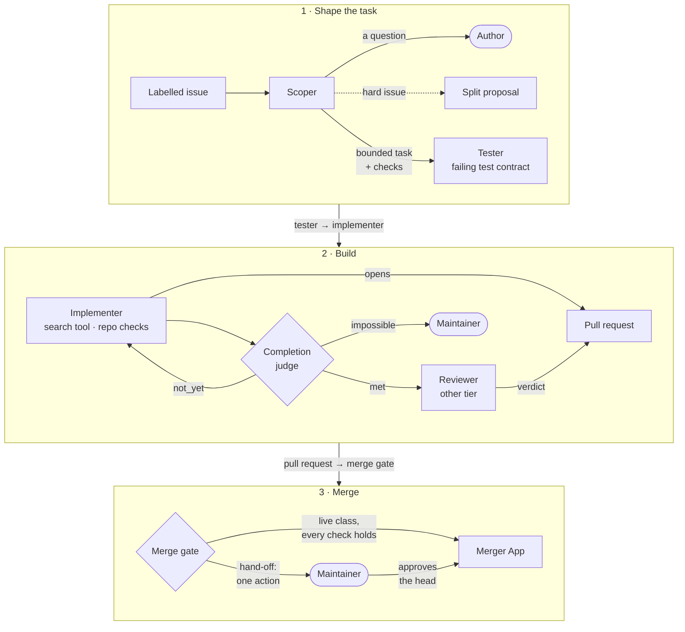
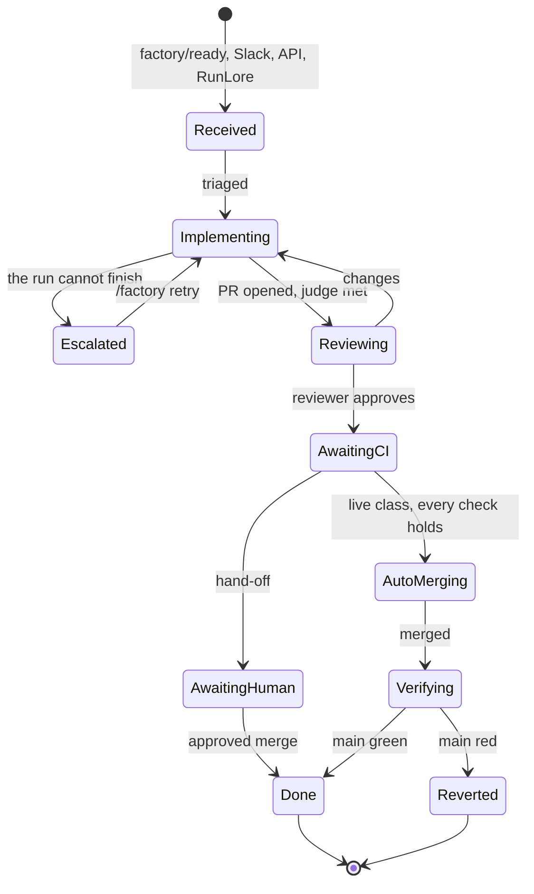

A task is a series of agent runs on one `agent/<task>` branch. Each run has one **role**, and the role
fixes what the run may write and which models and tools it may call. Only two roles write: the tester
and the implementer. Every other role reads and reports.

Two GitHub Apps stand beside the agents. They are not agents and run no model: **policy-bot** posts a
status on every agent pull request, and the **merger App** merges what the
[merge gate]() decided or a maintainer approved.



## The roles {#roles}

The implementer runs on every task, and the reviewer on almost every one: the task's **template** decides
(`pair` is the implementer and a reviewer). The scoper, tester, search and judge are switched on **per
class**: a class is a kind of change the factory recognises, such as "link fixes" or "scripts". A role
that is off for a class is skipped.

## Every role in one table {#role-table}

| Role | What it does | Writes? |
|---|---|---|
| **Scoper** | Reads the issue and turns it into a bounded task with acceptance checks. If one thing is unclear, it asks the author one question instead ([what you do then]()) | No |
| **Splitter** | Part of the scoper: proposes splitting a hard issue into smaller parts. A maintainer approves the split; the parts then run one at a time | No |
| **Tester** | Writes tests that fail on the current code. They become the contract the implementer works to, and the implementer may not change them | Tests only |
| **Implementer** | Writes the change on the task's branch, runs the repository's own checks and opens the pull request. It runs again for a review's changes or a red CI | Code |
| **Search** | A read-only helper the implementer can ask a question about the repository | No |
| **Completion judge** | A single model call with a fresh context: is the change done against its acceptance checks? `not_yet` sends the implementer back; `impossible` escalates to you | No |
| **Reviewer** | Reviews the pull request with a different model from the implementer's, and posts a verdict. On a class that may merge by itself, the gate needs its approval; otherwise its verdict is advice for you | No |
| **Triager** | Investigates an alert handed over by [RunLore](), the platform's incident agent, and proposes a public issue, which a maintainer publishes. The scoper is a triager run too | No |
| **policy-bot** (an App) | Posts the `policy-bot: main` status on every push; dismisses an approval when the head moves | No |
| **Merger App** (an App) | Merges the commit the gate decided, or the one a maintainer approved; opens the revert of a factory merge | Merges only |

When each role starts and how it ends: [run endings]().
Each task has a **data class**: *public* (an open repository's work) or *internal* (private data, which
only reaches approved providers). Example (the reference host, cloud-native-ref): every role uses GLM-5.3
for public work and Claude Opus 5.5 for internal work; the judge uses their light versions.

## What each role may call {#profiles}

For platform owners. Each role has one capability profile per data class, in
`infrastructure/base/agent-gateway/profiles/<role>.<public|internal>.yaml`. They compile into the
gateway's rules.

| A profile declares | Enforced by |
|---|---|
| `models`: the aliases the role may name. Only public profiles list the [providers]() | The gateway answers 403 to any other alias; the factory refuses an internal run that names a public-only alias |
| `tools`: the MCP tools and arguments it may use. The reviewer cannot read the implementer's transcript; no tool reads a Secret | The gateway, before the call reaches the MCP server |
| One model per run | The identity proxy pins every call, the judge's too, to the run's alias |

To change what a role may call, edit its profile, run `scripts/ci/gen-capabilities.py --write`, and let
`task check` prove the compiled rules match.

## A task's life {#lifecycle}

You see a task's phase in its room (the task's live log), with the `maku status <room>` command and in
`kubectl get tasks`. The diagram keeps
the main path; Maku's [full diagram](https://github.com/Smana/maku/blob/v0.32.3/docs/factory.md#a-tasks-life)
has every transition.

What the diagram leaves out:

- Intake can **reject** a task: its issue is too long, or the day's task cap is reached.
- A run that cannot finish **escalates** to you (a question, a split, a spent budget); `/factory retry`
  resumes it.
- After a merge by the gate, the task checks that `main` stays green, and reverts if it turns red. A merge
  you approved is never reverted automatically.
- `factory/stop` or the kill switch stops any open task.
