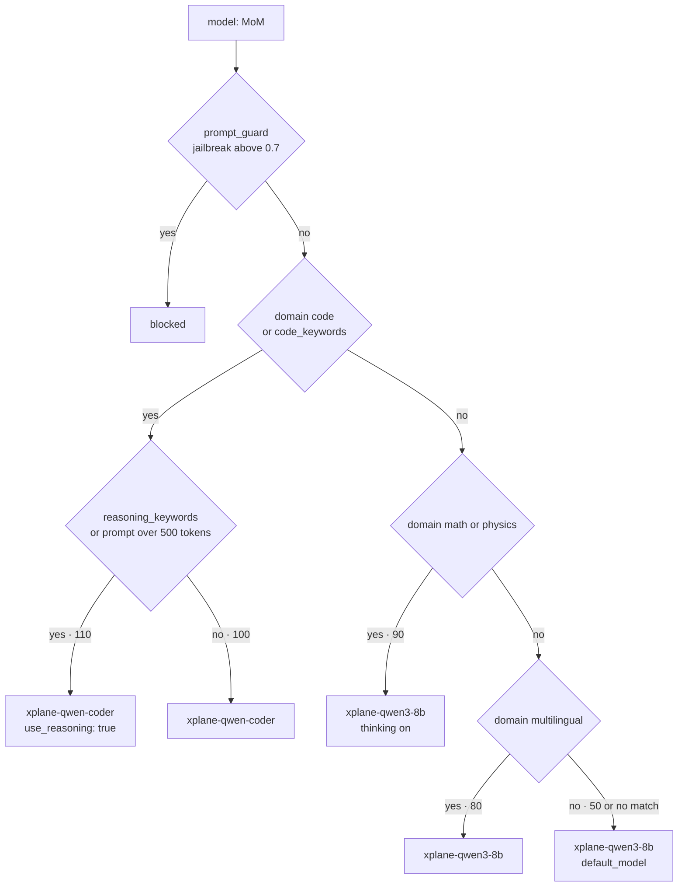
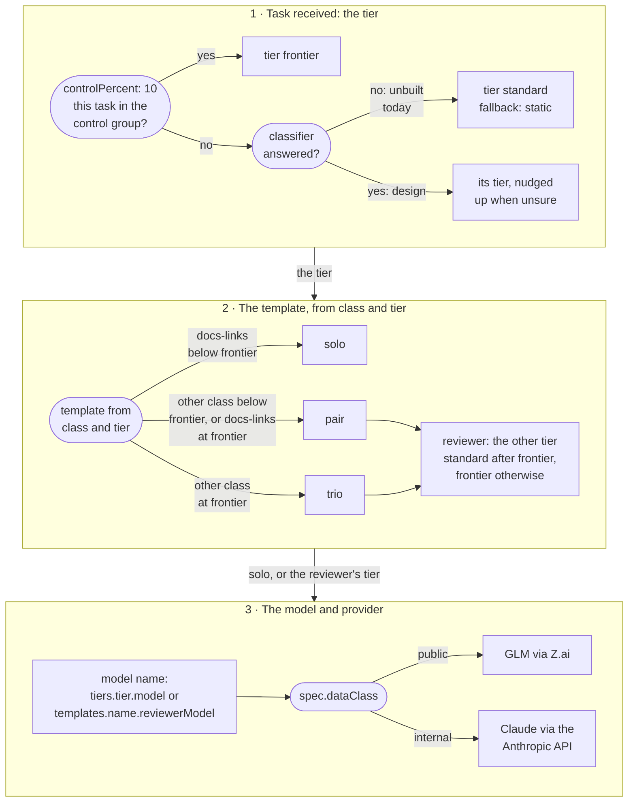
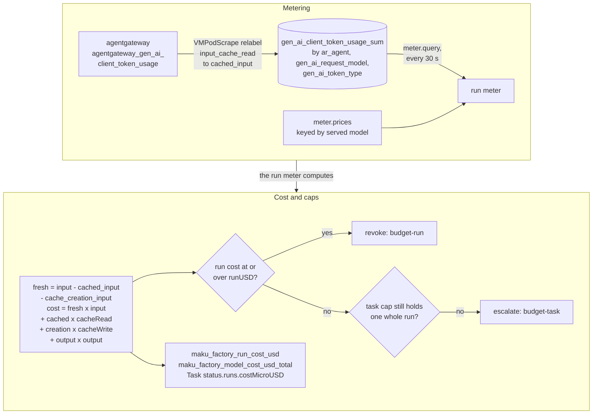
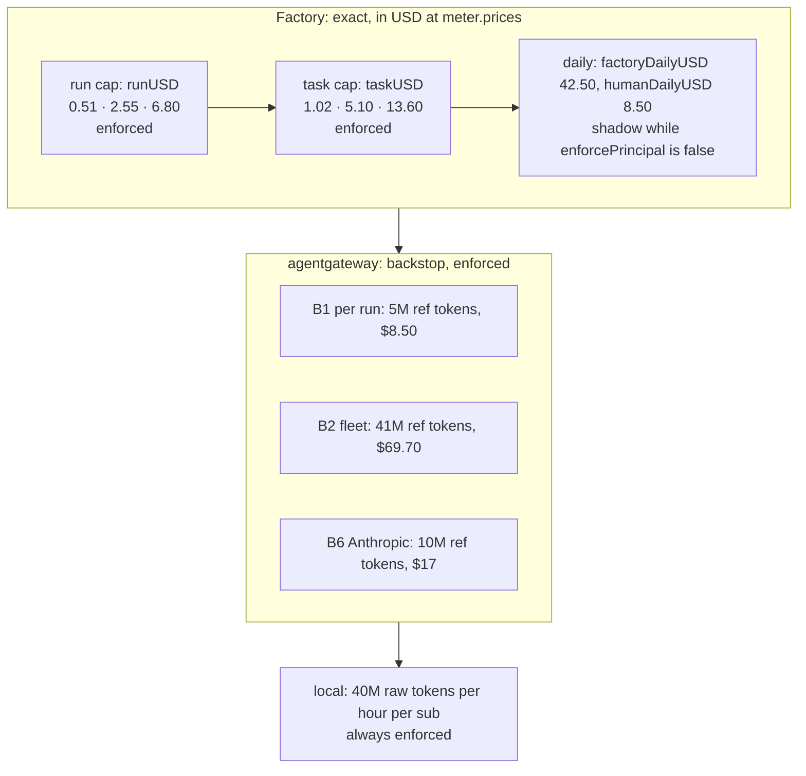

**Routing is static. Prompt caching drives the bill, and the model decides the outcome.**
An agent run gets one model from its data class (GLM-5.3 for `public`, Claude Opus 5.5 for
`internal`), whatever its tier. The tier sets the run's caps and its team, not its model. Nothing
classifies a task yet: every task is triaged `standard` by the static fallback, and 10% go to
`frontier` as a control group. Typically more than 90% of the input tokens agents send are cache
reads, which cuts the bill about fourfold. On harder tasks the model changed the outcome
more than any routing could: Claude was accepted on 13 of 15 issues, GLM-5.3 on none, in either
harness.

This page owns the routing, tuning and cost angle. How the gateways authenticate and what they
carry is on [Gateways](). What runs where
is on [Status](), which wins over this page if
the two disagree.

Dollar figures on this page are examples from the reference host, at the list prices its
`meter.prices` pins.

## What is built {#state}

Measured in October 2026; the component-by-component state table is in [the repository's design records](https://github.com/Smana/ai-native-ref/blob/main/docs/superpowers/specs/2026-11-14-routing-and-cost-measurements.md#what-is-built).

## Every routing decision, end to end {#decision-points}

There are two callers and seven decisions. Only two of the seven look at the prompt: the Semantic
Router on `MoM`, and the planned triage classifier (once per task, never per request).

```mermaid
flowchart TB
  subgraph human["Humans and coding clients: ai-gateway (Envoy AI Gateway)"]
    C["Client: OpenCode, Continue, OpenWebUI, promptfoo"] -->|"model: name or MoM"| SR{"1 · Semantic Router<br/>only when model is MoM or auto"}
    SR -->|"rewrites body.model"| XM["x-ai-eg-model header"]
    C -->|"explicit name, no classification"| XM
    XM --> AR{"2 · AIGatewayRoute<br/>header match"}
    AR -->|"tier-frontier"| ZAI1["Z.ai glm-5.3"]
    AR -->|"xplane-qwen-coder"| CAN{"3 · LoRA canary<br/>90 / 10 weights"}
    AR -->|"other xplane-*"| V["vLLM Service"]
    CAN --> V
  end
  subgraph agent["Agent runs: agentgateway model-gateway"]
    I["Issue labelled factory/ready"] --> T{"4 · Triage, once per task<br/>tier and template"}
    T --> R{"5 · Role<br/>reviewer takes the other tier"}
    R -->|"tiers.tier.model or reviewerModel"| N["Logical name<br/>agent-default, tier-*"]
    N --> D{"6 · Data class<br/>audience picks the listener"}
    D -->|"public :8080"| AL1{"7 · aliases"}
    D -->|"internal :8081"| AL2{"7 · aliases"}
    AL1 --> ZAI2["Z.ai glm-5.3, flashx, flash"]
    AL2 --> ANT["Anthropic opus-5-5, sonnet-5-5, haiku-5-5"]
  end
```



Decisions 4–7 are pinned by design: every name maps to one model at weight 100, with no fallback
and no canary, so nothing re-routes a run mid-trajectory. Escalation is a new run at another tier,
never a gateway failover ([routing design](https://github.com/Smana/ai-native-ref/blob/main/docs/superpowers/specs/2026-09-23-llm-complexity-routing-design.md#decisions)). The seven-decision lookup table is in [the repository's design records](https://github.com/Smana/ai-native-ref/blob/main/docs/superpowers/specs/2026-11-14-routing-and-cost-measurements.md#every-routing-decision).

## Serving side: `ai-gateway` {#serving-routing}

### The `MoM` cascade as configured

Semantic Router 0.2.0 (`flux/sources/ocirepo-vllm-semantic-router.yaml`) still uses the v0.2
schema. A ModernBERT domain classifier maps the prompt to an MMLU category, keyword and length
rules add evidence, and the highest-priority decision that matches wins:



**Two behaviours to know before you rely on `MoM`.**

- **It sits in front of every request, and fails closed.** The filter is on the `http` listener,
  not only on `MoM`, and has no `failure_mode_allow`, with a 60 s `message_timeout`
  (`infrastructure/base/envoy-ai-gateway/envoypatchpolicy-semantic-router.yaml`). An unreachable
  router fails every request on that listener, `tier-frontier` included. A router that
  is up but not rewriting lets `MoM` reach vLLM, which answers 404 for an unknown model (the
  HelmRelease's own note). The designed fix, not built: two replicas, a PDB, and fail-open
  with a 2 s timeout.
- **Classification costs about 250–300 ms**
  ([gateways]()). A
  client that knows its model names it, and the router passes it through untouched. FIM traffic
  never uses `MoM`.

A routing change on the serving side is a capacity change too: moving a category from
`xplane-qwen3-8b` to `xplane-qwen-coder` moves its share of the batch-saturation trigger, and the
LoRA canary ([LoRA canaries]()) shares the coder's batch ([autoscaling](), [serving roadmap]()). Measured in October 2026; the signal table, designed cascade and post-routing capacity table are in [the repository's design records](https://github.com/Smana/ai-native-ref/blob/main/docs/superpowers/specs/2026-11-14-routing-and-cost-measurements.md#serving-side-signals-and-cascade).

## Agent side: tiers, data classes, names {#agent-routing}

### How a run gets its model



The aliases, per listener of the model gateway
(`aliases` in `infrastructure/base/agent-gateway/model-gateway/helmrelease.yaml`):

| Name | `public` (Z.ai) | `internal` (Anthropic) |
|---|---|---|
| `tier-light` | `glm-5.3-flash` | `claude-haiku-5-5` |
| `tier-standard` | `glm-5.3-flashx` | `claude-sonnet-5-5` |
| `tier-frontier` | `glm-5.3` | `claude-opus-5-5` |
| `agent-default` | `glm-5.3` | `claude-opus-5-5` |

A run reaches only the alias its token names: any other is refused 403 before an upstream call. The
factory picks the alias, and the budgets bound what it costs.

### Why every tier still asks for `agent-default`

```yaml
# tooling/base/agent-factory/resources/factory.yaml, spec
tiers:
  light:    {model: agent-default, runTokens: 300000,  taskTokens: 600000,  runMinutes: 20, runUSD: 0.51, taskUSD: 1.02}
  standard: {model: agent-default, runTokens: 1500000, taskTokens: 3000000, runMinutes: 45, runUSD: 2.55, taskUSD: 5.10}
  frontier: {model: agent-default, runTokens: 4000000, taskTokens: 8000000, runMinutes: 90, runUSD: 6.80, taskUSD: 13.60}
```

The gateway serves the `tier-*` names on both listeners, so moving a tier to its own model is a
one-line change (see
[tuning](#tuning)). Nobody has measured whether `glm-5.3-flashx` or `glm-5.3-flash` can do a
factory task, so the change has not been made. Until it is:

- **the tier sets caps, minutes and the team, not the model.** The control group measures budget
  fit, not model fit;
- **the reviewer runs the implementer's model**, except on the classes the merge gate may merge
  without a person, where it runs on Kimi ([providers]()).
  Elsewhere "the other tier" changes its caps only. ADR-0058 keeps public data away from Anthropic
  for review
  ([ADR-0058]()).

Complexity routing for tasks is kept out of the request path and evaluated once at factory intake ([factory design](https://github.com/Smana/ai-native-ref/blob/main/docs/superpowers/specs/2026-09-23-agent-factory-design.md), [routing design §3](https://github.com/Smana/ai-native-ref/blob/main/docs/superpowers/specs/2026-09-23-llm-complexity-routing-design.md#3-complexity-classifier-c7)); the classifier trade-offs are in [the repository's design records](https://github.com/Smana/ai-native-ref/blob/main/docs/superpowers/specs/2026-11-14-routing-and-cost-measurements.md#complexity-routing-for-tasks).

## What a call costs {#costs}

<span id="worked-example"></span><span id="budget-layers"></span>

`meter.prices`, the `Factory`'s `prices` in `tooling/base/agent-factory/resources/factory.yaml`, is the only place a
price is edited. Every dollar figure on this page comes from it, and `task check` fails when a copy
drifts (`python3 scripts/ci/gen-prices.py --write` renders `infrastructure/base/llm-gateway/vmrule-llm-gateway.yaml` and `scripts/ci/flux-schema/assert-agent-gateway.py` checks `infrastructure/base/agent-gateway/policy-budgets.yaml`; `.github/workflows/price-drift.yaml` checks upstream catalogs).



- **Keyed by the served model**, not the logical name: `agent-default` is GLM-5.3 on one listener
  and Opus on the other. A model with no price row is never treated as free: its run falls back to
  its token caps and `AgentModelUnpriced` fires.
- **The `input` series includes cache tokens** on every path this platform runs: Z.ai's OpenAI
  usage, and agentgateway's Chat Completions to Messages translation, streamed or not (`test-agent-gateway-cache-wire`). The meter subtracts the cache tokens unless `input` is smaller than them, in which case it prices all of `input` as fresh (`inputExcludesCache`, Maku `internal/factory/meter/meter.go`) and fires `AgentMeterInputExcludesCache`.
- **Overshoot is one scrape plus one response.** The run is revoked on the meter's next tick, and
  calls already in flight complete.



Measured in October 2026; the price tables, `llm_gateway:charge_usd_per_mtoken` charge series, worked run example and five-layer budget table (`infrastructure/base/agent-gateway/ratelimit.yaml`) are in [the repository's design records](https://github.com/Smana/ai-native-ref/blob/main/docs/superpowers/specs/2026-11-14-routing-and-cost-measurements.md#what-a-call-costs).

## Efficiency {#efficiency}

### Prompt caching is the largest lever {#caching}

Agent runs typically read 85–96% of their input from cache: GLM-5.3 factory runs 91–96%
([cohort results](https://github.com/Smana/ai-native-ref/blob/main/docs/superpowers/specs/2026-10-12-v2-hard-task-cohort-design.md#results)),
an internal Opus run 85%. On a whole fleet day that cuts the bill by about 75% against the same
tokens with no cache discount. Caching is also why per-request model switching is a bad idea for agents: a new model starts with a cold cache, and on a 95%-cached run that multiplies the next call's input cost by about 5 (`images/maku-harness/site/sitecustomize.py`).

### Caps in USD, not tokens

The hard-task cohort found that the token cap, not the work, decided 11 of the factory's 15 issues:
it counted every cache read as a full token, and runs stopped at about 1.5M tokens and $0.58–0.76.
Caps are in USD because a dollar cap prices cache reads at their real rate, so a cache-heavy run
gets the work its budget pays for.

### Cheaper tiers and self-hosting {#self-host-vs-api}

A cheaper model that fails costs more per accepted outcome than a dearer one that succeeds, and self-hosting four always-warm L4 models (`docs/superpowers/specs/2026-05-06-oss-llm-foundation-showcase-design.md`) is for privacy, pinned weights and warm tab completion ([why self-host](), [autoscaling]()), not cost. Measured in October 2026; the caching, token-vs-USD, hard-task cohort and self-hosting comparison tables are in [the repository's design records](https://github.com/Smana/ai-native-ref/blob/main/docs/superpowers/specs/2026-11-14-routing-and-cost-measurements.md#efficiency-and-cohort-results).

## Tuning, measuring and known gaps {#tuning}

<span id="measuring"></span><span id="known-gaps"></span>

The factory's tiers, prices, budgets and loops live in `tooling/base/agent-factory/resources/factory.yaml`, which the factory reads without a restart ([factory configuration]()); signal definitions and alerts are on [Observability]() and open items on the [status page](). Measured in October 2026; the tuning recipes, PromQL queries, dashboard guide and known-gaps table are in [the repository's design records](https://github.com/Smana/ai-native-ref/blob/main/docs/superpowers/specs/2026-11-14-routing-and-cost-measurements.md#tuning-and-measuring).
