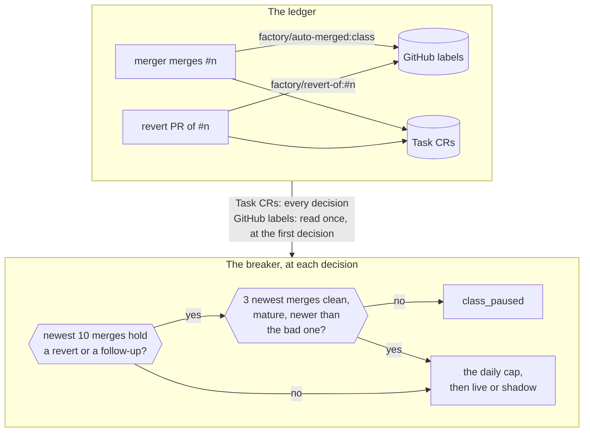

A **live** class merges agent pull requests with no human ([the merge gate]()).
This page is for the platform owner who turns one on. Any auto-merge can be reverted, the breaker pauses
a class that goes wrong, a monitor watches each merge, and alerts tell you when any of them fire.

## Take a class live {#go-live}

1. Run the class in **shadow** first: `shadow: true` under `repositories[].classes.<class>`. The gate
   decides and records each pull request, and merges none.
2. Read the records. Maku's `shadow-merge-tally.sh` counts them (`--outcomes`) and replays them against
   the current rules (`--replay`, `--strictness`). Look for decisions that would have merged a bad change.
3. Add the class's `low-risk` rule to the repository's `.policy.yml`, so policy-bot passes its pull requests.
4. Switch the class to `live: true`. Keep its `maxPerDay` low at first.

## Undo an auto-merge {#revert}

Label the merged pull request `factory/revert` within `merge.revertWindow`. The merger App opens the
revert pull request, labelled `factory/revert-of:#<n>`, and merges it while the `revert` class is live.
The revert counts against the breaker. A merge a maintainer approved is not the factory's: revert it by
hand.

## The breaker {#breaker}

The breaker sends a live class back to human review when its recent merges went wrong.

Example (the reference host): `breaker: {window: 10, maxReverts: 1, maxFollowUps: 1, recoverAfter: 3}`.
A live class whose 10 newest merges hold 1 revert, or 1 follow-up fix or regression, is paused: its
next pull requests hand off as `class_paused`. Each revert is announced on the control issue.

The breaker's ledger is the Task objects plus the merger's GitHub labels, read at the first decision. A
rebuilt factory therefore keeps a paused class paused. The gauge
`maku_factory_class_paused{repository,class}` reads 1 while the class is paused; an absent series means
"not reported", not "not paused".

## Run a drill {#drills}

A **drill** is a revert you make on purpose, to test the revert path, without pausing the class.

1. Label the merged pull request `factory/drill`.
2. Then label it `factory/revert`.

Order matters. The merger copies `factory/drill` to the revert pull request, and the breaker does not
count that revert: the control issue gets a drill notice, and the merge still counts as clean. A label
added after the revert is honoured only at the next factory restart. A revert of a red `main` is never a
drill.

## Recovery {#recovery}

A paused class resumes by itself once its `recoverAfter` newest merges (3 in the example) are all newer
than the last bad merge, clean, and mature. Until then, a maintainer's approval still merges its pull
requests.

A merge is **mature** once it is older than the class's `monitor.followUpWindow`, or `merge.revertWindow`
for a class without a monitor. An immature merge neither counts nor blocks. A new bad merge pauses the
class again at once. Keep `recoverAfter` below `window`.

## After a merge {#after-a-merge}

Every merge of a class that declares a monitor stays under watch, whoever merged it. The monitor reads
`main`'s CI, the detector's next runs and, where the class asks for it, Flux. It records `healthy`,
`regression` or `inconclusive`, and counts the follow-up fixes merged within the class's window.

The monitor never reverts and never widens a class. Its results live on the pull request as labels
(`factory/merged:<class>`, `factory/monitor:regression`, `factory/follow-up-of:#<n>`), so they survive a
rebuild. A regression or a follow-up counts against the breaker like a revert.

## Metrics and alerts {#metrics}

| Signal | Reads |
|---|---|
| `maku_factory_merge_decisions_total{repository,class,verdict,reason}` | Every gate decision. `verdict=arm` with `reason=maintainer_approved` is an approved merge |
| `maku_factory_handoff_to_merge_seconds{class,reason,how}` | From the first hand-off to the merge; `how` is `approved` or `human` |
| `maku_factory_human_wait_seconds_total{principal,phase,reason,class}` | Time spent waiting on a human, by reason |
| `maku_factory_class_paused{repository,class}` | 1 while the breaker pauses the class |
| `maku_factory_pr_outcomes_total{outcome}` | `auto_merged`, `approved_merged`, `human_merged`, `reverted` (drills too), `follow_up` |
| Dashboard `agent-factory` | The "Human path" row: hand-off to merge, waiting by reason, classes paused |

Alerts, in `observability/base/agent-platform/vmrule-agent-factory.yaml`:

| Alert | Fires when |
|---|---|
| `AgentFactoryAutoMergeReverted` | A merged agent pull request was reverted, drills included |
| `AgentFactoryMergeRegression` | The monitor recorded a regression |
| `AgentFactoryClassPausedLong` | A class has been paused for over 7 days |
| `PolicyBotUnavailable` | policy-bot has no ready pod, so agent pull requests wait |

## Adopt Renovate's pull requests {#adopted-classes}

The factory authors no dependency bump. Instead, a class that declares `author.adopt` takes Renovate's
pull requests: a poller turns each eligible one into a Task that runs no agent, and the same gate decides
it.

| What is checked | How |
|---|---|
| The pull request | Into `main`, from the same repository, by `renovate[bot]` on a `renovate/` branch; at most 10 open Tasks per repository and class |
| The diff | Computed by the factory: at most 3 files and 10 lines, version strings only, no lockfile, none of Renovate's never-automerge files |
| The age | Renovate's `stability-days` status is green |
| The people | A maintainer's Request changes parks it; so does a human commit |
| The merge | Pinned to the commit it judged; Renovate's next commit is decided again, at most 3 times |

An adopted class keeps the older approval rule: a maintainer's approval hands it to a human merge and
does not trigger the merger.
