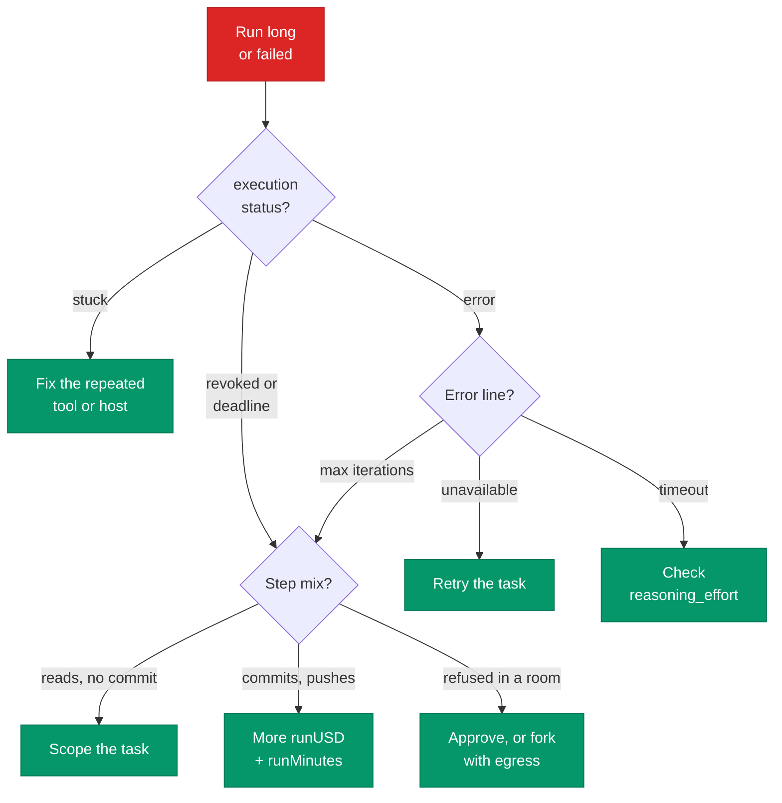

The harness runs the agent loop inside the sandbox: OpenHands
[`agent-server`](https://github.com/OpenHands/software-agent-sdk), driven by a small entrypoint,
`agent-run`. This page is the guide; every setting with its value and bounds is on the
[Harness reference]().


**The levers that matter are outside the harness.** Money, time and model come from the **tier**,
the team from the **template**, the tools from the **data class**, and the run's length from the
**task text**. The cheapest optimization is a bounded task: an open "find out why" once spent its
whole $2.55 on 319 `grep` steps and pushed nothing.


## The five levers {#levers}

<span id="start"></span><span id="loop"></span><span id="layers"></span>

| Lever | Sets | Changed in | Reference |
|---|---|---|---|
| 🎚️ **Tier** | USD cap, deadline, model | Factory config | [Tiers]() |
| 👥 **Template** | Which roles run: solo, pair, trio | Factory config | [Templates]() |
| 🔒 **Data class** | Provider, egress, tools, prompt caching | The task's source | [AgentRun]() |
| 📝 **Task text** | How far the agent wanders | The issue | [Writing a good task]() |
| ⚙️ **Harness** | Iterations, condenser, timeouts, reasoning effort | A harness release, not per run | [Agent loop]() |

How `agent-run` drives `agent-server`, the tester's contract ([runbook 21](https://github.com/Smana/ai-native-ref/blob/main/docs/runbooks/agent-factory/21-test-first-tester.md), [the roles]()) and where each setting layer is pinned are in [the repository's design records](https://github.com/Smana/ai-native-ref/blob/main/docs/superpowers/specs/2026-11-14-routing-and-cost-measurements.md#harness-tuning-measurements).

## Trade-offs {#trade-offs}

| Turn up | It costs | Watch for |
|---|---|---|
| ⬆️ Tier, `standard` → `frontier` ([tiers]()) | Caps ×2.7, deadline 45 → 90 min | A wandering run spends all of it |
| ⬆️ `runMinutes` alone ([tiers]()) | Wall time | A deadline kill is never resumed: add money too |
| ⬆️ `runUSD` alone ([tiers]()) | Money | Keep `taskUSD ≥ 2 × runUSD` so a resume fits |
| ⬆️ `maxReviewRounds` ([caps]()) | One implementer and one reviewer run per round | Out of rounds, the task escalates |
| ⬆️ `trio` over `pair` ([templates]()) | One more run | The tester keeps the implementer's tier |
| ⬆️ `reasoning_effort` ([loop]()) | Reasoning tokens, seconds per step | Above `high`, GLM-5.3 hits the 300 s timeout |
| ✅ Prompt caching ([loop]()) | Nothing: cache reads cost 5% | Needs the marker carried end to end |

## Measuring a change {#measuring}

<span id="examples"></span>

Change one lever, run the same kind of task, compare. A run's id is the 8 characters after
`run-`. Measured in October 2026; sample runs and their step counts and costs are in [the repository's design records](https://github.com/Smana/ai-native-ref/blob/main/docs/superpowers/specs/2026-11-14-routing-and-cost-measurements.md#what-real-runs-look-like).



On the `agent-run` dashboard:

| Question | Panel |
|---|---|
| What did it cost? | *Cost (USD)* |
| How much input was cached? | *Tokens in / out* |
| How many steps, which tools? | *Steps*, *Distinct steps* |
| How long, and where did the time go? | *Duration*, *Run traces* |
| How slow was the model? | *Model latency p50 / p95* |
| Why did it end? | *Run*, *Errors* |


```logsql
# The step log, then the tool mix
kubernetes.pod_name:"run-<id>" AND kubernetes.container_name:"harness" AND _msg:~"^agent-run"
kubernetes.pod_name:"run-<id>" AND kubernetes.container_name:"harness" AND _msg:~"^agent-run step "
  | extract "agent-run step <n>: <tool> |" | stats by (tool) count() steps
```


```promql
# Cost, as the meter computes it
maku_factory_run_spend_usd{run="<id>"}
# Was the tier right? fit = under | fit | over
sum by (tier, fit) (maku_factory_tier_fit_total)
# Why runs end
sum by (reason) (agentrun_outcome_info)
```



## Failure modes {#failure-modes}

### Budget and time

| You see | Do this |
|---|---|
| Out of budget, no commit, hundreds of `grep`/`cat` steps | The task has no stopping rule: [scope it](#recipes) |
| Out of budget with limit `run-tokens` | A hand-started run or an unpriced model: raise `--max-tokens`, or add a `meter.prices` row ([caps]()) |
| `PodFailed` near the deadline | Raise `runMinutes` together with `runUSD` ([tiers]()) |
| A `429`, then the agent stops | A gateway budget, never retried by design: check `maku_factory_run_revocations_total` |

### Loops and errors

| You see | Do this |
|---|---|
| `maximum iterations limit (500)` | The run looped: [debug it](#debug) ([loop]()) |
| `execution_status=stuck` | The same action or error repeated: fix the tool, host or test it trips on |
| `LLMServiceUnavailableError` after `model retry 2/2` | The provider failed 3 times: `/factory retry` |
| Steps take minutes, calls fail at 300 s | `reasoning_effort` is not reaching the model: check the request body ([loop]()) |

Tester-contract (`contract_not_red`, `contract_outside_tests`, `not_testable`) and environment/room failure modes ([bridge](), [pod]()) are in [the repository's design records](https://github.com/Smana/ai-native-ref/blob/main/docs/superpowers/specs/2026-11-14-routing-and-cost-measurements.md#failure-modes-tester-and-rooms).

## Recipes {#recipes}



A wandering run is hundreds of reads and no commit. The stuck detector misses it, because every
command differs.

1. Give the task a **scope**: which files, which component.
2. Give it an **exit**: "if X is not found, say so and stop".
3. Only then try a bigger tier ([tiers]()).


1. Check it is large, not wandering: a large run posts `committed.` and `pushed its branch.` notes.
2. Raise the tier's `runUSD` **and** `runMinutes` together; keep `taskUSD ≥ 2 × runUSD` ([tiers]()).
3. A task that installs packages needs `--profiles` on a hand-started run: the factory adds none ([AgentRun]()).


A review of a small PR takes under 10 steps: the cost is in the rounds.

1. Keep `maxReviewRounds` at 2, or 1 for mechanical fixes ([caps]()).
2. Leave `docs-links` on `solo`: the matrix skips the reviewer below `frontier` ([templates]()).
3. For a smaller reviewer, set `templates.pair.reviewerModel: tier-standard`.
   [ADR-0058]() weighs it: cheaper,
   but a smaller model judging a larger one's work.



## Debug a run that loops {#debug}



1. `kubectl get agentruns.maku.ogenki.io -n agents run-<id>`: phase and reason.
2. The step log's last 30 lines: repeating, or changing?
3. The tool mix (the LogsQL tab above): 95% `terminal` and no commit is searching, not working.
4. The room transcript for the model's reasoning; the trace for timings.
5. If it burns money, stop it: `factory/stop` on the issue.

## Loop policy and search {#loop-policy}

<span id="search"></span><span id="limits"></span>

The loop policy (`loops.<class>` in `tooling/base/agent-factory/resources/factory.yaml`, [reference]()) stops wandering runs (`stallSteps`), checks a finished run against the task's acceptance checks (`judge`) and continues the conversation (`continuations`), while `loops.<class>.search: true` gives the implementer an experimental read-only search helper ([agent loop]()). The loop-policy end states, search sequence diagram and untunable-settings table are in [the repository's design records](https://github.com/Smana/ai-native-ref/blob/main/docs/superpowers/specs/2026-11-14-routing-and-cost-measurements.md#loop-policy-details).

Related: [Harness reference]() ·
[Factory]() ·
[Rooms]() ·
[Observability]() ·
[User guide]()
