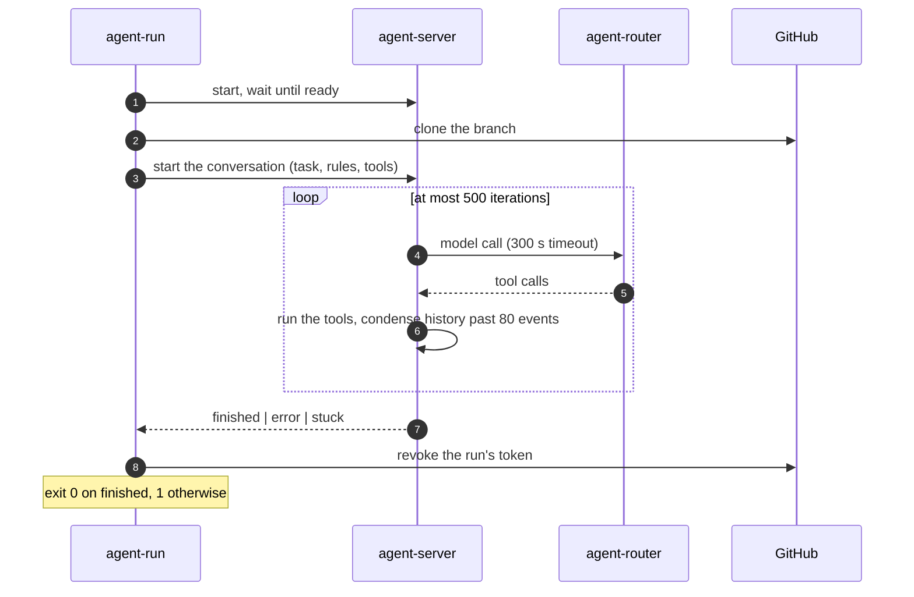
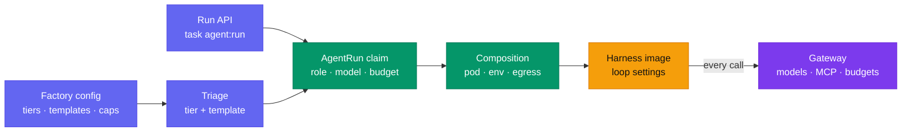
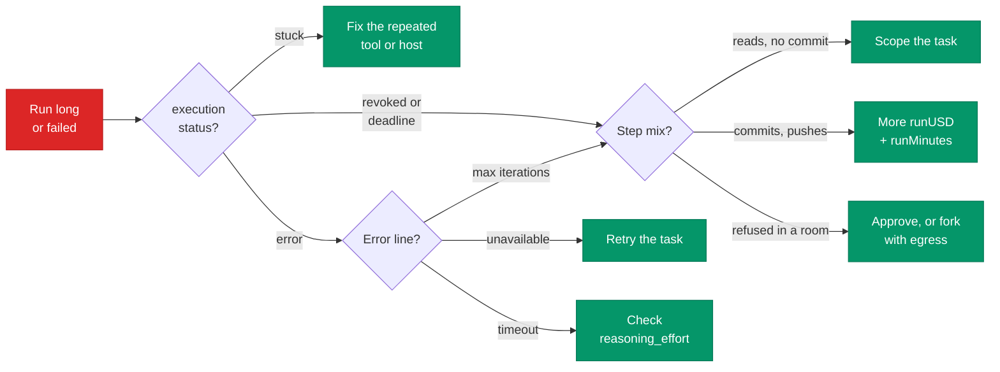
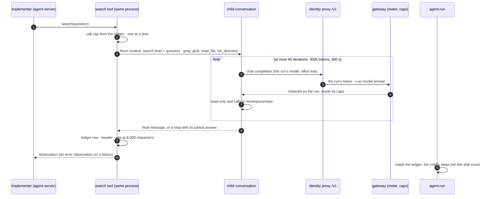

The harness runs the agent loop inside the sandbox: OpenHands
[`agent-server`](https://github.com/OpenHands/software-agent-sdk), driven by a small entrypoint,
`agent-run`. This page is the guide; every setting with its value and bounds is on the
[Harness reference]().


**The levers that matter are outside the harness.** Money, time and model come from the **tier**,
the team from the **template**, the tools from the **data class**, and the run's length from the
**task text**. The cheapest optimization is a bounded task: an open "find out why" once spent its
whole $2.55 on 319 `grep` steps and pushed nothing.


## Start here {#start}


  
  
  
  
  
  


## The five levers {#levers}

| Lever | Sets | Changed in |
|---|---|---|
| 🎚️ **Tier** | USD cap, deadline, model | Factory config |
| 👥 **Template** | Which roles run: solo, pair, trio | Factory config |
| 🔒 **Data class** | Provider, egress, tools, prompt caching | The task's source |
| 📝 **Task text** | How far the agent wanders | The issue |
| ⚙️ **Harness** | Iterations, condenser, timeouts, reasoning effort | A harness release, not per run |

## How a run works {#loop}

`agent-run` starts `agent-server`, clones the repository, hands it the task, then follows it until
the conversation ends.




One line per action, never its output, redacted for tokens. It is what you read most.

```text
agent-run step 3: terminal | List crossplane controller dir and kustomization | ls /workspace/repo/... | trace_id=706f…
agent-run model retry 1/2 in 10s: ServiceUnavailableError …
agent-run: conversation ended with execution_status=finished
agent-run summary: 21 steps, 0 model retries
```


## Where settings come from {#layers}

Each layer lives in its own repository and is pinned into the next. A run's settings are fixed when
it is created; only its token cap can be raised while it runs.



| Layer | Repository | A change reaches |
|---|---|---|
| Factory config | ai-native-ref | New runs, once Flux applies the release |
| Run API | `task agent:run` flags | That run only |
| Claim and composition | crossplane-configuration | Runs created after the package upgrade |
| Harness image | agent-platform | Runs created after its digest reaches the composition |
| Gateway | ai-native-ref | Every call, running runs included |

## Trade-offs {#trade-offs}

| Turn up | It costs | Watch for |
|---|---|---|
| ⬆️ Tier, `standard` → `frontier` | Caps ×2.7, deadline 45 → 90 min | A wandering run spends all of it |
| ⬆️ `runMinutes` alone | Wall time | A deadline kill is never resumed: add money too |
| ⬆️ `runUSD` alone | Money | Keep `taskUSD ≥ 2 × runUSD` so a resume fits |
| ⬆️ `maxReviewRounds` | One implementer and one reviewer run per round | Out of rounds, the task escalates |
| ⬆️ `trio` over `pair` | One more run | The tester keeps the implementer's tier |
| ⬆️ `reasoning_effort` | Reasoning tokens, seconds per step | Above `high`, GLM-5.3 hits the 300 s timeout |
| ✅ Prompt caching (internal) | Nothing: cache reads cost 5% | Needs the marker carried end to end |

## Measuring a change {#measuring}

Change one lever, run the same kind of task, compare. A run's id is the 8 characters after
`xplane-run-`.



On the `agent-run` dashboard:

| Question | Panel |
|---|---|
| What did it cost? | *Cost (USD)* |
| How much input was cached? | *Tokens in / out* |
| How many steps, which tools? | *Steps*, *Distinct steps* |
| How long, and where did the time go? | *Duration*, *Run traces* |
| How slow was the model? | *Model latency p50 / p95* |
| Why did it end? | *Run*, *Errors* |


```logsql
# The step log, then the tool mix
kubernetes.pod_name:"xplane-run-<id>" AND kubernetes.container_name:"harness" AND _msg:~"^agent-run"
kubernetes.pod_name:"xplane-run-<id>" AND kubernetes.container_name:"harness" AND _msg:~"^agent-run step "
  | extract "agent-run step <n>: <tool> |" | stats by (tool) count() steps
```


```promql
# Cost, as the meter computes it
agent_factory_run_spend_usd{run="<id>"}
# Was the tier right? fit = under | fit | over
sum by (tier, fit) (agent_factory_tier_fit_total)
# Why runs end
sum by (reason) (agentrun_outcome_info)
```



### What real runs look like {#examples}

On `gcp-0`, 2026-10-18, all on GLM-5.3:

| Run | Task | Steps | Cost | End |
|---|---|---|---|---|
| `dkpa4r4o` | docs-links | 10 | $0.03 | ✅ succeeded |
| `b4cnoos7` | docs | 36 | $0.17 | ✅ PR opened |
| `jcp6kl72` | docs-links | 225 | $1.65 | ✅ PR opened |
| `d3jacb5z` | dashboards | 319 | $2.65 | ❌ out of budget, nothing pushed |
| `kk2egjta` | dashboards, frontier | 444+ | $4.46+ | ⏳ still running at 66 min |


**Step count, not tier, separates runs.** Most finish in 10–40 steps for under $0.20. And with 95%
of input read from cache, a dollar cap fits better than a token cap: `d3jacb5z` read 7.7 M tokens
for $2.65.


## Failure modes {#failure-modes}

### Budget and time

| You see | Do this |
|---|---|
| Out of budget, no commit, hundreds of `grep`/`cat` steps | The task has no stopping rule: [scope it](#recipes) |
| Out of budget with limit `run-tokens` | A hand-started run or an unpriced model: raise `--max-tokens`, or add a `meter.prices` row |
| `PodFailed` near the deadline | Raise `runMinutes` together with `runUSD` |
| A `429`, then the agent stops | A gateway budget, never retried by design: check `agent_factory_run_revocations_total` |

### Loops and errors

| You see | Do this |
|---|---|
| `maximum iterations limit (500)` | The run looped: [debug it](#debug) |
| `execution_status=stuck` | The same action or error repeated: fix the tool, host or test it trips on |
| `LLMServiceUnavailableError` after `model retry 2/2` | The provider failed 3 times: `/factory retry` |
| Steps take minutes, calls fail at 300 s | `reasoning_effort` is not reaching the model: check the request body |

### Environment and rooms

| You see | Do this |
|---|---|
| The same refused action for minutes, in a room | Read the bridge's refusal; approve it, or fork with more egress |
| Pod `Pending` 15 min, then `run_unschedulable` | No gVisor node yet: wait 1.5–3.5 min, or turn the warm headroom on |
| An internal run costs as much as a public one | Prompt caching is off: the harness logs `prompt cache NOT applied` at start, and `AgentCacheReadZero` fires once the run passes 100k input tokens |

## Recipes {#recipes}



A wandering run is hundreds of reads and no commit. The stuck detector misses it, because every
command differs.

1. Give the task a **scope**: which files, which component.
2. Give it an **exit**: "if X is not found, say so and stop".
3. Only then try a bigger tier.


1. Check it is large, not wandering: a large run posts `committed.` and `pushed its branch.` notes.
2. Raise the tier's `runUSD` **and** `runMinutes` together; keep `taskUSD ≥ 2 × runUSD`.
3. A task that installs packages needs `--profiles` on a hand-started run: the factory adds none.


A review of a small PR takes under 10 steps: the cost is in the rounds.

1. Keep `maxReviewRounds` at 2, or 1 for mechanical fixes.
2. Leave `docs-links` on `solo`: the matrix skips the reviewer below `frontier`.
3. For a smaller reviewer, set `templates.pair.reviewerModel: tier-standard`.
   [ADR-0058]() weighs it: cheaper,
   but a smaller model judging a larger one's work.



## Debug a run that loops {#debug}



1. `kubectl get agentrun -n agents xplane-run-<id>`: phase and reason.
2. The step log's last 30 lines: repeating, or changing?
3. The tool mix (the LogsQL tab above): 95% `terminal` and no commit is searching, not working.
4. The room transcript for the model's reasoning; the trace for timings.
5. If it burns money, stop it: `factory/stop` on the issue.

## Loop policy {#loop-policy}

The loop policy stops wandering runs and checks a finished run against the task's acceptance checks.
 The code ships (agent-platform v0.17.1,
crossplane-configuration v0.9.18); only the `docs` class has a row (a gcp-0 session), so every other run behaves as before.

| Piece | What it does |
|---|---|
| Stall rule | An implementer run with no commit by `stallSteps` steps, or two continuations in a row that add none, stops and posts what it found |
| Completion judge | After the run ends on its own, a fresh-context judge reads the acceptance checks and says `met`, `not_yet` or `impossible` |
| Continuation | A `not_yet` continues the same conversation, so the prompt cache survives, at most `continuations` times |

**The switch** is the factory's `loops` key, one row per class (`default`, `review`, or a class a
repository declares). A row that sets any of its three keys switches that class on. No row, or a row
without them, is today's run (D4). **Only `docs` has a row here**: besides it, the values' `loops` key holds only
`default: {scope: off}`, which switches nothing on.

| Key | Default once a row exists | Bounds |
|---|---|---|
| `stallSteps` | 80 | 1 … 500 |
| `continuations` | 2 | 0 … 5 |
| `judge` | `tier-light` | one of the four model aliases, or `none` for no judge |

The factory copies the row into the claim as `spec.loop`, on every implementer claim of the task:
the first run, revisions, CI fixes, retries and resumes. Reviewers, testers and triagers never carry
it. The composition (crossplane-configuration v0.9.18) hands it to `agent-run` as `AGENT_LOOP`, a
JSON object with `stallSteps`, `continuations` and `judgeModel`. A cluster whose composition is older
refuses the claim, and the task escalates with `loop_unsupported`.

**The three ends.** `met` is not an end: the run finishes and the task goes to the next role.

| End | Room | Task | Issue | Counter |
|---|---|---|---|---|
| `judge_impossible` | `harness_end` event, then the judge's text as a run note | `Escalated`, reason `judge_impossible` | Fixed narration with the reason category only, no judge text | `agent_factory_loop_runs_total{end="judge_impossible"}` |
| `stalled` | `harness_end` event, then the run's findings as a note | `Escalated`, reason `stalled` | The same | `end="stalled"` |
| `not_met` | `harness_end` event, then the last `not_yet` reason as a note | `Escalated`, reason `not_met` | The same | `end="not_met"` |

The counter also reads `finished` for a run under the policy that ended normally, and `other` for any end not listed above, by `class`.

Switching a class on is last: add its row only after the platform session's live check passes. The
meter and the factory's outcomes then say whether cost per accepted pull request fell.

## Search {#search}

 The implementer can ask a read-only helper one
question about the repository instead of reading it file by file. The code ships (agent-platform
v0.19.0); **no class has `search: true`**, so every run behaves as before.



| Case | The child | The implementer sees | Ledger outcome |
|---|---|---|---|
| Answered | `finish` | the answer | `complete` |
| 40 iterations, 300k tokens or 300 s | stopped (the SDK's limit or the watchdog's pause) | error observation: the bound and the partial answer | `budget` |
| A model error after the transient retries | stopped | error observation with the reason | `error` |
| A budget 429 | stopped | error observation; the run then ends on its own next call | `error` |
| The 7th call | not started | "no searches left: read the files yourself" | `refused` |
| The stall rule fires mid-search | paused by the executor when the parent is interrupted | — the run ends `stalled` | `interrupted` |
| The pod stops mid-search | lost with the process | on resume, the call's error, as for any interrupted tool | none |
| `agent_search` fails to import | — | no `search` tool, a run as today | — (`search off` logged) |

The child sees nothing of the conversation, reads the uncommitted tree, never writes and never reaches
the room. Its calls are metered on the run and bounded by the run's USD cap, and the bridge classes the
call plain. The switch is `loops.<class>.search: true` ([reference]()),
which does not switch the loop policy on.

## Not tunable today {#limits}

| Wanted | What it takes |
|---|---|
| Per-task reasoning effort, iterations, condenser | A harness change reading new env vars, set by the composition |
| A bigger sandbox for a factory run | A factory change: it always writes `size: small` |
| A tier picked by task difficulty | The complexity classifier, not deployed: every task is `standard` |
| A different harness | A new profile in the composition |

Related: [Harness reference]() ·
[Factory]() ·
[Rooms]() ·
[Observability]() ·
[User guide]()
