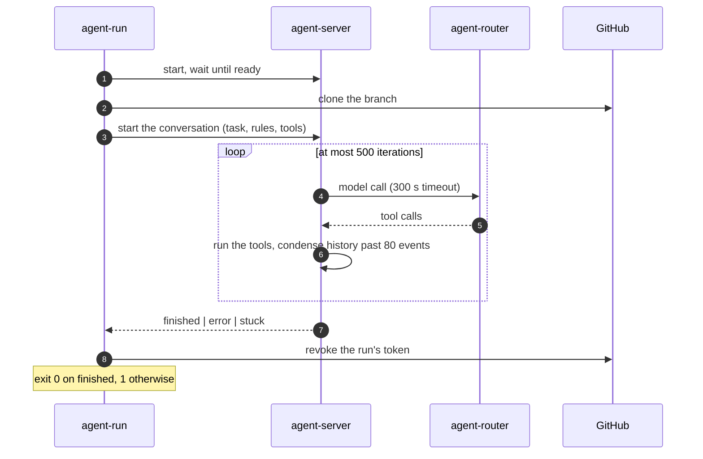
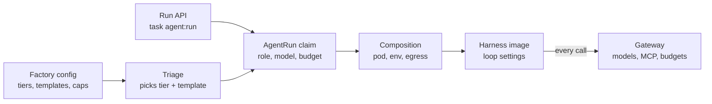
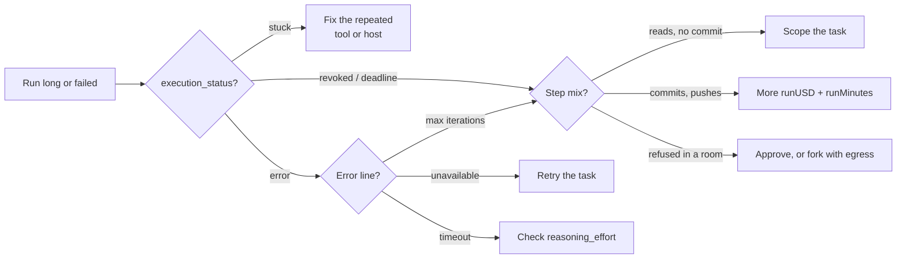


**The levers that matter are outside the harness.** A run's money, time and model come from the
factory's **tier**, its team from the **template**, its tools from the **data class**, and its length
from the **task text**. The loop's own settings are baked into the harness image. The cheapest lever
is a bounded task: an open "find out why" task once spent its whole $2.55 on 319 `grep` steps and
pushed nothing.


The harness is the program that runs the agent loop in the sandbox: OpenHands
[software-agent-sdk](https://github.com/OpenHands/software-agent-sdk) `agent-server`, driven by a
small entrypoint, `agent-run`. This page is the guide; every knob, its default and its bounds are on
the [Harness reference]().
Isolation is on [Runtime](), models and
prices on [Routing and cost]().

## Which knob for which goal {#goals}

| I want to… | Change | Where |
|---|---|---|
| Let a long task finish | `runUSD` **and** `runMinutes` of its tier, together | [Tiers]() |
| Stop a run that wanders | The task text: a scope and an exit | [Recipe](#wandering) |
| Make reviews cheaper | `maxReviewRounds`, or `reviewerModel` | [Recipe](#cheaper-reviews) |
| Use another model | `tiers.<tier>.model` + a `meter.prices` row | [Routing]() |
| Let a run install packages | `--profiles pypi,npm,…` on a hand-started run | [Run API]() |
| Run more tasks at once | `caps.activeTasks`, `caps.concurrentRuns` | [Caps]() |
| Change iterations, condenser, reasoning effort | Not per run: a harness release | [Not tunable](#limits) |

## How a run works {#loop}

`agent-run` starts `agent-server`, clones the repository, hands it the task, then polls it and
prints a step log until the conversation ends.



The step log is what you read most: one line per action, never its output, redacted for tokens.

```text
agent-run step 3: terminal | List crossplane controller dir and kustomization | ls /workspace/repo/... | trace_id=706f…
agent-run model retry 1/2 in 10s: ServiceUnavailableError …
agent-run: conversation ended with execution_status=finished
agent-run summary: 21 steps, 0 model retries
```

## Where settings come from {#layers}

Each layer lives in its own repository and is pinned into the next. A run's settings are fixed when
it is created; only `budget.maxTokens` can be raised on a live run.



| Layer | Repository | A change reaches |
|---|---|---|
| Factory config | ai-native-ref | New runs, once Flux applies the release |
| Run API | flags of `task agent:run` | That run only |
| Claim and composition | crossplane-configuration | Runs created after the package upgrade |
| Harness image | agent-platform | Runs created after its digest reaches the composition |
| Gateway | ai-native-ref | Every call, running runs included |

## Trade-offs {#trade-offs}

| Turn up | Costs | Watch for |
|---|---|---|
| Tier, `standard` → `frontier` | Caps ×2.7, deadline 45 → 90 min | A wandering run spends all of it |
| `runMinutes` alone | Wall time | A deadline kill is never resumed: add money too |
| `runUSD` alone | Money | Keep `taskUSD` ≥ 2 × `runUSD` so a resume fits |
| `maxReviewRounds` | One implementer + one reviewer run per round | Out of rounds, the task escalates |
| `trio` over `pair` | One more run | The tester keeps the implementer's tier |
| `reasoning_effort` (harness) | Reasoning tokens, seconds per step | Above `high`, GLM-5.3 calls hit the 300 s timeout |
| Prompt caching (internal runs) | Nothing: cache reads cost 5% | Only where provider and gateway carry the marker |

## Measuring a change {#measuring}

Change one knob, run the same kind of task, and compare. A run's id is the 8 characters after
`xplane-run-`; the panels are on the `agent-run` dashboard.

| Question | Panel | Metric |
|---|---|---|
| Cost? | *Cost (USD)* | `agent_factory_run_spend_usd{run}` |
| Share of cached input? | *Tokens in / out* | `gen_ai_client_token_usage_sum` by `gen_ai_token_type` |
| Steps and tools? | *Steps*, *Distinct steps* | `agent-run step` log lines |
| Duration? | *Duration*, *Run traces* | `agentrun_{started,finished}_timestamp_seconds` |
| Model latency? | *Model latency p50 / p95* | `gen_ai_server_request_duration_seconds_bucket` |
| Why it ended? | *Run*, *Errors* | `agentrun_outcome_info{reason}` |
| Was the tier right? | Explore | `agent_factory_tier_fit_total{tier, fit}` |

```logsql
# A run's step log, then its tool mix
kubernetes.pod_name:"xplane-run-<id>" AND kubernetes.container_name:"harness" AND _msg:~"^agent-run"
kubernetes.pod_name:"xplane-run-<id>" AND kubernetes.container_name:"harness" AND _msg:~"^agent-run step "
  | extract "agent-run step <n>: <tool> |" | stats by (tool) count() steps
```

### What real runs look like {#examples}

On `gcp-0`, 2026-10-18, all on GLM-5.3:

| Run | Steps | USD | End |
|---|---|---|---|
| `dkpa4r4o`, docs-links | 10 | 0.03 | succeeded |
| `b4cnoos7`, docs | 36 | 0.17 | succeeded, PR |
| `jcp6kl72`, docs-links | 225 | 1.65 | succeeded, PR |
| `d3jacb5z`, dashboards | 319 | 2.65 | out of budget, nothing pushed |
| `kk2egjta`, dashboards, frontier | 444+ | 4.46+ | still running at 66 min |

- **Step count, not tier, separates runs.** Most finish in 10–40 steps for under $0.20.
- **95% of input is cache reads**, so a USD cap fits better than a token cap: `d3jacb5z` read 7.7 M
  tokens for $2.65.

## Failure modes {#failure-modes}

| Symptom | Cause | Fix |
|---|---|---|
| Out of budget, no commit, hundreds of `grep`/`cat` steps | A task with no stopping rule | [Scope the task](#wandering) |
| Out of budget, limit `run-tokens` | A hand-started run, or a model with no price | Raise `--max-tokens`, or add a `meter.prices` row |
| `PodFailed` near the deadline | `runMinutes` | Raise `runMinutes` with `runUSD` |
| `maximum iterations limit (500)` | The run looped | [Debug it](#debug) |
| `execution_status=stuck` | The same action or error, repeated | Read the last steps: fix the tool, host or test it trips on |
| `LLMServiceUnavailableError` after `model retry 2/2` | The provider failed 3 times | `/factory retry`; if it recurs, the provider's status |
| Steps take minutes, calls fail at 300 s | `reasoning_effort` not reaching the model | Check the request body carries it |
| A `429`, then the agent stops | A gateway budget; never retried, by design | `agent_factory_run_revocations_total` |
| In a room, the same refused action for minutes | The bridge refuses it, the model retries | Read the refusal; approve, or fork with more egress |
| Pod `Pending` 15 min, then `run_unschedulable` | No gVisor node yet | Wait 1.5–3.5 min, or turn the warm headroom on |
| Internal run costs as much as a public one | Prompt caching not applied | The harness logs `prompt cache NOT applied` at start |

## Recipes {#recipes}

### Stop a run that wanders {#wandering}

A wandering run is hundreds of reads and no commit; the stuck detector misses it because every
command differs. Give the task a scope and an exit: which files, what to change, and "if X is not
found, say so and stop". Only then try a bigger tier.

### Make reviews cheaper {#cheaper-reviews}

A review of a small PR takes under 10 steps; the cost is in the rounds.

1. Keep `maxReviewRounds` at 2, or 1 for mechanical fixes.
2. Leave `docs-links` on `solo`: the matrix skips the reviewer below `frontier`.
3. For a smaller reviewer model, set `templates.pair.reviewerModel: tier-standard`.
   [ADR-0058]() weighs it: cheaper,
   but a smaller model judging a larger one's work.

### Give long tasks more room {#long-tasks}

1. Check it is large, not wandering: a large run posts `committed.` and `pushed its branch.` notes.
2. Raise the tier's `runUSD` **and** `runMinutes` together; keep `taskUSD ≥ 2 × runUSD`.
3. A task that installs packages needs `--profiles` on a hand-started run: the factory adds none.

### Debug a run that loops {#debug}



1. `kubectl get agentrun -n agents xplane-run-<id>`: phase and reason.
2. The step log's last 30 lines: repeating, or changing?
3. The tool mix (LogsQL above): 95% `terminal` and no commit is searching, not working.
4. The room transcript for the model's reasoning, and the trace for timings.
5. Stop it if it burns money: `factory/stop` on the issue.

## What is not tunable today {#limits}

| Wanted | Path |
|---|---|
| Per-task reasoning effort, iterations, condenser | A harness change reading new env vars, set by the composition |
| A bigger sandbox for a factory run | A factory change: it always writes `size: small` |
| A tier chosen by task difficulty | The complexity classifier, not deployed: every task is `standard` |
| A different harness | A new profile in the composition |

Related: [Harness reference](),
[Factory](),
[Rooms](),
[Observability](), and the
[user guide]().
