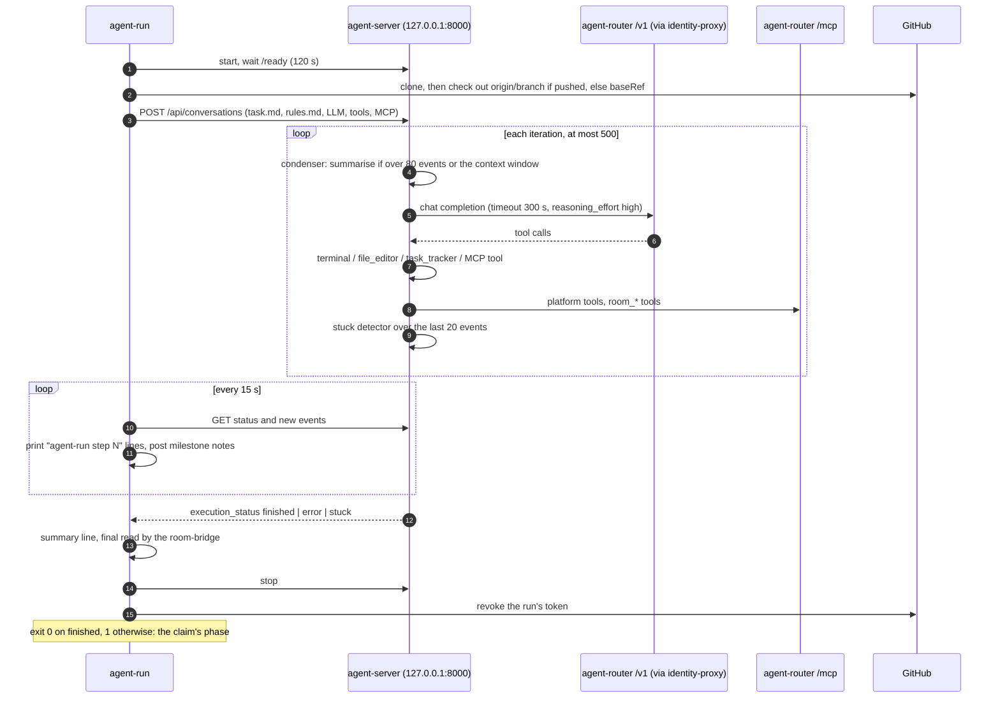
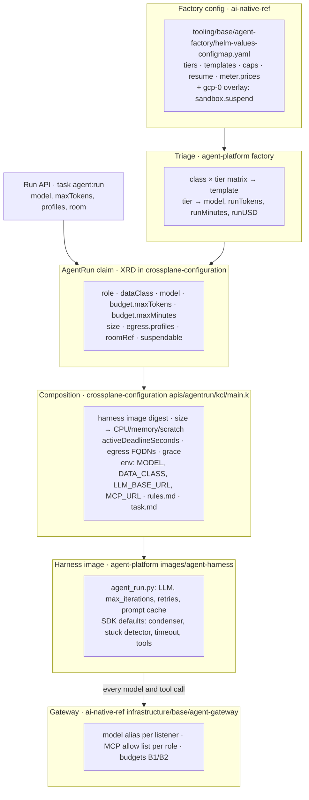
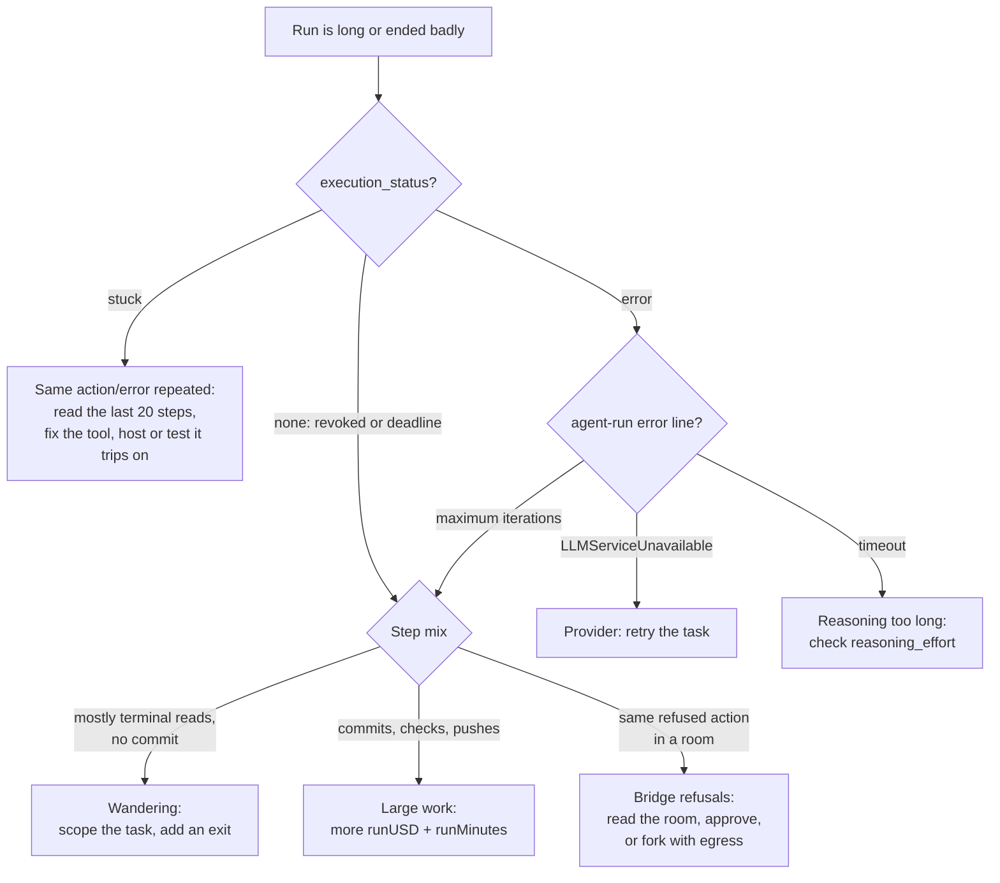


**The levers that matter are outside the harness.** A run's money, time, team, model and tools are
set by the factory's **tier** and **template**, the run's **data class**, and the **task text**. The
loop's own settings (500 iterations, a context condenser at 80 events, a 300 s model timeout,
`reasoning_effort: high`) are fixed in the harness image: no claim field reaches them, and changing
one is an agent-platform release. The cheapest lever of all is a bounded task: on 2026-10-18 an open
"find out why" task spent its whole $2.55 on 319 steps of `grep` and pushed nothing.


The harness is the program that runs the agent loop in the sandbox: OpenHands
[software-agent-sdk](https://github.com/OpenHands/software-agent-sdk) `agent-server` 1.49.6, started
and driven by a small entrypoint, `agent-run`
([agent-platform `images/agent-harness/`](https://github.com/Smana/agent-platform/tree/main/images/agent-harness)).
The isolation around it is on [Runtime]();
model routing and prices are on the [routing and cost page](/docs/platform/ai-platform/routing/).
This page owns the configuration of a run and how to tune it.

**Status on `gcp-0`, 2026-10-18.** Harness `v0.15.2` runs every sandbox (read from the running pod),
composed by crossplane-configuration `v0.9.15`. Each row below carries one of four marks:

| Mark | Meaning |
|---|---|
| **live** | Seen working on a real run, with the date and the evidence |
| **deployed** | Configured on `gcp-0`; no run has exercised it yet |
| **off** | Built and shipped, switched off on this platform |
| **design** | Specified, not built |

## The loop

`agent-run` is the container's entrypoint (`tini -- agent-run`). It does five things, and
`agent-server` does the rest:



The step log is what you read most. One line per action, the final message in full:

```text
agent-run step 3: terminal | List crossplane controller dir and kustomization | ls /workspace/repo/... | trace_id=706f…
agent-run model retry 1/2 in 10s: ServiceUnavailableError litellm.ServiceUnavailableError: …
agent-run: conversation ended with execution_status=finished
agent-run summary: 21 steps, 0 model retries
agent-run final message:
…
```

Actions are printed, their outputs never are, and every line is redacted for GitHub tokens before
it is written. Condensations are not in the step log.

## Where each setting comes from

Five layers, each in its own repository, each released and pinned into the next. A run's settings
are fixed at creation: the claim's fields are immutable, except `budget.maxTokens`.



| Layer | Change it with | Reaches new runs |
|---|---|---|
| Factory config | A PR to ai-native-ref, a release, the pin bump in cloud-native-ref | Once Flux applies it: the ConfigMap is watched, so the release upgrades at once. A bad value fails the rollout: the parser is strict |
| Run API | Flags of `task agent:run` (`scripts/ops/k8s/agent-run.sh`) | That run only |
| Claim schema and composition | A PR to [crossplane-configuration](https://github.com/Smana/crossplane-configuration/tree/main/apis/agentrun), a release, the package pin in cloud-native-ref | Runs created after Crossplane installs the package |
| Harness image | A PR to [agent-platform](https://github.com/Smana/agent-platform/tree/main/images/agent-harness); its release builds, tests and signs the image; then the digest in the composition, then the package pin | As above: the digest lives in the composition, never in a claim |
| Gateway | A PR to ai-native-ref, as the factory config | Every call, including running runs |

Only the factory may create an `AgentRun` (a Kyverno policy refuses everyone else), so a run you
start by hand also goes through the factory's run API.

## Knob reference

### Factory: tiers {#tiers}

`config.tiers` in `tooling/base/agent-factory/helm-values-configmap.yaml`. Exactly `light`,
`standard` and `frontier`; triage fixes one per task, and each run of the task inherits it.
**deployed**, the USD cap **live** (below).

| Tier | `model` | `runTokens` | `taskTokens` | `runMinutes` | `runUSD` | `taskUSD` |
|---|---|---|---|---|---|---|
| light | `agent-default` | 300,000 | 600,000 | 20 | 0.51 | 1.02 |
| standard | `agent-default` | 1,500,000 | 3,000,000 | 45 | 2.55 | 5.10 |
| frontier | `agent-default` | 4,000,000 | 8,000,000 | 90 | 6.80 | 13.60 |

| Field | What it does | Bounds |
|---|---|---|
| `model` | The logical name the run asks for: `agent-default`, `tier-light`, `tier-standard` or `tier-frontier`. Every tier asks for `agent-default` today, so the tier changes the caps and not the model. What each name resolves to is the [routing page](/docs/platform/ai-platform/routing/)'s | A C5 logical name |
| `runUSD` | The run meter revokes the run (`BudgetExhausted`, reason `budget-run`, limit `run-usd`) when its cost reaches this. Each model's tokens are priced from `meter.prices`, cache reads at their own rate | Positive; needs a price row for the tier's model |
| `runTokens` | Written into the claim as `budget.maxTokens`. Caps the run **only when the meter cannot price it** (a model with no price row, or no USD cap): then the limit is `run-tokens` and `AgentModelUnpriced` fires | 1 … 5,000,000, the gateway's per-run ceiling |
| `taskUSD`, `taskTokens` | The whole task's cap, every run and resume included. A resume or a new review round starts only if a whole run still fits under it | ≥ the run cap |
| `runMinutes` | The claim's `budget.maxMinutes`, then the pod's `activeDeadlineSeconds`. At the deadline the kubelet kills the pod: `Failed`, reason `PodFailed`, and the factory does not resume it | 1 … 480 |

A priced run is held to its USD cap, not to its tokens: `kk2egjta` (frontier) passed 12.5 M tokens
against a 4 M `maxTokens` at $4.46 of its $6.80 on 2026-10-18, because 95% of them were cache reads
at $0.26 per million. The gateway's own per-run budget B1 (5 M reference tokens, $8.50) is the
backstop, still in shadow ([gateways]()).

### Factory: templates and triage {#templates}

`config.templates`: which roles run, in order, on one branch. **deployed**.

| Template | Roles | `maxReviewRounds` |
|---|---|---|
| `solo` | implementer | — |
| `pair` | implementer, reviewer | 2 |
| `trio` | implementer, tester, reviewer | 2 |
| `investigate` | triager (proposes an issue text, never writes) | — |

| Field | What it does |
|---|---|
| `maxReviewRounds` | Every revision a verdict asks for, and every review run that has to start again, uses one round. Out of rounds, the task escalates (`review_rounds_exhausted`, `no_verdict`) |
| `reviewerModel` | The reviewer's logical model whatever the tiers say. Unset on this platform: [ADR-0058]() keeps a public reviewer on the implementer's GLM model |

Triage picks the template from the task's class and tier, not from `defaults.template`:

| Source, class, tier | Template |
|---|---|
| a RunLore finding | `investigate`, forced `internal` |
| `docs-links`, frontier | `pair` |
| `docs-links`, any other tier | `solo` |
| any other class, frontier | `trio` |
| any other class | `pair` |

The tier comes from the complexity classifier, which is **design**: it is not deployed, so every
task falls back to `standard` (`status.classification.classifier: static`). `triage.controlPercent: 10`
puts one task in ten, by a hash of its id, in the control group, which runs `frontier`. On
2026-10-18 the twelve tasks on `gcp-0` were ten `standard` and two `frontier`, both control.
`defaults.template` and `defaults.tier` are validated but read only by the static triager, which the
deployed factory does not use: editing them changes nothing.

The reviewer runs on **the other tier** ("on a different tier from the implementer where possible"):
`standard` and `light` implementers get a `frontier` reviewer, a `frontier` implementer a `standard`
one. The reviewer gets that tier's label, model and USD cap, and keeps the implementer's
`maxTokens` (live: `ujnumrm6`, reviewer, tier `frontier`, `maxTokens` 1,500,000). The tester keeps
the implementer's tier.

### Factory: caps, resume and suspend {#caps}

| Key | Default here | What it does | Status |
|---|---|---|---|
| `caps.activeTasks` | 3 | Tasks worked at once | deployed |
| `caps.concurrentRuns` | 4 | Sandboxes at once | deployed |
| `caps.tasksPerDay` | 20 | Past it, a labelled issue is refused with a comment | deployed |
| `caps.maxTextBytes` | 14,336 | The task text the factory accepts | deployed |
| `caps.maxPendingMinutes` | 30 (omitted, defaulted; 5 … 480) | A run still `Pending` after this escalates as `run_unschedulable`: `activeDeadlineSeconds` counts only from the pod's start | deployed |
| `resume.maxPerTask` | 2 (1 … 5) | Runs lost to their infrastructure (`Disrupted`, `PodLost`) resumed on their own, with room for a whole run under the task cap. Never a `PodFailed` run | live on aws-0 ([runbook 10](https://github.com/Smana/ai-native-ref/blob/main/docs/runbooks/agent-factory/10-disruption.md)) |
| `sandbox.suspend.enabled` | `true` on `gcp-0` (`tooling/gcp-0/agent-factory/helm-values-suspend.yaml`) | A run created in an attended room gets `spec.suspendable: true`; the broker suspends it after `suspend.after` (5 min, `infrastructure/gcp-0/room-broker/config.yaml`) waiting on an approval in an idle room, and resumes it with what is left of its deadline | live 2026-10-18 ([runbook 01, step 8](https://github.com/Smana/ai-native-ref/blob/main/docs/runbooks/agent-factory/01-runtime-sandbox.md#step-8--gcp-0-2026-10-18-ai-native-ref-v0114)) |
| `budgets.*` | `factoryDaily` 25 M, `humanDaily` 5 M, `enforceTask: true`, `enforcePrincipal: false` | Daily and per-person caps; the per-person one counts in shadow | deployed, person caps in shadow |

### Run API: runs started by hand {#run-api}

`task agent:run -- --role … --class … --task …` asks the factory for one run. Such a run has no tier,
so the meter caps it **in tokens**: `--max-tokens` (default 2,000,000, at most 5,000,000).
`--model` takes one of the four logical names (default `agent-default`), `--profiles` the egress
profiles. The deadline is fixed at 120 minutes and the size at `small`: `--minutes` and `--size`
are refused. Live example: `jede5jsq`, an open-ended typo hunt, 55 steps, revoked at 2.2 M tokens
on 2026-10-18 (limit `run-tokens`).

### AgentRun claim {#claim}

The XRD, `agentruns.cloud.ogenki.io` ([definition](https://github.com/Smana/crossplane-configuration/blob/main/apis/agentrun/definition.yaml)).
The factory always writes `size: small`, `baseRef: main` for an implementer and the task branch for
a reviewer or tester.

| Field | Default | Effect on the run | Mutable |
|---|---|---|---|
| `role` | required | `implementer` writes and pushes; `reviewer`, `tester`, `triager` read only. Picks the rules, the token audiences, the MCP allow list and the bridge's room rules | no |
| `dataClass` | required | `public`: Z.ai through the public listener, GitHub egress. `internal`: Claude through the internal listener, a read-only clone through the gateway, no egress at all, cluster and log read tools, prompt caching | no |
| `model` | `agent-default` | `MODEL` in the harness | no |
| `budget.maxTokens` | 2,000,000 (1 … 5,000,000) | The token cap, when the run is not priced | **yes**: the owner may raise it on a live run |
| `budget.maxMinutes` | 120 (1 … 480) | `activeDeadlineSeconds`; also the TTL of the run's projected tokens, at least 600 s | no |
| `size` | `small` | `small` 1→2 CPU, 2→4 GiB, 10 Gi scratch; `medium` 2→4, 4→8 GiB, 20 Gi; `large` 4→8, 8→16 GiB, 40 Gi (request → limit) | no |
| `egress.profiles` | `[]` | `pypi`, `npm`, `golang`, `crates` on top of `github`; refused on an `internal` run | no |
| `roomRef` | — | Adds the room-bridge sidecar and its gate, the room rules in `rules.md`, and a 45 s grace period instead of 30 s | no |
| `suspendable` | — | `/workspace` on a PVC of the size's scratch; the suspend annotations are read | no |

### Composition {#composition}

[`apis/agentrun/kcl/main.k`](https://github.com/Smana/crossplane-configuration/blob/main/apis/agentrun/kcl/main.k)
turns the claim into the pod. Nothing here is set per run.

| Setting | Value | Why it matters for tuning |
|---|---|---|
| Harness image | `ghcr.io/smana/agent-harness:v0.15.2@sha256:c49c…` | A harness change reaches runs only through this digest |
| `harness` env | `MODEL`, `DATA_CLASS`, `ROLE`, `LLM_BASE_URL` and `MCP_URL` (the identity-proxy's port for the class), `TASK_FILE`, `RULES_FILE`, `CONVERSATION_ID` (the claim's uid), `TRACEPARENT`, `OTEL_*`, `LMNR_TRACE_CONTENT=false` | `LLM_REASONING_EFFORT` and `LLM_{INPUT,OUTPUT}_USD_PER_MTOK` are **not** set, so the harness defaults apply (below) |
| `rules.md` | The platform rules appended to the system prompt: the one branch to push, one PR, never touch `.github/workflows/`, "a 429 means the budget is spent: stop and exit"; in a room, `room_read` first, `room_handoff` or `room_verdict` before finishing | Behaviour the agent is told; every rule is also enforced outside the sandbox |
| `task.md` | The task text, or the issue or PR URL | The single biggest driver of a run's length |
| Egress FQDNs | `github`: `github.com`, `api.github.com`, `codeload.github.com`, `objects.githubusercontent.com`, `raw.githubusercontent.com`; plus each profile's registries | A command that needs any other host fails: in a room the bridge refuses it as `egress.new` |
| Grace period | 30 s, 45 s with a room | Holds the SIGTERM sequence: pause 1 s, checkpoint 7 s, final read 3 s, stop 2 s, revoke 1 s |
| Read-only MCP tools | `MCP_READ_ONLY_TOOLS` on the bridge: the Flux, VictoriaMetrics and VictoriaLogs read tools and the five `room_*` tools | In a room, any other MCP tool is `mcp.write` and waits for an approval |
| Sidecar resources | identity-proxy 50m/64Mi → 200m/128Mi; room-bridge 20m/32Mi → 100m/64Mi | Fixed |

### Harness {#harness}

Set in [`agent_run.py`](https://github.com/Smana/agent-platform/blob/main/images/agent-harness/agent_run.py)
and [`site/sitecustomize.py`](https://github.com/Smana/agent-platform/blob/main/images/agent-harness/site/sitecustomize.py),
or left at the [SDK's v1.49.6 defaults](https://github.com/OpenHands/software-agent-sdk/tree/v1.49.6/openhands-sdk/openhands/sdk).
None is a claim field.

| Knob | Value | Source | What it trades | Status |
|---|---|---|---|---|
| Model | `openai/$MODEL` at `LLM_BASE_URL`, placeholder key (identity-proxy injects the real token) | agent_run.py | — | live |
| `reasoning_effort` | `high`, from `LLM_REASONING_EFFORT` (unset) | agent_run.py, sent in the body because litellm drops it for an unknown model name | Unsent, GLM-5.3 thinks at maximum: one reply measured 150 s and 1,238 reasoning tokens against 10.8 s at `high`, and some steps hit the 300 s timeout | live |
| Model timeout | 300 s per call | SDK `LLM.timeout` | A timeout is not retried: it ends the run | live |
| Transient retries | 3 attempts, 10 s then 20 s apart, on a 503, an Envoy reset or a refused connection. **Never** a 429 or a timeout | sitecustomize.py (#99); the SDK's `num_retries=0` and litellm's client retries off | A 429 can be the gateway's budget: a retry would hammer it | live 2026-10-18 (`kk2egjta`, `model retry 1/2`) |
| `max_iterations` | 500 | agent_run.py | Past it the conversation ends `error` (`Agent reached maximum iterations limit`), exit 1. In practice the USD cap and the deadline end a run first | deployed |
| Stuck detection | on; the last 20 events: 4 identical action-observation cycles, 3 action-error cycles, 3 agent messages in a row, 6 alternating cycles | SDK `StuckDetectionThresholds` | Ends the run `stuck`, exit 1. It catches repetition, not a wander through different commands | live (one `stuck` in the [v2 cohort](https://github.com/Smana/ai-native-ref/blob/main/docs/superpowers/specs/2026-10-12-v2-hard-task-cohort-design.md#results)) |
| Condenser | `LLMSummarizingCondenser`, `max_size` 80 events, `keep_first` 4, also when the context nears the model's input limit; summarises with the same model, under usage id `condenser` | SDK `default_condenser` | Each summary is a model call on the run's budget | deployed |
| Event size | `max_message_chars` 30,000 per event sent to the model | SDK default | A huge command output is truncated, not refused | deployed |
| Tools | `terminal`, `file_editor`, `task_tracker`, plus the built-ins (`think`, `finish`); no browser (`cli_mode=True`); MCP tools under `platform` at `MCP_URL` | `get_default_agent` | Which MCP tools a role sees is the gateway's allow list ([gateways]()) | live |
| Prompt caching | On for `DATA_CLASS=internal`: the SDK's markers rewritten as `prompt_cache_breakpoint`, the only one agentgateway 1.6 carries to Anthropic. Off on `public`: Z.ai caches on its own | agent_run.py and sitecustomize.py (#132) | Live 2026-10-16: 85% of a triager's input were cache reads, $0.48 against $2.13 for an uncached one | live |
| `autotitle` | off | agent_run.py | Each title is an extra model call | live |
| Poll and step log | every 15 s; at most 5 poll errors in a row | agent_run.py | Step lines arrive in batches with the tick's timestamp | live |
| Progress notes | `room_progress` at five milestones (started, committed, pushed, ran checks, opened a PR), one a minute, eight a run | agent_run.py (#91) | Fixed texts, nothing the model wrote | live |
| Checkpoint on SIGTERM | implementer only; refused over 200 files or 5 MiB, or with a GitHub token staged | agent_run.py | A reclaimed run's work survives on its branch for the resume | live on aws-0 (runbook 10) |
| Self-pricing | $1.40 / $4.40 per M (GLM-5.3), `LLM_*_USD_PER_MTOK` | agent_run.py | The SDK's own cost stat only. The meter prices from the gateway's counters | — |
| Tracing | root span `agent-run` under the factory's `TRACEPARENT`; each MCP call carries the span that made it (#117, #120); no prompt or output content | agent_run.py, sitecustomize.py | — | live |

## Trade-offs {#trade-offs}

| Turn up | Quality | Tokens and USD | Wall time | Watch for |
|---|---|---|---|---|
| Tier (`standard` → `frontier`) | More room to finish; same model today | Run cap ×2.7, task cap ×2.7 | Deadline 45 → 90 min | A wandering run spends all of it: `kk2egjta` was at $4.46 and 444 steps after 66 min |
| `runMinutes` alone | Lets a slow model finish | None directly | Longer | A run killed at its deadline is `PodFailed` and never resumed: give time and money together |
| `runUSD` alone | Lets a long run finish | Higher | Usually longer | The task cap must stay ≥ the run cap, and a resume needs a whole run under it |
| `maxReviewRounds` | More fix-ups per PR | One implementer and one reviewer run per round | Longer | Out of rounds, the task escalates `review_rounds_exhausted` |
| `trio` over `pair` | A tester's run | One more run | One more run | The tester keeps the implementer's tier |
| `reasoning_effort` (harness) | Better plans per step | Reasoning tokens per call | Seconds to minutes per step | Above `high` on GLM-5.3, calls hit the 300 s timeout |
| Condenser `max_size` (harness) | More history in view | Bigger prompts per call; fewer summaries | Slightly longer calls | The model's input limit triggers a summary anyway |
| `size` | Faster builds and tests | None | Shorter tool time | Factory runs are always `small` |
| Prompt caching (internal) | None | Cache reads at $0.20 instead of $4.00 per M on Opus 5.5 | None | Only where the provider and gateway carry the marker |

## Measuring a change {#measuring}

Change one knob, run the same kind of task, and compare these. Every query names a run by its id,
the 8 characters after `xplane-run-`.

| Question | Signal | Where |
|---|---|---|
| What did the run cost? | `agent_factory_run_spend_usd{run}` (the meter's figure) | `agent-run` dashboard, *Cost (USD)* |
| How much of the input was cached? | `gen_ai_client_token_usage_sum` by `gen_ai_token_type`: `cached_input` over `input` (`input` includes cache reads) | *Tokens in / out* |
| Tokens against the cap | `agentrun_usage_tokens`, `agentrun_budget_max_tokens` | *Tokens vs budget* |
| How many steps, of which tools? | `agent-run step` lines | *Steps*, *Distinct steps*, `agent-fleet` *Tier vs tokens and steps per run* |
| How long, and where did the time go? | `agentrun_started_timestamp_seconds`, `agentrun_finished_timestamp_seconds`; the trace | *Duration*, *Phase*, *Run traces* |
| Model latency | `gen_ai_server_request_duration_seconds_bucket{ar_agent=…}` | *Model latency p50 / p95* |
| Why did it end? | `agentrun_outcome_info{reason}`, `agent_factory_run_revocations_total{reason, limit}` | *Run*, *Errors* |
| Was the tier right? | `agent_factory_tier_fit_total{tier, fit}` (`under`, `fit`, `over`) | Explore |
| Fleet totals per tier | `agent-fleet` *Tokens by tier* | `agent-fleet` |

```promql
# One run's cost by model and token type, priced as the meter does
sum by (gen_ai_request_model, gen_ai_token_type) (
  max_over_time(gen_ai_client_token_usage_sum{ar_agent="system:serviceaccount:agents:xplane-run-<id>"}[1d]))
```

```logsql
# The run's step log, then its tool mix
kubernetes.pod_namespace:"agents" AND kubernetes.pod_name:"xplane-run-<id>" AND kubernetes.container_name:"harness" AND _msg:~"^agent-run"
kubernetes.pod_name:"xplane-run-<id>" AND kubernetes.container_name:"harness" AND _msg:~"^agent-run step "
  | extract "agent-run step <n>: <tool> |" | stats by (tool) count() steps
```

### What runs look like {#examples}

Factory and hand-started runs on `gcp-0`, read from VictoriaMetrics and VictoriaLogs on 2026-10-18.
All on `glm-5.3`; cost is the meter's `agent_factory_run_spend_usd`.

| Run | Role, tier | Steps | Minutes | Input tokens (cached) | USD | End |
|---|---|---|---|---|---|---|
| `dkpa4r4o` | implementer, standard (docs-links) | 10 | 1.6 | 91,509 (95%) | 0.03 | `Succeeded` |
| `q6rmraip` | implementer, standard | 21 | 4.6 | 210,473 (95%) | 0.08 | `Succeeded` |
| `b4cnoos7` | implementer, standard (docs) | 36 | 7.0 | 542,545 (97%) | 0.17 | `Succeeded`, PR |
| `jeg7vkpx` | tester, frontier | 23 | 5.5 | 426,784 (92%) | 0.17 | `Succeeded` |
| `jcp6kl72` | implementer, standard (docs-links) | 225 | 36.9 | 4,433,376 (94%) | 1.65 | `Succeeded`, PR |
| `d3jacb5z` | implementer, standard (dashboards) | 319 | 31 | 7,654,466 (95%) | 2.65 | `BudgetExhausted`, `run-usd`, nothing pushed |
| `kk2egjta` | implementer, frontier (dashboards) | 444 at 66 min | running | 12,075,100 (96%) | 4.46 | still `Running` |

Gateway latency for these runs' model calls over the two days: p50 2.7 s, p95 18.3 s.

What the numbers say:
- **Step count, not tier, separates the runs.** Most finish in 10–40 steps and under $0.20; the
  two dashboard tasks ran 300–450 steps.
- **95% of public input is cache reads**, so a run's cost is roughly
  `0.26 × input + 1.14 × uncached input + 4.40 × output` per million on GLM-5.3. Uncached input and
  output are each under 10% of the bill's tokens, but together about 30% of its dollars.
- **A token cap would mislead here.** `d3jacb5z` reached 7.7 M tokens before its $2.55; under the old
  token cap it would have stopped at 1.5 M, which is what decided 11 of 15 issues in the
  [v2 cohort](https://github.com/Smana/ai-native-ref/blob/main/docs/superpowers/specs/2026-10-12-v2-hard-task-cohort-design.md#results).

## Failure modes {#failure-modes}

| Symptom | Cause | Fix |
|---|---|---|
| `BudgetExhausted`, `budget-run`, `run-usd`, no commit; the step log is hundreds of `terminal` reads (`grep`, `cat`) | The task has no stopping rule: "find out why", "check every". The stuck detector does not fire, since every command differs | Reword the task with a scope and an exit: which files, what to change, "if X is not found, say so and stop". Then a bigger tier, if the scoped task still needs it |
| `BudgetExhausted`, `budget-run`, `run-tokens` | A run with no tier (started by hand), or an unpriced model (`AgentModelUnpriced` fires) | Raise `--max-tokens`, or add the model's row to `meter.prices` |
| `Failed`, `PodFailed`, near `runMinutes` | The deadline | More `runMinutes` with more `runUSD`; a deadline kill is never resumed |
| `agent-run error: … Agent reached maximum iterations limit (500)`, exit 1 | 500 iterations | The run was looping; see [the recipe](#debug-a-run-that-loops). Raising the limit needs a harness release |
| Run ends `execution_status=stuck` | The SDK's stuck detector: the same action and result 4 times, the same error 3 times, 3 messages with no action | Read the last steps: usually a command that fails the same way (a missing tool, a denied host). Fix the environment or the task |
| `agent-run error: LLMServiceUnavailableError …` after `model retry 2/2` | The provider failed three times in 30 s | Transient: `/factory retry`. Recurring: the provider's status; `AgentGatewayModelErrorRatioHigh` |
| Steps of minutes; a call fails at 300 s | Model thinking at its maximum: `reasoning_effort` not reaching the provider | Check the request body carries `reasoning_effort`; the harness has sent it since the GLM-5.3 measurement |
| 429 from the gateway, then the agent stops | Its budget at the gateway (B1, B2), or the provider's limit. Never retried, by design | `agent_factory_run_revocations_total{reason="budget-fleet"}`; the throttle query in `meter.throttleQuery` |
| In a room, the agent retries a refused action for many minutes | The bridge refuses a step (`forge.other`, `mcp.write`, `egress.new`, approval timeout) and the model tries again. A broker answering 404 once made a run retry for 25 minutes | The refusal texts tell the model which shapes pass (`gh pr create --body-file -`, `git push --force-with-lease origin <branch>`). A widening needs a fork with more `egress.profiles`; an `internal` run has none to add |
| `RoomBridgeHarnessStalled` | The bridge cannot move past the harness's event log | The bridge's logs and the [rooms runbook](https://github.com/Smana/ai-native-ref/blob/main/docs/runbooks/agent-factory/13-rooms-restore.md) |
| Pod `Pending` 15 min (`AgentSandboxPodPending`); the task escalates `run_unschedulable` after 30 | No gVisor node: cold start or pool at its limit | Wait for the node (1.5–3.5 min cold); the warm headroom (**off**) starts runs in 16–17 s ([status]()) |
| Internal run costs as much as a public one | Prompt caching not applied: an SDK upgrade changed the patched calls | The harness prints `prompt cache NOT applied` at start; `cached_input` stays 0 |
| `F29 patch NOT applied`, then every MCP call fails | An `mcp` upgrade moved the patched method | Pin `mcp` back, or port the patch |

## Recipes {#recipes}

### Make reviews cheaper

A review is short when the PR is: the two on 2026-10-18 took 7 and 9 steps and under 135 k input tokens. Its cost is
in the rounds, not the run.

1. Keep `maxReviewRounds` at 2, or set it to 1 for a class whose fixes are mechanical.
2. Let `docs-links` stay `solo` (the matrix already skips the reviewer below `frontier`).
3. To run the reviewer on a smaller model, set `templates.pair.reviewerModel: tier-standard`
   (`glm-5.3-flashx` on public). ADR-0058 weighed it: cheaper, but a smaller model judging a larger
   one's work. It keeps the other tier's USD cap.
4. Do not move the reviewer to a lower tier to cap it: the reviewer's cap is the other tier's
   `runUSD`, and a short review never reaches it.

### Give long tasks more room

1. Measure first: is the run long because the work is large, or because it wanders? A large run
   commits along the way (`committed.`, `pushed its branch.` notes); a wandering one shows hundreds
   of reads and no commit.
2. For large work, raise the tier's `runUSD` **and** `runMinutes` together, and keep
   `taskUSD ≥ 2 × runUSD` so a resume still fits. Bounds: `runMinutes` ≤ 480, `runTokens` ≤ 5 M.
3. Expect `frontier` only from the 10% control group until the complexity classifier lands.
4. A task needing `pypi`, `npm`, `golang` or `crates` needs the profile on its run; the factory
   writes none on its own, so start it through the run API with `--profiles`.

### Debug a run that loops {#debug-a-run-that-loops}



1. `kubectl get agentrun -n agents xplane-run-<id>`: phase and reason.
2. The step log's last 30 lines: are the commands repeating, or changing?
3. The tool mix (the LogsQL above): a run that is 95% `terminal` reads and has no `commit` milestone
   is searching, not working. `d3jacb5z`: 303 of 319 steps `terminal`, 5 `file_editor`.
4. The room transcript: the model's reasoning, which the step log leaves out.
5. The trace: one span per model and tool call, with timings.
6. Stop it early if it is burning money: delete the claim, or `factory/stop` on the issue.

## What is not tunable today {#limits}

| Wanted | Why not | Path |
|---|---|---|
| Per-task reasoning effort, iterations, condenser size | No claim field reaches them; the composition does not set `LLM_REASONING_EFFORT` | A harness change reading new env vars, then a composition change setting them |
| A bigger sandbox for a factory run | The factory always writes `size: small`; the run API refuses `--size` | A factory change |
| Another model per tier | Every tier asks for `agent-default` | Change `tiers.<tier>.model` and add its `meter.prices` row ([routing](/docs/platform/ai-platform/routing/)) |
| A tier chosen by task difficulty | The classifier is not deployed | The complexity-classifier (SP4 PR 5) |
| A different harness | `harness` accepts only `openhands` | A new profile in the composition |

Related: [Runtime]() for the isolation,
[Factory]() for the task flow,
[Rooms]() for approvals,
[Observability]() for the signals,
and the [user guide]()
for budgets from a developer's seat.
