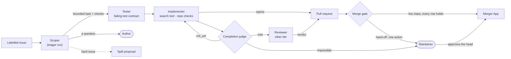
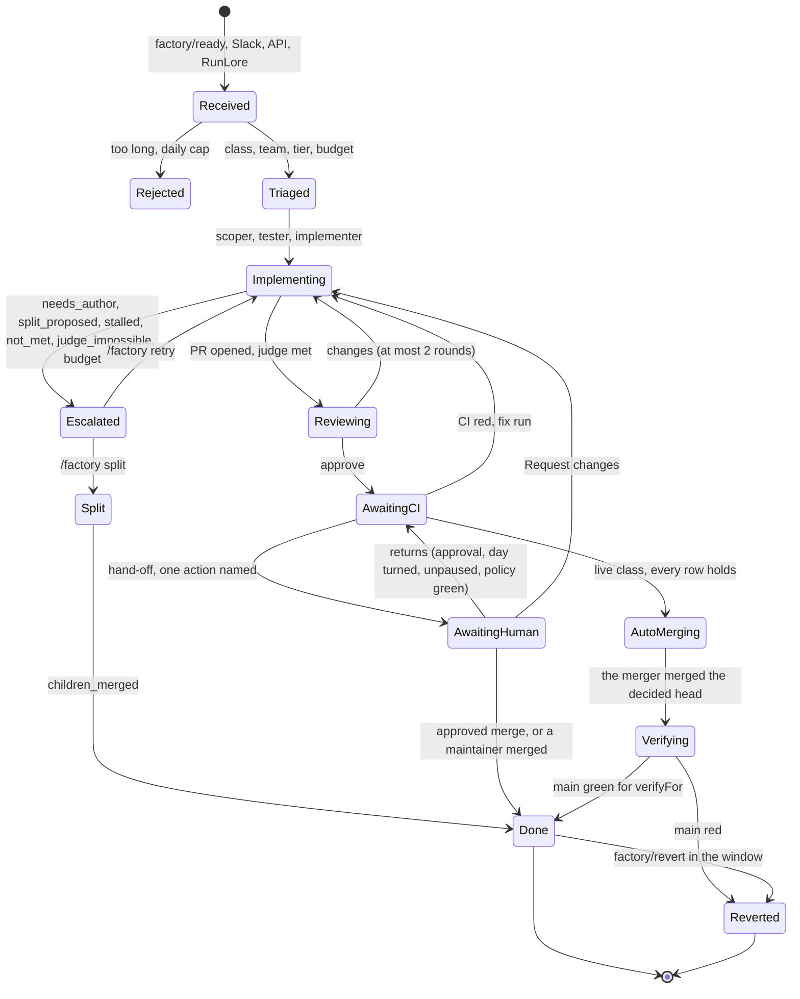
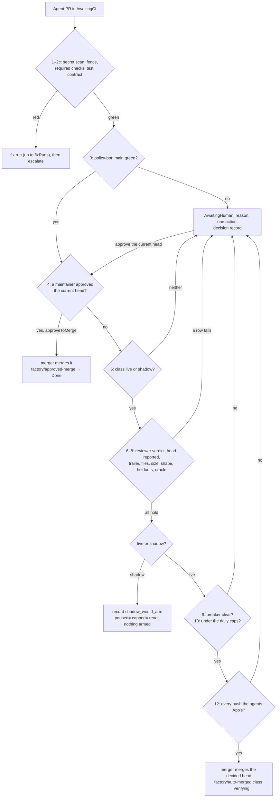
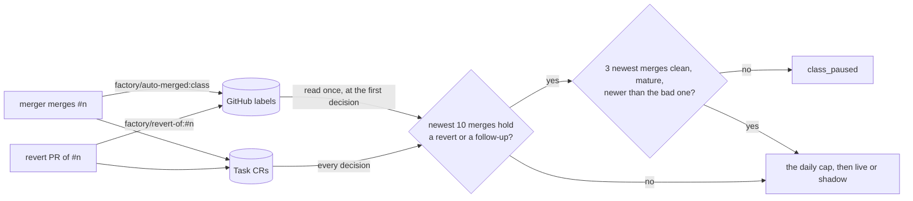

A task is a sequence of runs on one `agent/<task>` branch, in one room. Each run has one role, and
the role fixes what it may write and which models and tools it may call. Only the tester and the
implementer write. Around them stand two GitHub Apps that are not agents: policy-bot, which posts a
policy status, and the merger App, which merges only what the factory's gate decided or a
maintainer approved. The facts here are Maku v0.32.3's (the factory's controller) and this
repository's config; what is proven is on the [status page]().



## The roles {#roles}



### Every role in one table {#role-table}

A role is switched on per class: the `loops.<class>` rows for the scope and the loop,
`repositories[].classes.<class>` for `checks` and `testFirst`, the template for the reviewer. A row is
read whole, and a class without one runs as before. Every tier names the model `agent-default`: GLM-5.3
(Z.ai) for public work, Claude Opus 5.5 for internal work
(`infrastructure/base/agent-gateway/llm.yaml`, `infrastructure/base/agent-gateway/anthropic.yaml`).

| Role | Trigger | Brief | Ending | Model | Writes |
|---|---|---|---|---|---|
| <span id="scoper"></span>**Scoper** (a `triager` run) | `loops.<class>.scope: scoper`, on `docs` and `scripts`; the task's first run | The issue snapshot and the steering note; it reads the issue's `## Acceptance check` section or an `Acceptance:` paragraph. Its first line bounds it: `<!-- agent-factory scoper nudgeAt=25 maxToolCalls=40 -->` | A handoff `ready` starts the implementer with a scope; `question` escalates as `needs_author` and labels the issue `factory/needs-author` ([what you do]()); a split ends `split_proposed`. Nudged at 25 tool calls, stopped at 40 (`budget_calls`); any end without a handoff runs the implementer unscoped | `agent-default` | No |
| **Splitter** (the scoper's split, not a run) | `loops.<class>.split`, on `scripts`, with `anyTier: true` | Part of the scoper's brief | 2 to `maxChildren` parts after a maintainer's `/factory split` (the approver pays); the parts open one at a time, as `pair` at `childTier`. The parent ends `children_merged`, `child_dropped` or `budget-family` | The scoper's | No |
| <span id="tester"></span>**Tester** | `classes.<class>.testFirst: true`, which needs `checks: true`; off everywhere now, a session switch | Write failing tests, only under the repository's test paths | The harness runs them red on the base, then signs and pushes one commit, `test: the test contract`. Ends `contract_ready`, `not_testable` (the implementer then runs without a contract), `contract_not_red`, `contract_outside_tests`; escalations `contract_invalid`, `contract_disputed` | The task's own model and caps | Tests, pushed by the harness |
| **Implementer** | Always; again on Request changes (a revision), red CI (up to `merge.fixRuns`), `/factory retry`, and a resume after a reclaim (at most 2) | Snapshot, steering note, scope, contract | Opens the pull request. Under a loop row: the judge's `met`, or `judge_impossible`, `stalled`, `not_met`. Otherwise `deadline`, `budget-run`, `agent_error`, `stuck`, `Disrupted`. A head that changes the tester's contract is refused (`contract_modified`) | The tier's: `agent-default` | Code, on `agent/<task>` |
| **Search** (a tool of the implementer) | `loops.<class>.search: true`, on `docs` only | One question about the repository | A read-only child conversation: 40 iterations, 300k tokens, 300 s, six a run | The run's own alias | No |
| <span id="judge"></span>**Completion judge** (a call, not a run) | An implementer conversation that ends `finished`, on a class with a loop row: `docs`, `scripts` | The acceptance check, the diff (16 KiB at most) and the head's check runs; no tools, a fresh context | `met`; `not_yet` continues the same conversation, at most `continuations` (2) times, each in a 15-minute box; `impossible` escalates. A failing named check is never `met`. A `not_yet` whose only objection is a pending check waits for it inside the box and spends no continuation. A failing check's log tail is quoted, except live, where the harness cannot reach the Actions log host yet and says so | `tier-light`: GLM-5.3-flash public, Claude Haiku 5.5 internal | No |
| <span id="reviewer"></span>**Reviewer** | The template: `pair`, `trio` (an oracle class such as `dead-links` runs `solo`, without one) | The acceptance checks first, then the snapshot and the pull request; correctness-only findings, each with its command and output; never the implementer's handoff | `room_verdict` approve sends the task to CI; changes start a revision, at most `maxReviewRounds` (2); else `review_rounds_exhausted`, `no_verdict`. **For a live or shadow class the verdict is a gate input**: the gate refuses a head without an approving one (`no_approving_verdict`, row 6). On a pull request a human merges, it is advice | The other tier's, which is `agent-default` too: GLM-5.3 (live record `reviewer=glm-5.3`). `loops.<class>.models` can name a provider for a live session ([providers]()) | No |
| **Triager** (`investigate`) | A RunLore finding, posted to `POST /v1/tasks` as an internal principal | The finding | `proposal_ready`: a maintainer's `factory/publish` files the public issue; or `no_action` | `agent-default`, internal: Claude | No |
| **policy-bot** (`ogenki-merge-gate[bot]`, an App, not an agent) | Every push to an agent pull request | `.policy.yml` on `main` | Posts `policy-bot: main`; dismisses an approval when the head moves ([ADR-0045]()) | — | No |
| **Merger App** (`ogenki-agent-merger[bot]`, an App) | The gate arms, a maintainer approves the head, or `factory/revert` | — | Merges the decided head and labels it `factory/auto-merged:<class>`, or `factory/approved-merge` and `factory/merged:<class>`; opens the revert pull request (`factory/revert-of:#<n>`) and merges it while `revert` is live | — | Merges only |
| **RunLore** (an external agent) | An Alertmanager alert | — | An investigate task, then, after the fix's soak, a verdict on its monitor: `resolved` or `persisting` ([RunLore]()) | Its own | No |

Every key and its bounds: [harness reference]().

**Cost by role.** `maku_factory_run_cost_usd{tier,role}` splits each run's cost by role (`scoper` for a
scoping triager run); the `agent-factory` dashboard plots it as "Cost by role (7 d)".

### What each role may call {#profiles}

Each role has one capability profile per data class, in
`infrastructure/base/agent-gateway/profiles/<role>.<public|internal>.yaml`. `scripts/ci/gen-capabilities.py`
compiles them into the gateway's rules, and a gate fails when the compiled rules drift from the profiles.

| A profile declares | Enforced by |
|---|---|
| `models`: the aliases the role may name. Only the public profiles list the provider aliases ([providers]()) | The gateway answers 403 to any other alias; the factory refuses, at admission, an internal run that names a public-only alias |
| `tools`: the MCP tools and arguments it may use. The reviewer cannot read the implementer's transcript, and no tool reads a Secret | The gateway, before the call reaches the MCP server |
| One model per run (P4) | The identity proxy pins every call, the judge's included, to the alias the run was created with |

To change what a role may call, edit its profile, regenerate the rules with `gen-capabilities.py --write` (it lives in `scripts/ci/`), and let
`task check` prove the compiled rules match.

## A task's life {#lifecycle}

A task's phase is in `kubectl get tasks`, in its room's summary and in `maku status <room>`. Simplified
from Maku's [full diagram](https://github.com/Smana/maku/blob/v0.32.3/docs/factory.md#a-tasks-life):



`Rejected`, `NoOp`, `Done`, `Reverted`, `Closed` and `Stopped` are final. Any open phase goes to
`Stopped` on `factory/stop` or the kill switch. An approved merge goes to `Done` without `Verifying`,
and is never reverted on a red `main`.

## The merge gate {#merge-gate}

Three parts, three owners: policy-bot posts a status, the factory's gate decides, the merger App
merges. Nothing merges unless the gate decided that exact head, or a maintainer approved it. Every
switch is off by default in Maku; a class does only what its row turns on.



### The decision rows {#decision-rows}

The gate reads the pull request in `AwaitingCI`, in this order; every "no" goes to a human. With no
class `live` or `shadow` it reads nothing and hands off as `merge_gate_off`.

| # | Check | If it fails |
|---|---|---|
| 1 | The secret scan (`merge.leakScanCheck`) is not red | Escalated, `secret_scan_red` |
| 2a | The repository names this factory (the fence) | `not_owned` |
| 2 | Every `merge.requiredChecks` is green | Red: a fix run, up to `merge.fixRuns`, then `ci_red`. Cancelled: a re-run, up to `merge.checkReruns`. Pending: wait |
| 2b, 2c | A task with a test contract: its check is green, and no contract file changed | As row 2; `contract_modified`, never a fix run |
| 3 | `policy-bot: main` is green, posted by policy-bot | `policy_absent`, `policy_pending`, `gate_path` |
| 4 | The author is the agents App. With `approveToMerge`, a maintainer's approval of the current head arms the merger here | `not_agent_authored`, `approval_stale`, `changes_requested`, `human_commit_in_pr` |
| 5 | The class is `live` or `shadow` | `class_unarmed` |
| 6 | The reviewer approved, the room reported the head, every approval is of that head | `no_approving_verdict`, `head_unreported`, `verdict_stale` |
| 7 | The head's `Agent-Run` trailer names one of the task's runs | `foreign_trailer` |
| 8 | The class's conditions: allowed and protected files, modify-only, files and lines, diff shape, holdout checks, oracle | `file_not_allowed`, `file_protected`, `file_added_or_deleted`, `patch_too_large`, `class_mismatch`, `holdout_red`, `oracle_finding_open`, `oracle_unrequested` |
| 9 | A live class: its breaker has not tripped | `class_paused` |
| 10 | A live class: under `merge.autoMergesPerDay` and the class's `maxPerDay` | `auto_merge_cap` |
| 11 | The class is `live` | `shadow_would_arm`: the decision is posted, nothing merges |
| 12 | Every push to the branch was the agents App's | `human_commit_in_pr` |

A shadow class skips rows 9 and 10: it records `shadow_would_arm` whatever the breaker and the day's
count say, and its record says what they read (`paused=`, `capped=`). Row 8 is decided on GitHub's own
file list, read only when every other row would merge or post a shadow decision. Every reason and its
next step: Maku's [merge gate](https://github.com/Smana/maku/blob/v0.32.3/docs/factory.md#the-merge-gate).

| Setting | cloud-native-ref | ai-native-ref |
|---|---|---|
| `requiredChecks` | The 4 contexts of `main`'s protection | `validate`, `lint` |
| `autoMergesPerDay` | 1 | 2 |
| `fixRuns` | 2 | 1 |
| `verifyFor` · `revertWindow` | 30 min · 168 h | 30 min · 168 h |
| `approveToMerge` | `true` | `true` |
| `breaker` | `{window: 10, maxReverts: 1, maxFollowUps: 1, recoverAfter: 3}` | The same |

Source: `tooling/base/agent-factory/helm-values-configmap.yaml`.

### Classes: live, shadow, monitor {#classes}

A **live** class merges on its own; a **shadow** class is decided and recorded, never armed; a
**monitored** class has its merges watched afterwards, whoever merged them.

| Class | cloud-native-ref | ai-native-ref | What it allows |
|---|---|---|---|
| `docs-links` | **live** | shadow | Markdown link targets only (`links-only`) |
| `revert` | **live** | shadow | The factory's revert of a class merge |
| `dead-links` | shadow; drilled live once on 2026-10-31 | shadow | An oracle class: fixes what two nightly scans found, at most 20 lines, monitored over 2 oracle runs and 168 h |
| `deps-patch` | shadow | — | Renovate's patch bumps, [adopted](#adopted-classes): at most 3 files and 10 lines, a release age |
| `deps-minor` | shadow, to observe | — | Renovate's minors; never live |
| `alert-rules` | monitored only | — | RunLore's fixes; a `persisting` verdict is a regression |
| `docs`, `scripts`, `tests`, `dashboards`, `review` | unarmed | unarmed | `class_unarmed`: a maintainer's approval merges |

### Approve-to-merge {#approve-to-merge}

With `merge.approveToMerge` (on for both repositories), a maintainer's `APPROVED` review of the
current head is the merge. The merger merges that head outside the daily caps, labels it
`factory/approved-merge` and `factory/merged:<class>`, and records the outcome `approved_merged`: the
task ends `Done` without `Verifying`, is never reverted on a red `main`, and its monitor still watches it.

A hand-off returns to the gate on its own when its cause clears:

| Return | When |
|---|---|
| `reentered_approved` | A maintainer approved the head it was handed off at. Once per review, not counted against the returns limit |
| `reentered_day_turned` | An `auto_merge_cap` hand-off, on the next UTC day |
| `reentered_unpaused` | A `class_paused` hand-off, once a clean ledger lifts the pause |
| `reentered_policy` | policy-bot now passes the head |

Nine reasons are a human's to fix on the pull request, and no approval returns them; their comment keeps
the bypass instructions: `not_agent_authored`, `gate_path`, `contract_modified`, `not_owned`,
`steering_path`, `foreign_trailer`, `not_mergeable`, `changes_requested`, `human_commit_in_pr`. A
`changes_requested` hand-off returns on an approval once no maintainer's newest review requests changes.
The design: [merge gate human path](https://github.com/Smana/ai-native-ref/blob/main/docs/superpowers/specs/2026-10-29-merge-gate-human-path-design.md).

#### Approve the commit you read {#approve-the-commit-you-read}


GitHub binds an approval sent without a commit to whatever the head is when it arrives. If a run pushes
while you read, `gh pr review --approve` approves a commit you never saw. Approve from the web UI, which
sends the commit you are looking at, or name the commit with the command below.


```bash
gh api repos/<owner>/<name>/pulls/<n>/reviews -f commit_id=<sha> -f event=APPROVE
```

An approval counts only once the head has stopped moving (Maku [#301](https://github.com/Smana/maku/pull/301)):

- GitHub recorded the head's push no later than the end of the task's last pushing run;
- the approval came more than a minute after that end.

Otherwise the gate answers `approval_stale`: approve again once the runs have ended. A force push moves an
existing review onto the new head, so the review's commit alone proves nothing. A head pushed after the
runs ended, by a human or by any other run, is not the task's: it hands off as `human_commit_in_pr`, and
no approval returns it. An approval is a human's click: the agents' own sessions refuse to approve.

### The hand-off: what you see and do {#hand-off}

A hand-off moves the task to `AwaitingHuman` and comments on the issue once, with the reason, one action
and the [decision record](#decision-record). On a repository with approve-to-merge the action reads:
"To merge: approve this pull request (a GitHub review by a maintainer). The merger merges the approved
head within a minute, or says why not." The room page and `maku status` show the same reason.

<!-- PR 5: the room screenshot (room-next-your-move.png) goes here once Maku's room text names the approval. -->

| Reason | Means | Your move |
|---|---|---|
| `class_unarmed` | The class never merges on its own (`docs`, `scripts`, …) | Review; approve the current head to merge, or Request changes |
| `policy_pending` | policy-bot waits for a maintainer's approval | Approve the current head |
| `approval_stale` | Your approval is of an older head, or came before the runs ended | Approve the current head again |
| `shadow_would_arm` | Every row holds and the class is in shadow | Approve to merge, or close |
| `class_paused` | The class's breaker tripped | Approve to merge it yourself; it also returns on its own once the pause lifts |
| `auto_merge_cap` | The day's auto-merges are spent | Approve, or wait: it returns on the next UTC day |
| `human_commit_in_pr` | A commit no run of the task pushed | Read it, then merge with the bypass, or close |


The room page's "Next" box still names the bypass (`gh pr merge --admin`) for a `class_unarmed` hand-off,
even with approve-to-merge on. The issue comment is right: approve the current head.


### The breaker {#breaker}

`breaker: {window: 10, maxReverts: 1, maxFollowUps: 1, recoverAfter: 3}` on both repositories. A live
class whose 10 newest merges hold 1 revert, or 1 follow-up fix or regression, goes back to human review
(`class_paused`). Each revert is announced on the control issue
([cloud-native-ref#2188](https://github.com/Smana/cloud-native-ref/issues/2188)). The ledger is the Tasks
plus the merger's GitHub labels, read at the first decision, so a rebuild keeps a demoted class demoted.
The gauge `maku_factory_class_paused{repository,class}` reads 1 while the class is paused, refreshed at
each decision and each monitor pass; absent means not reported, not "not paused".



### Drills {#drills}

A maintainer who reverts on purpose labels the pull request `factory/drill` **before** `factory/revert`.
The merger copies the label to the revert pull request, and the breaker does not count that revert:

- the control issue gets a drill notice, not the demotion one;
- the drill-reverted merge counts as a clean merge;
- `maku_factory_pr_outcomes_total{outcome="reverted"}` still counts it;
- a revert of a red `main` is never a drill;
- a `factory/drill` added after the revert lifts a pause only through GitHub's labels, at the next process
  start, and only when no Task for the merge exists. Label first.

### Recovery {#recovery}

With `recoverAfter: 3`, a paused class resumes once its 3 newest merges are all newer than the newest bad
merge, clean, and mature. A merge is mature once it is older than the class's `monitor.followUpWindow`, or
`merge.revertWindow` for a class without a monitor. An immature merge neither counts nor blocks; a new bad
merge trips the class again at once. `recoverAfter` must stay below `window`.

### The decision record {#decision-record}

Every non-wait decision appends one hidden line to its comment, with what each row read. Hand-off records
post on the issue; shadow decisions post on the pull request. A real one, from ai-native-ref#241:

```text
<!-- agent-factory-decision head=67dfa768 class=docs decision=human:class_unarmed files=-/0 lines=-/0 shape=- holdout=- oracle=- age=- evidence=- paused=false capped=false reviewer=glm-5.3 -->
```

| Field | Reads |
|---|---|
| `decision=` | `<verdict>:<reason>` |
| `files=`, `lines=` | GitHub's counts over the class's caps (0 is no cap) |
| `shape=`, `holdout=`, `oracle=`, `age=`, `evidence=` | `ok`, `n/a` when the class declares none, or the refusal's reason |
| `paused=`, `capped=` | What the breaker and the day's count said |
| `reviewer=` | The reviewer's served models; `none` without a reviewer |

`-` means unread, never `0`: a refusal leaves the rows after it unread. Since Maku v0.32.2, `paused=` and
`capped=` print `-` too when the decision stopped before reading them (the example predates it). A replay
counts such a record as unreplayable. `merge_gate_off`, `ledger_truncated` and the waits' own endings
(`ci_cancelled`, `ci_wait_expired`) carry no record. Maku's `shadow-merge-tally.sh` counts and replays the
records (`--outcomes`, `--replay`, `--strictness`).

### Metrics and alerts {#metrics}

| Signal | Reads |
|---|---|
| `maku_factory_merge_decisions_total{repository,class,verdict,reason}` | Every gate decision. `verdict=arm` with `reason=maintainer_approved` is an approved merge |
| `maku_factory_handoff_to_merge_seconds{class,reason,how}` | From the first hand-off to the merge; `reason` is the first hand-off's, `how` is `approved` or `human` |
| `maku_factory_human_wait_seconds_total{principal,phase,reason,class}` | Time waiting on a human, by the factory's closed reason codes |
| `maku_factory_class_paused{repository,class}` | 1 while the breaker holds the class |
| `maku_factory_pr_outcomes_total{outcome}` | `auto_merged`, `approved_merged`, `human_merged`, `reverted` (drills included), `follow_up` |
| Dashboard `agent-factory` | The "Human path" row (hand-off to merge, waiting by reason, classes paused) and "Cost by role (7 d)" |
| Alerts | `AgentFactoryAutoMergeReverted`, `AgentFactoryMergeRegression`, `AgentFactoryClassPausedLong` (paused over 7 days), `PolicyBotUnavailable`, in `observability/base/agent-platform/vmrule-agent-factory.yaml` |

### After a merge {#after-a-merge}

Every merge of a class that declares a monitor stays under watch, whoever merged it. The monitor reads
`main`'s CI, the detector's next runs and, for a class that declares it, Flux, then records `healthy`,
`regression` or `inconclusive`. It counts the follow-up fixes merged within the class's window, never
reverts and never widens a class. The merger labels the pull request `factory/merged:<class>`,
`factory/monitor:regression`, and `factory/follow-up-of:#<n>` on a fixing one, so the record survives a
rebuild. A regression or a follow-up counts against the breaker like a revert, and
`AgentFactoryMergeRegression` fires on a regression.

### Adopted classes {#adopted-classes}

The factory authors no dependency bump. A class that declares `author.adopt` takes Renovate's pull
requests: a poller turns an eligible open one into a Task that runs no agent, and the same gate decides it.

| What is checked | How |
|---|---|
| The pull request | Into `main`, from the same repository, by `renovate[bot]` on a `renovate/` branch; at most 10 open Tasks per repository and class |
| The diff | Computed by the factory: at most 3 files and 10 lines, version tokens only, no lockfile, none of the never-automerge files |
| The age | Renovate's `stability-days` status is green |
| The people | A `CHANGES_REQUESTED` from a member parks it; so does a human commit |
| The merge | Pinned to the head it judged; Renovate's next head is decided again, at most 3 times |

An adopted class keeps the older approval rule: a maintainer's approval hands it to a human merge and
does not arm the merger.

## What was proven live, and where {#proven}

| Where | When | What |
|---|---|---|
| `gcp-0` | 2026-10-27 to 29 | v3's roles: the scoper and its split, the tester, the completion judge, the search tool (once), the reviewer; Slack and RunLore intake; `docs-links` and `revert` merging live |
| `aws-0` | 2026-10-30 to 31, Maku v0.32.0 to v0.32.3 | The human path: the one-action hand-off and its record; a lifted Request changes returning on approval; an approved merge ([ai-native-ref#249](https://github.com/Smana/ai-native-ref/pull/249), recorded right since v0.32.2); an approval a force push did not carry over (#250); a regression pausing a class; a follow-up detected; shadow decisions kept while paused, and under a spent cap ([cloud-native-ref#2700](https://github.com/Smana/cloud-native-ref/pull/2700), `capped=true`); recovery after three clean merges (the gauge from 1 to 0 in 63 min); a `dead-links` merge by the class, verified by two oracle runs, then reverted as a drill ([cloud-native-ref#2698](https://github.com/Smana/cloud-native-ref/pull/2698)), that revert merged by the merger with no human and not counted |

Still open: the policy replay, the release age (no eligible Renovate pull request yet), the `AwaitingCI`
bound, the next-day return, the host's retroactive drill label, and Maku
[#304](https://github.com/Smana/maku/issues/304), the approval binding's residuals. Details:
[status](),
[runbook 12](https://github.com/Smana/ai-native-ref/blob/main/docs/runbooks/agent-factory/12-live-auto-merge-drill.md),
[runbook 15](https://github.com/Smana/ai-native-ref/blob/main/docs/runbooks/agent-factory/15-dead-links.md).
