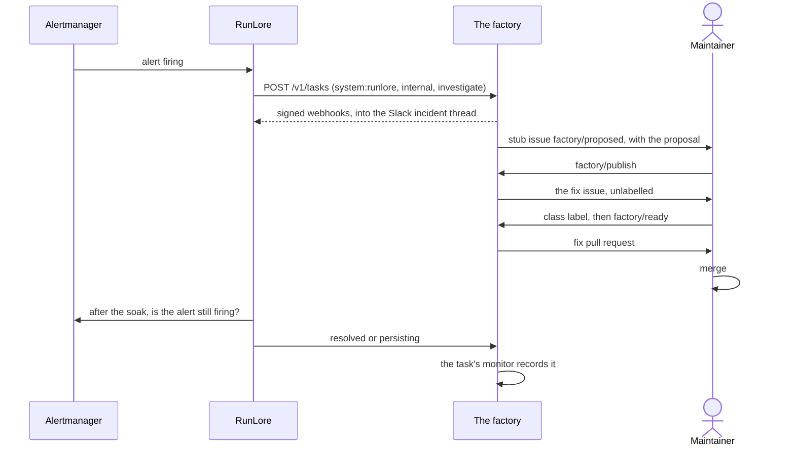

[RunLore](https://github.com/Smana/runlore) investigates alerts. With the factory it works agent to
agent, through the factory's standard API, as an internal principal with a sponsor, a cost ceiling and
a daily cap. One incident runs end to end: an alert, an `investigate` task, a proposal,
`factory/publish`, a fix pull request, its merge, a soak, and a verdict (`resolved` or `persisting`)
recorded on the task's monitor.

| You want to… | Do this |
|---|---|
| Publish RunLore's proposal | Read the proposal on the stub issue (`factory/proposed`), then label it **`factory/publish`**: the factory files the fix issue, unlabelled, with a footer naming its origin |
| Start the fix | Label the fix issue with its class (for an alerting rule, `class:alert-rules`), then `factory/ready` |
| Read the verdict | `kubectl get task <fix> -o jsonpath='{.status.monitor}'`: `resolved` is healthy |
| React to a fix that did not hold | `persisting` labels the pull request `factory/monitor:regression`, opens a follow-up stub, and pauses the class like any other regression; clear the pause as for any class |

The investigation stays internal: it runs on Claude, read-only, and starts no public work until a
maintainer labels the proposal. RunLore's link to the factory is off by default; an operator turns
it on in the host's RunLore configuration. Operator steps and keys:
[runbook 20](https://github.com/Smana/ai-native-ref/blob/main/docs/runbooks/agent-factory/20-runlore-agent-to-agent.md).
