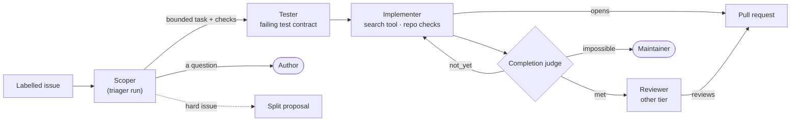

A task is a sequence of runs on one `agent/<task>` branch, in one room. Each run has one role, and
the role fixes what it may write and which models and tools it may call. Only the implementer and the
tester write. State as of 2026-10-30 is on the [status page]().



## The roles

| Role | What it does | Switched on by | Proven |
|---|---|---|---|
| Scoper | A read-only triager run that turns the issue into a bounded task (files, acceptance criteria, the check that proves it), or asks its author the question it could not answer and labels the issue `factory/needs-author` ([what you do then]()). For a hard issue it may propose a split | `loops.<class>.scope: scoper` | Live; its split, proven 2026-10-29 |
| Tester | Writes tests under the repository's test paths, which the harness runs red on the base, signs and pushes: the implementer's contract. It answers `not_testable` when the change has no testable behaviour, and the implementer then runs without a contract | `classes.<class>.testFirst: true` per repository, which needs `checks: true`; on `scripts` it is a session switch, off outside a live session ([#199](https://github.com/Smana/ai-native-ref/pull/199)) | Live |
| Implementer | The one writer of the code. Runs the repository's checks before it pushes, may ask the search tool, and cannot change the tester's contract: a head that does is refused (`contract_modified`): built, not yet read live | Always | Live; the holds built, not yet read live |
| Completion judge | Not a run: a fresh-context call through `/judge/v1` on the alias `loops.<class>.judge` (default `tier-light`), after the implementer ends. It says `met`, `not_yet` or `impossible` against the scoper's checks; a failing named check is never `met`. A `not_yet` continues the same conversation, at most `continuations` times, each continuation time-boxed to 15 minutes; an `impossible` escalates to a human ("cannot be done as asked") | `loops.<class>.judge` (with `stallSteps` or `continuations`) | Live |
| Search tool | Inside the implementer: a read-only child conversation on the run's own token with a hard budget (40 iterations, 300k tokens, 300 s, six a run) that answers one question about the repository | `loops.<class>.search: true` | Used live in one drill; value unmeasured |
| Reviewer | Runs on the other tier, reads the room but never the implementer's transcript, and records a verdict the broker posts on the pull request. Its verdict is a gate input: the merge gate refuses a head without an approving verdict (`no_approving_verdict`) | The template (`pair`, `trio`) | Live |
| Triager | Read-only. Alone in the `investigate` template: a RunLore finding becomes a proposed issue, never a change ([RunLore]()) | The task's source | Live |

The switches live in `tooling/base/agent-factory/helm-values-configmap.yaml`: `loops.<class>` rows for
the loop and scope keys, `repositories[].classes.<class>` for `checks` and `testFirst`. A row is read
whole, and a class without one runs as before. Every key and its bounds:
[harness reference]().

## What each role may call {#profiles}

Each role has one capability profile per data class, in
`infrastructure/base/agent-gateway/profiles/<role>.<public|internal>.yaml`. `scripts/ci/gen-capabilities.py`
compiles them into the gateway's rules, and a gate fails when the compiled rules drift from the profiles.

| A profile declares | Enforced by |
|---|---|
| `models`: the aliases the role may name. Only the public profiles list the provider aliases ([providers]()) | The gateway answers 403 to any other alias; the factory refuses, at admission, an internal run that names a public-only alias |
| `tools`: the MCP tools and arguments it may use. The reviewer cannot read the implementer's transcript, and no tool reads a Secret | The gateway, before the call reaches the MCP server |
| One model per run (P4) | The identity proxy pins every call, the judge's included, to the alias the run was created with |

To change what a role may call, edit its profile, regenerate the rules with `gen-capabilities.py --write` (it lives in `scripts/ci/`), and let
`task check` prove the compiled rules match.
