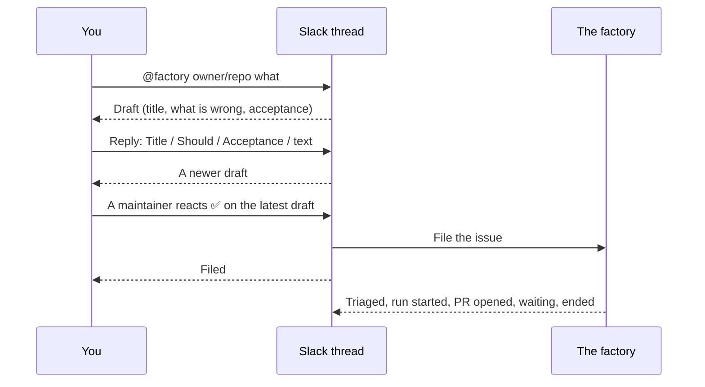

`maku-slack`, Maku's Slack app, turns a Slack thread into a factory task. Whether it is deployed on your
platform is on the [status page](). A mention drafts the issue, a reply edits it, a
maintainer's ✅ files it and starts the task, and the thread then follows the room. Approvals and
steering stay on the room page; the merge is your approval on GitHub.

| Step | Do this |
|---|---|
| Once | Mention `@factory link` in a served channel and confirm the one-time page it answers you with. `@factory unlink` undoes it |
| Draft | `@factory <owner/repo> <title>`, then optional lines: `Should:` and `Acceptance:` |
| Edit | Reply in the draft's thread: `Title:`, `Should:`, `Acceptance:` or free text. Each reply posts a newer draft |
| File | A maintainer reacts ✅ on the latest draft. The issue is filed, the task starts, and the thread shows its triage, runs, pull request and end |
| Act | Approve, answer or steer on the room page linked in the thread; approve the pull request on GitHub to merge it |

Setting it up (the Slack App, its keys, the machine user, the channels it serves) is the operator's:
[runbook 22](https://github.com/Smana/ai-native-ref/blob/main/docs/runbooks/agent-factory/22-slack.md),
and [runbook 18](https://github.com/Smana/ai-native-ref/blob/main/docs/runbooks/agent-factory/18-factory-interfaces.md)
for the sponsored principal and the webhooks it rides on.



## Link your Slack user, once

Before your ✅ files anything, the factory must know whose GitHub account you are. Mention **`@factory link`** in
a served channel: the App answers **only you** with a one-time link (valid 10 minutes, never send it to anyone).
Open it, sign in to the rooms page, and press **Link** after checking that the Slack user and your GitHub login
are yours. Your ✅ then files in the name of your **current** GitHub login, and only if it is a maintainer of the
repository. **`@factory unlink`** removes the link. Someone the operator lists in git keeps that entry.

## Write a mention

One line is enough:

```text
@factory acme/shop docs: the README's install link is dead
```

Add lines when you have more to say:

```text
@factory acme/shop docs: the README's install link is dead
The install section links to a page that was moved.
Should: point the link at the current install page.
Acceptance: README.md's install link returns 200.
```

| Part | Rule |
|---|---|
| Line 1 | `<owner/repo> <title>`. In a channel that serves one repository you may leave the repository out |
| Title | `docs: …`, `fix(agents): …`. Without an area, the App adds `docs: ` (when you mention a doc, runbook or README) or `chore: ` |
| Other lines | They become "What is wrong". With none, the title does |
| `Should:` (or `Expected:`, `Want:`) | What it should be |
| `Acceptance:` (or `Done when:`, `Check:`) | How we know it is done, up to the end of the message. Write one: an issue filed from Slack carries no `class:` label, so its task runs in the `review` class, which has no scoper to ask. Without it, the implementer and the reviewer work from the description alone |

Enter or Shift+Enter in Slack does not matter any more: type it as it comes.

## Edit the draft

Reply **in the draft's thread**. Only the person who wrote the mention can edit, and only until the issue
is filed. Each reply makes a new draft below the old one.

| Reply | Effect |
|---|---|
| `Title: docs: new title` | Replaces the title |
| `Should: …` | Replaces "What it should be" |
| `Acceptance: …` (or `Done when:`) | Replaces the acceptance check, several lines allowed |
| Any other text | Added to "What is wrong" |

## File it

A **maintainer reacts ✅** on the **latest** draft: hover the message, **Add reaction**, pick
`white_check_mark`. Typing ✅ as a message does not file anything yet (a fix is coming in a release);
react for now. One issue per thread: a second ✅ answers `Already filed` with the room link.

Then the thread shows, in this order:

| Line | Means |
|---|---|
| `Filed #N for @you; the factory starts it. Room: …` | The issue exists, and the room page link is yours to open |
| `Triaged.` / `A run started.` | The work is under way |
| `Pull request #… opened.` / `A review verdict is on #…` | A PR is ready for review |
| `The work waits for a human (…)` | The run needs an answer or an approval: open the room page |
| `#… merged.` / `#… reverted.` | The PR landed or was undone |
| `A budget was reached (…)` | The run hit its cap and stopped |
| `Ended, state: …` | The room is closed |

## What needs you, and where

| Need | Where |
|---|---|
| Merge a pull request | GitHub: approve its current head |
| Approve a step, answer a question, steer or stop | The room page (the link in the thread). Nothing you write in the thread reaches the run |
| Change the draft | The draft's thread, before the ✅ |

## When it says no

| You see | Why | Fix |
|---|---|---|
| `Draft refused: line 1 must be the repository, a space, then the title. Try: …` | The channel serves several repositories (or the line is malformed) and line 1 has none | Copy the `Try:` line, with the repository you mean (the list is in the message) |
| `Draft refused: …` (other text) | The issue template's rule, quoted from the factory (empty title, no area, a heading missing) | Fix what it names and mention again |
| `Draft not posted: it is too long to file from Slack` | The draft is over what Slack can carry | Shorten it, or file from the web UI |
| `Change refused: …` | A reply broke the same rules | Reply again with the fix |
| `This draft was replaced by a newer one: react on the latest draft.` | You reacted to an older draft | React on the last draft of the thread |
| `Not filed: not_linked` | Your Slack account is not linked to a GitHub login | Mention `@factory link` and confirm the page it answers ([runbook 22](https://github.com/Smana/ai-native-ref/blob/main/docs/runbooks/agent-factory/22-slack.md#6-who-may-file)) |
| `Not filed: not_a_maintainer` | Your linked login is not a maintainer | A maintainer reacts instead |
| `Not filed: max_cost_over_principal` / `principal_budget_exhausted` | The channel's cap or the App's day budget is over | Wait for the next day, or ask the operator |
| `Not filed: repository_not_allowed` | The factory does not accept that repository from Slack | Ask the operator ([runbook 22](https://github.com/Smana/ai-native-ref/blob/main/docs/runbooks/agent-factory/22-slack.md#5-declare-the-channel-in-git)) |
| `Not filed: the factory could not be reached, react again to retry` | A passing failure | React again |
| Nothing at all | The channel or repository is not served, or the bot is not in the channel | Invite `@factory`, check the channel with the operator |

The link needs your GitHub account linked to your ZITADEL user ([who sees a room]()); it
grants nothing a maintainer of the repository did not have, and the task is sponsored by your **current**
GitHub login. Users the factory's config lists by hand keep that entry whatever they link.

The task is filed by the factory App, with no label and a footer naming its sponsor; its Task names the
App and you. Its budget is the channel's `maxCostUSD`.
