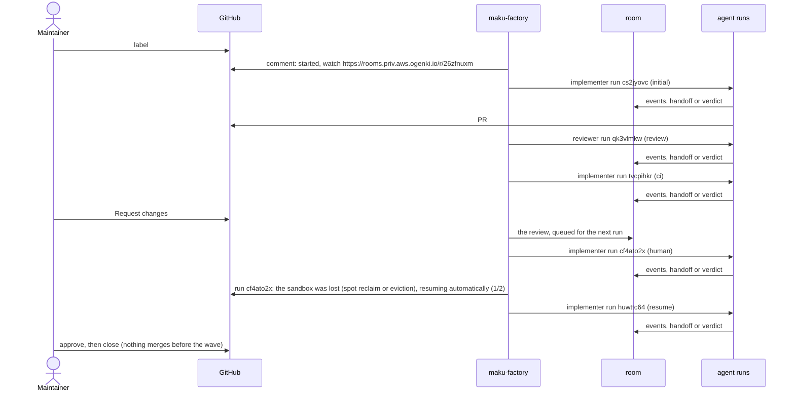
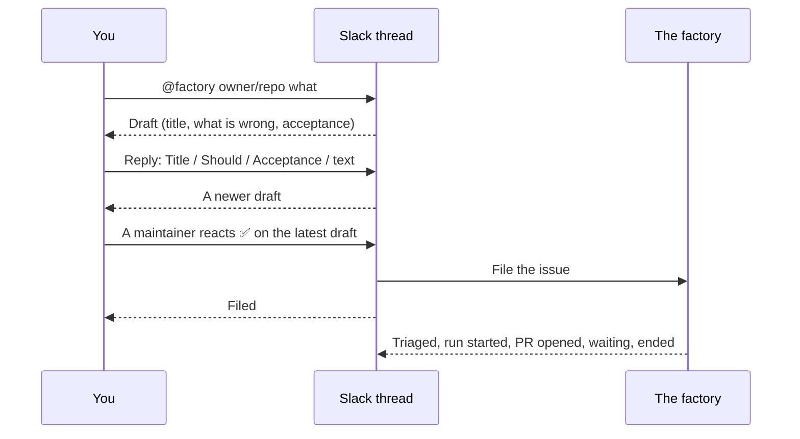


**On `main` (v2.0.1), for two public repositories; paused between releases while `gcp-0` is torn down:** you label, the
agents work, you review and merge. The merge gate is live for link fixes: it merges them with no human,
at most once a day. The task below ran on 2026-10-07, before v1's release. What has landed, and what
comes next, is on the
[status page]().


New to the vocabulary (run, role, sandbox, room)? Read
[the overview]() first; it takes two minutes.

## Before you start

| You need | Why |
|---|---|
| Access to the tailnet | The room UI, Grafana and the factory's API are private |
| Your OS trusting the platform's root CA | The room page and `maku` talk to private endpoints signed by it. Without it, `maku` fails with `x509: certificate signed by unknown authority`. Fetch and trust it as in [runbook 11's prerequisites](https://github.com/Smana/ai-native-ref/blob/main/docs/runbooks/agent-factory/11-v1-validation.md#prerequisites) |
| SSO membership in `agents-member` | To watch rooms and runs, and to start a run by hand. Requesting `internal` work or a `triager` run needs `agents-admin`. A valid login that still 403s on the room UI: see the [FAQ](#frequently-asked-questions) |
| Your GitHub account linked to your ZITADEL user | You see a room only if GitHub lets you read its repository: see [who sees a room](#who-sees-a-room) |
| Maintainer rights on the repository | Labels and reviews are how you steer. The agents never merge on their own, except for the low-risk classes below |
| `maku configure` then `maku login`, once ([commands](#from-a-terminal-maku)) | To follow tasks from a terminal or from your coding agent, and to start a run by hand: `task agent:run` sends the factory the token it prints, and the run is yours |

## What happens to a task

1. **You label the issue `factory/ready`.** The factory takes a snapshot of the issue, so a later
   edit does not change the task, and picks its class, its team and its budget. It comments that it
   started: the run, the branch `agent/<task>`, the budget and a *watch* link to the task's room.
2. **An implementer run works it** in its own sandbox, on that branch, and opens a pull request.
   The factory comments with the link.
3. **A reviewer run reviews it** and records a verdict in the room, which posts it on the pull
   request as one comment. The verdict is advice: it neither approves nor blocks.
4. **CI runs.** When it fails, an implementer run fixes it on the same branch.
5. **The factory waits for you**, and comments that the task needs a maintainer's review.
6. **You review on GitHub.** "Request changes" starts a revision: a new implementer run on the same
   branch, with your review in its brief. The factory comments that it is revising.
7. **A lost sandbox is resumed.** When a run's node is reclaimed or its pod evicted, the factory
   starts the run again on the same branch and in the same room, at most twice per task, and says
   so on the issue. A run that failed on its own is not resumed: the task waits for you.
8. **You approve, then merge or close.** Your approval is what the merge gate counts; outside the
   low-risk classes you merge yourself. The factory comments how the task ended and the tokens it
   used.

## One real task, end to end

Issue [#2238](https://github.com/Smana/cloud-native-ref/issues/2238), on `aws-0` on 2026-10-07: a
docs page listed the `victoria-logs-single` chart at 0.13.9 while the repository pins 0.13.10. The
maintainer's review, "Request changes", asked for a second fix on the same page. The pull request,
[#2239](https://github.com/Smana/cloud-native-ref/pull/2239), was approved, then closed unmerged:
nothing merges before the programme does.

<!-- Rendered by scripts/docs/factory-journey.py from the walkthrough's transcript. The script stamped
     the human steps when Enter was pressed, and buffered keystrokes moved them, so four times come
     from GitHub instead: the label 18:40:15 (the issue's labeled event), "Request changes" 19:11:30
     and the approval 19:24:42 (the PR's reviews), the close 19:26:00 (the PR's closedAt). -->

| Step | UTC | Minutes after the label |
|---|---|---|
| A maintainer labels the issue | 18:40 | 0 |
| The factory says it started | 18:40 | 0 |
| PR opened | 18:45 | 4 |
| A maintainer requests changes | 19:11 | 31 |
| The revision is pushed | 19:22 | 42 |
| A maintainer approves | 19:24 | 44 |
| Closed unmerged (before the wave) | 19:26 | 45 |

Runs: implementer (initial) → reviewer (review) → implementer (ci) → implementer (human) → implementer (resume). Template `pair`, tier `standard`, 1078k tokens in total.



### The reclaim

At 19:16 UTC an AWS Spot interruption reclaimed the node under the revision run `cf4ato2x`, after
it had pushed its fix. The run ended `Disrupted`, and the factory resumed it on its own. The issue
read:

> Agent factory task `26zfnuxm`: run `cf4ato2x` stopped because the sandbox was lost (spot reclaim or eviction); resuming automatically (1/2).

The resumed run, `huwttc64`, continued on the same branch and in the same room, and the task ended
normally.

Two reasons mark a run lost to the infrastructure, and the factory resumes both on its own, twice per
task at most and within its budget:

- `Disrupted`: its node was reclaimed or drained (a Spot or preemptible reclaim, an eviction, an upgrade);
- `PodLost`: its pod was deleted, or vanished with its node, before a final state was read.

The two resumes count per task: a `/factory retry` does not give them back. A lost review run
starts again without using a review round. A run that fails on its own reads `PodFailed` and is
not resumed. On the way out, within 15 s, an implementer commits its uncommitted changes to its
branch with the trailer `Agent-Checkpoint: disruption` and pushes them, so the resumed run starts
from that commit.

### What the factory wrote on the issue

The first comment, as posted:

```text
Agent factory task `26zfnuxm` started run `cs2jyovc` (implementer) on branch `agent/26zfnuxm`.

- Budget: 1.5 M tokens, 45 minutes (tier standard)
- Watch: https://rooms.priv.aws.ogenki.io/r/26zfnuxm (tailnet only)
- Stop: apply the label `factory/stop`
```

Then, one line each; every "started" comment carries the same budget, watch and stop lines as the first:

| UTC | Comment |
|---|---|
| 18:40 | Agent factory task `26zfnuxm` started run `cs2jyovc` (implementer) on branch `agent/26zfnuxm`. |
| 18:44 | Run `cs2jyovc` of task `26zfnuxm` opened #2239: https://github.com/Smana/cloud-native-ref/pull/2239 |
| 18:45 | Agent factory task `26zfnuxm` started run `qk3vlmkw` (reviewer) on branch `agent/26zfnuxm`. |
| 19:00 | Agent factory task `26zfnuxm` started run `tvcpihkr` (implementer) on branch `agent/26zfnuxm`. |
| 19:10 | Agent factory task `26zfnuxm` waits for a maintainer's review: the policy needs a maintainer's approval. |
| 19:11 | Agent factory task `26zfnuxm` is revising after @Smana's review: the next run starts on the same branch, with the review in its brief. |
| 19:11 | Agent factory task `26zfnuxm` started run `cf4ato2x` (implementer) on branch `agent/26zfnuxm`. |
| 19:18 | Agent factory task `26zfnuxm`: run `cf4ato2x` stopped because the sandbox was lost (spot reclaim or eviction); resuming automatically (1/2). |
| 19:18 | Agent factory task `26zfnuxm` started run `huwttc64` (implementer) on branch `agent/26zfnuxm`. |
| 19:26 | Agent factory task `26zfnuxm` was closed: the pull request was closed. Tokens used: 923 k. |

The closing comment's 923 k is what the factory had metered when the task closed; the task's final
tally is 1,078 k.

## What you can do

| You want to… | Do this |
|---|---|
| Hand over an issue | Label it **`factory/ready`** |
| Watch it work | Open the *watch* link in the "started" comment: every step of every run, their messages and the handoffs between roles |
| Ask for changes | A GitHub review with **"Request changes"**: the next run starts on the same branch with your review in its brief |
| Accept the work | **Approve** it: the merge gate counts a maintainer's approval. Outside the low-risk classes, merge it yourself |
| Try again after a failure | Comment **`/factory retry`** on the issue (a maintainer only) |
| Stop one task | Label its issue or pull request **`factory/stop`**: its runs are revoked, its branch stays |
| Stop every task | `kubectl -n agent-system create configmap agent-factory-stop`, or the label `factory/stop` on the pinned control issue. Intake pauses, every run is revoked and new runs are refused, runs started by hand included |
| Undo a merged low-risk change | *(Once the merge gate is live)* Label it **`factory/revert`** within 7 days: the factory opens the revert, which merges as the `revert` class |
| Start a run by hand | `task agent:run -- --role implementer --class public --task-url <issue>`. The factory creates it under your SSO identity |
| Resume a run a stop ended | The same command with **`--branch agent/<run id>`**: it continues from what the run pushed |

### Hand off from your coding agent

From Claude Code, OpenCode or another terminal coding agent you hand a side task to the factory,
follow it and bring its branch back without leaving the session. The broker renders the views once,
so every client shows the same text ([ADR-0059]()).

**Set it up.** It needs `maku` v0.30.0 or later (`roomctl` v0.23.1 or later before the rename), configured and logged in (see
[From a terminal](#from-a-terminal-maku)), then three steps:

1. **Install for your client.** `setup` is user-level: it registers `maku mcp` as the `factory`
   MCP server and writes the `factory-handoff` skill where that client reads skills. One command
   each:

   | Client | Command |
   |---|---|
   | Claude Code | `maku setup claude` |
   | OpenCode | `maku setup opencode` |
   | Codex CLI | `maku setup codex` |
   | Gemini CLI | `maku setup gemini` |
   | Cursor | `maku setup cursor` |
   | Copilot CLI | `maku setup copilot` |

2. **Check the set-up.** `maku doctor`: every check `ok`.
3. **Verify in the client.** A working registration lists the tools `rooms_list`, `room_summary`,
   `room_changes`, `room_wait`, `room_checkout`, `issue_draft`, `issue_file` and the prompts
   `handoff`, `status`, `inbox`.

`setup`'s options and caveats:

- `--project` writes both into the repository instead, for a team that commits them (Copilot's
  project MCP config is the `mcp.json` file in the repository's `.github` folder).
- `--print` shows every command and file without doing anything.
- It is idempotent.
- It runs the client's own `mcp add` when that is on the PATH and otherwise prints the snippet to
  paste: it never edits a config file itself.
- Gemini CLI connects a local (stdio) server only in a folder you trust; `maku setup gemini`
  reminds you.

| You say | What happens |
|---|---|
| `/factory:handoff fix the dead link in runbook 04` | The agent drafts the issue, one defect per issue; a form shows it to you, files it and, where the repository allows, offers to start it |
| `/factory:status [room or #issue]` | The room card below. Without an argument, your most recently updated room |
| `/factory:inbox` | The rooms that need you first, then your other open rooms |
| "wait for it" | `room_wait` follows the room from your machine and returns when it needs you, opens a pull request or ends. A client with background tasks runs it there |
| "check it out" | `room_checkout` creates a new git worktree beside the repository, at the commit it checked, and returns its path |

The slash command is spelled the client's way (`/factory:handoff` in OpenCode,
`/mcp__factory__handoff` in Claude Code).

**What you see.** The same card in a terminal (`maku status`) and in the agent's transcript:

```markdown
### 26zfnuxm · #2238 docs: chart version is wrong
**needs you** · waiting for a human · Smana/cloud-native-ref · [open the room](https://rooms.example/r/26zfnuxm)

| | |
|---|---|
| Run | implementer `cf4ato2x` (your review) · started 19:11 UTC, 8 min ago |
| Spend | $0.31 of $1.50 (21 %) · 182 k tokens |
| PR | [#2239](https://github.com/Smana/cloud-native-ref/pull/2239) · reviewer approved at 18:49 UTC |
| Next | the run continues once the push is approved |

**Needs you**
1. approve `git push to agent/26zfnuxm` by 19:30 UTC → [decide in the room](https://rooms.example/r/26zfnuxm#approval-a1)

**Runs** implementer (initial) succeeded · 4 min · $0.08 → reviewer approved · 3 min · $0.04 →
implementer (ci) succeeded · 6 min · $0.11 → implementer (your review) **running** · 8 min · $0.08

**Agents' notes**, their claims, not checked
- 19:12 `cf4ato2x` `found both versions on lines 12–13, fixing`
- 19:14 `cf4ato2x` `edit done, running checks`

**You can** queue a note for the next run · stop it with the label `factory/stop` · fork it
```

A room is in one of seven states, shown as words: `needs you` (only when an item names you),
`waiting for a human`, `running`, `queued`, `done`, `failed` or `stopped`.

**What stays on the room page.** Approvals and steering
([ADR-0049]()). Approvals stay on
the room page: the card links to each one, and a client that offers link forms opens it for you.
`room_wait` wakes on your own needs, then waits again once you have decided.

**Safety.**

- The start is a form field, never a tool argument: your agent can call `issue_file` but cannot
  answer the form. It is offered only on repositories the platform lists, where you can write, and
  starting applies `factory/ready` with your own `gh`. A client that cannot show forms is refused
  and the agent shows you the draft to file yourself.
- A checkout that changes agent or editor config, hooks, symlinks or non-ASCII paths asks first, and
  is refused when the client cannot ask.
- Everything an agent wrote comes back in code spans, as data: a note never becomes a link, a
  heading or a terminal escape, and it is never an instruction.

**Per client.** Text views work everywhere. The rest depends on what each client declares at
`initialize`; each cell below comes from the
[research](https://github.com/Smana/ai-native-ref/blob/main/docs/superpowers/specs/2026-10-25-factory-from-your-agent-research.md#2-what-an-mcp-integration-can-rely-on-per-client)
and the `setup` source, and `unconfirmed` means no fetched source says. Claude Code and OpenCode
are **documented** until the live session proves them (`docs/runbooks/agent-factory/19-factory-from-your-agent.md`).

| Client | Tools and text views | Forms | URL forms | Slash commands | Background wait | Skill directory | Status |
|---|---|---|---|---|---|---|---|
| Claude Code | yes | unconfirmed | yes | `/mcp__factory__<prompt>` (unconfirmed) | background subagents | `~/.claude/skills` | documented |
| OpenCode | yes | yes | yes | `/factory:<prompt>` | background subagents | `~/.agents/skills` | documented |
| Codex CLI | yes | unconfirmed | unconfirmed | unconfirmed | unconfirmed; calls may be cut at 60 s, the skill calls `room_wait` again | `~/.agents/skills` | documented |
| Gemini CLI | yes | unconfirmed | unconfirmed | yes | unconfirmed | `~/.gemini/skills` | documented |
| Copilot CLI | yes | unconfirmed | unconfirmed | unconfirmed | unconfirmed | `~/.copilot/skills` | documented |
| Cursor | yes | yes | unconfirmed | yes | unconfirmed | `~/.cursor/skills` | documented |

Without forms the draft is shown for you to file with `gh`, nothing starts, and a checkout that
needs to confirm refuses. Before this existed, issue
[#2266](https://github.com/Smana/cloud-native-ref/issues/2266) was filed by the skill on 2026-10-08 and
merged as [#2267](https://github.com/Smana/cloud-native-ref/pull/2267).

Starting from the session is off until a repository is listed in the broker's
`human.mcp.sessionStart`; today none is.

### From a terminal: `maku`

`maku` (named `roomctl` before v0.30.0) reads, chats, queues and forks. It never steers, interrupts, takes the driver token or
approves: those stay in the web view, because a local agent can drive a terminal
([ADR-0049]()). Download it from an
Maku release (`maku-<os>-<arch>`, checked against `maku.sha256`) or build it there
with `go build ./cmd/maku`.

```bash
maku configure --url … --issuer … --client-id … --project-id …  # the room list's "CLI setup" prints it
maku login                                    # device flow: open the URL, enter the code
maku rooms --mine                             # issues you filed or labelled, PRs you authored or review
maku rooms --needs-me                         # an approval you could decide; --repo owner/name filters
maku status <room> --json                     # phase, run, budget, PR, what needs you, the agents' notes
maku changes <room>                           # what changed since your last call (first call: 24 h)
maku checkout <room>                          # the room's branch in a new worktree beside the repository
maku setup claude                             # the MCP server and the skill, for a coding agent
maku watch <room>                             # the last 50 events, then live
maku post <room> --queue "address L42"        # for the next run's brief; without --queue, a chat
maku fork <room> --at <seq> --role implementer --egress pypi --note "try uv"
maku token                                    # your access token, for scripts
```

A task waiting for your merge is not under `--needs-me` yet
([maku#51](https://github.com/Smana/maku/issues/51)).

### Who sees a room

You see a room only if GitHub lets you read its repository; `agents-admin` sees every room. The
broker reads the GitHub account linked to your ZITADEL user, asks GitHub for its permission on the
room's repository, and keeps the answer for 5 minutes: a grant or a revocation takes effect within
that. A room you cannot read answers 404, as if it did not exist, and when GitHub cannot be asked
the broker refuses once its cached answer expires.

Link your GitHub account once: sign in at `https://auth.gcp.cloud.ogenki.io`, choose **GitHub**, and link
it to your existing user. If you sign in with Google only, that flow ends on a password reset: ask an
admin to add the link, which takes one command:

```bash
IDP_URL=https://auth.gcp.cloud.ogenki.io scripts/provision/zitadel-idp.sh link-github \
  <your-zitadel-login> <your-github-login> --cluster gcp-0 --cloud gcp --apply
```

Until the link exists, `maku rooms` lists nothing and says how to link; once it does, the hint
goes away when the broker's cached answer expires, within 5 minutes.

### The room page

From top to bottom:

1. **Status**: phase, run and role, budget, PR, last verdict.
2. **Needs you**, only when something does: an approval, its deadline and its button.
   `…/r/<room>#<approvalId>` scrolls to that approval.
3. **What you can do now**: queue a note, steer if you hold the driver token, stop. Only what your
   standing allows; a watcher sees none of it.
4. **Progress notes**, the agents' own claims, labelled as such.
5. **The raw event stream**, folded.

## When the factory asks a question {#scoper-question}

With the scoper on for a class (off everywhere today), the factory reads an issue before it writes any
code. When the issue leaves a question open, it comments on the issue with the question, the
assumption it would make otherwise, and the label `factory/needs-author`; no run starts.

| You want to… | Do this |
|---|---|
| Answer it | Edit the issue's title or body, then a maintainer re-applies `factory/ready`. The factory reads the issue as it was labelled, never its comments |
| Proceed on its assumption | A maintainer comments `/factory retry` |
| Do nothing | The task stops after 7 days |

Comments are never read as an answer: a reply posted under the question changes nothing.

**Steering notes.** A maintainer writes one short note per class in the target repository's default
branch, `.github/agent-factory/steering/<class>.md`: at most 2 KiB, at most three `##` modules, one of
them `## Verify` with at least one item (the checks that prove the work). The factory reads it at triage
and puts it in the implementer's brief. This repository's [suite](https://github.com/Smana/ai-native-ref/blob/main/scripts/ci/tests/test-agent-steering.py)
applies the factory's own rule to every note.

## When the factory proposes a split {#split}

With the splitter on for a class (off everywhere today, and only beside the scoper), a hard issue may
come back with a plan instead of a run: two to four parts, each with its own acceptance checks. The
factory comments on the issue with the plan, labels it `factory/split-proposed` and waits. No part
exists yet.

| You want to… | Do this |
|---|---|
| Approve the plan | A maintainer comments **`/factory split`**. The approver pays for every part |
| Run the whole issue as one task | A maintainer comments **`/factory retry`** |
| Change the issue and plan again | Edit the issue, then a maintainer re-applies `factory/ready`: the scoper may split again |
| Stop every part | `factory/stop` on the parent issue |

After an approval the parts open one at a time, as sub-issues titled `Part k of N of #p`. Each part is
a pull request through `pair` and the class's merge gate. The next part opens when the previous one has
merged, and the parent closes on the last merge. A part that stops waits for a re-label or a close; a
part closed without landing ends the family and the remaining parts are never created.

## Using the factory from Slack {#from-slack}

With the factory's Slack App on (off today, and one workspace's), a thread can hand work to the factory
without leaving Slack. You write a mention, the App drafts the issue, you tune the draft by replying,
and a maintainer's check mark files it. Approvals and steering stay on the room page. Setting the App up
is the operator's job: [runbook 22](https://github.com/Smana/ai-native-ref/blob/main/docs/runbooks/agent-factory/22-slack.md).



### Link your Slack user, once

Before your ✅ files anything, the factory must know whose GitHub account you are. Mention **`@factory link`** in
a served channel: the App answers **only you** with a one-time link (valid 10 minutes, never send it to anyone).
Open it, sign in to the rooms page, and press **Link** after checking that the Slack user and your GitHub login
are yours. Your ✅ then files in the name of your **current** GitHub login, and only if it is a maintainer of the
repository. **`@factory unlink`** removes the link. Someone the operator lists in git keeps that entry.

### Write a mention

One line is enough:

```text
@factory Smana/ai-native-ref docs: runbook 18 never says where the key lives
```

Add lines when you have more to say:

```text
@factory Smana/ai-native-ref docs: runbook 18 never says where the key lives
The runbook names the factory's API but not where its key is stored.
Should: say which Secret holds it.
Acceptance: docs/runbooks/18.md gains one line naming the Secret.
```

| Part | Rule |
|---|---|
| Line 1 | `<owner/repo> <title>`. In a channel that serves one repository you may leave the repository out |
| Title | `docs: …`, `fix(agents): …`. Without an area, the App adds `docs: ` (when you mention a doc, runbook or README) or `chore: ` |
| Other lines | They become "What is wrong". With none, the title does |
| `Should:` (or `Expected:`, `Want:`) | What it should be |
| `Acceptance:` (or `Done when:`, `Check:`) | How we know it is done, up to the end of the message. Without one, the factory's scoper asks on the issue |

Enter or Shift+Enter in Slack does not matter any more: type it as it comes.

### Edit the draft

Reply **in the draft's thread**. Only the person who wrote the mention can edit, and only until the issue
is filed. Each reply makes a new draft below the old one.

| Reply | Effect |
|---|---|
| `Title: docs: new title` | Replaces the title |
| `Should: …` | Replaces "What it should be" |
| `Acceptance: …` (or `Done when:`) | Replaces the acceptance check, several lines allowed |
| Any other text | Added to "What is wrong" |

### File it

A **maintainer reacts ✅** on the **latest** draft: hover the message, **Add reaction**, pick
`white_check_mark`. Typing ✅ as a message does not file anything yet (a fix is coming in a release);
react for now. One issue per thread: a second ✅ answers `Already filed` with the room link.

Then the thread shows, in this order:

| Line | Means |
|---|---|
| `Filed #N for @you; the factory starts it. Room: …` | The issue exists, and the room page link is yours to open |
| `Triaged.` / `A run started.` | The work is under way |
| `Pull request #… opened.` / `A review verdict is on #…` | A PR is ready for review |
| `The work waits for a human (…)` | The run needs an answer or an approval: open the room page |
| `#… merged.` / `#… reverted.` | The PR landed or was undone |
| `A budget was reached (…)` | The run hit its cap and stopped |
| `Ended, state: …` | The room is closed |

### What needs you, and where

| Need | Where |
|---|---|
| Merge a pull request | GitHub |
| Approve a step, answer a question, steer or stop | The room page (the link in the thread). Nothing you write in the thread reaches the run |
| Change the draft | The draft's thread, before the ✅ |

### When it says no

| You see | Why | Fix |
|---|---|---|
| `Draft refused: line 1 must be the repository, a space, then the title. Try: …` | The channel serves several repositories (or the line is malformed) and line 1 has none | Copy the `Try:` line, with the repository you mean (the list is in the message) |
| `Draft refused: …` (other text) | The issue template's rule, quoted from the factory (empty title, no area, a heading missing) | Fix what it names and mention again |
| `Draft not posted: it is too long to file from Slack` | The draft is over what Slack can carry | Shorten it, or file from the web UI |
| `Change refused: …` | A reply broke the same rules | Reply again with the fix |
| `This draft was replaced by a newer one: react on the latest draft.` | You reacted to an older draft | React on the last draft of the thread |
| `Not filed: not_linked` | Your Slack account is not linked to a GitHub login | Mention `@factory link` and confirm the page it answers ([runbook 22](https://github.com/Smana/ai-native-ref/blob/main/docs/runbooks/agent-factory/22-slack.md#6-who-may-file)) |
| `Not filed: not_a_maintainer` | Your linked login is not a maintainer | A maintainer reacts instead |
| `Not filed: max_cost_over_principal` / `principal_budget_exhausted` | The channel's cap or the App's day budget is over | Wait for the next day, or ask the operator |
| `Not filed: repository_not_allowed` | The factory does not accept that repository from Slack | Ask the operator ([runbook 22](https://github.com/Smana/ai-native-ref/blob/main/docs/runbooks/agent-factory/22-slack.md#5-declare-the-channel-in-git)) |
| `Not filed: the factory could not be reached, react again to retry` | A passing failure | React again |
| Nothing at all | The channel or repository is not served, or the bot is not in the channel | Invite `@factory`, check the channel with the operator |

The link needs your GitHub account linked to your ZITADEL user ([who sees a room](#who-sees-a-room)); it
grants nothing a maintainer of the repository did not have, and the task is sponsored by your **current**
GitHub login. Users the factory's config lists by hand keep that entry whatever they link.

The task is filed by the factory App, with no label and a footer naming its sponsor; its Task names the
App and you. Its budget is the channel's `maxCostUSD`.

## What the factory never does

| Never | What enforces it |
|---|---|
| Merge anything but a `docs-links` change or its revert | policy-bot evaluates `.policy.yml` from `main`; the `agent-merge` ruleset lets only the merger App merge, and only once that check passes ([ADR-0045]()) |
| Touch a gate path: CI, the rulesets, the merge policy, the agent platform's own manifests | `.policy.yml` lists every gate path in every agent rule: a pull request that touches one matches no rule, policy-bot reports an error, and it cannot merge |
| Take a principal from a request body | The run-request API takes the principal from your SSO token, never from the body, and the Kyverno policy `agentrun-one-creator` admits no `AgentRun` creator but the factory |
| Start public work from an internal finding on its own | An `investigate` task is the triager alone. It ends on a proposed public issue, which starts nothing until a maintainer labels it ([ADR-0048]()) |

## Budgets and costs

A task runs within limits it cannot raise:
- **Each run has a deadline and a token budget**, set by the task's tier: `light` 20 minutes and
  300 k tokens, `standard` 45 minutes and 1.5 M, `frontier` 90 minutes and 4 M. The run meter
  revokes a run at its cap, runs started by hand included.
- **Each task has a token cap**, twice its tier's run budget, and a resume needs room for a whole
  run under it.
- **The factory takes at most 20 tasks a day, and works at most 3 at once.** Past the daily cap, a
  labelled issue is refused, with a comment saying why.

Every model call is metered per run at the gateway, so the dashboard shows what a task cost.

---

## Observability: what you can inspect

| Question | Where |
|---|---|
| Where is my run? | `kubectl get agentrun -n agents`, or the `agent-run` dashboard's status panel: phase, reason, PR, tokens against budget |
| What did it do? | The step log, in `kubectl logs` or on the dashboard, with every gateway and MCP call of that run |
| What did it cost, how fast was it? | The dashboard: tokens in and out, cost, model latency, error rate. `agent-fleet` shows every run |
| Where did the time go? | A trace per run: steps, model calls and tool calls, with timings. Metadata only: no prompts or outputs |

A run's page is `/d/agent-run/agent-run?var-run=<id>`; its *This run's window* link sets the time
range to the run. A successful task run shows its pull request, a room's run links its room and its
branch's pull requests; the outcome reason appears only when a run fails. A resumed run counts each
step once and has one trace per attempt. One known issue: MCP tool calls are not yet joined to
the run's trace ([F16](https://github.com/Smana/ai-native-ref/blob/main/docs/runbooks/agent-factory/11-v1-validation.md#live-findings)).

The full transcript (prompts and outputs) lives in the room, visible to the people with access to
that room. It holds a run to its end: before the harness stops, even when its node is reclaimed, it
asks maku-bridge to read its log to the last event
([F11](https://github.com/Smana/ai-native-ref/blob/main/docs/runbooks/agent-factory/11-v1-validation.md#live-findings), fixed and verified on `aws-0` on 2026-10-07).

## Frequently asked questions

**Can an agent merge to `main`, or push anywhere else?**
No. Its GitHub App may push only `agent/**` branches and no tags, enforced by two repository rulesets. Merging is
the human's, except for the two low-risk classes above, which go through a separate App.
That confinement is per repository, not per run: every run pushes as the same App, so one run can
push to another's `agent/**` branch. The footer is provenance, never authorisation: the merge gate
merges only the commit the task's own run reported in its room, with every reviewer approval naming
that commit.

**Can it read our secrets?**
The sandbox holds no long-lived credential. Its GitHub token is minted per run, scoped to one
repository and one role, and revoked when the run ends (at worst it expires within an hour). Model and
tool calls carry a run token that the gateway verifies. It has no access to Kubernetes Secrets. An
`internal` run can read logs and pod specs over the read-only MCP tools, and those can contain
secrets.

**Can it reach the internet?**
Only the hosts its network policy names: GitHub, the gateway and, with `--profiles`, package
registries. Everything else is dropped.

**What if it loops or goes off track?**
Its deadline or the run meter ends it, and you can delete it. The stop ConfigMap ends every task.
Every step is in the step log, the room and the trace.

**Why gVisor?**
The agent runs arbitrary commands. gVisor answers their system calls in user space, so a kernel
exploit hits gVisor, not the node. Escaping takes a gVisor bug as well; the node pool is dedicated
and tainted to limit what that would reach.

**I logged in with SSO and the room UI still gives me a 403. Why?**
oauth2-proxy and the broker admit a token only when its `groups` claim names `agents-member` or
`agents-admin`. A 403 after a valid login means the claim names neither, and two things put it there:

1. the `groupsFromRoles` ZITADEL Action, which turns your project roles into that claim. A broken
   or edited Action drops it from every token;
2. a grant of one of those roles to your user. A fresh ZITADEL holds no grants (gcp-0 mints one
   every build), and a user exists only after their first login, so log in once, then run
   `scripts/provision/zitadel-oidc-clients.sh --grant agents-member=<your email>` (or
   `agents-admin=` to own and approve).

Check the Action first (it fails for everyone at once), then your grant (it fails for you alone).
