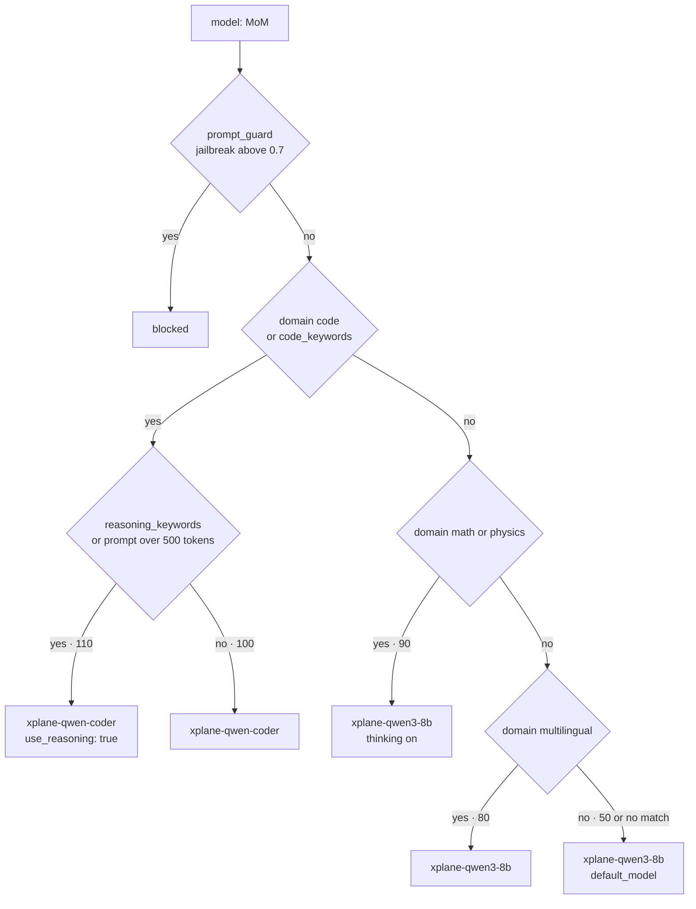
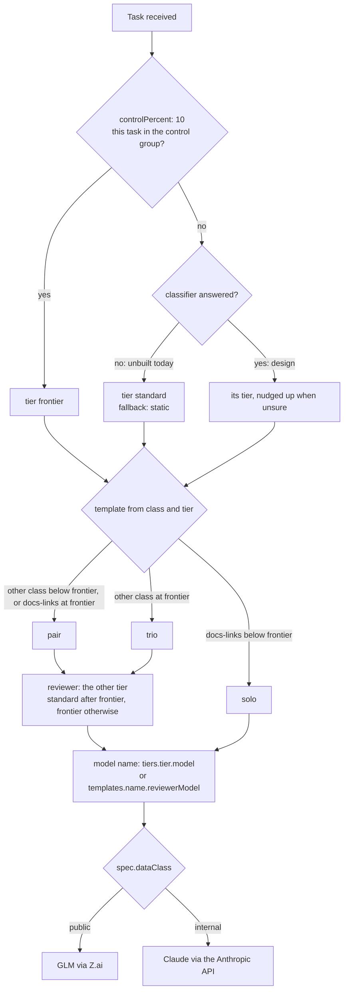
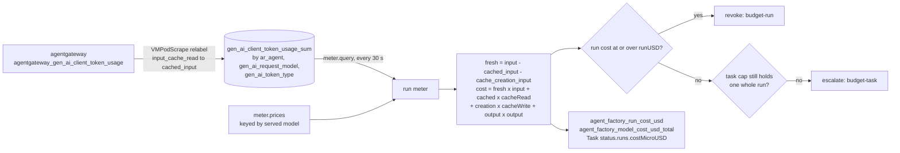
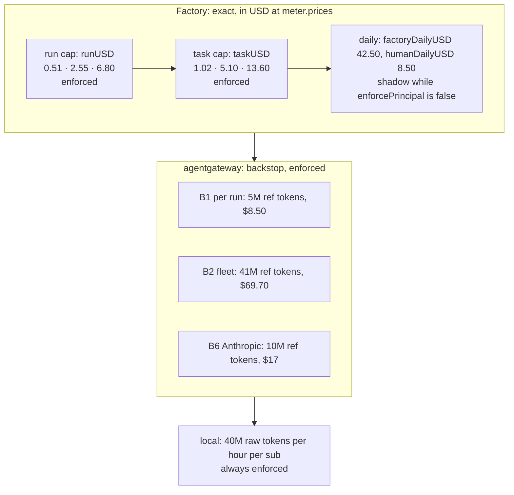

**Today, routing is static. Prompt caching drives the bill, and the model decides the outcome.**
An agent run gets one model from its data class (GLM-5.3 for `public`, Claude Opus 5.5 for
`internal`), whatever its tier. The tier sets the run's caps and its team, not its model. Nothing
classifies a task yet: every task is triaged `standard` by the static fallback, and 10% go to
`frontier` as a control group. On `gcp-0`, 95% of the input tokens agents sent in the last 24 hours
were cache reads, which cut the bill about fourfold. On harder tasks the model changed the outcome
more than any routing could: Claude was accepted on 13 of 15 issues, GLM-5.3 on none, in either
harness.

This page owns the routing, tuning and cost angle. How the gateways authenticate and what they
carry is on [Gateways](). What runs where
is on [Status](), which wins over this page if
the two disagree.


**Figures dated 2026-10-18.** Live numbers come from read-only queries against `gcp-0`'s
VictoriaMetrics and its `Task` objects on 2026-10-18 (11:40 UTC). `gcp-0` had run the factory for
about 17 hours, so "24 h" and "7 d" windows cover the same traffic. Prices are the list prices the
repository pins, read on 2026-10-16.


## What is real today {#state}

| Piece | State on `gcp-0`, 2026-10-18 | Source |
|---|---|---|
| Agent model per data class (`public` → Z.ai, `internal` → Anthropic) | **Deployed, proven live** | [ADR-0054](), status *Landed* |
| `tier-light`, `tier-standard`, `tier-frontier` served by the agent gateway | **Deployed**. No factory tier asks for them: every tier names `agent-default` | `llm.yaml`, `anthropic.yaml`, factory values |
| Triage classifier (`complexity-classifier`, C7) | **Design only**. The URL is configured and nothing answers it, so every task falls back to `standard` with `classifier: static` | factory values, live `Task` status |
| 10% control group at `frontier` (`triage.controlPercent`) | **Deployed, live**: 2 of 12 tasks | live `Task` status |
| Run meter priced in USD, cache reads at their own rate | **Deployed, proven live** | [plan, internal run](https://github.com/Smana/ai-native-ref/blob/main/docs/superpowers/plans/2026-10-15-agent-router-agentgateway-plan.md#live-evidence-internal-run-2026-10-16) |
| Gateway budgets B1, B2, B6 | **Deployed, enforced** since 2026-10-18: a call over its bucket is refused `429` | [runbook 04, Part D](https://github.com/Smana/ai-native-ref/blob/main/docs/runbooks/agent-factory/04-gateway-secrets-budgets.md#part-d--enforcing-the-agents-budgets) |
| `ai-gateway` with `tier-frontier` (GLM-5.3) | **Deployed**, CPU only | `aigatewayroute.yaml` |
| Semantic Router `MoM` cascade | **Deployed but idle**: the router pod runs, and `llm-platform` is suspended, so no vLLM model exists to route to | `kubectl get ks llm-platform`: no status, suspended |
| SR `complexity` signal, PII-gated frontier escalation, SR fail-open | **Design only** (SP4 PR 4: SR 0.3.0) | [SP4 design §2](https://github.com/Smana/ai-native-ref/blob/main/docs/superpowers/specs/2026-09-23-llm-complexity-routing-design.md#2-complexity-signal-for-chat-mom) |
| LoRA canary on `xplane-qwen-coder` | **Built**, serves only while `llm-platform` runs | `apps/base/ai/llm/qwen-coder.yaml` |
| Endpoint picker (Gateway API Inference Extension) | **Built, enabled on no claim** | [serving known gaps]() |

## Every routing decision, end to end {#decision-points}

There are two callers and seven decisions. Only two of the seven look at the prompt: the Semantic
Router on `MoM`, and the planned triage classifier (once per task, never per request).

```mermaid
flowchart TB
  subgraph human["Humans and coding clients: ai-gateway (Envoy AI Gateway)"]
    C["Client: OpenCode, Continue, OpenWebUI, promptfoo"] -->|"model: name or MoM"| SR{"1 · Semantic Router<br/>only when model is MoM or auto"}
    SR -->|"rewrites body.model"| XM["x-ai-eg-model header"]
    C -->|"explicit name, no classification"| XM
    XM --> AR{"2 · AIGatewayRoute<br/>header match"}
    AR -->|"tier-frontier"| ZAI1["Z.ai glm-5.3"]
    AR -->|"xplane-qwen-coder"| CAN{"3 · LoRA canary<br/>90 / 10 weights"}
    AR -->|"other xplane-*"| V["vLLM Service"]
    CAN --> V
  end
  subgraph agent["Agent runs: agentgateway agent-router"]
    I["Issue labelled factory/ready"] --> T{"4 · Triage, once per task<br/>tier and template"}
    T --> R{"5 · Role<br/>reviewer takes the other tier"}
    R -->|"tiers.tier.model or reviewerModel"| N["Logical name<br/>agent-default, tier-*"]
    N --> D{"6 · Data class<br/>audience picks the listener"}
    D -->|"public :8080"| AL1{"7 · modelAliases"}
    D -->|"internal :8081"| AL2{"7 · modelAliases"}
    AL1 --> ZAI2["Z.ai glm-5.3, flashx, flash"]
    AL2 --> ANT["Anthropic opus-5-5, sonnet-5-5, haiku-5-5"]
  end
```



| # | Decision | Decided by | When | Input | Tuned in |
|---|---|---|---|---|---|
| 1 | Which local model answers `MoM` | Semantic Router, `ext_proc` at filter index 0 | Per request | The prompt: domain classifier, keywords, length | `infrastructure/base/vllm-semantic-router/helmrelease.yaml` |
| 2 | Which backend a model name reaches | `AIGatewayRoute` rule on `x-ai-eg-model` | Per request | The model name only | `infrastructure/base/llm-gateway/aigatewayroute.yaml`; claims with `gateway.enabled` |
| 3 | Base model or LoRA adapter | Route weights rendered from `gateway.canaries` | Per request, random | None | `apps/base/ai/llm/qwen-coder.yaml` |
| 4 | A task's tier and template | Factory triage | Once, in `Received` | The classifier's tier (static fallback today), the class, `controlPercent` | `tooling/base/agent-factory/helm-values-configmap.yaml` |
| 5 | The model name a role asks for | The factory | Per run | Tier, role, template | same file: `tiers`, `templates.<name>.reviewerModel` |
| 6 | Which provider may see the data | The run's token audience | Per run, fixed | `spec.dataClass` | the task (`investigate` forces `internal`) |
| 7 | Which provider model a name means | `modelAliases` on the backend | Per request, static | The name | `infrastructure/base/agent-gateway/llm.yaml`, `infrastructure/base/agent-gateway/anthropic.yaml` |

Decisions 4–7 are pinned by design: every name maps to one model at weight 100, with no fallback
and no canary, so nothing re-routes a run mid-trajectory. Escalation is a new run at another tier,
never a gateway failover ([SP4 S7, S8](https://github.com/Smana/ai-native-ref/blob/main/docs/superpowers/specs/2026-09-23-llm-complexity-routing-design.md#decisions)).

## Serving side: `ai-gateway` {#serving-routing}

### The `MoM` cascade as configured

Semantic Router 0.2.0 (`flux/sources/ocirepo-vllm-semantic-router.yaml`) still uses the v0.2
schema. A ModernBERT domain classifier maps the prompt to an MMLU category, keyword and length
rules add evidence, and the highest-priority decision that matches wins:



| Signal | Configured | Effect on routing today |
|---|---|---|
| `domain` (MMLU categories) | 5 categories: `math`, `physics`, `code`, `multilingual`, `other` | Picks the model. `multilingual` maps to `philosophy` and `law`, a proxy rather than a language detector |
| `keyword` | `code_keywords` (16 terms: `kubectl`, `yaml`, `debug`…), `reasoning_keywords` (12: `why`, `explain`, `compare`…) | Code keywords catch what the classifier misses. Reasoning keywords turn on chain-of-thought, the dearest knob in tokens |
| `context` | `long_query`: 500 to 32,000 tokens | Turns on reasoning for long code prompts |
| `jailbreak` (`prompt_guard`) | threshold 0.7 | Blocks. A filter, not a route |
| `pii` | model loaded, threshold 0.7, every model `allow_by_default: true` | **None**: no decision reads it |
| `complexity` | not configured | **None**. Designed (SP4 S5) as a hard–easy margin of 0.12. The documented 0.70–0.75 never fires, because the margin stayed at or below 0.197 in tests ([semantic-router#3246](https://github.com/vllm-project/semantic-router/issues/3246)) |
| `semantic_cache` | **off** | Would answer from a similar past prompt. Off because tool-calling clients' prompts all look alike, and a cached error re-poisons every retry |

**Two behaviours to know before you rely on `MoM`.**

- **It sits in front of every request, and fails closed.** The filter is on the `http` listener,
  not only on `MoM`, and has no `failure_mode_allow`, with a 60 s `message_timeout`
  (`infrastructure/base/envoy-ai-gateway/envoypatchpolicy-semantic-router.yaml`). An unreachable
  router fails every request on that listener, `tier-frontier` included (SP4 R13). A router that
  is up but not rewriting lets `MoM` reach vLLM, which answers 404 for an unknown model (the
  HelmRelease's own note). The fix is SP4 PR 4, not built: two replicas, a PDB, and fail-open
  with a 2 s timeout.
- **Classification costs about 250–300 ms**
  ([gateways]()). A
  client that knows its model names it, and the router passes it through untouched. FIM traffic
  never uses `MoM`.

### The designed cascade (SP4, not built)

The SP4 design replaces fleet names with roles that claims opt into (`spec.gateway.aliases`), and
adds the one escalation that leaves the cluster:

| Band | Role | Served by |
|---|---|---|
| hard, no PII | `tier-frontier` | GLM through `llm-gateway` |
| hard with PII, medium, math or physics | `mom-standard`, thinking on | `xplane-qwen3-8b` |
| code | `mom-code` | `xplane-qwen-coder`, canary still applied |
| easy, default, or router down | `mom-light` | `xplane-qwen3-8b`, thinking off |

Its verdict rule (SC-9) is set in advance: unless routed `MoM` reaches 95% of always-frontier's
promptfoo pass rate at 50% of its cost or less over 14 nightly runs, `MoM` defaults to
`mom-standard`. It is the right bar: an independent evaluation found router gains *"track
selected-tier composition more closely than demonstrated task-specific targeting"*
([arXiv 2608.14641](https://arxiv.org/abs/2608.14641)). A router has to beat a fixed tier, not
simply exist.

### After the model is chosen: canary, endpoint picker, autoscaling

| Mechanism | What it routes | Knob | Interplay |
|---|---|---|---|
| LoRA canary | 10% of `xplane-qwen-coder` requests to the `xplane-qwen-coder-sql-dpo` adapter, on the same pod | `gateway.canaries[].weightPercent` | The adapter name is matched verbatim: a typo routes to nothing, with no error ([LoRA canaries]()) |
| Endpoint picker | Which replica, from KV-cache and queue state | enabled per claim | Mutually exclusive with canaries; worth it from two replicas up ([roadmap]()) |
| KEDA | How many replicas a model gets | `model.maxNumSeqs`, trigger thresholds 0.7 / 0.6 / 8 | Routing chooses whose queue grows. Every `MoM` default lands on `xplane-qwen3-8b`, so it saturates first. Its `max: 2` and the pool's 4-GPU cap bound it ([autoscaling]()) |

A routing change on the serving side is a capacity change too. Moving a category from
`xplane-qwen3-8b` to `xplane-qwen-coder` moves its share of the batch-saturation trigger, and the
LoRA canary shares the coder's batch: adapter traffic scales the base model.

## Agent side: tiers, data classes, names {#agent-routing}

### How a run gets its model



The aliases, identical on both Z.ai backends and mirrored on Anthropic's
(`infrastructure/base/agent-gateway/llm.yaml`):

| Name | `public` (Z.ai) | `internal` (Anthropic) |
|---|---|---|
| `tier-light` | `glm-5.3-flash` | `claude-haiku-5-5` |
| `tier-standard` | `glm-5.3-flashx` | `claude-sonnet-5-5` |
| `tier-frontier` | `glm-5.3` | `claude-opus-5-5` |
| `agent-default` | `glm-5.3` | `claude-opus-5-5` |

Any other name is refused 403 by the profile's model rule (`policy-capabilities.yaml`) before an
upstream call; the transformation's 400 stays behind it (gate AG12). A run can still ask for any of the four names in its class (SP4 R10): the budgets bound what
that costs.

### Why every tier still asks for `agent-default`

```yaml
# tooling/base/agent-factory/helm-values-configmap.yaml
tiers:
  light:    {model: agent-default, runTokens: 300000,  taskTokens: 600000,  runMinutes: 20, runUSD: 0.51, taskUSD: 1.02}
  standard: {model: agent-default, runTokens: 1500000, taskTokens: 3000000, runMinutes: 45, runUSD: 2.55, taskUSD: 5.10}
  frontier: {model: agent-default, runTokens: 4000000, taskTokens: 8000000, runMinutes: 90, runUSD: 6.80, taskUSD: 13.60}
```

When the factory was built the `tier-*` names answered 404 (plan R11). The gateway has served them
on both listeners since AGW-8, so moving a tier to its own model is now a one-line change (see
[tuning](#tuning)). Nobody has measured whether `glm-5.3-flashx` or `glm-5.3-flash` can do a
factory task, so the change has not been made. Until it is:

- **the tier sets caps, minutes and the team, not the model.** The control group measures budget
  fit, not model fit;
- **the reviewer runs the implementer's model.** "The other tier" changes its caps only. ADR-0058
  keeps it that way on `public` work, so no public data goes to Anthropic for review
  ([ADR-0058]()).

### Complexity routing for tasks: kept out of the request path

| Choice | Decision | Rejected | Why |
|---|---|---|---|
| Where to classify | Once per task, at factory intake (C7) | Per request in the data path | Switching models mid-run loses the prompt cache and the tool state, and one under-routed step can fail a whole trajectory |
| Which classifier | The Semantic Router's own complexity signal through `POST /api/v1/eval`: OSS first | LiteLLM's complexity router; NeMo Switchyard; Jev in the path | One thin service insulates the factory from router API churn (0.2 → 0.3 broke the config) |
| Jev (TypeSafe AI, SaaS) | An optional adapter in **shadow** only, on `dataClass: public` text, never acting | Jev deciding tiers | Latency, availability and data exposure; about $0.08 per 1,000 tasks if turned on |

Source: [agent factory design D8](https://github.com/Smana/ai-native-ref/blob/main/docs/superpowers/specs/2026-09-23-agent-factory-design.md)
and [SP4 S6, §3](https://github.com/Smana/ai-native-ref/blob/main/docs/superpowers/specs/2026-09-23-llm-complexity-routing-design.md#3-complexity-classifier-c7).
ADR-0047 is reserved for it and not yet written. None of it is built: on `gcp-0` all 12 tasks
read `classifier: static, fallback: static`.

## What a call costs {#costs}

### One price table

`meter.prices`, in `tooling/base/agent-factory/helm-values-configmap.yaml`, is the only place a
price is edited. Every dollar figure on this page comes from it, and `task check` fails when a copy
drifts:

| Reader | Its copy of the table | Held by |
|---|---|---|
| The run meter: USD run and task caps, `agent_factory_run_cost_usd`, the `Task`'s `costMicroUSD` | The factory's config itself | — |
| The *Spend per identity* dashboard (`agent-identity`): `agent_factory_charged_usd_total` and the day gauges | The factory's meter: no copy of the table | — |
| Gateway budgets B1, B2, B6 | A CEL cost string in `infrastructure/base/agent-gateway/policy-budgets.yaml` | Gate AG8 regenerates it |
| The `agent-run` dashboard's *Cost (USD)* panel, `AnthropicFleetNearCap` | `llm_gateway:charge_usd_per_mtoken`, the `llm-gateway-prices` group of `infrastructure/base/llm-gateway/vmrule-llm-gateway.yaml` | `test-agent-prices`: the group is what `scripts/ci/gen-prices.py` renders |

A price change is the row's edit, `python3 scripts/ci/gen-prices.py --write` and the cost string gate AG8 prints for `infrastructure/base/agent-gateway/policy-budgets.yaml`, in one commit.

`meter.prices`, USD per million tokens, list prices read 2026-10-16:

| Model | Input | Cache read | Cache write | Output | Cache read vs input |
|---|---|---|---|---|---|
| `glm-5.3` | 1.40 | 0.26 | not billed (priced as input) | 4.40 | 19% |
| `glm-5.3-flashx` | 0.37 | 0.075 | not billed | 1.25 | 20% |
| `glm-5.3-flash` | 0.15 | 0.03 | not billed | 0.50 | 20% |
| `claude-opus-5-5` | 4.00 | 0.20 | 5.00 | 20.00 | 5% |
| `claude-sonnet-5-5` | 2.00 | 0.10 | 2.50 | 10.00 | 5% |
| `claude-haiku-5-5` | 0.50 | 0.05 | 0.625 | 2.50 | 10% |

Haiku is at its over-100K-prompt rate, which an agent's context soon reaches. Over-counting is the
safe direction for a cap.

A nightly workflow, `.github/workflows/price-drift.yaml`, compares every row with genai-prices,
LiteLLM and models.dev. A disagreement, or a row a catalog stops listing, opens or updates one issue
labelled `prices-drift`, and the first clean run closes it. The check never edits the table: catalogs
copy the providers' page mistakes, so a person confirms each finding on the provider's page first.

### The charge series

The gateways count cache tokens inside `input` (see the meter's formula below), so the recording
rule holds a charge, not a price: what one counted token of each type adds to the cost.

| `gen_ai_token_type` | Charge | `claude-opus-5-5` |
|---|---|---|
| `input` | `input` | 4.00 |
| `output` | `output` | 20.00 |
| `cached_input` | `cacheRead` − `input` | −3.80 |
| `cache_creation_input` | `cacheWrite` − `input`; 0 where no write is billed (Z.ai) | 1.00 |

A cost over a window is one join, to which each reader adds its own selector:

```promql
sum(
  sum by (gen_ai_request_model, gen_ai_token_type) (
    increase(gen_ai_client_token_usage_sum{gen_ai_token_type=~"input|output|cached_input|cache_creation_input"}[24h])
  )
  * on (gen_ai_request_model, gen_ai_token_type) group_left() llm_gateway:charge_usd_per_mtoken
) / 1e6
```

The reply the wire test sends on Opus, 1,050 input of which 900 read and 50 written, and 10 output,
reads 1050 × 4.00 − 900 × 3.80 + 50 × 1.00 + 10 × 20.00 = 1,030 per million, **$0.00103**: the
meter's 100 × 4.00 + 900 × 0.20 + 50 × 5.00 + 10 × 20.00. The list-price rule it replaced read 4.3×
that. `reasoning` is inside `output` and has no charge. The join prices the whole window at today's
charges; what each run was charged stays in `agent_factory_run_cost_usd` and the `Task`'s
`costMicroUSD`.

### The meter's formula



- **Keyed by the served model**, not the logical name: `agent-default` is GLM-5.3 on one listener
  and Opus on the other. A model with no price row is never treated as free: its run falls back to
  its token caps and `AgentModelUnpriced` fires.
- **The `input` series includes cache tokens** on every path this platform runs: Z.ai's OpenAI
  usage, and agentgateway's Chat Completions to Messages translation, streamed or not.
  `test-agent-gateway-cache-wire` asserts the plain and the streamed reply at every agentgateway pin; the meter's comment that a
  stream leaves them out predates the measurement. The meter subtracts the cache tokens unless
  `input` is smaller than them, in which case it prices all of `input` as fresh
  (`inputExcludesCache`, agent-platform `internal/factory/meter/meter.go`) and counts the run in
  `agent_factory_meter_input_excludes_cache_runs_total`. `AgentMeterInputExcludesCache` fires on it:
  the charge series would under-count such a run, down to a negative cost.
- **Overshoot is one scrape plus one response.** The run is revoked on the meter's next tick, and
  calls already in flight complete.

### Worked example: a real run {#worked-example}

Run `xplane-run-jcp6kl72`, an implementer on a `standard` task, `public`, served by `glm-5.3`,
which opened [cloud-native-ref#2508](https://github.com/Smana/cloud-native-ref/pull/2508). Its
gateway counters on 2026-10-18:

| Series | Tokens | × price | USD |
|---|---|---|---|
| `input` 4,433,376 − `cached_input` 4,161,472 = fresh | 271,904 | × 1.40 | 0.3807 |
| `cached_input` | 4,161,472 | × 0.26 | 1.0820 |
| `output` | 42,275 | × 4.40 | 0.1860 |
| **Run cost** | | | **1.6487** |

The meter recorded `costMicroUSD: 1648658` on the `Task`: an exact match. The same run under the
old token cap would have been revoked at 1.5 M of its 4.48 M tokens, with the work unfinished.
Priced with no cache discount it would show as $6.39.

The same token mix on other models, as arithmetic from `meter.prices` and not a measurement:

| Model | Cost | vs `glm-5.3` |
|---|---|---|
| `glm-5.3-flash` | $0.19 | 0.11× |
| `glm-5.3-flashx` | $0.47 | 0.28× |
| `glm-5.3` | $1.65 | 1× |
| `claude-opus-5-5`, cache writes excluded | $2.77 | 1.7× |
| `claude-opus-5-5`, no cache | $18.58 | 11× |

**With caching, Opus is not ten times GLM.** Opus's cache read ($0.20) is cheaper than GLM-5.3's
($0.26), so on a 94%-cached run the list-price gap narrows from about 3× on input to 1.7× overall.
Anthropic does bill cache writes ($5.00 per million on Opus), which this estimate leaves out. The one
measured internal run, `wfeiraim` (triager, Opus 5.5), cost **$0.477** for 303,477 input tokens,
85% of them cache reads.

### Budgets: five layers, one exact {#budget-layers}



| Layer | Unit | Enforced | Note |
|---|---|---|---|
| `runUSD`, `taskUSD` | USD, cache-aware | **yes** | The cap that decides a run's fate |
| `factoryDailyUSD`, `humanDailyUSD` | USD, cache-aware: the same `meter.prices`, since agent-platform v0.16.0 (#168), pinned here at v0.17.1 | **shadow**, the fleet's day and each person's: with `enforcePrincipal: false` a run past its day is admitted and counted as `budget-principal-shadow` | `AgentFactoryDailyBudgetHigh` fires at 80%. The day's ledger is `agent-factory-ledger-usd-<YYYYMMDD>`, in micro-USD |
| B1, B2, B6 | reference tokens: USD ÷ $1.70 per million, at `meter.prices` | **yes**, since 2026-10-18 (`SHADOW_MODE: "false"`, `infrastructure/base/agent-gateway/ratelimit.yaml`): `429 agent_budget_exhausted` | Sized above the factory's caps, so the gateway never refuses what the factory admits. Gate AG8 holds B2 at or above `factoryDailyUSD` plus four frontier runs |
| local limit | raw tokens per hour, per replica | always | Above the largest admitted run: $6.80 of Opus cache reads is 34M tokens |


**The daily caps count dollars.** Until agent-platform v0.16.0 they counted raw tokens, a cache read
as a full token: on 2026-10-18 the fleet's 25M and a person's 5M both read 0 remaining after about
$10 of real spend. `factoryDailyUSD` ($42.50) and `humanDailyUSD` ($8.50) are the same days at the
reference $1.70 per million, now priced as the run caps are. They stay in shadow until a record in
dollars shows that enforcing would refuse only what it should. The raw-token alerts
`AgentRunTokenSpendHigh` (5M in 8 h) and `AgentFleetTokenSpendHigh` are unchanged: they still fire
on cache-heavy runs well inside their USD caps.


## Efficiency {#efficiency}

### Prompt caching is the largest lever {#caching}

| Where | Cache reads / input | Source |
|---|---|---|
| `gcp-0`, all agent calls, 24 h to 2026-10-18 | **95.1%** (27.40M of 28.83M) | `gen_ai_client_token_usage_sum`, live |
| Cohort arm A (GLM-5.3, factory) | 91–96% | [cohort results](https://github.com/Smana/ai-native-ref/blob/main/docs/superpowers/specs/2026-10-12-v2-hard-task-cohort-design.md#results) |
| `wfeiraim`, Opus 5.5 internal run | 85% | [plan, live evidence](https://github.com/Smana/ai-native-ref/blob/main/docs/superpowers/plans/2026-10-15-agent-router-agentgateway-plan.md#live-evidence-internal-run-2026-10-16) |

On those 24 hours the meter's figure is **$10.40**. The same tokens with no cache discount would be
**$41.64**: caching cut the bill by 75%.

| Provider | How the cache engages | What to keep stable |
|---|---|---|
| Z.ai GLM | Automatic, no marker; cache writes not billed | The prompt prefix: system prompt, tool list, early turns |
| Anthropic | Explicit breakpoints. The harness rewrites the SDK's `cache_control` as `prompt_cache_breakpoint`, the only marker agentgateway 1.6 carries from Chat Completions to Messages (agent-platform `images/agent-harness/site/sitecustomize.py`) | The same, and the breakpoint itself: an agentgateway upgrade that drops the field silently re-prices every internal run at the input rate |

Caching is also why per-request model switching is a bad idea for agents: a new model starts with
a cold cache, and on a 95%-cached run that multiplies the next call's input cost by about 5.

### Caps in USD, not tokens

The hard-task cohort found that the token cap, not the work, decided 11 of the factory's 15 issues:
it counted every cache read as a full token, and runs stopped at about 1.5M tokens and $0.58–0.76.
The owner's decision (OD-6, #2369) moved the caps to USD. Today's live record shows the change at
work:

| Run (`standard`, $2.55 cap) | Tokens | Meter USD | Under the old 1.5M token cap | Outcome |
|---|---|---|---|---|
| `jcp6kl72` | 4.48M | $1.65 | revoked at a third of its work | finished, PR opened |
| `d3jacb5z` | 7.42M | $2.56 | revoked far earlier | revoked at its USD cap: `budget-run`, fit `under` |

### Cheaper tiers: priced, not measured

Moving `light` and `standard` to their own names would cut the price of the same tokens to 0.11×
and 0.28× (worked example above). Whether those models finish factory tasks is unmeasured. The one
model comparison on record points the other way: on harder tasks the gap followed the model.

| Arm | Model | Accepted | USD | USD per accepted |
|---|---|---|---|---|
| A, the factory | GLM-5.3 | 0 of 15 | 9.00 | n/a |
| B, Claude Code Action | Claude | 13 of 15 | 15.80 | 1.22 |
| C, Claude Code Action | GLM-5.3 | 0 of 15 | 25.65 | n/a |

C ran B's harness on A's model and hit the 60-turn cap on all 15 issues, at $1.13–2.33 each.
**A cheaper model that fails costs more per accepted outcome than a dearer one that succeeds.** The
cohort's caveat holds: fifteen issues separate only large differences, and A was stopped by its old
token cap.

### Self-hosted against an API {#self-host-vs-api}

| Question | Answer from the repository |
|---|---|
| Is self-hosting a cost play? | **No.** Four always-warm L4 models are about **$876 a month** on spot ($0.30 an hour each, the May design's AWS estimate, `docs/superpowers/specs/2026-05-06-oss-llm-foundation-showcase-design.md`). That buys about 84 days of the agents' 2026-10-18 GLM-5.3 spend, or about 2.4B tokens a month at its blended $0.357 per million |
| Can the local fleet serve agents? | **No, by design.** "Local 7–8B models are never agent tiers" (SP4 §5): agents need frontier capability with zero GPUs |
| Why self-host at all | Prompts that never leave the tailnet, a model pinned to a commit, sub-200 ms tab completion on a warm replica ([why self-host]()) |
| When does the trade change | The [serving roadmap]() triggers: a bigger coder when the 7B hits its limits, L40S or tensor-parallel when quantized quality loss becomes measurable, cost per tenant when several consumers share the platform |

The scale-to-zero deadlock is why the floor is fixed: a model with no pod emits no metric to wake
it ([autoscaling]()).

## Tuning {#tuning}

Every knob, what it trades and how to see the effect. Factory values live in
`tooling/base/agent-factory/helm-values-configmap.yaml`, a gate path a maintainer changes. A
`meter.prices` change must be mirrored in the CEL cost of
`infrastructure/base/agent-gateway/policy-budgets.yaml`: gate AG8 fails any difference.

| Goal | Knob | Trade-off | Measure with |
|---|---|---|---|
| Cheaper agent runs | `tiers.<tier>.model: tier-standard` or `tier-light` | 0.28× or 0.11× the price; quality unmeasured | `agent_factory_tier_fit_total`, `agent_factory_pr_outcomes_total`, cost per merged task |
| Better hard-task outcomes | `defaults.dataClass` or the task's class, `internal` → Opus | Data class first, cost second: only internal data may reach Anthropic (ADR-0054) | the cohort's measure: accepted outcomes and USD per accepted |
| A reviewer independent of the implementer | `templates.pair.reviewerModel` | Another *size* only on `public`: ADR-0058 rejected a Claude reviewer on data class and cost, and no other open-weight family has a route | review verdicts against maintainer rejections |
| Measure model fit, not only budget fit | `triage.controlPercent` (10) | More control tasks run `frontier` with `trio`, at about 2.7× the run cap | `agent_factory_tier_fit_total{fit}` |
| Fewer runs revoked mid-work | `tiers.<tier>.runUSD`, `taskUSD` | A run cap above $6.80 also needs B1 and the local limit raised: AG8 checks it | `agent_factory_run_revocations_total`, `budget-run` reasons |
| A longer or shorter day | `budgets.factoryDailyUSD`, `humanDailyUSD` | Above $42.50, `factoryDailyUSD` also needs B2 raised: AG8 fails otherwise. Both count in shadow until `enforcePrincipal` | `agent_factory_budget_spent_usd` against `agent_factory_budget_cap_usd` |
| Gateway budgets that only count | `SHADOW_MODE: "true"` in `ratelimit.yaml` | Nothing past a bucket is refused: the backstop under the factory's caps is gone | `agent_router:budget_shadow_overrun_tokens:increase10m` |
| Lower chat latency | Clients name the model instead of `MoM` | Loses automatic choice; saves 250–300 ms | gateway TTFT on *LLM Gateway* |
| Less chain-of-thought spend in chat | Trim `reasoning_keywords`, raise `long_query.min_tokens` | Fewer `use_reasoning: true` decisions; weaker answers on multi-step prompts | output tokens per model, promptfoo pass rate |
| Better coding answers in chat | Widen `code_keywords` or the `code` categories | More traffic, and more KEDA pressure, on the coder | `vllm:num_requests_running` per model |
| Adapter rollout | `gateway.canaries[].weightPercent` | More users on a less-proven adapter; no endpoint picker while a canary exists | *LLM Gateway* base vs canary panels, canary SLO alerts |
| Throughput per GPU | `model.maxNumSeqs` | Also raises the scale-up bar: trigger 1 divides by it | `vllm:num_requests_waiting`, KV-cache usage |

**Move a tier to its own model:**

```yaml
# tooling/base/agent-factory/helm-values-configmap.yaml
tiers:
  # tier-light is glm-5.3-flash on public, claude-haiku-5-5 on internal (llm.yaml, anthropic.yaml);
  # both are priced in meter.prices, so the USD caps keep working.
  light: {model: tier-light, runTokens: 300000, taskTokens: 600000, runMinutes: 20, runUSD: 0.51, taskUSD: 1.02}
```

Do it with a measurement in place: run a cohort on the tier with fixed-tier arms, as the SP4
measurement rule asks, and compare accepted outcomes and USD per accepted outcome.

**Change a provider model behind a name** (both Z.ai backends, and the gate's price row):

```yaml
# infrastructure/base/agent-gateway/llm.yaml, on zai and zai-anthropic
modelAliases:
  tier-standard: glm-5.3-flashx   # a new model here needs its meter.prices row, or AG10 fails
```

In-flight runs see a mapping change on their next request. Use the factory's pause first when that
matters.

**Tune the chat cascade** (Semantic Router 0.2 schema):

```yaml
# infrastructure/base/vllm-semantic-router/helmrelease.yaml
context_rules:
  - name: long_query
    min_tokens: 500    # raise to turn reasoning on for fewer code prompts
    max_tokens: 32000
```

The `complexity` signal and role targets need SR 0.3.0 (SP4 PR 4). Do not add a `complexity` rule
to the 0.2 config with the documented 0.70–0.75 threshold: it never fires.

## Measuring {#measuring}

| Question | Query or panel |
|---|---|
| Tokens by served model and type | `sum by (gen_ai_request_model, gen_ai_token_type) (increase(gen_ai_client_token_usage_sum{namespace="agent-gateway"}[24h]))` |
| Cache-read share | `sum(increase(gen_ai_client_token_usage_sum{namespace="agent-gateway",gen_ai_token_type="cached_input"}[24h])) / sum(increase(gen_ai_client_token_usage_sum{namespace="agent-gateway",gen_ai_token_type="input"}[24h]))` |
| USD per model, as the meter priced it | `sum by (model) (agent_factory_model_cost_usd_total)` |
| USD per run, by tier | `agent_factory_run_cost_usd_sum / agent_factory_run_cost_usd_count`, by `tier` |
| One run's cost, exactly | `kubectl get task <id> -n agent-system -o jsonpath='{.status.runs[*].costMicroUSD}'` |
| Did the tier fit? | `agent_factory_tier_fit_total{classifier, tier, fit}`: `under`, `fit`, `over` |
| Model latency | `histogram_quantile(0.95, sum by (le, gen_ai_request_model) (rate(gen_ai_server_request_duration_seconds_bucket{namespace="agent-gateway"}[1h])))`: p50 2.8 s, p95 18.4 s on `glm-5.3`, 2026-10-18 |
| What B1, B2 and B6 refused | `agent_router:budget_refused_tokens:increase10m` by `key1` (`AgentBudgetRefused`) |
| Daily budget left, in USD | `agent_factory_budget_remaining_usd / agent_factory_budget_cap_usd` by `principal`; `agent_factory_budget_spent_usd` is today's spend, unclamped |
| Serving: which model is hot | `vllm:num_requests_running`, `vllm:kv_cache_usage_perc`, `vllm:num_requests_waiting` by `model_name` |

| Dashboard (`uid`) | Read it for |
|---|---|
| `agent-gateway` | Tokens by type as the meter reads them, tokens per agent, B1–B2 counted and would-refuse, model latency |
| `agent-factory` | Tokens per finished task p90, budget left today, budget fit by classifier, class mismatches |
| `agent-fleet` | Tokens per run, tier against tokens and steps, tokens by tier |
| `agent-run` | One run: tokens against budget, model calls. Its *Cost (USD)* panel prices the run from `llm_gateway:charge_usd_per_mtoken`; see [costs](#costs) |
| *LLM Gateway — Envoy AI Gateway GenAI Telemetry*, *LLM Platform — Self-hosted vLLM Fleet* | Serving: tokens per model, base against canary, TTFT, queue and KV cache. Folder `llm`, present only while `llm-platform` runs |

Signal definitions and alerts are on
[Observability]().

## Known gaps {#known-gaps}

| Gap | Effect | Closes with |
|---|---|---|
| No triage classifier | Every task is `standard`; the tier never reflects difficulty | SP4 PR 5 |
| Every tier is `agent-default` | Tiers change caps, not models; the reviewer shares the implementer's model | A measured tier move |
| The router fails closed, on one replica | A router outage fails every `ai-gateway` request, `tier-frontier` included | SP4 PR 4 |
| PII classifier loaded, read by no decision | No data-class protection on `MoM` today. Harmless while every `MoM` target is local | SP4 PR 4 (`NOT pii_any` on the frontier decision) |
| No Semantic Router series in VictoriaMetrics on `gcp-0` | The router's decisions cannot be read from metrics today | Not investigated |
