What of the design you can use, what is left, and what comes next. The evidence behind each line
is on the page or runbook it links to.

**As of 2026-10-29.** v3 is built; its release (v3.0.0) is a draft, not released. `main` pins
Maku v0.32.0, whose CRD group is `maku.ogenki.io` (`rooms.maku.ogenki.io`, formerly
`agents.ogenki.io` under the name agent-platform); the host composes runs with
crossplane-configuration v0.9.29 ([cloud-native-ref#2676](https://github.com/Smana/cloud-native-ref/pull/2676)). `gcp-0`, where
every live proof below ran, was torn down on 2026-10-29; the next session bootstraps it fresh on
Maku v0.32.0.

The Agent Factory is a bundle of open-source tools (Maku, agentgateway, OpenHands, gVisor, octo-sts,
RunLore, Kueue and others). [Maku](https://github.com/Smana/maku) is one of them: the factory
controller, the rooms, the harness and bridge, the Slack app and the `maku` CLI.

```mermaid
flowchart LR
  subgraph landed["v1 and v2: landed"]
    v1["Agent Factory v1"]
    rooms["Attended rooms"]
    gw["agentgateway, model tiers"]
    cloud["The factory on gcp-0"]
    merge["Live auto-merge of link fixes"]
    budgets["Gateway budgets enforced"]
  end
  subgraph v3live["v3: live and proven"]
    scoper["Scoper and completion judge"]
    checks["Repository checks in the sandbox"]
    tester["Test-first tester"]
    search["Search for agents"]
    slack["Slack intake"]
    runlore["RunLore agent to agent"]
    profiles["Capability profiles, cache alerts, spend per identity"]
    local["The factory from your coding agent"]
    split["Splitter"]
    providers["Moonshot and Mistral, public data only"]
  end
  subgraph v3built["v3: built, live proof pending"]
    classes["More auto-merge classes, in shadow"]
  end
  subgraph later["Later"]
    bench["Eval bench and bake-off"]
  end
  landed --> v3live --> v3built --> later
```

## Landed {#landed}

| Feature | What it does for you |
|---|---|
| Agent Factory v1, shipped 2026-10-08 | A labelled issue becomes a reviewed pull request that a human merges, built by agents in a gVisor sandbox under their own identity ([agents]()) |
| Attended rooms with approval deadlines | Follow, steer and approve a run live; an approval answered after its deadline is refused ([rooms]()) |
| Private repositories | Room access follows each person's GitHub permission, proven on a private repository ([runbook 11](https://github.com/Smana/ai-native-ref/blob/main/docs/runbooks/agent-factory/11-v1-validation.md)) |
| Agents work on internal data through Claude, with prompt caching | Investigations and cluster or log reads run on Claude through the Anthropic API, clone read-only, and are priced at the gateway's price ([evidence](https://github.com/Smana/ai-native-ref/blob/main/docs/superpowers/plans/2026-10-15-agent-router-agentgateway-plan.md#live-evidence-internal-run-2026-10-16)) |
| agentgateway as the agents' gateway, with model tiers | Every agent call is checked, metered and routed to the model its tier names ([ADR-0053]()) |
| The reviewer keeps the implementer's model | Public work never goes to Anthropic for review ([ADR-0058]()) |
| A measured comparison on harder tasks | The factory against a hosted agent on 15 harder issues: the gap follows the model, not the factory ([results](https://github.com/Smana/ai-native-ref/blob/main/docs/superpowers/specs/2026-10-12-v2-hard-task-cohort-design.md#results)) |
| The AI platform in its own repository and site | Versioned and signed on its own, documented here; a rebuild from release pins closes the move ([ADR-0057]()) |
| The factory on `gcp-0` | Part of v2.0. The whole factory runs on GKE alone: a labelled issue became a merged pull request on release pins, its room followed live, and the gVisor pool scaled to its second node ([runbook 14](https://github.com/Smana/ai-native-ref/blob/main/docs/runbooks/agent-factory/14-gcp-0-session.md)) |
| Warm sandboxes, off by default on this platform | Turned on, a run starts in 16–17 s instead of 1.5–3.5 min (target 30 s), and a run preempts the warm capacity, never the reverse. Off here, since the warm node costs about $126 a month; a production platform turns it on with one value ([headroom](https://github.com/Smana/ai-native-ref/blob/main/docs/superpowers/specs/2026-10-16-v2-warm-sandboxes-design.md#headroom-off-by-default-on-for-production)) |
| A second repository, `ai-native-ref` | The factory takes issues from both repositories side by side. A room, a resumed branch or a run's token never crosses to the other repository, and a fence file names the one factory that acts on each. Proven on gcp-0 on 2026-10-18, except the read-only caller check (P5), not proven live ([results](https://github.com/Smana/ai-native-ref/blob/main/docs/superpowers/specs/2026-10-16-v2-second-repository-design.md#results)) |
| Suspend | A run waiting on a human gives up its pod and resumes with the same workspace and conversation, proven on gcp-0 on 2026-10-18 ([runbook 01](https://github.com/Smana/ai-native-ref/blob/main/docs/runbooks/agent-factory/01-runtime-sandbox.md#step-8--gcp-0-2026-10-18-ai-native-ref-v0114)) |
| Live auto-merge of link fixes and their reverts | A pull request that only fixes Markdown link targets merges without a human, at most once a day, at the head the gate decided. A revert asked with `factory/revert` is opened by the merger and demotes the class to human review. Proven on gcp-0 on 2026-10-18; the revert's own unattended merge is fixed in Maku #158 and proven offline ([runbook 12](https://github.com/Smana/ai-native-ref/blob/main/docs/runbooks/agent-factory/12-live-auto-merge-drill.md#2026-10-18-afternoon-gcp-0-g2-and-g3)) |
| Budgets enforced at the gateway | Since 2026-10-18 the gateway refuses an agent's call over its run, fleet or Anthropic budget with `429 agent_budget_exhausted`, instead of only counting it; a refusal was proven live the same day. Before the flip, a shadow record showed no real run over, and the overrun alert fires. The refusal alert reads the ratelimit service since [#81](https://github.com/Smana/ai-native-ref/issues/81), and fired live on 2026-10-18 ([runbook 04, Part D](https://github.com/Smana/ai-native-ref/blob/main/docs/runbooks/agent-factory/04-gateway-secrets-budgets.md#part-d--enforcing-the-agents-budgets)) |
| Self-hosted model serving | vLLM on L4 GPUs behind an OpenAI-compatible gateway, off by default on both clouds ([known gaps]()) |

Hardening is tracked on the **v1 hardening** milestones of
[Maku](https://github.com/Smana/maku/milestone/1) and
[cloud-native-ref](https://github.com/Smana/cloud-native-ref/milestone/1).

## v3: what shipped {#roadmap}

v3 makes the factory **land more accepted pull requests per dollar on the models it may use**. Public
work stays on open-weight models and internal work on Claude, so the lever is the task, not the
model: shape it to fit, check it before it is pushed, judge it against its acceptance checks
([design](https://github.com/Smana/ai-native-ref/blob/main/docs/superpowers/specs/2026-10-19-v3-roadmap-design.md)).
Every feature was proven offline first (unit, golden and container suites, rule tests, drift
gates), then live on `gcp-0` between 2026-10-27 and 2026-10-29. Each ships behind a per-class
switch: a class runs a feature only where its row in the factory's config turns it on.

**Session switches** are on for a live session and off after it. All are off now:

| Switch | Turned off by |
|---|---|
| `testFirst` on `scripts` (cloud-native-ref) | [#199](https://github.com/Smana/ai-native-ref/pull/199) |
| The `docs` row's provider `models` (Kimi, Mistral) | [#218](https://github.com/Smana/ai-native-ref/pull/218) |
| RunLore's link to the factory | [cloud-native-ref#2643](https://github.com/Smana/cloud-native-ref/pull/2643) |
| `human.mcp.sessionStart`, starting factory work from your session ([runbook 19](https://github.com/Smana/ai-native-ref/blob/main/docs/runbooks/agent-factory/19-factory-from-your-agent.md)) | [#230](https://github.com/Smana/ai-native-ref/pull/230) |

The mechanisms themselves, such as `loops.<class>.models`, are permanent.

 proven on `gcp-0` ·  deployed, its live proof pending ·  deferred

| # | Feature | State | How to use it | Runbook |
|---|---|---|---|---|
| 1 | Scoper  | Proven live: a labelled issue becomes a bounded task with acceptance checks, or the factory asks its author the one question it could not answer (`factory/needs-author`) | [Run roles](), [when the factory asks]() | [Layer 1](https://github.com/Smana/ai-native-ref/blob/main/docs/runbooks/agent-factory/README.md#layer-1-the-scoper) |
| 2 | Completion judge  | Proven live: a fresh-context judge says `met`, `not_yet` or `impossible` against the scoper's checks. An impossible task escalated as "cannot be done as asked", with no false `met`; a failing named check is never `met`. A `not_yet` continues the same conversation, each continuation time-boxed to 15 minutes | [Loop policy]() | [Layer 2](https://github.com/Smana/ai-native-ref/blob/main/docs/runbooks/agent-factory/README.md#layer-2-the-loop-policy) |
| 3 | Repository checks in the sandbox  | Proven live: the implementer runs the repository's checks before it pushes. The drill's seeded defect was caught before the push, with 0 fix runs. The CI stays the only judge | `classes.<class>.checks: true` per repository ([reference]()) | [Layer 3](https://github.com/Smana/ai-native-ref/blob/main/docs/runbooks/agent-factory/README.md#layer-3-the-sandbox-checks) |
| 4 | Test-first tester  | Proven live: the tester commits a failing test contract first; the implementer works to it; that it cannot change it (the holds) is built and not yet read live. The `not_testable` case is proven: no contract, and the implementer runs without one. A session switch | [The tester]() | [21](https://github.com/Smana/ai-native-ref/blob/main/docs/runbooks/agent-factory/21-test-first-tester.md) |
| 5 | Search for agents  | Used live in one drill (3 calls): the implementer asks a read-only search tool with a fresh context instead of reading the repository itself. Its value is unmeasured until the paired search on/off proof | `loops.<class>.search: true` ([search]()) | [Layer 4](https://github.com/Smana/ai-native-ref/blob/main/docs/runbooks/agent-factory/README.md#layer-4-the-search-tool) |
| 6 | Splitter  | Proven live on 2026-10-29 on Maku v0.30.3 ([cloud-native-ref#2672](https://github.com/Smana/cloud-native-ref/issues/2672)): the scoper proposed a split into 3 parts in 8 minutes, with a merge order (script, then dashboard, then docs, because the docs page names the others' paths). Accepting a split is a maintainer's act (`/factory split`) | [When the factory proposes a split]() | [17](https://github.com/Smana/ai-native-ref/blob/main/docs/runbooks/agent-factory/17-splitter.md) |
| 7 | Open-weight bake-off  | Later, with the eval bench ([below](#later)). Moonshot and Mistral (15) are the second processors it would compare, approved for public data | — | — |
| 8 | More auto-merge classes  | Built, in shadow mode: `dead-links` and `deps-patch` record the decision they would make and arm nothing; `deps-minor` observes. A full day's live proof is deferred. Link fixes and their reverts stay the one live class, and one maintainer approval merges most other agent pull requests ([the human path](https://github.com/Smana/ai-native-ref/blob/main/docs/superpowers/specs/2026-10-29-merge-gate-human-path-design.md), proof pending on aws-0) | [Factory → merge gate]() | [15](https://github.com/Smana/ai-native-ref/blob/main/docs/runbooks/agent-factory/15-dead-links.md), [16](https://github.com/Smana/ai-native-ref/blob/main/docs/runbooks/agent-factory/16-deps-patch.md) |
| 9 | Slack intake (`maku-slack`)  | Proven live: a mention drafts the issue, a reply edits it, a maintainer's ✅ files it and starts the task, and the thread follows the room. Each user links once, self-serve, with `@factory link`. Approvals stay on the room page | [Slack]() | [22](https://github.com/Smana/ai-native-ref/blob/main/docs/runbooks/agent-factory/22-slack.md), [18](https://github.com/Smana/ai-native-ref/blob/main/docs/runbooks/agent-factory/18-factory-interfaces.md) |
| 10 | Capability profiles  | Live: each role and data class has a model allow-list compiled into the gateway's rules, and every run, the judge included, is pinned to one model (P4). An internal run naming a public-only alias is refused at admission, proven live by a server dry-run; the gateway's own 403 for it is proven by the gates offline | [Run roles]() | [14 §5](https://github.com/Smana/ai-native-ref/blob/main/docs/runbooks/agent-factory/14-gcp-0-session.md#feature-15-providers-a-smoke-through-the-gateway) |
| 11 | Cache alerts  | Proven live: every cache rule evaluates, 0 in error | [Observability]() | [04 Part E](https://github.com/Smana/ai-native-ref/blob/main/docs/runbooks/agent-factory/04-gateway-secrets-budgets.md#part-e--the-cache-read-share) |
| 12 | Spend per identity  | Live: one dashboard per person and per sponsored principal, with the gateway's per-request cost as a cross-check. The full day's match against the meter's ledger is deferred | [Routing and cost]() | [04 Part G](https://github.com/Smana/ai-native-ref/blob/main/docs/runbooks/agent-factory/04-gateway-secrets-budgets.md#part-g--the-cost-cross-check) |
| 13 | The factory from your coding agent  | Claude Code and OpenCode drive the factory locally, through the `maku` CLI, its MCP server and the `factory-handoff` skill: file, start, follow and check a room's branch out | [Hand off from your coding agent]() | [19](https://github.com/Smana/ai-native-ref/blob/main/docs/runbooks/agent-factory/19-factory-from-your-agent.md) |
| 14 | RunLore agent to agent  | Proven end to end: an alert, an `investigate` task, a proposal, `factory/publish`, a fix pull request, its merge, a soak, and the verdict `resolved` recorded on the task's monitor. A session switch | [RunLore]() | [20](https://github.com/Smana/ai-native-ref/blob/main/docs/runbooks/agent-factory/20-runlore-agent-to-agent.md) |
| 15 | Moonshot and Mistral  | **Public data only**: Kimi K3.1 Pro (processed in China) and Mistral Medium and Small (EU), selectable per class with `loops.<class>.models`; internal tasks never get them. Proven live on 2026-10-29: a reviewer on Kimi, its cost matching the gateway's ($0.089596 against $0.0895964), 82% of input read from cache; an implementer on Mistral Medium, 190 calls, cost within 1%. Mistral is **not recommended as an implementer**: its one live run spent its whole budget (4.8M tokens) on a 5-line docs change, so the reviewer never ran | [Providers]() | [14 §5](https://github.com/Smana/ai-native-ref/blob/main/docs/runbooks/agent-factory/14-gcp-0-session.md#feature-15-providers-a-smoke-through-the-gateway) |
| — | Room and intake UX  | The approvals page; a status line per room in the room list; attended forks; the daily task cap refused at `POST /v1/tasks` with `429 daily_task_cap`; judge continuations time-boxed to 15 minutes | [The room page]() | — |

### What is left in v3 {#before-v3}

| Item | What is left |
|---|---|
| More auto-merge classes (8) | A full day's live proof before a class leaves shadow; each class then waits for its own drill |
| Spend per identity (12) | The full day's match between the dashboard and the meter's ledger |
| Mistral as an implementer (15) | A run that finishes a routine task inside its budget before it is recommended |
| Per-person caps | Counted, not refused: each person's day is $8.50, recorded in shadow until a longer record says enforcing is safe ([runbook 04, Part C](https://github.com/Smana/ai-native-ref/blob/main/docs/runbooks/agent-factory/04-gateway-secrets-budgets.md#part-c--per-person-caps-the-shadow-week)) |
| Maku [#279](https://github.com/Smana/maku/issues/279), [#280](https://github.com/Smana/maku/issues/280) | A task's status cost freezes before its final settle; a budget-exhausted run's ledger misses its last spend |
| Release | v3.0.0 is a draft: no release is cut and no tag pushed without the owner's word |

Not in v3: public work on Claude, a doc-writer or standalone architect agent, memory across tasks,
parallel writers on one branch, switching models in the middle of a run ([why](https://github.com/Smana/ai-native-ref/blob/main/docs/superpowers/specs/2026-10-19-v3-roadmap-design.md#not-in-v3)), and
approving or steering a run from Slack or MCP, which stays in the rooms web UI.

### On the road to a factory {#dark-factory}

A *factory* is the top of Dan Shapiro's levels of AI-assisted programming, named after robot
factories that run with the lights off: specs go in, software comes out, and no human writes or
reviews the changes ([the levels](https://simonwillison.net/2026/Jan/28/the-five-levels/)).
StrongDM's AI team runs one under two rules: code must not be written by humans, and must not be
reviewed by humans ([StrongDM](https://factory.strongdm.ai/)).

| Level | Who does what | Here |
|---|---|---|
| 3 · Developer | Agents write most of the code; a human reviews it | |
| 4 · Engineering team | Humans write the specs; agents build | **Most work**: a human writes the issue and approves the merge; agents implement and review each other |
| 5 · Factory | No human in the loop | **One lane**: link fixes merge with no human, at most once a day, and a revert sends the class back to human review |

We are not a factory yet, and we do not remove humans wholesale. Each class of change earns its
way to lights-out on evidence: a live drill, a revert breaker, a budget. The next lanes, built in v3
and in shadow, are a class with a machine oracle (`dead-links`) and patch dependency bumps
(`deps-patch`); each one's own revert rate decides how wide it opens. Dropping human review is a consequential choice, not only a productivity one ([Stanford CodeX](https://law.stanford.edu/2026/02/08/built-by-agents-tested-by-agents-trusted-by-whom/)),
which is why each lane is reversible by one label.

### Later {#later}

| Feature | When |
|---|---|
| Eval bench: a fixed set of hard and routine issues, three runs each, scored on acceptance and cost per accepted pull request, each run recording the harness, composition and factory versions, the model served and its cache-read share ([design](https://github.com/Smana/ai-native-ref/blob/main/docs/superpowers/specs/2026-10-22-eval-bench-design.md)). Parked by the owner on 2026-10-22: a session costs about $400 against a $600 budget | If a sponsor funds the bench sessions |
| Open-weight bake-off: six open models compete on our issues and on Terminal-Bench-shaped tasks; the winner per class becomes the implementer's model. Needs the bench | If a sponsor funds the bench sessions, with the bench |
| Install on any Kubernetes, and a run runtime without the gateway | Designed in Maku ([portable run runtime](https://github.com/Smana/maku/blob/main/docs/superpowers/specs/2026-10-18-portable-run-runtime-design.md), [install anywhere](https://github.com/Smana/maku/blob/main/docs/superpowers/specs/2026-10-18-install-anywhere-design.md)). v3 targets the gateway runtime this platform runs: the loop policy, the scoper and the splitter work on both, while profiles, budgets, model pins and the cache markers exist only behind the gateway |
| Agent-to-agent protocols and trackers: an A2A card over the same task states; Jira or Linear as delegates | When a consumer speaks A2A or a tracker is in use; the state vocabulary is kept ready for it |
| Webhook subscribers registered through an API, limited to hosts already declared in the config | When subscribers outgrow a reviewed list |
| Finer permissions: an external policy decision point; a token exchanged per backend | When a policy outgrows the compiled gateway rules, or a backend needs its own audience |
| Substrate as the sandbox runtime | Spike passed on `gcp-0` 2026-10-18: a run restores on another node with its conversation intact, and warm-starts in 2.9 s. Not adopted now (beta kubelet gates, a second control plane, no published images); next look 2026-12-15, or sooner if those costs shrink upstream ([spike](https://github.com/Smana/ai-native-ref/blob/main/docs/superpowers/specs/2026-10-17-substrate-spike.md#conclusion)) |
| The warm pool: pre-warmed sandboxes handed to a run (binder W1) | Needs the owner's acceptance of the binder's token-minting authority, unless agent-sandbox's warm pools replace it ([results](https://github.com/Smana/ai-native-ref/blob/main/docs/superpowers/specs/2026-10-16-v2-warm-sandboxes-design.md#results)) |
| A continuation loop that picks a PR's next step from its state | Only if the factory's outcomes show tasks abandoned on PRs that could still have been fixed |
| Untrusted-input hardening: an agent that writes only through validated outputs | When a repository takes issues from people outside its maintainers |

### Serving {#serving-roadmap}

| Path | Trigger |
|---|---|
| GPU sharing for the small always-warm models: native time-slicing, each model's memory fraction set, the GPU pool's limit counting shared replicas ([options]()) | Now: the FIM model and LlamaGuard each hold a whole L4 for a fraction of its memory; packing them frees a node, about $260–325 a month |
| The endpoint picker on a high-traffic model | A model at two replicas or more without a LoRA canary (it is built, enabled on no claim) |
| Saturation of the InferencePool as an autoscaling trigger | Specified, not built: when the endpoint picker is on |
| A bigger coder model on the same L4 GPUs | The 7B coder hits its tool-call or correctness limits |
| A frontier coder on L40S in a second region | The quantized model's quality loss becomes measurable, or full-context work outgrows one L4 |
| Tensor-parallel on four L4 GPUs | The quantized model is not enough, and a second region costs more to run |
| Claude Code on the self-hosted models, through a protocol relay | The open-weights models get close enough to be a daily backend, or a no-telemetry workflow needs it |
| Heavier dense models (GLM-4.6, DeepSeek-Coder-V3) | A budget for H100-class GPUs, and stable tool-call parsing in vLLM |
| Cost per tenant | Several consumers share the platform, even simulated by LoRA adapter names |
