The other pages of this section describe the design. This page says what of it you can use today,
what is being finished, and what comes next. The evidence behind each line is on the page it links to.

```mermaid
flowchart LR
  subgraph landed["Landed"]
    v1["Agent factory v1"]
    rooms["Attended rooms"]
    priv["Private repositories"]
    internal["Internal work on Claude"]
    gw["agentgateway, model tiers"]
    repo["Own repository and site"]
    cloud["v2.1: the factory on gcp-0"]
    warm["Warm sandboxes, off by default"]
  end
  subgraph progress["In progress"]
    suspend["Suspend, warm pool"]
    caps["Per-person caps"]
    merge["Live auto-merge"]
    second["A second repository"]
  end
  subgraph next["Next"]
    loop["Continuation loop, if needed"]
    serving["Serving paths"]
  end
  landed --> progress --> next
```

## Landed {#landed}

| Feature | What it does for you |
|---|---|
| Agent factory v1, shipped 2026-10-08 | A labelled issue becomes a reviewed pull request that a human merges, built by agents in a gVisor sandbox under their own identity ([agents]()) |
| Attended rooms with approval deadlines | Follow, steer and approve a run live; an approval answered after its deadline is refused ([rooms]()) |
| Private repositories | Room access follows each person's GitHub permission, proven on a private repository ([runbook 11](https://github.com/Smana/ai-native-ref/blob/main/docs/runbooks/agent-factory/11-v1-validation.md)) |
| Agents work on internal data through Claude, with prompt caching | Investigations and cluster or log reads run on Claude through the Anthropic API, clone read-only, and are priced at the gateway's price ([evidence](https://github.com/Smana/ai-native-ref/blob/main/docs/superpowers/plans/2026-10-15-agent-router-agentgateway-plan.md#live-evidence-internal-run-2026-10-16)) |
| agentgateway as the agents' gateway, with model tiers | Every agent call is checked, metered and routed to the model its tier names ([ADR-0053]()) |
| The reviewer keeps the implementer's model | Public work never goes to Anthropic for review ([ADR-0058]()) |
| A measured comparison on harder tasks | The factory against a hosted agent on 15 harder issues: the gap follows the model, not the factory ([results](https://github.com/Smana/ai-native-ref/blob/main/docs/superpowers/specs/2026-10-12-v2-hard-task-cohort-design.md#results)) |
| The AI platform in its own repository and site | Versioned and signed on its own, documented here; a rebuild from release pins closes the move ([ADR-0057]()) |
| v2.1: the factory on `gcp-0` | The whole factory runs on GKE alone: a labelled issue became a merged pull request on release pins, its room followed live, and the gVisor pool scaled to its second node ([runbook 14](https://github.com/Smana/ai-native-ref/blob/main/docs/runbooks/agent-factory/14-gcp-0-session.md)) |
| Warm sandboxes, off by default on this platform | Turned on, a run starts in 16–17 s instead of 1.5–3.5 min (target 30 s), and a run preempts the warm capacity, never the reverse. Off here, since the warm node costs about $126 a month; a production platform turns it on with one value ([headroom](https://github.com/Smana/ai-native-ref/blob/main/docs/superpowers/specs/2026-10-16-v2-warm-sandboxes-design.md#headroom-off-by-default-on-for-production)) |
| Self-hosted model serving | vLLM on L4 GPUs behind an OpenAI-compatible gateway, off by default on both clouds ([known gaps]()) |

v1 is a pilot, not yet dependable: its hardening is tracked on the **v1 hardening** milestones of
[agent-platform](https://github.com/Smana/agent-platform/milestone/1) and
[cloud-native-ref](https://github.com/Smana/cloud-native-ref/milestone/1).

## In progress {#in-progress}


**Live on `gcp-0` since 2026-10-17.** `aws-0` is torn down; `gcp-0` runs alone, hosts the identity
provider and runs the factory. The work below continues there in the [order below](#next-on-gcp-0).


| Feature | What is left |
|---|---|
| Suspend and the warm pool | Suspend and resume proven live on gcp-0 on 2026-10-18: a run waiting on a human gives up its pod and resumes with the same workspace and conversation ([runbook 01](https://github.com/Smana/ai-native-ref/blob/main/docs/runbooks/agent-factory/01-runtime-sandbox.md#step-8--gcp-0-2026-10-18-ai-native-ref-v0114)). The warm pool is not built ([results](https://github.com/Smana/ai-native-ref/blob/main/docs/superpowers/specs/2026-10-16-v2-warm-sandboxes-design.md#results)) |
| Per-person spend caps | Counting, not refusing. Compressed same-day test 2026-10-17: every run was charged to its person, and none would have been refused. The recommended daily limit is the 5M-token default. Enforcing waits on a longer record ([runbook 04](https://github.com/Smana/ai-native-ref/blob/main/docs/runbooks/agent-factory/04-gateway-secrets-budgets.md#parts-c-and-d--gcp-0-2026-10-17-compressed-same-day-test)) |
| Live auto-merge of link fixes and their reverts | GitHub setup (the merger App's permissions and two rulesets), then a live drill ([runbook 12](https://github.com/Smana/ai-native-ref/blob/main/docs/runbooks/agent-factory/12-live-auto-merge-drill.md)) |
| A second repository, `ai-native-ref` | The repository is prepared; GitHub setup, then the live checks ([design](https://github.com/Smana/ai-native-ref/blob/main/docs/superpowers/specs/2026-10-16-v2-second-repository-design.md)) |

### Next on gcp-0 {#next-on-gcp-0}

1. A longer shadow record before either cap is enforced.
2. The GitHub setup, then the live auto-merge drill and the second repository.

## Roadmap {#v2-roadmap}

Each gate is a go/no-go on evidence; how each v2 decision is weighed is in the [v1 review](https://github.com/Smana/ai-native-ref/blob/main/docs/superpowers/specs/2026-10-12-agent-factory-v1-review.md#how-v2-is-judged).

| Next | When |
|---|---|
| Substrate as the sandbox runtime | Spike passed on `gcp-0` 2026-10-18: a run restores on another node with its conversation intact, and warm-starts in 2.9 s. Not adopted now (beta kubelet gates, a second control plane, no published images); next look 2026-12-15, or sooner if those costs shrink upstream ([spike](https://github.com/Smana/ai-native-ref/blob/main/docs/superpowers/specs/2026-10-17-substrate-spike.md#conclusion)) |
| A continuation loop that picks a PR's next step from its state | Only if a cohort shows tasks abandoned on PRs that could still have been fixed |
| Budgets enforced at the gateway | Built behind one flag, still in shadow. Compressed same-day test 2026-10-17: no real run went over, and a deliberate overrun was admitted and counted. Its alert now fires (fixed, proven live 2026-10-18). Next a longer shadow record, then the owner flips the flag ([runbook 04, Part D](https://github.com/Smana/ai-native-ref/blob/main/docs/runbooks/agent-factory/04-gateway-secrets-budgets.md#d4-alert-re-run--gcp-0-2026-10-18)) |

### Serving {#serving-roadmap}

| Path | Trigger |
|---|---|
| The endpoint picker on a high-traffic model | A model at two replicas or more without a LoRA canary (it is built, enabled on no claim) |
| Saturation of the InferencePool as an autoscaling trigger | Specified, not built: when the endpoint picker is on |
| A bigger coder model on the same L4 GPUs | The 7B coder hits its tool-call or correctness limits |
| A frontier coder on L40S in a second region | The quantized model's quality loss becomes measurable, or full-context work outgrows one L4 |
| Tensor-parallel on four L4 GPUs | The quantized model is not enough, and a second region costs more to run |
| Claude Code on the self-hosted models, through a protocol relay | The open-weights models get close enough to be a daily backend, or a no-telemetry workflow needs it |
| Heavier dense models (GLM-4.6, DeepSeek-Coder-V3) | A budget for H100-class GPUs, and stable tool-call parsing in vLLM |
| Cost per tenant | Several consumers share the platform, even simulated by LoRA adapter names |
